# Enterprise Insurance Administration System — System Specification

| Field | Value |
|---|---|
| Document ID | `EIA-SPEC-001` |
| Title | Enterprise Insurance Administration System Specification |
| Version | 1.8.0 |
| Status | Proposed — for architecture and business review |
| Date | 2026-10-19 |
| Classification | Internal |
| Owner | Enterprise Architecture Board |
| Audience | Architecture, engineering, QA, security, actuarial, claims operations, finance, reinsurance operations |
| Supersedes | Empty placeholder `SPEC.md` |

**Change log**

| Version | Date | Author | Change |
|---|---|---|---|
| 0.0.0 | 2026-10-19 | Enterprise Architecture | Empty placeholder created |
| 1.0.0 | 2026-10-19 | Enterprise Architecture | Initial full specification: architecture, federation, transaction model, eight vertical data models for commercial mass tort and reinsurance, lineage, security, NFRs, standards mapping |
| 1.1.0 | 2026-10-19 | Enterprise Architecture | Added the two-book wall, Cession and Retrocession adapter verticals, FS-RI pull/hand-off model, book-scoped access and data rules; corrected Primary and Reinsurance separation |
| 1.2.0 | 2026-10-19 | Enterprise Architecture | Added Playwright-first front-end/E2E testing and 100% business-logic coverage; FS-RI/S4 test endpoints; production readiness gates; canonical data model position; deferred production interfaces |
| 1.3.0 | 2026-10-19 | Enterprise Architecture | Closed specification gaps: reinsurance formulas and test vectors, credit/collateral/Schedule F, commutation, contract documents, recoverable cash, reinsurance tax, S/4 posting principles, underwriting/rating/producer, billing collections, actuarial workbench, regulatory filings/notices/SLAs, KYC/AML, print/e-sign/notary, legal entity/capacity, organization/staffing/SOPs/vendors, and performance/security/DR/UAT/pilot plans |
| 1.4.0 | 2026-10-19 | Enterprise Architecture | Added canonical master data for legal entity, organization unit, carrier assignment, program, LOB, subline, coverage, coverage type, policy organization snapshot, and external code mapping; aligned the model to ACORD, NAIC, ISO, and SAP |
| 1.5.0 | 2026-10-19 | Enterprise Architecture | Added least-privilege access profiles and permission matrix, integration contract standard, master-data seed catalog and governance, enterprise security/privacy/resilience standards, test case catalog and evidence templates, operations service catalog, delivery governance, and standard-default decisions |
| 1.6.0 | 2026-10-19 | Enterprise Architecture | Added the system boundary and business-responsibility matrix, separated system readiness from business readiness, and clarified that legal, staffing, vendor, migration, and commercial decisions are business-owned |
| 1.7.0 | 2026-10-19 | Enterprise Architecture | Added the repository, build, and release standard; defined the GitHub organization and 48-repository topology; created the `repos/` catalog and per-repository README scaffolding |
| 1.8.0 | 2026-10-19 | Enterprise Architecture | Published as the EIA Open Insurance open-source project under Apache 2.0; added the `eia` umbrella repository, governance, code of conduct, security policy, trademark policy, roadmap, and 49-repository catalog |

**Contents**

| Part | Sections |
|---|---|
| [0. How to Read This Specification](#0-how-to-read-this-specification) | Conformance language, document structure, identifiers, reading paths |
| [1. Executive Summary](#1-executive-summary) | What is built, the five commitments, key consequences |
| [2. Scope, Actors, and Capabilities](#2-scope-actors-and-capabilities) | In scope, out of scope, personas, capability map, requirement traceability |
| [3. Architecture Principles, Constraints, and Decisions](#3-architecture-principles-constraints-and-decisions) | Principles, constraints, dependency policy, ADRs, deviation process |
| [4. System Architecture](#4-system-architecture) | Context, containers, inventory, deployment, core flows, consistency, failure modes |
| [5. Front-End Architecture: Federated Injection](#5-front-end-architecture-federated-injection) | Shell, remote contract, manifest, injection runtime, context API, routing, state, security, release |
| [6. The Domain Service and the Transaction Model](#6-the-domain-service-and-the-transaction-model) | Catalog, draft, business transaction, steps, compensation, expert contract, monitoring, approvals |
| [7. Expert Services, Batch, Scheduling, and Eventing](#7-expert-services-batch-scheduling-and-eventing) | Persistence, Spring Batch, Quartz, outbox/inbox, API conventions, integrations, integration contract standard, financial expectations and SAP reconciliation, FX/intercompany, actuarial reserving, regulatory reporting, BI and data governance, FS-RI boundary, Cession/Retrocession administration, reinsurance calculations, credit/collateral/Schedule F, commutation/documents/cash, reinsurance tax |
| [8. Lineage, Linkage, and Sequence of Events](#8-lineage-linkage-and-sequence-of-events) | Entity references, link taxonomy, graph, timeline, scale, temporal lineage, authorization |
| [9. Identity, Security, and Compliance](#9-identity-security-and-compliance) | Identity, authorization, book roles, access profiles, permission matrix, SoD, classification, privacy, threat model |
| [10. Data Architecture Standards](#10-data-architecture-standards) | Identifiers, temporal modeling, money, enums, JSON, retention, volumes, legal entity/organization/program/LOB/coverage master data, seed catalog and governance |
| [11. Vertical Domain Specifications](#11-vertical-domain-specifications) | Complete domain models, data dictionaries, state machines, commands, events, APIs, mass tort and reinsurance specifics |
| [11.1 Party](#111-party) | Party, roles, associations, merge, screening, consent |
| [11.2 Policy](#112-policy) | Primary policies, coverage, limits, premium, occurrences, mass tort profile, programs |
| [11.3 Contract](#113-contract) | Reinsurance contracts, layers, participations, cessions, bordereaux, accounts, commutation |
| [11.4 Primary (Claims for Policy)](#114-primary-claims-for-policy) | FNOL, coverage, injury/exposure, reserves, litigation, settlement, liens, recovery |
| [11.5 Reinsurance (Claims for Contract)](#115-reinsurance-claims-for-contract) | Loss advices, reinsurance reserves, cash calls, recoveries, disputes, commutation |
| [11.6 Document](#116-document) | Ingestion, versions, classification, associations, retention, holds, signature, generation |
| [11.7 Payment](#117-payment) | Authority, issuance, SAP S/4HANA, reconciliation, returns, reversals, escheatment |
| [11.8 Notifications](#118-notifications) | Rules, templates, delivery, escalation, acknowledgement, actions, digest |
| [11.9 Cession](#119-cession-primary-book-reinsurance-administration) | Primary-book ceded reinsurance administration: contracts, layers, participants, terms, security, rules, FS-RI hand-off, recoverables, reconciliation |
| [11.10 Retrocession](#1110-retrocession-reinsurance-book-reinsurance-administration) | Reinsurance-book retrocessional administration: contracts, layers, participants, terms, security, rules, FS-RI hand-off, recoverables, reconciliation |
| [12. Canonical Contracts and Data Shapes](#12-canonical-contracts-and-data-shapes) | EntityRef, Money, Problem, event envelope, resource examples, headers, contract testing |
| [13. Industry Standards Mapping](#13-industry-standards-mapping) | ACORD, NAIC, ISO forms and ISO 20022, SAP master data, medical codes, reinsurance standards, regulatory mapping |
| [14. Non-Functional Requirements](#14-non-functional-requirements) | SLOs, performance, scalability, DR, security, privacy, resilience, supply chain, accessibility, observability |
| [15. Testing and Quality Strategy](#15-testing-and-quality-strategy) | Test levels, journeys, Playwright, coverage, data, environments, gates, severity, performance, security, DR, UAT, pilot, test case catalog, evidence |
| [16. Delivery Roadmap](#16-delivery-roadmap) | Strategy, teams, phases, cross-cutting tracks, dependencies, risks, definition of done, governance, stage gates, RAID, release management, repository/build standard |
| [17. Operations](#17-operations) | Operating model, deployment, backup, runbooks, incidents, data correction, organization, staffing, SOPs, QA, vendor oversight, migration and cutover, production readiness gates, service catalog |
| [18. Open Decisions](#18-open-decisions) | Decisions required before or during delivery, with standard defaults |
| [19. Appendices](#19-appendices) | A enum registry · B code lists · C error codes · D end-to-end scenario · E mass tort catalog · F clause catalog · G glossary · H traceability · I DDL · J acceptance criteria · K governance |

---

## 0. How to Read This Specification

### 0.1 Conformance language

The key words **MUST**, **MUST NOT**, **REQUIRED**, **SHALL**, **SHALL NOT**, **SHOULD**, **SHOULD NOT**, **RECOMMENDED**, **MAY**, and **OPTIONAL** are to be interpreted as described in RFC 2119 and RFC 8174 when, and only when, they appear in capitals.

* **MUST / SHALL** — a binding requirement. Deviation requires an approved architecture decision record (ADR) referenced in §3.5.
* **SHOULD** — the expected implementation. Deviation requires a recorded rationale in the implementing repository.
* **MAY** — a permitted option with no implied recommendation.

### 0.2 Document structure

| Part | Sections | Contains |
|---|---|---|
| Framing | §1–§3 | Purpose, scope, actors, principles, constraints, dependency policy, ADRs |
| Platform architecture | §4–§10 | System context, federation, domain services, expert services, lineage, security, data standards |
| Domain specification | §11 | One self-contained chapter per business vertical: aggregates, entity dictionaries, state machines, rules, commands, events, APIs |
| Contracts and data | §12–§13 | Canonical schemas, JSON conventions, industry-standard code lists and mappings |
| Delivery | §14–§19 | NFRs, testing, roadmap, operations, open decisions, appendices |

Each vertical chapter in §11 follows an identical template so that a delivery team can own one chapter end-to-end without reading the others:

1. Purpose and boundary
2. Ubiquitous language
3. Aggregate model and entity–relationship diagram
4. Entity dictionary (field-level)
5. Enumerations
6. Lifecycle state machines
7. Invariants and business rules
8. Commands and transactions
9. Published and consumed events
10. API surface
11. Mass tort and reinsurance specifics
12. Projections, integrations, and metrics

### 0.3 Diagram notation

* C4 model (Context, Container, Component) for architecture.
* Mermaid `flowchart`, `sequenceDiagram`, `stateDiagram-v2`, and `erDiagram` for renderable diagrams.
* Entity dictionaries are authoritative over diagrams; diagrams are explanatory.

### 0.4 Normative identifiers

All identifiers used in this document are defined in §10.2. Business identifiers carry a type prefix so that an identifier is self-describing in logs, links, and events:

| Entity | Canonical ID | Business key | Example business key |
|---|---|---|---|
| Party | `partyId` | `partyNumber` | `PTY-000004281` |
| Policy | `policyId` | `policyNumber` | `GL-2024-0041827` |
| Policy version | `policyVersionId` | `policyVersionNumber` | `GL-2024-0041827-03` |
| Contract | `contractId` | `contractNumber` | `XOL-2025-00091` |
| Claim (Primary) | `claimId` | `claimNumber` | `CLM-2026-0193382` |
| Claim (Reinsurance) | `reinsuranceClaimId` | `reinsuranceClaimNumber` | `RNS-2026-0007731` |
| Document | `documentId` | `documentNumber` | `DOC-2026-0081234` |
| Payment | `paymentId` | `paymentNumber` | `PAY-2026-0044721` |
| Notification | `notificationId` | `notificationNumber` | `NTF-2026-0129033` |
| Business transaction | `transactionId` | — | `BT-01J9Z4K7Q2` |

### 0.5 Reading paths

| Reader | Read |
|---|---|
| Executive / product | §1, §2, §11.x.1 for each vertical, §16 |
| Architect | §3–§10, §12, §18 |
| Front-end engineer | §5, §6.3–§6.7, §8.7, §11.x.10 |
| Back-end engineer | §6, §7, §11 (own vertical), §12, §13 |
| Data engineer / modeler | §10, §11, §12, §13, Appendix A–B |
| Security / audit | §9, §7.4, §8.3, §11 (Document, Payment, Notifications) |
| Actuarial / claims | §11.2, §11.4, §11.5, §11.7, Appendix E |
| Reinsurance operations | §11.3, §11.5, Appendix F |

---

## 1. Executive Summary

### 1.1 What is being built

An enterprise insurance administration platform for two lines of business that share one operating model:

The platform is a **policy, claims, and reinsurance administration system of record and transactional system**. It is not an ERP, general ledger, HR, legal, procurement, or vendor-management system. It integrates with those functions and provides the data, workflow, controls, and evidence they need; it does not replace the business that operates them.

1. **Directly underwritten commercial insurance**, focused on **commercial mass tort** exposures (asbestos, silica, talc, PFAS, opioids, product liability, environmental, and similar long-tail liability), including the associated claims administration.
2. **Reinsurance**, including proportional and non-proportional treaties, facultative placements, loss portfolio transfers, adverse development covers, and run-off, including the associated reinsurance claims administration.

The platform is composed of **ten verticals: eight business verticals plus two FS-RI integration verticals**. Each vertical owns its business or integration truth, its front-end, its business logic, its transactional persistence, and its database:

| Vertical | Code | Owns | Primary users |
|---|---|---|---|
| **Policy** | `policy` | Directly underwritten policies, coverage grants, limits, endorsements, premium, aggregate erosion, mass tort policy profiles | Underwriters, policy admin, actuarial, finance |
| **Contract** | `contract` | Reinsurance contract administration (treaties, facultative, LPT/ADC), layers, participations, technical accounts, bordereaux, security | Treaty underwriters, reinsurance accountants, claims operations |
| **Cession** | `cession` | Primary-book outward reinsurance contracts (treaties, facultative, layers, participants, terms, security), cession rules, cession cases, FS-RI hand-off, confirmations, ceded recoverables, statements, reconciliation | Reinsurance accountants, cession contract administrators, primary finance |
| **Retrocession** | `retrocession` | Reinsurance-book retrocessional contracts (treaties, facultative, layers, participants, terms, security), retro rules, retro cases, FS-RI hand-off, confirmations, retro recoverables, statements, reconciliation | Reinsurance accountants, retrocession contract administrators, reinsurance finance |
| **Primary** | `primary` | Claims arising under Policy vertical policies: FNOL, coverage, injury/exposure, reserves, litigation, settlement, recovery | Adjusters, coverage counsel, claims managers, actuaries |
| **Reinsurance** | `reinsurance` | Claims arising under Contract vertical contracts: loss advices, reinsurance reserves, cash calls, commutations, reinsurance recoveries | Reinsurance claims adjusters, accountants |
| **Party** | `party` | Every person, organization, trust, estate, and their roles and associations with policies, contracts, claims, payments, documents | All users; data stewards |
| **Document** | `document` | Every document in the enterprise: receipt, classification, association, versioning, retention, legal hold, privilege, chain of custody | All users; records management; legal |
| **Payment** | `payment` | Every payment and financial posting related to claims and reinsurance, including the SAP S/4HANA integration | Payment approvers, finance, treasury |
| **Notifications** | `notifications` | Every notification across all verticals: routing, templates, delivery, escalation, acknowledgement | All users; operations |

### 1.2 The six architectural commitments

| # | Commitment | Where specified |
|---|---|---|
| C1 | **Federated front-end injection.** A thin React shell injects independently deployed vertical front-ends at runtime. No vertical front-end is compiled into another, and no front-end contains business rules. | §5 |
| C2 | **Business logic lives only in the domain service.** Each vertical has a domain service between its front-end and its expert (persistence) service. The expert service writes data; it does not decide business outcomes. | §6, §7 |
| C3 | **Front-end composes, domain service executes, front-end monitors.** The front-end builds a *transaction draft* from a domain-published *transaction catalog*; the domain service validates it, materializes an executable *business transaction*, and streams progress back to the front-end. | §6 |
| C4 | **Lineage is a product feature, not an afterthought.** Every entity reference is typed and navigable. Users can follow Policy → Party → Claim → Payment → Document → Notification, and see the ordered sequence of events that connects them. | §8 |
| C5 | **Two books, hard wall.** Primary + Policy and Reinsurance + Contract are separate books with separate data, access, queues, and reinsurance administration verticals. Nothing crosses the wall by default. | §3.6, §7.18 |
| C6 | **Standards-first data.** Money, dates, countries, currencies, industries, medical codes, claim codes, payment messages, and reinsurance terminology follow published standards, not local invention. | §10, §13 |

### 1.3 Key design consequences

* A vertical can be **released, scaled, and fail independently**. The shell degrades gracefully; a missing remote renders an unavailable panel, not a blank application.
* A vertical's database is **never read by another vertical**. Cross-vertical reads happen through domain-service APIs and lineage projections.
* Financial history is **append-only**. Reserves, payments, premium, and technical accounts are never updated in place; corrections are new transactions with compensating entries.
* Every write is **idempotent and attributable**: who, what, when, from which front-end build, under which transaction, and with which approval.
* The platform is **audit-ready by construction**: every state change produces an immutable audit record and a domain event, and every event carries correlation and causation identifiers.

### 1.4 Open-source project

EIA Open Insurance is published as an open-source project under the Apache License 2.0.

| Item | Standard |
|---|---|
| Organization | `eia-open-insurance` |
| Umbrella repository | `eia` |
| License | Apache License 2.0 |
| Contribution | Developer Certificate of Origin, no CLA |
| Governance | Maintainers and Technical Steering Committee |
| Code of conduct | Contributor Covenant 2.1 |
| Security | Private vulnerability reporting and coordinated disclosure |
| Trademarks | Project name and logo are not granted by the license |

The project is independent. It is not affiliated with or endorsed by SAP, ACORD, NAIC, ISO, Verisk, or any carrier, broker, or regulator.
---

## 2. Scope, Actors, and Capabilities

### 2.1 In scope

| Area | Included |
|---|---|
| Policy administration | Quote-to-bind, issue, endorse, renew, cancel, reinstate, audit premium, coverage and limit management, aggregate erosion, mass tort policy profiles, legal entity/program/capacity, coinsurance, fronting, captive, pool |
| Reinsurance contract administration | Treaty and facultative record, layers, participations, premium and commission, technical accounts, bordereaux ingestion, cash calls, reinstatements, security and collateral, commutation |
| Primary-book reinsurance contract administration | Cession vertical: ceded contracts, layers, participants, terms, security, cession rules, calculations, credit, collateral, commutation, tax, FS-RI hand-off, confirmations, recoverables |
| Reinsurance retrocessional contract administration | Retrocession vertical: retro contracts, layers, participants, terms, security, retro rules, calculations, credit, collateral, commutation, tax, FS-RI hand-off, confirmations, retro recoverables |
| Claims administration (primary) | FNOL, coverage assessment, injury and exposure capture, reserving, litigation management, settlement, recovery, closure |
| Claims administration (reinsurance) | Loss advice capture, reinsurance reserving, cash call, recovery, commutation, dispute and audit |
| Actuarial reserving | Reserve reviews, triangles, ultimate picks, ranges, IBNR, committee, sign-off, model governance |
| Ceded reinsurance | Outward contracts, cessions, recoverables, credit for reinsurance, collateral, Schedule F, commutation, tax, recoverable cash |
| Claims depth | Coverage litigation, legal spend, medical review, liens, structured settlements, class and trust administration |
| Tax and regulatory | Tax determination, withholding, remittance, regulatory filings, notices, complaints, statutory timelines, conduct |
| Reporting and operating model | BI, data governance, SOPs, QA, controls, staffing, vendor oversight, migration and cutover |
| Party management | Identity, deduplication, roles, associations, sanctions screening, KYC/AML, beneficial ownership, consent |
| Document management | Ingestion, classification, association, versioning, retention, legal hold, privilege, OCR/text indexing, generation, print/mail, e-signature, notary, e-discovery |
| Payments | Authority, approval, execution instruction, SAP S/4HANA posting, reconciliation, returns, escheatment, recovery |
| Business billing and financial reconciliation | Premium billing schedules, dunning, collections, premium finance, producer payables, expected receivables/payables, commission, SAP AR/GL reconciliation, proof of balance, close |
| Notifications | Event-driven notification rules, templating, routing, delivery, escalation, acknowledgement, action links |
| Lineage | Typed entity links, graph traversal, event timeline, record 360 views |
| Platform | Identity, access, gateway, configuration, observability, audit, reference data, file storage |

### 2.2 Out of scope (v1)

| Area | Rationale / integration point |
|---|---|
| Complex pricing models and external rating engines | Policy owns product, rating factors, worksheets, and reproducibility (§11.2.14); an external model may supply rates through an adapter |
| External actuarial projection models | The platform owns reserve governance, triangles, ultimate picks, ranges, IBNR recording, and sign-off (§7.14); licensed models may be integrated for complex projections |
| General ledger and statutory financial statements | SAP S/4HANA is the GL; the platform owns expected financials, reconciliation, proof of balance, and regulatory data extracts (§7.13, §7.15) |
| SAP AR ledger, cash application, dunning, credit management, and GL | SAP is the AR and financial ledger system of record. The platform owns business billing, expected receivables/payables, and reconciliation (§7.13, ADR-0013). |
| SAP FS-RI processing and reinsurance subledger | FS-RI is the system of record for actual cessions, retrocessions, ceded amounts, recoverables, and statements. Cession and Retrocession manage the contracts and hand off to FS-RI (§7.17, §7.18). |
| Broker and producer portals | Public API is designed for it; no portal in v1 |
| Consumer-primary quoting | Not applicable to mass tort |
| Life, health, and personal lines | Different regulatory and data models |
| Payment card acquiring | Out of scope; virtual card is an outbound method only |
| Sanctions list content management | Lists are consumed from a screening provider or licensed feed; the platform stores results |
| Document OCR/ML model training | OCR is an external adapter; classification rules are in-platform |
| External filing submission services | The platform manages obligations, calendars, data, evidence, complaints, and extracts (§7.15); submission may be through a filing service or regulator portal |
| Business operations, legal content, staffing, and vendor contracts | Business-owned; the system provides configuration, workflow, controls, and evidence (§2.6) |
| Legal entity registration, NAIC/SAP code assignment, tax IDs | Business/legal; the system stores, validates, and versions the values (§10.11) |
| Migration execution | Secondary; the system provides the canonical model, adapter pattern, and reconciliation (§17.9) |

### 2.3 Actors and personas

| Actor | Type | Goals | Key verticals |
|---|---|---|---|
| Underwriter | Human | Evaluate, quote, bind, and endorse mass tort programs | Policy, Party, Document |
| Policy administrator | Human | Issue documents, process endorsements, maintain coverage data | Policy, Document, Notifications |
| Treaty underwriter | Human | Structure and bind reinsurance, set participations and terms | Contract, Party, Document |
| Cession contract administrator | Human | Manage ceded contracts, layers, participants, terms, security, cession rules | Cession, Policy, Document |
| Retrocession contract administrator | Human | Manage retro contracts, layers, participants, terms, security, retro rules | Retrocession, Contract, Document |
| Reinsurance accountant | Human | Produce technical accounts, process bordereaux, settle balances, manage security | Contract, Reinsurance, Payment |
| Claims adjuster | Human | Register claims, investigate, reserve, negotiate, settle | Primary, Party, Document, Payment, Notifications |
| Senior adjuster / claims manager | Human | Approve reserves and settlements above authority, manage portfolio | Primary, Reinsurance, Payment, Notifications |
| Coverage counsel | Human | Assess coverage, manage declaratory actions, allocate | Primary, Document |
| Reinsurance claims adjuster | Human | Evaluate loss advices, set reinsurance reserves, pursue recoveries, commute | Reinsurance, Contract, Payment |
| Payment approver | Human | Approve payments within delegated authority | Payment, Notifications |
| Finance controller | Human | Reconcile payments, SAP postings, and technical accounts | Payment, Contract |
| Data steward | Human | Maintain reference data, merge parties, resolve data quality | Party, Document |
| Auditor | Human (read-only) | Inspect lineage, approvals, and financial history | All, read-only |
| Actuary | Human | Reserve review, ultimate picks, IBNR, committee sign-off, model validation | Actuarial, Primary, Reinsurance, Policy, Contract |
| Platform administrator | Human | Operate the platform, manage configuration and access | Platform |
| **External systems** | System | IdP, SAP S/4HANA, SAP FS-RI, email relay, object storage, sanctions screening, OCR, bank reporting, actuarial platform | Integrations |

### 2.4 Capability map

Capabilities are expressed as `CAP-<domain>-<n>` and traced to the vertical and transaction that delivers them.

| Capability | Vertical | Delivered by transaction(s) |
|---|---|---|
| `CAP-POL-01` Quote and bind a policy | Policy | `CREATE_QUOTE`, `BIND_POLICY` |
| `CAP-POL-02` Issue policy and documents | Policy, Document, Notifications | `ISSUE_POLICY` |
| `CAP-POL-03` Endorse coverage, limits, or parties | Policy | `ENDORSE_POLICY` |
| `CAP-POL-04` Renew, cancel, reinstate | Policy | `RENEW_POLICY`, `CANCEL_POLICY`, `REINSTATE_POLICY` |
| `CAP-POL-05` Erode and report aggregates | Policy, Primary | `APPLY_AGGREGATE_EROSION`, `QUERY_AGGREGATE_STATE` |
| `CAP-POL-06` Maintain mass tort policy profile | Policy | `UPDATE_MASS_TORT_PROFILE` |
| `CAP-POL-07` Bill premium and manage receivables | Policy, Payment | `INSTRUCT_BILLING`, `ISSUE_CREDIT_NOTE` |
| `CAP-CES-01` Administer primary outward reinsurance contracts and hand off to FS-RI | Cession | `CREATE_CEDED_CONTRACT`, `BIND_CEDED_CONTRACT`, `SEND_FSRI_HANDOFF`, `RECONCILE_CESSION` |
| `CAP-CON-01` Record and bind a treaty or facultative contract | Contract | `BIND_CONTRACT` |
| `CAP-CON-02` Manage layers, participations, and security | Contract | `AMEND_PARTICIPATION`, `RECORD_SECURITY` |
| `CAP-CON-03` Record cessions against policies and claims | Contract | `RECORD_CESSION` |
| `CAP-CON-04` Ingest and reconcile bordereaux | Contract | `PROCESS_BORDEREAU` |
| `CAP-CON-05` Produce technical accounts and cash calls | Contract | `PRODUCE_TECHNICAL_ACCOUNT`, `ISSUE_CASH_CALL` |
| `CAP-CON-06` Reinstatement and commutation | Contract | `APPLY_REINSTATEMENT`, `COMMUTE_CONTRACT` |
| `CAP-DIR-01` Register a first notice of loss | Primary | `REGISTER_FNOL` |
| `CAP-DIR-02` Assess coverage and trigger | Primary | `ASSESS_COVERAGE`, `REFER_COVERAGE` |
| `CAP-DIR-03` Capture injury, exposure, and medical criteria | Primary | `RECORD_INJURY`, `RECORD_EXPOSURE` |
| `CAP-DIR-04` Establish and change reserves | Primary | `ESTABLISH_RESERVE`, `CHANGE_RESERVE` |
| `CAP-DIR-05` Manage litigation | Primary | `UPDATE_LITIGATION`, `RECORD_TRIAL_OUTCOME` |
| `CAP-DIR-06` Authorize and record settlement | Primary | `AUTHORIZE_SETTLEMENT`, `EXECUTE_SETTLEMENT` |
| `CAP-DIR-07` Record recoveries and close claim | Primary | `RECORD_RECOVERY`, `CLOSE_CLAIM`, `REOPEN_CLAIM` |
| `CAP-RNS-01` Record loss advice | Reinsurance | `RECORD_LOSS_ADVICE` |
| `CAP-RNS-02` Establish and change reinsurance reserves | Reinsurance | `ESTABLISH_REINSURANCE_RESERVE`, `CHANGE_REINSURANCE_RESERVE` |
| `CAP-RNS-03` Process claims bordereau | Reinsurance, Contract | `PROCESS_CLAIMS_BORDEREAU` |
| `CAP-RNS-04` Cash call and recovery | Reinsurance, Payment | `REQUEST_CASH_CALL`, `RECORD_REINSURANCE_RECOVERY` |
| `CAP-RNS-05` Commute a reinsurance claim | Reinsurance | `COMMUTE_REINSURANCE_CLAIM` |
| `CAP-PTY-01` Create and maintain parties | Party | `CREATE_PARTY`, `UPDATE_PARTY` |
| `CAP-PTY-02` Manage roles and associations | Party | `ADD_PARTY_ROLE`, `END_PARTY_ROLE` |
| `CAP-PTY-03` Deduplicate and merge parties | Party | `MERGE_PARTY` |
| `CAP-PTY-04` Screen for sanctions and PEP | Party | `SCREEN_PARTY` |
| `CAP-DOC-01` Register and classify documents | Document | `REGISTER_DOCUMENT`, `RECLASSIFY_DOCUMENT` |
| `CAP-DOC-02` Associate and version documents | Document | `ASSOCIATE_DOCUMENT`, `SUPERSEDE_DOCUMENT` |
| `CAP-DOC-03` Retain, hold, and dispose | Document | `APPLY_LEGAL_HOLD`, `RELEASE_LEGAL_HOLD`, `DISPOSE_DOCUMENT` |
| `CAP-DOC-04` Generate documents | Document | `GENERATE_DOCUMENT` |
| `CAP-PAY-01` Authorize a payment | Payment | `AUTHORIZE_PAYMENT` |
| `CAP-PAY-02` Issue and confirm payment | Payment, SAP | `ISSUE_PAYMENT`, `CONFIRM_PAYMENT` |
| `CAP-PAY-03` Void, stop, reissue, reverse | Payment | `VOID_PAYMENT`, `REISSUE_PAYMENT`, `REVERSE_PAYMENT` |
| `CAP-PAY-04` Post to SAP S/4HANA | Payment, SAP | `POST_TO_SAP` |
| `CAP-PAY-05` Reconcile bank and SAP | Payment | `RECONCILE_PAYMENT` |
| `CAP-PAY-06` Reconcile SAP ledger and certify close | Payment | `RUN_RECONCILIATION`, `CERTIFY_CLOSE` |
| `CAP-ACT-01` Actuarial reserve review | Primary, Reinsurance | `RUN_RESERVE_REVIEW`, `POST_IBNR` |
| `CAP-RET-01` Administer retrocessional contracts and hand off to FS-RI | Retrocession | `CREATE_RETRO_CONTRACT`, `BIND_RETRO_CONTRACT`, `SEND_FSRI_HANDOFF`, `RECONCILE_RETROCESSION` |
| `CAP-DIR-08` Manage coverage litigation and legal spend | Primary | `RECORD_COVERAGE_POSITION`, `APPROVE_LEGAL_INVOICE` |
| `CAP-DIR-09` Administer class and trust settlements | Primary | `ADMINISTER_CLASS`, `FILE_TRUST_CLAIM` |
| `CAP-PAY-07` Determine and remit tax | Policy, Payment | `DETERMINE_TAX`, `FILE_TAX_RETURN` |
| `CAP-REG-01` Manage regulatory filings and complaints | Platform | `MANAGE_FILING`, `MANAGE_COMPLAINT` |
| `CAP-BI-01` Report and govern data | Platform | `RUN_REPORT`, `MANAGE_DATA_QUALITY` |
| `CAP-OPS-01` Operate SOPs, QA, and vendors | Platform | `MANAGE_SOP`, `PERFORM_QA`, `MANAGE_VENDOR` |
| `CAP-CES-02` Calculate expected cession and credit | Cession, Retrocession | `CALCULATE_CESSION`, `CALCULATE_CREDIT`, `CALCULATE_COLLATERAL` |
| `CAP-PTY-08` Verify KYC, AML, and beneficial ownership | Party | `VERIFY_KYC`, `SCREEN_AML`, `RECORD_BENEFICIAL_OWNER` |
| `CAP-DOC-04` Print, mail, e-sign, and notarize | Document | `PRINT_DOCUMENT`, `SEND_CERTIFIED_MAIL`, `ESIGN_DOCUMENT`, `NOTARIZE_DOCUMENT` |
| `CAP-POL-10` Manage programs, capacity, coinsurance, and fronting | Policy | `MANAGE_PROGRAM`, `ALLOCATE_CAPACITY`, `MANAGE_FRONTING` |
| `CAP-ACT-05` Govern actuarial models and committee | Actuarial (platform) | `VALIDATE_MODEL`, `APPROVE_RESERVE` |
| `CAP-OPS-02` Pass production readiness gates | Platform | `GATE_REVIEW`, `SIGN_OFF_GATE` |
| `CAP-MIG-01` Migrate and cut over (secondary) | Platform | `RUN_MIGRATION_WAVE`, `CUTOVER` |
| `CAP-NTF-01` Issue and route notifications | Notifications | `ISSUE_NOTIFICATION`, `DISPATCH_NOTIFICATION` |
| `CAP-NTF-02` Escalate and acknowledge | Notifications | `ESCALATE_NOTIFICATION`, `ACKNOWLEDGE_NOTIFICATION` |
| `CAP-NTF-03` Manage preferences and subscriptions | Notifications | `UPDATE_SUBSCRIPTION` |
| `CAP-LIN-01` Follow links across verticals | Lineage (platform) + all | `GET /lineage/...` |
| `CAP-LIN-02` View sequence of events | Lineage (platform) + all | `GET /timeline/...` |
| `CAP-LIN-03` Record 360 view | Lineage (platform) + all | `GET /record/{ref}` |

### 2.5 Requirement traceability

| Requirement | Interpretation | Sections |
|---|---|---|
| R1 — all front-end components federated-injected | Runtime module federation; shell injects remotes from a signed manifest; no compile-time cross-vertical imports | §5, ADR-0002 |
| R2 — React + JavaScript, no external libraries beyond minimum | Runtime dependency set is exactly `react` and `react-dom`; browser APIs and in-house modules only; build tooling excluded by ADR-0003 | §5.1, §5.13, ADR-0003 |
| R3 — Spring Boot/Batch/Cloud back-end, Quartz scheduling, no other third-party dependencies | Primary dependency allowlist; Spring Boot BOM transitives only through adapters; Quartz is the only scheduler; custom schema migration runner replaces Flyway/Liquibase | §7, §3.3, ADR-0004, ADR-0010 |
| R4 — business logic in a domain service between front-end and database-writing expert service | Three-tier vertical; domain service owns rules and orchestration; expert service owns persistence and batch | §4, §6, §7, ADR-0001 |
| R5 — front-end constructs transactions and monitors them through back-end services | Transaction catalog, transaction draft, business transaction envelope, SSE monitoring | §6.2–§6.7, ADR-0009 |
| Components: 10 verticals (8 business + 2 FS-RI integration), each with front-end, back-end, database | 10 × (`-web`, `-domain`, `-expert`, database) | §4.3, §11 |
| Follow links policy → person → claim → payment; expose lineage | Entity reference model, link taxonomy, lineage and timeline APIs, 360 views | §8 |

### 2.6 System boundary and business responsibilities

The platform is the **system of record and transactional system** for policy, claims, reinsurance contracts, cessions, retrocessions, party, document, payment instructions, and notifications. It is not the business itself.

| Capability | System provides | Business provides |
|---|---|---|
| Legal entity and carrier master | Fields, validation, effective dating, hierarchy, code uniqueness, SAP/NAIC code slots, audit | Legal names, registration, NAIC company/group codes, SAP company codes, tax IDs, approvals |
| ACORD/NAIC/ISO/SAP mappings | `external_code_map`, mapping validation, round-trip tests, code-set versioning, exception reporting | Official code-set values, stewardship approval, mapping decisions |
| Notices, filings, retention | Templates, merge fields, workflow, calendar, retention engine, legal-hold override, evidence | Legal review, state-specific language, filing content, retention policy approval |
| Staffing, training, vendors | Roles, queues, SOP templates, QA workflow, vendor register, scorecards, access controls | Hiring, training delivery, vendor selection, contracts, BAAs, budgets |
| Migration | Canonical model, mapping template, reconciliation, cutover runbook, parallel-run support | Scope decision, source systems, business rules for mapping, reconciliation sign-off |
| Commercial defaults | Configuration, defaults, validation, feature flags | Tenant model, residency, vendor selection, actuarial model, tax engine choices |
| Production evidence | Test harness, Playwright suites, simulators, evidence templates, gate workflow | UAT participation, business sign-off, pilot acceptance |
| Business acceptance | UAT scripts, defect tracking, sign-off record | Decision to accept and go live |

**Boundary rules:**

| ID | Rule |
|---|---|
| `SB-01` | A missing business value is a configuration or operating task, not a system defect, if the field, validation, workflow, and audit exist. |
| `SB-02` | A missing system capability is a system gap, even if the business could work around it manually. |
| `SB-03` | The system must make business responsibilities explicit: owner, required input, due date, and evidence. |
| `SB-04` | The system must not invent legal, tax, staffing, or vendor data; it must validate and record what the business provides. |
| `SB-05` | External systems (SAP S/4, FS-RI, bank, IdP, print, e-signature) remain systems of record for their domains. |
| `SB-06` | Production readiness is assessed at two levels: **system readiness** (capabilities, integrations, evidence) and **business readiness** (data, approvals, staff, acceptance). |
---

## 3. Architecture Principles, Constraints, and Decisions

### 3.1 Principles

| ID | Principle | Implication |
|---|---|---|
| `P-01` | **Domain ownership is absolute** | Each vertical is the sole writer of its tables. No shared databases, no cross-schema joins, no "just this once" reads. |
| `P-02` | **Business logic has exactly one home** | Rules that decide *what should happen* live in the domain service. The front-end renders and composes; the expert service persists and protects invariants. |
| `P-03` | **Expert services are powerful but obedient** | They enforce structural invariants (uniqueness, referential integrity, optimistic locking, immutability) but do not decide coverage, authority, allocation, or eligibility. |
| `P-04` | **The front-end is a transaction composer, not a rules engine** | It may validate form-shaped constraints; it must not compute limits, reserves, cessions, or approvals. |
| `P-05` | **Contracts over coupling** | Vertical-to-vertical interaction uses versioned APIs and versioned events. Internal classes, tables, and schemas are never shared. |
| `P-06` | **Every state change is an event** | Durable outbox per vertical; at-least-once delivery; idempotent consumers; event carries lineage links. |
| `P-07` | **Financial facts are append-only** | Reserves, payments, premiums, and technical accounts are corrected by new records, never by destructive updates. |
| `P-08` | **Audit is a first-class output** | Every command, approval, read of sensitive data, and integration call is auditable with actor, reason, and correlation. |
| `P-09` | **Lineage is a feature** | Typed links are written as part of the same transaction as the state change that creates them. |
| `P-10` | **Standards before invention** | External code lists and message formats are adopted where they exist (§13). Internal enums are documented, versioned, and stable. |
| `P-11` | **Zero unnecessary runtime dependencies** | Front-end runtime is React only. Back-end primary dependencies are Spring projects, Quartz, and the JDBC driver. |
| `P-12` | **Idempotency everywhere** | Every command, event consumer, scheduled job, and external call is safe to repeat. |
| `P-13` | **Observable by default** | Every transaction, step, integration call, and job emits structured telemetry with correlation identifiers. |
| `P-14` | **Accessible and fast** | WCAG 2.2 AA, keyboard-complete, screen-reader-verified; performance budgets are release gates. |
| `P-15` | **Least privilege, need to know** | PHI, privileged material, and settlement strategy are compartmented; ethical walls are enforceable. |
| `P-16` | **Multi-tenant by construction** | Every row carries `tenant_id`; every query is tenant-scoped; row-level security is available without redesign. |
| `P-17` | **Reinsurance system boundary and book wall** | SAP FS-RI owns cessions, retrocessions, ceded amounts, and recoverables. **Policy** owns the primary cession adapter; **Contract** owns the reinsurance retrocession adapter. The two books do not call or link to each other. |

### 3.2 Constraints

| ID | Constraint | Consequence |
|---|---|---|
| `C-01` | Front-end is React + JavaScript | No TypeScript at runtime; JSDoc types and runtime schema validation instead |
| `C-02` | No front-end runtime libraries beyond React | No router, state, UI, chart, date, i18n, HTTP, form, or icon libraries; in-house modules under `packages/ui-kit` |
| `C-03` | Back-end is Spring Boot, Spring Batch, Spring Cloud | All services are Spring Boot applications; bulk data movement uses Spring Batch; platform integration uses Spring Cloud |
| `C-04` | Quartz is the only scheduler | `@Scheduled`, `TaskScheduler` cron, and OS cron are prohibited; Quartz JDBC job store, clustered |
| `C-05` | No third-party back-end dependencies beyond Spring and Quartz | See §3.3 allowlist and enforcement |
| `C-06` | Business logic isolated in domain services | Expert services expose persistence capabilities only; the front-end never calls an expert service |
| `C-07` | One database per vertical | Cross-vertical consistency is eventual and compensated |
| `C-08` | Documents in object storage, metadata in Document DB | Document content is never stored in a relational BLOB |
| `C-09` | SAP S/4HANA is the financial system of record | Payment executes and reconciles; SAP holds GL, vendor payment, and bank truth |
| `C-10` | Browser is a modern evergreen browser | ES2022, CSS cascade layers, `EventSource`, `fetch`, `Intl`, `IndexedDB` (for drafts only) |
| `C-11` | US and EU data residency | Tenant data stays in its region; cross-region replication is metadata-only unless approved |
| `C-12` | 30-year retention for long-tail liability records | Immutable storage classes, legal hold, and disposition workflows are mandatory |

### 3.3 Dependency policy

The dependency policy is the practical interpretation of R2 and R3. It distinguishes **runtime application dependencies** (shipped to users or executed in production) from **build, test, and platform tooling** (not shipped, not linked into application behavior). The distinction is recorded in ADR-0003.

#### 3.3.1 Front-end

**Permitted runtime dependencies — exactly two:**

```json
{
  "dependencies": {
    "react": "19.x",
    "react-dom": "19.x"
  }
}
```

**Permitted build-time tooling** (not shipped as libraries, not imported by application code):

| Tool | Purpose | Constraint |
|---|---|---|
| Node.js 22 LTS or later | Build and test runtime | Not shipped |
| Webpack 5 | Bundling and Module Federation container generation | Configuration only; no application import |
| SWC | JSX and ES2022 transform | Configuration only |
| PostCSS (optional) | CSS nesting and cascade-layer post-processing | Configuration only |
| `node:test` + `node:assert` | Unit tests | Built into Node.js |
| Coverage via Node.js built-in test runner | Coverage | Built in |
| Playwright | Front-end and end-to-end testing, traces, coverage evidence | Test-only; not shipped; approved test-tooling exception |
| Playwright coverage (Chromium V8) | Front-end coverage evidence | Test-only |

**Prohibited at runtime (non-exhaustive):** any router (`react-router`, `wouter`), state library (`redux`, `zustand`, `jotai`, `mobx`), data library (`@tanstack/react-query`, `swr`, `axios`), UI kit (`mui`, `antd`, `chakra`, `mantine`, `tailwind`), form library (`react-hook-form`, `formik`), chart library (`recharts`, `chart.js`, `d3`), date library (`date-fns`, `dayjs`, `luxon`, `moment`), i18n library (`i18next`, `react-intl`), icon set, animation library, utility library (`lodash`, `ramda`), polyfill, or analytics SDK.

**Substitution standard:** every prohibited capability is implemented in-house under `packages/ui-kit` and `packages/runtime`, using browser and React primitives:

| Need | In-house implementation | Primitive used |
|---|---|---|
| Routing | `packages/runtime/router.js` (~200 lines) | History API, `URLPattern` where available |
| State | `packages/runtime/store.js` | `useSyncExternalStore`, `useReducer`, `Context` |
| Data fetching | `packages/runtime/http.js` | `fetch`, `AbortController`, `EventSource` |
| Tables (100k+ rows) | `packages/ui-kit/DataGrid.js` | Windowed rendering, `IntersectionObserver`, `ResizeObserver` |
| Charts | `packages/ui-kit/Charts.js` | Inline SVG, `Intl.NumberFormat` |
| Dates | `packages/runtime/datetime.js` | `Intl.DateTimeFormat`, `Temporal` when generally available, `Date` fallback |
| i18n | `packages/runtime/i18n.js` | `Intl`, JSON message catalogs |
| Forms | `packages/ui-kit/Form.js` | Controlled inputs, Constraint Validation API, schema validators |
| Icons | `packages/ui-kit/icons.js` | Inline SVG sprite |
| Modal, toast, drawer | `packages/ui-kit/Overlay.js` | `dialog` element, portals, focus trap |
| Virtualized tree | `packages/ui-kit/Tree.js` | Windowed rendering |

**Enforcement gates (local verification must fail on violation):**

1. `package.json` runtime dependency diff must equal the two entries above.
2. Production bundle scan: every emitted module must resolve to `react`, `react-dom`, `react/jsx-runtime`, or first-party source.
3. No `import` of a bare specifier outside the allowlist (checked by a custom Webpack resolver plugin).
4. Bundle-size budget check (§5.16).
5. License and SBOM generation for the runtime bundle.

#### 3.3.2 Back-end

**Permitted primary runtime dependencies:**

| Group | Artifact | Use |
|---|---|---|
| Spring Boot | `spring-boot-starter-web`, `-validation`, `-security`, `-actuator`, `-data-jpa`, `-batch`, `-jdbc`, `-oauth2-resource-server`, `-oauth2-client` | Service runtime |
| Spring Framework | `spring-webmvc`, `spring-web`, `spring-tx`, `spring-context`, `spring-aop`, `spring-expression` | Via starters |
| Spring Data | `spring-data-jpa`, `spring-data-jdbc` | Persistence abstraction |
| Spring Batch | `spring-batch-core`, `spring-batch-infrastructure` | Bulk jobs |
| Spring Cloud | `spring-cloud-starter-gateway`, `spring-cloud-config-client`, `spring-cloud-starter-loadbalancer`, `spring-cloud-starter-openfeign` | Platform integration |
| Spring Security | `spring-security-oauth2-resource-server`, `spring-security-oauth2-jose` | Token validation |
| Spring Authorization Server | `spring-security-oauth2-authorization-server` | Identity provider (platform) |
| Quartz | `quartz` | All scheduling |
| Database driver | `org.postgresql:postgresql` | JDBC only; the single infrastructure exception |
| Logging facade | SLF4J + Logback via Spring Boot | Transitive, adapter use only |
| JSON | Jackson via Spring Boot | Transitive, adapter use only |
| Validation | Jakarta Bean Validation via Spring Boot | Transitive |

**Prohibited primary dependencies (non-exhaustive):** Lombok, MapStruct, Guava, Apache Commons (`commons-lang3`, `commons-io`, `commons-collections`), Resilience4j, Hystrix, Kafka clients, RabbitMQ client, Redis/Lettuce/Jedis, Caffeine, Ehcache, Flyway, Liquibase, Hibernate Envers, Hibernate Validator as a primary dependency (transitive via Boot is permitted), Apache HttpClient, OkHttp, Retrofit, Feign core, OpenTelemetry SDK, Micrometer Prometheus registry beyond Spring Boot's managed version, Bouncy Castle, JJWT, Nimbus JOSE (Nimbus is transitive via Spring Security and used only through Spring Security APIs), PDFBox, Apache POI, iText, Tika, Quartz plugins, and any SDK for SAP, Salesforce, DocuSign, Twilio, SendGrid, or similar.

**Permitted test-scope dependencies:** JUnit 5, Spring Boot Test, Spring Batch Test, Spring Security Test, AssertJ, Mockito, H2 (only for non-PostgreSQL-specific tests), and XMLUnit. These are test-only and must not appear on the runtime classpath.

**Schema migration:** Flyway and Liquibase are prohibited. Each expert service ships an in-house `SqlMigrationRunner` that:

* reads ordered `db/migration/V<major>_<minor>__<description>.sql` files from the classpath;
* records checksums in `schema_migration` (schema `ent`);
* acquires a PostgreSQL advisory lock before applying;
* runs in a single transaction per migration where the SQL permits;
* fails fast on checksum mismatch and refuses to start;
* is idempotent across clustered replicas.

**Enforcement gates:**

1. Maven Enforcer `bannedDependencies` with the prohibited group/artifact list.
2. `maven-dependency-plugin:analyze` fails on undeclared or unused primary dependencies.
3. A custom build check asserts every primary runtime dependency's group ID is in `{org.springframework.*, org.quartz-scheduler, org.postgresql}`.
4. JDK module check: application code imports only `java.*`, `javax.*`, `jakarta.*`, `org.springframework.*`, `org.quartz.*`, and first-party packages.
5. CycloneDX SBOM published per build.

### 3.4 Architectural decisions (ADRs)

Full ADR records live in `docs/adr/`. The decisions that shape this specification:

| ADR | Decision | Status | Consequence |
|---|---|---|---|
| `ADR-0001` | **Three-tier vertical**: `-web` (federated React), `-domain` (business logic/orchestration), `-expert` (persistence/batch) | Accepted | 24 application deployables plus platform; clear responsibility; two internal APIs per vertical |
| `ADR-0002` | **Runtime Module Federation via Webpack 5 containers**, driven by a signed remote manifest | Accepted | Independent release; shared React singleton; shell owns injection runtime |
| `ADR-0003` | **Dependency boundary interpretation**: runtime libraries vs build/test/platform tooling | Accepted | React-only runtime; Spring/Quartz/JDBC runtime; tooling excluded but audited |
| `ADR-0004` | **No message broker**: transactional outbox + inbox, delivered over authenticated HTTP | Accepted | Fewer infrastructure dependencies; at-least-once with idempotency; ordering per aggregate |
| `ADR-0005` | **BFF session at the gateway**: browser receives an HttpOnly session cookie, never an access token | Accepted | Tokens never exposed to JavaScript; CSRF protection required; streaming auth via same cookie |
| `ADR-0006` | **One database per vertical, two schemas**: `tx` owned by domain service, `ent` owned by expert service | Accepted | Database-level enforcement of the tier boundary; single backup unit per vertical |
| `ADR-0007` | **Lineage graph as a read-only platform projection**, not a ninth business vertical | Accepted | Fast traversal and 360 views; source of truth remains each vertical; index is rebuildable |
| `ADR-0008` | **PostgreSQL 16+, UUIDv7 identifiers, snake_case physical naming** | Accepted | Time-ordered keys; index locality; consistent naming |
| `ADR-0009` | **Commands return `202 Accepted` with a transaction resource; progress via SSE** | Accepted | Uniform monitoring model; long-running work is first-class |
| `ADR-0010` | **Spring Batch for bulk, Quartz for time**: no other scheduler or batch framework | Accepted | Clustered, restartable jobs; explicit job catalog |
| `ADR-0011` | **Document content in S3-compatible object storage**, metadata and associations in the Document DB | Accepted | Scalable storage; retention and legal hold at object level |
| `ADR-0012` | **Payment owns all SAP S/4HANA financial postings** | Accepted | Single integration boundary; consistent idempotency and reconciliation |
| `ADR-0013` | **SAP S/4HANA is the AR and GL system of record; the platform owns business financial expectations and reconciliation** | Accepted | The platform does not duplicate the GL. It computes an independent expected financial position, sends billing/payment instructions through Payment, ingests SAP actuals, reconciles, and signs off proof of balance. Payment is the sole SAP AR/AP gateway. |
| `ADR-0014` | **SAP FS-RI is the system of record for actual cessions and retrocessions; the platform manages the contracts and business-side rules** | Accepted | **Cession** administers primary-book ceded contracts and pulls Policy/Primary facts. **Retrocession** administers reinsurance-book retro contracts and pulls Contract/Reinsurance facts. Each hands off to FS-RI, stores confirmations and recoverable projections, and reconciles per book. FS-RI is authoritative for actual ceded amounts, recoverables, and statements. |
| `ADR-0015` | **Primary and Reinsurance are separate books with a hard access wall** | Accepted | Policy + Primary form the `PRIMARY` book; Contract + Reinsurance form the `REINSURANCE` book. No cross-book calls, links, events, queues, or reports. Shared services are book-scoped; combined access requires both book roles and is audited. |
| `ADR-0016` | **Cession and Retrocession are full reinsurance administration verticals** | Accepted | Each has its own front-end, domain, expert, database, queues, credentials, and access scope. Users manage contracts, layers, participants, terms, security, and rules; each pulls only from its own book and outputs contract and cession facts to FS-RI. No embedded adapter in Policy or Contract. |
| `ADR-0017` | **Playwright is the mandatory front-end and E2E test framework** | Accepted | Every business rule is exercised through the front-end and a full transactional flow; business logic must reach 100% line and branch coverage; test endpoints and simulators stand in for FS-RI and S/4. |
| `ADR-0018` | **Production readiness is governed by eight evidence gates** | Accepted | Access control, calculation, regulatory content, operations, and proof are incorporated; FS-RI/S4 production interfaces are implementation-time; the data model is canonical and migration is secondary. |

### 3.5 Deviation process

A deviation from a **MUST** requires an ADR that states the requirement, the deviation, the risk, the compensating control, the expiry date, and the approver. Deviations are reviewed quarterly. A deviation from the dependency policy additionally requires a security review and a supply-chain assessment. Undocumented deviations are release-blocking defects.

---

### 3.6 Book separation and access wall

The platform supports **two distinct books** with separate value chains. They share platform services, but they do not share business process, business data, or access by default.

| Book | Business | Policy or contract administration | Claims | Reinsurance processing |
|---|---|---|---|---|
| `PRIMARY` | Primary commercial insurance | **Policy** | **Primary** | **Cession** manages the ceded contracts and hands off to SAP FS-RI |
| `REINSURANCE` | Reinsurance | **Contract** | **Reinsurance** | **Retrocession** manages the retro contracts and hands off to SAP FS-RI |

**The wall:**

| Rule | Requirement |
|---|---|
| `WALL-01` | Primary and Policy are one book. Reinsurance and Contract are another. They MUST NOT call each other's domain services. |
| `WALL-02` | **Cession** manages the primary-book ceded contracts and cession rules, pulls policy facts from Policy and claim facts from Primary, and hands off to FS-RI. Primary and Policy never call FS-RI or Contract. |
| `WALL-03` | **Retrocession** manages the reinsurance-book retro contracts and retro rules, pulls contract facts from Contract and claim facts from Reinsurance, and hands off to FS-RI. Reinsurance and Contract never call FS-RI or Policy. |
| `WALL-04` | No `Policy`↔`Contract`, `Primary`↔`Reinsurance`, `Primary`↔`Contract`, `Policy`↔`Reinsurance`, or `Cession`↔`Retrocession` business links or calls are permitted. |
| `WALL-05` | Shared services (`party`, `document`, `payment`, `notifications`, `lineage`) are book-aware and MUST enforce the caller's book scope. |
| `WALL-06` | A user with `PRIMARY` scope MUST NOT see, infer, or reference `REINSURANCE` records, and vice versa. |
| `WALL-07` | Cross-book access requires both book roles and an audit record. |
| `WALL-08` | No cross-book queues, authority matrices, templates, or report definitions. Group reporting is separate and aggregated. |

#### 3.6.1 Data model

Every business table carries `business_book` with value `PRIMARY` or `REINSURANCE`.

| Vertical | Book behavior |
|---|---|
| Policy | Fixed `PRIMARY` |
| Primary | Fixed `PRIMARY` |
| Contract | Fixed `REINSURANCE` |
| Reinsurance | Fixed `REINSURANCE` |
| Cession | Fixed `PRIMARY` |
| Retrocession | Fixed `REINSURANCE` |
| Party | Shared identity; every role association carries the book of the subject |
| Document | Shared repository; every association carries the book of the subject |
| Payment | Every payment and allocation carries the book |
| Notifications | Every notification, recipient, and template scope carries the book |
| Lineage | Every node and edge carries the book; cross-book edges are prohibited except shared Party/Document/Payment identity nodes, and those are filtered by scope |

**Rules:** unique business keys are scoped by tenant and book where the same key pattern could exist in both books; cross-book foreign keys and `EntityRef`s are prohibited; a shared Party or Document may participate in both books, but its associations are book-scoped and never returned together to a single-book user.

#### 3.6.2 Access model

| Control | Requirement |
|---|---|
| Book role | Access is granted by `PRIMARY_ROLE` for the `PRIMARY` book and `REINSURANCE_ROLE` for the `REINSURANCE` book. A user may hold either or both. |
| Default assignment | Most users hold one book role. Financial controllers and group users typically hold both; a user with both sees both books side-by-side. |
| Combined visibility | Holding both roles enables a combined Primary/Reinsurance finance view: side-by-side AR, AP, GL reconciliation, cession/retro recoverables, and close status. The view does not merge records or net the books. |
| Access profiles | Within each book, `VIEWER`, `OPERATOR`, `APPROVER`, `ADMIN`, `AUDITOR`, and `SERVICE` profiles enforce least privilege (§9.12). The book role grants entry; the profile and authority grant the action. |
| API guard | The domain service resolves the record's book and checks the user's book role. A mismatch returns `404 NOT_FOUND`, never `403`, to avoid confirming existence. |
| Row-level security | PostgreSQL RLS uses `app.book_scope`; every business table has a policy `business_book = ANY(app.book_scope)`. |
| Shared services | Party, Document, Payment, Notifications, and Lineage apply the user's book role(s) to every query and event. |
| Lineage | A user with both roles may view both books, but cross-book traversal remains blocked; shared identity nodes show only the authorized book associations. |
| Reporting | Operational reports are book-scoped. Combined finance and executive reports require both roles; they present the books side-by-side and do not net them. |
| Audit | Combined-role access, cross-book attempts, and break-glass access are logged as security events. |
| Testing | Negative tests must prove that a single-book user cannot read, write, link, report, or notify across the wall. |

#### 3.6.3 FS-RI flow per book

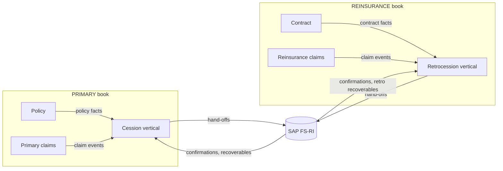

**Rules:** Cession and Retrocession are separate verticals with their own front-end, domain service, expert service, database, queues, credentials, and reconciliation scope. Each pulls only from its own book. FS-RI is a shared external system, not a shared platform database.

#### 3.6.4 Permitted exceptions

| Exception | Approval | Controls |
|---|---|---|
| Combined finance, executive, audit, or compliance user | CISO and business owner | Holds both book roles; side-by-side view; no netting; operational writes remain book-specific |
| Internal audit or regulator | CISO and legal | Time-bound; justification; audit |
| Legal hold or e-discovery across books | Legal and CISO | Break-glass; scoped; audited |
| Platform administration | CISO | No business data write; operational metadata only |
| Enterprise reporting | Data governance | Aggregated or de-identified; no record-level cross-book merge |

#### 3.6.5 Combined financial visibility

Financial controllers are the main users who hold both book roles. The design supports them without weakening the operational wall.

| Rule | Requirement |
|---|---|
| `COMB-01` | Most users have roles in one book only; combined visibility is the exception, not the default. |
| `COMB-02` | A financial controller holds `PRIMARY_ROLE` and `REINSURANCE_ROLE`; there is no separate combined role. |
| `COMB-03` | The combined finance view shows Primary and Reinsurance side-by-side: AR ageing, AP, GL proof of balance, cession and retro recoverables, close status, and exceptions. |
| `COMB-04` | The combined view does not net, offset, merge, or re-key the two books; totals remain separate and are presented as two columns plus a group total. |
| `COMB-05` | Drill-down from a combined figure opens the book-specific record; the user must have that book's role to see detail. |
| `COMB-06` | Operational actions (approve a payment, change a reserve, issue a cession hand-off) are performed in the book-specific workbench, never from the combined view. |
| `COMB-07` | Combined close presents two separate proofs of balance and a group summary; each book certifies independently. |
| `COMB-08` | Both book roles are assigned deliberately and audited; there is no separate combined-role approval. |
| `COMB-09` | A user with both roles can see both operational workbenches, but cannot move data, cases, or hand-offs between them. |
| `COMB-10` | Removing one book role immediately removes that book from the user's access and the combined view. |

**Consequences:** separate queues, authority matrices, templates, reports, reinsurance administration verticals, and reconciliation scopes; shared services must add book columns and row-level security; every API and event contract carries the book. Combined roles are additive, not a bypass.

---
## 4. System Architecture

### 4.1 System context (C4 level 1)

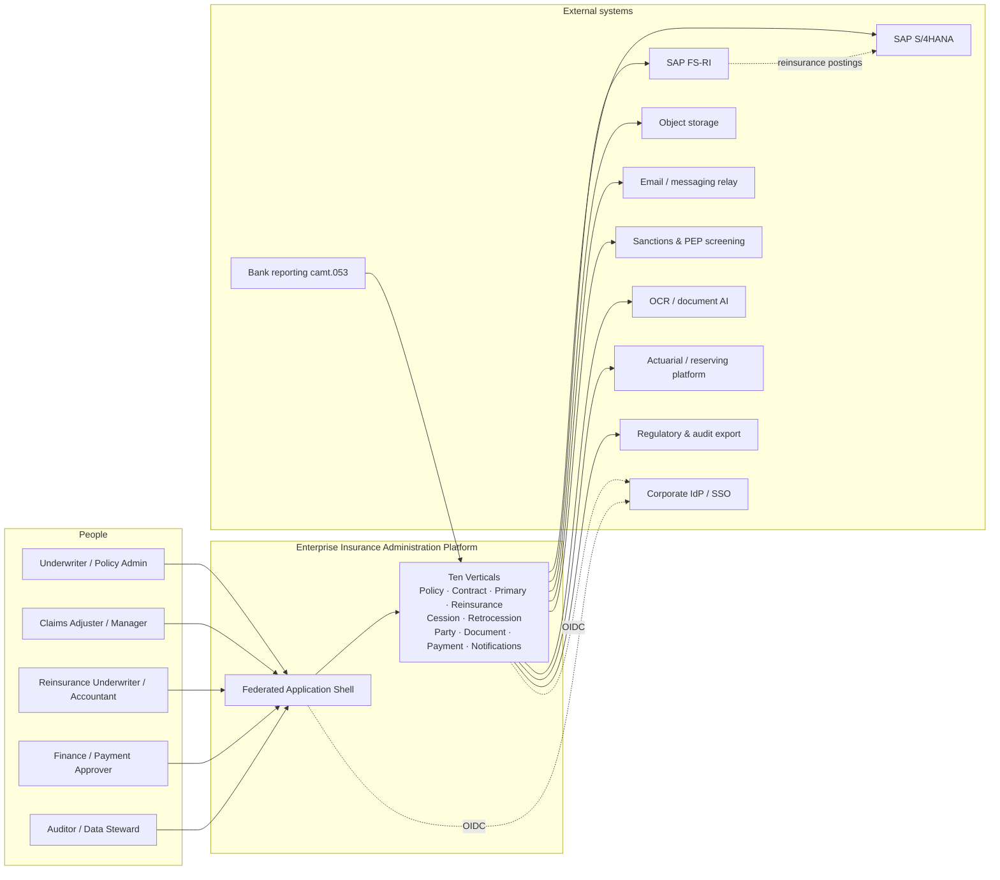

**Boundaries.** The platform is the system of record for policy, contract, claim, party, document metadata, payment intent, and notification state. It is *not* the system of record for cash, the general ledger, or statutory accounts; SAP S/4HANA holds those. It is not the system of record for medical records themselves; those are stored as documents with metadata and access controls.

### 4.2 Container view (C4 level 2)

```mermaid
flowchart TB
    subgraph Browser["Browser"]
        SHELL["eia-shell<br/>React host · router · session · transaction monitor"]
        R1["eia-policy-web"]
        R2["eia-contract-web"]
        R3["eia-primary-web"]
        R4["eia-reinsurance-web"]
        R5["eia-party-web"]
        R6["eia-document-web"]
        R7["eia-payment-web"]
        R8["eia-notifications-web"]
        SHELL -->|"runtime injection<br/>remoteEntry.js"| R1
        SHELL --> R2
        SHELL --> R3
        SHELL --> R4
        SHELL --> R5
        SHELL --> R6
        SHELL --> R7
        SHELL --> R8
    end

    subgraph Edge["Edge tier"]
        GW["eia-gateway<br/>Spring Cloud Gateway<br/>session · routing · rate limits · CSRF"]
        AUTH["eia-auth<br/>Spring Authorization Server"]
        CFG["eia-config<br/>Spring Cloud Config"]
    end

    subgraph Verticals["Ten verticals (each: domain + expert + DB)"]
        primaryion LR
        PD["policy-domain"] --> PE["policy-expert"] --> PDB[("eia_policy")]
        CD["contract-domain"] --> CE["contract-expert"] --> CDB[("eia_contract")]
        DD["primary-domain"] --> DE["primary-expert"] --> DDB[("eia_primary")]
        AD["reinsurance-domain"] --> AE["reinsurance-expert"] --> ADB[("eia_reinsurance")]
        TD["party-domain"] --> TE["party-expert"] --> TDB[("eia_party")]
        OD["document-domain"] --> OE["document-expert"] --> ODB[("eia_document")]
        MD["payment-domain"] --> ME["payment-expert"] --> MDB[("eia_payment")]
        CSD["cession-domain"] --> CSE["cession-expert"] --> CSDB[("eia_cession")]
        RTD["retrocession-domain"] --> RTE["retrocession-expert"] --> RTDB[("eia_retrocession")]
        ND["notifications-domain"] --> NE["notifications-expert"] --> NDB[("eia_notifications")]
    end

    subgraph Platform["Platform services"]
        LIN["eia-lineage<br/>read-only graph projection"]
        PDB2[("eia_platform")]
    end

    SHELL -->|HTTPS| GW
    GW --> PD & CD & DD & AD & TD & OD & MD & ND
    GW --> LIN
    GW --> AUTH
    AUTH --> PDB2
    LIN --> PDB2
    CFG -.-> Verticals
    PD & CD & DD & AD & TD & OD & MD & ND -->|"internal API"| LIN
    MD -->|OData / REST| SAP[(SAP S/4HANA)]
    CSD -->|"hand-off (primary)"| FSRI[(SAP FS-RI)]
    RTD -->|"hand-off (reinsurance)"| FSRI[(SAP FS-RI)]
    FSRI -.->|postings| SAP
    OD --> OBJ[(Object storage)]
    MD --> BANK[(Bank camt.053)]
    ND --> MAIL[(Email relay)]
    TD --> SANCT[(Screening)]
    OD --> OCR[(OCR adapter)]
```

### 4.3 Application inventory

**Naming:** `eia-<vertical>-web`, `eia-<vertical>-domain`, `eia-<vertical>-expert`, database `eia_<vertical>`. Shared libraries are distributed as versioned source modules or internal jars (no shared runtime state).

| Application | Type | Owns | Data store | Scaling unit | Public? |
|---|---|---|---|---|---|
| `eia-shell` | Static React host | Session presentation, routing, federation runtime, transaction monitor, notification center, lineage explorer | Browser storage (drafts, preferences only) | CDN | Yes, via gateway |
| `eia-policy-web` … `eia-notifications-web`, plus `eia-cession-web` and `eia-retrocession-web` (10) | Static federated remotes | Vertical screens and widgets | None | CDN | Yes, via gateway |
| `eia-gateway` | Spring Cloud Gateway | Session, routing, rate limiting, CSRF, request correlation | Redis-free: Spring Session JDBC in `eia_platform` | Horizontal | Yes |
| `eia-auth` | Spring Authorization Server | OIDC/OAuth2 authorization, client registry, token issuance | `eia_platform` | Horizontal | Via gateway |
| `eia-config` | Spring Cloud Config Server | Configuration and feature flags | Git or native file system | Horizontal | Internal |
| `eia-<v>-domain` (10) | Spring Boot | Business rules, transaction catalog, transaction journal, orchestration, approvals, vertical APIs | `tx` schema of its vertical DB | Horizontal | Via gateway, per tenant |
| `eia-<v>-expert` (10) | Spring Boot + Spring Batch + Quartz | Persistence, invariants, read models, batch jobs, outbox/inbox, scheduled jobs | `ent`, `ref`, `audit` schemas of its vertical DB | Horizontal + singleton batch workers | Internal only |
| `eia-cession-*`, `eia-retrocession-*` | Spring Boot + React remotes | Contract administration, layers, participants, terms, security, rules, cession/retro cases, hand-off queues, recoverables, statements, reconciliation | `eia_cession`, `eia_retrocession` | Horizontal | Internal or via gateway |
| `eia-lineage` | Spring Boot | Link graph projection, traversal, timeline merge, 360 assembly | `eia_platform` graph tables | Horizontal | Via gateway |
| PostgreSQL 16+ | Database | Per-vertical truth; platform truth | 11 databases | HA cluster, read replicas | Internal |
| Object storage | S3-compatible | Document content and renditions | Buckets per tenant/region | Managed | Internal |
| `eia-sap-adapter` | Module inside `payment-expert` | SAP S/4HANA OData communication | `eia_payment` | With expert | Internal |
| `eia-simulators` (test only) | Spring Boot and Node | FS-RI, S/4, bank, email, OCR, sanctions simulators | Ephemeral | Local | No |

**Port and path conventions:**

| Concern | Convention |
|---|---|
| Container port | `8080` (HTTP), `8081` (management, internal only) |
| Public API prefix | `/api/v1/{vertical}/...` |
| Internal domain→expert | `/internal/v1/...` (mTLS, workload identity) |
| Vertical→vertical | `/internal/v1/...` (mTLS, service identity, allowlisted) |
| Health | `/actuator/health/liveness`, `/actuator/health/readiness` |
| Metrics | `/actuator/prometheus` (not routed externally) |
| Static remote entry | `/remotes/{vertical}/{version}/remoteEntry.js` |
| Remote manifest | `/federation/remotes.json` (ETag, signed) |

### 4.4 Deployment topology

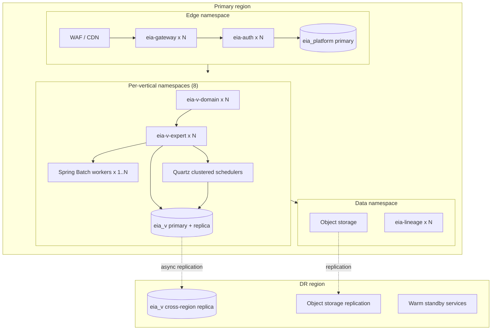

**Topology rules:**

* Each vertical namespace can be deployed, drained, or rolled back independently.
* Domain services are stateless except for the `tx` journal; they scale horizontally.
* Expert services scale horizontally for API traffic; **batch and Quartz roles run in a separately labelled worker pool** (`role=expert-worker`) to protect interactive latency.
* Quartz runs with `org.quartz.jobStore.isClustered=true`, JDBC job store, `SERIALIZABLE` transaction isolation, and a per-vertical scheduler instance name.
* The gateway is the only public ingress. Expert services have no ingress; their network policy admits only domain services, the worker pool, and observability.
* Database connections use PgBouncer-compatible pooling with `prepareThreshold=0` for pooled statements where required.

### 4.5 Core flows

#### 4.5.1 Interactive command with transaction monitoring (the canonical flow)

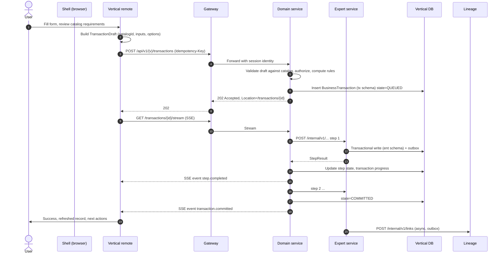

**Guarantees:** the transaction record is committed before the response is returned; every step is idempotent; the SSE stream resumes from `Last-Event-ID`; a dropped connection does not stop execution; the front-end can poll as a fallback.

#### 4.5.2 First notice of loss → claim, party, document, notification, reserve

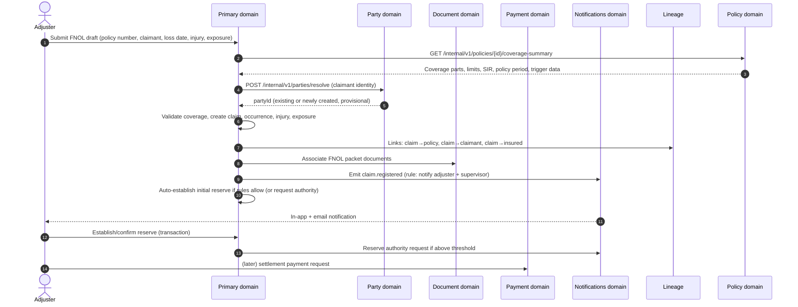

#### 4.5.3 Payment authorization → SAP S/4HANA → reconciliation

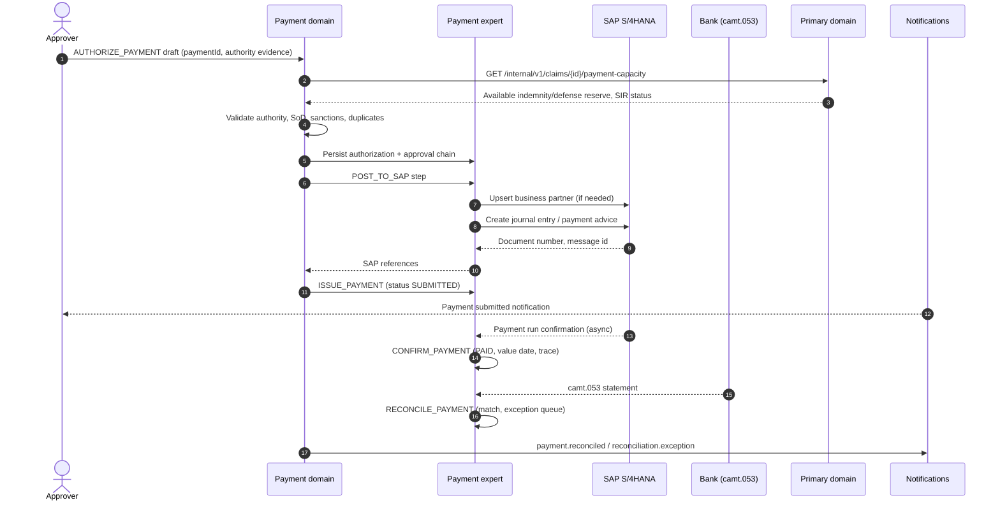

#### 4.5.4 Bordereau ingestion → reinsurance claims → cessions → technical account

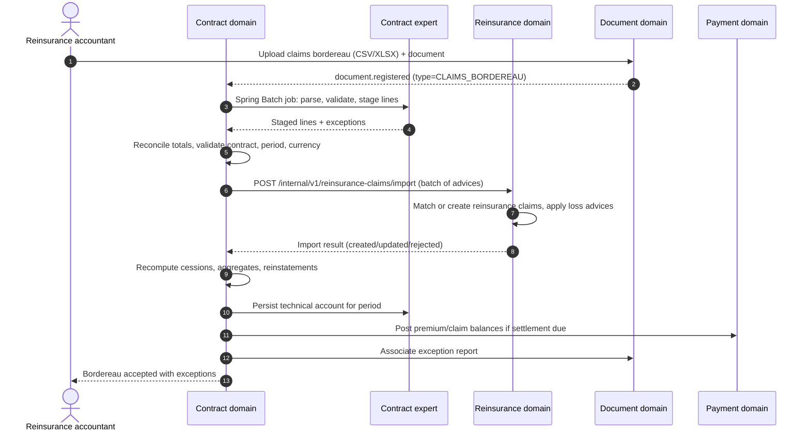

#### 4.5.5 Lineage traversal and record 360

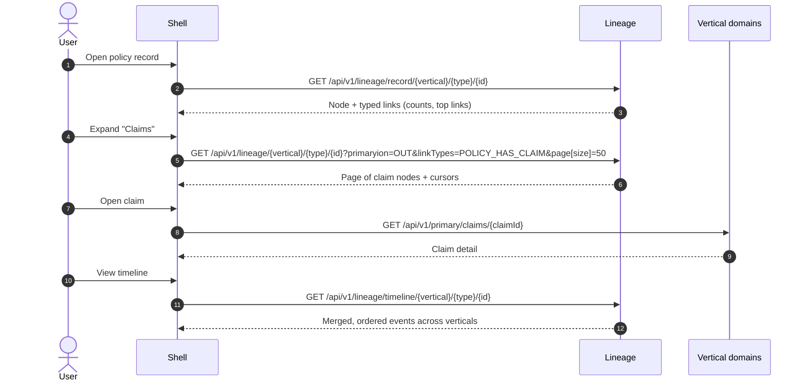

### 4.6 Cross-vertical interaction matrix

`S` = synchronous API call from the row's domain service; `E` = asynchronous event consumed by the row; `P` = read-only projection maintained by the row; blank = no primary interaction.

| Consumer ↓ / Producer → | Policy | Contract | Primary | Reinsurance | Party | Document | Payment | Notifications |
|---|---|---|---|---|---|---|---|---|
| **Policy** | — | — | S (coverage, limits) / E (claim events) | — | S (party validation) | E (document linked) | S (billing instruction) / E (posting status) | S (issue notification) |
| **Contract** | — | — | — | P (reinsurance loss aggregate) / E (retro projection) | S | E (bordereau registered) | S (settlement) | S |
| **Primary** | S (coverage, limits) / E (cession projection) | — | — | — | S (claimant resolve) | E (document linked) | S (payment capacity) | S |
| **Reinsurance** | — | S (terms and claim events) | — | — | S | E | S (payment capacity) | S |
| **Party** | E (role events) | E | E | E | — | E (document party) | E (payee) | E (recipient) |
| **Document** | E | E | E | E | S (resolve party) | — | E | E |
| **Payment** | E (premium/commission) | E (cash call/balance) | S (claim payment request) | S (reinsurance payment request) | S (payee/bank) | S (supporting docs) | — | S |
| **Notifications** | E | E | E | E | S (recipient) | E | E | — |

**FS-RI is external to this matrix.** Cession and Retrocession are separate reinsurance administration verticals (§7.18): Cession pulls from Policy/Primary, Retrocession pulls from Contract/Reinsurance, and neither appears as a business counterparty here. The blank cells between the `PRIMARY` pair (Policy, Primary) and the `REINSURANCE` pair (Contract, Reinsurance) are the **book wall** (§3.6): no cross-book calls, links, events, or reports.

**Interaction rules:**

1. Synchronous calls are **read-mostly** or command submissions. A synchronous call must have a 2-second timeout, one retry only for idempotent reads, and a defined degraded response.
2. A domain service MUST NOT synchronously call another vertical's domain service *inside* a database transaction that it holds open. It gathers inputs first, then writes locally.
3. Asynchronous events are the default for propagation. A consumer MUST tolerate duplicates, out-of-order delivery within a partition, and late arrival.
4. No vertical reads another vertical's database, cache, or object prefixes. There is no shared cache.
5. A vertical may keep a **reference projection** of another vertical's entity (ID, business key, display name, status, version) for display and validation. Projections carry `source_version` and `projected_at`, are read-only, and are reconciled nightly.
6. Read-only capacity checks may be biprimaryional (for example, Primary checks Payment for outstanding payments while Payment checks Primary for reserve capacity). Such calls MUST be timeout-bounded, MUST NOT hold database locks, and MUST NOT be part of a write transaction on either side.

### 4.7 Consistency model

| Scope | Guarantee | Mechanism |
|---|---|---|
| Single aggregate write within a vertical | Strong (ACID) | PostgreSQL transaction in the expert service |
| Multi-aggregate write within a vertical | Strong per transaction | Single expert transaction, or a short local saga with compensation |
| Front-end → domain → expert command | Read-your-writes for the initiating user | Transaction monitor returns committed state; record reads after commit use the primary |
| Cross-vertical state | Eventual, typically < 2 s | Transactional outbox → HTTP delivery → inbox dedupe |
| Cross-vertical read for validation | Bounded-staleness, fail-closed where money is involved | Synchronous call with explicit `asOf` and a version check |
| Aggregate / limit erosion | Serializable per policy | `SELECT … FOR UPDATE` on `policy_limit_state`, or `SERIALIZABLE` transaction with retry |
| Lineage graph | Eventual, rebuildable | Projection from domain events and synchronous link writes |

**Money and coverage are fail-closed.** If the Policy service cannot confirm available limit, the Primary service MUST NOT silently proceed as if limit exists; it opens an exception task and blocks the dependent step.

**Event ordering.** Events carry `aggregateType`, `aggregateId`, and a monotonic `aggregateVersion` (per aggregate). Consumers apply events only in increasing `aggregateVersion` per aggregate and discard duplicates by `eventId`. Global ordering is not promised.

**Compensation.** Cross-vertical business transactions use explicit compensating commands, not distributed transactions. Every compensable step declares its compensation in the transaction catalog. Compensation is itself auditable and may require human approval.

### 4.8 Failure modes and degradation

| Failure | Detection | Behavior | User-visible |
|---|---|---|---|
| A remote front-end fails to load | Fetch timeout, SRI mismatch, `init` throw | Shell renders a degraded panel with retry; navigation entry disabled; other verticals unaffected | "Policy module unavailable" with Retry |
| A remote crashes after mount | React error boundary | Panel replaced by fallback; shell remains usable; telemetry emitted | Error card with correlation ID |
| Domain service unavailable | Gateway 503 / circuit open | Commands rejected with `503`; reads serve last projection where safe | Banner; retry |
| Expert service unavailable | Domain health probe | Domain returns `503` for writes; no partial transaction committed | Transaction state `FAILED` with retry option |
| Database unavailable | Connection pool, health | Readiness fails; pods removed; retries with backoff | Degraded |
| SAP S/4HANA unavailable | Timeout, 5xx | Payment remains `AUTHORIZED`; posting queued in `integration_message`; retries; alert | "Posting pending" |
| Object storage unavailable | Timeout | Document registration rejected (no orphan metadata); downloads fail cleanly | Error with retry |
| Lineage index unavailable | Health | Shell falls back to primary link expansion via each vertical's `/links` endpoint | Slower lineage, still correct |
| Event delivery backlog | Outbox lag metric | Alerts at 60 s; no data loss; consumers catch up | Delayed notifications/lineage |
| Notification relay unavailable | Delivery failure | Retries with backoff; in-app inbox always written first | In-app present; email delayed |
| Quartz misfire storm | Misfire metrics | Per-job misfire policy; missed runs summarized, not replayed wholesale | Delayed jobs |

---
## 5. Front-End Architecture: Federated Injection

### 5.1 Model

The front-end is **one shell application plus ten independently deployable vertical modules** (eight business, two reinsurance administration). The shell is the only application the browser loads directly. It discovers, loads, validates, and mounts vertical modules at runtime from a signed manifest. No vertical is imported by another vertical, and the shell contains no insurance business rules.

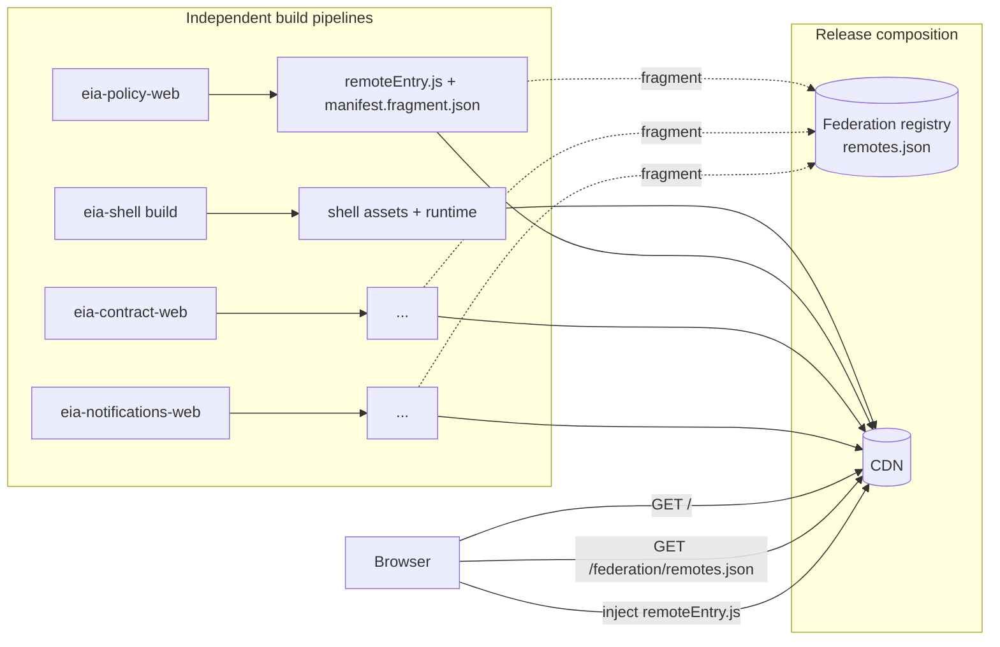

**Invariants:**

| ID | Invariant |
|---|---|
| `F-01` | A vertical front-end MUST be loadable, mountable, and unmountable without a page reload. |
| `F-02` | A vertical front-end MUST NOT import another vertical's source, bundle, or module. |
| `F-03` | The shell MUST remain usable when any subset of verticals is unavailable. |
| `F-04` | All vertical front-ends MUST share exactly one React and one ReactDOM instance with the shell. |
| `F-05` | The shell — not the remote — owns the URL, the session, the notification centre, the transaction monitor, and the global error surface. |
| `F-06` | A remote MUST declare its compatibility with the shell contract and MUST be rejected if incompatible. |
| `F-07` | All front-end code is JavaScript. Types are expressed with JSDoc and validated at runtime at trust boundaries. |
| `F-08` | A remote MUST NOT write global CSS, patch browser prototypes, or attach global event listeners it does not remove on dispose. |

### 5.2 The vertical front-end contract

Each remote exposes exactly one federated module, `./module`, whose default export is an async factory. The factory receives the shell context and returns the module descriptor. Exposing a factory (rather than a component) lets the shell validate capabilities before any UI mounts.

```js
/**
 * @typedef {Object} VerticalFrontendModule
 * @property {string} contractVersion      Semver of this contract the module implements, e.g. "1.0.0".
 * @property {string} verticalId           One of policy|contract|primary|reinsurance|cession|retrocession|party|document|payment|notifications.
 * @property {string} displayName
 * @property {string} moduleVersion        Semver of this deployment.
 * @property {string} buildId              Git SHA + build number.
 * @property {string} requiredShellApi     Semver range, e.g. "^1.4.0".
 * @property {string[]} permissions        Permission codes the module can request.
 * @property {NavItem[]} navigation
 * @property {RouteDef[]} routes
 * @property {Object<string, WidgetDef[]>} slots
 * @property {RecordTypeDef[]} recordTypes
 * @property {LinkRendererDef[]} linkRenderers
 * @property {Object<string, Object>} messages   Locale catalog keyed by BCP 47 tag.
 * @property {function(ShellContext): Promise<void>} initialize
 * @property {function(): Promise<void>} dispose
 * @property {function(): {status: "ok"|"degraded"|"down", detail?: string}} healthCheck
 * @property {Object<string, ServiceContract>} [services]  Cross-vertical UI services this module provides.
 */
```

**Field semantics:**

| Field | Required | Rules |
|---|---|---|
| `contractVersion` | Yes | Must satisfy the shell's supported contract range. Breaking change → major bump. |
| `verticalId` | Yes | Must equal the manifest entry's `verticalId`; mismatch is a load failure. |
| `moduleVersion` | Yes | Semver; must equal manifest `moduleVersion`. |
| `requiredShellApi` | Yes | Semver range. Shell rejects the module if unsatisfied, before `initialize`. |
| `permissions` | Yes | Descriptive metadata for future RBAC; current enforcement is `PRIMARY_ROLE` / `REINSURANCE_ROLE`. |
| `navigation` | Yes (may be empty) | Items the shell renders in the primary navigation. |
| `routes` | Yes | Path patterns the shell registers. Route components are lazy-loaded inside the remote. |
| `slots` | Yes (may be empty) | Widgets injected into shell-owned layout slots. |
| `recordTypes` | Yes (may be empty) | Record types this vertical contributes to the universal record page. |
| `linkRenderers` | No | Custom rendering for link chips of specific `linkType`s. |
| `initialize` | Yes | Must complete within 5 s; must not fetch unbounded data; may prefetch reference data. |
| `dispose` | Yes | Must remove listeners, timers, observers, and subscriptions. Called on unmount, tenant switch, and session end. |
| `healthCheck` | Yes | Synchronous or short (<500 ms) check used before enabling navigation. |
| `services` | No | Named UI service implementations registered in the shell registry. |

**Navigation item:**

```js
/**
 * @typedef {Object} NavItem
 * @property {string} id
 * @property {string} labelKey         i18n key, resolved by the shell.
 * @property {string} path             Shell route path.
 * @property {string} icon             Icon name from the shell icon set.
 * @property {number} order
 * @property {string[]} [permissions]
 * @property {"primary"|"secondary"|"admin"} [section]
 * @property {string} [badgeSource]    "notifications.unread" | "transactions.active" | none.
 */
```

**Route definition:**

```js
/**
 * @typedef {Object} RouteDef
 * @property {string} id
 * @property {string} path             e.g. "/v/primary/claims/:claimId"
 * @property {function(): Promise<{default: function}>} load
 * @property {string} [permission]
 * @property {function(object): boolean} [guard]
 * @property {string} [titleKey]
 * @property {function(object): Array<{labelKey: string, path?: string}>} [breadcrumb]
 * @property {boolean} [exact]
 */
```

**Record type definition** — the mechanism that makes cross-vertical navigation a first-class product feature:

```js
/**
 * @typedef {Object} RecordTypeDef
 * @property {string} type              "policy" | "contract" | "claim" | "reinsuranceClaim" | "cessionCase" | "retroCase" | "party" | "document" | "payment" | "notification"
 * @property {string} verticalId
 * @property {string} labelKey
 * @property {string} icon
 * @property {string} routePattern      Canonical deep-link pattern for this record type.
 * @property {function(string): Promise<EntityRef|null>} resolve   Resolve an ID to a display reference.
 * @property {function(): Promise<function>} summary              Lazy component for the record header/summary.
 * @property {RecordTabDef[]} tabs                                 Tabs this vertical contributes to *its own* record.
 */
```

**Record tab contribution** — any vertical can contribute a tab to any record type:

```js
/**
 * @typedef {Object} RecordTabDef
 * @property {string} id
 * @property {string} labelKey
 * @property {string} forRecordType     Which record page receives the tab.
 * @property {number} order
 * @property {string} [permission]
 * @property {function(string): Promise<function>} load   Receives the record ID.
 * @property {function(string): Promise<{count?: number}>} [badge]
 */
```

### 5.3 Remote manifest

The shell reads a **single composed manifest** at boot. The manifest is generated by the release pipeline from each remote's `manifest.fragment.json`, signed, and served with `Cache-Control: no-store` and an `ETag`.

```json
{
  "manifestVersion": "1.0.0",
  "generatedAt": "2026-10-19T13:00:00Z",
  "signature": {
    "algorithm": "ES256",
    "keyId": "fed-2026-01",
    "value": "base64url..."
  },
  "shell": {
    "version": "1.9.0",
    "supportedContract": ">=1.0.0 <2.0.0",
    "supportedShellApi": "1.9.0"
  },
  "remotes": [
    {
      "verticalId": "policy",
      "displayName": "Policy Administration",
      "enabled": true,
      "moduleVersion": "2.14.3",
      "contractVersion": "1.2.0",
      "requiredShellApi": "^1.4.0",
      "global": "eia_policy",
      "entry": "https://cdn.example.com/remotes/policy/2.14.3/remoteEntry.js",
      "integrity": "sha384-oqVuAfXRKap7fdgcCY5uykM6+R9GqQ8K/uxy9rx7HNQlGYl1kPzQho1wx4JwY8wC",
      "crossOrigin": "anonymous",
      "timeoutMs": 8000,
      "retry": { "attempts": 2, "backoffMs": 400 },
      "fallback": {
        "moduleVersion": "2.13.0",
        "entry": "https://cdn.example.com/remotes/policy/2.13.0/remoteEntry.js",
        "integrity": "sha384-..."
      },
      "chunks": [
        { "name": "main", "integrity": "sha384-..." }
      ],
      "compatibility": { "react": "19.x", "browsers": "es2022" },
      "permissions": ["policy.read", "policy.write", "policy.issue"],
      "featureFlags": { "policy.bulkEndorsement": true, "policy.massTortProfile": true },
      "rollout": { "strategy": "canary", "percentage": 100, "tenants": ["*"] },
      "killSwitch": false,
      "notes": "Minimum shell 1.4.0; requires Document service 1.2+."
    }
  ]
}
```

**Manifest fields:**

| Field | Required | Semantics |
|---|---|---|
| `manifestVersion` | Yes | Manifest schema version. |
| `signature` | Yes | Detached JWS over the canonical JSON body (excluding `signature`). Shell verifies with a pinned public key. |
| `shell.supportedContract` | Yes | Range of contract versions the shell can host. |
| `remotes[].enabled` | Yes | `false` hides the module entirely without removing its configuration. |
| `remotes[].killSwitch` | Yes | `true` loads the module in disabled mode; the shell shows an operational message. Used for incident response. |
| `remotes[].integrity` | Yes | SRI hash of `entry`. The shell MUST refuse to execute a script whose hash does not match. |
| `remotes[].chunks` | Yes | Every additional chunk the remote may load at runtime, with SRI. Empty for single-chunk builds (the default). |
| `remotes[].fallback` | No | Pinned previous version used when the current entry fails integrity, load, or `initialize`. Fallback is used once, then the shell degrades. |
| `remotes[].rollout` | Yes | `all` or `canary`. Canary uses a deterministic hash of `tenantId:userId` modulo 100 compared with `percentage`, plus an explicit tenant allowlist. |
| `remotes[].requiredShellApi` | Yes | Checked before `init`; incompatible modules are not initialized. |

**Manifest generation rules:**

1. A remote's release pipeline emits `manifest.fragment.json` containing everything except `manifestVersion`, `generatedAt`, `signature`, and `shell`.
2. The shell release pipeline composes fragments, sorts by `verticalId`, validates against `manifest.schema.json`, signs, and publishes.
3. Promotion from canary to 100% is a manifest change only — no rebuild.
4. Rollback is a manifest change to the previous fragment, or toggling `killSwitch`.
5. Manifest changes are audited in the platform audit log with approver identity.

### 5.4 Injection runtime

The shell ships `packages/runtime/federation.js` (target: ≤250 lines) and uses Webpack's container API directly. No federation runtime library is added.

```js
// Simplified normative algorithm. Production code adds telemetry, timeouts, and cleanup.
const loaded = new Map(); // verticalId -> { container, module, descriptor }

export async function ensureShareScope() {
  if (!globalThis.__EIA_SHARE_SCOPE_READY__) {
    // Provided by the shell's Webpack runtime; shares react, react-dom, react/jsx-runtime.
    await __webpack_init_sharing__("default");
    globalThis.__EIA_SHARE_SCOPE_READY__ = true;
  }
  return __webpack_share_scopes__.default;
}

export async function loadRemote(entry) {
  if (loaded.has(entry.verticalId)) return loaded.get(entry.verticalId);

  assertCompatible(entry);                       // contract range + shell API range
  const shareScope = await ensureShareScope();
  const script = await injectScript(entry.entry, {
    integrity: entry.integrity,
    crossOrigin: entry.crossOrigin,
    timeoutMs: entry.timeoutMs
  });

  const container = globalThis[entry.global];
  if (!container || typeof container.init !== "function" || typeof container.get !== "function") {
    throw new FederationError("CONTAINER_INVALID", entry);
  }

  await withTimeout(container.init(shareScope), entry.timeoutMs, "CONTAINER_INIT_TIMEOUT");
  const factory = await withTimeout(container.get("./module"), entry.timeoutMs, "MODULE_GET_TIMEOUT");
  const exported = factory();
  const create = exported.default ?? exported;
  if (typeof create !== "function") throw new FederationError("MODULE_SHAPE_INVALID", entry);

  const descriptor = await create(createShellContext(entry));
  validateDescriptor(descriptor, entry);        // schema validation, verticalId/moduleVersion match
  await withTimeout(descriptor.initialize(shellContext), 5000, "MODULE_INIT_TIMEOUT");

  const record = { container, descriptor, entry, script };
  loaded.set(entry.verticalId, record);
  return record;
}
```

**Runtime rules:**

| ID | Rule |
|---|---|
| `F-10` | Scripts are injected with `async=true`, `crossOrigin="anonymous"`, `integrity` from the manifest, and a unique `data-eia-remote` attribute. |
| `F-11` | A load that exceeds `timeoutMs` is aborted, the `<script>` is removed, and the failure is reported with the remote, version, and correlation ID. |
| `F-12` | `container.init` is called exactly once per loaded container; repeat loads return the cached record. |
| `F-13` | Before mounting, the shell asserts a single React instance by comparing `React.version` between shell and module context. A mismatch triggers the compatibility path, not a silent dual-React render. |
| `F-14` | Modules are mounted only after `validateDescriptor` passes. Invalid modules never execute UI code. |
| `F-15` | On `dispose`, the shell unmounts the React root, calls `module.dispose()`, removes owned DOM nodes, and clears module subscriptions. The `<script>` element is retained (removing it does not unload code) but marked inactive. |
| `F-16` | A module that fails `healthCheck` is still mounted for read-only routes if its descriptor declares `degradedReadOnly: true`; otherwise navigation to it is disabled. |
| `F-17` | The shell never calls `eval`, `new Function`, or `document.write`. |
| `F-18` | No remote may add a `<script>` tag. All code loading goes through the shell runtime. |

**Error taxonomy:**

| Code | Meaning | User-visible |
|---|---|---|
| `MANIFEST_FETCH_FAILED` | Manifest unavailable | Global banner; shell runs with last-known-good manifest from `localStorage` if signature still valid and not expired |
| `MANIFEST_SIGNATURE_INVALID` | Signature or key mismatch | Manifest rejected; security telemetry; only built-in shell features |
| `REMOTE_INTEGRITY_FAILED` | SRI mismatch | Remote blocked; incident alert |
| `REMOTE_FETCH_FAILED` | Network/404 | Retry, then fallback, then degraded panel |
| `REMOTE_TIMEOUT` | Entry or init exceeded budget | As above |
| `CONTAINER_INVALID` | Global not a container | Blocked |
| `CONTRACT_INCOMPATIBLE` | Version range unsatisfied | Disabled with explanation |
| `MODULE_SHAPE_INVALID` | Descriptor validation failed | Blocked |
| `MODULE_INIT_FAILED` | `initialize` threw | Blocked |
| `MODULE_RUNTIME_ERROR` | Error boundary caught | Tab/panel error card; shell continues |

### 5.5 Shell context API

The shell injects a frozen context object. It is the **only** supported way for a remote to reach platform capabilities. The context is versioned with the shell API version; additive changes are minor, removals are major.

| Namespace | Members | Contract |
|---|---|---|
| `context.session` | `user`, `tenant`, `roles`, `bookRoles`, `hasBookRole(book)`, `profiles`, `hasProfile(profile)`, `onChange(cb)` | Identity is server-derived. Book roles are `PRIMARY_ROLE` and `REINSURANCE_ROLE`; profiles are the least-privilege bundles in §9.12. The UI check is an affordance only. |
| `context.http` | `request(path, {method, body, headers, signal, idempotencyKey})`, `get`, `post`, `put`, `patch`, `del`, `stream(path, handlers)` | Prefixes `/api/v1`, adds correlation ID and CSRF token, parses `application/problem+json` into `ApiError`, retries only idempotent GETs, 30 s default timeout. |
| `context.router` | `navigate(to, {replace, state})`, `back()`, `match(pattern)`, `params`, `query`, `setQuery(patch)`, `hrefFor(ref)` | Shell owns history. Deep links are stable and shareable. |
| `context.records` | `open(ref, {tab})`, `resolve(ref)`, `refFor(verticalId, type, id)`, `recent()` | Universal record navigation. |
| `context.transactions` | `catalog(verticalId)`, `create(verticalId, draft)`, `get(id)`, `monitor(id, handlers)`, `cancel(id)`, `retry(id)`, `list(filter)` | Implements R5. `monitor` uses SSE with polling fallback and `Last-Event-ID` resume. |
| `context.lineage` | `record(ref)`, `links(ref, opts)`, `timeline(ref, opts)`, `expand(ref, opts)`, `graph(ref, opts)` | Read-only graph access. Handles pagination, aggregation, and `asOf`. |
| `context.events` | `publish(type, payload)`, `subscribe(type, handler)` | In-browser, synchronous, isolated by try/catch per subscriber. Payloads must be structured-cloneable. |
| `context.notifications` | `inbox(query)`, `unreadCount`, `markRead(id)`, `acknowledge(id)`, `onNew(cb)`, `openCenter()` | Backed by the Notifications vertical. |
| `context.ui` | `toast`, `dialog`, `confirm`, `drawer`, `busy`, `announce`, `theme`, `density`, `breakpoint` | Single overlay stack owned by the shell; remotes never render their own modals outside it. |
| `context.i18n` | `locale`, `t(key, params)`, `formatDate`, `formatDateTime`, `formatMoney`, `formatNumber`, `formatPercent`, `formatDuration` | `Intl` based; currency always explicit; time zone from user profile. |
| `context.files` | `openPicker({accept, multiple, maxSize})`, `download(documentRef)`, `preview(documentRef)` | Delegates to the Document vertical's registered UI services. |
| `context.services` | `register(name, version, impl)`, `get(name, versionRange)`, `has(name)` | Versioned cross-vertical UI services. See §5.5.1. |
| `context.telemetry` | `event(name, attrs)`, `error(err, attrs)`, `timing(name, ms)`, `page(name)` | No PII, no PHI, no free-text claim data. |
| `context.flags` | `isEnabled(flag)`, `variant(flag)` | Server-evaluated flags from the manifest and tenant configuration. |
| `context.storage` | `session.get/set/remove`, `local.get/set/remove` | Namespaced `eia:{tenant}:{vertical}:`; TTL enforced; no PHI. |
| `context.build` | `shellVersion`, `moduleVersion`, `buildId`, `environment` | For diagnostics and telemetry. |

#### 5.5.1 Cross-vertical UI services

Some capabilities are contributed by one vertical but used by many. They are registered in the shell service registry and consumed by name and version range, never by import.

| Service | Provider | Contract |
|---|---|---|
| `party.lookup` | Party | `search(query, {types, roles, limit}) → {items}`, `resolve(partyId) → PartySummary`, `createProvisional(input) → PartySummary`, `picker({multiple, roles}) → Promise<PartyRef[]>` |
| `document.attach` | Document | `pickAndAssociate({subject: EntityRef, docType, confidentiality}) → Promise<DocumentRef[]>`, `upload(file, metadata) → DocumentRef` |
| `document.preview` | Document | `open(documentRef, {page, rendition}) → void` |
| `lineage.explorer` | Lineage | `open(entityRef, {depth, linkTypes, asOf}) → void` |
| `payment.request` | Payment | `openRequest({claimRef, amount, component, payeeRef}) → Promise<PaymentRef or null>` |
| `notification.center` | Notifications | `open({filter}) → void`, `compose({type, subject, recipients}) → Promise<NotificationRef>` |
| `address.capture` | Party | `open({initial, country}) → Promise<Address>` |

**Registry rules:** a provider registers during `initialize`; a consumer resolves at call time, not at module evaluation; if a provider is absent, the consumer MUST render a disabled affordance with an explanation rather than crash; major version mismatch is treated as absent; every service call is wrapped by the shell with telemetry and a timeout.

### 5.6 Routing and navigation

The shell implements a small history-based router. Patterns support static segments, `:param`, and `*` wildcards. Registration order is irrelevant; the most specific match wins (more static segments, then more segments).

**Canonical URL scheme:**

| Pattern | Page | Providing vertical |
|---|---|---|
| `/` | Home / workbench | Shell |
| `/v/policy/policies` | Policy search and list | Policy |
| `/v/policy/policies/:policyId` | Policy record | Policy |
| `/v/policy/policies/:policyId/versions/:versionId` | Policy version | Policy |
| `/v/policy/programs/:programId` | Mass tort program | Policy |
| `/v/contract/contracts` | Contract list | Contract |
| `/v/contract/contracts/:contractId` | Contract record | Contract |
| `/v/contract/bordereaux/:bordereauId` | Bordereau detail | Contract |
| `/v/primary/claims` | Claim list / queue | Primary |
| `/v/primary/claims/:claimId` | Claim record | Primary |
| `/v/reinsurance/claims` | Reinsurance claim list | Reinsurance |
| `/v/reinsurance/claims/:reinsuranceClaimId` | Reinsurance claim record | Reinsurance |
| `/v/party/parties` | Party search | Party |
| `/v/party/parties/:partyId` | Party record | Party |
| `/v/document/documents/:documentId` | Document viewer | Document |
| `/v/payment/payments` | Payment list | Payment |
| `/v/cession/contracts` | Ceded contract list | Cession |
| `/v/cession/contracts/:contractId` | Ceded contract record | Cession |
| `/v/cession/cases` | Cession workbench | Cession |
| `/v/cession/cases/:caseId` | Cession case | Cession |
| `/v/retrocession/contracts` | Retro contract list | Retrocession |
| `/v/retrocession/contracts/:contractId` | Retro contract record | Retrocession |
| `/v/retrocession/cases` | Retrocession workbench | Retrocession |
| `/v/retrocession/cases/:caseId` | Retrocession case | Retrocession |
| `/v/payment/payments/:paymentId` | Payment record | Payment |
| `/v/notifications/inbox` | Inbox | Notifications |
| `/v/notifications/preferences` | Preferences | Notifications |
| `/transactions/:transactionId` | Transaction monitor | Shell |
| `/search` | Global search | Shell + all |
| `/admin/...` | Administration | Platform / Notifications |

**Record pages are composed.** The shell renders record chrome (header, summary, tabs, actions) and asks every module for tabs matching the record type. Example for a policy:

| Tab | Contributor | Content |
|---|---|---|
| Summary | Policy | Terms, coverage, limits, status |
| Coverage & limits | Policy | Layers, aggregates, erosion |
| Claims | Primary | Claims under the policy, paginated, with counts |
| Parties | Party | Insureds, additional insureds, brokers, counsel |
| Primary cessions | Policy | Cession requests and FS-RI confirmations for this policy |
| Documents | Document | Associated documents by type |
| Payments | Payment | Payment history and outstanding authority |
| Notifications | Notifications | Notifications about this policy |
| Lineage | Lineage | Graph and timeline |

This composition is the product realization of requirement R4's "follow a link" objective: every record is a hub, and every hub is contributed to by the verticals that own the related facts.

**Navigation rules:**

1. Deep links MUST work on first load, including on a hard refresh at any path. The gateway rewrites unknown paths to `index.html`.
2. The shell restores scroll position per history entry.
3. A record that no longer exists renders the owning vertical's "not found" state, not a shell crash.
4. Record pages MUST render the header and whichever tabs are available even if some contributors are down.
5. Browser back MUST NOT re-submit a command. Commands navigate with `replace: true` to the transaction monitor, then to the committed record.
6. Links to records use `context.records.open(ref)`; raw `<a href>` is permitted only for external URLs and print views.

### 5.7 State management

There is no global application store. State is classified and located deliberately:

| State class | Owner | Mechanism | Lifetime |
|---|---|---|---|
| Session, tenant, permissions | Shell | Context + `useSyncExternalStore` over the session store | Session |
| URL, filters, selected tab, pagination | URL | Router query and path | History entry |
| Server data | Each remote | `useResource` hook in `packages/runtime/data.js` | Component + configurable cache |
| Form state | Each form | `useReducer` + controlled inputs | Form lifetime |
| Multi-step transaction draft | Each remote | `useReducer` + `sessionStorage` recovery key | Until submitted or discarded |
| Cross-vertical signal | Shell | Typed event bus | Event |
| User preferences (theme, density, columns) | Shell | `localStorage`, server-synced for logged-in users | Persistent |
| Notification unread count | Shell | Subscribed store fed by SSE | Session |

**`useResource` contract:** accepts a fetcher and a key; deduplicates in-flight requests; aborts on unmount or key change; supports `refresh`, `mutate` (optimistic with rollback), and `invalidateOn(eventType)`. Stale-while-revalidate is the default for lists; record detail reads are network-first.

**Rules:**

| ID | Rule |
|---|---|
| `F-20` | No module may write to another module's state. Cross-vertical state moves through the event bus or the server. |
| `F-21` | Server data is never copied into a long-lived global store. It is fetched by the component that renders it and invalidated by events. |
| `F-22` | Optimistic updates are permitted only for reversible, low-risk fields. Money, reserves, coverage, and approvals are never optimistic. |
| `F-23` | Any cached server data displayed after a mutation MUST be invalidated by the committing event or by the transaction result. |
| `F-24` | `sessionStorage` and `localStorage` MUST NOT contain PHI, settlement strategy, or full claim narratives. |
| `F-25` | All list endpoints are cursor-paginated; the front-end must never load an unbounded collection. |

### 5.8 Cross-vertical events

Shell events use the namespace `eia:<domain>:<action>` and a versioned payload.

| Event | Publisher | Consumers | Payload |
|---|---|---|---|
| `eia:record:open` | Shell | All | `{ ref }` |
| `eia:record:changed` | Any | All | `{ ref, changeType, version }` |
| `eia:transaction:started` | Shell | Notifications, Lineage | `{ transactionId, verticalId, type }` |
| `eia:transaction:committed` | Shell | All | `{ transactionId, verticalId, type, subjects: EntityRef[] }` |
| `eia:transaction:failed` | Shell | Notifications | `{ transactionId, code }` |
| `eia:notification:received` | Notifications | Shell | `{ notificationId, severity, subject }` |
| `eia:party:merged` | Party | All | `{ survivorId, mergedIds }` |
| `eia:document:associated` | Document | All | `{ documentId, subject }` |
| `eia:session:expiring` | Shell | All | `{ expiresAt }` |
| `eia:tenant:changed` | Shell | All | `{ tenantId }` |

**Rules:** handlers are invoked in subscription order and isolated; a throwing handler is reported and skipped; payloads are validated by the publisher's JSDoc typedef and by consumers defensively; events are not persisted and must not be used for audit; `eia:record:changed` is a cache-invalidation hint, not a data transfer.

### 5.9 UI composition, slots, and design system

**Shell-owned layout regions and slots:**

| Slot | Location | Typical contributors |
|---|---|---|
| `shell.global.banner` | Above the header | Policy (out-of-compliance), Payment (posting outage) |
| `shell.header.actions` | Header right | Notifications (inbox), Shell (profile) |
| `shell.nav.primary` | Left navigation | All verticals (via `navigation`) |
| `shell.nav.secondary` | Left navigation, contextual | Policy (programs), Contract (treaties) |
| `shell.record.header` | Record header | Record owner |
| `shell.record.actions` | Record header actions | Owner + Payment (pay), Document (upload) |
| `shell.record.tabs` | Record tab strip | All verticals (via record tabs) |
| `shell.record.aside` | Right rail | Lineage (mini graph), Notifications (recent) |
| `shell.workbench.widgets` | Home dashboard | All verticals |
| `shell.search.results` | Global search | All verticals |
| `shell.footer.status` | Status bar | Shell (build, environment) |

**Widget descriptor:**

```js
/**
 * @typedef {Object} WidgetDef
 * @property {string} id
 * @property {string} slot
 * @property {number} order
 * @property {string} [permission]
 * @property {function(object): boolean} [when]
 * @property {function(): Promise<{default: function}>} load
 * @property {"sm"|"md"|"lg"|"full"} [size]
 * @property {boolean} [lazy]
 */
```

**Design system** (`packages/ui-kit`, CSS custom properties, cascade layers):

| Token group | Examples | Rule |
|---|---|---|
| Colour | `--eia-color-bg`, `-surface`, `-text`, `-muted`, `-border`, `-accent`, `-danger`, `-warning`, `-success`, `-info` | Semantic names only; remotes MUST NOT hard-code hex values |
| Typography | `--eia-font-sans`, `--eia-font-mono`, `--eia-text-xs` … `-2xl`, `--eia-leading-*`, `--eia-weight-*` | System font stack; no webfont download by default |
| Spacing | `--eia-space-1` … `-12` (4 px base) | 4/8 px rhythm |
| Radius, elevation, motion | `--eia-radius-*`, `--eia-shadow-*`, `--eia-duration-*`, `--eia-ease-*` | Motion respects `prefers-reduced-motion` |
| Breakpoints | `--eia-bp-sm/md/lg/xl` | Container queries preferred over viewport queries |
| Density | `data-density="comfortable / compact"` | Set by shell on `<html>` |
| Theme | `data-theme="light / dark / high-contrast"` | High contrast meets WCAG 2.2 AA at 7:1 |

**Component inventory (minimum):** AppShell, PageHeader, Breadcrumb, Tabs, DataGrid, Tree, FilterBar, Form, Field, TextInput, NumberInput, MoneyInput, DateInput, DateRangeInput, Select, Combobox, MultiSelect, Toggle, RadioGroup, Textarea, ValidationSummary, Button, SplitButton, Menu, StatusPill, Badge, LinkChip, EntityChip, Money, Percent, DateDisplay, Duration, Avatar, FileCard, Timeline, GraphView, Drawer, Dialog, ConfirmDialog, Toast, Banner, EmptyState, ErrorState, Skeleton, ProgressBar, StepIndicator, Pagination, SavedViewBar, AuditTrail, ApprovalPanel, TransactionMonitor, NotificationItem, CommentThread, AttachmentList.

**Styling rules:**

| ID | Rule |
|---|---|
| `F-30` | Each remote prefixes all classes with `eia-{vertical}-` and scopes styles under `[data-eia-vertical="{vertical}"]`. |
| `F-31` | No remote may import a global stylesheet that targets element selectors without a scope. |
| `F-32` | Components consume design tokens only; colour literals in component CSS fail review. |
| `F-33` | No CSS framework, utility framework, or CSS-in-JS library. CSS Modules are permitted (bundler feature). |
| `F-34` | Every interactive component must be keyboard reachable, have a visible focus indicator, and expose an accessible name. |

### 5.10 Security

| Control | Requirement |
|---|---|
| Authentication | OIDC Authorization Code + PKCE at the gateway. Browser holds an `HttpOnly`, `Secure`, `SameSite=Lax` session cookie only. No access token, refresh token, or ID token is exposed to JavaScript. |
| CSRF | Double-submit token issued by the gateway, required on all unsafe methods; the shell's HTTP client attaches it automatically. |
| Authorization | Server-side on every request. Front-end permission checks are usability only. |
| Remote trust | Manifest signature verified with a pinned public key; every script verified with SRI; only manifest-listed origins may execute. |
| CSP | `default-src 'self'; script-src 'self' 'strict-dynamic' 'nonce-{random}' https://cdn.example.com; style-src 'self' 'nonce-{random}'; img-src 'self' data: blob: https://cdn.example.com; connect-src 'self'; frame-ancestors 'none'; object-src 'none'; base-uri 'none'; form-action 'self'; require-trusted-types-for 'script'`. |
| Trusted Types | Shell creates a default policy for the few DOM sinks it needs; remotes may not create policies. |
| XSS | `dangerouslySetInnerHTML` is prohibited. User content is rendered as text. Server-provided rich text, if ever required, must be sanitized server-side and delivered as a restricted token stream, not HTML. |
| Clickjacking | `frame-ancestors 'none'`; no embedding of the application. |
| Supply chain | Lockfile committed; dependency allowlist; build provenance attestation; SBOM; signed manifest; SRI. |
| Secrets | No secrets in front-end bundles. Configuration is server-provided and non-sensitive. |
| Session | 30-minute idle timeout, 12-hour absolute; re-authentication for payment approval and authority changes. |
| Logging | Front-end telemetry excludes PHI/PII and free-text; correlation IDs only. |
| Clipboard and print | Sensitive views mark print/export permissions; copy actions are audited server-side. |

### 5.11 Resilience and observability

* Each remote is wrapped in an error boundary keyed by `verticalId` and `moduleVersion`.
* A failing remote is **quarantined** for the session after three mount errors; the user sees a persistent "unavailable" state with a retry that resets the counter.
* Health checks run when the tab becomes visible after 5 minutes and before navigating into a vertical.
* All HTTP calls carry `X-Correlation-Id` generated by the shell (UUIDv7) and reused across retries.
* The shell records Core Web Vitals and route timings via the browser Performance API and ships aggregated metrics to `/api/v1/platform/telemetry`.
* A diagnostics panel (`/admin/diagnostics`, permission-gated) shows loaded remotes, versions, integrity status, contract compatibility, feature flags, and recent errors.

### 5.12 Internationalization, accessibility, and formatting

| Concern | Requirement |
|---|---|
| Locale resolution | User preference → tenant default → `navigator.languages` → `en-US`. |
| Message catalogs | Each remote ships its own catalogs; the shell merges by vertical and locale with a deterministic precedence. Missing keys fall back to `en-US`, then to the key, and emit a telemetry counter. |
| Plurals and gender | `Intl.PluralRules`; no string concatenation for grammar. |
| Dates | ISO 8601 on the wire; `Intl.DateTimeFormat` for display; user time zone from profile; policy effective dates are date-only and rendered without time-zone shift. |
| Money | `Intl.NumberFormat` with explicit currency; amounts are strings on the wire; never `parseFloat` for arithmetic. |
| Numbers and percents | `Intl.NumberFormat`; percentages stored as decimal fractions and rendered with the tenant's precision policy. |
| Right-to-left | Layout uses logical CSS properties; RTL is supported even if not initially enabled. |
| Accessibility | WCAG 2.2 AA: landmarks, heading order, skip links, focus management on route change and dialog, `aria-live="polite"` for transaction progress, `aria-live="assertive"` for errors, 4.5:1 text contrast, 3:1 non-text, 200% zoom, reduced motion, no colour-only status encoding. |
| Keyboard | Every action reachable and operable by keyboard; DataGrid supports arrow navigation, selection, and column resize by keyboard. |
| Screen readers | Verified with NVDA + Chrome and VoiceOver + Safari for record pages, transaction monitor, and payment approval. |

### 5.13 Build, versioning, release, and rollback

**Version axes:**

| Version | Owner | Meaning |
|---|---|---|
| Shell version | Platform | Semver of the host application |
| Contract version | Platform | Semver of the front-end contract in this section |
| Shell API version | Platform | Semver of the context API |
| Module version | Vertical | Semver of the deployed remote |
| Backend API version | Vertical | `/api/v1` path version |
| Manifest version | Platform | Schema version of `remotes.json` |

**Compatibility rules:**

1. The shell supports the current and previous **major** contract version. A remote declaring an unsupported contract is not initialized.
2. Additive context API changes are minor; removals or semantic changes are major and require a deprecation window of at least two releases.
3. A remote MUST tolerate unknown context members and unknown shell events.
4. A remote MUST NOT assume a specific shell layout beyond its declared slots.
5. Backend breaking changes require a new path version and a migration plan for all remotes.

**Release pipeline:**

```mermaid
flowchart LR
    A[Commit] --> B[Lint + unit tests]
    B --> C[Contract schema validation]
    C --> D[Build remoteEntry + manifest fragment]
    D --> E[Bundle allowlist and size budget]
    E --> F[Publish immutable assets to CDN]
    F --> G[Publish fragment to registry]
    G --> H[Compose + sign manifest in staging]
    H --> I[Automated federation smoke tests]
    I --> J[Canary 5% tenants]
    J --> K[Promote 100%]
    K --> L[Monitor error rate, LCP, API 5xx]
    L -->|regression| M[Manifest rollback]
```

**Asset rules:** filenames contain the module version; `Cache-Control: public, max-age=31536000, immutable`; `remoteEntry.js` is content-addressed by SRI, so a version's bytes never change; the manifest is `no-store`.

**Rollout:** canary by tenant and user hash; explicit tenant allowlist; automatic rollback trigger if the remote's error rate exceeds 2% of sessions or p95 mount time exceeds 1.5 s for 10 minutes.

### 5.14 Local development

| Concern | Approach |
|---|---|
| Running the shell with local remotes | `EIA_REMOTE_OVERRIDE=policy=http://localhost:5001/remoteEntry.js` merges into the manifest at dev time; signature verification is disabled only when `NODE_ENV=development` and a visible environment badge is shown |
| Running a remote standalone | Each remote ships a `dev-host` HTML page that mounts its module against a stub shell context; no shell build required |
| API access | Dev server proxies `/api` to the shared development gateway; no CORS relaxation in deployed environments |
| Test data | Seeded tenant `dev-mass-tort` with representative policies, claims, and payments; no production data in lower environments |
| Contract drift | `npm run test:contract` validates the module descriptor against the JSON Schema and the shell API surface |

### 5.15 Testing strategy (front-end)

| Level | Tooling | Scope |
|---|---|---|
| Unit | `node:test`, `node:assert` | Pure functions: formatting, validation, reducers, graph layout |
| Component | `react-dom/server` render assertions + `node:test` | Renders without a DOM for structural and accessibility attributes |
| Contract | JSON Schema validator (in-house) | Module descriptor, manifest, API payload fixtures |
| Integration | Dev host + stubbed fetch | Route registration, tab composition, transaction monitor state machine |
| Federation | Shell test harness with local remotes | Load, incompatibility, integrity failure, timeout, quarantine, dispose |
| End-to-end | Platform browser automation (local tooling, not shipped) | Critical journeys: FNOL, reserve approval, payment, bordereau upload, lineage traversal |
| Accessibility | Manual matrix + local automated checks | Record pages, dialogs, grids, monitor, approvals |
| Performance | Lighthouse (local) (local tooling) | Budgets in §5.16 |

### 5.16 Performance budgets

| Metric | Budget | Enforcement |
|---|---|---|
| Shell initial JS (gzip) | ≤ 140 KB | Build fails |
| Shell initial CSS (gzip) | ≤ 25 KB | Build fails |
| A single vertical remote entry (gzip) | ≤ 300 KB | Build fails; larger modules must split and declare chunks |
| Total JS for a record page (all loaded remotes, gzip) | ≤ 900 KB | Release gate |
| LCP on a warm CDN, mid-tier laptop, 4G | ≤ 2.5 s | Lighthouse (local) |
| INP on record page interactions | ≤ 200 ms | RUM |
| CLS | ≤ 0.1 | Lighthouse (local) |
| Route transition (cached remote) | ≤ 300 ms | RUM |
| DataGrid first render, 1,000 rows | ≤ 150 ms | Benchmark |
| DataGrid scroll, 100,000 rows | ≥ 50 fps | Benchmark |
| Memory after 30 minutes of use | ≤ 350 MB | Soak test |

---
## 6. The Domain Service and the Transaction Model

### 6.1 Purpose and boundary

Each vertical has exactly one **domain service**. It is the only place where insurance business decisions are made. It sits between the vertical's front-end and the vertical's expert service, and it also coordinates with other verticals' domain services.

| The domain service **owns** | The domain service **does not own** |
|---|---|
| Business rules, eligibility, coverage logic, authority, allocation, approval policy | Table design, indexes, referential integrity, storage tuning |
| Transaction catalog, draft validation, transaction state machine, compensation policy | SQL, JPA entities, schema migrations |
| Orchestration across expert capabilities and other verticals | Batch execution mechanics, Quartz job storage |
| Business-derived values (available limit after business rules, ceded share, settlement capacity) | Raw persistence of those values |
| Read-model composition and business-level queries | Full-text and spatial indexes |
| Approval evidence and segregation-of-duties checks | Identity token validation (gateway) |
| Publication of transaction lifecycle events | Durable outbox mechanics (expert) |

**The critical boundary:** the domain service holds *no JPA entities and no SQL*. It holds a pure Java domain model, command handlers, and clients. The expert service holds *no business policy*. If a rule requires judgment — "is this claim covered?", "does this payment fit within authority?", "is this layer exhausted?" — it belongs in the domain service. If a rule is structural — "is this policy number unique?", "does this version conflict?", "is this amount positive?" — it belongs in the expert service and the database.

### 6.2 The transaction catalog

The catalog is the **published menu of everything the front-end can ask for**. It is the contract that makes R5 concrete: the front-end reads the catalog, composes a draft, and monitors execution.

#### 6.2.1 Catalog entry schema

```json
{
  "catalogId": "payment.authorize",
  "version": "2.0.0",
  "status": "ACTIVE",
  "verticalId": "payment",
  "type": "AUTHORIZE_PAYMENT",
  "titleKey": "payment.tx.authorize.title",
  "descriptionKey": "payment.tx.authorize.description",
  "requiredPermissions": ["payment.write"],
  "subjectTypes": ["Payment"],
  "inputDescriptorId": "payment.authorize.input.v2",
  "outputDescriptorId": "payment.authorize.output.v2",
  "idempotency": { "required": true, "scope": "tenant+actor+catalogId", "ttlHours": 24 },
  "concurrency": { "mode": "OPTIMISTIC", "versionPath": "$.inputs.paymentVersion" },
  "sla": { "targetMs": 4000, "deadlineMs": 120000 },
  "priority": "NORMAL",
  "approvalPolicy": "payment.authority.v4",
  "steps": [
    {
      "id": "load-payment",
      "type": "READ",
      "target": "payment.expert.payment.get",
      "timeoutMs": 1500,
      "retry": { "attempts": 1, "on": ["TIMEOUT", "UNAVAILABLE"] },
      "outputs": ["payment", "paymentVersion"]
    },
    {
      "id": "verify-claim-capacity",
      "type": "READ",
      "target": "primary.domain.claim.payment-capacity",
      "timeoutMs": 2500,
      "retry": { "attempts": 0 },
      "inputs": { "claimId": "$.steps.load-payment.output.payment.claimId" },
      "outputs": ["availableIndemnity", "availableDefense", "sirRemaining"],
      "onFailure": "FAIL_CLOSED"
    },
    {
      "id": "validate-amount",
      "type": "RULE",
      "rule": "payment.amount-within-capacity.v2",
      "inputs": {
        "requested": "$.inputs.amount",
        "component": "$.inputs.component",
        "availableIndemnity": "$.steps.verify-claim-capacity.output.availableIndemnity",
        "availableDefense": "$.steps.verify-claim-capacity.output.availableDefense"
      },
      "onFailure": "FAIL"
    },
    {
      "id": "screen-payee",
      "type": "INTEGRATE",
      "target": "sanctions.screen",
      "timeoutMs": 4000,
      "retry": { "attempts": 1, "on": ["TIMEOUT"] },
      "inputs": { "partyId": "$.steps.load-payment.output.payment.payeePartyId" },
      "onFailure": "FAIL_CLOSED"
    },
    {
      "id": "authority",
      "type": "HUMAN_APPROVAL",
      "policy": "payment.authority.v4",
      "assignees": { "permission": "payment.approve", "scope": "$.inputs.claimSubject" },
      "escalation": { "afterMinutes": 240, "toPermission": "payment.approve.senior" },
      "expiry": { "afterHours": 72, "onExpiry": "EXPIRE" }
    },
    {
      "id": "persist-authorization",
      "type": "PERSIST",
      "target": "payment.expert.payment.authorize",
      "compensation": "payment.expert.payment.revoke-authorization",
      "expectedVersion": "$.steps.load-payment.output.paymentVersion",
      "onFailure": "COMPENSATE"
    },
    {
      "id": "emit",
      "type": "EVENT",
      "target": "payment.payment.authorized",
      "payload": {
        "paymentId": "$.subject.id",
        "amount": "$.inputs.amount",
        "authorizedBy": "$.actor.id"
      }
    },
    {
      "id": "notify",
      "type": "NOTIFY",
      "template": "payment.authorized",
      "recipients": ["$.actor.id", "$.steps.authority.output.approverIds"],
      "bestEffort": true
    }
  ],
  "result": {
    "refs": ["$.subject"],
    "navigateTo": "/v/payment/payments/{subject.id}",
    "summaryKey": "payment.tx.authorize.committed"
  }
}
```

#### 6.2.2 Catalog rules

| ID | Rule |
|---|---|
| `T-01` | Catalog entries are immutable once `ACTIVE`. A change creates a new `version`. Active versions are never edited or deleted. |
| `T-02` | Only one version per `catalogId` may be `ACTIVE`; older versions are `RETIRED` but remain resolvable for in-flight transactions and audit. |
| `T-03` | A transaction always records the `catalogId` and `version` it executed. Replays use the recorded version, never the current one. |
| `T-04` | The catalog is versioned and published through the platform configuration pipeline with approval; publication emits an audit record. |
| `T-05` | Step targets are allowlisted. A catalog cannot reference an arbitrary URL or class; targets resolve through a registry of named capabilities. |
| `T-06` | Every step declares a timeout. Every `PERSIST`/`INTEGRATE` step declares an idempotency key expression and, where a side effect exists, a compensation. |
| `T-07` | A catalog entry that takes money, grants coverage, changes reserves above threshold, or changes authority MUST include a `HUMAN_APPROVAL` step. |
| `T-08` | Catalog changes are contract-tested against every remote that consumes them before activation. |
| `T-09` | Expressions are restricted to `$.inputs.*`, `$.steps.<id>.output.*`, `$.subject.*`, `$.actor.*`, `$.tenant.*`, `$.transaction.*`, and literals. No method calls, no property traversal beyond the declared output descriptor, no scripting. |
| `T-10` | Input descriptors use the internal restricted validation language (§6.2.4), not full JSON Schema, at runtime. OpenAPI and JSON Schema are documentation artifacts. |

#### 6.2.3 Catalog API

| Method | Path | Purpose |
|---|---|---|
| `GET` | `/api/v1/{vertical}/transactions/catalog` | List active catalog entries visible to the caller |
| `GET` | `/api/v1/{vertical}/transactions/catalog/{catalogId}` | Latest active entry with input/output descriptors and UI hints |
| `GET` | `/api/v1/{vertical}/transactions/catalog/{catalogId}/versions/{version}` | Specific version (for replay and audit) |
| `POST` | `/api/v1/{vertical}/transactions` | Submit a transaction draft |
| `GET` | `/api/v1/{vertical}/transactions/{transactionId}` | Transaction view |
| `GET` | `/api/v1/{vertical}/transactions/{transactionId}/events` | Event history (paginated) |
| `GET` | `/api/v1/{vertical}/transactions/{transactionId}/stream` | SSE progress stream |
| `POST` | `/api/v1/{vertical}/transactions/{transactionId}/approvals/{stepId}` | Approve or reject |
| `POST` | `/api/v1/{vertical}/transactions/{transactionId}/cancel` | Cancel if no irreversible step has run |
| `POST` | `/api/v1/{vertical}/transactions/{transactionId}/retry` | Retry a failed transaction as a new transaction linked by `retryOf` |
| `POST` | `/api/v1/{vertical}/transactions/{transactionId}/compensate` | Request compensation (authorized users only) |

#### 6.2.4 Restricted input descriptor

Because a full JSON Schema implementation would introduce a dependency, catalogs use a deliberately small descriptor language implemented in-house (approximately 400 lines) and shared with the front-end as data.

```json
{
  "descriptorId": "payment.authorize.input.v2",
  "fields": [
    { "name": "paymentId", "type": "UUID", "required": true },
    { "name": "component", "type": "ENUM", "values": ["INDEMNITY", "DEFENSE", "ALAE", "EXPENSE"], "required": true },
    { "name": "amount", "type": "MONEY", "required": true, "min": "0.01", "max": "100000000.00", "currencyFrom": "payment.currency" },
    { "name": "payeePartyId", "type": "UUID", "required": true },
    { "name": "reason", "type": "STRING", "required": true, "minLength": 5, "maxLength": 500 },
    { "name": "supportingDocumentIds", "type": "UUID[]", "required": false, "maxItems": 50 },
    { "name": "paymentVersion", "type": "INTEGER", "required": true }
  ],
  "crossFieldRules": [
    { "id": "component-amount", "expression": "amount.gt(0)", "messageKey": "validation.amount.positive" }
  ]
}
```

**Supported field types:** `STRING`, `TEXT`, `INTEGER`, `DECIMAL`, `MONEY`, `PERCENT`, `BOOLEAN`, `DATE`, `DATETIME`, `UUID`, `ENUM`, `CODE` (with code list), `ENTITY_REF`, `OBJECT` (nested descriptor), and arrays of these. **Supported constraints:** `required`, `min`, `max`, `minLength`, `maxLength`, `pattern`, `values`, `minItems`, `maxItems`, `uniqueItems`, `currencyFrom`, `asOf`, `readOnly`, and `dependency` (field required when another has a value). The front-end renders forms from this descriptor and validates locally; the domain service re-validates authoritatively.

### 6.3 The transaction draft

A **draft** is the front-end's composed intent. It is not an executable transaction; it is the payload the user reviewed and submitted.

**This is the precise sense in which the front-end "constructs transactions" (R5).** The front-end assembles a typed `TransactionDraft` from the catalog's input descriptor — the user's intent, subject references, inputs, options, and review state. The domain service turns that draft into the executable `BusinessTransaction`: it materializes the steps, resolves approvals and authority, assigns idempotency, persists the journal, executes the steps, and streams progress back. The front-end never assembles execution steps, never decides approval routing, and never writes business state.

```json
{
  "catalogId": "primary.claim.register",
  "catalogVersion": "3.1.0",
  "verticalId": "primary",
  "subjectRefs": [
    { "vertical": "policy", "type": "policy", "id": "0192f3a4-...", "businessKey": "GL-2024-0041827" }
  ],
  "inputs": {
    "policyId": "0192f3a4-...",
    "insuredPartyId": "0192f3a4-...",
    "claimant": { "partyId": "0192f3a4-...", "provisional": false },
    "lossDate": "2026-03-14",
    "lossType": "PRODUCT_LIABILITY",
    "tortCode": "TALC",
    "injury": { "diseaseCode": "C56.9", "diagnosisDate": "2026-01-22" },
    "exposure": { "product": "Talcum powder", "startDate": "1974-01-01", "endDate": "2003-06-30" },
    "description": "…",
    "documents": ["0192f3a4-..."]
  },
  "options": { "priority": "NORMAL", "dryRun": false, "notify": true },
  "clientContext": {
    "buildId": "primary-web@2.14.3+9f2c1a7",
    "locale": "en-US",
    "formId": "claim.fnol.v5",
    "timezone": "America/New_York"
  },
  "draftId": "0192f3a4-...",
  "draftHash": "sha256:…"
}
```

**Draft lifecycle:**

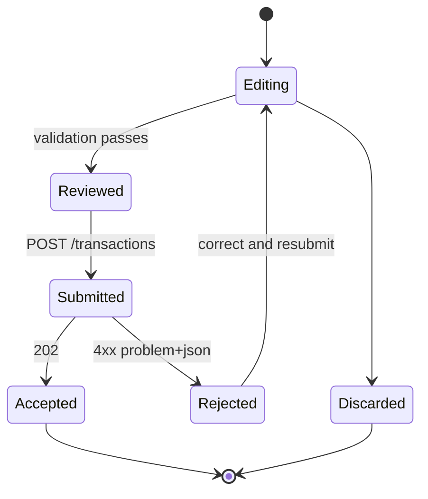

**Draft rules:**

| ID | Rule |
|---|---|
| `D-01` | The front-end MUST obtain the catalog entry before rendering the form. It MUST NOT hard-code required fields, enums, or limits. |
| `D-02` | The front-end MUST compute `draftHash` over the canonical JSON of `catalogId`, `catalogVersion`, `inputs`, and `subjectRefs`. The domain service recomputes it and rejects mismatches. |
| `D-03` | A draft is recoverable from `sessionStorage` for 8 hours, keyed by `draftId`, excluding file contents. |
| `D-04` | The front-end MAY perform local validation for responsiveness; the domain service is authoritative. |
| `D-05` | A draft MUST NOT contain derived financial values (totals, limits remaining, ceded amounts). The domain service computes them. |
| `D-06` | Currency MUST be explicit in every `MONEY` input unless the catalog declares `currencyFrom`. |
| `D-07` | The submitted draft is stored in the transaction journal as immutable evidence, subject to field-level encryption for PHI. |

### 6.4 The business transaction

#### 6.4.1 Envelope

| Field | Type | Description |
|---|---|---|
| `transactionId` | UUIDv7 | Primary identifier; time-ordered |
| `tenantId` | UUID | Tenant |
| `verticalId` | enum | Owning vertical |
| `catalogId` / `catalogVersion` | string | Executed catalog entry |
| `type` | enum | Transaction type (e.g., `AUTHORIZE_PAYMENT`) |
| `state` | enum | See §6.4.2 |
| `priority` | enum | `LOW`, `NORMAL`, `HIGH`, `URGENT` |
| `idempotencyKey` | string | Client-supplied; unique per tenant+actor+catalog |
| `requestHash` | string | Hash of canonical request |
| `correlationId` | string | End-to-end trace |
| `causationId` | string | Event or transaction that caused this one |
| `parentTransactionId` | UUID | For sub-transactions and retries |
| `requestedBy` | Actor | `{type: USER, SYSTEM, or SCHEDULE; id, displayName, delegationId?}` |
| `requestedAt` | timestamp | Submission time |
| `startedAt` / `completedAt` | timestamp | Execution window |
| `deadlineAt` | timestamp | Hard deadline |
| `currentStepId` | string | Active step |
| `progressPct` | integer | 0–100, computed from weighted steps |
| `subjectRefs` | EntityRef[] | Records affected |
| `inputs` | object | Validated inputs (encrypted at rest when sensitive) |
| `result` | object | Outputs, created IDs, links, navigate-to |
| `approvalState` | enum | `NOT_REQUIRED`, `PENDING`, `APPROVED`, `REJECTED`, `EXPIRED` |
| `error` | object | `{code, category, message, detail, retryable}` |
| `compensationState` | enum | `NONE`, `PENDING`, `RUNNING`, `COMPLETED`, `FAILED`, `PARTIAL` |
| `version` | integer | Optimistic concurrency for the transaction record |
| `retentionClass` | string | Drives purge policy |

#### 6.4.2 Transaction state machine

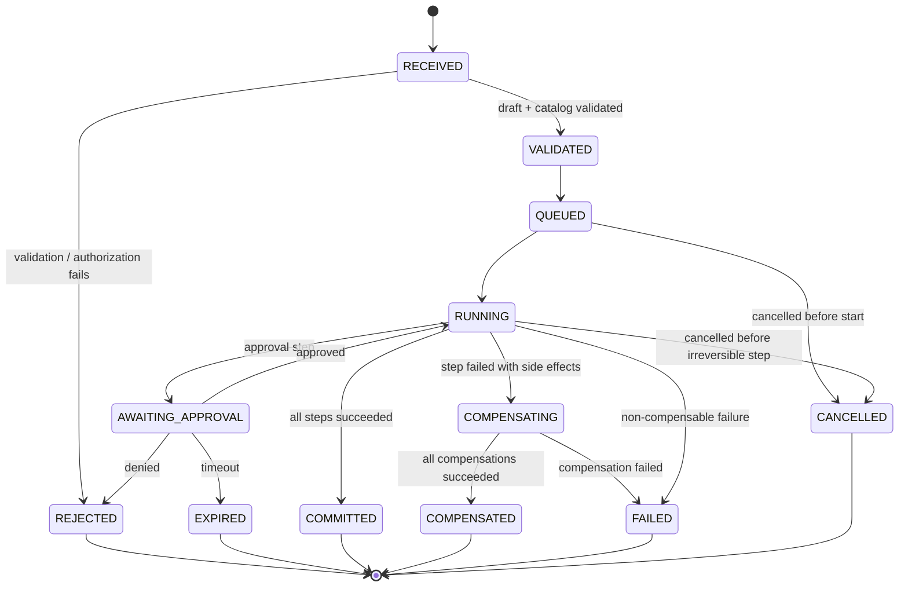

**Terminal states:** `COMMITTED`, `COMPENSATED`, `FAILED`, `REJECTED`, `CANCELLED`, `EXPIRED`.

**Allowed transitions are enforced in one place** (`TransactionStateMachine`), with a transition table and an audit record per transition. Illegal transitions raise `EIA-TX-0001` and are treated as defects.

#### 6.4.3 Step model

```json
{
  "stepId": "persist-authorization",
  "sequence": 60,
  "type": "PERSIST",
  "name": "Persist payment authorization",
  "state": "SUCCEEDED",
  "attempt": 1,
  "maxAttempts": 3,
  "startedAt": "2026-10-19T13:04:11.240Z",
  "completedAt": "2026-10-19T13:04:11.512Z",
  "durationMs": 272,
  "target": "payment.expert.payment.authorize",
  "idempotencyKey": "bt:0192f3a4:60",
  "output": { "paymentVersion": 8, "authorizedAmount": "1250000.00" },
  "compensationState": "NOT_REQUIRED",
  "links": [
    { "linkType": "PAYMENT_FOR_CLAIM", "to": { "vertical": "primary", "type": "claim", "id": "0192..." } }
  ]
}
```

**Step types:**

| Type | Purpose | Side effect | Compensation required |
|---|---|---|---|
| `READ` | Query expert, another vertical, or reference data | No | No |
| `RULE` | Evaluate a named business rule | No | No |
| `PERSIST` | Ask expert to commit a state change | Yes | Yes, if the change is externally visible or financial |
| `INTEGRATE` | Call an external system (SAP, sanctions, email, OCR) | Yes | Yes, via a defined reversal |
| `HUMAN_APPROVAL` | Wait for a decision | No (until approved) | No |
| `WAIT_EVENT` | Wait for a domain event (e.g., SAP confirmation) | No | No |
| `EVENT` | Publish a domain event | Yes | No |
| `NOTIFY` | Request a notification | Yes, best effort | No |
| `BATCH` | Submit a Spring Batch job and wait or detach | Yes | Depends on job |
| `SUB_TRANSACTION` | Invoke another vertical's catalog entry | Yes | Yes, delegated |

**Step state machine:** `PENDING → READY → RUNNING → (SUCCEEDED | FAILED | TIMED_OUT | SKIPPED | WAITING_APPROVAL)`. A failed step may transition to `COMPENSATING → COMPENSATED` or to `FAILED`.

**Progress computation:** each step carries a fixed weight (`w`) between 1 and 10. `progressPct = floor(100 * Σ(succeeded weights) / Σ(all weights))`. Weight is declared in the catalog, not guessed, so progress is monotonic and stable across retries.

### 6.5 Compensation

Compensation is **semantic**, not a database rollback. Each compensable step names a compensating capability.

| Original capability | Compensation | Notes |
|---|---|---|
| `payment.expert.payment.authorize` | `payment.expert.payment.revoke-authorization` | Only if not posted |
| `payment.expert.payment.issue` | `payment.expert.payment.void` | Requires stop/reversal if already sent |
| `sap.journal-entry.create` | `sap.journal-entry.reverse` | Reversal document, never delete |
| `policy.expert.version.issue` | `policy.expert.version.void` | Voided version retained |
| `claim.expert.reserve.change` | `claim.expert.reserve.reverse` | Compensating reserve movement |
| `document.expert.link.create` | `document.expert.link.remove` | Soft delete with audit |
| `notification.expert.dispatch` | none (best effort) | A sent notification cannot be unsent; issue a correction notice |

**Compensation rules:**

| ID | Rule |
|---|---|
| `C-01` | Compensation runs in reverse step order. |
| `C-02` | Compensation is idempotent and records its own evidence. |
| `C-03` | A failed compensation halts the sequence and requires human intervention; the transaction becomes `FAILED` with `compensationState=PARTIAL`. |
| `C-04` | Compensation never deletes audit records or financial history. |
| `C-05` | If a step has already produced an externally visible effect that cannot be reversed (e.g., a wire sent), compensation stops and escalates. |
| `C-06` | Every compensation is linked to the original transaction by `causationId` and appears in lineage. |

### 6.6 Invoking the expert service

The domain service calls expert capabilities over an authenticated internal API. Expert capabilities are coarse-grained, named, and versioned.

**Request:**

```json
{
  "transactionId": "0192f3a4-…",
  "stepId": "persist-authorization",
  "idempotencyKey": "bt:0192f3a4:60",
  "capability": "payment.authorize",
  "capabilityVersion": "1.4",
  "tenantId": "…",
  "actor": { "type": "USER", "id": "…", "displayName": "…" },
  "correlationId": "…",
  "expectedVersion": 7,
  "asOf": "2026-10-19T13:04:00Z",
  "payload": { "…": "…" }
}
```

**Response:**

```json
{
  "status": "COMMITTED",
  "result": { "paymentVersion": 8, "authorizedAmount": { "amount": "1250000.00", "currency": "USD" } },
  "warnings": [],
  "links": [
    { "linkType": "PAYMENT_FOR_CLAIM", "from": { "vertical": "payment", "type": "payment", "id": "…" }, "to": { "vertical": "primary", "type": "claim", "id": "…" } }
  ],
  "events": [
    { "eventId": "…", "eventType": "payment.payment.authorized", "aggregateVersion": 4 }
  ],
  "committedAt": "2026-10-19T13:04:11.512Z"
}
```

**Expert contract rules:**

| ID | Rule |
|---|---|
| `E-01` | Expert capabilities are transactional and either commit fully or change nothing. |
| `E-02` | `idempotencyKey` uniquely identifies the operation; a repeat returns the original result with `idempotentReplay: true`. |
| `E-03` | `expectedVersion` is required for mutations of versioned aggregates; mismatch returns `409 VERSION_CONFLICT` with the current version. |
| `E-04` | The expert writes the state change, the audit record, the link records it owns, and the outbox events in one transaction. |
| `E-05` | The expert does not decide business policy. It rejects only structural violations (`EIA-<V>-1xxx` domain integrity codes) and returns them as permanent failures. |
| `E-06` | The expert never calls another vertical's domain or expert service. Reference projections are consumed asynchronously. |
| `E-07` | The expert response includes the committed version and the events emitted, so the domain service can update progress without an extra read. |
| `E-08` | Internal calls use mTLS with workload identity plus a signed service token; a user context is propagated in a signed header for audit only. |

### 6.7 Monitoring through the back-end

The front-end monitors a transaction through the domain service. The domain service owns the authoritative progress view and streams it.

#### 6.7.1 Transaction view

```json
{
  "transactionId": "0192f3a4-…",
  "type": "AUTHORIZE_PAYMENT",
  "catalogId": "payment.authorize",
  "catalogVersion": "2.0.0",
  "verticalId": "payment",
  "state": "AWAITING_APPROVAL",
  "progressPct": 55,
  "currentStep": { "stepId": "authority", "name": "Payment authority", "state": "WAITING_APPROVAL" },
  "steps": [ { "…": "…" } ],
  "approval": {
    "state": "PENDING",
    "stepId": "authority",
    "requiredPermission": "payment.approve",
    "authorityLimit": { "amount": "2000000.00", "currency": "USD" },
    "requestedAmount": { "amount": "1250000.00", "currency": "USD" },
    "assignees": [ { "userId": "…", "displayName": "…" } ],
    "dueAt": "2026-10-19T17:04:11Z",
    "canApprove": true,
    "cannotApproveReason": null
  },
  "subjects": [ { "vertical": "primary", "type": "claim", "id": "…", "businessKey": "CLM-2026-0193382" } ],
  "result": null,
  "error": null,
  "links": { "self": "/api/v1/payment/transactions/0192f3a4-…", "stream": "…", "record": "…" },
  "timestamps": { "requestedAt": "…", "startedAt": "…", "completedAt": null, "deadlineAt": "…" }
}
```

#### 6.7.2 SSE protocol

`GET /api/v1/{vertical}/transactions/{transactionId}/stream`

```
event: snapshot
id: 0
data: { ...full TransactionView... }

event: step.started
id: 1
data: {"stepId":"load-payment","sequence":10,"startedAt":"..."}

event: step.progress
id: 2
data: {"stepId":"verify-claim-capacity","percent":40,"messageKey":"..."}

event: step.completed
id: 3
data: {"stepId":"verify-claim-capacity","durationMs":312,"outputs":["availableIndemnity"]}

event: approval.required
id: 4
data: {"stepId":"authority","dueAt":"...","requiredPermission":"payment.approve"}

event: transaction.state
id: 5
data: {"state":"AWAITING_APPROVAL","progressPct":55}

event: heartbeat
id: 6
data: {"at":"..."}

event: done
id: 7
data: {"state":"COMMITTED","result":{...}}
```

**Streaming rules:**

| ID | Rule |
|---|---|
| `M-01` | The first event is always a `snapshot` containing the full current view. |
| `M-02` | Every event has a monotonically increasing `id`; reconnecting with `Last-Event-ID` replays missed events from the transaction event log. |
| `M-03` | A `heartbeat` is sent every 15 s of inactivity. |
| `M-04` | The server closes the stream after `done`, after 15 minutes, or on authorization change. The client reconnects only if `done` was not received. |
| `M-05` | The front-end MUST fall back to polling `GET /transactions/{id}` with backoff (1 s → 2 s → 5 s → 15 s) if SSE fails twice. |
| `M-06` | Streaming is authorized per transaction; a user may stream only transactions they can read. |
| `M-07` | Sensitive field values are masked in stream payloads according to the caller's data scope. |
| `M-08` | The transaction monitor is a first-class route (`/transactions/:id`), shareable, and survives reload. |

#### 6.7.3 Front-end transaction UX contract

| Phase | UI requirement |
|---|---|
| Compose | Form driven by the input descriptor; review screen shows computed values returned by a `dryRun` validation call |
| Submit | Button disabled after first click; `Idempotency-Key` reused on retry; optimistic navigation to monitor |
| Monitor | Step list with status, elapsed time, current step, progress bar, correlation ID, cancel when allowed |
| Approval | Approval panel with authority limit, segregation-of-duties result, comment requirement, approve/reject |
| Success | Result summary, created record links, next actions, "view lineage" |
| Failure | Plain-language message, error code, correlation ID, retry or correct action, no raw stack traces |
| Timeout | Explain what is still running, offer refresh, never imply failure of an unknown state |

### 6.8 Idempotency, concurrency, and retry

| Concern | Rule |
|---|---|
| Command idempotency | `Idempotency-Key` required on every transaction submission. Scope `tenant + actor + catalogId`. TTL 24 h. Same key and same `requestHash` returns the original transaction with `200` and `Idempotent-Replayed: true`; same key with different payload returns `409 EIA-TX-1002`. |
| Resource idempotency | `PUT` is idempotent by definition. `POST` creates are idempotent only through the command key or a natural key declared in the catalog. |
| Optimistic concurrency | Mutations carry `expectedVersion` or `If-Match`; conflicts return `409` with `currentVersion` and a diff summary. |
| Pessimistic locking | Used only for aggregate/limit erosion and payment authorization; lock scope is one aggregate root; lock wait ≤ 2 s then `409 EIA-TX-1003`. |
| Retry classification | Retry only `TIMEOUT`, `UNAVAILABLE`, `DEADLOCK`, `SERIALIZATION_FAILURE`, and explicit provider retry hints. Never retry `VALIDATION`, `AUTHORIZATION`, `BUSINESS_RULE`, `CONFLICT`, `NOT_FOUND`. |
| Retry policy | Per step in the catalog: `attempts`, `backoffMs`, `backoffMultiplier`, `jitter`. Default 3 attempts, 200 ms, ×2, full jitter. |
| External calls | Retried only when the provider supports an idempotency key or the operation is read-only. SAP postings always carry an idempotency key. |
| Duplicate detection | Payment duplicate detection uses payee + amount + claim + date window + invoice reference. |
| Deadlines | Step timeout → step failure. Transaction deadline → `FAILED` or `COMPENSATING`. Deadline exceeded during approval → `EXPIRED`. |
| Poison messages | Event consumers move a message to the dead-letter table after the configured attempts and raise an operational notification. |

### 6.9 Approvals and delegation of authority

Authority is a first-class domain concept because every financial action in insurance is authority-bound.

**Authority model:** access and authority are separate. A user gets into a book through `PRIMARY_ROLE` or `REINSURANCE_ROLE`; high-risk actions additionally require an **authority position** and limit assigned within that book. A position never grants book access by itself.

| Dimension | Description |
|---|---|
| Book role | `PRIMARY_ROLE` or `REINSURANCE_ROLE`; required before any authority position applies |
| Authority position | `ADJUSTER`, `SENIOR_ADJUSTER`, `CLAIMS_MANAGER`, `PAYMENT_PREPARER`, `PAYMENT_APPROVER`, `SENIOR_PAYMENT_APPROVER`, `FINANCE_CONTROLLER`, `CONTRACT_ADMIN`, `CONTRACT_APPROVER`, `COMMUTATION_APPROVER`, `COMPLIANCE_OFFICER`, `RECORDS_MANAGER`, `PLATFORM_ADMIN` |
| Action | The transaction or approval action, e.g. `claim.reserve.approve`, `payment.approve`, `contract.bind`, `contract.commute`, `collateral.release` |
| Limit | Amount per component (`INDEMNITY`, `DEFENSE`, `ALAE`, `EXPENSE`), currency, and line of business |
| Scope | Tenant, office, portfolio, program, insured, tort, claim tier |
| Delegation | A time-bounded, recorded delegation with its own limit and reason |
| Segregation of duties | Requester ≠ approver; reserve setter ≠ approver above threshold; payment preparer ≠ payment approver; contract binder ≠ contract checker; commutation negotiator ≠ approver |

**`authority_position`** — tenant, user, book, position, effective dates, status, assigned by.

**`authority_limit`** — position or user, book, action, component, currency, limit amount, line of business, effective dates, delegator, status.

**Approval evidence** is stored with the transaction: required policy, action, authority position, approver identity, delegation used, limit at decision time, requested amount, decision, comment, timestamp, IP address, authentication strength (MFA), and the segregation check result.

**Rules:**

| ID | Rule |
|---|---|
| `A-01` | The domain service, not the front-end, determines whether approval is required and by whom. |
| `A-02` | An approver without sufficient limit cannot approve; the transaction routes to the next authority level. |
| `A-03` | Approval expires per the catalog (default 72 h) and escalates per policy (default 4 h before expiry). |
| `A-04` | A rejected approval terminates the transaction; a new draft is required. |
| `A-05` | Self-approval is blocked by identity comparison, not by role naming. |
| `A-06` | Break-glass approval requires a reason, a second reviewer within 24 h, and produces a high-severity audit finding. |
| `A-07` | Authority changes take effect immediately and are versioned; in-flight approvals use the authority version captured at step start. |
| `A-08` | Payment and reserve authority are separate actions. Holding one never implies the other. |
| `A-09` | An authority position without the matching book role is invalid and is ignored. |
| `A-10` | Every authority assignment, change, delegation, and revocation is audited. |

### 6.10 Scheduling, timeouts, and long-running work

Quartz is the only scheduler (C-04). The domain service uses Quartz for time-driven transaction concerns:

| Job | Cadence | Purpose | Misfire policy |
|---|---|---|---|
| `tx-timeout-scan` | every 30 s | Fail or expire transactions past step/deadline | `DO_NOTHING` (next run catches up) |
| `tx-approval-escalation` | every 5 min | Escalate pending approvals | `DO_NOTHING` |
| `tx-stale-draft-cleanup` | hourly | Remove expired drafts and journals | `DO_NOTHING` |
| `tx-compensation-retry` | every 10 min | Retry compensations marked retryable | `DO_NOTHING` |
| `tx-retention-purge` | daily 02:00 | Purge terminal transactions past retention, preserving audit | `DO_NOTHING` |
| `tx-outbox-dispatch` | every 2 s | Publish domain transaction events | `DO_NOTHING` |
| `tx-clock-skew-guard` | hourly | Detect cluster clock drift affecting deadlines | `DO_NOTHING` |

Long-running work is **detached**: the transaction records a `WAIT_EVENT` or `BATCH` step, returns control to the front-end with a running state, and resumes when the expert emits the completion event or Quartz polls the batch job. No HTTP request is held open for more than 30 s.

### 6.11 Error model and failure taxonomy

All API errors use `application/problem+json` (RFC 9457).

```json
{
  "type": "https://errors.example.com/payment/insufficient-authority",
  "title": "Insufficient payment authority",
  "status": 403,
  "detail": "Your limit is USD 500,000.00; the requested amount is USD 1,250,000.00.",
  "instance": "/api/v1/payment/transactions",
  "code": "EIA-PAY-5101",
  "category": "AUTHORIZATION",
  "retryable": false,
  "correlationId": "0192f3a4-…",
  "transactionId": "0192f3a4-…",
  "errors": [
    { "field": "amount", "code": "AUTHORITY_LIMIT", "message": "Exceeds your limit" }
  ],
  "meta": { "yourLimit": { "amount": "500000.00", "currency": "USD" } }
}
```

**Error categories:**

| Category | HTTP | Retryable | Meaning |
|---|---|---|---|
| `VALIDATION` | 400 | No | Input does not satisfy the descriptor or a rule |
| `AUTHENTICATION` | 401 | No | Session/token invalid |
| `AUTHORIZATION` | 403 | No | Permission or authority insufficient |
| `NOT_FOUND` | 404 | No | Resource does not exist or is not visible |
| `CONFLICT` | 409 | Sometimes | Version conflict, duplicate, illegal state |
| `BUSINESS_RULE` | 422 | No | Domain policy rejects the request (coverage, eligibility, limit) |
| `APPROVAL_REQUIRED` | 428 | No | A required approval is missing |
| `RATE_LIMIT` | 429 | Yes | Retry after `Retry-After` |
| `DEPENDENCY` | 502/503 | Sometimes | Another service or integration failed |
| `TIMEOUT` | 504 | Yes | Step or dependency timed out |
| `DEADLINE_EXCEEDED` | 504 | No | Transaction deadline passed |
| `INTERNAL` | 500 | No | Defect; always carries correlation ID |

**Error code scheme:** `EIA-<VERT|-PLT|-TX>-<NNNN>`, stable, documented in Appendix C, and never reused for a different meaning. Error responses never contain stack traces, SQL, table names, tokens, or PHI.

### 6.12 Initial transaction inventory

This is the v1 catalog. Each entry is specified in its vertical chapter; this table is the authoritative index.

| Vertical | `catalogId` | Type | Approval | Sync/async | Primary subjects |
|---|---|---|---|---|---|
| Party | `party.create` | `CREATE_PARTY` | No | Sync | Party |
| Party | `party.update` | `UPDATE_PARTY` | No | Sync | Party |
| Party | `party.merge` | `MERGE_PARTY` | Yes | Sync | Party |
| Party | `party.add-role` | `ADD_PARTY_ROLE` | No | Sync | Party, subject |
| Party | `party.end-role` | `END_PARTY_ROLE` | No | Sync | Party, subject |
| Party | `party.screen` | `SCREEN_PARTY` | No | Async | Party |
| Party | `party.update-consent` | `UPDATE_CONSENT` | No | Sync | Party |
| Document | `document.register` | `REGISTER_DOCUMENT` | No | Async | Document, subject |
| Document | `document.associate` | `ASSOCIATE_DOCUMENT` | No | Sync | Document, subject |
| Document | `document.supersede` | `SUPERSEDE_DOCUMENT` | No | Sync | Document |
| Document | `document.reclassify` | `RECLASSIFY_DOCUMENT` | No | Sync | Document |
| Document | `document.legal-hold` | `APPLY_LEGAL_HOLD` | Yes | Sync | Document(s) |
| Document | `document.release-hold` | `RELEASE_LEGAL_HOLD` | Yes | Sync | Document(s) |
| Document | `document.generate` | `GENERATE_DOCUMENT` | No | Async | Document, subject |
| Document | `document.dispose` | `DISPOSE_DOCUMENT` | Yes | Async | Document |
| Policy | `policy.quote` | `CREATE_QUOTE` | No | Sync | Policy |
| Policy | `policy.bind` | `BIND_POLICY` | Yes* | Sync | Policy |
| Policy | `policy.issue` | `ISSUE_POLICY` | No | Async | Policy, Document |
| Policy | `policy.endorse` | `ENDORSE_POLICY` | Yes* | Async | Policy, Document |
| Policy | `policy.renew` | `RENEW_POLICY` | Yes* | Sync | Policy |
| Policy | `policy.cancel` | `CANCEL_POLICY` | Yes | Sync | Policy |
| Policy | `policy.reinstate` | `REINSTATE_POLICY` | Yes | Sync | Policy |
| Policy | `policy.premium-audit` | `APPLY_PREMIUM_AUDIT` | Yes* | Sync | Policy |
| Policy | `policy.record-occurrence` | `RECORD_OCCURRENCE` | No | Sync | Policy, Occurrence |
| Policy | `policy.update-mass-tort-profile` | `UPDATE_MASS_TORT_PROFILE` | Yes | Sync | Policy |
| Policy | `policy.billing.plan` | `CREATE_BILLING_PLAN` | No | Sync | Policy, Payment |
| Cession | `cession.contract.create` | `CREATE_CEDED_CONTRACT` | No | Sync | Cession |
| Cession | `cession.contract.bind` | `BIND_CEDED_CONTRACT` | Yes | Sync | Cession |
| Cession | `cession.contract.endorse` | `ENDORSE_CEDED_CONTRACT` | Yes | Sync | Cession |
| Cession | `cession.contract.renew` | `RENEW_CEDED_CONTRACT` | Yes | Sync | Cession |
| Cession | `cession.contract.cancel` | `CANCEL_CEDED_CONTRACT` | Yes | Sync | Cession |
| Cession | `cession.contract.commute` | `COMMUTE_CEDED_CONTRACT` | Yes | Async | Cession, Finance |
| Cession | `cession.rule.define` | `DEFINE_CESSION_RULE` | No | Sync | Cession |
| Cession | `cession.handoff` | `SEND_FSRI_HANDOFF` | No | Async | Policy, Primary, FS-RI |
| Cession | `cession.reconcile` | `RECONCILE_CESSION` | No | Async | Finance |
| Policy | `policy.billing.instruct` | `INSTRUCT_BILLING` | Yes* | Sync | Policy, Payment |
| Policy | `policy.billing.credit-note` | `ISSUE_CREDIT_NOTE` | Yes | Sync | Policy, Payment |
| Policy | `policy.commission.statement` | `CREATE_COMMISSION_STATEMENT` | Yes* | Sync | Policy, Producer |
| Contract | `contract.create` | `CREATE_CONTRACT` | No | Sync | Contract |
| Contract | `contract.bind` | `BIND_CONTRACT` | Yes | Sync | Contract |
| Contract | `contract.endorse` | `ENDORSE_CONTRACT` | Yes | Sync | Contract, Document |
| Contract | `contract.amend-participation` | `AMEND_PARTICIPATION` | Yes | Sync | Contract |
| Contract | `contract.cession` | `RECORD_CESSION` | No | Sync | Contract, source |
| Contract | `contract.bordereau` | `PROCESS_BORDEREAU` | No | Async | Contract, Bordereau |
| Contract | `contract.technical-account` | `PRODUCE_TECHNICAL_ACCOUNT` | No | Async | Contract |
| Contract | `contract.cash-call` | `ISSUE_CASH_CALL` | Yes | Sync | Contract, Payment |
| Contract | `contract.reinstatement` | `APPLY_REINSTATEMENT` | No | Sync | Contract |
| Contract | `contract.security` | `RECORD_SECURITY` | Yes | Sync | Contract |
| Contract | `contract.commute` | `COMMUTE_CONTRACT` | Yes | Async | Contract, Reinsurance, Payment |
| Contract | `contract.renew` | `RENEW_CONTRACT` | Yes | Sync | Contract |
| Retrocession | `retrocession.contract.create` | `CREATE_RETRO_CONTRACT` | No | Sync | Retrocession |
| Retrocession | `retrocession.contract.bind` | `BIND_RETRO_CONTRACT` | Yes | Sync | Retrocession |
| Retrocession | `retrocession.contract.endorse` | `ENDORSE_RETRO_CONTRACT` | Yes | Sync | Retrocession |
| Retrocession | `retrocession.contract.renew` | `RENEW_RETRO_CONTRACT` | Yes | Sync | Retrocession |
| Retrocession | `retrocession.contract.cancel` | `CANCEL_RETRO_CONTRACT` | Yes | Sync | Retrocession |
| Retrocession | `retrocession.contract.commute` | `COMMUTE_RETRO_CONTRACT` | Yes | Async | Retrocession, Finance |
| Retrocession | `retrocession.rule.define` | `DEFINE_RETRO_RULE` | No | Sync | Retrocession |
| Retrocession | `retrocession.handoff` | `SEND_FSRI_HANDOFF` | No | Async | Contract, Reinsurance, FS-RI |
| Retrocession | `retrocession.reconcile` | `RECONCILE_RETROCESSION` | No | Async | Finance |
| Primary | `primary.claim.register` | `REGISTER_FNOL` | No | Sync | Claim, Party, Policy |
| Primary | `primary.claim.assess-coverage` | `ASSESS_COVERAGE` | Yes* | Sync | Claim |
| Primary | `primary.claim.injury` | `RECORD_INJURY` | No | Sync | Claim, Party |
| Primary | `primary.claim.exposure` | `RECORD_EXPOSURE` | No | Sync | Claim |
| Primary | `primary.claim.reserve` | `ESTABLISH_RESERVE` | Yes* | Sync | Claim |
| Primary | `primary.claim.change-reserve` | `CHANGE_RESERVE` | Yes* | Sync | Claim |
| Primary | `primary.claim.litigation` | `UPDATE_LITIGATION` | No | Sync | Claim |
| Primary | `primary.claim.settle-authorize` | `AUTHORIZE_SETTLEMENT` | Yes | Sync | Claim, Payment |
| Primary | `primary.claim.settle-execute` | `EXECUTE_SETTLEMENT` | No | Sync | Claim, Document |
| Primary | `primary.claim.recovery` | `RECORD_RECOVERY` | No | Sync | Claim, Payment |
| Primary | `primary.claim.close` | `CLOSE_CLAIM` | No | Sync | Claim |
| Primary | `primary.claim.reopen` | `REOPEN_CLAIM` | Yes | Sync | Claim |
| Primary | `primary.claim.allocate` | `ALLOCATE_CLAIM` | Yes* | Sync | Claim, Policy |
| Reinsurance | `reinsurance.claim.loss-advice` | `RECORD_LOSS_ADVICE` | No | Sync | ReinsuranceClaim |
| Reinsurance | `reinsurance.claim.bordereau` | `PROCESS_CLAIMS_BORDEREAU` | No | Async | ReinsuranceClaim, Contract |
| Reinsurance | `reinsurance.claim.reserve` | `ESTABLISH_REINSURANCE_RESERVE` | Yes* | Sync | ReinsuranceClaim |
| Reinsurance | `reinsurance.claim.change-reserve` | `CHANGE_REINSURANCE_RESERVE` | Yes* | Sync | ReinsuranceClaim |
| Reinsurance | `reinsurance.claim.payment` | `AUTHORIZE_REINSURANCE_PAYMENT` | Yes | Sync | ReinsuranceClaim, Payment |
| Reinsurance | `reinsurance.claim.cash-call` | `REQUEST_CASH_CALL` | Yes | Sync | ReinsuranceClaim, Contract, Payment |
| Reinsurance | `reinsurance.claim.recovery` | `RECORD_REINSURANCE_RECOVERY` | No | Sync | ReinsuranceClaim, Payment |
| Reinsurance | `reinsurance.claim.reinstatement` | `APPLY_REINSTATEMENT` | No | Sync | ReinsuranceClaim, Contract |
| Reinsurance | `reinsurance.claim.commute` | `COMMUTE_REINSURANCE_CLAIM` | Yes | Async | ReinsuranceClaim, Contract, Payment |
| Reinsurance | `reinsurance.claim.dispute` | `DISPUTE_LOSS_ADVICE` | No | Sync | ReinsuranceClaim |
| Reinsurance | `reinsurance.claim.close` | `CLOSE_REINSURANCE_CLAIM` | No | Sync | ReinsuranceClaim |
| Payment | `payment.authorize` | `AUTHORIZE_PAYMENT` | Yes | Sync | Payment, Claim |
| Payment | `payment.issue` | `ISSUE_PAYMENT` | Yes* | Async | Payment |
| Payment | `payment.confirm` | `CONFIRM_PAYMENT` | No | Async | Payment |
| Payment | `payment.void` | `VOID_PAYMENT` | Yes | Sync | Payment |
| Payment | `payment.stop` | `STOP_PAYMENT` | Yes | Sync | Payment |
| Payment | `payment.reissue` | `REISSUE_PAYMENT` | Yes | Sync | Payment |
| Payment | `payment.reverse` | `REVERSE_PAYMENT` | Yes | Sync | Payment |
| Payment | `payment.post-sap` | `POST_TO_SAP` | No | Async | Payment, SAP |
| Payment | `payment.run` | `PROCESS_PAYMENT_RUN` | Yes | Async | Payment batch |
| Payment | `payment.reconcile` | `RECONCILE_PAYMENT` | No | Async | Payment |
| Payment | `payment.escheat` | `APPLY_ESCHEATMENT` | Yes | Async | Payment |
| Payment | `payment.finance.expectation` | `CREATE_FINANCIAL_EXPECTATION` | No | Sync | Policy, Claim, Contract |
| Payment | `payment.finance.ar-invoice` | `POST_AR_INVOICE` | No | Sync | Policy, SAP |
| Payment | `payment.finance.credit-note` | `POST_CREDIT_NOTE` | No | Sync | Policy, SAP |
| Payment | `payment.finance.reconcile` | `RUN_RECONCILIATION` | No | Async | Finance |
| Payment | `payment.finance.close` | `CERTIFY_CLOSE` | Yes | Async | Finance |
| Notifications | `notifications.issue` | `ISSUE_NOTIFICATION` | No | Async | Notification, subject |
| Notifications | `notifications.retry` | `RETRY_DELIVERY` | No | Async | Notification |
| Notifications | `notifications.escalate` | `ESCALATE_NOTIFICATION` | No | Async | Notification |
| Notifications | `notifications.acknowledge` | `ACKNOWLEDGE_NOTIFICATION` | No | Sync | Notification |
| Notifications | `notifications.action` | `ACTION_NOTIFICATION` | No | Sync | Notification |
| Notifications | `notifications.suppress` | `SUPPRESS_NOTIFICATION` | No | Sync | Notification |
| Notifications | `notifications.subscription` | `UPDATE_SUBSCRIPTION` | No | Sync | User |
| Notifications | `notifications.template` | `UPDATE_TEMPLATE` | Yes | Sync | Template |

`*` = approval is conditional on amount, coverage impact, or tenant configuration; the catalog's approval policy decides.

### 6.13 Domain service internal structure

```text
eia-{vertical}-domain
├── api/                 REST controllers, DTO mapping, problem-detail advice, SSE
├── application/
│   ├── catalog/         Catalog registry, version resolution, descriptor compiler
│   ├── transaction/     Engine, state machine, step executors, compensation, journal
│   ├── approval/        Authority resolution, delegation, segregation of duties
│   ├── command/         Command handlers (thin: resolve, validate, transact)
│   ├── query/           Read services and read-model composition
│   └── orchestration/   Cross-vertical coordination
├── domain/
│   ├── model/           Aggregates, value objects, invariants (pure Java, no JPA)
│   ├── rule/            Named business rules implementing Rule<T>
│   ├── policy/          Approval, authority, allocation, eligibility policies
│   └── event/           Domain event definitions
├── client/
│   ├── expert/          Expert capability client (mTLS, retry, idempotency)
│   ├── vertical/        Other verticals' domain clients
│   └── integration/     Sanctions, SAP status, OCR callbacks
└── infrastructure/      Security, telemetry, scheduling, config, persistence of tx schema
```

**Layering rules:**

1. `domain` depends on nothing but the JDK and its own types.
2. `application` depends on `domain` and `client` interfaces.
3. `api` depends on `application`.
4. `infrastructure` implements interfaces declared by `application`/`client`.
5. No `javax.persistence` or `jakarta.persistence` import anywhere in the domain service.
6. Controllers contain no business logic; they translate HTTP to commands and back.
7. Query handlers may call expert read capabilities directly; they do not mutate.
8. The domain model is not the database model. Similar names are expected; shared code is not.

**Domain service persistence:** the domain service owns only the `tx` schema: `business_transaction`, `transaction_step`, `transaction_event`, `transaction_approval`, `transaction_compensation`, `idempotency_record`, `transaction_schedule`, `transaction_catalog`, `authority_matrix`, `delegation`, and `outbox`. It never reads `ent`.

### 6.14 Cross-vertical transactions

There is no central orchestrator. **The vertical that owns the business intent owns the transaction.**

| Business intent | Owning vertical | Delegated steps |
|---|---|---|
| Register a claim and reserve it | Primary | Party resolve, Policy coverage read, Document associate, Notifications issue |
| Settle a claim and pay the claimant | Primary (authorize) → Payment (execute) | Primary owns authorization; Payment owns issuance and SAP posting; a `SUB_TRANSACTION` step links them |
| Record a reinsurance cession and claim recovery | Contract | Cedent terms, Reinsurance claim, Payment recovery |
| Cede a primary policy or claim to SAP FS-RI | Policy | Policy/Primary facts, FS-RI request, confirmation, projection |
| Retrocede a reinsurance contract or claim to SAP FS-RI | Contract | Reinsurance facts, FS-RI retro request, confirmation, projection |
| Process a bordereau and create reinsurance claims | Contract | Reinsurance import, Document associate, Payment balance |
| Merge two parties and repoint references | Party | Notifications, Lineage edge rewrite; other verticals consume `party.merged` and lazily re-resolve |
| Dispose of documents under legal hold | Document | Notifications, Audit |

**Rules:**

| ID | Rule |
|---|---|
| `X-01` | A cross-vertical step uses the other vertical's catalog entry through `SUB_TRANSACTION`, not a private endpoint. |
| `X-02` | A sub-transaction has its own ID, state, approvals, and audit; the parent records the link and waits for terminal state. |
| `X-03` | A sub-transaction failure fails the parent step; the parent's compensation policy decides whether to compensate. |
| `X-04` | The parent MUST NOT retry a sub-transaction blindly; it queries the sub-transaction state first. |
| `X-05` | Approval taken in the parent is not automatically valid in the child; the child's catalog declares which approvals it trusts via `approvalDelegation`. |
| `X-06` | Two verticals must never write the same business fact. If both need to act, one owns the fact and the other records a reference. |

### 6.15 Transaction journal retention

| Data | Retention | Notes |
|---|---|---|
| Transaction header and result | 10 years, or longer if linked to a long-tail claim | Aligned to claim retention (30 years) when `subjectRefs` include a claim |
| Step records and outputs | 10 years | Financial evidence |
| Inputs with PHI | Encrypted at rest; access audited | Redacted in exports by default |
| Approval evidence | 10 years | Includes authority snapshot |
| SSE event history | 90 days | Then only the summarised transaction event log remains |
| Idempotency records | 24 h after transaction terminal state, minimum 7 days | Prevents replay after completion |
| Drafts | 8 h in browser; not stored server-side before submission | Submitted drafts are part of the transaction input |

---
## 7. Expert Services, Batch, Scheduling, and Eventing

### 7.1 Anatomy of an expert service

An expert service is a Spring Boot application that owns a vertical's persistence. It is deliberately narrow: it executes named capabilities atomically, protects structural invariants, serves read models, runs batch work, and publishes events.

```text
eia-{vertical}-expert
├── api/
│   ├── capability/      POST /internal/v1/capabilities/{capability}
│   ├── query/           GET  /internal/v1/{resource}..., POST /internal/v1/{resource}/query
│   ├── ops/             batch and Quartz administration, reconciliation, diagnostics
│   └── event/           Inbound event endpoint (consumer inbox)
├── capability/          One handler per capability; validates, loads, mutates, persists, emits
├── persistence/
│   ├── entity/          JPA entities (or JDBC records where JPA is a poor fit)
│   ├── repository/      Spring Data repositories
│   └── projection/      Read models, materialized views
├── batch/               Spring Batch jobs, readers, processors, writers, partitions
├── schedule/            Quartz jobs, triggers, calendars
├── event/
│   ├── outbox/          Transactional outbox writer + dispatcher
│   ├── inbox/           Idempotent consumer + dead letter
│   └── subscription/    Subscriber registry
├── integration/         SAP, object storage, sanctions, OCR, email, bank adapters
├── audit/               Append-only audit writer, hash chain
└── config/              Security, datasource, Jackson, telemetry, migration
```

**Expert service rules:**

| ID | Rule |
|---|---|
| `ES-01` | Every mutating endpoint is a named capability; generic CRUD writes are not exposed. |
| `ES-02` | A capability runs in one database transaction that includes the state change, audit record, link records, and outbox rows. |
| `ES-03` | A capability validates only structural invariants and version expectations; business policy belongs to the domain service. |
| `ES-04` | An expert service never calls another vertical's domain or expert service. |
| `ES-05` | Read endpoints never mutate. A read that must record access writes an audit row in a separate, asynchronous transaction. |
| `ES-06` | Every table has `tenant_id`; every query is tenant-scoped by a repository-level predicate, reinforced by PostgreSQL row-level security where enabled. |
| `ES-07` | No dynamic SQL string concatenation. Parameterized queries only. |
| `ES-08` | The expert service starts only after its schema migrations succeed and its outbox dispatcher acquires leadership for its shard. |
| `ES-09` | All time is stored as `timestamptz` in UTC; date-only business dates use `date`. |
| `ES-10` | Deletes are soft (`record_state='DELETED'`) or prohibited; financial and audit records are never deleted. |

### 7.2 Persistence standards

**Schemas inside each vertical database:**

| Schema | Owner | Contents |
|---|---|---|
| `ent` | Expert service | Business tables, link records owned by the vertical, outbox, inbox, audit, read models |
| `ref` | Expert service | Reference data and code lists owned or cached by the vertical |
| `batch` | Expert service | Spring Batch metadata (`BATCH_JOB_INSTANCE`, `BATCH_JOB_EXECUTION`, …) |
| `tx` | Domain service | Transaction journal, catalog, authority, delegation |
| `ops` | Expert service | Job locks, reconciliation runs, integration message queue, dead letters |

**Database roles:**

| Role | Grants |
|---|---|
| `eia_{v}_domain` | `USAGE` on `tx`; `SELECT/INSERT/UPDATE/DELETE` on `tx` tables; no access to `ent`, `ref`, `batch`, `ops` |
| `eia_{v}_expert` | `USAGE` and DML on `ent`, `ref`, `batch`, `ops`; no access to `tx` |
| `eia_{v}_readonly` | `SELECT` on approved read views only |
| `eia_{v}_migrator` | DDL during migration only; credentials held by the migration job, not the runtime |

**Table conventions (physical):**

| Convention | Rule |
|---|---|
| Primary key | `id uuid` containing a UUIDv7 generated by the application (`Uuid7.generate()`), never `serial` |
| Business key | `<entity>_number varchar(32)` unique per tenant, generated by a database sequence with a prefix |
| Tenant | `tenant_id uuid not null` on every table, first column of every composite index after `id` |
| Version | `version integer not null default 0`, incremented on update; used for optimistic locking |
| Timestamps | `created_at timestamptz not null`, `updated_at timestamptz not null` |
| Actor | `created_by uuid`, `updated_by uuid`, plus `created_by_type`/`updated_by_type` (`USER`, `SYSTEM`, `SCHEDULE`, `INTEGRATION`) |
| State | `record_state varchar(16) not null default 'ACTIVE'` with values `ACTIVE`, `INACTIVE`, `DELETED`, `PENDING` |
| Money | `<field>_amount numeric(19,4)` and `<field>_currency char(3)`; never floating point |
| Percent | `<field>_pct numeric(9,6)` storing a fraction (0.15 = 15%) |
| Enum | `varchar(48)` plus a `CHECK` constraint or a reference table; never a PostgreSQL `enum` type |
| Free text | `text` with a length check where the business limit is meaningful |
| JSON | `jsonb` only for genuinely extensible attributes, with a documented shape and a validation descriptor |
| Naming | `snake_case`; tables singular (`claim`, `policy`, `payment`); join tables `<a>_<b>`; indexes `ix_<table>_<cols>`; constraints `ck_`, `uq_`, `fk_` |
| Foreign keys | Within a vertical only; cross-vertical references are `EntityRef` columns (`<x>_vertical`, `<x>_type`, `<x>_id`) with no FK |
| Comments | Every table and non-obvious column has a `COMMENT ON` describing business meaning |

**Indexing rules:** every foreign key column; every business key; every `(tenant_id, status, created_at)` list pattern; partial indexes for active rows; GIN on `jsonb` only where queried; no index without a measured query.

### 7.3 Spring Batch

Spring Batch executes **bulk and long-running data movement**. It is not used for request/response work, and Quartz is not used to process data (Quartz only decides *when*).

**Standard job anatomy:**

| Component | Standard |
|---|---|
| Job | One `@Bean` per job, named `<vertical>.<jobName>`, parameters validated |
| Parameters | `runId` (UUID), `tenantId`, `businessDate`, `asOf`, `dryRun`, plus job-specific keys; never a raw SQL fragment |
| Reader | `JdbcCursorItemReader` for large sequential scans, `JdbcPagingItemReader` for sort-sensitive work; fetch size tuned; no ORM for bulk |
| Processor | Pure function; no external calls; external enrichment pre-loaded into a cache map or staging table |
| Writer | `JdbcBatchItemWriter` or a capability client for domain-owned rules; chunk size 100–1,000 |
| Listener | Emits metrics, enforces timeout, records counts, notifies on failure |
| Restart | `restartable=true`; idempotent writers keyed by natural keys; no partial duplicates |
| Skip/retry | Explicit; skipped rows written to an exception table with reason |
| Partitioning | `TaskExecutorPartitionHandler` with grid size 4–16 for CPU/IO-bound jobs |
| Idempotency | A `job_run` row with a unique business key prevents duplicate runs for the same period |
| Security | Runs under a system actor with a recorded delegation; data scope applied as if a user with the tenant's batch role |
| Observability | `jobName`, `jobExecutionId`, read/write/skip counts, duration, throughput, error summary |

**Job catalog:**

| Vertical | Job | Trigger | Purpose |
|---|---|---|---|
| Party | `party.dedupe-scan` | Quartz nightly | Score candidate duplicates; write review queue |
| Party | `party.bulk-import` | Manual | Import parties from CSV with validation and staging |
| Party | `party.screening-batch` | Quartz daily | Re-screen active parties against updated lists |
| Party | `party.merge-remediation` | Manual | Repoint references after a merge where events were missed |
| Policy | `policy.renewal-batch` | Quartz daily | Identify expiring policies, create renewal drafts |
| Policy | `policy.expiry-batch` | Quartz daily | Transition expired policies, emit events |
| Policy | `policy.aggregate-rebuild` | Manual / Quartz monthly | Recompute aggregate erosion from claims and payments |
| Policy | `policy.premium-audit-batch` | Quartz quarterly | Generate audit premium worksheets |
| Policy | `policy.document-generation-batch` | Manual | Generate declarations, certificates, endorsements at scale |
| Policy | `policy.mass-tort-review` | Quartz monthly | Flag policies with stale profiles or missing allocation |
| Contract | `contract.bordereau-parse` | Event / manual | Parse, validate, and stage bordereau lines |
| Contract | `contract.technical-account-batch` | Quartz monthly | Produce technical accounts for all active contracts |
| Contract | `contract.premium-adjustment-batch` | Quartz quarterly | Sliding-scale and adjustable premium computation |
| Contract | `contract.security-expiry` | Quartz daily | Expire collateral, raise requirements |
| Contract | `contract.portfolio-extract` | Manual | Extract treaty, premium, and loss data for actuarial use |
| Cession | `cession.export` | Quartz | Export pending primary hand-offs to FS-RI |
| Cession | `cession.statement-import` | Quartz | Import primary FS-RI statements and recoverables |
| Cession | `cession.reconciliation-batch` | Quartz | Reconcile primary cessions, recoverables, and S/4 |
| Retrocession | `retrocession.export` | Quartz | Export pending retro hand-offs to FS-RI |
| Retrocession | `retrocession.statement-import` | Quartz | Import retro FS-RI statements and recoverables |
| Retrocession | `retrocession.reconciliation-batch` | Quartz | Reconcile retrocessions, retro recoverables, and S/4 |
| Primary | `primary.claim-bulk-import` | Manual | Import legacy or portfolio claims |
| Primary | `primary.reserve-review-batch` | Quartz monthly | Flag claims with stale reserves or missing reviews |
| Primary | `primary.closure-sweep` | Quartz weekly | Close eligible zero-balance claims |
| Primary | `primary.recovery-match` | Quartz daily | Match incoming recoveries to claims |
| Primary | `primary.aggregate-erosion-sync` | Quartz daily | Send erosion facts to Policy, reconcile differences |
| Primary | `primary.extract-actuarial` | Manual | Loss development extract (Schedule P shape) |
| Reinsurance | `reinsurance.loss-advice-import` | Manual / event | Import loss advices from a bordereau |
| Reinsurance | `reinsurance.cash-call-batch` | Quartz monthly | Compute cash calls due |
| Reinsurance | `reinsurance.recovery-match` | Quartz daily | Match reinsurance recoveries |
| Reinsurance | `reinsurance.commutation-batch` | Manual | Bulk commutation valuation |
| Reinsurance | `reinsurance.extract-actuarial` | Manual | Reinsurance loss development extract |
| Document | `document.ingest` | Event | Virus scan, checksum, OCR, text extraction, classification |
| Document | `document.retention-scan` | Quartz daily | Identify records eligible for disposition |
| Document | `document.disposition` | Quartz weekly | Execute approved dispositions with certificate |
| Document | `document.reindex` | Manual | Rebuild full-text and metadata indexes |
| Document | `document.package-generate` | Manual | Assemble document packages (bordereau, settlement) |
| Document | `document.migration` | Manual | Bulk import from legacy repositories |
| Payment | `payment.run` | Quartz + manual | Assemble and submit a payment run to SAP |
| Payment | `payment.sap-posting` | Quartz | Post authorized payments and journal entries |
| Payment | `payment.bank-reconciliation` | Quartz daily | Ingest camt.053 and match |
| Payment | `payment.reconciliation-report` | Quartz daily | Produce exception and ageing reports |
| Payment | `finance.sap-actuals-import` | Quartz daily | Import SAP invoices, cash applications, and GL balances |
| Payment | `finance.reconciliation-batch` | Quartz daily | Match financial expectations to SAP actuals |
| Payment | `finance.ar-ageing` | Quartz daily | Build premium receivable ageing and producer payables |
| Payment | `finance.close-batch` | Manual / period end | Build proof-of-balance pack and close checklist |
| Payment | `payment.escheatment` | Quartz monthly | Identify unclaimed funds and prepare filings |
| Payment | `payment.tax-reporting` | Quartz annual | Produce 1099 extract |
| Notifications | `notifications.digest` | Quartz | Assemble digests per subscription |
| Notifications | `notifications.bulk-issue` | Manual | Issue notifications to a distribution list |
| Notifications | `notifications.retry` | Quartz | Retry failed deliveries |
| Notifications | `notifications.template-migration` | Manual | Render and validate template versions |
| Actuarial | `actuarial.triangle-build` | Quartz monthly | Build loss triangles and development factors |
| Actuarial | `actuarial.ibnr-post` | Manual / committee | Post approved IBNR allocations |
| Regulatory | `regulatory.filing-calendar` | Quartz daily | Generate due and overdue filing tasks |
| Regulatory | `regulatory.statistical-extract` | Quartz monthly | Produce ISO/NCCI statistical files |
| Reporting | `reporting.warehouse-refresh` | Quartz | Refresh certified data products |
| Reporting | `reporting.data-quality-run` | Quartz daily | Execute data quality rules |
| Migration | `migration.wave-run` | Manual | Execute a migration wave |

**Operational controls:** every job can be launched from `/internal/v1/ops/jobs/{jobName}/run` with an idempotency key; list executions, inspect step counts and exceptions, stop, restart, and abandon. Job execution is permission-gated (`ops.jobs.run`, `ops.jobs.stop`) and audited.

### 7.4 Quartz

Quartz is the **only** scheduler (C-04). `@Scheduled`, `ScheduledExecutorService` cron loops, and external cron are prohibited.

**Configuration standard:**

| Setting | Value |
|---|---|
| Job store | `JobStoreTX` with PostgreSQL `StdJDBCDelegate` |
| Clustering | `isClustered=true`, `clusterCheckinInterval=7500` |
| Instance | `org.quartz.scheduler.instanceName=eia-{vertical}`, `instanceId=AUTO` |
| Thread pool | `SimpleThreadPool`, 8–16 threads, `threadCount` from config |
| Misfire | Per job; default `DO_NOTHING` for idempotent polling jobs, `FIRE_AND_PROCEED` for catch-up jobs |
| Calendar | `HolidayCalendar` excluding weekends and tenant holidays where business-day logic applies |
| Recovery | `requestsRecovery=true` only for jobs safe to re-run |
| Locking | Quartz row locks; no application-level distributed lock for scheduling |
| Time zone | Scheduler in UTC; business-day jobs evaluate the tenant's calendar explicitly |
| Naming | `jobGroup = {vertical}`, `jobName = {domain}.{action}`, trigger `{jobName}.{cadence}` |
| Payload | `JobDataMap` contains IDs and dates only; never PHI or secrets |

**Job implementation rules:**

1. A Quartz job is a thin trigger: it validates preconditions, delegates to a service, records a `job_run`, and exits. Business logic stays in the domain or batch layer.
2. Jobs are idempotent for a given `(jobName, businessDate, tenantId)`.
3. A job acquires a business-level run key (`ops.job_run` unique constraint) before doing work.
4. A job that exceeds its timeout is interrupted and marked failed; it must not leave partial state. Batch jobs use Spring Batch restart; simple jobs use a transaction.
5. Every job emits start, finish, duration, and outcome metrics and a structured log line with `jobName`, `runId`, `tenantId`.

**Scheduling catalog (domain + expert):**

| Job | Owner | Cadence | Misfire |
|---|---|---|---|
| `tx-timeout-scan` | Domain (all) | 30 s | `DO_NOTHING` |
| `tx-approval-escalation` | Domain (all) | 5 min | `DO_NOTHING` |
| `tx-outbox-dispatch` | Domain (all) | 2 s | `DO_NOTHING` |
| `expert-outbox-dispatch` | Expert (all) | 2 s | `DO_NOTHING` |
| `expert-inbox-retry` | Expert (all) | 1 min | `DO_NOTHING` |
| `projection-reconcile` | Expert (all) | hourly | `DO_NOTHING` |
| `party.dedupe-scan` | Party expert | daily 03:00 | `FIRE_AND_PROCEED` |
| `party.screening-refresh` | Party expert | daily 04:00 | `FIRE_AND_PROCEED` |
| `policy.expiry-scan` | Policy expert | daily 00:30 | `FIRE_AND_PROCEED` |
| `policy.renewal-invitation` | Policy domain | daily 07:00 | `FIRE_AND_PROCEED` |
| `policy.aggregate-recalc` | Policy expert | daily 02:00 | `DO_NOTHING` |
| `policy.diary-review` | Policy domain | daily 08:00 | `FIRE_AND_PROCEED` |
| `contract.bordereau-due` | Contract domain | daily 06:00 | `FIRE_AND_PROCEED` |
| `contract.statement-generation` | Contract expert | monthly, 1st 05:00 | `FIRE_AND_PROCEED` |
| `contract.security-expiry` | Contract expert | daily 01:00 | `FIRE_AND_PROCEED` |
| `contract.commutation-window` | Contract domain | weekly Mon 08:00 | `FIRE_AND_PROCEED` |
| `primary.diary-scan` | Primary domain | hourly | `DO_NOTHING` |
| `primary.sla-breach-scan` | Primary domain | every 15 min | `DO_NOTHING` |
| `primary.sol-alert` | Primary domain | daily 07:30 | `FIRE_AND_PROCEED` |
| `primary.reserve-review-due` | Primary domain | daily 08:00 | `FIRE_AND_PROCEED` |
| `primary.aggregate-sync` | Primary expert | daily 03:30 | `DO_NOTHING` |
| `reinsurance.loss-advice-followup` | Reinsurance domain | daily 09:00 | `FIRE_AND_PROCEED` |
| `reinsurance.cash-call-due` | Reinsurance domain | monthly, 5th 08:00 | `FIRE_AND_PROCEED` |
| `reinsurance.recovery-due` | Reinsurance domain | daily 07:00 | `FIRE_AND_PROCEED` |
| `document.retention-scan` | Document expert | daily 02:30 | `FIRE_AND_PROCEED` |
| `document.ocr-poll` | Document expert | every 5 min | `DO_NOTHING` |
| `payment.run-schedule` | Payment domain | daily 11:00 | `FIRE_AND_PROCEED` |
| `payment.sap-status-poll` | Payment expert | every 5 min | `DO_NOTHING` |
| `payment.bank-statement` | Payment expert | daily 06:30 | `FIRE_AND_PROCEED` |
| `payment.stale-authorization` | Payment domain | daily 00:15 | `FIRE_AND_PROCEED` |
| `finance.gl-extract` | Payment expert | daily 05:00 | `FIRE_AND_PROCEED` |
| `finance.dunning-sync` | Payment expert | daily 06:00 | `FIRE_AND_PROCEED` |
| `finance.reconciliation-daily` | Payment domain | daily 07:00 | `FIRE_AND_PROCEED` |
| `finance.close-scan` | Payment domain | daily 18:00 | `DO_NOTHING` |
| `notifications.escalation` | Notifications domain | every 5 min | `DO_NOTHING` |
| `notifications.digest` | Notifications expert | hourly at :05 | `DO_NOTHING` |
| `notifications.delivery-retry` | Notifications expert | every 2 min | `DO_NOTHING` |
| `notifications.subscription-cache` | Notifications expert | every 15 min | `DO_NOTHING` |
| `actuarial.review-reminder` | Primary/Reinsurance domain | quarterly, 1st 08:00 | `FIRE_AND_PROCEED` |
| `actuarial.development-monitor` | Primary/Reinsurance expert | monthly, 1st 04:00 | `DO_NOTHING` |
| `regulatory.filing-calendar` | Platform | daily 06:00 | `FIRE_AND_PROCEED` |
| `reporting.data-quality` | Platform | daily 03:00 | `DO_NOTHING` |
| `reporting.refresh` | Platform | daily 04:00 | `FIRE_AND_PROCEED` |
| `cession.handoff-retry` | Cession expert | every 5 min | `DO_NOTHING` |
| `cession.recoverable-refresh` | Cession expert | hourly | `DO_NOTHING` |
| `cession.statement-sync` | Cession expert | daily 06:15 | `FIRE_AND_PROCEED` |
| `cession.reconciliation` | Cession domain | daily 07:15 | `FIRE_AND_PROCEED` |
| `retrocession.handoff-retry` | Retrocession expert | every 5 min | `DO_NOTHING` |
| `retrocession.recoverable-refresh` | Retrocession expert | hourly | `DO_NOTHING` |
| `retrocession.statement-sync` | Retrocession expert | daily 06:30 | `FIRE_AND_PROCEED` |
| `retrocession.reconciliation` | Retrocession domain | daily 07:30 | `FIRE_AND_PROCEED` |

### 7.5 Eventing: transactional outbox and inbox

There is no message broker (ADR-0004). Events are persisted with the state change and delivered over authenticated HTTP. This is sufficient for the platform's volume, keeps the dependency surface minimal, and gives complete, queryable event history.

#### 7.5.1 Outbox

```sql
CREATE TABLE ent.outbox_event (
  id                 uuid PRIMARY KEY,
  tenant_id          uuid NOT NULL,
  aggregate_type     varchar(64) NOT NULL,
  aggregate_id       uuid NOT NULL,
  aggregate_version  bigint NOT NULL,
  event_type         varchar(96) NOT NULL,
  event_version      integer NOT NULL,
  payload            jsonb NOT NULL,
  headers            jsonb NOT NULL DEFAULT '{}'::jsonb,
  partition_key      varchar(128) NOT NULL,
  occurred_at        timestamptz NOT NULL,
  recorded_at        timestamptz NOT NULL DEFAULT now(),
  available_at       timestamptz NOT NULL DEFAULT now(),
  status             varchar(16) NOT NULL DEFAULT 'PENDING',
  attempts           integer NOT NULL DEFAULT 0,
  last_error         text,
  published_at       timestamptz,
  CONSTRAINT ck_outbox_status CHECK (status IN ('PENDING','IN_FLIGHT','PUBLISHED','DEAD')),
  CONSTRAINT uq_outbox_aggregate_version UNIQUE (aggregate_type, aggregate_id, aggregate_version, event_type)
);
```

**Dispatcher algorithm:**

1. Claim a batch of due events with `SELECT … WHERE status='PENDING' AND available_at <= now() ORDER BY recorded_at FOR UPDATE SKIP LOCKED LIMIT 100`.
2. Group by `partition_key` (normally `aggregateId`); deliver groups sequentially to preserve per-aggregate order.
3. For each active subscriber whose filter matches `event_type`, `POST` the event to its endpoint with:
   * `Content-Type: application/json`
   * `X-EIA-Event-Id`, `X-EIA-Event-Type`, `X-EIA-Event-Version`, `X-EIA-Aggregate-Version`
   * `X-EIA-Signature: t=<unix>,v1=<HMAC-SHA256 of timestamp + "." + body>`
   * `Idempotency-Key: <eventId>`
4. On `2xx`, mark `PUBLISHED`. On `409` or `422` that indicate a permanent consumer rejection, mark `DEAD`. On `5xx`, timeout, or connection failure, increment `attempts`, set `available_at = now() + backoff(attempts)`, and keep `PENDING`. At `attempts > 12`, mark `DEAD` and raise an operational notification.
5. Dead events are replayable from the ops console after the consumer is fixed.

**Backoff:** 1 s, 5 s, 30 s, 2 min, 10 min, 30 min, 1 h, 2 h, 6 h, 12 h, 24 h, 24 h.

#### 7.5.2 Inbox

```sql
CREATE TABLE ent.inbox_message (
  id                uuid PRIMARY KEY,
  tenant_id         uuid NOT NULL,
  consumer          varchar(96) NOT NULL,
  event_id          uuid NOT NULL,
  event_type        varchar(96) NOT NULL,
  aggregate_type    varchar(64) NOT NULL,
  aggregate_id      uuid NOT NULL,
  aggregate_version bigint NOT NULL,
  payload_hash      varchar(64) NOT NULL,
  received_at       timestamptz NOT NULL DEFAULT now(),
  processed_at      timestamptz,
  status            varchar(16) NOT NULL DEFAULT 'RECEIVED',
  attempts          integer NOT NULL DEFAULT 0,
  last_error        text,
  CONSTRAINT uq_inbox_consumer_event UNIQUE (consumer, event_id)
);
```

**Consumer algorithm:** insert the inbox row with `ON CONFLICT DO NOTHING`; if no row was inserted, the event is a duplicate — return `200` immediately. Otherwise, process in the same transaction as the inbox status update. Enforce `aggregateVersion` monotonicity: if an event arrives with a version lower than the last applied version for the aggregate, discard it as stale; if it is higher than expected, park it and request a replay from the publisher's outbox (gap detection).

#### 7.5.3 Subscriptions

```json
{
  "subscriptionId": "primary-claim-notifications",
  "consumer": "notifications-expert",
  "endpoint": "https://notifications-expert.internal/v1/events",
  "eventTypes": ["primary.claim.registered", "primary.claim.reserve-changed", "primary.claim.settled"],
  "filter": { "tenantScope": "ALL" },
  "active": true,
  "maxAttempts": 12,
  "signingKeyId": "evt-2026-01",
  "owner": "notifications-team"
}
```

Subscriptions are configuration, not code. They are validated (the consumer must expose a health endpoint), versioned, and audited.

#### 7.5.4 Event envelope

```json
{
  "eventId": "0192f3a4-8f1c-7c3a-9b2e-6a1d4f8e2b90",
  "eventType": "primary.claim.registered",
  "eventVersion": 1,
  "occurredAt": "2026-10-19T13:04:11.240Z",
  "recordedAt": "2026-10-19T13:04:11.512Z",
  "tenantId": "0192f3a4-0000-7000-8000-000000000001",
  "vertical": "primary",
  "aggregateType": "Claim",
  "aggregateId": "0192f3a4-2b7e-7d1f-a9c4-3e8b5f0c9d21",
  "aggregateVersion": 1,
  "sequence": 10422,
  "correlationId": "0192f3a4-…",
  "causationId": "0192f3a4-…",
  "transactionId": "0192f3a4-…",
  "actor": { "type": "USER", "id": "0192f3a4-…", "displayName": "A. Adjuster" },
  "subject": { "vertical": "primary", "type": "claim", "id": "0192f3a4-…", "businessKey": "CLM-2026-0193382" },
  "links": [
    { "linkType": "CLAIM_UNDER_POLICY", "target": { "vertical": "policy", "type": "policy", "id": "0192f3a4-…" } },
    { "linkType": "CLAIM_HAS_CLAIMANT", "target": { "vertical": "party", "type": "party", "id": "0192f3a4-…" } }
  ],
  "data": {
    "claimNumber": "CLM-2026-0193382",
    "policyId": "0192f3a4-…",
    "lossDate": "2026-03-14",
    "tortCode": "TALC",
    "status": "OPEN"
  },
  "metadata": { "schemaVersion": "1.0.0", "sourceBuild": "primary-expert@1.9.0+abc123" }
}
```

**Event design rules:**

| ID | Rule |
|---|---|
| `EV-01` | Event names are `{vertical}.{aggregate}.{past-tense-verb}` in kebab case: `policy.policy.bound`, `primary.claim.reserve-changed`, `payment.payment.issued`. |
| `EV-02` | Events are facts about the past; they are never commands or requests. |
| `EV-03` | Events carry identifiers and deltas, not entire object graphs. Consumers fetch details they need through the domain API. |
| `EV-04` | Events carry `links` for newly created relationships so lineage can be projected without a callback. |
| `EV-05` | Additive fields are backward compatible. Removing or changing a field requires a new `eventVersion`, with dual publication for at least one release. |
| `EV-06` | Consumers must ignore unknown fields and unknown event types. |
| `EV-07` | Payloads never contain PHI beyond the minimum necessary; sensitive clinical detail stays behind an authorized read API. |
| `EV-08` | `aggregateVersion` is monotonic per aggregate and is the ordering authority. |
| `EV-09` | Events are immutable and retained for the life of the record. |
| `EV-10` | A republished event keeps the original `eventId`; a corrected fact is a new event. |

### 7.6 API conventions

These conventions apply to every public domain API and every internal API unless explicitly overridden.

**Resource design:**

| Concern | Convention |
|---|---|
| Base path | `/api/v1/{vertical}` public; `/internal/v1` internal |
| Resource names | Plural nouns, kebab case: `/policies`, `/reinsurance-claims`, `/legal-holds` |
| Identifiers | UUIDv7 in paths; business keys accepted via `?businessKey=` on lookup endpoints |
| Sub-resources | At most two levels: `/claims/{id}/reserves`, `/contracts/{id}/participations` |
| Actions | Only for non-CRUD business operations; prefer transaction submission. `/claims/{id}/close` is a transaction, not a PATCH. |
| Versioning | Path major version. Breaking change → `/v2`. Non-breaking additions stay in `/v1`. |
| Deprecation | `Deprecation` and `Sunset` headers, `Link: <successor>; rel="successor-version"`, minimum two releases |
| Content type | `application/json`; errors `application/problem+json`; streams `text/event-stream` |
| Field naming | `camelCase` in JSON; `snake_case` in the database; enums `UPPER_SNAKE`; dates ISO 8601 |
| Null semantics | `null` means explicitly unknown or cleared; absent means not provided and unchanged on PATCH |
| Money | `{ "amount": "1250000.00", "currency": "USD" }`; amounts are decimal strings, never JSON numbers |
| Percent | Decimal string `"0.150000"` |
| Dates | `YYYY-MM-DD` for business dates; RFC 3339 with offset for timestamps |
| Durations | ISO 8601 duration (`P30D`) or integer milliseconds with a `Ms` suffix in field names |
| IDs in JSON | `id` for the resource, `EntityRef` for cross-vertical references |

**Collection semantics:**

| Concern | Convention |
|---|---|
| Pagination | Cursor: `?page[size]=50&page[after]=<opaque>`; response `page: {size, hasMore, nextCursor, total?}`; default 25, max 200 |
| Sorting | `?sort=-createdAt,policyNumber`; allowlisted fields only |
| Filtering | `?filter[status]=OPEN&filter[lossDate.gte]=2024-01-01`; allowlisted operators `eq, ne, gt, gte, lt, lte, in, contains, startsWith, isNull` |
| Search | `?q=` free text over a documented searchable field set; minimum 2 characters; result includes highlights |
| Field selection | `?fields=id,claimNumber,status`; always includes `id` |
| Expansion | `?expand=policy,claimant` for a bounded set of related summaries; never unbounded graphs |
| Temporal | `?asOf=2026-01-01T00:00:00Z` on versioned resources; returns the state at that instant |
| Consistency | `?consistency=strong` or `eventual` on read models; `strong` may be slower and is limited |
| Idempotency | `Idempotency-Key` header required for transaction submission |
| Concurrency | `ETag` on detail; `If-Match` required on PUT/PATCH; `409` on mismatch |
| Rate limits | `RateLimit-Limit`, `RateLimit-Remaining`, `RateLimit-Reset`; `429` with `Retry-After` |
| Caching | `Cache-Control: private, no-store` for PHI; `private, max-age=60` for reference data; ETag for detail |
| Compression | gzip/br for responses over 1 KB |
| Tracing | `X-Correlation-Id` accepted or generated; `traceparent` propagated; both echoed |
| Max payload | 1 MB JSON; documents are uploaded through the Document API, not inlined |

**Response envelope:** resources are returned directly, not wrapped, except collections, which include `data`, `page`, and `_links`. Detail responses include `_links` with `self`, `collection`, and typed record links.

```json
{
  "id": "0192f3a4-…",
  "claimNumber": "CLM-2026-0193382",
  "status": "OPEN",
  "_links": {
    "self": { "href": "/api/v1/primary/claims/0192f3a4-…" },
    "policy": { "href": "/api/v1/policy/policies/0192f3a4-…", "type": "policy", "vertical": "policy" },
    "claimant": { "href": "/api/v1/party/parties/0192f3a4-…", "type": "party", "vertical": "party" },
    "documents": { "href": "/api/v1/primary/claims/0192f3a4-…/documents" },
    "lineage": { "href": "/api/v1/lineage/record/primary/claim/0192f3a4-…" }
  }
}
```

**Contract artifacts:** OpenAPI 3.1 documents are hand-authored in `contracts/openapi/{vertical}.yaml` and verified by contract tests that compare documented paths, schemas, and status codes with the running application. AsyncAPI 3 documents in `contracts/asyncapi/{vertical}.yaml` describe published and consumed events. These artifacts are release-gated; an undocumented endpoint fails the build.

### 7.7 Read models and projections

| Model | Owner | Freshness | Rebuild |
|---|---|---|---|
| Aggregate state (`policy_limit_state`) | Policy expert | Transactional | From policy versions + erosion facts |
| Claim financial summary (`claim_financial_summary`) | Primary expert | Transactional within Primary; < 2 s for payment events | From reserves, payments, recoveries |
| Contract loss aggregate (`contract_loss_aggregate`) | Contract expert | < 5 min | From reinsurance claims and cessions |
| Party reference projection (`party_ref`) | Each vertical | < 1 min | From `party.*` events; nightly reconcile |
| Document reference projection (`document_ref`) | Each vertical | < 1 min | From `document.*` events; nightly reconcile |
| Lineage graph | `eia-lineage` | < 2 s | Full rebuild from outbox replay and link snapshots |
| Search index | Each vertical | < 30 s | Rebuild from source tables |

**Projection rules:** projections are read-only; they carry `source_version` and `projected_at`; they are never used to make a financial decision without a synchronous authoritative check; a stale projection must be visible to the user as a "last updated" timestamp when it affects a decision.

### 7.8 Integration adapters

All external communication is isolated behind an adapter interface in the expert service (or in the domain service only for read-only enrichment such as sanctions pre-check). Adapters use Spring `RestClient`/`WebClient`, JDK HTTP, and JDK crypto — never vendor SDKs.

| Integration | Owner | Protocol | Auth | Idempotency | Failure handling |
|---|---|---|---|---|---|
| **SAP S/4HANA Business Partner** | Payment expert | OData V2/V4 REST | OAuth2 client credentials, mTLS | `BusinessPartner` external ID = party ID | Retry; block payment if partner cannot be resolved |
| **SAP S/4HANA Journal Entry** | Payment expert | OData V2 `API_JOURNALENTRYITEMBASIC` | OAuth2, mTLS | `PaymentId` + version in `ExternalSystemReference` | Retry; reversal for correction |
| **SAP S/4HANA Payment Advice** | Payment expert | OData `API_PAYMENTADVICE` | OAuth2, mTLS | Payment number | Retry; manual queue after 12 attempts |
| **SAP Supplier Invoice** | Payment expert | OData `API_SUPPLIERINVOICE_PROCESS_SRV` | OAuth2, mTLS | Invoice ID + supplier | Retry; duplicate check in SAP |
| **SAP cost centre / GL master** | Payment expert | OData read | OAuth2, mTLS | Read-only cache | Serve stale cache up to 24 h with warning |
| **SAP FS-RI primary cession** | Policy expert | FS-RI API, IDoc, or RFC as agreed; no FS-RI SDK | OAuth2, mTLS, or SAP principal | Cession request ID + payload hash | Queue, retry, exception; FS-RI authoritative |
| **SAP FS-RI retrocession** | Contract expert | FS-RI API, IDoc, or RFC as agreed; no FS-RI SDK | Separate credentials and scope | Retro request ID + payload hash | Queue, retry, exception; FS-RI authoritative |
| **Bank statements** | Payment expert | ISO 20022 `camt.053` XML delivered to object storage | Object storage credentials | File hash | Quarantine unparseable files |
| **Object storage** | Document expert | S3-compatible REST with SigV4 implemented via JDK HMAC | IAM role or scoped credentials | Content SHA-256 | Retry; no orphan metadata |
| **Sanctions / PEP screening** | Party expert | HTTPS JSON | OAuth2 / API key in secret manager | `screeningRequestId` | Fail closed; queue re-screen |
| **Email / messaging relay** | Notifications expert | HTTPS JSON relay | OAuth2 / API key | `notificationId` + attempt | Retry; in-app remains authoritative |
| **OCR / document AI** | Document expert | HTTPS async submit + callback | OAuth2 | Document version hash | Timeout → manual queue |
| **Actuarial extract** | Primary / Reinsurance / Policy / Contract expert | Encrypted file to object storage or API | Scoped credentials | Extract ID | Retry; checksum verification |

**Adapter rules:**

| ID | Rule |
|---|---|
| `IA-01` | Every external call has an explicit connect and read timeout; no default infinite timeout. |
| `IA-02` | Every outbound request carries a correlation ID and an idempotency key where the provider supports one. |
| `IA-03` | Every request and response is recorded in `ops.integration_message` with headers redacted for secrets and truncated bodies for PHI. |
| `IA-04` | Retries use bounded exponential backoff with jitter and a dead-letter path. |
| `IA-05` | The adapter maps provider errors to the internal error taxonomy; provider-specific codes are preserved in `meta`. |
| `IA-06` | Secrets come from the platform secret manager through environment injection; they are never in configuration files, logs, or the database. |
| `IA-07` | Certificate trust stores are platform-managed; hostname verification is never disabled. |
| `IA-08` | Sandbox and production endpoints are separate configurations with separate credentials. |

### 7.9 Expert idempotency and concurrency

**Idempotency record:**

```sql
CREATE TABLE ent.idempotency_record (
  id              uuid PRIMARY KEY,
  tenant_id       uuid NOT NULL,
  idempotency_key varchar(128) NOT NULL,
  capability      varchar(96) NOT NULL,
  request_hash    varchar(64) NOT NULL,
  response_status integer,
  response_body   jsonb,
  resource_type   varchar(64),
  resource_id     uuid,
  created_at      timestamptz NOT NULL DEFAULT now(),
  expires_at      timestamptz NOT NULL,
  CONSTRAINT uq_idem_key UNIQUE (tenant_id, capability, idempotency_key)
);
```

A repeated key with a different `request_hash` returns `409 EIA-<V>-1001`; the same hash returns the stored response with `idempotentReplay: true`.

**Locking:**

| Scenario | Mechanism |
|---|---|
| Update a versioned aggregate | `version` column + `UPDATE … WHERE id=? AND version=?`; zero rows → conflict |
| Policy limit erosion | `SELECT … FOR UPDATE` on `policy_limit_state`, then apply and write an erosion movement |
| Payment authorization | `SELECT … FOR UPDATE` on `payment` plus a unique constraint on active authorization |
| Reserve change | Append-only insert; concurrency is per claim sequence, serialized on `claim_reserve_sequence` |
| Document association | Unique `(document_id, subject_vertical, subject_type, subject_id, role)` |
| Party merge | Advisory lock on the survivor ID; merge log with reversible mapping |

### 7.10 Audit

Every expert service maintains an append-only, hash-chained audit log.

```sql
CREATE TABLE ent.audit_event (
  id              uuid PRIMARY KEY,
  tenant_id       uuid NOT NULL,
  sequence        bigint NOT NULL,
  occurred_at     timestamptz NOT NULL,
  actor_type      varchar(16) NOT NULL,
  actor_id        uuid,
  actor_display   varchar(200),
  delegation_id   uuid,
  action          varchar(96) NOT NULL,
  resource_type   varchar(64) NOT NULL,
  resource_id     uuid NOT NULL,
  resource_version integer,
  change_type     varchar(16) NOT NULL,
  before_hash     varchar(64),
  after_hash      varchar(64),
  diff            jsonb,
  reason          text,
  transaction_id  uuid,
  correlation_id  varchar(64),
  source_ip       inet,
  user_agent      text,
  auth_strength   varchar(32),
  prev_hash       varchar(64) NOT NULL,
  hash            varchar(64) NOT NULL,
  CONSTRAINT uq_audit_sequence UNIQUE (tenant_id, sequence)
);
```

**Audit rules:** `hash = SHA-256(prev_hash || canonical_json(record))`; the chain is verified by a Quartz job and on demand; the audit table is insert-only for the runtime role (no UPDATE/DELETE grant); exports preserve order and hashes; every sensitive read (PHI, privileged documents, settlement strategy) is audited with `change_type='READ'`; audit retention is 10 years minimum and aligned to claim retention.

### 7.11 Reconciliation and operational integrity

| Reconciliation | Cadence | Compares | Action on difference |
|---|---|---|---|
| Policy aggregate vs Primary erosion facts | Daily | `policy_limit_state` vs sum of claim allocations and payments | Raise `aggregate.drift` notification; block new allocations until resolved |
| Claim financial summary vs payments/reserves | Daily | Primary summary vs Payment ledger and reserve history | Recompute summary; investigate unmatched payments |
| Contract technical account vs reinsurance advices | Monthly | Statement totals vs accepted loss advices and payments | Hold statement; create exception |
| Payment vs SAP vs bank | Daily | Payment status, SAP document, camt.053 line | Exception queue; no silent write-off |
| Party reference projections | Nightly | Projected `party_ref` vs Party source versions | Refresh stale rows |
| Document reference projections | Nightly | `document_ref` vs Document source versions | Refresh stale rows |
| Lineage graph | Hourly | Graph edges vs source links | Add missing, flag orphans, never delete source-owned edges |
| Outbox vs consumer inbox | Hourly | Published events with no inbox acknowledgement | Replay after consumer health check |
| Audit chain | Daily | Recomputed hashes vs stored | Security incident; freeze affected tenant writes if broken |

### 7.12 Performance and scalability patterns

| Concern | Pattern |
|---|---|
| Large lists | Cursor pagination on indexed `(tenant_id, sort_key, id)`; no offset pagination in production |
| Large detail graphs | Bounded `expand`; separate endpoints for collections; lineage paginates and aggregates |
| Mass tort fan-out (100k claims per policy) | Counts and drill-down, not eager loading; search-first UX; export through a batch job |
| Reporting | Read replica for external reporting; never run analytic scans on the primary |
| Batch windows | Isolated worker pool; throttled to protect OLTP; resource Governor via connection pool caps |
| Hot aggregates | Limit-erosion serialization per policy; short transactions; retry on serialization failure |
| Reference data | In-process cache with 60 s TTL and event-driven invalidation; no distributed cache |
| Document content | Presigned URLs primary to object storage; the application never proxies multi-megabyte downloads |
| Search | PostgreSQL `tsvector` + trigram indexes; external search is out of scope for v1 |

---

### 7.13 Financial Expectations and SAP Reconciliation

#### 7.13.1 Boundary

SAP S/4HANA is the **AR ledger, AP execution, and general ledger**. The platform is the **business system of record** for what should be billed, paid, received, and recognized. Reconciliation is the control that proves the two agree; it is not a ledger and does not replace either system.

**Interface timing:** the production S/4 interface is implementation-time. The v1 platform ships a contract-compliant S/4 simulator and test endpoints so that billing, payment, cash application, and close flows can be tested end-to-end.

| Artifact | System of record | Notes |
|---|---|---|
| Premium and fee calculation | Platform (Policy) | Business rules, rating inputs, taxes, commissions |
| Billing schedule and installments | Platform (Policy) | Derived from policy terms |
| Expected premium receivable | Platform (Policy) | Independent expectation, not an SAP balance |
| AR invoice | SAP | Invoice number, customer balance, payment terms, dunning |
| Cash application | SAP | Invoice clearing, residual items, unapplied cash |
| Dunning and credit management | SAP | Status fed back to the platform |
| Claim/contract financial obligation | Platform (Primary, Reinsurance, Contract) | Expected payment, recovery, or balance |
| Payment instruction and status | Platform (Payment) → SAP | Platform decides authority; SAP executes |
| GL balance and financial statements | SAP | Platform never maintains a competing GL |
| Reconciliation, breaks, proof of balance | Platform (Payment/Finance) | The control layer |
| Close certification | Platform + SAP | Joint evidence, platform sign-off |

**Core principle:** without an independent expected position, "comparing to SAP" is manual reconciliation. Every financially relevant business event MUST produce a deterministic expected financial effect on the platform, at a granularity that can be matched to SAP.

**Three-way boundary.** S/4 is not the only financial counterparty. Outward cessions and retrocessions are processed in SAP FS-RI (§7.17). The platform therefore reconciles three views: its own business expectations, FS-RI reinsurance results, and S/4 GL/AR balances. §7.13 defines the platform↔S/4 reconciliation; §7.17.4 defines the platform↔FS-RI↔S/4 three-way reconciliation.

#### 7.13.2 Legal entity and company code

Every financial expectation belongs to exactly one legal entity, and every legal entity maps to one SAP company code per environment. The canonical legal entity and organization model is §10.11.2; this subsection defines the financial subset used for posting and reconciliation.

**`legal_entity`**

| Column | Type | Req | Notes |
|---|---|---|---|
| `id` | uuid | Y | |
| `tenant_id` | uuid | Y | |
| `entity_code` | varchar(16) | Y | Internal code, e.g. `EIA-INS-US` |
| `legal_name` | varchar(300) | Y | |
| `short_name` | varchar(120) | N | |
| `entity_type` | enum | Y | `INSURER`, `REINSURER`, `MGA`, `TPA`, `CAPTIVE`, `SYNDICATE`, `HOLDING`, `SERVICE_COMPANY` |
| `domicile_country` | char(3) | Y | ISO 3166-1 |
| `domicile_region` | varchar(6) | N | ISO 3166-2 |
| `naic_company_code` | varchar(12) | N | NAIC company code |
| `naic_group_code` | varchar(12) | N | NAIC group code |
| `lei` | char(20) | N | ISO 17442 |
| `tax_id` | varchar(32) | N | |
| `functional_currency` | char(3) | Y | ISO 4217 |
| `sap_company_code` | varchar(8) | Y | Unique per environment |
| `regulator` | varchar(120) | N | |
| `parent_legal_entity_id` | uuid | N | Group structure |
| `status` | enum | Y | `ACTIVE`, `INACTIVE`, `LIQUIDATING` |
| `effective_from`, `effective_to` | date | N | |

**Rules:** every `financial_expectation` MUST reference a `legal_entity`; `sap_company_code` is unique per environment; a legal entity cannot be deleted while it has open expectations or balances; consolidated reporting remains in SAP, not in the platform. A branch is an `organization_unit` (§10.11.2), not a legal entity; a legal entity may operate in multiple branches through `legal_entity_org_unit`.

#### 7.13.3 Expected financial model

**`accounting_event`** maps a business event to expected accounting lines.

| Field | Type | Notes |
|---|---|---|
| `id` | uuid | PK |
| `tenant_id` | uuid | |
| `event_type` | enum | `POLICY_ISSUED`, `ENDORSEMENT_ISSUED`, `POLICY_CANCELLED`, `PREMIUM_AUDITED`, `CLAIM_SETTLED`, `PAYMENT_AUTHORIZED`, `PAYMENT_ISSUED`, `RECOVERY_RECEIVED`, `BORDEREAU_POSTED`, `TECHNICAL_ACCOUNT_ISSUED`, `COMMUTATION_EXECUTED`, `CASH_RECEIVED` |
| `source_vertical` | enum | Policy, Primary, Reinsurance, Contract, Payment |
| `source_type` / `source_id` | varchar / uuid | Business object |
| `description` | varchar(300) | |
| `expected_lines` | jsonb | Debit/credit lines with account, amount, currency, cost centre |
| `status` | enum | `OPEN`, `POSTED`, `RECONCILED`, `SUPERSEDED` |
| `correlation_id` | varchar(64) | |

**`financial_expectation`** is the matchable unit.

| Field | Type | Notes |
|---|---|---|
| `id` | uuid | PK |
| `tenant_id` | uuid | |
| `legal_entity_id` | uuid | Insurer or company |
| `company_code` | varchar(8) | SAP company code |
| `accounting_event_id` | uuid | |
| `expectation_type` | enum | `AR_INVOICE`, `AR_CREDIT_NOTE`, `AP_PAYMENT`, `AR_RECEIPT`, `AP_CREDIT`, `JOURNAL`, `FX_REVALUATION` |
| `counterparty_type` | enum | `INSURED`, `PRODUCER`, `CEDENT`, `REINSURER`, `CLAIMANT`, `VENDOR`, `EMPLOYEE`, `INTERCOMPANY` |
| `counterparty_id` | uuid | Party or legal entity |
| `policy_id`, `claim_id`, `contract_id`, `payment_id` | uuid | Business context |
| `amount` | numeric(19,4) | |
| `currency` | char(3) | |
| `base_amount`, `base_currency`, `fx_rate` | numeric | Company-code currency |
| `due_date` | date | |
| `gl_account`, `cost_center`, `profit_center`, `tax_code` | varchar | Mapping |
| `primaryion` | enum | `AR`, `AP` |
| `status` | enum | `OPEN`, `INSTRUCTED`, `POSTED`, `MATCHED`, `PARTIALLY_MATCHED`, `BREAK`, `CANCELLED` |
| `supersedes_id` | uuid | Corrections |
| `correlation_id` | varchar(64) | |
| `created_at` | timestamptz | |

**`expected_journal_line`**

| Field | Type | Notes |
|---|---|---|
| `id` | uuid | PK |
| `financial_expectation_id` | uuid | |
| `line_number` | integer | |
| `debit_credit` | char(1) | `D` or `C` |
| `gl_account` | varchar(16) | |
| `amount` | numeric(19,4) | |
| `currency` | char(3) | |
| `cost_center`, `profit_center`, `tax_code` | varchar | |
| `description` | varchar(300) | |

**Rules:**

| ID | Rule |
|---|---|
| `FIN-01` | Every financially relevant business event MUST create an `accounting_event` and one or more `financial_expectation` rows in the same transaction as the business change, or through the outbox if the effect is derived. |
| `FIN-02` | Expectations are immutable. A correction creates a new expectation linked by `supersedes_id`; the original remains visible. |
| `FIN-03` | Every expectation MUST carry a stable business reference (`policyNumber`, `claimNumber`, `paymentNumber`, `contractNumber`) and the SAP mapping keys. |
| `FIN-04` | Expected debit and credit lines MUST balance within 0.01 per accounting event. |
| `FIN-05` | The platform MUST NOT post journals directly to the GL. Journals are posted by SAP; the platform posts AR/AP instructions through Payment. |
| `FIN-06` | Expectations MUST be reproducible from business data; a rebuild must produce the same amounts for a closed period. |
| `FIN-07` | Tax, commission, and fee expectations are separate lines so that reconciliation can isolate differences. |
| `FIN-08` | FX expectations record the transaction rate, date, source, and base amount; revaluation differences are separate expectations. |

**Example — policy issued:**

```json
{
  "accountingEvent": "POLICY_ISSUED",
  "source": { "vertical": "policy", "type": "policy", "id": "0192…", "businessKey": "GL-2024-0041827" },
  "legalEntityId": "0192…",
  "companyCode": "1000",
  "counterparty": { "type": "INSURED", "partyId": "0192…" },
  "expectations": [
    {
      "expectationType": "AR_INVOICE",
      "amount": { "amount": "842000.00", "currency": "USD" },
      "dueDate": "2024-01-15",
      "glAccount": "120100",
      "taxCode": "TX01",
      "expectedLines": [
        { "debitCredit": "D", "glAccount": "120100", "amount": "842000.00" },
        { "debitCredit": "C", "glAccount": "400100", "amount": "780000.00" },
        { "debitCredit": "C", "glAccount": "220100", "amount": "62000.00" }
      ]
    },
    {
      "expectationType": "AP_PAYMENT",
      "counterparty": { "type": "PRODUCER", "partyId": "0192…" },
      "amount": { "amount": "117000.00", "currency": "USD" },
      "dueDate": "2024-02-15",
      "glAccount": "210200",
      "expectedLines": [
        { "debitCredit": "D", "glAccount": "510100", "amount": "117000.00" },
        { "debitCredit": "C", "glAccount": "210200", "amount": "117000.00" }
      ]
    }
  ]
}
```

#### 7.13.4 Billing and AR flow

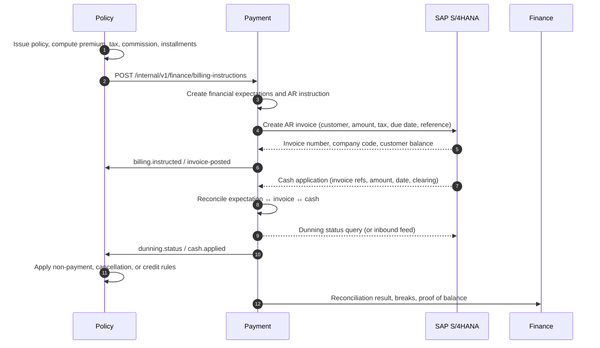

**Flow rules:**

| ID | Rule |
|---|---|
| `FIN-10` | Policy owns the billing schedule, premium, tax, fee, and commission calculations. Payment does not recompute them. |
| `FIN-11` | Payment translates billing instructions into SAP AR invoices; it does not create a competing invoice. |
| `FIN-12` | SAP is authoritative for the invoice number, customer balance, cash application, and dunning level. |
| `FIN-13` | Policy reacts to SAP cash and dunning status through Payment events; it does not read SAP directly. |
| `FIN-14` | A cancellation, endorsement, or audit produces a credit note or additional invoice instruction; it never edits the original SAP invoice. |
| `FIN-15` | Unapplied cash is held in suspense and assigned within the configured SLA; it is never written off silently. |

#### 7.13.5 Reconciliation model

**Levels:**

| Level | What is compared | Example |
|---|---|---|
| Transaction | One expectation ↔ one SAP document | Premium installment ↔ AR invoice |
| Counterparty | Platform balance ↔ SAP customer/vendor balance | Insured AR balance, producer payable |
| Account | Expected subledger total ↔ SAP GL account balance | Premium receivable, commission payable, claim payable |
| Period | Platform expected movement ↔ SAP GL movement | January premium earned, January claim paid |
| Legal entity | Expected balance sheet ↔ SAP trial balance | Proof of balance for company code 1000 |

**Types:**

| Type | Frequency | Key |
|---|---|---|
| AR invoice reconciliation | Daily | Billing instruction ↔ SAP invoice |
| FS-RI primary cession / reinsurance retro | Daily / monthly | Per-book request ↔ FS-RI confirmation and recoverable |
| Cash reconciliation | Daily | SAP invoice ↔ cash application ↔ bank |
| AP payment reconciliation | Daily | Payment ↔ SAP payment document ↔ bank |
| GL balance reconciliation | Monthly / on demand | Expected lines ↔ SAP GL balances |
| Counterparty reconciliation | Monthly | Policyholder, producer, cedent balances |
| Intercompany reconciliation | Monthly | Legal-entity pairs |
| FX revaluation reconciliation | Monthly | Transaction vs base currency |
| Suspense/unapplied cash | Daily | Cash without a matched invoice |
| Close reconciliation | Period end | All of the above, plus sign-off |

**Matching:**

| Key | Required | Notes |
|---|---|---|
| Business reference | Yes | Policy, claim, payment, contract, or billing instruction number |
| SAP document number | When posted | Invoice, payment, clearing, or journal document |
| Company code | Yes | Legal entity mapping |
| Fiscal year / period | Yes | Cut-off alignment |
| Counterparty | Yes | Customer or vendor ID |
| Amount and currency | Yes | Tolerance by account |
| Tax code | For tax lines | Isolates tax differences |
| Due date | For aging | Timing differences |

**Tolerances (configurable by account and materiality):**

| Difference | Default tolerance | Treatment |
|---|---|---|
| Amount | ±0.01 | Match within tolerance |
| Tax | ±0.01 | Match within tolerance; otherwise tax break |
| FX | ±0.5% or ±0.01 base | FX break |
| Date | ±3 business days | Timing break, auto-cleared after cut-off |
| Counterparty | Exact | Manual review |

**Break reason codes:**

`MISSING_SAP_INVOICE`, `MISSING_EXPECTATION`, `AMOUNT_MISMATCH`, `TAX_MISMATCH`, `FX_DIFFERENCE`, `TIMING`, `DUPLICATE`, `PARTIAL_PAYMENT`, `RESIDUAL_ITEM`, `CREDIT_NOTE`, `WRITE_OFF`, `UNALLOCATED_CASH`, `CUSTOMER_MISMATCH`, `COMPANY_CODE_MISMATCH`, `GL_MAPPING`, `ROUNDING`, `MANUAL_ADJUSTMENT`, `SUSPENSE`.

**Break lifecycle:** `OPEN → ASSIGNED → INVESTIGATING → RESOLVED → APPROVED → CLOSED`, or `WAIVED` with reason. Every break has an owner, age, amount, currency, and root cause. Breaks older than the configured SLA escalate to the finance controller.

**Resolution actions:** correct the platform expectation, correct the SAP document, reclassify, allocate cash, create a credit note, write off, or accept a timing difference. All actions are approved and audited; no primary database correction is permitted.

**Proof of balance:**

For each material GL account, the platform produces:

```json
{
  "legalEntityId": "0192…",
  "companyCode": "1000",
  "period": "2026-09",
  "glAccount": "120100",
  "accountName": "Premium Receivable",
  "expectedBalance": { "amount": "12450800.00", "currency": "USD" },
  "sapBalance": { "amount": "12450120.00", "currency": "USD" },
  "difference": { "amount": "680.00", "currency": "USD" },
  "breaks": [
    { "breakId": "…", "reason": "TIMING", "amount": "680.00", "ageDays": 2, "owner": "…" }
  ],
  "status": "EXPLAINED",
  "preparedBy": "…",
  "reviewedBy": "…",
  "signedAt": "2026-10-08T14:22:00Z"
}
```

**Close:**

| Step | Owner | Evidence |
|---|---|---|
| Open period | Finance | Close calendar |
| Cut-off instructions | Finance | Communication, system lock |
| Reconcile AR, AP, GL, intercompany, FX | Payment/Finance | Reconciliation runs |
| Resolve or waive breaks | Finance | Break record, approval |
| Produce proof of balance | Finance | Signed proof |
| Review and certify | Controller | Sign-off |
| Lock period | Finance | Period lock event |
| Post-close review | Internal audit | Sample testing |

**Close rules:**

| ID | Rule |
|---|---|
| `FIN-20` | A period MUST NOT be certified with an unresolved break above materiality. |
| `FIN-21` | Materiality thresholds are defined per legal entity and account and approved by the controller. |
| `FIN-22` | Preparer and reviewer MUST be different users. |
| `FIN-23` | Reconciliation evidence is retained for 10 years and is immutable. |
| `FIN-24` | Adjustments are posted in SAP, not in the platform; the platform records the adjustment reference and reason. |
| `FIN-25` | A closed period is locked; reopening requires controller approval and an audit record. |
| `FIN-26` | The platform must be able to reproduce the expected position as of the close date after the fact. |

#### 7.13.6 SAP interfaces

| Interface | Primaryion | Content | Frequency | Idempotency |
|---|---|---|---|---|
| AR invoice instruction | Platform → SAP | Company code, customer, amount, tax, due date, payment terms, business reference | Event | `billingInstructionId` |
| AR invoice confirmation | SAP → Platform | Invoice number, status, amounts, due date | Event / batch | Invoice number |
| Cash application | SAP → Platform | Invoice references, amount, date, bank, clearing document, residual | Daily batch | Clearing document |
| Dunning status | SAP → Platform | Level, date, amount, next action | Daily | Customer + level + date |
| Credit memo / refund | Platform → SAP | Credit memo request, reason, original invoice | Event | `creditNoteId` |
| AP payment instruction | Platform → SAP | Vendor, amount, method, reference, due date | Event | `paymentId` |
| AP payment status | SAP → Platform | Payment document, value date, status, bank | Event / batch | Payment document |
| GL balance extract | SAP → Platform | Company code, account, period, debit, credit, balance, currency | Daily / monthly | Extract ID |
| Customer master | SAP ↔ Platform | Customer ID, payment terms, credit limit, dunning profile | Event | Party ID |
| Vendor master | SAP ↔ Platform | Vendor ID, bank, tax, payment terms | Event | Party ID |
| Tax code master | SAP → Platform | Tax code, rate, jurisdiction | Daily | Code + validity |

**Mapping rules:** company code ↔ legal entity; customer ↔ insured/policyholder; vendor ↔ producer/cedent/claimant/vendor; invoice ↔ billing instruction; payment document ↔ payment; clearing document ↔ cash application; GL account ↔ accounting event.

#### 7.13.7 Events

**Published:** `finance.expectation.created`, `finance.invoice.posted`, `finance.cash.applied`, `finance.cash.unapplied`, `finance.dunning.changed`, `finance.reconciliation.completed`, `finance.reconciliation.break-opened`, `finance.reconciliation.break-resolved`, `finance.proof.signed`, `finance.close.period-opened`, `finance.close.period-certified`.

**Consumed:** `policy.policy.issued`, `policy.policy.endorsed`, `policy.policy.cancelled`, `policy.premium.audited`, `primary.claim.settlement-authorized`, `primary.claim.paid`, `contract.account.issued`, `contract.cash-call.issued`, `payment.payment.paid`, `payment.payment.returned`.

#### 7.13.8 Controls and metrics

| Control | Requirement |
|---|---|
| Segregation of duties | Preparer ≠ reviewer; billing creator ≠ credit note approver; payment preparer ≠ approver |
| Materiality | Thresholds by legal entity and account; approved annually |
| Break SLA | 3 days for cash, 10 days for GL, 30 days for disputed items |
| Escalation | Finance controller at SLA breach; CFO at 60 days |
| Evidence | Reconciliation runs, break records, proof of balance, sign-offs, extracts |
| Audit | Internal audit samples daily and close reconciliations |
| Access | Finance roles only; read-only for auditors |

**Metrics:** open breaks by age and value; unapplied cash; auto-match rate; close cycle time; manual adjustments per close; write-offs; AR ageing; DSO/DPO; proof differences; SAP posting failures; expectation-to-invoice lag.

#### 7.13.9 Boundary risks and mitigations

| Risk | Impact | Mitigation |
|---|---|---|
| SAP customer/vendor master is not insurance-aware | Wrong counterparty, wrong statement | Map customer/vendor to Party; maintain external references; validate on create |
| SAP AR invoice API does not support installments or audit premium | Manual invoices | Model each installment as a separate instruction; use reference fields; validate in design |
| Cash application lacks policy/claim references | Unapplied cash | Require payment reference; use invoice reference mapping; suspense workflow |
| GL dimensions lack policy/claim/tort | Cannot reconcile at business granularity | Add custom dimensions or reconcile at account + reference level; document limitation |
| SAP tax calculation differs from insurance tax | Tax breaks | Decide tax owner per jurisdiction; reconcile tax lines separately |
| Period cut-off differs | Timing breaks | Publish close calendar; align batch cut-offs; auto-clear timing breaks |
| Manual SAP journals | Unexplained differences | Require journal reference and reason; include in reconciliation scope |
| SAP change control | Integration drift | Versioned mapping; contract tests; sandbox regression |

---

#### 7.13.10 Posting model principles

The production S/4 interface is implementation-time. These principles define the accounting model the interface must satisfy.

| Business event | Accounting event | Debit | Credit |
|---|---|---|---|
| Premium billed | AR invoice | Premium receivable | Written premium |
| Premium collected | Cash application | Bank / cash | Premium receivable |
| Commission earned | AP/expense | Commission expense | Commission payable |
| Claim paid | AP payment | Paid loss | Bank / cash |
| Claim reserve | GL journal | Incurred loss | Loss reserve |
| Ceded premium | AP/GL | Ceded premium | Reinsurer payable |
| Recoverable recognized | GL journal | Reinsurance recoverable | Ceded loss recovery |
| Recoverable collected | Cash application | Bank / cash | Reinsurance recoverable |
| Tax determined | GL journal | Tax expense / premium receivable | Tax payable |
| Reversal | Reversal document | Reverses original | Reverses original |

| ID | Rule |
|---|---|
| `POST-01` | Every posting has a unique business key, source document, and idempotency key. |
| `POST-02` | The accounting date and posting date are separate; a closed period rejects posting. |
| `POST-03` | A correction is a reversal plus a new document; an original is never edited or deleted. |
| `POST-04` | Every posting carries company code, legal entity, currency, tax code, and cost object. |
| `POST-05` | FX difference is posted separately and reconciled. |
| `POST-06` | The platform stores the SAP document number and status for every posting. |
| `POST-07` | A failed posting queues and retries; it never silently drops. |
| `POST-08` | Reconciliation compares platform expected, SAP posted, and bank/cash actual. |
#### 7.13.11 FX, intercompany, and cost allocation

**FX:** every monetary amount stores transaction currency, functional currency, rate, rate date, rate source, and the converted amount. Realized and unrealized FX differences are posted separately and reconciled.

**`fx_rate`** — from/to currency, rate type (`SPOT`, `AVERAGE`, `HISTORICAL`, `CONTRACTUAL`), rate, effective date, source, status.

**Intercompany:** a legal-entity transaction records `from_legal_entity`, `to_legal_entity`, `intercompany_type` (`PREMIUM`, `COMMISSION`, `CLAIM`, `EXPENSE`, `CAPITAL`, `LOAN`), amount, currency, and elimination reference.

**Cost allocation:** `cost_pool` (expense pool), `allocation_basis` (`PREMIUM`, `HEADCOUNT`, `CLAIMS`, `POLICY_COUNT`, `SQUARE_FOOTAGE`, `PRIMARY`), `allocation_run`, `allocation_result` (pool, target, amount, basis, period).

| ID | Rule |
|---|---|
| `FX-01` | A rate is never inferred; the source and date are recorded. |
| `FX-02` | Translation and transaction differences are separate accounts. |
| `FX-03` | Revaluation runs at period close and posts to the ledger. |
| `IC-01` | Intercompany balances eliminate at group close; the platform records the elimination reference. |
| `IC-02` | Transfer pricing follows the approved policy and is effective-dated. |
| `CA-01` | Every allocated cost traces to a pool, basis, and target. |
| `CA-02` | Allocation results are immutable; a rerun creates a new version. |
### 7.14 Actuarial Reserving and Reserve Governance

#### 7.14.1 Purpose and ownership

Recording a reserve is not reserving. Mass tort and reinsurance require a governed actuarial process: data extraction, triangle construction, method selection, ultimate loss picks, ranges, committee review, sign-off, and ongoing development monitoring.

Actuarial reserving is a **cross-cutting capability hosted in the Primary and Reinsurance domain services**, with Portfolio views in Policy and Contract. It is not a ninth business vertical. The workbench is shared; the reserve records remain owned by the vertical that owns the claim or contract.

| Capability | Hosted in | Consumers |
|---|---|---|
| Claim-level case reserve governance | Primary | Claims, Finance, Actuarial |
| Reinsurance reserve governance | Reinsurance | Reinsurance claims, Finance, Actuarial |
| Portfolio triangles and IBNR | Primary, Reinsurance | Actuarial, Finance, CFO |
| Ceded IBNR and recoverable | Contract, Payment | Actuarial, Finance |
| Reserve committee and sign-off | Platform workflow | Actuarial, Finance, Audit |

**Book scope:** actuarial reviews run within one book. An actuary with only `PRIMARY_ROLE` reviews primary reserves; an actuary with only `REINSURANCE_ROLE` reviews reinsurance reserves. A group actuary with both roles may review both, but the two reviews remain separate and are not netted. No review combines Primary and Reinsurance data into one triangle.

#### 7.14.2 Entities

**`actuarial_review`**

| Column | Type | Req | Notes |
|---|---|---|---|
| `id` | uuid | Y | |
| `tenant_id` | uuid | Y | |
| `review_number` | varchar(32) | Y | |
| `scope` | enum | Y | `PRIMARY_PORTFOLIO`, `REINSURANCE_PORTFOLIO`, `POLICY_YEAR`, `TORT`, `TREATY`, `CLAIM_GROUP`, `LEGAL_ENTITY` |
| `scope_ref` | varchar(120) | N | Tort, treaty, year, or program |
| `as_of_date` | date | Y | Valuation date |
| `review_period` | varchar(16) | Y | Quarter or year |
| `actuary_party_id` | uuid | N | Qualified actuary |
| `method_set` | text[] | N | `CHAIN_LADDER`, `BORNHUETTER_FERGUSON`, `EXPECTED_LOSS_RATIO`, `CASE_BASED`, `DEVELOPMENT`, `SCENARIO` |
| `status` | enum | Y | `DRAFT`, `IN_REVIEW`, `COMMITTEE`, `APPROVED`, `PUBLISHED`, `SUPERSEDED` |
| `memo_document_id` | uuid | N | Actuarial memorandum |
| `opinion_document_id` | uuid | N | Formal opinion where required |
| `approved_by`, `approved_at` | uuid / timestamptz | N | |
| `version` | integer | Y | |

**`loss_triangle`**

| Column | Type | Req | Notes |
|---|---|---|---|
| `id` | uuid | Y | |
| `review_id` | uuid | Y | |
| `basis` | enum | Y | `PAID`, `INCURRED`, `REPORTED_COUNT`, `CLOSED_COUNT`, `EXPOSURE` |
| `segment` | varchar(96) | Y | Tort, coverage, treaty year, or layer |
| `valuation_date` | date | Y | |
| `development_age` | integer | Y | Months or years |
| `amount` | numeric(19,4) | Y | |
| `currency` | char(3) | Y | |
| `claim_count` | integer | N | |
| `exposure_amount` | numeric(19,4) | N | |

**`development_factor`**

| Column | Type | Req | Notes |
|---|---|---|---|
| `id` | uuid | Y | |
| `review_id` | uuid | Y | |
| `segment` | varchar(96) | Y | |
| `from_age`, `to_age` | integer | Y | |
| `factor` | numeric(12,6) | Y | Selected age-to-age |
| `source` | enum | Y | `SELECTED`, `CEDENT_SUPPLIED`, `INDUSTRY`, `ACTUARIAL_JUDGMENT` |
| `tail_factor` | numeric(12,6) | N | |
| `notes` | text | N | |

**`ultimate_loss_pick`**

| Column | Type | Req | Notes |
|---|---|---|---|
| `id` | uuid | Y | |
| `review_id` | uuid | Y | |
| `segment` | varchar(96) | Y | |
| `method` | enum | Y | `CHAIN_LADDER`, `BORNHUETTER_FERGUSON`, `EXPECTED_LOSS_RATIO`, `CASE_BASED`, `JUDGMENT` |
| `paid_to_date` | numeric(19,4) | N | |
| `case_reserves` | numeric(19,4) | N | |
| `selected_ultimate` | numeric(19,4) | Y | |
| `ibnr` | numeric(19,4) | Y | |
| `ibner` | numeric(19,4) | N | |
| `ulae` | numeric(19,4) | N | Unallocated loss adjustment expense |
| `currency` | char(3) | Y | |
| `confidence` | enum | N | `LOW`, `MEDIUM`, `HIGH` |
| `selected_by`, `selected_at` | uuid / timestamptz | N | |

**`reserve_range`**

| Column | Type | Req | Notes |
|---|---|---|---|
| `id` | uuid | Y | |
| `review_id` | uuid | Y | |
| `segment` | varchar(96) | Y | |
| `low_amount` | numeric(19,4) | Y | |
| `best_estimate` | numeric(19,4) | Y | |
| `high_amount` | numeric(19,4) | Y | |
| `percentile` | integer | N | |
| `currency` | char(3) | Y | |
| `basis` | varchar(200) | N | Method and assumptions |

**`reserve_committee`**

| Column | Type | Req | Notes |
|---|---|---|---|
| `id` | uuid | Y | |
| `review_id` | uuid | Y | |
| `meeting_date` | date | Y | |
| `members` | jsonb | Y | Names and roles |
| `decision` | enum | Y | `APPROVED`, `APPROVED_WITH_CHANGES`, `DEFERRED`, `REJECTED` |
| `approved_amount` | numeric(19,4) | N | |
| `rationale` | text | N | |
| `minutes_document_id` | uuid | N | |
| `signed_at` | timestamptz | N | |

**`ibnr_allocation`**

| Column | Type | Req | Notes |
|---|---|---|---|
| `id` | uuid | Y | |
| `review_id` | uuid | Y | |
| `target_vertical` | enum | Y | `primary`, `reinsurance`, `contract`, `policy` |
| `target_type` | varchar(48) | Y | Claim, treaty year, policy year, tort |
| `target_id` | uuid | N | |
| `amount` | numeric(19,4) | Y | |
| `currency` | char(3) | Y | |
| `method` | enum | Y | `PRO_RATA_CASE`, `PRO_RATA_PREMIUM`, `EXPOSURE`, `EQUAL`, `MANUAL` |
| `posted_at` | timestamptz | N | |

**`payout_pattern`**

| Column | Type | Req | Notes |
|---|---|---|---|
| `id` | uuid | Y | |
| `review_id` | uuid | Y | |
| `segment` | varchar(96) | Y | |
| `pattern` | jsonb | Y | Year-to-percent paid |
| `discount_rate` | numeric(9,6) | N | |
| `currency` | char(3) | N | |

#### 7.14.3 Workflow

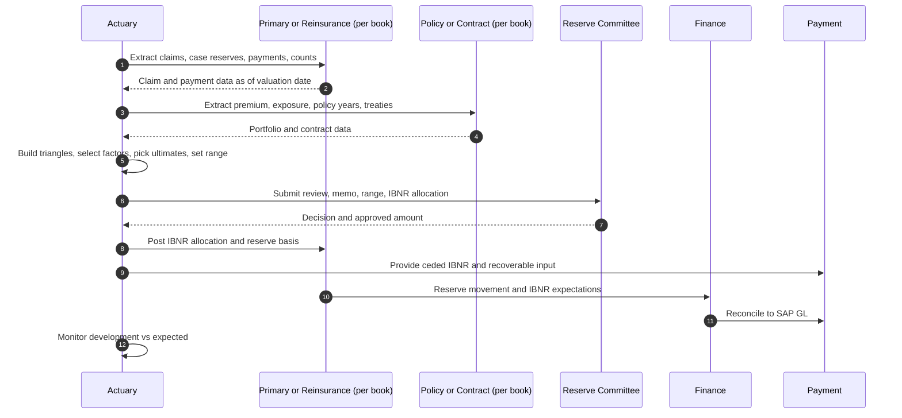

#### 7.14.4 Rules

| ID | Rule |
|---|---|
| `ACT-01` | Case reserves and actuarial IBNR are separate; IBNR MUST NOT overwrite case reserves. |
| `ACT-02` | IBNR MUST have a method, a selected ultimate, an as-of date, and an actuarial owner. |
| `ACT-03` | A reserve review is reproducible from the extract, triangles, factors, and selections. |
| `ACT-04` | Reserve changes above the approved materiality or authority require reserve committee approval. |
| `ACT-05` | Actuarial reserves are posted to Primary/Reinsurance as `reserve_basis=ACTUARIAL`; the platform does not net them against case reserves. |
| `ACT-06` | The approved range and best estimate are disclosed; a pick outside the range requires documented rationale. |
| `ACT-07` | Ceded IBNR is computed separately and reconciled to the ceded recoverable. |
| `ACT-08` | The actuarial memorandum and committee minutes are Documents and are retained with the review. |
| `ACT-09` | A published review is immutable; a subsequent review supersedes it and preserves the prior version. |
| `ACT-10` | Reserving follows the applicable actuarial standards of practice and the tenant's reserve policy. |
| `ACT-11` | A reserve review is book-scoped; no review, triangle, IBNR allocation, or committee approval mixes `PRIMARY` and `REINSURANCE` data. |

#### 7.14.5 APIs and events

| Method | Path | Purpose |
|---|---|---|
| `GET` | `/api/v1/primary/actuarial/reviews` | Reviews |
| `POST` | `/api/v1/primary/actuarial/reviews` | Create review |
| `POST` | `/api/v1/primary/actuarial/reviews/{reviewId}/publish` | Publish approved review |
| `GET` | `/api/v1/primary/actuarial/reviews/{reviewId}/triangles` | Triangles |
| `GET` | `/api/v1/primary/actuarial/reviews/{reviewId}/ultimates` | Ultimate picks and ranges |
| `POST` | `/api/v1/primary/actuarial/ibnr/allocate` | Allocate IBNR |
| `GET` | `/api/v1/reinsurance/actuarial/reviews` | Reinsurance reviews |
| `POST` | `/api/v1/reinsurance/actuarial/reviews` | Create reinsurance review |
| `GET` | `/api/v1/policy/portfolio/reserve-summary` | Policy-year view |
| `GET` | `/api/v1/contract/portfolio/reserve-summary` | Treaty-year view |

**Events:** `actuarial.review.started`, `actuarial.triangle.built`, `actuarial.ultimate.selected`, `actuarial.review.submitted`, `actuarial.review.approved`, `actuarial.ibnr.posted`, `actuarial.development.alert`.

**Metrics:** reserve adequacy ratio, IBNR as percentage of incurred, prior-year development, range width, review cycle time, late reviews, committee overrides, ceded IBNR recovery rate.

---

#### 7.14.6 Actuarial workbench

| View | Purpose |
|---|---|
| Reserve study | Line, book, accident year, paid/incurred, case, IBNR |
| Development triangle | Age-to-age factors, cumulative, selected |
| Method selection | Chain ladder, Bornhuetter-Ferguson, expected loss, frequency-severity |
| Ultimate pick | Selected ultimate, confidence interval, sensitivity |
| Committee pack | Summary, movements, drivers, prior comparison, sign-off |
| Back-testing | Prior picks versus actual development |
| Model inventory | Model, version, owner, validation, assumptions |

Routes: `/v/actuarial/studies`, `/v/actuarial/studies/:id`, `/v/actuarial/triangles`, `/v/actuarial/committee`, `/v/actuarial/models`.

#### 7.14.7 Committee, sign-off, and model governance

```text
DATA_CLOSED → TRIANGLE_BUILT → METHOD_SELECTED → ULTIMATE_PICKED
→ PEER_REVIEWED → COMMITTEE_APPROVED → POSTED → BACK_TESTED
```

| Role | Responsibility |
|---|---|
| Chief actuary | Owns the reserve opinion and model inventory |
| Reviewing actuary | Independent review of methods and selections |
| Peer reviewer | Challenges assumptions and data |
| Reserve committee | Approves ultimate and IBNR |
| Finance controller | Posts and reconciles |

| ID | Rule |
|---|---|
| `ACT-06` | Every study records data cut-off, method, assumptions, and reviewer. |
| `ACT-07` | A method change requires a reason and a comparison to the prior method. |
| `ACT-08` | A reserve movement above threshold requires committee explanation. |
| `ACT-09` | The model inventory records version, owner, validation, and last back-test. |
| `ACT-10` | Back-testing compares prior picks to actual development and records the variance. |
| `ACT-11` | The reserve opinion is signed by the chief actuary and retained. |

**Model governance:** `actuarial_model`, `model_version`, `model_validation`, `assumption_set`, `back_test`. A model cannot be used in a committee pack without a current validation.
### 7.15 Regulatory Reporting and Conduct

#### 7.15.1 Purpose

Regulatory reporting is not a downstream afterthought. The platform must produce the data, evidence, calendars, attestations, and complaint records that regulators and bureaus require. This is a **platform capability** that reads from all verticals; it owns no insurance truth.

#### 7.15.2 Entities

**`regulatory_obligation`**

| Column | Type | Req | Notes |
|---|---|---|---|
| `id` | uuid | Y | |
| `tenant_id` | uuid | Y | |
| `jurisdiction` | varchar(8) | Y | ISO 3166-2 or regulator code |
| `regulator` | varchar(120) | Y | |
| `obligation_type` | enum | Y | `STATUTORY_FILING`, `STATISTICAL`, `RATE_FILING`, `FORM_FILING`, `SURPLUS_LINES`, `DATA_CALL`, `MARKET_CONDUCT`, `COMPLAINT`, `TAX`, `OTHER` |
| `title` | varchar(300) | Y | |
| `frequency` | enum | Y | `MONTHLY`, `QUARTERLY`, `ANNUAL`, `EVENT_DRIVEN`, `AD_HOC` |
| `due_rule` | varchar(120) | N | e.g. 45 days after quarter end |
| `owner` | uuid | N | |
| `evidence_required` | boolean | Y | |
| `status` | enum | Y | `ACTIVE`, `SUSPENDED`, `RETIRED` |

**`regulatory_filing`**

| Column | Type | Req | Notes |
|---|---|---|---|
| `id` | uuid | Y | |
| `obligation_id` | uuid | Y | |
| `period` | varchar(16) | Y | |
| `due_date` | date | Y | |
| `status` | enum | Y | `NOT_STARTED`, `PREPARING`, `REVIEW`, `SUBMITTED`, `ACCEPTED`, `REJECTED`, `RESUBMITTED`, `LATE` |
| `prepared_by`, `reviewed_by` | uuid | N | Must differ |
| `submitted_at` | timestamptz | N | |
| `accepted_at` | timestamptz | N | |
| `evidence_document_id` | uuid | N | |
| `regulator_reference` | varchar(64) | N | |

**`data_call`**

| Column | Type | Req | Notes |
|---|---|---|---|
| `id` | uuid | Y | |
| `regulator` | varchar(120) | Y | |
| `received_date` | date | Y | |
| `due_date` | date | N | |
| `scope` | text | Y | |
| `status` | enum | Y | `RECEIVED`, `IN_PROGRESS`, `SUBMITTED`, `CLOSED` |
| `response_document_id` | uuid | N | |

**`statistical_report`**

| Column | Type | Req | Notes |
|---|---|---|---|
| `id` | uuid | Y | |
| `bureau` | enum | Y | `ISO`, `NCCI`, `NAIC`, `STATE`, `OTHER` |
| `report_code` | varchar(32) | Y | |
| `period` | varchar(16) | Y | |
| `status` | enum | Y | `DRAFT`, `VALIDATED`, `SUBMITTED`, `ACCEPTED`, `REJECTED` |
| `submission_reference` | varchar(64) | N | |
| `error_count` | integer | N | |

**`rate_form_filing`**

| Column | Type | Req | Notes |
|---|---|---|---|
| `id` | uuid | Y | |
| `jurisdiction` | varchar(8) | Y | |
| `filing_type` | enum | Y | `RATE`, `FORM`, `RATE_AND_FORM`, `MANUSCRIPT` |
| `product_code` | varchar(32) | N | |
| `form_number` | varchar(32) | N | |
| `status` | enum | Y | `DRAFT`, `SUBMITTED`, `APPROVED`, `DISAPPROVED`, `WITHDRAWN`, `EFFECTIVE` |
| `effective_date` | date | N | |
| `filing_reference` | varchar(64) | N | |

**`complaint`**

| Column | Type | Req | Notes |
|---|---|---|---|
| `id` | uuid | Y | |
| `tenant_id` | uuid | Y | |
| `complaint_number` | varchar(32) | Y | |
| `source` | enum | Y | `REGULATOR`, `INSURED`, `CLAIMANT`, `PRODUCER`, `INTERNAL`, `OTHER` |
| `jurisdiction` | varchar(8) | N | |
| `category` | enum | Y | `CLAIMS_HANDLING`, `COVERAGE`, `PAYMENT`, `PREMIUM`, `CANCELLATION`, `SERVICE`, `PRIVACY`, `OTHER` |
| `severity` | enum | Y | `LOW`, `MEDIUM`, `HIGH`, `CRITICAL` |
| `status` | enum | Y | `RECEIVED`, `ACKNOWLEDGED`, `INVESTIGATING`, `RESPONDED`, `CLOSED`, `ESCALATED` |
| `subject_ref` | EntityRef | N | Policy, claim, payment |
| `received_at` | timestamptz | Y | |
| `due_at` | timestamptz | N | |
| `resolution` | text | N | |
| `root_cause` | varchar(200) | N | |
| `regulator_reportable` | boolean | Y | |

**`market_conduct_review`**

| Column | Type | Req | Notes |
|---|---|---|---|
| `id` | uuid | Y | |
| `jurisdiction` | varchar(8) | Y | |
| `review_type` | enum | Y | `INTERNAL`, `REGULATOR`, `THIRD_PARTY` |
| `period_from`, `period_to` | date | Y | |
| `status` | enum | Y | `SCHEDULED`, `IN_PROGRESS`, `FINDINGS`, `REMEDIATION`, `CLOSED` |
| `findings` | jsonb | N | |
| `report_document_id` | uuid | N | |

**`regulatory_inquiry`**

| Column | Type | Req | Notes |
|---|---|---|---|
| `id` | uuid | Y | |
| `regulator` | varchar(120) | Y | |
| `reference` | varchar(64) | N | |
| `received_date` | date | Y | |
| `response_due_date` | date | N | |
| `status` | enum | Y | `OPEN`, `RESPONDING`, `SUBMITTED`, `CLOSED` |
| `response_document_id` | uuid | N | |

##### Report and filing catalog (minimum)

| Report or filing | Regulator or body | Frequency | Primary source | Section |
|---|---|---|---|---|
| NAIC annual statement | State insurance departments / NAIC | Annual | Policy, Contract, Primary, Reinsurance, Payment | §7.15 |
| Schedule P (loss reserves) | NAIC | Annual | Primary, Reinsurance, Actuarial | §7.14, §7.15 |
| Schedule F (reinsurance) | NAIC | Annual | Contract, Payment | §11.3.13, §7.15 |
| Statutory premium and loss exhibits | State insurance departments | Annual / quarterly | Policy, Primary, Reinsurance | §7.15 |
| ISO statistical reporting | ISO | Monthly / quarterly | Policy, Primary | §7.15 |
| NCCI statistical reporting | NCCI | Quarterly | Policy | §7.15 |
| Surplus lines tax and stamping | State surplus lines offices | Monthly / quarterly | Policy, Payment | §7.15, §11.7.15 |
| Premium tax return | State tax authorities | Quarterly / annual | Policy, Payment | §11.7.15 |
| TRIA premium and disclosure | Federal / state | Annual / policy | Policy | §11.7.15 |
| Rate and form filings | State insurance departments | Event-driven | Policy | §11.2.14, §7.15 |
| Market conduct data call | State insurance departments | Event-driven | All | §7.15 |
| Complaint register and responses | State insurance departments | Event-driven | Primary, Policy, Notifications | §7.15 |
| ORSA summary report | State / group supervisor | Annual | Actuarial, Finance | §7.14, §7.15 |
| IFRS 17 disclosure pack (if applicable) | Group reporting | Annual / interim | Contract, Primary, Finance | §7.15 |
| Solvency II reports (if applicable) | EU supervisor | Quarterly / annual | Finance, Contract | §7.15 |

#### 7.15.3 Workflow and rules

| ID | Rule |
|---|---|
| `REG-01` | Every filing has an owner, a due date, a reviewer who is not the preparer, and retained evidence. |
| `REG-02` | A statutory or rate filing MUST NOT be submitted without a second review and a data reconciliation to source. |
| `REG-03` | Late or rejected filings escalate to the compliance officer and the CFO. |
| `REG-04` | Complaints are acknowledged within the jurisdiction's requirement and resolved within the internal SLA; regulator-reportable complaints are flagged. |
| `REG-05` | Every report line has data lineage to the source records and the query or extract version. |
| `REG-06` | Filing data is versioned and reproducible for the period; corrections are resubmissions, not edits. |
| `REG-07` | A regulatory inquiry or market conduct review creates a tracked matter with an evidence pack. |
| `REG-08` | The compliance calendar is reviewed weekly; overdue items are a Sev-2 operational issue. |

**APIs:** `/api/v1/regulatory/obligations`, `/api/v1/regulatory/filings`, `/api/v1/regulatory/complaints`, `/api/v1/regulatory/inquiries`, `/api/v1/regulatory/data-calls`, `/api/v1/regulatory/statistical-reports`, `/api/v1/regulatory/rate-form-filings`.

**Events:** `regulatory.filing.due`, `regulatory.filing.submitted`, `regulatory.filing.rejected`, `regulatory.complaint.received`, `regulatory.complaint.escalated`, `regulatory.inquiry.received`, `regulatory.market-conduct.finding`.

---

#### 7.15.4 Filing catalog and report specifications

Every filing has a report specification, an owner, a reviewer, a due date, a source query, and an evidence record.

**`report_spec`**

| Column | Type | Req | Notes |
|---|---|---|---|
| `id` | uuid | Y | |
| `report_code` | varchar(32) | Y | |
| `report_name` | varchar(160) | Y | |
| `jurisdiction` | varchar(8) | Y | `US-NAIC`, state, or country |
| `domain` | enum | Y | `FINANCIAL`, `CLAIMS`, `REINSURANCE`, `PREMIUM_TAX`, `MARKET_CONDUCT`, `HOLDING_COMPANY`, `RISK`, `CYBER`, `OTHER` |
| `frequency` | enum | Y | `MONTHLY`, `QUARTERLY`, `ANNUAL`, `EVENT` |
| `due_rule` | varchar(120) | Y | e.g. `45 days after quarter end` |
| `source_query` | text | Y | Versioned query or view |
| `format` | enum | Y | `PDF`, `CSV`, `XBRL`, `JSON`, `EDI` |
| `submission_channel` | varchar(120) | Y | |
| `owner_id` | uuid | Y | |
| `reviewer_id` | uuid | Y | |
| `status` | enum | Y | `DRAFT`, `APPROVED`, `ACTIVE`, `RETIRED` |

**Filing catalog (minimum):**

| Domain | Filing | Frequency | Owner |
|---|---|---|---|
| Financial | NAIC Annual Statement, Schedule F, Schedule P | Annual | Finance, Actuarial |
| Financial | Quarterly NAIC statement | Quarterly | Finance |
| Financial | Holding company registration / Form B / Form F | Annual or event | Legal, Finance |
| Financial | ORSA summary report | Annual | Risk, Actuarial |
| Financial | Own risk and solvency assessment | Annual | Risk |
| Reinsurance | Schedule F, credit for reinsurance, collateral | Annual / quarterly | Reinsurance, Finance |
| Premium tax | State premium tax return, surplus lines tax, TRIA | Annual / quarterly / monthly | Tax |
| Claims | Statutory claims report, closed claim report | Annual / quarterly | Claims |
| Market conduct | Complaint log, producer licensing, policy forms, rates | Annual / event | Compliance |
| Cyber | Cybersecurity incident notification | Event | CISO, Legal |
| Privacy | Breach notification, DSAR evidence | Event | Privacy |
| Tax | 1099, withholding, VAT/GST | Annual / periodic | Tax |

**Report specification rules:**

| ID | Rule |
|---|---|
| `RR-01` | Every report has a versioned source query; a manual spreadsheet is not a source. |
| `RR-02` | The reviewer differs from the preparer. |
| `RR-03` | A filing is reproducible from the source query and the retained extract. |
| `RR-04` | A late or rejected filing creates an incident and a remediation record. |
| `RR-05` | A jurisdiction change creates a new report version; historical filings are not rewritten. |

#### 7.15.5 State notices and complaint SLAs

**Notice catalog:**

| Notice | Trigger | Timing | Channel |
|---|---|---|---|
| Cancellation / nonrenewal | Policy action | Statutory notice period by state | Mail, email |
| Premium increase | Renewal or endorsement | Statutory notice period | Mail, email |
| Reservation of rights | Coverage question | With the coverage decision | Mail |
| Claim delay | No decision within statutory period | Before the deadline | Mail |
| Denial | Adverse benefit decision | With the denial | Mail |
| Settlement / release | Settlement | At settlement | Mail, e-signature |
| Privacy notice | Collection or annual | As required | Mail, web |
| Breach notification | Incident | As required by state | Mail, web |
| Complaint acknowledgement | Complaint received | 5 business days (default) | Mail, email |
| Complaint resolution | Complaint | 30 calendar days (default) | Mail |

**Complaint SLA:**

| Stage | Default | Escalation |
|---|---|---|
| Acknowledge | 5 business days | 1 business day before due |
| Investigate | 20 calendar days | Supervisor at day 15 |
| Resolve and respond | 30 calendar days | Compliance at day 25 |
| Regulatory response | Per regulator deadline | Legal immediately |

State-specific overrides are stored in `complaint_sla_rule`; the strictest applicable rule wins.

#### 7.15.6 Statutory claims timelines

| Step | Default | Notes |
|---|---|---|
| FNOL acknowledgement | 10 calendar days | Written or electronic |
| Coverage decision | 30 calendar days after proof of loss | Extension requires written notice |
| Payment | 30 calendar days after settlement | Interest may accrue |
| Denial | Written, with reasons and appeal rights | |
| Status update | Every 30 days while open | |
| Closure letter | At closure | |

`claims_timeline_rule` stores state, line, step, days, extension allowed, interest rule, and citation. A timer breach creates an exception and a notification.

#### 7.15.7 Market conduct and examinations

| Control | Evidence |
|---|---|
| Complaint log | Every complaint, stage, outcome, and timing |
| Producer licensing | License, appointment, state, expiry |
| Policy forms and rates | Filed version, effective date, state |
| Claims practices | File samples, timelines, denial reasons |
| Record retention | Retention schedule and certificates |
| Examination response | Data request, extract, reconciliation, sign-off |

#### 7.15.8 Retention and evidence

| Record | Retention | Basis |
|---|---|---|
| Policy and contract | 10 years after expiry | Contract and tax |
| Claim | 10 years after closure | Statutory and litigation |
| Reinsurance contract and statement | 10 years after expiry or commutation | Financial evidence |
| Complaint | 5 years after resolution | Market conduct |
| Filing and workpaper | 10 years | Regulatory |
| Tax return | 7 years after filing | Tax |
| Security incident | 7 years after closure | Cyber and legal |
| Training record | 5 years after employment | Compliance |

A legal hold overrides disposition. Destruction produces a certificate.
### 7.16 Management Reporting, BI, and Data Governance

#### 7.16.1 Purpose

Operational reporting is how the business is run: inventory, ageing, SLA, reserve development, settlement velocity, premium, receivables, recoverables, and regulatory data. BI is a platform capability fed by all verticals; it owns no transactional truth.

#### 7.16.2 Architecture

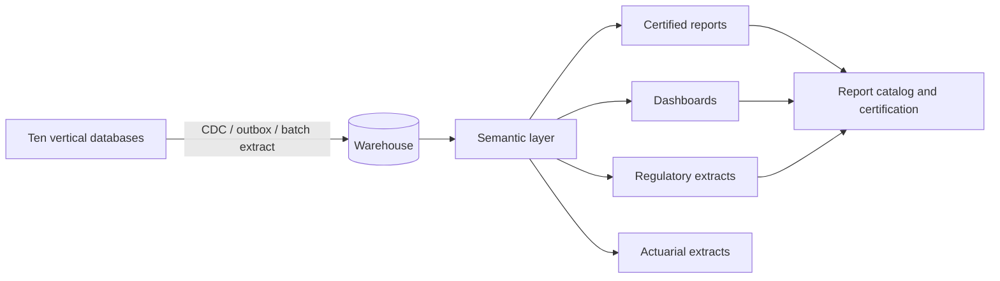

| Layer | Responsibility |
|---|---|
| Operational read models | Vertical-owned, low-latency, bounded scope |
| Warehouse | Integrated, historized, conformed dimensions |
| Semantic layer | Metric definitions, joins, row-level security |
| Report catalog | Certified reports, owners, refresh, consumers |
| Data governance | Stewardship, quality rules, issues, lineage |

#### 7.16.3 Entities

**`data_domain`** — domain name, owner, steward, classification, criticality.
**`data_product`** — name, domain, schema, freshness SLA, consumers, certification.
**`semantic_model`** — model name, version, source marts, metrics, security.
**`metric_definition`** — code, name, definition, formula, grain, dimensions, owner, version.
**`report_catalog`** — report code, name, audience, purpose, source, owner, refresh, certification, retention.
**`report_run`** — report, parameters, started, completed, row count, status, output ref.
**`data_quality_rule`** — rule code, dataset, dimension, expression, threshold, severity.
**`data_quality_result`** — rule, run, result, failed count, sample, status.
**`data_issue`** — issue, dataset, impact, owner, status, root cause, remediation.
**`data_steward`** — user, domain, responsibilities.

#### 7.16.4 Metric catalog (minimum)

| Metric | Definition | Grain |
|---|---|---|
| Claim count | Claims registered in period | Tort, status, adjuster |
| Open inventory | Claims not closed at period end | Tort, queue, age |
| Paid loss | Payments with value date in period | Tort, policy year, coverage |
| Incurred loss | Paid plus reserve change | Tort, policy year |
| IBNR | Actuarial estimate not yet reported | Tort, treaty year |
| Reserve adequacy | Incurred vs ultimate | Tort, year |
| Settlement velocity | Days from FNOL to settlement | Tort, firm |
| Closure rate | Claims closed / claims opened | Period |
| Reopen rate | Reopened / closed | Period |
| Cycle time | Stage-to-stage duration | Queue |
| SLA compliance | Tasks completed within SLA | Queue, team |
| Premium written | Bound premium in period | Product, program |
| Premium receivable | Outstanding AR | Insured, producer |
| Cash collected | Cash applied in period | Legal entity |
| Commission payable | Outstanding producer payable | Producer |
| Ceded premium | Premium ceded in period | Treaty |
| Recoverable | Ceded paid plus unpaid plus IBNR | Treaty, cedent |
| Loss ratio | Incurred / earned premium | Portfolio, year |
| Expense ratio | Expense / premium | Portfolio |
| Data quality score | Passed rules / total rules | Dataset |

#### 7.16.5 Rules

| ID | Rule |
|---|---|
| `BI-01` | Every certified metric has one definition, one owner, and one semantic implementation. |
| `BI-02` | A report is certified only after reconciliation to source and sign-off by the data owner. |
| `BI-03` | Row-level security applies in the semantic layer; PHI and privileged data are masked by role. |
| `BI-04` | Refresh SLAs are published; stale reports show the last refresh time and a warning. |
| `BI-05` | Data quality rules run on every load; failures create issues with owners. |
| `BI-06` | Every report traces to source systems and transformation versions. |
| `BI-07` | Ad hoc access is read-only, bounded, and audited; no primary production database access. |
| `BI-08` | Regulatory and actuarial extracts use the same certified metrics as management reporting. |
| `BI-09` | Combined finance and executive reports require a combined role; they present `PRIMARY` and `REINSURANCE` side-by-side without netting, merging, or record-level cross-book export. |

**APIs:** `/api/v1/reporting/catalog`, `/api/v1/reporting/reports/{code}/run`, `/api/v1/reporting/metrics`, `/api/v1/reporting/data-quality`, `/api/v1/reporting/issues`.

**Events:** `reporting.report.published`, `reporting.metric.changed`, `reporting.data-quality.failed`, `reporting.data-issue.opened`, `reporting.data-issue.resolved`.

**SLOs:** certified reports refresh within 4 hours of source close; operational dashboards within 15 minutes; data quality results within 1 hour; metric definition changes reviewed within 5 days.

---

### 7.17 SAP FS-RI System Boundary

SAP FS-RI is the system of record for **actual cessions, retrocessions, ceded amounts, recoverables, and reinsurance statements**. The platform manages the **business side**: Cession and Retrocession administer the outward and retrocessional contracts, layers, participants, terms, security, and cession/retro rules. They may calculate an expected cession for validation and display, but FS-RI remains authoritative for the posted result. The platform does not maintain an outward reinsurance subledger.

| Capability | System of record | Platform role |
|---|---|---|
| Primary policy administration | Platform (Policy) | Own |
| Primary claims handling | Platform (Primary) | Own |
| Reinsurance contract administration | Platform (Contract) | Own |
| Reinsurance claims handling | Platform (Reinsurance) | Own |
| Primary outward reinsurance contract administration | Platform (Cession) | Own contract terms, layers, participants, security, cession rules; calculate expected cession |
| Reinsurance retrocessional contract administration | Platform (Retrocession) | Own retro contract terms, layers, participants, security, retro rules; calculate expected retro |
| Actual ceded and retroceded amounts | SAP FS-RI | Authoritative; platform reconciles |
| Ceded and retroceded recoverables | SAP FS-RI | Authoritative; platform projects and reconciles |
| Reinsurance statements and cash calls | SAP FS-RI | Receive, link, reconcile |
| Premium AR, claim AP, GL | SAP S/4HANA | Expected position, instructions, reconciliation |

**Two reinsurance administration verticals:**

| Vertical | Book | Owns business side | Sources | Output |
|---|---|---|---|---|
| **Cession** | `PRIMARY` | Ceded contracts, layers, participants, terms, security, cession rules | Policy, Primary | Contract and cession hand-offs to SAP FS-RI |
| **Retrocession** | `REINSURANCE` | Retro contracts, layers, participants, terms, security, retro rules | Contract, Reinsurance | Contract and retro hand-offs to SAP FS-RI |

The verticals are separate, with their own front-end, domain, expert, database, credentials, queues, and mapping tables. Their design is in §7.18, §11.9, and §11.10.

**Contract master decision:** the default is that **Cession and Retrocession own the business contract master** (`contract_number`), send it to FS-RI, and store the returned `fsri_contract_ref`. FS-RI may not create a second contract for the same terms. If the FS-RI implementation requires FS-RI to create the contract first, Cession/Retrocession store the FS-RI reference and do not create a competing contract; the contract number remains the platform's immutable business key. The chosen mode is recorded per implementation, and a daily contract-master reconciliation detects duplicates or orphans.

**Interface timing:** the production FS-RI interface is implementation-time. The v1 platform ships a contract-compliant FS-RI simulator and test endpoints so that Cession, Retrocession, and Playwright E2E tests can run end-to-end without a live FS-RI connection.

**Boundary rules:**

| ID | Rule |
|---|---|
| `FSRI-01` | Policy and Primary never call FS-RI or Cession; they publish facts and read Cession projections. Reinsurance and Contract never call FS-RI or Retrocession. |
| `FSRI-02` | Cession pulls only `PRIMARY` sources; Retrocession pulls only `REINSURANCE` sources. |
| `FSRI-03` | Cession and Retrocession may calculate an expected cession from their contract terms and rules for validation and display; FS-RI is authoritative for the actual cession, recoverable, and statement. |
| `FSRI-04` | Every hand-off has an idempotency key and a stored FS-RI acknowledgement. |
| `FSRI-05` | Cession and Retrocession do not call each other and do not share tables, queues, or credentials. |
| `FSRI-06` | Reconciliation is per book: platform source facts, FS-RI results, and S/4 postings. No cross-book netting. |
| `FSRI-07` | A rejected hand-off creates an exception with an owner and SLA; the source is flagged as pending or unceded. |

---
### 7.18 Cession and Retrocession Reinsurance Administration Verticals

#### 7.18.1 Two verticals, one boundary each

Cession and Retrocession are **full reinsurance administration verticals**, not embedded adapters. Each has its own front-end workbench, domain service, expert service, database, queues, credentials, and access scope. Users manage the outward or retrocessional contracts in these verticals; the verticals output contract and cession facts to SAP FS-RI.

| Vertical | Code | Book | Pulls from | Owns | Hands off to |
|---|---|---|---|---|---|
| **Cession** | `cession` | `PRIMARY` | Policy, Primary | Outward contract administration, layers, participants, terms, security, cession rules, cession cases, hand-off events, confirmations, ceded recoverables, statements, exceptions, reconciliation | SAP FS-RI |
| **Retrocession** | `retrocession` | `REINSURANCE` | Contract, Reinsurance | Retrocessional contract administration, layers, participants, terms, security, retro rules, retro cases, hand-off events, confirmations, retro recoverables, statements, exceptions, reconciliation | SAP FS-RI |

| Application | Type | Database |
|---|---|---|
| `eia-cession-web` | Federated React remote | — |
| `eia-cession-domain` | Spring Boot domain service | `eia_cession` (`tx`, `ent`) |
| `eia-cession-expert` | Spring Boot + Batch + Quartz | `eia_cession` (`ent`, `ref`, `batch`, `ops`) |
| `eia-retrocession-web` | Federated React remote | — |
| `eia-retrocession-domain` | Spring Boot domain service | `eia_retrocession` (`tx`, `ent`) |
| `eia-retrocession-expert` | Spring Boot + Batch + Quartz | `eia_retrocession` (`ent`, `ref`, `batch`, `ops`) |

#### 7.18.2 Pull model

The Cession and Retrocession verticals **pull** what they need from the source verticals. They do not require the source business vertical to push into them, and they never write source business data.

| Vertical | Event triggers | Detail reads |
|---|---|---|
| Cession | `policy.policy.issued`, `policy.policy.endorsed`, `policy.policy.cancelled`, `policy.premium.changed`, `primary.claim.registered`, `primary.claim.reserve-changed`, `primary.claim.paid`, `primary.claim.recovery-recorded`, `primary.claim.closed` | Policy coverage/limits/premium; Primary claim facts, reserves, payments, recoveries |
| Retrocession | `contract.contract.bound`, `contract.contract.endorsed`, `contract.contract.commuted`, `reinsurance.claim.registered`, `reinsurance.claim.reserve-changed`, `reinsurance.claim.paid`, `reinsurance.claim.recovery-recorded`, `reinsurance.claim.closed` | Contract terms/layers/participations; Reinsurance claim facts, reserves, payments, recoveries |

**Pull rules:**

| ID | Rule |
|---|---|
| `PULL-01` | The vertical consumes domain events; it fetches detail through the source vertical's internal read API. |
| `PULL-02` | The vertical never writes to Policy, Primary, Contract, or Reinsurance. |
| `PULL-03` | A missing or stale source record creates an exception; the vertical does not invent or infer business facts. |
| `PULL-04` | A daily snapshot reconciliation detects missed events by comparing source business keys to its cases. |
| `PULL-05` | Cession pulls only from `PRIMARY` sources; Retrocession pulls only from `REINSURANCE` sources. |
| `PULL-06` | No cross-book pull is permitted; a source record from the other book is rejected as a wall violation. |

#### 7.18.3 Hand-off model

The vertical builds an FS-RI hand-off event, writes it to its outbox, and delivers it to FS-RI. The hand-off carries the business reference, the FS-RI treaty/contract reference, the source version, the mapped payload, and an idempotency key.

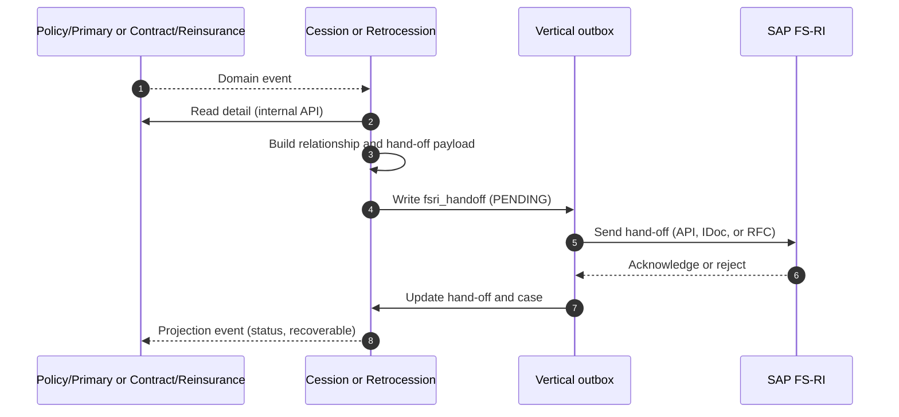

**Hand-off rules:**

| ID | Rule |
|---|---|
| `HAND-01` | Every hand-off has a stable idempotency key: vertical, book, source type, source ID, source version, hand-off type. |
| `HAND-02` | A hand-off is immutable; a source change creates a new hand-off version with a new key. |
| `HAND-03` | FS-RI acknowledgement is stored with the FS-RI reference, timestamp, and response. |
| `HAND-04` | A rejection creates an exception with an owner and SLA; the source record is flagged as pending or unceded. |
| `HAND-05` | FS-RI outage queues hand-offs; no shadow spreadsheet or manual file transfer is permitted. |
| `HAND-06` | Hand-off payloads are versioned; mapping changes require a new mapping version and contract test. |
| `HAND-07` | A hand-off never contains data from the other book; the vertical rejects cross-book payloads. |

#### 7.18.4 Data ownership

The Cession and Retrocession verticals own **contract administration and FS-RI relationship data**:

`ceded_contract` / `retrocession_contract`, layers, participants, terms, security, cession/retro rules, `cession_case` / `retro_case`, `fsri_handoff`, `fsri_confirmation`, `fsri_recoverable`, `fsri_statement`, `fsri_mapping`, `fsri_exception`, `fsri_reconciliation`, `fsri_message`.

They do not own policy, claim, reinsurance contract, reserve, payment, or party truth. Source verticals may display the contract or cession projection through the vertical's read API or events.

#### 7.18.5 Access and wall

* `cession` is `PRIMARY` only; `retrocession` is `REINSURANCE` only.
* Permissions are `cession.*` and `retrocession.*`; they require the matching `bookScope`.
* Cession and Retrocession never call each other.
* Cession calls only Policy and Primary; Retrocession calls only Contract and Reinsurance.
* No shared database, queue, credential, or mapping table between the two.
* Users with both book roles may read both workbenches, but cannot combine their data in one hand-off or one case.

#### 7.18.6 APIs and events

| Method | Path | Purpose |
|---|---|---|
| `GET` | `/api/v1/cession/cases` | Cession cases |
| `GET` | `/api/v1/cession/handoffs` | Hand-off queue |
| `POST` | `/api/v1/cession/handoffs/{id}/retry` | Retry hand-off |
| `GET` | `/api/v1/cession/recoverables` | Ceded recoverables |
| `GET` | `/api/v1/cession/reconciliations` | Reconciliation |
| `GET` | `/api/v1/retrocession/cases` | Retro cases |
| `GET` | `/api/v1/retrocession/handoffs` | Hand-off queue |
| `POST` | `/api/v1/retrocession/handoffs/{id}/retry` | Retry hand-off |
| `GET` | `/api/v1/retrocession/recoverables` | Retro recoverables |
| `GET` | `/api/v1/retrocession/reconciliations` | Reconciliation |

**Events:** `cession.case.created`, `cession.handoff.sent`, `cession.handoff.acknowledged`, `cession.handoff.rejected`, `cession.confirmation.received`, `cession.recoverable.updated`, `cession.reconciliation.break`; `retrocession.case.created`, `retrocession.handoff.sent`, `retrocession.handoff.acknowledged`, `retrocession.handoff.rejected`, `retrocession.confirmation.received`, `retrocession.recoverable.updated`, `retrocession.reconciliation.break`.

#### 7.18.7 Failure modes

| Failure | Behaviour |
|---|---|
| Source event missed | Daily snapshot reconciliation creates a catch-up case |
| Source record not found | Exception; no hand-off |
| FS-RI unavailable | Queue; retry with backoff; alert |
| FS-RI rejects hand-off | Exception; source flagged; owner assigned |
| Duplicate hand-off | Idempotency key returns the existing FS-RI result |
| Mapping error | Rejected before send; mapping defect |
| Cross-book payload | Blocked and logged as a security event |
| Confirmation mismatch | Reconciliation break; no silent correction |

---

### 7.19 Reinsurance Calculations and Test Vectors

Cession and Retrocession calculate an **expected** cession or retrocession from the contract terms and rules they manage. FS-RI remains authoritative for the actual amount. Expected calculations exist to validate terms, explain variances, and give users a defensible preview before hand-off.

#### 7.19.1 Inputs, precision, and rounding

| Input | Source | Rule |
|---|---|---|
| Subject premium | Policy or Contract | Gross written or earned, as stated by the rule |
| Gross loss | Primary or Reinsurance | Paid, reserve, or ultimate, as stated by the rule |
| Expenses | Policy, Primary, Reinsurance, Contract | Allocated or primary, as stated by the rule |
| Layer attachment and limit | Ceded/retro contract | Absolute amount or percentage of subject premium |
| Cession percentage | Quota share, surplus, or rule | 0–100% |
| Commission and brokerage | Contract terms | Percentage of ceded premium |
| Currency and FX rate | Contract and ledger | Rate on the calculation date; rate source recorded |

Money is `numeric(19,4)`. Calculations round half-up at currency precision. Percentage allocations that must sum to 100% use largest-remainder allocation; the residual goes to the largest participant. FX conversion records the rate, source, and date.

#### 7.19.2 Quota share

```
ceded_premium      = subject_premium × qs_pct
ceding_commission  = ceded_premium × commission_pct
brokerage          = ceded_premium × brokerage_pct
ceded_loss         = gross_loss × qs_pct
net_retention_loss = gross_loss × (1 − qs_pct)
```

#### 7.19.3 Surplus

```
cession_pct = min(max((subject_premium − retention) ÷ subject_premium, 0), capacity_pct)
ceded_premium = subject_premium × cession_pct
ceded_loss    = gross_loss × cession_pct
```

For per-risk surplus, replace `subject_premium` with the risk limit and `retention` with the retention line. `capacity_pct` is the sum of signed participant lines, capped at 100%.

#### 7.19.4 Excess of loss

```
ceded_loss = min(max(gross_loss − attachment, 0), limit)
```

If the layer has reinstatements:

```
reinstatement_premium = (ceded_loss ÷ limit) × reinstatement_rate × deposit_premium
remaining_limit = limit + reinstated_limit − ceded_loss
```

Reinstatement premium is pro rata to the limit consumed unless the contract states a different basis. An unlimited reinstatement must have a contractual cap.

#### 7.19.5 Aggregate excess and stop loss

Aggregate excess:

```
aggregate_ceded = min(max(aggregate_loss − attachment, 0), limit)
```

Stop loss:

```
loss_ratio = aggregate_loss ÷ subject_premium
ceded_loss = min(max(loss_ratio − attachment_ratio, 0), limit_ratio) × subject_premium
```

#### 7.19.6 Commission, brokerage, sliding scale, and profit commission

```
sliding_commission_pct = base_commission_pct
                       + slope × (target_loss_ratio − actual_loss_ratio)
```

The result is bounded by the contract floor and cap.

```
profit = ceded_premium − ceded_loss − ceded_expenses
         − ceding_commission − brokerage + other_terms
profit_commission = max(profit, 0) × profit_commission_pct
```

A deficit is carried forward only where the contract says so; otherwise it is extinguished at the treaty year.

#### 7.19.7 Inuring order

```text
remaining_loss = gross_loss
total_ceded = 0
for rule in rules sorted by order:
    ceded = apply(rule, remaining_loss)
    ceded = min(ceded, rule.available_limit)
    total_ceded += ceded
    remaining_loss -= ceded
```

| Rule | Requirement |
|---|---|
| `INUR-01` | Every rule has an explicit `order`; equal orders are rejected. |
| `INUR-02` | A rule sees only the loss remaining after prior rules; no double counting. |
| `INUR-03` | A facultative certificate may override the order only with an explicit `inuring_override` and approval. |
| `INUR-04` | The expected calculation stores every intermediate result, not only the total. |
| `INUR-05` | Reordering rules creates a new rule version and recalculates open cases. |

#### 7.19.8 Retrocession

```
retro_premium    = retro_subject_premium × retro_pct
retro_commission = retro_premium × retro_commission_pct
retro_ceded_loss = min(max(ceded_loss − retro_attachment, 0), retro_limit) × retro_pct
retro_recoverable = retro_ceded_loss − retro_commission_adjustment
```

Retro rules apply to the **ceded loss after the reinsurance contract's inuring cessions**, in the retro program's own order. A retro program may not attach to gross reinsurance loss unless the contract explicitly says so.

#### 7.19.9 Commutation

```
commutation_value = PV(future_recoverables + future_premium_adjustments
                       − future_expenses, discount_rate)
```

The negotiated amount may differ from the calculated value; the difference is recorded as a commutation gain or loss and requires approval. Commutation releases the contract, the related cession/retro cases, and the security, and closes the recoverable.

#### 7.19.10 Expected versus actual

```
variance_amount = expected_amount − fsri_actual_amount
variance_pct    = variance_amount ÷ fsri_actual_amount
```

| Variance | Treatment |
|---|---|
| Within tolerance | Auto-accepted; evidence retained |
| Above tolerance, explained | Accepted with reason code and reviewer |
| Above tolerance, unexplained | Exception; blocks reconciliation sign-off |
| Sign reversed or missing | Critical exception; security event |

Default tolerance is the lesser of 1% or 1,000 in contract currency; the contract may set a tighter tolerance.

#### 7.19.11 Test vectors

| ID | Scenario | Inputs | Expected |
|---|---|---|---|
| `TV-QS-01` | Quota share | Premium 1,000,000; QS 40%; commission 25%; loss 600,000 | Ceded premium 400,000; commission 100,000; ceded loss 240,000; net loss 360,000 |
| `TV-SUR-01` | Surplus | Premium 1,000,000; retention 250,000; capacity 750,000; loss 600,000 | Cession 75%; ceded premium 750,000; ceded loss 450,000 |
| `TV-XOL-01` | XOL below attachment | Loss 500,000; attachment 1,000,000; limit 1,000,000 | Ceded 0 |
| `TV-XOL-02` | XOL partial | Loss 2,000,000; attachment 1,000,000; limit 1,000,000 | Ceded 1,000,000 |
| `TV-XOL-03` | XOL exhausted | Loss 2,500,000; attachment 1,000,000; limit 1,000,000 | Ceded 1,000,000 |
| `TV-AGG-01` | Aggregate excess | Aggregate loss 5,000,000; attachment 4,000,000; limit 2,000,000 | Ceded 1,000,000 |
| `TV-SL-01` | Stop loss | Premium 10,000,000; loss ratio 80%; attachment 70%; limit 20% | Ceded 1,000,000 |
| `TV-SS-01` | Sliding scale | Base 25%; target LR 60%; slope 0.5; actual LR 50%; ceded premium 400,000 | Commission 30%; 120,000 |
| `TV-PC-01` | Profit commission | Ceded premium 400,000; ceded loss 240,000; expenses 40,000; commission 100,000; brokerage 10,000; PC 20% | Profit 10,000; PC 2,000 |
| `TV-INUR-01` | Inuring order | Loss 1,000,000; QS 50% first; XOL 200,000 xs 200,000 second | QS 500,000; XOL 200,000; total 700,000; net 300,000 |
| `TV-RET-01` | Retro quota share | Ceded loss 700,000; retro QS 30% | Retro ceded 210,000 |
| `TV-COM-01` | Commutation | Future recoverables 1,000,000 per year for 3 years; discount 5%; expenses 50,000 | PV 2,723,248; net 2,673,248; negotiated 2,650,000 |

Every vector is implemented as a unit test and as a Playwright E2E scenario using the same inputs. A formula change requires a new vector version and a regression run.
### 7.20 Credit for Reinsurance, Collateral, and Schedule F

Cession and Retrocession manage the contract and collateral; FS-RI supplies the actual recoverable. This section defines how the platform determines **credit for reinsurance**, holds **collateral**, and produces **Schedule F** evidence.

#### 7.20.1 Eligible reinsurer

**`reinsurer_eligibility`**

| Column | Type | Req | Notes |
|---|---|---|---|
| `id` | uuid | Y | |
| `tenant_id` | uuid | Y | |
| `reinsurer_party_id` | uuid | Y | Legal entity, not a contact |
| `domicile_country` | char(2) | Y | |
| `naic_company_code` | varchar(12) | N | |
| `eligibility_type` | enum | Y | `AUTHORIZED`, `ACCREDITED`, `CERTIFIED`, `RECIPROCAL`, `ALIEN`, `UNAUTHORIZED` |
| `rating_agency` | enum | N | `AM_BEST`, `SP`, `MOODYS`, `FITCH` |
| `rating` | varchar(8) | N | |
| `trust_fund_flag` | boolean | Y | |
| `effective_from`, `effective_to` | date | Y | |
| `status` | enum | Y | `ACTIVE`, `SUSPENDED`, `WITHDRAWN` |

**Credit rule:** an authorized reinsurer receives full credit. An accredited, certified, or reciprocal reinsurer receives credit subject to the state's collateral rule. An alien reinsurer receives credit only with a qualifying trust fund or collateral. An unauthorized reinsurer receives no credit without collateral.

**`state_credit_rule`** — state, eligibility type, credit allowed flag, collateral requirement pct, trust requirement flag, effective dates, citation.

**`credit_for_reinsurance`**

| Column | Type | Req | Notes |
|---|---|---|---|
| `id` | uuid | Y | |
| `cession_id` | uuid | Y | |
| `reinsurer_party_id` | uuid | Y | |
| `state_code` | char(2) | Y | |
| `credit_type` | enum | Y | `FULL`, `COLLATERALIZED`, `TRUST`, `NONE` |
| `ceded_recoverable` | numeric(19,4) | Y | |
| `collateral_offset` | numeric(19,4) | N | |
| `allowed_credit` | numeric(19,4) | Y | |
| `basis` | varchar(240) | Y | Rule and citation |
| `effective_date` | date | Y | |

**Rules:**

| ID | Rule |
|---|---|
| `CR-01` | Credit is determined per reinsurer, per state, per contract; it is never a single global flag. |
| `CR-02` | An unauthorized reinsurer without qualifying collateral receives zero credit and is flagged. |
| `CR-03` | Collateral is valued at the lower of cost or market, with the contractual haircut. |
| `CR-04` | Credit and collateral are recalculated when the recoverable, rating, or eligibility changes. |
| `CR-05` | Schedule F extracts reconcile to the general ledger and to FS-RI. |
| `CR-06` | A credit shortfall creates an exception with an owner and a remediation date. |

#### 7.20.2 Collateral

**`collateral`**

| Column | Type | Req | Notes |
|---|---|---|---|
| `id` | uuid | Y | |
| `contract_id` | uuid | Y | Ceded or retro contract |
| `reinsurer_party_id` | uuid | Y | |
| `collateral_type` | enum | Y | `CASH`, `LETTER_OF_CREDIT`, `TRUST_FUND`, `FUNDS_WITHHELD`, `SECURITIES`, `GUARANTEE` |
| `required_amount` | numeric(19,4) | Y | |
| `held_amount` | numeric(19,4) | Y | |
| `currency` | char(3) | Y | |
| `custodian_party_id` | uuid | N | |
| `beneficiary` | varchar(120) | N | |
| `effective_from`, `expiry_date` | date | Y | |
| `valuation_amount` | numeric(19,4) | N | Market value after haircut |
| `haircut_pct` | numeric(9,6) | N | |
| `status` | enum | Y | `PENDING`, `ACTIVE`, `DEFICIENT`, `RELEASED`, `EXPIRED` |

**Requirement:**

```
required_collateral = ceded_recoverable_paid
                    + ceded_recoverable_unpaid
                    + ceded_ibnr × ibnr_collateral_factor
                    − funds_withheld
```

`ibnr_collateral_factor` is contractual or regulatory; default 100% for unauthorized reinsurers, 0% for authorized.

**Collateral rules:**

| ID | Rule |
|---|---|
| `COL-01` | Collateral is held under a written agreement with a defined beneficiary and release condition. |
| `COL-02` | A deficiency blocks new cessions to that reinsurer until cured or approved. |
| `COL-03` | Release requires a signed release, zero recoverable, and finance approval. |
| `COL-04` | Expiry within 60 days creates a renewal task; expiry creates a deficiency. |
| `COL-05` | Collateral is included in Schedule F and in the credit calculation, never double-counted. |

#### 7.20.3 Schedule F

Schedule F is produced per legal entity, per year, per reinsurer, and per state where required.

| Schedule F category | Source |
|---|---|
| Reinsurance recoverable on paid losses | `fsri_recoverable` paid |
| Reinsurance recoverable on unpaid losses | `fsri_recoverable` unpaid + IBNR |
| Ceded premium payable | `fsri_statement` |
| Funds held by ceding company | `collateral` funds withheld |
| Collateral | `collateral` |
| Provision for doubtful recoverables | `recoverable_provision` |
| Commutations | `commutation` |

**`recoverable_provision`** — recoverable, provision type (`DISPUTE`, `COLLECTABILITY`, `AGING`, `CREDIT`), amount, reason, approver, effective date.

**Rules:**

| ID | Rule |
|---|---|
| `SF-01` | Schedule F ties to the GL, FS-RI, and the collateral register. |
| `SF-02` | A provision is required for recoverables aged over 90 days, in dispute, or with an impaired reinsurer. |
| `SF-03` | Write-off requires finance and reinsurance approval and a reason code. |
| `SF-04` | The extract is versioned and retained for 10 years. |
### 7.21 Commutation, Contract Documents, and Reinsurance Cash

#### 7.21.1 Commutation

**`commutation`**

| Column | Type | Req | Notes |
|---|---|---|---|
| `id` | uuid | Y | |
| `contract_id` | uuid | Y | Ceded or retro contract |
| `commutation_number` | varchar(32) | Y | |
| `commutation_type` | enum | Y | `FULL`, `PARTIAL`, `LOSS_PORTFOLIO`, `BUYOUT`, `NOVATION` |
| `effective_date` | date | Y | |
| `calculated_value` | numeric(19,4) | N | PV of future obligations |
| `negotiated_amount` | numeric(19,4) | Y | |
| `gain_loss_amount` | numeric(19,4) | N | Negotiated minus calculated |
| `currency` | char(3) | Y | |
| `release_date` | date | N | |
| `status` | enum | Y | `DRAFT`, `VALUED`, `NEGOTIATED`, `APPROVED`, `RELEASED`, `CLOSED`, `CANCELLED` |
| `approver_id` | uuid | N | |

**Process:** initiate → value → negotiate → approve → release → close. Release cancels open cession/retro cases, releases collateral, closes recoverables, and sends a commutation hand-off to FS-RI.

| ID | Rule |
|---|---|
| `COM-01` | A commutation requires a valuation, a negotiated amount, and two approvers above the authority limit. |
| `COM-02` | Release is blocked while collateral, recoverables, or open claims remain unless the agreement explicitly transfers them. |
| `COM-03` | The gain or loss is posted to the ledger and reconciled to FS-RI. |
| `COM-04` | A commuted contract cannot accept new cessions or retros. |
| `COM-05` | Commutation documents are linked and retained for 10 years after close. |

#### 7.21.2 Contract documents

**`contract_document`** — contract, document, document type (`SLIP`, `WORDING`, `ENDORSEMENT`, `COVER_NOTE`, `SECURITY`, `COMMUTATION_AGREEMENT`, `SIGNATURE_PAGE`), version, effective date, signature status, signed date, signed by, custody location.

| ID | Rule |
|---|---|
| `CD-01` | A contract cannot bind without a slip or wording and a signature page. |
| `CD-02` | Every endorsement creates a new document version and a contract version. |
| `CD-03` | Signed documents are immutable; corrections are new versions. |
| `CD-04` | Documents are linked to the contract, the parties, and the FS-RI reference. |
| `CD-05` | A document hold blocks commutation and release until resolved. |

#### 7.21.3 Bind and commutation authority

**`authority_limit`** — user or approver group, book, action (`BIND`, `ENDORSE`, `COMMUTE`, `RELEASE_COLLATERAL`), currency, limit amount, effective dates, delegator, status.

| ID | Rule |
|---|---|
| `AUTH-01` | Every bind, endorsement, commutation, and collateral release checks an authority limit. |
| `AUTH-02` | The limit is per book; a user with both roles still has separate limits per book. |
| `AUTH-03` | Delegation cannot exceed the delegator's limit and cannot be self-approved. |
| `AUTH-04` | A missing limit blocks the action; there is no implicit unlimited authority. |
| `AUTH-05` | Authority changes are audited and effective-dated. |

#### 7.21.4 Reinsurance cash and recoverable application

**`reinsurance_receipt`** — receipt number, contract, reinsurer, bank reference, received date, amount, currency, FX rate, cash account, status.

**`recoverable_cash_application`** — receipt, recoverable, applied amount, application type (`PAID_LOSS`, `UNPAID_LOSS`, `IBNR`, `EXPENSE`, `COMMISSION`, `OTHER`), FX gain/loss, unapplied amount, status.

| ID | Rule |
|---|---|
| `CASH-01` | Cash is applied to the oldest eligible recoverable first unless the remittance identifies a claim. |
| `CASH-02` | Unapplied cash is held in a suspense account and aged; it is never silently netted. |
| `CASH-03` | A receipt cannot exceed the open recoverable plus tolerance; excess becomes unapplied. |
| `CASH-04` | FX gain or loss is recorded separately and reconciled to the ledger. |
| `CASH-05` | A cash call or offset is applied only with a matching statement or agreement. |
| `CASH-06` | Every application is idempotent and auditable. |

### 7.22 Reinsurance Tax

Reinsurance tax is calculated per contract, jurisdiction, and tax type. The platform records the expected tax; Payment and S/4 remit and post it.

**`reinsurance_tax`**

| Column | Type | Req | Notes |
|---|---|---|---|
| `id` | uuid | Y | |
| `contract_id` | uuid | Y | |
| `tax_type` | enum | Y | `PREMIUM_TAX`, `SURPLUS_LINES`, `TRIA`, `WITHHOLDING`, `VAT`, `GST`, `STAMP_DUTY`, `PARAFISCAL` |
| `jurisdiction` | varchar(8) | Y | State, country, or tax authority |
| `tax_base` | numeric(19,4) | Y | Premium or ceded premium |
| `rate` | numeric(9,6) | Y | |
| `tax_amount` | numeric(19,4) | Y | |
| `payer` | enum | Y | `CEDENT`, `REINSURER`, `BROKER` |
| `remittance_status` | enum | Y | `PENDING`, `FILED`, `PAID`, `EXEMPT`, `CREDITED` |
| `filing_reference` | varchar(64) | N | |

**Tax rules:**

| ID | Rule |
|---|---|
| `TAX-01` | Taxability is determined by risk location, contract situs, and reinsurer eligibility. |
| `TAX-02` | A tax rate change is effective-dated; historical calculations are not rewritten. |
| `TAX-03` | Exemptions require a certificate and an expiry date. |
| `TAX-04` | Withholding tax on ceded premium is recorded even when the reinsurer bears it. |
| `TAX-05` | Tax reconciles to the S/4 tax ledger and the regulatory filing. |
| `TAX-06` | A missing tax rule blocks bind or hand-off and creates an exception. |

**Tax content:** `tax_jurisdiction`, `tax_rate`, `tax_rule`, `tax_exemption`, `tax_filing`. The content is versioned, approved by tax, and refreshed at least annually.
### 7.23 Integration Contract Standard

This section defines the minimum contract for every external integration. It is intentionally system-agnostic so that FS-RI, S/4, banks, sanctions, OCR, e-signature, and print providers follow the same pattern.

#### 7.23.1 Interface catalog

Every integration is registered:

| Field | Meaning |
|---|---|
| `interface_id` | Stable ID, e.g. `FSRI-CESSION-HANDOFF` |
| `system` | Target system |
| `owner` | Business and technical owner |
| `primaryion` | Inbound, outbound, biprimaryional |
| `pattern` | Sync request/response, async event, batch file, polling |
| `frequency` | Real-time, scheduled, on-demand |
| `data_classification` | Highest classification exchanged |
| `sla` | Latency, availability, cut-off |
| `version` | Contract version |
| `status` | Proposed, certified, active, retired |

#### 7.23.2 Message envelope

Every request and event carries:

| Field | Requirement |
|---|---|
| `message_id` | UUID, unique |
| `idempotency_key` | Stable business key; required on writes |
| `correlation_id` | End-to-end trace |
| `causation_id` | Prior message or event |
| `tenant_id` | Tenant |
| `business_book` | `PRIMARY` or `REINSURANCE` where applicable |
| `source_system` | Origin |
| `target_system` | Destination |
| `schema_version` | Contract version |
| `created_at` | RFC 3339 |
| `payload_hash` | SHA-256 of canonical payload |
| `signature` | HMAC or mTLS identity where required |

#### 7.23.3 Interaction rules

| ID | Rule |
|---|---|
| `INT-01` | Every write is idempotent by business key; a duplicate is acknowledged, not repeated. |
| `INT-02` | Every external call has a timeout, retry policy, and dead-letter path. |
| `INT-03` | Retries are exponential with jitter; non-idempotent operations are never blind-retried. |
| `INT-04` | A partial success is stored as partial and reconciled; it is never reported as complete. |
| `INT-05` | The platform stores the external document/reference ID for every accepted message. |
| `INT-06` | A rejected message creates an exception with a reason code and owner. |
| `INT-07` | Contract versions are backward compatible within a major version; breaking changes require a new major. |
| `INT-08` | The consumer tolerates unknown fields and unknown enum values where the contract says so. |
| `INT-09` | Every integration has a reconciliation that compares sent, accepted, rejected, and pending. |
| `INT-10` | Every integration is observable: success rate, latency, backlog, error rate, last successful message. |

#### 7.23.4 Error taxonomy

| Code | Meaning | Retry? |
|---|---|---|
| `VALIDATION` | Payload or business rule invalid | No; correct and resend |
| `AUTHENTICATION` | Credential or token invalid | No; fix credential |
| `AUTHORIZATION` | Caller not permitted | No |
| `NOT_FOUND` | Referenced record missing | No; reconcile |
| `CONFLICT` | Version or state conflict | Yes after refresh |
| `THROTTLED` | Rate limit | Yes with backoff |
| `UNAVAILABLE` | Target down | Yes |
| `TIMEOUT` | No response in time | Yes if idempotent |
| `PARTIAL` | Some lines accepted | Reconcile; resend only rejected lines |
| `BUSINESS_REJECT` | Business rule rejection | No; exception |
| `DUPLICATE` | Already processed | Acknowledge; no retry |

#### 7.23.5 FS-RI minimum contract

| Interface | Primaryion | Required content |
|---|---|---|
| Contract master | Platform → FS-RI | Contract number, parties, type, term, layers, participants, currency, status |
| Contract acknowledgement | FS-RI → Platform | FS-RI contract reference, status, errors |
| Cession hand-off | Platform → FS-RI | Contract ref, policy/claim ref, source version, cession case, expected amount, documents |
| Cession confirmation | FS-RI → Platform | FS-RI cession ID, confirmed amount, status, errors |
| Retro hand-off | Platform → FS-RI | Retro contract ref, reinsurance contract/claim ref, source version, expected amount |
| Retro confirmation | FS-RI → Platform | FS-RI retro ID, confirmed amount, status |
| Recoverable | FS-RI → Platform | Recoverable ID, paid/unpaid/IBNR, currency, due date |
| Statement | FS-RI → Platform | Statement ID, period, lines, amounts, currency |
| Reconciliation | Both | Sent, accepted, rejected, pending, amount variance |

#### 7.23.6 S/4 minimum contract

| Interface | Primaryion | Required content |
|---|---|---|
| AR invoice | Platform → S/4 | Company code, customer, amount, tax, due date, business reference |
| AP invoice | Platform → S/4 | Company code, vendor, amount, tax, due date, business reference |
| GL journal | Platform → S/4 | Company code, account, cost object, debit/credit, currency, posting date |
| Payment instruction | Platform → S/4 | Payee, bank, amount, method, remittance |
| Cash application | S/4 → Platform | Invoice, amount, date, bank reference, clearing document |
| GL balance | S/4 → Platform | Company code, account, period, debit, credit, balance |
| Reversal | Platform → S/4 | Original document, reason, date |

#### 7.23.7 Certification

An integration is certified when:

1. The interface catalog entry is complete.
2. The OpenAPI/AsyncAPI or file schema is published and versioned.
3. Contract tests pass against the simulator and the target sandbox.
4. Idempotency, duplicate, timeout, partial, and reject paths are tested.
5. Reconciliation proves sent = accepted + rejected + pending.
6. Observability dashboards and alerts exist.
7. The runbook and escalation path are published.
8. The business owner signs the certification record.
## 8. Lineage, Linkage, and Sequence of Events

### 8.1 Purpose

Lineage answers three questions for every record:

1. **What is this connected to?** — Policy → insured person → their claim → its payment → the defense invoice document.
2. **How did it get here?** — the ordered sequence of events, transactions, approvals, and documents that produced the current state.
3. **What was true then?** — the state and the connections at a chosen point in time (policy version, role period, reserve history, contract year).

Lineage is a **product capability**, not a debugging aid. It is exposed as record tabs, link chips, a graph explorer, and a timeline, and it is available through the API for downstream analytics and audit.

### 8.2 The entity reference

Every cross-vertical reference is a typed `EntityRef`. It is the only currency of lineage.

```json
{
  "tenantId": "0192f3a4-0000-7000-8000-000000000001",
  "book": "PRIMARY",
  "vertical": "primary",
  "type": "claim",
  "id": "0192f3a4-2b7e-7d1f-a9c4-3e8b5f0c9d21",
  "businessKey": "CLM-2026-0193382",
  "display": "CLM-2026-0193382 · Doe, Jane · Talc",
  "status": "OPEN",
  "version": 7,
  "classification": "CONFIDENTIAL",
  "href": "/v/primary/claims/0192f3a4-2b7e-7d1f-a9c4-3e8b5f0c9d21"
}
```

| Field | Required | Semantics |
|---|---|---|
| `tenantId` | Yes | Tenant; must match the request tenant |
| `vertical` | Yes | `party`, `policy`, `contract`, `primary`, `reinsurance`, `document`, `payment`, `notifications` |
| `type` | Yes | Type within the vertical; see §8.3 |
| `id` | Yes | Canonical UUIDv7 |
| `businessKey` | No | Human-facing key; never used for resolution |
| `display` | No | Cached label; never trusted for authorization or decisions |
| `status` | No | Current lifecycle state at projection time |
| `version` | No | Aggregate version the projection saw |
| `classification` | No | `PUBLIC`, `INTERNAL`, `CONFIDENTIAL`, `RESTRICTED`, `PHI`, `PRIVILEGED` |
| `href` | No | Deep link; the shell computes it if absent |

**Resolution rule:** an `EntityRef` is resolved authoritatively by its owning vertical. A cached `display` value is presentation only. If resolution fails because the record is deleted or out of scope, the link is rendered as `Restricted` or `Unavailable`, never as a broken page.

### 8.3 Link taxonomy

Link types are a **closed, versioned enumeration**. Adding a link type requires a schema change, documentation, and a lineage projection update. Link types are named from the perspective of the canonical source: `SOURCE_VERB_TARGET`.

**Book wall:** link types that cross `PRIMARY` and `REINSURANCE` are prohibited. A Policy links only to its own primary cession records, never to a Contract. A Reinsurance claim links only to its own reinsurance contract, never to a Primary claim or Policy. Shared Party, Document, and Payment links are permitted but are filtered by the caller's book scope (§3.6, §8.10).

**Canonical primaryion:** the link points from the entity that owns the relationship fact to the related entity. Traversal supports `OUT`, `IN`, and `BOTH`; the UI labels inbound links with the inverse label.

**Canonical versus inverse types.** Each business relationship has exactly **one canonical stored link type**. Where a table also lists the reverse primaryion — for example `POLICY_HAS_CLAIM` alongside `CLAIM_UNDER_POLICY` — the reverse type is a **derived inverse**: the lineage projector materializes it for query performance, but no service ever writes it. Derived inverse types are marked *(inverse)* below. This guarantees a single writer per relationship and prevents duplicate edges.

**Link ownership:** the vertical that owns the relationship fact writes the canonical link. This is normally the from-entity's vertical, with three deliberate exceptions: party role links (`CLAIM_HAS_CLAIMANT`, `CLAIM_HAS_PARTY`, `POLICY_HAS_INSURED`) are written by **Party** because Party owns the role; document association links (`*_HAS_DOCUMENT`) are written by **Document** because Document owns the association; and notification-subject links are written by **Notifications** because Notifications owns the notification.

#### 8.3.1 Policy vertical links

| Link type | Canonical from → to | Cardinality | Role / attributes | Inverse label |
|---|---|---|---|---|
| `POLICY_HAS_VERSION` | `policy` → `policyVersion` | 1:N | `versionNumber` | Version of |
| `POLICY_HAS_INSURED` | `policy` → `party` | 1:N | `role`: `NAMED_INSURED`, `ADDITIONAL_INSURED`, `INSURED_ORGANIZATION`, `LOSS_PAYEE`, `MORTGAGEE`, `LENDER`; `effectiveFrom/To` | Insured under |
| `POLICY_HAS_PRODUCER` | `policy` → `party` | 1:N | `role`: `BROKER`, `AGENT`, `MGA`, `MANAGING_GENERAL_AGENT`; `sharePct` | Produced |
| `POLICY_HAS_CLAIM` | `policy` → `claim` | 1:N | *(inverse of `CLAIM_UNDER_POLICY`)*; `coveragePart`, `policyYear`, `allocationPct` | Claim under |
| `POLICY_HAS_OCCURRENCE` | `policy` → `policyOccurrence` | 1:N | `occurrenceNumber` | Occurrence of |
| `POLICY_HAS_COVERAGE` | `policy` → `policyCoverage` | 1:N | `coverageCode` | Coverage in |
| `POLICY_HAS_CESSION` | `policy` → `primaryCession` | 1:N | `cessionType`, `treatyReference`, `status` | Cession of |
| `POLICY_IN_PROGRAM` | `policy` → `massTortProgram` | N:1 | `programRole` | Program includes |
| `POLICY_HAS_DOCUMENT` | `policy` → `document` | 1:N | `role` (see §8.3.6) | Document for |
| `POLICY_HAS_NOTIFICATION` | `policy` → `notification` | 1:N | `notificationType` | Notification about |
| `POLICY_RENEWS` | `policy` → `policy` | 1:1 | — | Renewed by |
| `POLICY_REPLACES` | `policy` → `policy` | 1:1 | `reason` | Replaced by |
| `POLICY_HAS_ENDORSEMENT` | `policyVersion` → `policyEndorsement` | 1:N | `endorsementNumber` | Endorsement in |
| `VERSION_SUPERSEDES` | `policyVersion` → `policyVersion` | 1:1 | — | Superseded by |
| `OCCURRENCE_HAS_CLAIM` | `policyOccurrence` → `claim` | 1:N | *(inverse of `CLAIM_HAS_OCCURRENCE`)* | Occurrence for |

#### 8.3.2 Contract vertical links

| Link type | Canonical from → to | Cardinality | Role / attributes | Inverse label |
|---|---|---|---|---|
| `CONTRACT_HAS_CEDENT` | `contract` → `party` | N:1 | `cedentType` | Cedent of |
| `CONTRACT_HAS_REINSURER` | `contract` → `party` | 1:N | `sharePct`, `lead`, `securityRating` | Reinsurer on |
| `CONTRACT_HAS_BROKER` | `contract` → `party` | 1:N | `sharePct` | Broker for |
| `CONTRACT_HAS_LAYER` | `contract` → `contractLayer` | 1:N | `layerNumber` | Layer of |
| `CONTRACT_HAS_PARTICIPANT` | `contract` → `contractParticipant` | 1:N | `sharePct` | Participant in |
| `CONTRACT_HAS_CESSION` | `contract` → `contractCession` | 1:N | `cessionType` | Cession under |
| `CONTRACT_CEDES_POLICY` | Removed | — | Cross-book link prohibited; external cedent policies are external references, not platform links | — |
| `CONTRACT_HAS_BORDEREAU` | `contract` → `bordereau` | 1:N | `bordereauType`, `period` | Bordereau for |
| `CONTRACT_HAS_STATEMENT` | `contract` → `technicalAccount` | 1:N | `period` | Statement for |
| `CONTRACT_HAS_SECURITY` | `contract` → `contractSecurity` | 1:N | `securityType` | Security for |
| `CONTRACT_HAS_REINSURANCE_CLAIM` | `contract` → `reinsuranceClaim` | 1:N | *(inverse of `REINSURANCE_CLAIM_UNDER_CONTRACT`)*; `treatyYear` | Reinsurance claim under |
| `CONTRACT_HAS_COMMUTATION` | `contract` → `commutation` | 1:N | `effectiveDate` | Commutation of |
| `CONTRACT_HAS_RETRO` | `contract` → `retroCession` | 1:N | `retroType`, `treatyReference`, `status` | Retrocession of |
| `CONTRACT_RENEWS` | `contract` → `contract` | 1:1 | — | Renewed by |
| `CONTRACT_HAS_DOCUMENT` | `contract` → `document` | 1:N | `role` | Document for |
| `CONTRACT_HAS_NOTIFICATION` | `contract` → `notification` | 1:N | `notificationType` | Notification about |
| `BORDEREAU_INCLUDES_LOSS_ADVICE` | `bordereau` → `lossAdvice` | 1:N | `lineNumber` | Advised in |
| `LAYER_PARTICIPATED_BY` | `contractLayer` → `party` | 1:N | `sharePct` | Participates in |

#### 8.3.3 Primary (claim) vertical links

| Link type | Canonical from → to | Cardinality | Role / attributes | Inverse label |
|---|---|---|---|---|
| `CLAIM_UNDER_POLICY` | `claim` → `policy` | N:1 | `coveragePart`, `policyYear` | Policy for |
| `CLAIM_HAS_CLAIMANT` | `claim` → `party` | 1:N | Written by Party; `claimantType`, `primary` | Claimant in |
| `CLAIM_HAS_PARTY` | `claim` → `party` | 1:N | Written by Party; `role`: `DEFENSE_COUNSEL`, `PLAINTIFF_COUNSEL`, `ADJUSTER`, `SUPERVISOR`, `EXPERT_WITNESS`, `GUARDIAN`, `TRUSTEE`, `LIENHOLDER`, `PROVIDER`, `EMPLOYER`, `CO_DEFENDANT`, `MEDIATOR`, `ARBITRATOR` | Party to |
| `CLAIM_ASSIGNED_TO` | `claim` → `party` | N:1 | `assignmentRole` | Assigned claim |
| `CLAIM_HAS_INJURY` | `claim` → `claimInjury` | 1:N | `primary` | Injury in |
| `CLAIM_HAS_EXPOSURE` | `claim` → `claimExposure` | 1:N | `exposureType` | Exposure in |
| `CLAIM_HAS_OCCURRENCE` | `claim` → `policyOccurrence` | N:1 | — | Claim in |
| `CLAIM_HAS_RESERVE` | `claim` → `claimReserve` | 1:N | `component`, `sequence` | Reserve for |
| `CLAIM_HAS_SETTLEMENT` | `claim` → `claimSettlement` | 1:N | `settlementType` | Settlement of |
| `CLAIM_HAS_LITIGATION` | `claim` → `claimLitigation` | 1:N | `matterType` | Litigation for |
| `CLAIM_HAS_ALLOCATION` | `claim` → `claimAllocation` | 1:N | `policyYear`, `layer` | Allocation of |
| `CLAIM_HAS_PAYMENT` | `claim` → `payment` | 1:N | *(inverse of `PAYMENT_FOR_CLAIM`)*; `component` | Payment for |
| `CLAIM_HAS_RECOVERY` | `claim` → `payment` | 1:N | *(inverse of `RECOVERY_APPLIES_TO_CLAIM`)*; `recoveryType` | Recovery against |
| `CLAIM_HAS_DOCUMENT` | `claim` → `document` | 1:N | `role` | Document for |
| `CLAIM_HAS_NOTIFICATION` | `claim` → `notification` | 1:N | `notificationType` | Notification about |
| `CLAIM_RELATED_TO_CLAIM` | `claim` → `claim` | N:M | `relation`: `SAME_OCCURRENCE`, `SAME_CLAIMANT`, `DUPLICATE`, `SEVERED`, `CONSOLIDATED`, `RELATED_LITIGATION` | Related claim |
| `CLAIM_TENDERED_TO` | `claim` → `party` | 1:N | `tenderType`; contract tenders are not a platform link | Tender received |
| `INJURY_HAS_MEDICAL_CRITERIA` | `claimInjury` → `document` | 1:N | `criteriaCode` | Medical criteria evidence |
| `SETTLEMENT_HAS_PAYMENT` | `claimSettlement` → `payment` | 1:N | *(inverse of `PAYMENT_SETTLES`)* | Settlement paid by |

#### 8.3.4 Reinsurance (claim) vertical links

| Link type | Canonical from → to | Cardinality | Role / attributes | Inverse label |
|---|---|---|---|---|
| `REINSURANCE_CLAIM_UNDER_CONTRACT` | `reinsuranceClaim` → `contract` | N:1 | `treatyYear`, `section` | Contract for |
| `REINSURANCE_CLAIM_FROM_ADVICE` | `reinsuranceClaim` → `lossAdvice` | 1:N | `adviceType` | Advised by |
| `REINSURANCE_CLAIM_HAS_RESERVE` | `reinsuranceClaim` → `reinsuranceReserve` | 1:N | `component` | Reserve for |
| `REINSURANCE_CLAIM_HAS_PAYMENT` | `reinsuranceClaim` → `payment` | 1:N | *(inverse of `PAYMENT_FOR_REINSURANCE_CLAIM`)*; `component` | Payment for |
| `REINSURANCE_CLAIM_HAS_RECOVERY` | `reinsuranceClaim` → `payment` | 1:N | `recoveryType` | Recovery against |
| `REINSURANCE_CLAIM_HAS_DOCUMENT` | `reinsuranceClaim` → `document` | 1:N | `role` | Document for |
| `REINSURANCE_CLAIM_HAS_NOTIFICATION` | `reinsuranceClaim` → `notification` | 1:N | `notificationType` | Notification about |
| `REINSURANCE_CLAIM_CORRESPONDS_TO_CLAIM` | Removed | — | Cross-book link prohibited: Reinsurance has no relationship to Primary | — |
| `REINSURANCE_CLAIM_HAS_COMMUTATION` | `reinsuranceClaim` → `commutation` | 1:N | — | Commuted by |
| `REINSURANCE_CLAIM_DISPUTED_BY` | `reinsuranceClaim` → `claimDispute` | 1:N | `disputeType` | Dispute of |
| `REINSURANCE_CLAIM_HAS_PARTY` | `reinsuranceClaim` → `party` | 1:N | `role`: `CEDENT`, `BROKER`, `REINSURER`, `TPA` | Party to |

#### 8.3.5 Payment vertical links

| Link type | Canonical from → to | Cardinality | Role / attributes | Inverse label |
|---|---|---|---|---|
| `PAYMENT_FOR_CLAIM` | `payment` → `claim` | N:1 | `component` | Payment on |
| `PAYMENT_FOR_REINSURANCE_CLAIM` | `payment` → `reinsuranceClaim` | N:1 | `component` | Payment on |
| `PAYMENT_TO_PAYEE` | `payment` → `party` | N:1 | `payeeRole` | Payee of |
| `PAYMENT_HAS_ALLOCATION` | `payment` → `paymentAllocation` | 1:N | `component` | Allocation of |
| `PAYMENT_HAS_AUTHORITY` | `payment` → `paymentAuthority` | 1:1 | — | Authority for |
| `PAYMENT_SETTLES` | `payment` → `claimSettlement` | N:1 | — | Paid by |
| `PAYMENT_PART_OF_BATCH` | `payment` → `paymentBatch` | N:1 | — | Contains |
| `PAYMENT_POSTED_TO_SAP` | `payment` → `sapPosting` | 1:N | `sapDocumentType` | SAP posting of |
| `PAYMENT_HAS_DOCUMENT` | `payment` → `document` | 1:N | `role` | Document for |
| `PAYMENT_REVERSES` | `payment` → `payment` | 1:1 | `reason` | Reversed by |
| `PAYMENT_REISSUES` | `payment` → `payment` | 1:1 | `reason` | Reissued by |
| `PAYMENT_FOR_CONTRACT` | `payment` → `contract` | N:1 | `postingType` | Posting for |
| `PAYMENT_HAS_NOTIFICATION` | `payment` → `notification` | 1:N | `notificationType` | Notification about |
| `RECOVERY_APPLIES_TO_CLAIM` | `payment` → `claim` | N:1 | `recoveryType` | Recovery on |

#### 8.3.6 Party and Document vertical links

| Link type | Canonical from → to | Cardinality | Role / attributes | Inverse label |
|---|---|---|---|---|
| `PARTY_HAS_ROLE` | `party` → `partyRoleAssociation` | 1:N | `role`, `subjectRef` | Role of |
| `PARTY_RELATED_TO_PARTY` | `party` → `party` | N:M | `relationship`: `PARENT`, `SUBSIDIARY`, `AFFILIATE`, `SPOUSE`, `GUARDIAN`, `ATTORNEY_IN_FACT`, `TRUSTEE`, `BENEFICIARY`, `EMPLOYER`, `PREDECESSOR`, `SUCCESSOR`, `CO_DEFENDANT` | Related party |
| `PARTY_MERGED_INTO` | `party` → `party` | N:1 | `mergeId`, `effectiveDate` | Survivor of |
| `PARTY_SCREENED_BY` | `party` → `screeningResult` | 1:N | `list`, `result` | Screening of |
| `PARTY_HAS_CONSENT` | `party` → `consent` | 1:N | `purpose`, `status` | Consent by |
| `PARTY_HAS_DOCUMENT` | `party` → `document` | 1:N | `role`: `AUTHOR`, `SIGNATORY`, `CUSTODIAN`, `RECIPIENT` | Document of |
| `PARTY_HAS_NOTIFICATION` | `party` → `notification` | 1:N | `recipientRole` | Notified |
| `DOCUMENT_HAS_VERSION` | `document` → `documentVersion` | 1:N | `versionNumber` | Version of |
| `DOCUMENT_VERSION_SUPERSEDES` | `documentVersion` → `documentVersion` | 1:1 | — | Superseded by |
| `DOCUMENT_HAS_RENDITION` | `documentVersion` → `documentRendition` | 1:N | `renditionType` | Rendition of |
| `DOCUMENT_PART_OF_PACKAGE` | `document` → `documentPackage` | N:M | `packageRole` | Contains |
| `DOCUMENT_GENERATED_FOR` | `document` → `policy`/`claim`/`contract`/`payment` | N:1 | `templateId` | Generated document |
| `DOCUMENT_HAS_LINK` | `document` → `document` | N:M | `relation`: `ATTACHMENT`, `EXHIBIT`, `REFERS_TO`, `AMENDS`, `SUPERSEDES` | Related document |

**Role vocabulary for document associations (shared by all `*_HAS_DOCUMENT` links):** `AUTHORITATIVE`, `SUPPORTING`, `EXHIBIT`, `ATTACHMENT`, `CORRESPONDENCE`, `INVOICE`, `RECEIPT`, `PROOF`, `RELEASE`, `PLEADING`, `MEDICAL_RECORD`, `EXPERT_REPORT`, `PACKAGE`, `NOTICE`.

#### 8.3.7 Notification links

| Link type | Canonical from → to | Cardinality | Role / attributes | Inverse label |
|---|---|---|---|---|
| `NOTIFICATION_ABOUT` | `notification` → any subject | N:1 | `subjectType` | Notified about |
| `NOTIFICATION_SENT_TO` | `notification` → `party` or user | 1:N | `channel`, `deliveryStatus` | Received |
| `NOTIFICATION_CAUSED_BY` | `notification` → `businessTransaction` | N:1 | — | Caused |
| `NOTIFICATION_HAS_ACTION` | `notification` → `notificationAction` | 1:N | `actionType` | Action for |
| `NOTIFICATION_HAS_DOCUMENT` | `notification` → `document` | 1:N | `role` | Attachment to |

**Link type governance:** the taxonomy is stored in `ref.link_type` with `linkType`, `sourceVertical`, `targetVerticals`, `inverseLabelKey`, `cardinality`, `sinceVersion`, `deprecatedAt`. Adding a type requires an ADR-level review because it affects the graph contract.

### 8.4 Link records

Links are stored by the **source vertical** in its own database and projected centrally.

```sql
CREATE TABLE ent.entity_link (
  id                uuid PRIMARY KEY,
  tenant_id         uuid NOT NULL,
  link_type         varchar(64) NOT NULL,
  from_vertical     varchar(32) NOT NULL,
  from_type         varchar(48) NOT NULL,
  from_id           uuid NOT NULL,
  to_vertical       varchar(32) NOT NULL,
  to_type           varchar(48) NOT NULL,
  to_id             uuid NOT NULL,
  role              varchar(64),
  attributes        jsonb NOT NULL DEFAULT '{}'::jsonb,
  source            varchar(24) NOT NULL,
  confidence        numeric(5,4),
  valid_from        timestamptz NOT NULL DEFAULT now(),
  valid_to          timestamptz,
  transaction_id    uuid,
  correlation_id    varchar(64),
  created_at        timestamptz NOT NULL DEFAULT now(),
  created_by        uuid,
  superseded_by     uuid,
  record_state      varchar(16) NOT NULL DEFAULT 'ACTIVE',
  CONSTRAINT ck_link_source CHECK (source IN ('DOMAIN_WRITE','EVENT','DERIVED','MANUAL','MIGRATION')),
  CONSTRAINT ck_link_state CHECK (record_state IN ('ACTIVE','SUPERSEDED','REMOVED'))
);

CREATE UNIQUE INDEX uq_entity_link_active
  ON ent.entity_link (tenant_id, link_type, from_vertical, from_type, from_id,
                      to_vertical, to_type, to_id, coalesce(role, ''))
  WHERE record_state = 'ACTIVE';

CREATE INDEX ix_entity_link_from ON ent.entity_link (tenant_id, from_vertical, from_type, from_id)
  WHERE record_state = 'ACTIVE';
CREATE INDEX ix_entity_link_to ON ent.entity_link (tenant_id, to_vertical, to_type, to_id)
  WHERE record_state = 'ACTIVE';
```

**Source semantics:**

| `source` | Meaning | Written by |
|---|---|---|
| `DOMAIN_WRITE` | Created deliberately as part of a business action | Expert capability in the same transaction |
| `EVENT` | Derived from a domain event's `links` array | Lineage projector |
| `DERIVED` | Inferred by reconciliation (e.g., matching a reinsurance claim to a primary claim) | Reconciliation job, with `confidence < 1` |
| `MANUAL` | Created by a user with a reason | Data steward capability, audited |
| `MIGRATION` | Loaded from legacy data | Migration job, with provenance |

**Lifecycle rules:**

| ID | Rule |
|---|---|
| `L-01` | A link is written in the same transaction as the fact it represents. If the fact rolls back, no link exists. |
| `L-02` | Links are never hard-deleted. Removal sets `record_state='REMOVED'`, `valid_to`, and an audit reason. |
| `L-03` | Replacing a link supersedes the old row and inserts a new one, preserving history. |
| `L-04` | A link may be valid for a period (`valid_from`/`valid_to`); role changes end the old link and start a new one. |
| `L-05` | A link must reference existing entities at write time, validated by the owning vertical; dangling links are quarantined, not silently dropped. |
| `L-06` | The vertical that owns the relationship fact writes the canonical link. This is normally the from-entity's vertical; party role links are written by Party, document association links by Document, and notification-subject links by Notifications. Derived inverse types are never written. |
| `L-07` | Every link records the transaction and correlation that created it. |
| `L-08` | Cardinality is enforced in the capability, not only in the database (e.g., one primary claimant per claim). |

### 8.5 The lineage projection

`eia-lineage` is a **read-only platform service** (ADR-0007). It owns no insurance truth. It consumes link events and maintains a query-optimized graph.

```sql
CREATE TABLE lineage.lineage_node (
  id               uuid PRIMARY KEY,          -- deterministic hash of tenant+vertical+type+entity
  tenant_id        uuid NOT NULL,
  vertical         varchar(32) NOT NULL,
  entity_type      varchar(48) NOT NULL,
  entity_id        uuid NOT NULL,
  business_key     varchar(64),
  display_label    varchar(300),
  status           varchar(32),
  classification   varchar(24),
  source_version   bigint,
  last_seen_at     timestamptz NOT NULL,
  CONSTRAINT uq_node UNIQUE (tenant_id, vertical, entity_type, entity_id)
);

CREATE TABLE lineage.lineage_edge (
  id                uuid PRIMARY KEY,
  tenant_id         uuid NOT NULL,
  link_type         varchar(64) NOT NULL,
  from_node_id      uuid NOT NULL REFERENCES lineage.lineage_node(id),
  to_node_id        uuid NOT NULL REFERENCES lineage.lineage_node(id),
  role              varchar(64),
  attributes        jsonb NOT NULL DEFAULT '{}'::jsonb,
  valid_from        timestamptz NOT NULL,
  valid_to          timestamptz,
  source_vertical   varchar(32) NOT NULL,
  last_event_id     uuid,
  updated_at        timestamptz NOT NULL,
  CONSTRAINT uq_edge UNIQUE (tenant_id, link_type, from_node_id, to_node_id, coalesce(role, ''))
);

CREATE INDEX ix_edge_from ON lineage.lineage_edge (tenant_id, from_node_id, link_type);
CREATE INDEX ix_edge_to   ON lineage.lineage_edge (tenant_id, to_node_id, link_type);
```

**Projection rules:**

1. The projector consumes link-bearing events from every vertical's outbox. It is idempotent by `eventId`.
2. It also periodically snapshots each vertical's `/internal/v1/links` export to repair drift.
3. It stores only references and display metadata — never claim narrative, medical detail, or financial amounts.
4. Display labels are refreshed on a schedule (daily) and on `entity.changed` events for high-value types (party, policy, claim, contract).
5. Node IDs are deterministic: `uuidv5(namespace, tenant + "|" + vertical + "|" + type + "|" + id)`.
6. Rebuild procedure: truncate a shadow schema, replay the retained outbox archive and snapshots, verify counts by vertical and link type, then atomically swap.
7. The graph is **eventually consistent**; if it is unavailable, each vertical's `/links` endpoint still answers for its own entity.

### 8.6 Lineage API

#### 8.6.1 Record view

`GET /api/v1/lineage/record/{vertical}/{type}/{id}`

Returns the node, grouped connections by link type and primaryion, counts, and a small set of representative links. This powers the record "Connections" panel.

```json
{
  "node": { "vertical": "policy", "type": "policy", "id": "0192…", "businessKey": "GL-2024-0041827", "display": "GL-2024-0041827 · Acme Chemical", "status": "IN_FORCE", "classification": "INTERNAL" },
  "groups": [
    { "linkType": "POLICY_HAS_INSURED", "primaryion": "OUT", "label": "Insured parties", "inverseLabel": "Insured under", "count": 14, "sample": [ { "…": "…" } ] },
    { "linkType": "POLICY_HAS_CLAIM", "primaryion": "OUT", "label": "Claims", "derivedInverse": true, "count": 12431, "sample": [ { "…": "…" } ], "aggregated": true },
    { "linkType": "POLICY_HAS_CESSION", "primaryion": "OUT", "label": "Primary cessions", "count": 3, "sample": [ { "…": "…" } ] },
    { "linkType": "POLICY_HAS_DOCUMENT", "primaryion": "OUT", "label": "Documents", "count": 57, "sample": [ { "…": "…" } ] }
  ],
  "timelineSummary": { "firstEventAt": "2019-01-01T…", "lastEventAt": "2026-10-18T…", "eventCount": 48210 },
  "asOf": "2026-10-19T13:00:00Z"
}
```

#### 8.6.2 Links

`GET /api/v1/lineage/{vertical}/{type}/{id}/links`

| Parameter | Values | Default |
|---|---|---|
| `primaryion` | `OUT`, `IN`, `BOTH` | `BOTH` |
| `linkTypes` | Comma-separated allowlist | All visible |
| `role` | Filter by role | None |
| `asOf` | RFC 3339 | Now |
| `page[size]` | 1–200 | 25 |
| `page[after]` | Cursor | — |
| `includeHidden` | Boolean (auditor only) | `false` |

Response: `data[]` of `{linkId, linkType, primaryion, role, attributes, node}`, plus `page`, plus `_links` for the target records.

#### 8.6.3 Graph

`GET /api/v1/lineage/{vertical}/{type}/{id}/graph`

| Parameter | Values | Default |
|---|---|---|
| `depth` | 1–4 | 1 |
| `primaryion` | `OUT`, `IN`, `BOTH` | `BOTH` |
| `linkTypes` | Allowlist | Recommended set per record type |
| `maxNodes` | 1–500 | 200 |
| `maxEdges` | 1–1,000 | 500 |
| `asOf` | RFC 3339 | Now |

Response: `{ nodes: [...], edges: [...], truncated: true, omitted: {nodes: n, edges: n}, cuts: [...] }`. The graph is **bounded by construction**: the service stops expanding when a limit is reached and reports what it omitted. It never returns an unbounded graph.

#### 8.6.4 Timeline

`GET /api/v1/lineage/timeline/{vertical}/{type}/{id}`

| Parameter | Values | Default |
|---|---|---|
| `from`, `to` | RFC 3339 | Last 12 months |
| `sources` | Vertical allowlist | All related |
| `eventTypes` | Allowlist | All |
| `includeTransactions` | Boolean | `true` |
| `includeDocuments` | Boolean | `true` |
| `page[size]` | 1–500 | 100 |
| `page[after]` | Cursor | — |
| `groupBy` | `NONE`, `CORRELATION`, `BUSINESS_DATE` | `CORRELATION` |

```json
{
  "data": [
    {
      "timelineId": "…",
      "occurredAt": "2026-10-19T13:04:11.240Z",
      "recordedAt": "2026-10-19T13:04:11.512Z",
      "vertical": "primary",
      "eventType": "primary.claim.registered",
      "category": "LIFECYCLE",
      "title": "Claim registered",
      "summary": "CLM-2026-0193382 registered under GL-2024-0041827",
      "actor": { "type": "USER", "id": "…", "displayName": "A. Adjuster" },
      "transactionId": "0192…",
      "correlationId": "0192…",
      "subject": { "vertical": "primary", "type": "claim", "id": "…" },
      "links": [ { "rel": "subject", "href": "/v/primary/claims/0192…" } ],
      "episodeId": "corr:0192…"
    }
  ],
  "episodes": [
    { "episodeId": "corr:0192…", "startedAt": "…", "endedAt": "…", "eventCount": 6, "label": "FNOL to reserve" }
  ],
  "page": { "hasMore": true, "nextCursor": "…" }
}
```

**Timeline rules:**

| ID | Rule |
|---|---|
| `TL-01` | Ordering is by `occurredAt`, then `recordedAt`, then vertical precedence (`policy`, `contract`, `primary`, `reinsurance`, `party`, `document`, `payment`, `notifications`). |
| `TL-02` | Events are grouped into episodes by `correlationId` when they occur within a 10-minute window; grouping is a presentation concern and never merges records. |
| `TL-03` | The timeline includes related-record events only one hop away, filtered by the user's data scope. |
| `TL-04` | Sensitive events (settlement strategy, reserve authority, privileged counsel) are shown with a redacted summary to users without the relevant permission. |
| `TL-05` | A timeline for a mass tort policy with tens of thousands of claims defaults to policy-level events and aggregated claim activity; claim-level detail requires a drill-down. |
| `TL-06` | Every timeline entry links to the owning record and, where applicable, the transaction monitor. |

### 8.7 Traversal, scale, and aggregation

| Record type | Typical fan-out | Strategy |
|---|---|---|
| Party | 1–50 policies, 1–20 claims, 1–5,000 documents | Group by link type; paginate parties and claims; documents summarized |
| Policy | 1–500 parties, 1–100,000 claims, 1–20 contracts, 1–20,000 documents | Aggregated counts; claim drill-down with filters; timeline defaults to policy-level |
| Contract | 1–20 parties, 1–50,000 reinsurance claims | Aggregate by treaty year and status; paginate |
| Claim | 1–20 parties, 1–200 reserves, 1–200 payments, 1–500 documents | Full detail; payment and reserve histories paginated by date |
| Reinsurance claim | 1–20 parties, 1–1,000 advices | Full detail; advices paginated |
| Document | 1–10 subjects, 1–20 versions | Full detail |
| Payment | 1–50 allocations, 1–20 documents | Full detail |
| Notification | 1 subject, 1–50 recipients | Full detail |

**Traversal rules:**

| ID | Rule |
|---|---|
| `G-01` | A request never traverses more than 4 hops; deeper analysis is an export, not an interactive query. |
| `G-02` | Counts are computed over the visible scope of the caller, not the global graph. |
| `G-03` | When a group exceeds 200 links, the API returns `aggregated: true` with counts and a drill-down cursor. |
| `G-04` | Graph layout is computed client-side in the shell; the server returns topology only. |
| `G-05` | The lineage service may serve stale links up to 60 s; it reports `projectionLagMs` so the UI can warn when precision matters. |
| `G-06` | Lineage reads never block on a vertical; if a vertical is down, its group is marked `unavailable` rather than failing the request. |

### 8.8 Temporal lineage

* **Policy versions:** `POLICY_HAS_VERSION` plus `VERSION_SUPERSEDES` form a chain. `asOf` returns the version in force at that time.
* **Role periods:** `valid_from`/`valid_to` on `POLICY_HAS_INSURED`, `CLAIM_HAS_PARTY`, and `CONTRACT_HAS_REINSURER` allow "who was the adjuster in March?" and "which reinsurer was on the 2019 year?".
* **Reserve history:** reserve links are point-in-time; the timeline and the reserve sequence reconstruct the evolution.
* **Contract years:** `treatyYear` on `CONTRACT_HAS_REINSURANCE_CLAIM` and `REINSURANCE_CLAIM_UNDER_CONTRACT` supports year-by-year views.
* **Claim status history:** status transitions are events, not links; timeline exposes them with actor and reason.
* **As-of semantics:** `asOf` filters links by validity and asks owning verticals for the version in force at that instant. The response includes `resolvedAsOf` and a per-node `version`.

### 8.9 User experience patterns

| Pattern | Behaviour |
|---|---|
| Entity chip | Renders icon, business key, and status; hover shows a summary card; click opens the record; keyboard-focusable. |
| Connections panel | Right-hand panel on every record, grouped by link type, with counts and representative items. |
| Record tabs | Cross-vertical tabs contributed by other verticals (§5.6). |
| Graph explorer | Full-screen, filterable by link type and vertical; bounded depth; breadcrumb to return; "focus" and "pin" actions. |
| Timeline | Chronological and episode views; filters by vertical, category, actor, and date; export controlled by permission. |
| Lineage breadcrumb | Tracks the traversal path so users can walk back through A → B → C. |
| Deep links | Every node, edge, and timeline entry has a stable URL with `asOf` where relevant. |
| Large fan-out | Summary cards ("12,431 claims") open a filtered list in the owning vertical rather than rendering the whole graph. |
| Empty state | Explains why there are no links and offers the action that would create one. |
| Accessibility | Graph has an equivalent table view; keyboard traversal; screen-reader announcements for expansion. |

### 8.10 Authorization and privacy in lineage

* The lineage service enforces the caller's tenant, **book scope**, and data scope before returning a node or edge.
* The `PRIMARY` and `REINSURANCE` books do not cross. A Policy node never returns a Contract edge; a Primary claim never returns a Reinsurance claim. Shared Party, Document, and Payment nodes return only the caller's book associations.
* A caller without both book roles who attempts a cross-book traversal receives an omitted edge and a logged security event; the response does not confirm the other book's record.
* Nodes the caller cannot see are returned as `{ hidden: true, type, vertical }` without business key or display, and counted in `hiddenCount`. Existence of a privileged record may itself be sensitive; the default is to omit entirely unless the caller has `lineage.viewHidden`.
* Ethical walls: a configurable `lineage_suppression` rule set can suppress links between a party group and a matter group for specific users or roles. Suppression is audited.
* PHI never appears in a node label. A claim label uses claim number, claimant initials where policy requires, and status — not diagnosis.
* Exports of lineage are permission-gated, watermarked, and audited.

### 8.11 Repair and reconciliation

| Failure | Detection | Repair |
|---|---|---|
| Missing edge | Event consumed but projection write failed | Replay the event; snapshot sync |
| Orphan edge | Source or target node deleted/merged | Supersede with a reprimary edge; record merge mapping |
| Duplicate edge | Unique constraint violation on projection | Idempotent upsert |
| Stale label | Display mismatch vs source | Refresh job |
| Suppression drift | Rule changed | Rebuild suppression view |
| Party merge | `party.merged` event | Rewrite edges to survivor, add `MERGED_FROM` alias edge, keep old links for audit with `superseded_by` |

### 8.12 Lineage metrics

| Metric | Target |
|---|---|
| Record view p95 | ≤ 250 ms |
| Links page p95 | ≤ 300 ms |
| Graph depth 2 (≤200 nodes) p95 | ≤ 700 ms |
| Timeline page p95 | ≤ 500 ms |
| Projection lag p95 | ≤ 2 s |
| Orphan edge count | 0 |
| Rebuild duration | ≤ 60 min for 50M edges |
| Hidden-node rate | Monitored for authorization defects |

---
## 9. Identity, Security, and Compliance

### 9.1 Identity and authentication

| Concern | Requirement |
|---|---|
| Human identity | Corporate IdP via OIDC (authorization code + PKCE). SAML federation is supported through the IdP, not in the application. |
| MFA | Required for all users; phishing-resistant authenticators (FIDO2/WebAuthn) required for payment approval, reserve authority, contract binding, and administration. |
| Session | `eia-gateway` holds tokens server-side in Spring Session JDBC; the browser has only an `HttpOnly`, `Secure`, `SameSite=Lax` session cookie. Idle timeout 30 min; absolute 12 h; re-authentication for step-up actions. |
| Logout | RP-initiated logout invalidates the session, revokes tokens at the IdP where supported, and closes SSE streams. |
| Service identity | Each service has a workload identity (SPIFFE/Kubernetes service account) and an mTLS certificate. Internal calls require mTLS plus a short-lived signed service token with the target audience. |
| User context propagation | The gateway forwards a signed context header (`X-EIA-User-Context`) containing user, tenant, roles, permission hash, auth strength, and session ID. Services verify the signature and expiry; they never trust a browser-supplied user header. |
| Machine actors | Batch and scheduled jobs use a distinct service identity with a recorded `SYSTEM` actor and a delegation reference; they cannot perform human-only approvals. |
| API clients | OAuth2 client credentials for system-to-system; no personal access tokens; scoped to a single vertical and environment. |
| Secrets | Platform secret manager, injected at runtime; rotated at least every 90 days; no secrets in images, environment files, or repositories. |

### 9.2 Authorization model

Authorization is **book-role access** plus **profile permission** plus **ABAC for data scope and sensitivity**. Profiles are defined in §9.12.

```
permit(user, action, resource) ⇔
  hasBookRole(user, resource.book)
  ∧ hasProfile(user, action, resource)
  ∧ authorityLimit(user, action, resource)
  ∧ tenantMatch(user, resource)
  ∧ dataScopeMatch(user, resource)
  ∧ sensitivityClearance(user, resource.classification)
  ∧ ¬ethicalWall(user, resource)
  ∧ ¬segregationConflict(user, action, resource)
```

| Layer | Enforced in | Notes |
|---|---|---|
| Route and navigation visibility | Shell (UX only) | Never authoritative |
| Book role | Gateway, domain service, expert query, RLS | `PRIMARY_ROLE`, `REINSURANCE_ROLE`, or both; mismatch returns 404 |
| Access profile | Domain service | `VIEWER`, `OPERATOR`, `APPROVER`, `ADMIN`, `AUDITOR`, `SERVICE`; §9.12 |
| Authority limit | Domain service approval engine | Position, action, amount, currency, book; §6.9 |
| Record-level data scope | Domain service + expert query predicate | Office, portfolio, program, insured, tort, claim tier, assigned adjuster |
| Field-level sensitivity | Domain service response mapping | Masking and redaction based on clearance |
| Row-level tenancy | Database RLS + repository predicate | Defense in depth |
| Segregation of duties | Domain service approval engine | Identity comparison, not role labels; role mapping deferred |

**Book role is mandatory.** A user must hold the book role for the record's book. Most users have one book. Financial controllers and group users may hold `PRIMARY_ROLE` and `REINSURANCE_ROLE` together. Within the book, the access profile must permit the action and the authority limit must cover it; a book role alone does not authorize a high-risk action. Combined access is additive, not a bypass; cross-book requests outside the user's roles return `404`, and the attempt is logged.

### 9.3 Book roles and deferred RBAC

For this iteration, only **two book roles** are defined. Within each book, access profiles (§9.12) provide least privilege without creating additional book roles.

| Role | Book | Grants |
|---|---|---|
| `PRIMARY_ROLE` | `PRIMARY` | Access to the primary book: Policy, Primary, Cession, and shared services for `PRIMARY` records |
| `REINSURANCE_ROLE` | `REINSURANCE` | Access to the reinsurance book: Contract, Reinsurance, Retrocession, and shared services for `REINSURANCE` records |

**Rules:**

| ID | Rule |
|---|---|
| `RBAC-01` | A user may hold `PRIMARY_ROLE`, `REINSURANCE_ROLE`, or both. |
| `RBAC-02` | Holding both roles enables combined visibility, such as the financial controller view; the two books remain separate and are not netted. |
| `RBAC-03` | A user without a book role cannot read, write, link, report, or receive notifications for that book. |
| `RBAC-04` | The book role is enforced at the API, query, and row-level-security layers. |
| `RBAC-05` | Detailed endpoint permissions, role catalogs, segregation-of-duties role mapping, and authority-limit configuration are **deferred**. They will be added later without changing the book boundary. |
| `RBAC-06` | Within a book, the access profile and authority limit govern the action; a book role alone is not sufficient for write, approve, or administer actions. |
| `RBAC-07` | Authority positions and limits (§6.9) are separate from book roles; a position never grants book access, and a book role never grants unlimited authority. |
| `RBAC-08` | Within a book, least privilege is enforced through access profiles (`VIEWER`, `OPERATOR`, `APPROVER`, `ADMIN`, `AUDITOR`, `SERVICE`) and the permission matrix in §9.12. |

### 9.4 Book role assignment

| User type | Book roles | Typical profiles |
|---|---|---|
| Primary-only user | `PRIMARY_ROLE` | `VIEWER` or `OPERATOR`; `APPROVER` where authority applies |
| Reinsurance-only user | `REINSURANCE_ROLE` | `VIEWER` or `OPERATOR`; `APPROVER` where authority applies |
| Financial controller or group user | `PRIMARY_ROLE` + `REINSURANCE_ROLE` | `VIEWER`/`OPERATOR` in each book; `APPROVER` where authority applies |
| Auditor | Book role(s), time-bound | `AUDITOR` |
| Platform administrator | `PRIMARY_ROLE` + `REINSURANCE_ROLE` (operations only) | `ADMIN`; no business data write |
| Service account | None | `SERVICE`, scoped to one vertical and environment |

**Profiles are not book roles.** They refine what a user can do inside a book they already hold. A user with a book role but no write profile is read-only.

### 9.5 Segregation of duties and authority

These are **business approval controls**, not access roles. The transaction engine enforces identity separation and the configured approver; the control is mapped to authority positions and access profiles in §6.9 and §9.12.

| Control | Rule |
|---|---|
| Payment preparation vs approval | The user who creates or edits a payment cannot approve it. |
| Reserve setting vs approval | Above the adjuster's limit, the approver must not be the reserve author. |
| Contract binding vs checking | The binder and the final checker must differ. |
| Party merge | Requires two users: initiator and approver. |
| Document disposition | Requires records manager plus legal approval when the record is under a hold or privileged. |
| Authority delegation | A delegate cannot approve their own request, the delegator's own request, or beyond the delegated limit. |
| Break-glass | Requires justification, is time-boxed, alerts security, and is reviewed within one business day. |
| System jobs | Cannot approve; can only execute pre-approved rules. |

### 9.6 Data classification and protection

| Class | Definition | Examples | Controls |
|---|---|---|---|
| `PUBLIC` | Approved for public release | Published policy forms | No special handling |
| `INTERNAL` | Normal business data | Policy terms, coverage codes | Authenticated access, standard logging |
| `CONFIDENTIAL` | Commercially sensitive | Premium, commission, reinsurance terms, reserves | Need-to-know, masked in exports, access audited |
| `RESTRICTED` | Highly sensitive | Settlement strategy, authority limits, bank details, sanctions results | Explicit permission, field encryption, dual control |
| `PHI` | Health information | Medical records, diagnoses, treatment, injury detail | HIPAA controls, minimum necessary, field encryption, break-glass, access audit |
| `PRIVILEGED` | Legal privilege | Counsel communications, coverage opinions, work product | Ethical wall, `document.privileged.read`, no export without legal approval |

**Protection standards:**

* TLS 1.3 externally, TLS 1.2+ internally with modern cipher suites; HSTS with preload.
* AES-256-GCM at rest for databases, backups, and object storage; envelope encryption with a managed KMS; separate keys per environment and tenant tier.
* Field-level encryption for SSN/TIN, bank account numbers, government IDs, and free-text medical notes.
* Tokenization for bank accounts; the platform stores a token plus last four digits, never a full account number, except in the payment instruction vault.
* Masking by default in logs, telemetry, error messages, and non-production environments.
* Data loss prevention on export endpoints: row limits, watermarking, and audit.
* Backups encrypted and restore-tested quarterly.
* Production data is never copied to lower environments; synthetic data is generated from distributions.

### 9.7 Privacy and regulatory compliance

| Regime | Applicability | Controls |
|---|---|---|
| **HIPAA** | PHI in medical records and claim injury detail | Access control, audit, minimum necessary, encryption, BAA with hosting and OCR vendors, breach notification runbook, 6-year documentation retention |
| **GDPR** | EU data subjects | Lawful basis, consent records, DSAR workflow (access, rectification, erasure with legal-hold override), data minimization, records of processing, DPIA for profiling, cross-border transfer safeguards |
| **CCPA/CPRA** | California residents | Notice at collection, access/deletion requests, opt-out where applicable, service-provider contracts |
| **SOX** | Financial reporting controls | Change management, segregation of duties, access reviews, immutable audit trail, reconciliation evidence |
| **NAIC Model 902 / state unfair claims practices** | Claims handling | Acknowledgment within statutory days, investigation timelines, written denial reasons, payment timeliness, complaint handling, record retention per state |
| **State surplus lines and TRIA** | Policy issuance | Diligent effort records, stamping fee, TRIA disclosure and premium |
| **Medicare Secondary Payer / MMSEA §111** | Claim settlements involving Medicare beneficiaries | Lien identification, conditional payment resolution, Section 111 reporting extract, settlement language |
| **OFAC / sanctions** | All parties and payments | Screening at onboarding, before payment, and on list update; blocking and reporting workflow; 50% rule for ownership |
| **NACHA / Reg E (where applicable)** | ACH payments | Authorization retention, return handling, re-presentment limits, audit |
| **IRS 1099 / W-9** | Payee tax reporting | TIN collection and validation, 1099 extract, backup withholding flags |
| **Escheatment** | Unclaimed funds | Dormancy tracking, due diligence letters, filing extracts |
| **Reinsurance contract certainty** | Contract binding | Complete terms before binding, evidence pack, signed slip/wording |
| **Records retention** | All | Retention schedule, legal hold, disposition certificate |

### 9.8 Audit and evidence

* Every command, approval, authority change, sensitive read, export, configuration change, and integration call produces an audit record.
* Audit records include actor, delegation, reason where required, before/after hashes, correlation, transaction, IP, user agent, and authentication strength.
* Audit is append-only with a per-tenant hash chain (§7.10); chain verification runs daily and on demand.
* Evidence packs for payments include the authorization, approval chain, supporting documents, sanctions result, SAP posting, and bank reconciliation.
* Evidence packs for settlements include authority, release, lien resolution, and payment confirmation.
* Evidence packs for contract binding include the slip, wording, participation schedule, security, and sign-off.
* Audit access is itself audited. Auditors receive time-bound read access.

### 9.9 Secure development and supply chain

| Control | Requirement |
|---|---|
| Threat modeling | Per vertical at design; STRIDE; reviewed each major release |
| Code review | Two reviewers for security-sensitive paths (auth, payment, document access) |
| Static analysis | SAST in local verification; no high-severity findings at release |
| Dependency scanning | SCA on every build; blocked on known critical vulnerabilities with a fix available |
| Secret scanning | pre-commit and pre-push |
| Container scanning | Image scan; distroless or minimal base; non-root |
| SBOM | CycloneDX per artifact, retained per release |
| Signed artifacts | Images and front-end bundles signed; provenance attestation |
| Penetration testing | Annual plus after major changes to federation or payment |
| Vulnerability remediation | Critical 7 days, high 30 days, medium 90 days |
| Patch management | Runtime and dependency patching monthly; emergency process defined |
| Environment separation | Dev, test, staging, production with separate credentials and data |

### 9.10 Threat model (summary)

| Threat | Vector | Controls |
|---|---|---|
| Malicious remote injection | Compromised CDN or manifest | Signed manifest, pinned key, SRI on every script, CSP `strict-dynamic`, immutable versioned assets, canary + anomaly detection |
| Cross-tenant data access | IDOR or missing tenant predicate | Tenant in session, repository predicate, RLS, integration tests per endpoint, UUIDs not guessable |
| Payment fraud | Altered payee or amount | Dual control, authority limits, sanctions screening, duplicate detection, bank account change verification callback, SAP reconciliation |
| Document exfiltration | Bulk download, export | Classification-aware permissions, DLP, watermarking, rate limits, audit, no primary object URLs without authorization |
| Privilege escalation | Role misconfiguration | Deny by default, permission tests, quarterly access review, SoD checks |
| Event spoofing | Forged internal call | mTLS, signed service token, HMAC on events, network policy |
| Session hijacking | XSS or stolen cookie | No tokens in JS, `HttpOnly`, `Secure`, `SameSite`, CSP, Trusted Types, short idle timeout, step-up auth |
| SSRF | User-supplied URL in integration | No user-supplied URLs; adapter allowlist; egress policy |
| Deserialization | Untrusted JSON | Strict DTO binding, no polymorphic type handling, size limits |
| Insider threat | Legitimate access misuse | Least privilege, ethical walls, break-glass review, anomaly detection, immutable audit |
| Supply chain compromise | Build tooling or dependency | Minimal dependencies, lockfiles, allowed registries, SBOM, provenance |
| Denial of service | Large queries, exports | Pagination limits, query allowlists, rate limits, timeouts, read replicas |

### 9.11 Logging, monitoring, and forensics

* Structured JSON logs with `timestamp`, `level`, `service`, `version`, `tenantId` (hashed where required), `correlationId`, `transactionId`, `actorId`, `event`, and no PHI.
* Security events (authentication failures, authorization denials, break-glass, sanctions hits, bank-account changes, role changes, exports) go to a separate tamper-evident security log with longer retention.
* Metrics and traces use Micrometer; traces propagate `traceparent`.
* Alerts: payment failure rate, outbox lag, audit chain failure, unusual export volume, repeated authorization denials, remote integrity failure, SAP posting backlog, reconciliation breaks.
* Forensics: immutable logs, chain of custody for documents, session reconstruction from audit and transaction records.

### 9.12 Access profiles, permission policy, and segregation

The two book roles remain the outer boundary. Within a book, least privilege is enforced through **access profiles** and **authority positions**. A profile is not a book role and never grants access to the other book.

#### 9.12.1 Profiles

| Profile | Grants | Cannot |
|---|---|---|
| `VIEWER` | Read records, reports, lineage, documents | Create, edit, approve, export restricted data |
| `OPERATOR` | Create and edit drafts, submit transactions, upload documents | Approve, bind, release, administer |
| `APPROVER` | Approve within authority, bind/commute where authority allows | Prepare the same action, administer |
| `ADMIN` | Configure book reference data, queues, templates, mappings | Approve business transactions, change reserves/payments |
| `AUDITOR` | Read all book records, audit trail, lineage, evidence | Write business data, approve, administer |
| `SERVICE` | Machine-to-machine scope for one vertical and environment | Interactive login, human approval |

A user may hold more than one profile. Effective permission is the union, constrained by segregation of duties and authority limits.

#### 9.12.2 Permission matrix

| Domain | View | Operate | Approve | Administer |
|---|---|---|---|---|
| Party | `party.read` | `party.write`, `party.merge.request` | `party.merge.approve` | `party.admin` |
| Policy | `policy.read` | `policy.write`, `policy.quote`, `policy.issue` | `policy.bind`, `policy.endorse.approve`, `policy.cancel.approve` | `policy.admin` |
| Primary claims | `claim.read` | `claim.write`, `claim.reserve.propose`, `claim.settle.propose` | `claim.reserve.approve`, `claim.settle.authorize` | `claim.admin` |
| Contract | `contract.read` | `contract.write`, `contract.account.produce` | `contract.bind`, `contract.commute.approve` | `contract.admin` |
| Reinsurance claims | `reinsurance-claim.read` | `reinsurance-claim.write`, `reinsurance-claim.reserve.propose` | `reinsurance-claim.reserve.approve`, `reinsurance-claim.payment.authorize` | `reinsurance-claim.admin` |
| Cession | `cession.read` | `cession.contract.write`, `cession.handoff`, `cession.case.write` | `cession.contract.bind`, `cession.contract.commute`, `cession.reconcile.approve` | `cession.admin` |
| Retrocession | `retrocession.read` | `retrocession.contract.write`, `retrocession.handoff`, `retrocession.case.write` | `retrocession.contract.bind`, `retrocession.contract.commute`, `retrocession.reconcile.approve` | `retrocession.admin` |
| Payment | `payment.read` | `payment.prepare`, `payment.bank-account.read` | `payment.approve`, `payment.issue` | `payment.admin` |
| Document | `document.read` | `document.write`, `document.associate` | `document.legal-hold`, `document.dispose` | `document.admin` |
| Notifications | `notification.read` | `notification.issue`, `notification.dispatch` | `notification.template.approve` | `notification.admin` |
| Platform | `lineage.read`, `audit.read` | `ops.jobs.run` | `ops.config.approve` | `admin.tenant`, `admin.user` |

Permissions are book-qualified: `policy.*`, `primary.*`, `cession.*` apply only to `PRIMARY`; `contract.*`, `reinsurance.*`, `retrocession.*` apply only to `REINSURANCE`; shared permissions are evaluated against the record's book.

#### 9.12.3 Segregation of duties

| Action | Rule |
|---|---|
| Payment | Preparer ≠ approver; issuer ≠ approver |
| Reserve | Author ≠ approver above threshold |
| Contract bind | Binder ≠ checker |
| Commutation | Negotiator ≠ approver; releaser ≠ negotiator |
| Party merge | Initiator ≠ approver |
| Document disposition | Records manager + legal approver; neither may be the sole disposer |
| Collateral release | Requester ≠ approver |
| Authority delegation | Delegator ≠ delegate; delegate cannot self-approve |
| Break-glass | Second reviewer within 24 h; security alert |

#### 9.12.4 Access governance

| Control | Requirement |
|---|---|
| Least privilege | A user receives the minimum profile and authority needed for the role |
| Periodic review | Quarterly for privileged profiles; annual for all others |
| Joiners/movers/leavers | Access granted, changed, and revoked through the IdP lifecycle |
| Service accounts | Named owner, scoped permission, rotation, no interactive login |
| Break-glass | Time-bound, justification, alert, review within one business day |
| Segregation test | Automated test for every SoD pair |
| Audit | Every grant, change, revocation, and use of privileged access is logged |
| Recertification | Business owner signs the access review; exceptions are time-bound |
## 10. Data Architecture Standards

**Canonical model:** the entities and rules in this section and §11 are the canonical target model. They are intended as an industry reference model, not a projection of any legacy system. Migration adapts to this model; this model does not adapt to a migration.

### 10.1 Identifiers

| Rule | Standard |
|---|---|
| Primary keys | UUIDv7 (RFC 9562), generated in the application, time-ordered for index locality |
| Book | Every business row carries `business_book` (`PRIMARY` or `REINSURANCE`); shared associations carry the subject's book; keys are unique per tenant and book |
| Business keys | `{PREFIX}-{YEAR}-{SEQ}`; sequence per tenant and entity; never reused; immutable |
| Prefixes | `PTY`, `POL`, `PVN` (policy version), `CTR`, `CLM`, `RNS`, `CES` (cession case), `RTS` (retro case), `DOC`, `PAY`, `NTF`, `BRD` (bordereau), `STL` (settlement), `RSV` (reserve) |
| External references | Stored as `(source_system, external_id)` with a unique constraint; never reinsurance globally unique |
| Cross-vertical references | `EntityRef` columns; no foreign keys across databases |
| Correlation | UUIDv7 per user action; `causationId` links derived actions |
| Public exposure | Only UUIDs and business keys; no sequential database IDs |
| Merged entities | Old ID remains resolvable and reprimarys to the survivor; merge mapping retained permanently |

### 10.2 Temporal modeling

| Concept | Model |
|---|---|
| Policy term | `effective_from`, `effective_to` (date, inclusive start, exclusive end) |
| Policy version | Immutable `policy_version` rows with `version_number`, `issued_at`, `effective_from`, `transaction_time` |
| Coverage period | Dates on coverage and layer rows; multi-year policies have `policy_term` rows per annual period for occurrence allocation |
| Bitemporal | `valid_from`/`valid_to` for business validity; `recorded_at` for system time; `asOf` queries use both where needed |
| Claim occurrence | `loss_date`, `occurrence_from`, `occurrence_to`, `manifestation_date`, `discovery_date`, `report_date` |
| Reserve | Append-only `claim_reserve` rows with `effective_date`, `sequence`, `change_reason`; current reserve is the latest effective row |
| Payment | `authorized_at`, `submitted_at`, `settled_at`, `value_date`, `reconciled_at` |
| Reinsurance | `treaty_year`, `period_from`, `period_to`, `accounting_period` |
| Historical queries | `?asOf=` on versioned resources; projections expose `source_version` and `as_of` metadata |

**Rules:** no date is stored as a string; no local time without an offset; business dates never shift with time zone; `effective_to` is exclusive; overlapping coverage periods on the same policy and coverage part are rejected unless explicitly layered.

### 10.3 Money, precision, and rounding

| Concern | Rule |
|---|---|
| Representation | `numeric(19,4)` in the database; decimal string in JSON; `BigDecimal` in Java |
| Currency | ISO 4217 alphabetic code; every amount carries one; no implicit tenant currency |
| FX | Store transaction currency, base currency, rate, rate date, rate source, and the base amount; never recompute historical amounts with a current rate |
| Rounding | `HALF_UP` to the currency's minor unit at the point of posting; intermediate calculations retain 4 decimal places; rounding differences are posted to a rounding account |
| Percentages | Fraction stored with 6 decimal places; display precision per tenant policy |
| Allocation | Largest-remainder method to ensure allocated amounts equal the total exactly |
| Rates | Store as decimal fractions or per-mille with the unit stated in the field name (`rate_per_mille`) |
| Comparisons | Compare amounts only in the same currency; otherwise convert with a recorded rate |
| Tolerance | Reconciliation tolerances are configured per integration (default 0.01) and documented |

### 10.4 Enumerations and code lists

| Type | Governance |
|---|---|
| **Internal enum** | Closed set owned by the platform, documented in Appendix A, versioned; additive changes are minor; removal is breaking |
| **External code list** | Sourced from a standards body (ISO, NAIC, ACORD, NCCI, CMS, IRS), loaded into `ref.*`, versioned by release date, never edited locally |
| **Tenant code list** | Tenant-specific extension, validated against a pattern, never used to reinterpret an external code |
| **Reference cache** | Each vertical caches the code lists it needs in `ref.*`; refresh is event-driven or scheduled; the source of truth is the owning reference service or the published standard file |

**Rules:** enums are stored as `varchar`, not database enums; unknown values from external systems are mapped to `UNKNOWN` with the raw value preserved in a `*_raw` column; code lists carry `effective_from`/`effective_to` because standards change (e.g., ICD-10 updates, NAICS revisions); labels are never used as keys.

### 10.5 JSON and XML conventions

| Concern | Rule |
|---|---|
| JSON field names | `camelCase` |
| Property order | Not significant; canonical JSON for hashing sorts keys lexicographically |
| Numbers | Money and percentages as strings; counts as integers; no floats for money |
| Nulls | Explicit when meaningful; omit when not applicable |
| Dates | RFC 3339 with offset; date-only `YYYY-MM-DD` |
| Unknown fields | Ignored on input; preserved in `attributes` only where the descriptor allows |
| Extensibility | `attributes` object with a documented descriptor; never used for core business fields |
| XML | Only for external standards (ISO 20022, ACORD, SAP where required); generated and parsed by adapters with schema validation where a schema is published |
| EDI | X12 835/837 only if a trading partner requires it; handled by an adapter, not by core services |
| CSV/XLSX | Ingested only through batch jobs with a header contract, checksum, and exception report |

### 10.6 Data quality rules

| Dimension | Rule | Enforcement |
|---|---|---|
| Completeness | Required fields per entity and transaction descriptor | API validation + database `NOT NULL` |
| Validity | Codes exist in the applicable code list at the effective date | Domain rule + reference lookup |
| Uniqueness | Business keys unique per tenant; party dedupe candidates flagged | Database + Party rules |
| Consistency | Policy period contains claim loss date; payment currency matches claim currency unless FX recorded; settlement amount ≤ authority | Domain rules |
| Timeliness | FNOL within statutory acknowledgment; reserve within policy; approval within SLA | Quartz jobs + notifications |
| Accuracy | Amounts reconcile to allocations; erosion reconciles to payments | Reconciliation jobs |
| Referential integrity | Cross-vertical references resolve; dangling links quarantined | Lineage reconciliation |
| Provenance | Every record has source, actor, and transaction | Audit columns + audit log |

### 10.7 Reference data ownership

| Data | Owner | Consumers |
|---|---|---|
| Parties and roles | Party | All |
| Legal entity, NAIC company code, SAP company code | Finance and data governance | Policy, Payment, Contract, Compliance |
| Organization hierarchy and carrier assignments | Data governance and Finance | Policy, Primary, Payment, Reporting |
| Program, LOB, subline, coverage, coverage type | Data governance with Product and Policy | Policy, Primary, Contract, Reporting |
| External code map (ACORD, NAIC, ISO, SAP) | Data governance | All integrations and reporting |
| Code lists (tort, injury, coverage, document type, payment type) | Platform reference data, curated with business owners | All |
| Policy forms and endorsements | Policy | Contract, Primary, Document |
| Reinsurance clause library | Contract | Contract, Document |
| GL mapping, cost centres, company codes | Payment (synced from SAP) | Payment, Contract |
| Notification templates | Notifications | All |
| Authority matrices | Each vertical's domain service, with a platform-wide ceiling | All |
| Retention classes | Document | All |

### 10.8 Retention and archival

| Record | Retention | Trigger | Notes |
|---|---|---|---|
| Policy and versions | 10 years after expiry | Expiry | Extend to 30 years for long-tail liability if linked to open claims |
| Contract and accounts | 10 years after expiry or commutation | Terminal state | Financial evidence |
| Claim | 30 years after closure | Closure | Asbestos and latent injury; state minimums may be longer |
| Claim medical records | 30 years after closure, or per HIPAA | Closure | PHI; minimum necessary |
| Payment | 10 years after settlement | Settlement | Financial record |
| Notification | 3 years | Creation | In-app content; delivery metadata 7 years |
| Audit | 10 years | Creation | Financial and access evidence; longer for SOX |
| Transaction journal | 10 years | Terminal state | 30 years when linked to a claim |
| Document | Per document class (5–30 years) | Creation or closure | Legal hold overrides disposal |
| Lineage graph | 10 years after node terminal state | Terminal | Rebuildable, but retained for audit |
| Backups | 35 days operational; 7 years archive | — | Restore tested |
| Lower environments | 30 days | — | Synthetic only |

**Legal hold:** suspends disposition for any record or class; holds are approved, scoped, and audited; release requires records manager plus legal; disposition produces a certificate with counts and hashes.

### 10.9 Volume and capacity assumptions

| Dimension | Year 1 | Year 3 | Design peak |
|---|---|---|---|
| Policies | 50,000 | 250,000 | — |
| Policy versions and endorsements | 150,000 | 900,000 | — |
| Reinsurance contracts | 2,000 | 8,000 | — |
| Claims (Primary) | 250,000 | 1,500,000 | Mass tort portfolio: 500,000 open claims |
| Claims per policy (max) | 50,000 | 150,000 | 250,000 |
| Reinsurance claims | 40,000 | 200,000 | — |
| Reserves (rows) | 1,000,000 | 8,000,000 | — |
| Payments | 300,000 | 2,000,000 | 20,000 per run |
| Documents | 5,000,000 | 30,000,000 | 10 TB content |
| Document size | p95 2 MB | p95 2 MB | Max 500 MB |
| Parties | 500,000 | 3,000,000 | — |
| Notifications | 5,000,000 | 40,000,000 | 1,000/min |
| Events | 20,000,000 | 250,000,000 | 500/s |
| Lineage edges | 50,000,000 | 400,000,000 | — |
| Concurrent users | 800 | 2,500 | 5,000 |
| Peak API throughput | 300 rps | 1,000 rps | 2,000 rps |

### 10.10 Interchange and export formats

| Format | Use | Rules |
|---|---|---|
| JSON | APIs, events, configuration | Canonical form defined in §10.5 |
| CSV | Bordereaux, bulk import, extracts | UTF-8, header row required, RFC 4180 quoting, checksum in filename, rejected rows in an exception file |
| XLSX | User-authored bordereaux and worksheets | Parsed in batch only; first sheet by default; template version recorded |
| XML | ISO 20022 payments, ACORD, SAP where required | Schema validation; namespace-aware parsing; no external entities |
| PDF | Documents, generated forms | PDF/A-2b for archival; OCR text sidecar |
| TIFF/JPEG/PNG | Scanned documents | Preserve original; generate PDF rendition |
| DOCX | Correspondence and legal documents | Preserve original; generate PDF/A rendition for the record copy |
| ZIP | Document packages | Manifest with hashes; no encrypted archives unless a password is delivered out of band |

---
### 10.11 Enterprise master data: company, carrier, branch, program, LOB, and coverage

This section is the canonical model for the dimensions that every policy, claim, payment, and report uses. It replaces free-text organization, program, line-of-business, and coverage fields with governed catalogs.

#### 10.11.1 Design rules

| ID | Rule |
|---|---|
| `MD-01` | Every catalog row has a UUID primary key and an immutable business code. |
| `MD-02` | Codes are unique within their namespace and tenant, never reused, and never used as foreign keys. |
| `MD-03` | Legal entity, organization unit, program, line of business, subline, coverage, and coverage type are separate namespaces. |
| `MD-04` | Every catalog row is effective-dated; historical reporting uses the row effective at the policy or claim date. |
| `MD-05` | A policy stores the catalog IDs and a snapshot of the codes at bind. |
| `MD-06` | External codes (ACORD, NAIC, ISO, SAP) are stored in `external_code_map`, not as primary keys. |
| `MD-07` | A retired code remains readable; it is never deleted or redefined. |

#### 10.11.2 Legal entity and organization

**`legal_entity`** — the regulated entity. Extends §7.13.2.

| Column | Type | Req | Notes |
|---|---|---|---|
| `id` | uuid | Y | |
| `tenant_id` | uuid | Y | |
| `entity_code` | varchar(16) | Y | Business code, immutable |
| `legal_name` | varchar(300) | Y | |
| `short_name` | varchar(120) | N | |
| `entity_type` | enum | Y | `HOLDING`, `INSURER`, `REINSURER`, `MGA`, `TPA`, `CAPTIVE`, `SYNDICATE`, `SERVICE_COMPANY` |
| `domicile_country` | char(3) | Y | ISO 3166-1 |
| `domicile_region` | varchar(6) | N | ISO 3166-2 |
| `naic_company_code` | varchar(12) | N | NAIC company code |
| `naic_group_code` | varchar(12) | N | NAIC group code |
| `lei` | char(20) | N | ISO 17442 |
| `tax_id` | varchar(32) | N | |
| `functional_currency` | char(3) | Y | ISO 4217 |
| `sap_company_code` | varchar(8) | Y | Unique per environment |
| `parent_legal_entity_id` | uuid | N | Ownership/control parent |
| `effective_from`, `effective_to` | date | N | |
| `status` | enum | Y | `ACTIVE`, `INACTIVE`, `LIQUIDATING` |

**`legal_entity_relationship`** — parent/child, relationship type (`OWNERSHIP`, `CONTROL`, `AFFILIATE`), ownership pct, effective dates.

**`organization_unit`**

| Column | Type | Req | Notes |
|---|---|---|---|
| `id` | uuid | Y | |
| `tenant_id` | uuid | Y | |
| `parent_id` | uuid | N | Hierarchy |
| `unit_type` | enum | Y | `GROUP`, `DIVISION`, `REGION`, `BRANCH`, `OFFICE`, `DEPARTMENT` |
| `code` | varchar(16) | Y | Immutable |
| `name` | varchar(200) | Y | |
| `short_name` | varchar(80) | N | |
| `country` | char(3) | N | ISO 3166-1 |
| `region` | varchar(6) | N | ISO 3166-2 |
| `path` | varchar(800) | Y | Materialized path |
| `depth` | integer | Y | |
| `effective_from`, `effective_to` | date | N | |
| `status` | enum | Y | `ACTIVE`, `INACTIVE` |

**`organization_unit_closure`** — ancestor, descendant, depth. Rebuilt when the hierarchy changes.

**`legal_entity_org_unit`**

| Column | Type | Req | Notes |
|---|---|---|---|
| `legal_entity_id` | uuid | Y | |
| `organization_unit_id` | uuid | Y | |
| `role` | enum | Y | `ISSUING_CARRIER`, `ADMINISTERING_OFFICE`, `SALES_OFFICE`, `CLAIMS_OFFICE` |
| `effective_from`, `effective_to` | date | N | |

A carrier may operate in several branches; a branch may handle several carriers. The relationship is many-to-many.

**Example:**

```text
Legal entity hierarchy              Organization hierarchy
ABC Group (HOLDING)                 ABC Group (GROUP)
├── ABC Insurance (INSURER)         ├── Home Office (BRANCH)
└── ABC Excess & Surplus (INSURER)  ├── United States (BRANCH)
                                    └── Canada (BRANCH)

Assignments:
ABC Insurance -> Home Office, United States, Canada
ABC Excess & Surplus -> United States
```

#### 10.11.3 Program

**`program`**

| Column | Type | Req | Notes |
|---|---|---|---|
| `id` | uuid | Y | |
| `tenant_id` | uuid | Y | |
| `code` | varchar(16) | Y | Immutable |
| `name` | varchar(200) | Y | |
| `description` | text | N | |
| `program_type` | enum | Y | `CASUALTY`, `PROPERTY`, `COMMERCIAL`, `AUTO`, `SPECIALTY`, `OTHER` |
| `owner_legal_entity_id` | uuid | N | |
| `manager_org_unit_id` | uuid | N | |
| `effective_from`, `effective_to` | date | N | |
| `status` | enum | Y | `ACTIVE`, `INACTIVE` |

**`program_org_unit`** — program, organization unit, role (`OWNER`, `MANAGER`, `WRITER`), effective dates.

**`program_legal_entity`** — program, legal entity, role (`ISSUING`, `CAPACITY`), effective dates.

**`program_lob`** — program, line of business, effective dates. A program can span multiple LOBs; an LOB can appear in multiple programs.

#### 10.11.4 Line of business, subline, coverage, and coverage type

**`line_of_business`**

| Column | Type | Req | Notes |
|---|---|---|---|
| `id` | uuid | Y | |
| `tenant_id` | uuid | Y | |
| `code` | varchar(16) | Y | Immutable |
| `name` | varchar(200) | Y | |
| `category` | enum | Y | `PROPERTY`, `CASUALTY`, `AUTO`, `WORKERS_COMP`, `PROFESSIONAL`, `MARINE`, `ENERGY`, `OTHER` |
| `effective_from`, `effective_to` | date | N | |
| `status` | enum | Y | `ACTIVE`, `INACTIVE` |

**`subline`** — line of business, code, name, effective dates, status. Unique within LOB.

**`coverage`**

| Column | Type | Req | Notes |
|---|---|---|---|
| `id` | uuid | Y | |
| `tenant_id` | uuid | Y | |
| `code` | varchar(24) | Y | Immutable |
| `name` | varchar(200) | Y | |
| `coverage_category` | enum | Y | `BI`, `PD`, `MEDPAY`, `UM_UIM`, `DEFENSE`, `EXPENSE`, `PROPERTY_DAMAGE`, `OTHER` |
| `effective_from`, `effective_to` | date | N | |
| `status` | enum | Y | `ACTIVE`, `INACTIVE` |

**`coverage_lob`** — coverage, line of business, subline, effective dates. A coverage may apply to more than one LOB.

**`coverage_type`**

| Column | Type | Req | Notes |
|---|---|---|---|
| `id` | uuid | Y | |
| `tenant_id` | uuid | Y | |
| `code` | varchar(16) | Y | Immutable |
| `name` | varchar(120) | Y | |
| `response_basis` | enum | Y | `OCCURRENCE`, `CLAIMS_MADE`, `CLAIMS_MADE_AND_REPORTED`, `PER_PROJECT`, `BLANKET` |
| `limit_structure` | enum | Y | `PER_OCCURRENCE`, `AGGREGATE`, `PER_PROJECT`, `PER_RISK`, `BLANKET` |
| `effective_from`, `effective_to` | date | N | |
| `status` | enum | Y | `ACTIVE`, `INACTIVE` |

**Do not conflate:** coverage code is what is covered; coverage category is the loss type; coverage type is the response basis; limit structure is how the limit applies.

#### 10.11.5 Policy and coverage linkage

**`policy`** carries:

| Column | Type | Req | Notes |
|---|---|---|---|
| `issuing_legal_entity_id` | uuid | Y | Carrier that issues |
| `admin_org_unit_id` | uuid | Y | Branch/office that administers |
| `program_id` | uuid | Y | Generic program, not mass-tort-only |
| `line_of_business_id` | uuid | Y | |
| `subline_id` | uuid | N | |

**`policy_coverage`** carries:

| Column | Type | Req | Notes |
|---|---|---|---|
| `coverage_id` | uuid | Y | Catalog coverage |
| `coverage_type_id` | uuid | Y | Response basis |
| `coverage_part` | varchar(8) | N | `A`, `B`, `C`, `D` |
| `limit_basis` | enum | Y | From `policy_limit` or denormalized |
| `form_number`, `form_edition` | varchar | N | ISO or manuscript |

**`policy_org_snapshot`**

| Column | Type | Req | Notes |
|---|---|---|---|
| `id` | uuid | Y | |
| `tenant_id` | uuid | Y | |
| `policy_id` | uuid | Y | |
| `company_code` | varchar(16) | Y | Group/company code at bind |
| `branch_code` | varchar(16) | Y | Administering branch code at bind |
| `carrier_code` | varchar(16) | Y | Issuing carrier code at bind |
| `program_code` | varchar(16) | N | |
| `lob_code` | varchar(16) | Y | |
| `subline_code` | varchar(16) | N | |
| `coverage_codes` | jsonb | N | Snapshot of coverage codes and types |
| `captured_at` | timestamptz | Y | |

The snapshot preserves historical reporting when the hierarchy or catalogs change.

#### 10.11.6 Reporting

Facts carry `issuing_legal_entity_id`, `admin_org_unit_id`, `program_id`, `line_of_business_id`, `subline_id`, `coverage_id`, `coverage_type_id`.

| Roll-up | Join |
|---|---|
| Company/carrier | `legal_entity_closure` |
| Branch/company | `organization_unit_closure` |
| Program | `program_id` |
| LOB/subline | `line_of_business_id`, `subline_id` |
| Coverage | `coverage_id`, `coverage_type_id` |

#### 10.11.7 External codes

**`external_code_map`**

| Column | Type | Req | Notes |
|---|---|---|---|
| `id` | uuid | Y | |
| `tenant_id` | uuid | Y | |
| `entity_type` | enum | Y | `LEGAL_ENTITY`, `ORGANIZATION_UNIT`, `PROGRAM`, `LOB`, `SUBLINE`, `COVERAGE`, `COVERAGE_TYPE` |
| `entity_id` | uuid | Y | |
| `standard` | enum | Y | `ACORD`, `NAIC`, `ISO`, `SAP`, `OTHER` |
| `code_set` | varchar(64) | Y | e.g. `ACORD_LOB`, `NAIC_LINE`, `ISO_FORM` |
| `external_code` | varchar(64) | Y | |
| `external_name` | varchar(200) | N | |
| `version` | varchar(32) | N | |
| `effective_from`, `effective_to` | date | N | |

**Rules:** an internal row may have zero or more external mappings; an external code is never used as the internal primary key; mappings are versioned and effective-dated.
#### 10.11.8 Keys and uniqueness

| Entity | Unique constraint | Notes |
|---|---|---|
| `legal_entity` | `(tenant_id, entity_code)` | Business code |
| `legal_entity` | `(tenant_id, naic_company_code)` where not null | NAIC |
| `legal_entity` | `(tenant_id, sap_company_code)` | SAP company code |
| `organization_unit` | `(tenant_id, code)` | Global per tenant |
| `organization_unit` | `(tenant_id, parent_id, name)` | Sibling name |
| `program` | `(tenant_id, code)` | Global per tenant |
| `line_of_business` | `(tenant_id, code)` | Global per tenant |
| `subline` | `(tenant_id, line_of_business_id, code)` | Within LOB |
| `coverage` | `(tenant_id, code)` | Global per tenant |
| `coverage_type` | `(tenant_id, code)` | Global per tenant |
| `external_code_map` | `(tenant_id, standard, code_set, external_code, version)` | One external code per version |
| `external_code_map` | `(tenant_id, entity_type, entity_id, standard, code_set, version)` | One mapping per entity/code set |
| `policy` | `(tenant_id, issuing_legal_entity_id, policy_number)` | Policy number is unique per carrier |
| `policy_coverage` | `(policy_id, coverage_id, coverage_part, sequence)` | No duplicate coverage line |
| `policy_org_snapshot` | `(policy_id)` | One snapshot per policy version |

All codes are uppercase, trimmed, and immutable after first use. A code change creates a new row and retires the old one; it never updates the code in place.
### 10.12 Master data seed catalog and governance

The model in §10.11 is the structure. This section defines the minimum seed content and the governance that keeps it correct.

#### 10.12.1 Seed catalog

Internal codes are examples. Official ACORD, NAIC, ISO, and SAP values are loaded from their published code sets and mapped through `external_code_map`; the internal code is never replaced by the external code.

| Catalog | Seed examples | External source |
|---|---|---|
| Legal entity type | `HOLDING`, `INSURER`, `REINSURER`, `MGA`, `TPA`, `CAPTIVE`, `SYNDICATE`, `SERVICE_COMPANY` | Internal; NAIC company type where applicable |
| Organization unit type | `GROUP`, `DIVISION`, `REGION`, `BRANCH`, `OFFICE`, `DEPARTMENT` | Internal |
| Program type | `CASUALTY`, `PROPERTY`, `COMMERCIAL`, `AUTO`, `SPECIALTY`, `OTHER` | Internal; ACORD line grouping where applicable |
| LOB | `CGL`, `PRODUCTS`, `PROPERTY`, `AUTO`, `WORKERS_COMP`, `PROFESSIONAL`, `ENVIRONMENTAL`, `MARINE`, `CYBER` | ACORD LOB, NAIC line, ISO line |
| Subline | `PREMISES`, `PRODUCTS_COMPLETED`, `BUILDING`, `AUTO_LIABILITY`, `AUTO_PHYSICAL_DAMAGE` | ACORD/ISO where available |
| Coverage | `GL_PREMISES`, `GL_PRODUCTS`, `PROPERTY_BUILDING`, `AUTO_LIABILITY`, `MEDPAY`, `UM_UIM`, `DEFENSE_COST` | ACORD coverage, ISO form |
| Coverage type | `OCCURRENCE`, `CLAIMS_MADE`, `CLAIMS_MADE_AND_REPORTED`, `PER_PROJECT`, `BLANKET` | ACORD response basis |
| Coverage category | `BI`, `PD`, `MEDPAY`, `UM_UIM`, `DEFENSE`, `EXPENSE`, `PROPERTY_DAMAGE`, `OTHER` | Internal |
| Limit structure | `PER_OCCURRENCE`, `AGGREGATE`, `PER_PROJECT`, `PER_RISK`, `BLANKET` | ACORD limit applies / ISO form |

The seed catalog is **not** a substitute for the official external code sets. It is the minimum internal catalog that lets Policy, Primary, Cession, and Retrocession operate while the official mappings are loaded.

#### 10.12.2 Data quality rules

| Dimension | Rule | Threshold |
|---|---|---|
| Completeness | Every active policy has legal entity, organization unit, program, LOB, and coverage | 100% |
| Uniqueness | No duplicate code within a namespace | 100% |
| Referential integrity | Every FK resolves to an active or historical row | 100% |
| Mapping coverage | Every active LOB, coverage, and coverage type has the required external mappings | ≥ 99% |
| Effective dating | No overlapping active versions for the same key | 100% |
| Orphan check | No policy or coverage points to a retired row without a snapshot | 100% |
| Currency | Every monetary row has a currency and FX basis | 100% |

A failure creates a data quality issue with an owner, severity, and remediation date.

#### 10.12.3 Master data lifecycle

```text
DRAFT → PROPOSED → APPROVED → ACTIVE → RETIRED
```

| State | Meaning |
|---|---|
| `DRAFT` | Being configured; not usable in transactions |
| `PROPOSED` | Submitted for approval |
| `APPROVED` | Approved, effective in the future |
| `ACTIVE` | Usable |
| `RETIRED` | No new use; historical references remain |

No row is deleted. A correction creates a new version and retires the old one.

#### 10.12.4 Stewardship

| Role | Responsibility |
|---|---|
| Data owner | Business accountable for the catalog |
| Data steward | Maintains values, mappings, and quality |
| Technical custodian | Runs the platform, backups, and access |
| Change approver | Approves new or changed values |
| Consumer | Uses the catalog and reports defects |

#### 10.12.5 Implementation order

1. Legal entities and NAIC/SAP codes.
2. Organization units and carrier assignments.
3. Programs and program-to-entity/branch assignments.
4. LOB and subline catalog.
5. Coverage and coverage type catalog.
6. ACORD/NAIC/ISO/SAP mappings.
7. Policy and coverage migration or seed.
8. Data quality baseline and stewardship sign-off.

#### 10.12.6 Metrics

| Metric | Target |
|---|---|
| Policies with complete organization/program/LOB dimensions | 100% |
| Policies with complete coverage/coverage type | 100% |
| Active mappings with round-trip test | 100% |
| Orphan references | 0 |
| Duplicate codes | 0 |
| Data quality issues past SLA | 0 |
## 11. Vertical Domain Specifications

The vertical chapters are ordered by dependency: Party and Document are shared reference verticals; Policy and Contract create risk; Primary and Reinsurance administer claims; Payment moves money; Notifications coordinates attention.

Each chapter uses the template in §0.2. Entity dictionaries are the normative data definition. Physical DDL follows §7.2 and Appendix I.

**Business capability responsibility matrix.** Capabilities that span verticals are assigned to one owner, not duplicated.

| Capability | Owner | Section |
|---|---|---|
| Premium billing, receivables, producer payables | Policy (business), Payment (SAP AR/recon) | §11.2.13, §7.13 |
| Product, rating, underwriting, producer licensing | Policy | §11.2.14 |
| Actuarial reserving and reserve governance | Primary and Reinsurance, with platform workbench | §7.14 |
| Inward reinsurance | Contract, Reinsurance | §11.3, §11.5 |
| Primary-book reinsurance administration and FS-RI hand-off | Cession | §11.9, §7.18 |
| Reinsurance retrocession administration and FS-RI hand-off | Retrocession | §11.10, §7.18 |
| Coverage litigation and legal spend | Primary | §11.4.13 |
| Medical review, liens, structured settlements | Primary, Payment | §11.4.14 |
| Class actions, global settlements, trust administration | Primary | §11.4.15 |
| Tax determination and remittance | Policy (calculation), Payment (posting/remittance) | §11.7.15 |
| Regulatory reporting and complaints | Platform regulatory capability | §7.15 |
| Management reporting, BI, data governance | Platform reporting capability | §7.16 |
| Operating model, QA, vendor oversight | Operations platform | §17.8 |
| Migration and cutover | Operations platform | §17.9 |

### 11.1 Party

#### 11.1.1 Purpose and boundary

Party owns **who** — every person, organization, trust, estate, government body, and group that participates in a policy, contract, claim, payment, document, or notification — and **how they are connected** to those things and to each other.

| Party owns | Party does not own |
|---|---|
| Legal identity, names, identifiers, addresses, contacts | Bank accounts and payment instruments (Payment) |
| Roles and associations to subjects | Coverage decisions, claim liability, payment authority |
| Relationships between parties (parent, spouse, guardian, trustee) | Document content and retention (Document) |
| Sanctions, PEP, and adverse-media screening results | Settlement strategy (Primary) |
| Consent, communication preference, vulnerability flags | Notification delivery (Notifications) |
| Duplicate detection and merge history | Policy underwriting (Policy) |

**Boundary rules:** Party stores a role association to a subject it does not own (`subjectVertical`, `subjectType`, `subjectId`). It validates that the subject exists by calling the owning vertical at role creation. It never stores claim financial data or policy coverage data.

#### 11.1.2 Ubiquitous language

| Term | Meaning |
|---|---|
| **Party** | A unique legal or natural person or entity |
| **Role** | The capacity in which a party participates in a subject (e.g., named insured, claimant, cedent) |
| **Association** | The link between a party role and a specific policy, contract, claim, payment, document, or notification |
| **Capacity** | The legal ability in which a party acts (individual, estate representative, guardian, trustee, class representative, assignee) |
| **Subject** | The policy, contract, claim, payment, document, or notification a role refers to |
| **Survivor** | The party record that remains after a merge |
| **Restricted party** | A party subject to a sanctions or legal restriction that blocks certain actions |

#### 11.1.3 Aggregates and entity–relationship diagram

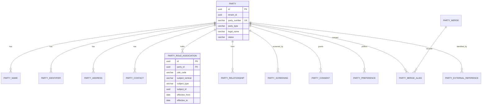

**Aggregate roots:** `Party` (identity and its names, identifiers, addresses, contacts, preferences, consents), `PartyRoleAssociation` (the role link), `PartyMerge` (merge operation), `PartyScreening` (a screening run and its matches).

#### 11.1.4 Entity dictionary

##### `party`

| Column | Type | Req | Notes |
|---|---|---|---|
| `id` | uuid | Y | UUIDv7 |
| `tenant_id` | uuid | Y | Tenant |
| `party_number` | varchar(32) | Y | `PTY-000004281`; unique per tenant |
| `party_type` | enum | Y | `PERSON`, `ORGANIZATION`, `TRUST`, `ESTATE`, `GOVERNMENT_ENTITY`, `UNINCORPORATED_ASSOCIATION`, `GROUP`, `BANKRUPTCY_TRUST`, `SETTLEMENT_TRUST`, `QUALIFIED_SETTLEMENT_FUND` |
| `party_subtype` | varchar(48) | N | For organizations: `CORPORATION`, `LLC`, `LLP`, `PARTNERSHIP`, `SOLE_PROPRIETORSHIP`, `NON_PROFIT`, `PUBLIC_ENTITY`, `MUNICIPALITY`, `AGENCY`; for trusts: `REVOCABLE`, `IRREVOCABLE`, `CHARITABLE`, `SPECIAL_NEEDS`, `524G_TRUST` |
| `display_name` | varchar(300) | Y | UI label; derived but stored for search |
| `legal_name` | varchar(300) | Y | As registered |
| `legal_name_normalized` | varchar(300) | Y | Case-folded, punctuation-stripped for matching |
| `status` | enum | Y | `PROSPECT`, `ACTIVE`, `INACTIVE`, `DECEASED`, `DISSOLVED`, `MERGED`, `RESTRICTED`, `BLOCKED` |
| `formation_date` | date | N | Incorporation or trust creation |
| `dissolution_date` | date | N | |
| `date_of_birth` | date | N | Persons only; restricted field |
| `date_of_death` | date | N | Persons only |
| `deceased_flag` | boolean | Y | Default false |
| `gender` | varchar(32) | N | Self-described; optional; not used for eligibility |
| `marital_status` | enum | N | `SINGLE`, `MARRIED`, `DIVORCED`, `WIDOWED`, `SEPARATED`, `UNKNOWN` |
| `nationality_country` | char(3) | N | ISO 3166-1 alpha-3 |
| `residence_country` | char(3) | N | ISO 3166-1 alpha-3 |
| `place_of_birth` | varchar(160) | N | |
| `industry_naics` | varchar(6) | N | NAICS 2022 |
| `industry_sic` | varchar(4) | N | SIC |
| `employee_count` | integer | N | |
| `annual_revenue_amount` | numeric(19,4) | N | |
| `annual_revenue_currency` | char(3) | N | ISO 4217 |
| `lei` | char(20) | N | ISO 17442 legal entity identifier |
| `duns_number` | varchar(9) | N | |
| `tax_country` | char(3) | N | |
| `tax_id_type` | enum | N | `EIN`, `SSN`, `TIN`, `ITIN`, `VAT`, `GST`, `OTHER` |
| `tax_id_last4` | char(4) | N | Display only |
| `tax_id_encrypted` | bytea | N | Field-level encryption; never returned by default |
| `sanctions_status` | enum | Y | `NOT_SCREENED`, `CLEAR`, `POTENTIAL_MATCH`, `CONFIRMED_MATCH`, `FALSE_POSITIVE`, `ERROR` |
| `sanctions_screened_at` | timestamptz | N | |
| `pep_status` | enum | N | `NOT_SCREENED`, `CLEAR`, `PEP`, `RCA`, `ERROR` |
| `risk_rating` | enum | N | `LOW`, `MEDIUM`, `HIGH`, `PROHIBITED` |
| `vulnerable_person_flag` | boolean | Y | Default false; triggers communication safeguards |
| `confidentiality` | enum | Y | `INTERNAL`, `CONFIDENTIAL`, `RESTRICTED`, `PHI` |
| `preferred_language` | varchar(35) | N | BCP 47 |
| `preferred_currency` | char(3) | N | ISO 4217 |
| `time_zone` | varchar(64) | N | IANA zone |
| `do_not_contact` | boolean | Y | Default false |
| `merged_into_party_id` | uuid | N | Set when merged; old record remains resolvable |
| `source_system` | varchar(64) | N | Provenance |
| `source_id` | varchar(128) | N | External ID |
| `version` | integer | Y | Optimistic concurrency |
| `record_state` | enum | Y | `ACTIVE`, `INACTIVE`, `DELETED` |
| `created_at`, `updated_at` | timestamptz | Y | |
| `created_by`, `updated_by` | uuid | N | |

##### `party_name`

| Column | Type | Req | Notes |
|---|---|---|---|
| `id` | uuid | Y | |
| `tenant_id` | uuid | Y | |
| `party_id` | uuid | Y | FK |
| `name_type` | enum | Y | `LEGAL`, `DBA`, `FORMER`, `MAIDEN`, `ALIAS`, `TRADE`, `TRUST`, `ESTATE`, `SETTLEMENT_CLASS` |
| `name` | varchar(300) | Y | |
| `name_normalized` | varchar(300) | Y | Matching key |
| `effective_from`, `effective_to` | date | N | Name validity |
| `primary_flag` | boolean | Y | Exactly one primary legal name per party |
| `source` | varchar(64) | N | |

##### `party_identifier`

| Column | Type | Req | Notes |
|---|---|---|---|
| `id` | uuid | Y | |
| `tenant_id` | uuid | Y | |
| `party_id` | uuid | Y | FK |
| `identifier_type` | enum | Y | `TIN`, `EIN`, `SSN`, `ITIN`, `DUNS`, `LEI`, `PASSPORT`, `DRIVER_LICENSE`, `STATE_ID`, `MEDICARE_ID`, `MEDICAID_ID`, `NPI`, `BAR_NUMBER`, `ACORD_PARTY_ID`, `ISO_PARTY_ID`, `TRUST_CLAIM_NUMBER`, `BANKRUPTCY_CASE_NUMBER` |
| `identifier_value_encrypted` | bytea | Y | Encrypted at rest |
| `identifier_last4` | char(4) | N | Display |
| `issuing_country` | char(3) | N | ISO 3166-1 |
| `issuing_authority` | varchar(160) | N | |
| `effective_from`, `effective_to` | date | N | |
| `verified_flag` | boolean | Y | Default false |
| `verified_at` | timestamptz | N | |
| `verification_source` | varchar(64) | N | |

##### `party_address`

| Column | Type | Req | Notes |
|---|---|---|---|
| `id` | uuid | Y | |
| `tenant_id` | uuid | Y | |
| `party_id` | uuid | Y | FK |
| `address_type` | enum | Y | `LEGAL`, `PHYSICAL`, `MAILING`, `BILLING`, `CLAIM_SITE`, `EXPOSURE_SITE`, `EMPLOYER`, `PROVIDER`, `BANK`, `OTHER` |
| `line1`, `line2`, `line3` | varchar(200) | N | |
| `city` | varchar(120) | N | |
| `district` | varchar(120) | N | County or equivalent |
| `region` | varchar(120) | N | State/province |
| `region_code` | varchar(6) | N | ISO 3166-2 subdivision |
| `postal_code` | varchar(20) | N | |
| `country` | char(3) | Y | ISO 3166-1 alpha-3 |
| `latitude`, `longitude` | numeric(9,6) | N | WGS84 |
| `geocode_accuracy` | enum | N | `ROOFTOP`, `STREET`, `CITY`, `POSTAL`, `UNKNOWN` |
| `effective_from`, `effective_to` | date | N | |
| `primary_flag` | boolean | Y | |
| `validated_flag` | boolean | Y | Address verification |
| `normalized_hash` | varchar(64) | N | Dedup key |

##### `party_contact`

| Column | Type | Req | Notes |
|---|---|---|---|
| `id` | uuid | Y | |
| `tenant_id` | uuid | Y | |
| `party_id` | uuid | Y | |
| `contact_type` | enum | Y | `EMAIL`, `PHONE_MOBILE`, `PHONE_HOME`, `PHONE_WORK`, `FAX`, `WEB`, `PORTAL` |
| `value_encrypted` | bytea | Y | Encrypted; email may be stored hashed + encrypted |
| `value_masked` | varchar(200) | N | e.g., `j***@example.com`, `+1 ***-***-4821` |
| `verified_flag` | boolean | Y | |
| `verified_at` | timestamptz | N | |
| `consent_status` | enum | N | `OPT_IN`, `OPT_OUT`, `UNKNOWN` |
| `effective_from`, `effective_to` | date | N | |
| `primary_flag` | boolean | Y | |

##### `party_role_association`

| Column | Type | Req | Notes |
|---|---|---|---|
| `id` | uuid | Y | |
| `tenant_id` | uuid | Y | |
| `party_id` | uuid | Y | FK |
| `role_code` | enum | Y | See §11.1.5 |
| `capacity` | enum | N | `INDIVIDUAL`, `ESTATE_REPRESENTATIVE`, `GUARDIAN`, `TRUSTEE`, `CLASS_REPRESENTATIVE`, `ASSIGNEE`, `BANKRUPTCY_TRUSTEE`, `ATTORNEY_IN_FACT`, `CORPORATE_OFFICER` |
| `subject_vertical` | enum | Y | `policy`, `contract`, `primary`, `reinsurance`, `payment`, `document`, `notifications` |
| `subject_type` | varchar(48) | Y | e.g., `policy`, `claim`, `payment` |
| `subject_id` | uuid | Y | |
| `subject_business_key` | varchar(64) | N | Cached for display |
| `scope` | varchar(120) | N | Coverage part, layer, claim component, trust |
| `effective_from`, `effective_to` | date | N | Role period |
| `primary_flag` | boolean | Y | One primary per role per subject |
| `share_pct` | numeric(9,6) | N | For participations and ownership |
| `status` | enum | Y | `ACTIVE`, `ENDED`, `PENDING`, `REJECTED` |
| `source` | enum | Y | `MANUAL`, `POLICY_ISSUE`, `CLAIM_REGISTRATION`, `CONTRACT_BIND`, `PAYMENT`, `IMPORT`, `DERIVED` |
| `verification_status` | enum | N | `UNVERIFIED`, `VERIFIED`, `DISPUTED` |
| `version` | integer | Y | |

**Unique active association:** `(tenant_id, party_id, role_code, subject_vertical, subject_type, subject_id, coalesce(scope,''))` where `status='ACTIVE'`.

##### `party_relationship`

| Column | Type | Req | Notes |
|---|---|---|---|
| `id` | uuid | Y | |
| `tenant_id` | uuid | Y | |
| `from_party_id` | uuid | Y | FK |
| `to_party_id` | uuid | Y | FK |
| `relationship_type` | enum | Y | `PARENT`, `SUBSIDIARY`, `AFFILIATE`, `PREDECESSOR`, `SUCCESSOR`, `SPOUSE`, `DOMESTIC_PARTNER`, `CHILD`, `PARENT_OF`, `SIBLING`, `GUARDIAN`, `WARD`, `ATTORNEY_IN_FACT`, `TRUSTEE`, `BENEFICIARY`, `EMPLOYER`, `EMPLOYEE`, `CO_DEFENDANT`, `CO_PLAINTIFF`, `ASSIGNOR`, `ASSIGNEE`, `AGENT`, `PRINCIPAL`, `JOINT_VENTURE_PARTNER` |
| `effective_from`, `effective_to` | date | N | |
| `status` | enum | Y | `ACTIVE`, `ENDED`, `PENDING` |
| `source` | enum | Y | `MANUAL`, `IMPORT`, `DERIVED` |
| `confidence` | numeric(5,4) | N | For derived relationships |
| `attributes` | jsonb | N | e.g., ownership percentage |
| `version` | integer | Y | |

##### `party_screening`

| Column | Type | Req | Notes |
|---|---|---|---|
| `id` | uuid | Y | |
| `tenant_id` | uuid | Y | |
| `party_id` | uuid | Y | |
| `screening_type` | enum | Y | `ONBOARDING`, `PERIODIC`, `PRE_PAYMENT`, `AD_HOC`, `LIST_UPDATE` |
| `provider` | varchar(64) | N | |
| `lists` | text[] | Y | `OFAC_SDN`, `OFAC_CONSOLIDATED`, `UN_CONSOLIDATED`, `EU_CONSOLIDATED`, `UK_HMT`, `PEP`, `ADVERSE_MEDIA`, `INTERNAL` |
| `requested_at` | timestamptz | Y | |
| `completed_at` | timestamptz | N | |
| `result` | enum | Y | `CLEAR`, `POTENTIAL_MATCH`, `CONFIRMED_MATCH`, `FALSE_POSITIVE`, `ERROR` |
| `highest_score` | numeric(5,4) | N | |
| `match_count` | integer | Y | Default 0 |
| `disposition` | enum | N | `CLEARED`, `BLOCKED`, `ESCALATED`, `PENDING` |
| `disposition_by` | uuid | N | |
| `disposition_at` | timestamptz | N | |
| `disposition_reason` | text | N | |
| `evidence_document_id` | uuid | N | |

##### `party_screening_match`

| Column | Type | Req | Notes |
|---|---|---|---|
| `id` | uuid | Y | |
| `screening_id` | uuid | Y | FK |
| `list_code` | varchar(48) | Y | |
| `list_entry_id` | varchar(120) | N | |
| `matched_name` | varchar(300) | N | |
| `score` | numeric(5,4) | N | |
| `match_fields` | jsonb | N | Name, DOB, country, ID |
| `status` | enum | Y | `OPEN`, `TRUE_MATCH`, `FALSE_POSITIVE`, `INCONCLUSIVE` |
| `reviewed_by` | uuid | N | |
| `reviewed_at` | timestamptz | N | |

##### `party_consent`

| Column | Type | Req | Notes |
|---|---|---|---|
| `id` | uuid | Y | |
| `tenant_id` | uuid | Y | |
| `party_id` | uuid | Y | |
| `purpose` | enum | Y | `DATA_PROCESSING`, `MARKETING`, `MEDICAL_RECORDS_RELEASE`, `SETTLEMENT_COMMUNICATION`, `ELECTRONIC_DELIVERY`, `THIRD_PARTY_SHARING` |
| `status` | enum | Y | `GRANTED`, `WITHDRAWN`, `EXPIRED`, `NOT_REQUIRED` |
| `lawful_basis` | enum | N | `CONSENT`, `CONTRACT`, `LEGAL_OBLIGATION`, `VITAL_INTEREST`, `PUBLIC_TASK`, `LEGITIMATE_INTEREST` |
| `jurisdiction` | char(3) | N | ISO 3166-1 |
| `effective_from`, `effective_to` | date | Y | |
| `evidence_document_id` | uuid | N | |
| `captured_at` | timestamptz | Y | |
| `captured_by` | uuid | N | |
| `withdrawn_at` | timestamptz | N | |
| `withdrawal_reason` | text | N | |

##### `party_preference`

| Column | Type | Req | Notes |
|---|---|---|---|
| `id` | uuid | Y | |
| `tenant_id` | uuid | Y | |
| `party_id` | uuid | Y | |
| `preferred_channel` | enum | Y | `EMAIL`, `PHONE`, `SMS`, `PORTAL`, `MAIL` |
| `preferred_language` | varchar(35) | N | BCP 47 |
| `format` | enum | N | `STANDARD`, `LARGE_PRINT`, `BRAILLE`, `AUDIO` |
| `quiet_hours_from`, `quiet_hours_to` | time | N | |
| `time_zone` | varchar(64) | N | IANA |
| `accessibility_notes` | text | N | |

##### `party_merge`

| Column | Type | Req | Notes |
|---|---|---|---|
| `id` | uuid | Y | |
| `tenant_id` | uuid | Y | |
| `survivor_party_id` | uuid | Y | |
| `merged_party_ids` | uuid[] | Y | |
| `reason` | enum | Y | `DUPLICATE`, `DATA_CORRECTION`, `ACQUISITION`, `SUCCESSION` |
| `evidence` | jsonb | N | Match scores, reviewed fields |
| `requested_by` | uuid | Y | |
| `approved_by` | uuid | Y | Must differ |
| `merged_at` | timestamptz | Y | |
| `reversible_until` | timestamptz | N | Operational window |
| `status` | enum | Y | `COMPLETED`, `REVERSED` |

##### `party_merge_alias`

| Column | Type | Req | Notes |
|---|---|---|---|
| `id` | uuid | Y | |
| `merge_id` | uuid | Y | |
| `from_party_id` | uuid | Y | Old ID, resolvable forever |
| `to_party_id` | uuid | Y | Survivor |
| `moved_roles` | integer | N | Count |
| `conflicts` | jsonb | N | Roles that could not be moved |

##### `party_external_reference`

| Column | Type | Req | Notes |
|---|---|---|---|
| `id` | uuid | Y | |
| `tenant_id` | uuid | Y | |
| `party_id` | uuid | Y | |
| `source_system` | varchar(64) | Y | `SAP`, `LEGACY_CLAIMS`, `BROKER_PORTAL`, `SANCTIONS_PROVIDER`, `DMS` |
| `external_id` | varchar(128) | Y | |
| `external_type` | varchar(64) | N | e.g., `SAP_BUSINESS_PARTNER`, `LEGACY_PARTY` |
| `last_synced_at` | timestamptz | N | |

#### 11.1.5 Enumerations

**`PartyType`:** `PERSON`, `ORGANIZATION`, `TRUST`, `ESTATE`, `GOVERNMENT_ENTITY`, `UNINCORPORATED_ASSOCIATION`, `GROUP`, `BANKRUPTCY_TRUST`, `SETTLEMENT_TRUST`, `QUALIFIED_SETTLEMENT_FUND`.

**`PartyStatus`:** `PROSPECT`, `ACTIVE`, `INACTIVE`, `DECEASED`, `DISSOLVED`, `MERGED`, `RESTRICTED`, `BLOCKED`.

**`PartyRoleCode` (closed list, versioned):**

| Group | Codes |
|---|---|
| Insurance | `NAMED_INSURED`, `ADDITIONAL_INSURED`, `INSURED_PERSON`, `INSURED_ORGANIZATION`, `LOSS_PAYEE`, `MORTGAGEE`, `LENDER`, `BENEFICIARY`, `ASSIGNEE` |
| Intermediary | `BROKER`, `AGENT`, `MGA`, `MANAGING_GENERAL_AGENT`, `PRODUCER`, `WHOLESALE_BROKER`, `REINSURANCE_BROKER`, `TPLAC` |
| Claim | `CLAIMANT`, `INJURED_PARTY`, `CLASS_MEMBER`, `CLAIMANT_REPRESENTATIVE`, `DEFENDANT`, `CO_DEFENDANT`, `WITNESS`, `GUARDIAN`, `ESTATE_REPRESENTATIVE`, `TRUSTEE` |
| Legal | `DEFENSE_COUNSEL`, `PLAINTIFF_COUNSEL`, `COVERAGE_COUNSEL`, `LOCAL_COUNSEL`, `EXPERT_WITNESS`, `MEDIATOR`, `ARBITRATOR`, `SETTLEMENT_ADMINISTRATOR` |
| Reinsurance | `CEDENT`, `REINSURER`, `RETROCESSIONAIRE`, `LEAD_REINSURER`, `FOLLOW_REINSURER`, `FRONTING_COMPANY`, `CAPTIVE` |
| Operations | `ADJUSTER`, `SENIOR_ADJUSTER`, `SUPERVISOR`, `CLAIMS_MANAGER`, `TPA`, `CLAIMS_ADMINISTRATOR`, `UNDERWRITER`, `ACTUARY`, `AUDITOR`, `DATA_STEWARD`, `TREASURY`, `BANK` |
| Financial | `PAYEE`, `REMITTER`, `PAYER`, `LIENHOLDER`, `STRUCTURED_SETTLEMENT_BROKER`, `ANNUITY_ISSUER` |
| Medical | `PROVIDER`, `TREATING_PHYSICIAN`, `FACILITY`, `PHARMACY` |
| Other | `EMPLOYER`, `LANDLORD`, `TENANT`, `GOVERNMENT_AGENCY`, `REGULATOR` |

**`PartyRelationshipType`:** as listed in §11.1.4.

**`ScreeningResult`:** `CLEAR`, `POTENTIAL_MATCH`, `CONFIRMED_MATCH`, `FALSE_POSITIVE`, `ERROR`.

**`ScreeningDisposition`:** `CLEARED`, `BLOCKED`, `ESCALATED`, `PENDING`.

#### 11.1.6 State machines

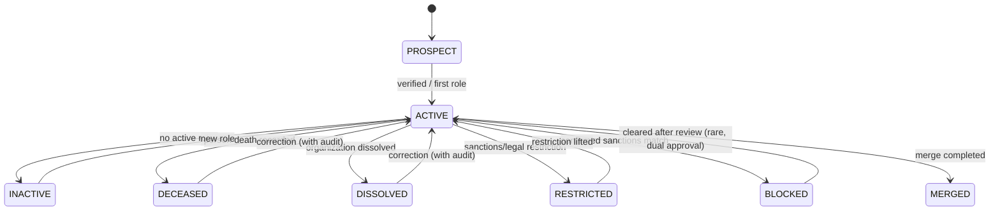

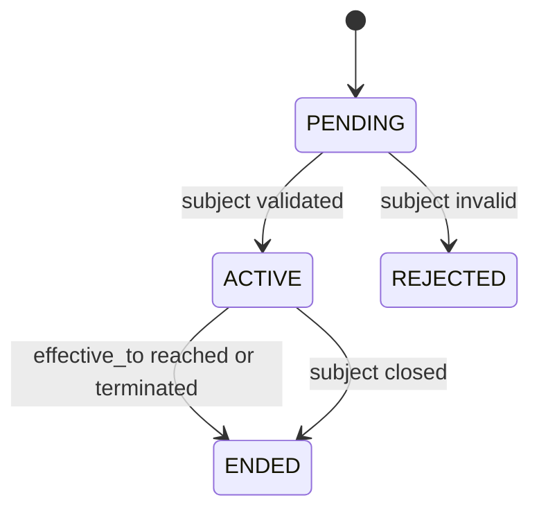

#### 11.1.7 Invariants and business rules

| ID | Rule |
|---|---|
| `PTY-01` | A party MUST have exactly one primary legal name and at most one active primary address and primary contact per contact type. |
| `PTY-02` | `PERSON` parties MUST NOT have `party_subtype`; organizations MUST NOT have `date_of_birth`. |
| `PTY-03` | A deceased party MUST have `date_of_death`; claims on behalf of a deceased person require an `ESTATE_REPRESENTATIVE` role. |
| `PTY-04` | A minor claimant MUST have a `GUARDIAN` or `ESTATE_REPRESENTATIVE` association before a settlement can be authorized. |
| `PTY-05` | A `CONFIRMED_MATCH` sanctions result sets status `BLOCKED`; all payments to that party are blocked until a dual-approved clearance. |
| `PTY-06` | A merge MUST be approved by a different user than the requester, and the survivor MUST be `ACTIVE`. |
| `PTY-07` | A merge MUST move or explicitly resolve every active role association; unresolved conflicts block completion. |
| `PTY-08` | A merged party remains resolvable by ID and reprimarys to the survivor; its roles are closed with `ENDED` and re-created on the survivor. |
| `PTY-09` | A party with any financial, claim, policy, contract, document, or audit reference MUST NOT be deleted; status is changed instead. |
| `PTY-10` | SSNs, TINs, passport numbers, and bank details are encrypted and masked; only the last four characters are displayed. |
| `PTY-11` | Role associations MUST reference an existing subject in the owning vertical, verified synchronously at creation. |
| `PTY-12` | A party cannot hold two active roles of the same code on the same subject with the same scope. |
| `PTY-13` | `do_not_contact` suppresses marketing and non-essential notifications but never suppresses legally required notices; the notification service records the override reason. |
| `PTY-14` | Vulnerable-person status requires additional communication safeguards and cannot be removed without a recorded reason. |
| `PTY-15` | Duplicate detection is advisory; merging is never automatic. |

#### 11.1.8 Commands and transactions

**`party.create`**

| # | Step | Type | Target | Notes |
|---|---|---|---|---|
| 1 | Validate identity descriptor | RULE | `party.identity-valid` | Type-specific required fields |
| 2 | Match existing parties | READ | `party.expert.party.match` | Name, DOB, TIN last4, address; returns candidates and scores |
| 3 | Decide create vs link | RULE | `party.dedupe-decision` | High score requires explicit user choice |
| 4 | Screen party | INTEGRATE | `sanctions.screen` | Fail closed |
| 5 | Persist party | PERSIST | `party.expert.party.create` | Compensation: `party.expert.party.deactivate` |
| 6 | Persist role associations | PERSIST | `party.expert.role.create` | Only roles supplied by the initiating transaction |
| 7 | Emit | EVENT | `party.party.created` | Includes links |
| 8 | Notify | NOTIFY | `party.created` | Best effort |

**`party.merge`**

| # | Step | Type | Target | Notes |
|---|---|---|---|---|
| 1 | Load both parties and roles | READ | expert | |
| 2 | Check conflicts | RULE | `party.merge-compatible` | Same type, no contradictory identifiers, no active conflicting role |
| 3 | Approval | HUMAN_APPROVAL | `party.merge.approve` | Different user |
| 4 | Persist merge | PERSIST | `party.expert.party.merge` | Writes merge, aliases, closes old roles, re-creates on survivor |
| 5 | Move documents and notifications | SUB_TRANSACTION | `document.repoint`, `notifications.repoint` | Best effort with reconciliation |
| 6 | Emit | EVENT | `party.party.merged` | All verticals invalidate projections |
| 7 | Lineage rewrite | EVENT | links | Survivor edges; alias edge retained |

**`party.screen`**

| # | Step | Type | Target | Notes |
|---|---|---|---|---|
| 1 | Compose screening request | COMPUTE | — | Name variants, DOB, country, IDs |
| 2 | Call provider | INTEGRATE | `sanctions.screen` | Timeout 8 s, retry once |
| 3 | Persist result and matches | PERSIST | `party.expert.screening.record` | |
| 4 | Apply status | PERSIST | `party.expert.party.status` | `BLOCKED` on confirmed match |
| 5 | Escalate | NOTIFY | `party.sanctions.match` | Compliance officer, high priority |

#### 11.1.9 Events

**Published:**

| Event | Payload highlights |
|---|---|
| `party.party.created` | `partyId`, `partyNumber`, `partyType`, `status`, `roles[]` |
| `party.party.updated` | `partyId`, `changedFields[]`, `version` |
| `party.party.status-changed` | `partyId`, `from`, `to`, `reason` |
| `party.party.merged` | `survivorId`, `mergedIds[]`, `mergeId` |
| `party.role.added` | `partyId`, `roleCode`, `subject`, `effectiveFrom` |
| `party.role.ended` | `partyId`, `roleCode`, `subject`, `effectiveTo` |
| `party.screening.completed` | `partyId`, `screeningId`, `result`, `highestScore` |
| `party.screening.blocked` | `partyId`, `screeningId`, `listCode` |
| `party.consent.changed` | `partyId`, `purpose`, `status` |

**Consumed:** `policy.policy.issued` (create insured roles if not already), `contract.contract.bound` (cedent/reinsurer roles), `primary.claim.registered` (claimant roles when created outside Party), `reinsurance.claim.registered`, `payment.payment.paid` (payee verification), `document.document.registered` (author/signatory roles).

#### 11.1.10 API surface

| Method | Path | Purpose |
|---|---|---|
| `GET` | `/api/v1/party/parties` | Search and filter parties |
| `POST` | `/api/v1/party/parties` | Create party (transaction) |
| `GET` | `/api/v1/party/parties/{partyId}` | Party detail |
| `PATCH` | `/api/v1/party/parties/{partyId}` | Update (transaction) |
| `POST` | `/api/v1/party/parties/{partyId}/merge` | Merge (transaction) |
| `GET` | `/api/v1/party/parties/{partyId}/roles` | Role associations |
| `POST` | `/api/v1/party/parties/{partyId}/roles` | Add role |
| `POST` | `/api/v1/party/parties/{partyId}/roles/{roleId}/end` | End role |
| `GET` | `/api/v1/party/parties/{partyId}/relationships` | Relationships |
| `GET` | `/api/v1/party/parties/{partyId}/screenings` | Screening history |
| `POST` | `/api/v1/party/parties/{partyId}/screenings` | Screen |
| `GET` | `/api/v1/party/parties/{partyId}/consents` | Consents |
| `POST` | `/api/v1/party/parties/{partyId}/consents` | Record consent |
| `GET` | `/api/v1/party/parties/{partyId}/documents` | Documents via Document service |
| `GET` | `/api/v1/party/parties/{partyId}/lineage` | Lineage summary |
| `GET` | `/api/v1/party/parties/match` | Dedupe candidates |
| `GET` | `/api/v1/party/parties/{partyId}/audit` | Audit trail |

**Internal:** `POST /internal/v1/parties/resolve` (resolve or provisionally create), `GET /internal/v1/parties/{id}/roles`, `GET /internal/v1/parties/{id}/summary`, `POST /internal/v1/parties/{id}/roles` (from other verticals), `GET /internal/v1/parties/{id}/screening-status`.

#### 11.1.11 Mass tort specifics

| Concern | Model |
|---|---|
| Claimant identity | `PERSON` with `CLAIMANT` role on the claim; `capacity` captures estate, guardian, class representative |
| Deceased claimants | `date_of_death`, `ESTATE_REPRESENTATIVE` or `TRUSTEE` role, estate party as payee where appropriate |
| Minors | `GUARDIAN` role required; settlement requires court approval evidence (Document) |
| Class members | `GROUP` party with `CLASS_MEMBER` role; individual members optionally linked |
| Bankruptcy trust claimants | `BANKRUPTCY_TRUST` party and `TRUST_CLAIM_NUMBER` identifier; `TRUSTEE` role |
| Plaintiff firms | `ORGANIZATION` with `PLAINTIFF_COUNSEL` role; used for inventory grouping and ethical walls |
| Defendants | `DEFENDANT`/`CO_DEFENDANT` role, often also `NAMED_INSURED` under one or more policies |
| Medical providers | `PROVIDER` role with NPI identifier; used for lien resolution |
| Settlement class | `SETTLEMENT_CLASS` name and `CLASS_REPRESENTATIVE` role |
| Exposure site | `EXPOSURE_SITE` address type on the party or employer |

#### 11.1.12 Projections, integrations, and metrics

**Projections published to other verticals:** `party_ref` (`partyId`, `partyNumber`, `displayName`, `partyType`, `status`, `sanctionsStatus`, `version`). Consumers cache it and refresh on `party.*` events.

**Integrations:** sanctions/PEP provider, corporate registry lookup (optional), address verification (optional), SAP business partner sync (owned by Payment, consumes `party_ref`).

**Metrics:** duplicate candidate count, merge rate, screening turnaround, blocked-party count, role-association latency, orphan-role count.

#### 11.1.13 Tooling for mass tort claimant intake

| Capability | Behaviour |
|---|---|
| Bulk claimant import | Batch job with dedupe scoring; creates provisional parties with `verification_status=UNVERIFIED` |
| Plaintiff fact sheet intake | Document registration + extraction of claimant fields, with human verification |
| Duplicate review queue | Ranked candidates, side-by-side field comparison, merge or dismiss |
| Guardian/estate guard | Blocks settlement authorization when capacity is missing |
| Sanctions pre-payment check | Payment service calls Party synchronously before issuing |

#### 11.1.14 KYC, AML, and beneficial ownership

**`kyc_profile`** — party, risk rating (`LOW`, `MEDIUM`, `HIGH`), verification status, last review, next review, source of funds, source of wealth, PEP flag, adverse media flag.

**`kyc_document`** — profile, document type, number, issuer, expiry, verification result, verified by.

**`beneficial_owner`** — legal entity party, natural person party, ownership pct, control type (`OWNERSHIP`, `VOTING`, `DIRECTOR`, `TRUSTEE`, `OTHER`), verification status.

**`aml_case`** — party, case type (`SANCTIONS`, `PEP`, `ADVERSE_MEDIA`, `STRUCTURING`, `FRAUD`, `OTHER`), risk, decision, owner, status.

| ID | Rule |
|---|---|
| `KYC-01` | Identity is verified before bind, payment, or contract execution. |
| `KYC-02` | Beneficial ownership is identified for legal entities above 25% or the applicable threshold. |
| `KYC-03` | Sanctions, PEP, and adverse media are screened at onboarding and before payment. |
| `KYC-04` | High-risk parties require enhanced due diligence and senior approval. |
| `KYC-05` | Ongoing monitoring re-screens on profile change, payment, and at least annually. |
| `KYC-06` | A sanctioned or confirmed match blocks the action and opens an AML case. |
| `KYC-07` | KYC records and decisions are retained for 5 years after the relationship ends. |

**Claimant verification:** for a claim payee, Party verifies identity, authority (guardian, estate, trustee), and payment eligibility; Payment re-screens sanctions before issuance. A missing authority blocks settlement.

---
### 11.2 Policy

#### 11.2.1 Purpose and boundary

Policy owns **directly underwritten commercial insurance** from quote through expiry: the contract of insurance, its versions, coverage grants, limits and retentions, premium, aggregate erosion, occurrences, and the mass tort profile that makes long-tail liability administrable.

| Policy owns | Policy does not own |
|---|---|
| Policy identity, status, terms, versions, endorsements | Insured party identity (Party) |
| Coverage parts, forms, exclusions, limits, layers, retentions | Claim facts and reserves (Primary) |
| Premium, commission, taxes, fees, rating exposures, audits | Outward cession amounts and recoverables (SAP FS-RI) |
| Occurrence definitions and occurrence records | Payments and SAP postings (Payment) |
| Mass tort program and policy-level mass tort profile | Documents (Document) — it references them |
| Aggregate/limit state used for coverage decisions | Claim-level allocation truth (Primary) — Policy owns the limit, Primary owns the allocation |

**Boundary with Primary:** Policy declares *what coverage exists and how much remains*. Primary determines *whether a claim is covered and how much to reserve*. When a claim erodes a limit, Primary sends an erosion fact; Policy applies it to `policy_limit_state` and acknowledges the new remaining amount. Primary owns the claim allocation record; Policy owns the limit ledger.

**Boundary with Contract and SAP FS-RI:** Policy owns the primary book, but **Cession** owns primary cessions (§11.9). Policy publishes policy facts and exposes a read API; Cession pulls from Policy/Primary, hands off to SAP FS-RI, and stores the relationship data. Contract and Reinsurance are a different book and MUST NOT receive Policy or Primary data. Policy keeps a read-only cession projection for the policy 360 and does not calculate or post ceded premium or loss.

#### 11.2.2 Ubiquitous language

| Term | Meaning |
|---|---|
| **Policy** | The insurance contract between insurer and insured |
| **Policy version** | An immutable issued state of the policy (bind, issue, endorsement, renewal, cancellation, reinstatement) |
| **Policy term** | An annual period within a multi-year policy; the unit of occurrence allocation |
| **Coverage part** | A grant of coverage (e.g., general liability, products-completed operations) |
| **Limit** | The maximum payable under a coverage, with a basis and an erosion behavior |
| **Aggregate** | A limit that accumulates across occurrences or claims |
| **SIR / deductible** | The insured's retention before the policy responds |
| **Occurrence** | The event or exposure grouping that triggers coverage and consumes a per-occurrence limit |
| **Trigger** | The theory determining which policy period responds (exposure, manifestation, injury-in-fact, continuous) |
| **Coverage block** | A defined set of years/layers treated together for mass tort allocation |
| **Allocation** | The method for distributing a loss across policy periods and layers |
| **Program** | A group of policies placed together for one insured or one mass tort exposure |
| **Erosion** | Consumption of a limit or aggregate by paid and reserved amounts |

#### 11.2.3 Aggregates and entity–relationship diagram

```mermaid
erDiagram
    POLICY ||--o{ POLICY_VERSION : versions
    POLICY ||--o{ POLICY_TERM : terms
    POLICY ||--o{ POLICY_INSURED : insureds
    POLICY ||--o{ POLICY_COVERAGE : coverages
    POLICY_COVERAGE ||--o{ POLICY_LIMIT : limits
    POLICY_LIMIT ||--|| POLICY_LIMIT_STATE : state
    POLICY ||--o{ POLICY_LAYER : layers
    POLICY ||--o{ POLICY_DEDUCTIBLE : retentions
    POLICY ||--o{ POLICY_ENDORSEMENT : endorsements
    POLICY ||--o{ POLICY_FORM : forms
    POLICY ||--o{ POLICY_EXCLUSION : exclusions
    POLICY ||--o{ POLICY_PREMIUM : premium
    POLICY ||--o{ POLICY_RATING_EXPOSURE : exposures
    POLICY ||--o{ POLICY_OCCURRENCE : occurrences
    POLICY ||--o| POLICY_MASS_TORT_PROFILE : profile
    LEGAL_ENTITY ||--o{ POLICY : issues
    ORGANIZATION_UNIT ||--o{ POLICY : administers
    PROGRAM ||--o{ POLICY : includes
    LINE_OF_BUSINESS ||--o{ POLICY : classifies
    SUBLINE ||--o{ POLICY : refines
    COVERAGE ||--o{ POLICY_COVERAGE : defines
    COVERAGE_TYPE ||--o{ POLICY_COVERAGE : responds
    POLICY ||--o{ POLICY_ORG_SNAPSHOT : snapshots
    POLICY_MASS_TORT_PROFILE ||--o{ POLICY_COVERAGE_BLOCK : blocks
    POLICY ||--o{ POLICY_TERRITORY : territories
    POLICY ||--o{ POLICY_TAX_FEE : taxes
    LEGAL_ENTITY {
      uuid id PK
      uuid tenant_id
      varchar entity_code UK
      varchar legal_name
      varchar naic_company_code
      varchar sap_company_code
    }
    ORGANIZATION_UNIT {
      uuid id PK
      uuid parent_id
      varchar unit_type
      varchar code UK
      varchar name
    }
    PROGRAM {
      uuid id PK
      uuid tenant_id
      varchar code UK
      varchar name
      varchar program_type
    }
    LINE_OF_BUSINESS {
      uuid id PK
      uuid tenant_id
      varchar code UK
      varchar name
    }
    SUBLINE {
      uuid id PK
      uuid line_of_business_id
      varchar code
      varchar name
    }
    COVERAGE {
      uuid id PK
      uuid tenant_id
      varchar code UK
      varchar name
      varchar coverage_category
    }
    COVERAGE_TYPE {
      uuid id PK
      uuid tenant_id
      varchar code UK
      varchar response_basis
    }
    POLICY {
      uuid id PK
      uuid tenant_id
      varchar policy_number UK
      uuid issuing_legal_entity_id
      uuid admin_org_unit_id
      uuid program_id
      uuid line_of_business_id
      uuid subline_id
      varchar status
      date effective_from
      date effective_to
      char currency
    }
```

#### 11.2.4 Entity dictionary

##### `policy`

| Column | Type | Req | Notes |
|---|---|---|---|
| `id` | uuid | Y | UUIDv7 |
| `tenant_id` | uuid | Y | |
| `policy_number` | varchar(32) | Y | `GL-2024-0041827`; unique per tenant and issuing legal entity |
| `program_id` | uuid | N | FK `program` (§10.11.3) |
| `issuing_legal_entity_id` | uuid | Y | Carrier that issues the policy |
| `admin_org_unit_id` | uuid | Y | Branch/office that administers the policy |
| `line_of_business_id` | uuid | Y | FK `line_of_business` |
| `subline_id` | uuid | N | FK `subline` |
| `policy_type` | enum | Y | `PRIMARY`, `EXCESS`, `UMBRELLA`, `QUOTA_SHARE`, `FRONTED`, `CAPTIVE`, `FINITE`, `LOSS_PORTFOLIO_TRANSFER` |
| `product_line` | enum | Y | Product taxonomy, distinct from statutory LOB: `COMMERCIAL_GENERAL_LIABILITY`, `PRODUCTS_LIABILITY`, `EXCESS_LIABILITY`, `UMBRELLA`, `COMMERCIAL_AUTO`, `TRUCKING`, `WORKERS_COMPENSATION`, `EMPLOYERS_LIABILITY`, `PROFESSIONAL_LIABILITY`, `ENVIRONMENTAL`, `MARINE`, `AVIATION`, `CONSTRUCTION`, `CYBER`, `DIRECTORS_AND_OFFICERS`, `POLLUTION_LEGAL_LIABILITY` |
| `line_of_business_code` | varchar(8) | N | Deprecated; derived from `line_of_business_id` for external extracts |
| `policy_form_family` | varchar(48) | N | `ISO_CGL`, `ISO_UMBRELLA`, `MANUSCRIPT` |
| `insured_party_id` | uuid | Y | Primary named insured; Party owns the record |
| `insured_display_name` | varchar(300) | Y | Projection for search and lists |
| `status` | enum | Y | See §11.2.5 |
| `status_reason` | varchar(200) | N | |
| `effective_from` | date | Y | Inclusive |
| `effective_to` | date | Y | Exclusive |
| `retroactive_date` | date | N | For claims-made |
| `claims_made_flag` | boolean | Y | |
| `occurrence_definition` | text | N | Wording summary; full text in forms |
| `policy_term_months` | integer | Y | 12 for annual |
| `currency` | char(3) | Y | ISO 4217 |
| `billing_currency` | char(3) | N | If different |
| `governing_law_country` | char(3) | N | ISO 3166-1 |
| `governing_law_region` | varchar(6) | N | ISO 3166-2 |
| `domicile_country` | char(3) | N | Insured domicile |
| `placement_type` | enum | Y | `PRIMARY`, `COINSURANCE`, `FRONTED`, `CAPTIVE`, `MGA_BINDING_AUTHORITY` |
| `binding_authority_ref` | varchar(64) | N | MGA/BPA reference |
| `quote_id` | uuid | N | Originating quote |
| `binder_number` | varchar(32) | N | |
| `bound_at` | timestamptz | N | |
| `issued_at` | timestamptz | N | |
| `cancelled_at` | timestamptz | N | |
| `cancellation_effective_date` | date | N | |
| `cancellation_type` | enum | N | `FLAT`, `PRO_RATA`, `SHORT_RATE`, `NON_PAYMENT`, `VOID` |
| `cancellation_reason` | varchar(200) | N | |
| `non_renewal_reason` | varchar(200) | N | |
| `expired_at` | timestamptz | N | |
| `renewal_of_policy_id` | uuid | N | Prior policy |
| `renewed_by_policy_id` | uuid | N | Successor policy |
| `superseded_by_policy_id` | uuid | N | Replacement |
| `countersignature_required` | boolean | Y | Default false |
| `countersigned_at` | timestamptz | N | |
| `premium_written_amount` | numeric(19,4) | N | Denormalized for lists |
| `premium_currency` | char(3) | N | |
| `total_premium_amount` | numeric(19,4) | N | Premium + taxes + fees |
| `commission_amount` | numeric(19,4) | N | |
| `tax_amount` | numeric(19,4) | N | |
| `fee_amount` | numeric(19,4) | N | |
| `mass_tort_flag` | boolean | Y | Default false |
| `catastrophe_exposed` | boolean | Y | |
| `risk_tier` | enum | N | `LOW`, `MEDIUM`, `HIGH`, `SEVERE` |
| `underwriter_party_id` | uuid | N | |
| `producer_party_id` | uuid | N | |
| `office_code` | varchar(24) | N | Deprecated; use `admin_org_unit_id` |
| `source_system` | varchar(64) | N | |
| `version` | integer | Y | Optimistic concurrency |
| `record_state` | enum | Y | `ACTIVE`, `VOID`, `DELETED` |
| `created_at`, `updated_at` | timestamptz | Y | |
| `created_by`, `updated_by` | uuid | N | |

##### `policy_version`

| Column | Type | Req | Notes |
|---|---|---|---|
| `id` | uuid | Y | |
| `tenant_id` | uuid | Y | |
| `policy_id` | uuid | Y | FK |
| `version_number` | integer | Y | 1, 2, 3 … unique per policy |
| `policy_version_number` | varchar(40) | Y | `GL-2024-0041827-03` |
| `change_type` | enum | Y | `BIND`, `ISSUE`, `ENDORSEMENT`, `RENEWAL`, `CANCELLATION`, `REINSTATEMENT`, `CORRECTION`, `PREMIUM_AUDIT`, `VOID` |
| `status` | enum | Y | `DRAFT`, `ISSUED`, `VOIDED`, `SUPERSEDED` |
| `effective_from` | date | Y | Version effective date |
| `effective_to` | date | N | |
| `issued_at` | timestamptz | N | |
| `issued_by` | uuid | N | |
| `approved_by` | uuid | N | For endorsements requiring approval |
| `transaction_id` | uuid | N | Business transaction |
| `document_package_id` | uuid | N | Document package |
| `premium_delta_amount` | numeric(19,4) | N | |
| `premium_delta_currency` | char(3) | N | |
| `description` | text | N | |
| `supersedes_version_id` | uuid | N | |
| `immutable_hash` | varchar(64) | Y | Canonical hash of the version snapshot |
| `created_at` | timestamptz | Y | |

**Rule:** a `policy_version` row is immutable after `ISSUED`. Corrections create a new version.

##### `policy_term`

| Column | Type | Req | Notes |
|---|---|---|---|
| `id` | uuid | Y | |
| `tenant_id` | uuid | Y | |
| `policy_id` | uuid | Y | |
| `term_number` | integer | Y | 1-based |
| `term_from`, `term_to` | date | Y | |
| `annual_premium_amount` | numeric(19,4) | N | |
| `annual_aggregate_amount` | numeric(19,4) | N | |
| `currency` | char(3) | Y | |
| `audit_period` | varchar(24) | N | |
| `status` | enum | Y | `PLANNED`, `IN_FORCE`, `EXPIRED`, `CANCELLED` |

##### `policy_insured`

| Column | Type | Req | Notes |
|---|---|---|---|
| `id` | uuid | Y | |
| `tenant_id` | uuid | Y | |
| `policy_id` | uuid | Y | |
| `party_id` | uuid | Y | |
| `insured_role` | enum | Y | `NAMED_INSURED`, `ADDITIONAL_INSURED`, `INSURED_ORGANIZATION`, `LOSS_PAYEE`, `MORTGAGEE`, `LENDER`, `CERTIFICATE_HOLDER` |
| `certificate_number` | varchar(32) | N | |
| `scope` | varchar(120) | N | Coverage parts or locations |
| `primary_non_contributory` | boolean | N | |
| `waiver_of_subrogation` | boolean | N | |
| `additional_insured_wording` | varchar(120) | N | Form reference |
| `effective_from`, `effective_to` | date | N | |
| `status` | enum | Y | `ACTIVE`, `ENDORSED_OFF`, `EXPIRED` |

##### `policy_coverage`

| Column | Type | Req | Notes |
|---|---|---|---|
| `id` | uuid | Y | |
| `tenant_id` | uuid | Y | |
| `policy_id` | uuid | Y | |
| `coverage_id` | uuid | Y | FK `coverage` |
| `coverage_type_id` | uuid | Y | FK `coverage_type` |
| `coverage_name` | varchar(160) | N | Denormalized display name |
| `coverage_part` | varchar(8) | Y | `A`, `B`, `C`, `D` |
| `coverage_category` | enum | N | Snapshot of `coverage.coverage_category` |
| `form_number` | varchar(32) | N | ISO or manuscript |
| `form_edition` | varchar(16) | N | e.g., `CG 00 01 04 13` |
| `occurrence_basis` | enum | Y | `OCCURRENCE`, `CLAIMS_MADE`, `CLAIMS_MADE_WITH_RETRO`, `DISCOVERY` |
| `coverage_trigger_default` | enum | N | `EXPOSURE`, `INJURY_IN_FACT`, `MANIFESTATION`, `CONTINUOUS_TRIGGER`, `OCCURRENCE`, `CLAIMS_MADE` |
| `retroactive_date` | date | N | |
| `defense_within_limits` | boolean | Y | |
| `defense_cost_allocation` | enum | N | `WITHIN_LIMITS`, `OUTSIDE_LIMITS`, `PRO_RATA`, `DEFENSE_RATE` |
| `extended_reporting_available` | boolean | N | |
| `extended_reporting_period_days` | integer | N | |
| `waiting_period_days` | integer | N | |
| `coinsurance_pct` | numeric(9,6) | N | |
| `effective_from`, `effective_to` | date | Y | |
| `status` | enum | Y | `ACTIVE`, `EXCLUDED`, `ENDORSED`, `EXPIRED` |
| `sequence` | integer | Y | |

##### `policy_limit`

| Column | Type | Req | Notes |
|---|---|---|---|
| `id` | uuid | Y | |
| `tenant_id` | uuid | Y | |
| `policy_id` | uuid | Y | |
| `coverage_id` | uuid | N | FK `policy_coverage`; null for policy-level aggregate |
| `layer_id` | uuid | N | FK `policy_layer` |
| `limit_code` | enum | Y | `EACH_OCCURRENCE`, `GENERAL_AGGREGATE`, `PRODUCTS_COMPLETED_OPS_AGGREGATE`, `PERSONAL_ADVERTISING_INJURY`, `DAMAGES_TO_PREMISES`, `MEDICAL_EXPENSE`, `SUPPLEMENTARY_PAYMENTS`, `DEFENSE_COST`, `PER_CLAIMANT`, `CLASS_ACTION_SUBLIMIT`, `AGGREGATE_SIR`, `REINSTATEMENT`, `POLICY_AGGREGATE` |
| `limit_basis` | enum | Y | `PER_OCCURRENCE`, `PER_CLAIM`, `PER_CLAIMANT`, `ANNUAL_AGGREGATE`, `POLICY_AGGREGATE`, `PER_EVENT` |
| `amount` | numeric(19,4) | Y | |
| `currency` | char(3) | Y | |
| `aggregate_applies` | boolean | Y | |
| `aggregate_scope` | enum | N | `POLICY`, `COVERAGE`, `LAYER`, `PER_CLAIMANT` |
| `shared_flag` | boolean | Y | Shared across coverage parts |
| `reinstatement_count` | integer | N | |
| `reinstatement_type` | enum | N | `NONE`, `FREE`, `PAID_PRO_RATA`, `PAID_FULL_RATE`, `PER_OCCURRENCE` |
| `erosion_basis` | enum | Y | `PAID`, `INCURRED`, `PAID_PLUS_RESERVED` |
| `sequence` | integer | Y | |
| `effective_from`, `effective_to` | date | Y | |

##### `policy_limit_state`

| Column | Type | Req | Notes |
|---|---|---|---|
| `id` | uuid | Y | |
| `tenant_id` | uuid | Y | |
| `policy_id` | uuid | Y | |
| `limit_id` | uuid | Y | FK, unique |
| `as_of` | timestamptz | Y | |
| `original_amount` | numeric(19,4) | Y | |
| `paid_amount` | numeric(19,4) | Y | |
| `reserved_amount` | numeric(19,4) | Y | |
| `incurred_amount` | numeric(19,4) | Y | Paid + reserved |
| `recovered_amount` | numeric(19,4) | Y | |
| `remaining_amount` | numeric(19,4) | Y | |
| `eroded_pct` | numeric(9,6) | Y | |
| `reinstated_amount` | numeric(19,4) | Y | |
| `pending_authority_amount` | numeric(19,4) | N | Payments awaiting approval |
| `source_version` | bigint | Y | Erosion fact version |
| `computed_at` | timestamptz | Y | |
| `reconciliation_status` | enum | Y | `CURRENT`, `STALE`, `DRIFT`, `MANUAL_REVIEW` |
| `version` | integer | Y | |

##### `policy_layer`

| Column | Type | Req | Notes |
|---|---|---|---|
| `id` | uuid | Y | |
| `tenant_id` | uuid | Y | |
| `policy_id` | uuid | Y | |
| `layer_number` | integer | Y | 1 = primary |
| `layer_type` | enum | Y | `PRIMARY`, `EXCESS`, `UMBRELLA`, `QUOTA_SHARE`, `FACULTATIVE`, `COINSURANCE` |
| `attachment_amount` | numeric(19,4) | Y | |
| `limit_amount` | numeric(19,4) | Y | |
| `currency` | char(3) | Y | |
| `participation_pct` | numeric(9,6) | N | Insurer share |
| `lead_flag` | boolean | N | |
| `coverage_scope` | varchar(200) | N | |
| `effective_from`, `effective_to` | date | Y | |

##### `policy_deductible`

| Column | Type | Req | Notes |
|---|---|---|---|
| `id` | uuid | Y | |
| `tenant_id` | uuid | Y | |
| `policy_id` | uuid | Y | |
| `coverage_id` | uuid | N | |
| `retention_type` | enum | Y | `DEDUCTIBLE`, `SELF_INSURED_RETENTION`, `CAPTIVE_RETENTION`, `COINSURANCE` |
| `amount` | numeric(19,4) | Y | |
| `currency` | char(3) | Y | |
| `basis` | enum | Y | `PER_OCCURRENCE`, `PER_CLAIM`, `PER_CLAIMANT`, `ANNUAL_AGGREGATE`, `PER_POLICY` |
| `inside_limits` | boolean | Y | |
| `applies_to` | enum | Y | `INDEMNITY`, `DEFENSE`, `BOTH`, `EXPENSE` |
| `aggregate_cap_amount` | numeric(19,4) | N | |
| `waiting_period_days` | integer | N | |
| `effective_from`, `effective_to` | date | Y | |

##### `policy_endorsement`

| Column | Type | Req | Notes |
|---|---|---|---|
| `id` | uuid | Y | |
| `tenant_id` | uuid | Y | |
| `policy_id` | uuid | Y | |
| `policy_version_id` | uuid | Y | Version created by this endorsement |
| `endorsement_number` | varchar(32) | Y | |
| `sequence` | integer | Y | |
| `form_number` | varchar(32) | N | |
| `form_edition` | varchar(16) | N | |
| `endorsement_type` | enum | Y | `COVERAGE`, `LIMIT`, `PARTY`, `PREMIUM`, `RETENTION`, `EXCLUSION`, `TERRITORY`, `CANCELLATION`, `REINSTATEMENT`, `NON_RENEWAL`, `CORRECTION`, `MANUSCRIPT` |
| `effective_date` | date | Y | |
| `description` | text | Y | |
| `premium_delta_amount` | numeric(19,4) | N | |
| `premium_delta_currency` | char(3) | N | |
| `coverage_impact` | enum | Y | `NONE`, `BROADEN`, `RESTRICT`, `CLARIFY` |
| `manuscript_flag` | boolean | Y | |
| `approval_ref` | uuid | N | Transaction approval |
| `issued_at` | timestamptz | N | |

##### `policy_form`

| Column | Type | Req | Notes |
|---|---|---|---|
| `id` | uuid | Y | |
| `tenant_id` | uuid | Y | |
| `policy_id` | uuid | Y | |
| `form_number` | varchar(32) | Y | |
| `form_edition` | varchar(16) | N | |
| `form_type` | enum | Y | `COVERAGE`, `EXCLUSION`, `CONDITION`, `DECLARATIONS`, `SCHEDULE`, `WORDING`, `MANUSCRIPT`, `NOTICE` |
| `title` | varchar(300) | Y | |
| `edition_date` | date | N | |
| `iso_flag` | boolean | Y | |
| `manuscript_flag` | boolean | Y | |
| `document_id` | uuid | N | Document service |
| `sequence` | integer | Y | |

##### `policy_exclusion`

| Column | Type | Req | Notes |
|---|---|---|---|
| `id` | uuid | Y | |
| `tenant_id` | uuid | Y | |
| `policy_id` | uuid | Y | |
| `coverage_id` | uuid | N | |
| `exclusion_code` | enum | Y | `POLLUTION_ABSOLUTE`, `POLLUTION_TOTAL`, `ASBESTOS`, `SILICA`, `TALC`, `PFAS`, `OPIOID`, `LEAD`, `MOLD`, `FUNGUS`, `EIFS`, `EMPLOYMENT_PRACTICES`, `CYBER`, `TERRORISM`, `PROFESSIONAL`, `AUTO`, `WORKERS_COMP`, `CONTRACTUAL`, `PUNITIVE`, `MANUSCRIPT` |
| `form_number` | varchar(32) | N | |
| `schedule_reference` | varchar(120) | N | |
| `buyback_flag` | boolean | Y | |
| `buyback_limit_amount` | numeric(19,4) | N | |
| `buyback_premium_amount` | numeric(19,4) | N | |
| `effective_from`, `effective_to` | date | N | |
| `status` | enum | Y | `ACTIVE`, `REMOVED` |

##### `policy_premium`

| Column | Type | Req | Notes |
|---|---|---|---|
| `id` | uuid | Y | |
| `tenant_id` | uuid | Y | |
| `policy_id` | uuid | Y | |
| `policy_version_id` | uuid | N | |
| `premium_type` | enum | Y | `WRITTEN`, `EARNED`, `UNEARNED`, `MINIMUM`, `DEPOSIT`, `AUDIT_ADDITIONAL`, `AUDIT_RETURN`, `CANCELLATION_RETURN`, `REINSTATEMENT`, `POLICY_FEE`, `TRIA`, `TAX`, `STAMPING_FEE` |
| `basis` | enum | Y | `FLAT`, `RATED`, `MINIMUM_DEPOSIT`, `AUDIT`, `PRO_RATA` |
| `amount` | numeric(19,4) | Y | |
| `currency` | char(3) | Y | |
| `effective_from`, `effective_to` | date | N | |
| `transaction_type` | enum | Y | `NEW`, `RENEWAL`, `ENDORSEMENT`, `AUDIT`, `CANCELLATION`, `REINSTATEMENT` |
| `transaction_id` | uuid | N | |
| `commissionable_flag` | boolean | Y | |
| `posted_to_sap_flag` | boolean | N | Projection from Payment |

##### `policy_rating_exposure`

| Column | Type | Req | Notes |
|---|---|---|---|
| `id` | uuid | Y | |
| `tenant_id` | uuid | Y | |
| `policy_id` | uuid | Y | |
| `term_id` | uuid | N | |
| `class_code` | varchar(16) | N | ISO/NCCI |
| `class_description` | varchar(300) | N | |
| `exposure_basis` | enum | Y | `SALES`, `RECEIPTS`, `PAYROLL`, `UNITS`, `SQUARE_FEET`, `ADMISSIONS`, `REVENUE`, `OTHER` |
| `exposure_amount` | numeric(19,4) | Y | |
| `rate` | numeric(19,8) | N | |
| `premium_amount` | numeric(19,4) | N | |
| `territory_code` | varchar(8) | N | |
| `effective_from`, `effective_to` | date | N | |
| `audit_source` | enum | N | `APPLICATION`, `AUDIT`, `ESTIMATE` |

##### `policy_premium_audit`

| Column | Type | Req | Notes |
|---|---|---|---|
| `id` | uuid | Y | |
| `tenant_id` | uuid | Y | |
| `policy_id` | uuid | Y | |
| `audit_period_from`, `audit_period_to` | date | Y | |
| `audit_type` | enum | Y | `ANNUAL`, `FINAL`, `INTERIM`, `VOLUNTARY` |
| `reported_exposure_amount` | numeric(19,4) | N | |
| `deposit_premium_amount` | numeric(19,4) | N | |
| `rated_premium_amount` | numeric(19,4) | N | |
| `additional_premium_amount` | numeric(19,4) | N | |
| `return_premium_amount` | numeric(19,4) | N | |
| `minimum_premium_applied` | boolean | Y | |
| `audit_date` | date | N | |
| `status` | enum | Y | `SCHEDULED`, `IN_REVIEW`, `FINALIZED`, `DISPUTED`, `WAIVED` |

##### `policy_occurrence`

| Column | Type | Req | Notes |
|---|---|---|---|
| `id` | uuid | Y | |
| `tenant_id` | uuid | Y | |
| `policy_id` | uuid | Y | |
| `occurrence_number` | varchar(32) | Y | |
| `occurrence_type` | enum | Y | `SINGLE_EVENT`, `PRODUCT_LINE`, `CONTINUOUS_EXPOSURE`, `CLAIM_AGGREGATE`, `CATASTROPHE`, `SITE_BASED` |
| `occurrence_definition` | enum | Y | `PER_CLAIMANT`, `PER_ACCIDENT`, `PER_OCCURRENCE`, `PER_LOCATION`, `PER_EVENT`, `BATCH_CLAUSE` |
| `occurrence_from`, `occurrence_to` | date | N | |
| `product_name` | varchar(200) | N | |
| `site_party_id` | uuid | N | |
| `injury_category` | varchar(120) | N | |
| `claimants_asserted` | integer | N | |
| `coverage_block_id` | uuid | N | |
| `status` | enum | Y | `OPEN`, `CLOSED`, `MERGED`, `SPLIT` |
| `notes` | text | N | |

##### `policy_mass_tort_profile`

| Column | Type | Req | Notes |
|---|---|---|---|
| `id` | uuid | Y | |
| `tenant_id` | uuid | Y | |
| `policy_id` | uuid | Y | Unique |
| `primary_tort_code` | enum | Y | Appendix E |
| `secondary_tort_codes` | text[] | N | |
| `product_names` | text[] | N | |
| `exposure_period_from`, `exposure_period_to` | date | N | |
| `claimant_estimate` | integer | N | |
| `known_claim_count` | integer | N | Projection from Primary |
| `trigger_theory` | enum | Y | `EXPOSURE`, `INJURY_IN_FACT`, `MANIFESTATION`, `CONTINUOUS_TRIGGER`, `ALL_SUMS`, `CLAIMS_MADE` |
| `allocation_method` | enum | Y | `ALL_SUMS`, `PRO_RATA_TIME_ON_RISK`, `PRO_RATA_PREMIUM`, `EQUAL_SHARES`, `STACKED_LIMITS`, `CUSTOM_MATRIX` |
| `allocation_notes` | text | N | |
| `defense_strategy` | enum | N | `DEFEND`, `SETTLE`, `MIXED`, `COVERAGE_LITIGATION`, `GLOBAL_SETTLEMENT`, `BANKRUPTCY_TRUST` |
| `settlement_authority_amount` | numeric(19,4) | N | |
| `settlement_authority_currency` | char(3) | N | |
| `claims_handling_instructions` | text | N | |
| `mdl_references` | text[] | N | MDL numbers |
| `bankruptcy_trust_refs` | text[] | N | 524(g) trust references |
| `coverage_counsel_party_id` | uuid | N | |
| `review_frequency_days` | integer | N | |
| `last_reviewed_at` | timestamptz | N | |
| `next_review_at` | timestamptz | N | |
| `status` | enum | Y | `ACTIVE`, `SUPERSEDED`, `UNDER_REVIEW` |
| `version` | integer | Y | |

##### `policy_coverage_block`

| Column | Type | Req | Notes |
|---|---|---|---|
| `id` | uuid | Y | |
| `tenant_id` | uuid | Y | |
| `policy_id` | uuid | Y | |
| `mass_tort_profile_id` | uuid | N | |
| `block_code` | varchar(32) | Y | e.g., `ASB-1978-1985-PRIMARY` |
| `block_name` | varchar(200) | Y | |
| `period_from`, `period_to` | date | Y | |
| `layer_scope` | varchar(120) | N | |
| `aggregate_treatment` | enum | N | `SEPARATE`, `SHARED`, `EXHAUSTIVE` |
| `sequence` | integer | Y | |

##### `mass_tort_program`

| Column | Type | Req | Notes |
|---|---|---|---|
| `id` | uuid | Y | |
| `tenant_id` | uuid | Y | |
| `program_id` | uuid | N | FK `program`; links the mass tort program to the commercial program catalog |
| `program_code` | varchar(32) | Y | |
| `program_name` | varchar(200) | Y | |
| `program_type` | enum | Y | `OCCURRENCE_TOWER`, `CLAIMS_MADE_PROGRAM`, `LOSS_PORTFOLIO`, `RUNOFF`, `BANKRUPTCY_TRUST_FUNDING`, `GLOBAL_SETTLEMENT` |
| `insured_organization_party_id` | uuid | Y | |
| `tort_codes` | text[] | N | |
| `inception_date`, `expiration_date` | date | N | |
| `total_limit_amount` | numeric(19,4) | N | |
| `total_attachment_amount` | numeric(19,4) | N | |
| `currency` | char(3) | Y | |
| `claims_administrator_party_id` | uuid | N | |
| `lead_insurer_party_id` | uuid | N | |
| `funding_structure` | enum | N | `INSURANCE`, `TRUST`, `QSF`, `CAPTIVE`, `SELF_INSURED`, `MIXED` |
| `status` | enum | Y | `ACTIVE`, `CLOSED`, `RUNOFF` |

##### `policy_territory`

| Column | Type | Req | Notes |
|---|---|---|---|
| `id` | uuid | Y | |
| `tenant_id` | uuid | Y | |
| `policy_id` | uuid | Y | |
| `country` | char(3) | Y | |
| `region_code` | varchar(6) | N | |
| `allocation_pct` | numeric(9,6) | N | |
| `premium_basis` | enum | N | `PAYROLL`, `SALES`, `UNITS` |

##### `policy_tax_fee`

| Column | Type | Req | Notes |
|---|---|---|---|
| `id` | uuid | Y | |
| `tenant_id` | uuid | Y | |
| `policy_id` | uuid | Y | |
| `tax_fee_type` | enum | Y | `PREMIUM_TAX`, `SURPLUS_LINES_TAX`, `STAMPING_FEE`, `TRIA`, `FIRE_MARSHAL_TAX`, `BROKER_FEE`, `POLICY_FEE`, `INSPECTION_FEE` |
| `jurisdiction` | varchar(8) | Y | ISO 3166-2 or tax jurisdiction |
| `basis` | enum | Y | `PERCENT_OF_PREMIUM`, `FLAT`, `PER_UNIT` |
| `rate` | numeric(19,8) | N | |
| `amount` | numeric(19,4) | Y | |
| `currency` | char(3) | Y | |
| `exempt_flag` | boolean | Y | |

##### `policy_claim_summary` (read projection)

| Column | Type | Req | Notes |
|---|---|---|---|
| `policy_id` | uuid | Y | |
| `tenant_id` | uuid | Y | |
| `claim_count` | integer | Y | |
| `open_claim_count` | integer | Y | |
| `closed_claim_count` | integer | Y | |
| `paid_amount` | numeric(19,4) | Y | |
| `reserved_amount` | numeric(19,4) | Y | |
| `incurred_amount` | numeric(19,4) | Y | |
| `recovery_amount` | numeric(19,4) | N | |
| `last_claim_at` | timestamptz | N | |
| `source_version` | bigint | Y | |

##### `policy_reinsurance_ref` (read projection)

| Column | Type | Req | Notes |
|---|---|---|---|
| `policy_id` | uuid | Y | |
| `contract_id` | uuid | Y | |
| `contract_number` | varchar(32) | N | |
| `cession_pct` | numeric(9,6) | N | |
| `cession_basis` | enum | N | `QUOTA_SHARE`, `SURPLUS`, `FACULTATIVE`, `EXCESS_OF_LOSS` |
| `effective_from`, `effective_to` | date | N | |
| `source_version` | bigint | Y | |

#### 11.2.5 Enumerations

**`PolicyStatus`:** `DRAFT`, `QUOTED`, `BOUND`, `ISSUED`, `IN_FORCE`, `ENDORSED`, `RENEWED`, `CANCELLED`, `EXPIRED`, `NON_RENEWED`, `REINSTATED`, `VOID`.

**`PolicyType`:** `PRIMARY`, `EXCESS`, `UMBRELLA`, `QUOTA_SHARE`, `FRONTED`, `CAPTIVE`, `FINITE`, `LOSS_PORTFOLIO_TRANSFER`.

**`CoverageType`:** as listed in §11.2.4.

**`LimitCode`:** as listed in §11.2.4.

**`TriggerTheory`:** `EXPOSURE`, `INJURY_IN_FACT`, `MANIFESTATION`, `CONTINUOUS_TRIGGER`, `ALL_SUMS`, `CLAIMS_MADE`.

**`AllocationMethod`:** `ALL_SUMS`, `PRO_RATA_TIME_ON_RISK`, `PRO_RATA_PREMIUM`, `EQUAL_SHARES`, `STACKED_LIMITS`, `CUSTOM_MATRIX`.

**`PolicyTransactionType`:** `NEW_BUSINESS`, `RENEWAL`, `ENDORSEMENT`, `CANCELLATION`, `REINSTATEMENT`, `AUDIT`, `CORRECTION`, `NON_RENEWAL`, `VOID`.

#### 11.2.6 Lifecycle

```mermaid
stateDiagram-v2
    [*] --> DRAFT
    DRAFT --> QUOTED: quote issued
    DRAFT --> CANCELLED: withdrawn
    QUOTED --> BOUND: bind (approval)
    QUOTED --> EXPIRED: quote expiry
    BOUND --> ISSUED: policy issued
    ISSUED --> IN_FORCE: effective date reached
    IN_FORCE --> ENDORSED: endorsement issued
    ENDORSED --> IN_FORCE
    IN_FORCE --> CANCELLED: cancellation effective
    IN_FORCE --> EXPIRED: term end
    IN_FORCE --> NON_RENEWED: non-renewal notice
    CANCELLED --> REINSTATED: reinstatement approved
    REINSTATED --> IN_FORCE
    EXPIRED --> RENEWED: renewal bound
    EXPIRED --> REINSTATED: late reinstatement
    IN_FORCE --> RENEWED: renewal bound
    IN_FORCE --> VOID: void ab initio (approval)
    CANCELLED --> VOID: void ab initio
    RENEWED --> [*]
    EXPIRED --> [*]
    NON_RENEWED --> [*]
    VOID --> [*]
```

**Version lifecycle:** `DRAFT → ISSUED → SUPERSEDED` or `VOIDED`. A version is immutable once `ISSUED`. Only one version is `ISSUED` at a time; issuing a new version supersedes the prior one.

#### 11.2.7 Invariants and business rules

| ID | Rule |
|---|---|
| `POL-01` | `effective_to` MUST be after `effective_from`; policy term months MUST equal the term span for standard annual policies. |
| `POL-02` | `retroactive_date` MUST be on or before `effective_from` for claims-made coverages. |
| `POL-03` | Each occurrence limit MUST be less than or equal to the applicable aggregate, unless the aggregate is explicitly `NONE`. |
| `POL-04` | The SIR/deductible MUST be less than the each-occurrence limit for the coverage it applies to. |
| `POL-05` | Coverage parts MUST NOT overlap in a way that double-counts the same loss; shared limits must be marked `shared_flag`. |
| `POL-06` | Exactly one `policy_version` is `ISSUED`; its `immutable_hash` MUST match the recomputed snapshot hash. |
| `POL-07` | Endorsement effective dates MUST fall within the policy period, or the endorsement MUST create a new term with explicit approval. |
| `POL-08` | Cancellation effective date MUST fall within the policy period; flat cancellation refunds the full unearned premium; short-rate applies the filed short-rate table. |
| `POL-09` | Reinstatement MUST restore the cancelled period without creating overlapping active coverage. |
| `POL-10` | Premium components MUST reconcile to `total_premium_amount`; commission and tax are computed from the rated premium, not the total. |
| `POL-11` | `policy_limit_state.remaining_amount` MUST equal `original + reinstated − incurred + recovered` within 0.01; negative remaining is prohibited. |
| `POL-12` | A claim allocation that would exceed a limit MUST be rejected by Policy and returned to Primary with the available amount. |
| `POL-13` | `mass_tort_flag=true` requires a `policy_mass_tort_profile` with `primary_tort_code` and `trigger_theory` before issue. |
| `POL-14` | Occurrence dates used for allocation MUST fall within a policy term or within the exposure period of the applicable coverage block. |
| `POL-15` | A policy with open claims MUST NOT be voided; it must be cancelled with a reason. |
| `POL-16` | Reinsurance cessions displayed on the policy are projections and MUST NOT be edited in Policy. |
| `POL-17` | Binding without approval when the premium or limit exceeds the underwriter's authority is prohibited. |
| `POL-18` | A policy that has issued documents MUST NOT be deleted; it is voided or cancelled. |

#### 11.2.8 Commands and transactions

**`policy.issue`** (async, document generation)

| # | Step | Type | Target | Notes |
|---|---|---|---|---|
| 1 | Load draft version and validate | READ + RULE | `policy.issue-eligible` | All required coverages, limits, forms, parties |
| 2 | Validate premium reconciliation | RULE | `policy.premium-balanced` | |
| 3 | Validate mass tort profile | RULE | `policy.mass-tort-complete` | Required when flag set |
| 4 | Persist issued version | PERSIST | `policy.expert.version.issue` | Immutable snapshot, hash |
| 5 | Update policy status | PERSIST | `policy.expert.policy.status` | `ISSUED` → `IN_FORCE` on effective date |
| 6 | Generate documents | SUB_TRANSACTION | `document.generate` | Declarations, forms, endorsements, certificates |
| 7 | Associate documents | SUB_TRANSACTION | `document.associate` | Roles `AUTHORITATIVE`, `SUPPORTING` |
| 8 | Create party roles | SUB_TRANSACTION | `party.add-role` | Insureds, producers |
| 9 | Record links | PERSIST | links | Policy→party, policy→document |
| 10 | Emit | EVENT | `policy.policy.issued` | |
| 11 | Notify | NOTIFY | `policy.issued` | Insured, producer, policy admin |

**`policy.endorse`** (async, conditional approval)

| # | Step | Type | Target | Notes |
|---|---|---|---|---|
| 1 | Load current version | READ | expert | |
| 2 | Compute change and premium delta | RULE | `policy.endorsement-pricing` | Uses rating exposures or flat |
| 3 | Validate coverage/limit changes | RULE | `policy.endorsement-valid` | No retroactive coverage reduction without approval |
| 4 | Approval if financial impact or coverage restriction | HUMAN_APPROVAL | `policy.endorse.approve` | Authority by delta and limit |
| 5 | Persist new version | PERSIST | `policy.expert.version.issue` | |
| 6 | Persist endorsement record | PERSIST | `policy.expert.endorsement.create` | |
| 7 | Generate endorsement document | SUB_TRANSACTION | `document.generate` | |
| 8 | Update projection and links | PERSIST | | |
| 9 | Emit | EVENT | `policy.policy.endorsed` | |
| 10 | Notify | NOTIFY | `policy.endorsed` | |

**`policy.cancel`** (sync, approval required)

| # | Step | Type | Target | Notes |
|---|---|---|---|---|
| 1 | Load policy and in-force version | READ | expert | |
| 2 | Determine cancellation type and refund | RULE | `policy.cancellation-terms` | Flat/pro-rata/short-rate |
| 3 | Check open claims and documents | READ | Primary, Document | Warn if open claims |
| 4 | Approval | HUMAN_APPROVAL | `policy.cancel.approve` | |
| 5 | Persist cancellation | PERSIST | `policy.expert.cancellation.create` | New version, status |
| 6 | Generate notice | SUB_TRANSACTION | `document.generate` | |
| 7 | Emit | EVENT | `policy.policy.cancelled` | |
| 8 | Notify | NOTIFY | `policy.cancelled` | Insured, producer, claims |
| 9 | Post premium refund | SUB_TRANSACTION | `payment.authorize` | Payment type `REFUND`, if refund due |

**`policy.record-occurrence`** (sync)

| # | Step | Type | Target | Notes |
|---|---|---|---|---|
| 1 | Validate occurrence against policy | RULE | `policy.occurrence-valid` | Dates, coverage block |
| 2 | Persist occurrence | PERSIST | `policy.expert.occurrence.create` | |
| 3 | Link occurrence to claims (if any) | PERSIST | links | |
| 4 | Emit | EVENT | `policy.occurrence.recorded` | |

**`policy.update-mass-tort-profile`** (sync, approval)

| # | Step | Type | Target | Notes |
|---|---|---|---|---|
| 1 | Validate tort, trigger, allocation | RULE | `policy.mass-tort-valid` | Allocation percentages sum to 1 |
| 2 | Check consistency with existing allocations | READ | Primary | Warn on conflict |
| 3 | Approval | HUMAN_APPROVAL | `policy.mass-tort.approve` | |
| 4 | Persist profile and blocks | PERSIST | expert | |
| 5 | Emit | EVENT | `policy.policy.mass-tort-profile-updated` | Primary consumes |

#### 11.2.9 Events

**Published:** `policy.policy.quoted`, `policy.policy.bound`, `policy.policy.issued`, `policy.policy.version-issued`, `policy.policy.endorsed`, `policy.policy.cancelled`, `policy.policy.reinstated`, `policy.policy.renewed`, `policy.policy.expired`, `policy.policy.non-renewed`, `policy.policy.voided`, `policy.premium.changed`, `policy.premium.audited`, `policy.occurrence.recorded`, `policy.aggregate.eroded`, `policy.aggregate.reconciled`, `policy.mass-tort-profile.updated`, `policy.coverage-block.updated`.

**Consumed:** `primary.claim.registered` (claim count projection), `primary.claim.allocated` (erosion), `primary.claim.paid` (erosion), `primary.claim.recovery-recorded` (restoration), `contract.cession.recorded` (reinsurance projection), `payment.payment.paid` (premium posting), `document.document.associated`, `party.party.merged`.

**`policy.aggregate.eroded` payload:**

```json
{
  "policyId": "0192…",
  "policyNumber": "GL-2024-0041827",
  "policyVersionId": "0192…",
  "limitId": "0192…",
  "limitCode": "GENERAL_AGGREGATE",
  "coverageCode": "GL_PRODUCTS",
  "policyYear": 2024,
  "erosionAmount": { "amount": "250000.00", "currency": "USD" },
  "incurredAmount": { "amount": "3125000.00", "currency": "USD" },
  "remainingAmount": { "amount": "1875000.00", "currency": "USD" },
  "claimId": "0192…",
  "allocationId": "0192…",
  "source": "PRIMARY",
  "asOf": "2026-10-19T13:04:11Z"
}
```

#### 11.2.10 API surface

| Method | Path | Purpose |
|---|---|---|
| `GET` | `/api/v1/policy/policies` | Search policies (filter by insured, status, tort, program, year) |
| `POST` | `/api/v1/policy/policies` | Create quote (transaction) |
| `GET` | `/api/v1/policy/policies/{policyId}` | Policy detail with current version |
| `GET` | `/api/v1/policy/policies/{policyId}/versions` | Version history |
| `GET` | `/api/v1/policy/policies/{policyId}/versions/{versionId}` | Version snapshot |
| `POST` | `/api/v1/policy/policies/{policyId}/bind` | Bind |
| `POST` | `/api/v1/policy/policies/{policyId}/issue` | Issue |
| `POST` | `/api/v1/policy/policies/{policyId}/endorse` | Endorse |
| `POST` | `/api/v1/policy/policies/{policyId}/cancel` | Cancel |
| `POST` | `/api/v1/policy/policies/{policyId}/reinstate` | Reinstate |
| `POST` | `/api/v1/policy/policies/{policyId}/renew` | Renew |
| `GET` | `/api/v1/policy/policies/{policyId}/coverages` | Coverage parts and forms |
| `GET` | `/api/v1/policy/policies/{policyId}/limits` | Limits and current state |
| `GET` | `/api/v1/policy/policies/{policyId}/premium` | Premium breakdown |
| `GET` | `/api/v1/policy/policies/{policyId}/occurrences` | Occurrences |
| `POST` | `/api/v1/policy/policies/{policyId}/occurrences` | Record occurrence |
| `GET` | `/api/v1/policy/policies/{policyId}/mass-tort-profile` | Mass tort profile |
| `PUT` | `/api/v1/policy/policies/{policyId}/mass-tort-profile` | Update profile |
| `GET` | `/api/v1/policy/policies/{policyId}/claims` | Claim projection |
| `GET` | `/api/v1/policy/policies/{policyId}/reinsurance` | Cession projection |
| `GET` | `/api/v1/policy/policies/{policyId}/aggregate-state` | Erosion state |
| `GET` | `/api/v1/policy/programs` | Mass tort programs |
| `GET` | `/api/v1/policy/programs/{programId}` | Program detail |
| `GET` | `/api/v1/policy/policies/{policyId}/lineage` | Lineage summary |

**Internal:** `GET /internal/v1/policies/{id}/coverage-summary` (Primary), `GET /internal/v1/policies/{id}/limits/{limitId}/availability`, `POST /internal/v1/policies/{id}/erosion` (Primary), `GET /internal/v1/policies/{id}/cession-terms` (Contract), `GET /internal/v1/policies/{id}/cession-context` (Cession), `GET /internal/v1/policies/{id}/premium-summary`.

#### 11.2.11 Mass tort specifics

**Trigger and allocation.** Each mass tort policy declares a `trigger_theory` and an `allocation_method`. These determine how a claim with exposure from 1974 to 2003 and a diagnosis in 2026 is distributed across policy years. The platform does not decide legal allocation; it records the method, applies the configured percentages, and exposes the result for adjuster review.

| Allocation method | Behaviour |
|---|---|
| `ALL_SUMS` | The claim is allocated in full to each triggered policy year, subject to limits; the insured may select the year |
| `PRO_RATA_TIME_ON_RISK` | Allocated across triggered years in proportion to time on risk |
| `PRO_RATA_PREMIUM` | Allocated in proportion to premium for each triggered year |
| `EQUAL_SHARES` | Equal allocation across triggered years |
| `STACKED_LIMITS` | Policy years are exhausted in order (vertical or horizontal stacking as configured) |
| `CUSTOM_MATRIX` | A maintained matrix of percentages by year, coverage, and claimant category |

**Coverage blocks.** A block groups years and layers for allocation and reporting, for example `ASB-1978-1985-PRIMARY`. Blocks are the unit for aggregate tracking and for the policy 360 coverage view.

**Occurrence definitions.** Mass tort policies commonly define occurrence as per claimant, per occurrence, per location, or per event, and may include a batch clause. `policy_occurrence.occurrence_definition` captures the definition; `claimants_asserted` supports occurrence-level reserving and limit testing.

**Defense within limits.** Where defense is inside limits, defense payments erode the same limit as indemnity. Policy exposes this flag on the coverage; Primary and Payment must apply it when testing capacity.

**Aggregate erosion.** Policy maintains the limit ledger. Primary sends erosion facts when a reserve is established or changed and when a payment is issued or recovered. Policy applies them idempotently by `(claimId, allocationId, sourceVersion)` and publishes the new state. A daily reconciliation compares the ledger to Primary's allocation totals.

**Bankruptcy trusts and QSFs.** The program records funding structure, trust references, and settlement administrator; Party records the trust and trustee; Document stores trust agreements and claim forms; Payment pays trust distributions. Policy does not administer the trust.

**MDL and global settlements.** `mdl_references` and `defense_strategy` record the litigation context. Settlement authority is policy-level; individual settlement authorization remains in Primary.

**Reinsurance interaction.** A mass tort policy may be ceded under quota share or excess of loss. Contract records the cession against policy and claim facts; Policy displays the projection and includes ceded premium in its premium view without owning it.

#### 11.2.12 Projections, integrations, and metrics

**Integrations:** rating engine (inbound rated premium), policy administration legacy (migration), document generation (Document), SAP premium posting (Payment), bureau reporting (ISO/NAIC extracts via batch), surplus lines filing (batch extract).

**Metrics:** policies in force, premium written, endorsement volume and cycle time, aggregate erosion accuracy, mass tort profile review compliance, quote-to-bind rate, cancellation rate, average approval cycle time.

---

#### 11.2.13 Billing, premium receivables, and producer payables

Business billing is owned by Policy. SAP owns the AR ledger. Policy produces billing instructions and expected receivables; Payment posts them to SAP, ingests cash, and reconciles.

##### `billing_account`

| Column | Type | Req | Notes |
|---|---|---|---|
| `id` | uuid | Y | |
| `tenant_id` | uuid | Y | |
| `policy_id` | uuid | Y | |
| `legal_entity_id` | uuid | Y | Issuing insurer or company |
| `company_code` | varchar(8) | Y | SAP company code |
| `sap_customer_id` | varchar(32) | N | Assigned by SAP |
| `currency` | char(3) | Y | Billing currency |
| `payment_terms_days` | integer | Y | Net terms |
| `billing_frequency` | enum | Y | `ANNUAL`, `SEMI_ANNUAL`, `QUARTERLY`, `MONTHLY`, `SINGLE` |
| `installment_count` | integer | Y | |
| `credit_limit_amount` | numeric(19,4) | N | |
| `dunning_level` | integer | N | From SAP |
| `dunning_status` | enum | N | `CLEAR`, `REMINDER`, `DUNNING`, `LEGAL`, `BLOCKED` |
| `status` | enum | Y | `ACTIVE`, `SUSPENDED`, `CLOSED` |
| `version` | integer | Y | |

##### `premium_installment_plan`

| Column | Type | Req | Notes |
|---|---|---|---|
| `id` | uuid | Y | |
| `tenant_id` | uuid | Y | |
| `policy_id` | uuid | Y | |
| `plan_number` | varchar(24) | Y | |
| `installment_count` | integer | Y | |
| `frequency` | enum | Y | `ANNUAL`, `SEMI_ANNUAL`, `QUARTERLY`, `MONTHLY` |
| `first_due_date` | date | Y | |
| `total_premium_amount` | numeric(19,4) | Y | |
| `total_tax_amount` | numeric(19,4) | N | |
| `total_fee_amount` | numeric(19,4) | N | |
| `currency` | char(3) | Y | |
| `status` | enum | Y | `DRAFT`, `ACTIVE`, `SUPERSEDED`, `CANCELLED` |
| `approved_by` | uuid | N | |

##### `billing_instruction`

| Column | Type | Req | Notes |
|---|---|---|---|
| `id` | uuid | Y | |
| `tenant_id` | uuid | Y | |
| `policy_id` | uuid | Y | |
| `policy_version_id` | uuid | N | |
| `billing_account_id` | uuid | Y | |
| `instruction_number` | varchar(32) | Y | |
| `installment_number` | integer | Y | |
| `instruction_type` | enum | Y | `NEW`, `ENDORSEMENT`, `AUDIT`, `CANCELLATION`, `REINSTATEMENT`, `FEE`, `TAX`, `ADJUSTMENT` |
| `amount` | numeric(19,4) | Y | Premium |
| `tax_amount` | numeric(19,4) | N | |
| `fee_amount` | numeric(19,4) | N | |
| `commission_amount` | numeric(19,4) | N | |
| `currency` | char(3) | Y | |
| `due_date` | date | Y | |
| `sap_invoice_number` | varchar(32) | N | Assigned by SAP |
| `sap_invoice_status` | enum | N | `PENDING`, `POSTED`, `REJECTED`, `CANCELLED` |
| `status` | enum | Y | `DRAFT`, `APPROVED`, `SENT_TO_SAP`, `INVOICED`, `PARTIALLY_PAID`, `PAID`, `DISPUTED`, `CANCELLED` |
| `correlation_id` | varchar(64) | N | |
| `created_at` | timestamptz | Y | |

**Unique:** `(tenant_id, policy_version_id, installment_number, instruction_type)`.

##### `billing_instruction_line`

| Column | Type | Req | Notes |
|---|---|---|---|
| `id` | uuid | Y | |
| `tenant_id` | uuid | Y | |
| `billing_instruction_id` | uuid | Y | |
| `coverage_id` | uuid | N | |
| `capacity_provider_party_id` | uuid | N | Insurer, coinsurer, fronting carrier, captive |
| `legal_entity_id` | uuid | N | |
| `share_pct` | numeric(9,6) | N | |
| `premium_amount` | numeric(19,4) | Y | |
| `commission_amount` | numeric(19,4) | N | |
| `tax_amount` | numeric(19,4) | N | |
| `gl_account` | varchar(16) | N | |
| `cost_center` | varchar(16) | N | |

##### `premium_receivable`

| Column | Type | Req | Notes |
|---|---|---|---|
| `id` | uuid | Y | |
| `tenant_id` | uuid | Y | |
| `policy_id` | uuid | Y | |
| `billing_instruction_id` | uuid | Y | |
| `expected_amount` | numeric(19,4) | Y | |
| `invoiced_amount` | numeric(19,4) | Y | |
| `paid_amount` | numeric(19,4) | Y | |
| `credited_amount` | numeric(19,4) | Y | |
| `outstanding_amount` | numeric(19,4) | Y | |
| `currency` | char(3) | Y | |
| `due_date` | date | Y | |
| `aging_bucket` | enum | N | `CURRENT`, `DAYS_1_30`, `DAYS_31_60`, `DAYS_61_90`, `DAYS_90_PLUS` |
| `status` | enum | Y | `OPEN`, `PARTIALLY_PAID`, `PAID`, `DISPUTED`, `WRITTEN_OFF`, `CANCELLED` |
| `last_cash_at` | timestamptz | N | |
| `dispute_id` | uuid | N | |
| `version` | integer | Y | |

##### `commission_statement`

| Column | Type | Req | Notes |
|---|---|---|---|
| `id` | uuid | Y | |
| `tenant_id` | uuid | Y | |
| `producer_party_id` | uuid | Y | |
| `statement_number` | varchar(32) | Y | |
| `period_from`, `period_to` | date | Y | |
| `premium_base_amount` | numeric(19,4) | Y | Excludes tax and fees |
| `commission_pct` | numeric(9,6) | N | |
| `commission_amount` | numeric(19,4) | Y | |
| `adjustment_amount` | numeric(19,4) | N | Chargebacks, corrections |
| `payable_amount` | numeric(19,4) | Y | |
| `currency` | char(3) | Y | |
| `status` | enum | Y | `DRAFT`, `APPROVED`, `SENT_TO_SAP`, `PAID`, `DISPUTED` |
| `sap_document` | varchar(32) | N | |
| `approved_by` | uuid | N | |

##### `producer_payable`

| Column | Type | Req | Notes |
|---|---|---|---|
| `id` | uuid | Y | |
| `tenant_id` | uuid | Y | |
| `producer_party_id` | uuid | Y | |
| `commission_statement_id` | uuid | Y | |
| `expected_amount` | numeric(19,4) | Y | |
| `paid_amount` | numeric(19,4) | Y | |
| `outstanding_amount` | numeric(19,4) | Y | |
| `due_date` | date | N | |
| `status` | enum | Y | `OPEN`, `PAID`, `DISPUTED`, `CANCELLED` |

##### `credit_note_request`

| Column | Type | Req | Notes |
|---|---|---|---|
| `id` | uuid | Y | |
| `tenant_id` | uuid | Y | |
| `policy_id` | uuid | Y | |
| `original_invoice_number` | varchar(32) | N | |
| `reason` | enum | Y | `CANCELLATION`, `ENDORSEMENT`, `AUDIT_RETURN`, `OVERPAYMENT`, `REFUND`, `CORRECTION` |
| `amount` | numeric(19,4) | Y | |
| `tax_amount` | numeric(19,4) | N | |
| `currency` | char(3) | Y | |
| `status` | enum | Y | `REQUESTED`, `APPROVED`, `SENT_TO_SAP`, `ISSUED`, `REJECTED` |
| `sap_credit_memo_number` | varchar(32) | N | |
| `approved_by` | uuid | N | |

##### `billing_dispute`

| Column | Type | Req | Notes |
|---|---|---|---|
| `id` | uuid | Y | |
| `tenant_id` | uuid | Y | |
| `policy_id` | uuid | Y | |
| `invoice_number` | varchar(32) | N | |
| `amount` | numeric(19,4) | Y | |
| `currency` | char(3) | Y | |
| `reason` | enum | Y | `PREMIUM`, `TAX`, `COMMISSION`, `AUDIT`, `CANCELLATION`, `OTHER` |
| `status` | enum | Y | `OPEN`, `INVESTIGATING`, `RESOLVED`, `REJECTED` |
| `owner` | uuid | N | |
| `resolution` | text | N | |

##### `dunning_status`

| Column | Type | Req | Notes |
|---|---|---|---|
| `id` | uuid | Y | |
| `tenant_id` | uuid | Y | |
| `policy_id` | uuid | Y | |
| `billing_account_id` | uuid | Y | |
| `level` | integer | Y | |
| `status_date` | date | Y | |
| `amount` | numeric(19,4) | N | |
| `currency` | char(3) | N | |
| `next_action` | varchar(200) | N | |
| `sap_dunning_run` | varchar(32) | N | |

##### Billing rules

| ID | Rule |
|---|---|
| `BIL-01` | One active billing account per policy, legal entity, and currency. |
| `BIL-02` | Installments MUST sum to premium plus tax plus fees within 0.01. |
| `BIL-03` | A billing instruction is idempotent by policy version, installment, and type. |
| `BIL-04` | Commission base excludes tax and fees; the rate comes from the producer agreement; multi-carrier programs split commission by capacity share. |
| `BIL-05` | Cancellation, endorsement, and audit produce a credit note or additional invoice; the original SAP invoice is never edited. |
| `BIL-06` | `outstanding = invoiced − paid − credited`; outstanding MUST NOT be negative. |
| `BIL-07` | A write-off requires approval and a SAP posting; the platform never writes off a receivable without SAP. |
| `BIL-08` | Dunning status from SAP drives business action; cancellation for non-payment requires statutory notice, approval, and a credit note. |
| `BIL-09` | For multi-carrier programs, billing lines split by capacity provider and legal entity; active shares MUST sum to 100%. |
| `BIL-10` | When billing currency differs from company-code currency, the rate, date, and source are recorded and the difference is reconciled. |

##### Commands

**`policy.billing.instruct`**

| # | Step | Type | Target | Notes |
|---|---|---|---|---|
| 1 | Load policy, version, plan | READ | expert | |
| 2 | Validate installment and amounts | RULE | `policy.billing-valid` | |
| 3 | Compute tax, fee, commission | COMPUTE | `policy.billing-calc` | |
| 4 | Approval if credit or exception | HUMAN_APPROVAL | `policy.billing.approve` | |
| 5 | Persist instruction and lines | PERSIST | `policy.expert.billing.instruction` | |
| 6 | Create financial expectation | SUB_TRANSACTION | `payment.finance.expectation` | Expected AR |
| 7 | Post AR invoice | SUB_TRANSACTION | `payment.finance.ar-invoice` | Through Payment to SAP |
| 8 | Persist invoice reference | PERSIST | `policy.expert.billing.invoice` | |
| 9 | Emit | EVENT | `policy.billing.instruction-created` | |
| 10 | Notify | NOTIFY | `policy.billing.instructed` | |

**`policy.billing.credit-note`**

| # | Step | Type | Target | Notes |
|---|---|---|---|---|
| 1 | Load original invoice and policy | READ | expert | |
| 2 | Validate reason and amount | RULE | `policy.credit-note-valid` | |
| 3 | Approval | HUMAN_APPROVAL | `policy.credit-note.approve` | |
| 4 | Persist request | PERSIST | `policy.expert.credit-note.create` | |
| 5 | Send to SAP through Payment | SUB_TRANSACTION | `payment.finance.credit-note` | |
| 6 | Persist SAP reference | PERSIST | `policy.expert.credit-note.issued` | |
| 7 | Emit | EVENT | `policy.billing.credit-note-issued` | |

##### Events

**Published:** `policy.billing.plan-created`, `policy.billing.instruction-created`, `policy.billing.invoice-posted`, `policy.billing.cash-applied`, `policy.billing.credit-note-issued`, `policy.billing.dunning-changed`, `policy.billing.dispute-opened`, `policy.commission.statement-created`, `policy.producer-payable-updated`.

**Consumed:** `finance.invoice.posted`, `finance.cash.applied`, `finance.dunning.changed`, `policy.policy.cancelled`, `policy.policy.endorsed`, `policy.premium.audited`.

##### API surface

| Method | Path | Purpose |
|---|---|---|
| `GET` | `/api/v1/policy/policies/{policyId}/billing-account` | Billing account |
| `POST` | `/api/v1/policy/policies/{policyId}/billing-account` | Create or update billing account |
| `GET` | `/api/v1/policy/policies/{policyId}/installments` | Installment plan |
| `POST` | `/api/v1/policy/policies/{policyId}/installments` | Create plan |
| `GET` | `/api/v1/policy/policies/{policyId}/billing-instructions` | Instructions |
| `POST` | `/api/v1/policy/policies/{policyId}/billing-instructions` | Instruct billing |
| `GET` | `/api/v1/policy/policies/{policyId}/receivables` | Receivables |
| `POST` | `/api/v1/policy/policies/{policyId}/credit-notes` | Request credit note |
| `GET` | `/api/v1/policy/billing/receivables` | AR ageing across policies |
| `GET` | `/api/v1/policy/billing/disputes` | Billing disputes |
| `POST` | `/api/v1/policy/billing/disputes` | Open dispute |
| `GET` | `/api/v1/policy/producers/{partyId}/commission-statements` | Commission statements |
| `POST` | `/api/v1/policy/producers/{partyId}/commission-statements` | Generate statement |

**Internal:** `GET /internal/v1/policies/{id}/billing-summary`, `POST /internal/v1/policies/{id}/cash-applied`, `POST /internal/v1/policies/{id}/dunning-status`.

##### Mass tort billing specifics

* **Annual installments on multi-year programs.** Each policy term has its own installment schedule; the plan is versioned with the policy.
* **Audit premium.** Sales-based exposures are audited; additional or return premium produces an audit billing instruction or credit note, never an edit to the original invoice.
* **Minimum and deposit premium.** Deposit premium is billed at inception; the minimum is tested at audit; the true-up is a separate instruction.
* **Cancellation.** Pro-rata and short-rate refunds are computed by Policy, approved, and issued as credit notes through SAP.
* **Coinsurance and fronting.** Billing lines split by capacity provider and legal entity so each carrier's AR and commission are correct.
* **Commission.** Program commissions may be flat, sliding, or fee-based; the producer statement records the basis and any chargeback.
* **Deductible/SIR reimbursement.** Treated as a claim-side recovery in Primary/Payment, not as premium.

##### Front-end views

| View | Purpose |
|---|---|
| Billing account | Terms, installments, tax, fees, currency, status |
| Installment plan | Schedule, due dates, amounts, paid/unpaid |
| Invoices and credit notes | SAP reference, amount, status, dispute |
| Receivables | Ageing, outstanding, dunning level, owner |
| Dunning workbench | Level, next action, notice, cancellation |
| Disputes | Reason, evidence, resolution, credit note |
| Producer payables | Statement, commission, chargeback, payment status |
| Premium finance | Agreement, down payment, installments, default |

##### Collections and dunning

```text
CURRENT → REMINDER → DUNNING_1 → DUNNING_2 → NOTICE → CANCELLATION_PENDING → CANCELLED
                                  ↘ DISPUTE → HOLD
                                  ↘ AGENCY_REFERRAL
```

| ID | Rule |
|---|---|
| `COL-01` | Dunning follows the SAP dunning level but business action is decided by Policy. |
| `COL-02` | Cancellation for non-payment requires statutory notice, approval, and a credit note. |
| `COL-03` | A dispute places collection on hold and stops dunning. |
| `COL-04` | A promise-to-pay is recorded with date, amount, and owner; a broken promise escalates. |
| `COL-05` | Agency referral, write-off, and legal action require authority. |

##### Premium finance

**`premium_finance_agreement`** — policy, finance company, down payment, financed amount, installments, APR, effective dates, power of attorney, status.

| ID | Rule |
|---|---|
| `PF-01` | The finance company pays the full premium; the policy is issued with the finance company as payee. |
| `PF-02` | Default triggers cancellation notice to the insured and the finance company. |
| `PF-03` | A return premium is paid to the finance company first, then the insured. |
| `PF-04` | The agreement and power of attorney are documents linked to the policy. |

##### Producer payable settlement

| ID | Rule |
|---|---|
| `PP-01` | A producer statement is produced monthly and reconciled to written premium and cash. |
| `PP-02` | Commission is payable only on collected premium unless the agreement says otherwise. |
| `PP-03` | A chargeback is recorded on cancellation, audit, or return premium. |
| `PP-04` | Payment requires approval and is posted to SAP AP. |

##### Billing run

| Job | Cadence | Purpose |
|---|---|---|
| `policy.billing-run` | Daily | Produce due instructions and invoices |
| `policy.dunning-run` | Daily | Apply dunning level and actions |
| `policy.commission-run` | Monthly | Produce producer statements |
| `policy.producer-payable-run` | Monthly | Produce payables |
| `policy.billing-reconciliation` | Daily | Reconcile platform receivables to SAP |

A billing run is idempotent by run date and policy version. A rerun corrects only unposted instructions.

---

#### 11.2.14 Product, Rating, Underwriting, and Producer Licensing

Quote and bind are defined in §11.2.8. This section defines the control environment around them: the product and form library, rating, eligibility, underwriting submission, clearance, referral, authority, and producer licensing.

##### Entities

**`product`**

| Column | Type | Req | Notes |
|---|---|---|---|
| `id` | uuid | Y | |
| `tenant_id` | uuid | Y | |
| `product_code` | varchar(32) | Y | |
| `product_name` | varchar(200) | Y | |
| `product_line` | enum | Y | Mirrors `policy.product_line` |
| `jurisdiction` | varchar(8) | Y | ISO 3166-2 or country |
| `form_family` | varchar(48) | N | ISO CGL, umbrella, manuscript |
| `status` | enum | Y | `DRAFT`, `FILED`, `APPROVED`, `ACTIVE`, `SUSPENDED`, `RETIRED` |
| `effective_from`, `effective_to` | date | N | |
| `owner` | uuid | N | Product manager |

**`product_version`**

| Column | Type | Req | Notes |
|---|---|---|---|
| `id` | uuid | Y | |
| `product_id` | uuid | Y | |
| `version_number` | integer | Y | |
| `effective_from`, `effective_to` | date | N | |
| `rate_plan_id` | uuid | N | |
| `underwriting_guideline_id` | uuid | N | |
| `filing_reference` | varchar(64) | N | |
| `approved_by`, `approved_at` | uuid / timestamptz | N | |
| `status` | enum | Y | `DRAFT`, `ACTIVE`, `SUPERSEDED`, `WITHDRAWN` |

**`coverage_form`**

| Column | Type | Req | Notes |
|---|---|---|---|
| `id` | uuid | Y | |
| `tenant_id` | uuid | Y | |
| `form_number` | varchar(32) | Y | ISO or manuscript |
| `form_edition` | varchar(16) | N | |
| `form_type` | enum | Y | `COVERAGE`, `EXCLUSION`, `CONDITION`, `DECLARATIONS`, `SCHEDULE`, `WORDING`, `ENDORSEMENT` |
| `title` | varchar(300) | Y | |
| `manuscript_flag` | boolean | Y | |
| `filing_status` | enum | Y | `NOT_FILED`, `FILED`, `APPROVED`, `EXEMPT` |
| `state_availability` | text[] | N | |
| `document_id` | uuid | N | |
| `effective_from`, `effective_to` | date | N | |

**`rating_plan`**

| Column | Type | Req | Notes |
|---|---|---|---|
| `id` | uuid | Y | |
| `product_id` | uuid | Y | |
| `plan_code` | varchar(32) | Y | |
| `rating_method` | enum | Y | `RATE_TIMES_EXPOSURE`, `LOSS_COST`, `EXPERIENCE_MOD`, `SCHEDULE`, `JUDGMENT`, `FLAT` |
| `base_rate_basis` | varchar(48) | N | |
| `minimum_premium_amount` | numeric(19,4) | N | |
| `deposit_premium_flag` | boolean | Y | |
| `territory_basis` | varchar(48) | N | |
| `effective_from`, `effective_to` | date | N | |
| `status` | enum | Y | `DRAFT`, `ACTIVE`, `RETIRED` |

**`rating_factor`**

| Column | Type | Req | Notes |
|---|---|---|---|
| `id` | uuid | Y | |
| `rating_plan_id` | uuid | Y | |
| `factor_type` | enum | Y | `CLASS`, `TERRITORY`, `SCHEDULE`, `EXPERIENCE`, `DEDUCTIBLE`, `SIR`, `LIMIT`, `COVERAGE`, `MANUSCRIPT` |
| `factor_key` | varchar(64) | Y | |
| `factor_value` | numeric(12,6) | Y | |
| `effective_from`, `effective_to` | date | N | |

**`rating_worksheet`**

| Column | Type | Req | Notes |
|---|---|---|---|
| `id` | uuid | Y | |
| `submission_id` | uuid | Y | |
| `product_version_id` | uuid | Y | |
| `exposure_lines` | jsonb | Y | Class, territory, basis, amount |
| `factor_trace` | jsonb | N | Applied factors and sequence |
| `premium_amount` | numeric(19,4) | Y | |
| `tax_amount` | numeric(19,4) | N | |
| `fee_amount` | numeric(19,4) | N | |
| `currency` | char(3) | Y | |
| `calc_hash` | varchar(64) | Y | Reproducibility |
| `status` | enum | Y | `DRAFT`, `CALCULATED`, `APPROVED`, `SUPERSEDED` |

**`eligibility_rule`**

| Column | Type | Req | Notes |
|---|---|---|---|
| `id` | uuid | Y | |
| `product_version_id` | uuid | Y | |
| `rule_code` | varchar(32) | Y | |
| `condition` | jsonb | Y | Restricted predicate |
| `action` | enum | Y | `DECLINE`, `REFER`, `EXCLUDE`, `WARN` |
| `message` | varchar(300) | N | |

**`underwriting_submission`**

| Column | Type | Req | Notes |
|---|---|---|---|
| `id` | uuid | Y | |
| `submission_number` | varchar(32) | Y | |
| `applicant_party_id` | uuid | Y | |
| `program_id` | uuid | N | |
| `product_id` | uuid | Y | |
| `requested_effective_date` | date | N | |
| `requested_limits` | jsonb | N | |
| `requested_coverages` | text[] | N | |
| `tort_codes` | text[] | N | |
| `exposures` | jsonb | N | |
| `status` | enum | Y | `RECEIVED`, `CLEARANCE`, `RATING`, `REFERRED`, `QUOTED`, `BOUND`, `DECLINED`, `WITHDRAWN` |
| `owner` | uuid | N | |
| `received_at` | timestamptz | Y | |

**`clearance`**

| Column | Type | Req | Notes |
|---|---|---|---|
| `id` | uuid | Y | |
| `submission_id` | uuid | Y | |
| `sanctions_status` | enum | Y | `CLEAR`, `POTENTIAL_MATCH`, `CONFIRMED_MATCH`, `ERROR` |
| `appetite_status` | enum | Y | `IN_APPETITE`, `REFER`, `DECLINE` |
| `conflict_status` | enum | Y | `NONE`, `POTENTIAL`, `CONFLICT` |
| `prior_coverage_status` | enum | N | `NONE`, `EXISTS`, `UNKNOWN` |
| `status` | enum | Y | `PENDING`, `PASSED`, `REFERRED`, `FAILED` |
| `checked_at` | timestamptz | N | |

**`referral`**

| Column | Type | Req | Notes |
|---|---|---|---|
| `id` | uuid | Y | |
| `submission_id` | uuid | Y | |
| `reason` | enum | Y | `LIMIT`, `PREMIUM`, `TORT`, `APPETITE`, `MANUSCRIPT`, `SANCTIONS`, `CONFLICT`, `OTHER` |
| `required_authority` | varchar(64) | N | |
| `assigned_to` | uuid | N | |
| `decision` | enum | Y | `PENDING`, `APPROVED`, `DECLINED`, `RETURNED` |
| `comments` | text | N | |
| `decided_by`, `decided_at` | uuid / timestamptz | N | |

**`underwriting_authority`**

| Column | Type | Req | Notes |
|---|---|---|---|
| `id` | uuid | Y | |
| `role_code` | varchar(32) | Y | |
| `product_line` | enum | N | |
| `tort_code` | enum | N | |
| `max_limit_amount` | numeric(19,4) | N | |
| `max_premium_amount` | numeric(19,4) | N | |
| `can_bind` | boolean | Y | |
| `can_decline` | boolean | Y | |
| `effective_from`, `effective_to` | date | N | |

**`declination`**

| Column | Type | Req | Notes |
|---|---|---|---|
| `id` | uuid | Y | |
| `submission_id` | uuid | Y | |
| `reason` | enum | Y | `APPETITE`, `SANCTIONS`, `CONFLICT`, `LOSS_HISTORY`, `EXPOSURE`, `OTHER` |
| `letter_document_id` | uuid | N | |
| `declined_by`, `declined_at` | uuid / timestamptz | N | |

**`policy_quote`**

| Column | Type | Req | Notes |
|---|---|---|---|
| `id` | uuid | Y | |
| `submission_id` | uuid | Y | |
| `product_version_id` | uuid | Y | |
| `quote_number` | varchar(32) | Y | |
| `terms` | jsonb | Y | Limits, retentions, coverage, exclusions |
| `premium_amount` | numeric(19,4) | Y | |
| `tax_amount` | numeric(19,4) | N | |
| `fee_amount` | numeric(19,4) | N | |
| `valid_until` | date | N | |
| `status` | enum | Y | `DRAFT`, `ISSUED`, `ACCEPTED`, `DECLINED`, `EXPIRED` |
| `approved_by` | uuid | N | |

**`producer`**

| Column | Type | Req | Notes |
|---|---|---|---|
| `id` | uuid | Y | |
| `party_id` | uuid | Y | |
| `producer_code` | varchar(32) | Y | |
| `producer_type` | enum | Y | `AGENT`, `BROKER`, `MGA`, `WHOLESALE_BROKER`, `REINSURANCE_BROKER` |
| `status` | enum | Y | `PROSPECT`, `ACTIVE`, `SUSPENDED`, `TERMINATED` |
| `commission_schedule_id` | uuid | N | |

**`producer_license`**

| Column | Type | Req | Notes |
|---|---|---|---|
| `id` | uuid | Y | |
| `producer_id` | uuid | Y | |
| `jurisdiction` | varchar(8) | Y | |
| `license_number` | varchar(32) | Y | |
| `lines` | text[] | Y | |
| `expiration_date` | date | Y | |
| `verified_at` | timestamptz | N | |
| `status` | enum | Y | `ACTIVE`, `EXPIRED`, `REVOKED`, `PENDING` |

**`appointment`**

| Column | Type | Req | Notes |
|---|---|---|---|
| `id` | uuid | Y | |
| `producer_id` | uuid | Y | |
| `legal_entity_id` | uuid | Y | |
| `jurisdiction` | varchar(8) | Y | |
| `effective_from`, `effective_to` | date | N | |
| `status` | enum | Y | `REQUESTED`, `ACTIVE`, `TERMINATED`, `REJECTED` |

**`producer_agreement`**

| Column | Type | Req | Notes |
|---|---|---|---|
| `id` | uuid | Y | |
| `producer_id` | uuid | Y | |
| `commission_schedule_id` | uuid | Y | |
| `effective_from`, `effective_to` | date | N | |
| `payment_terms_days` | integer | N | |
| `chargeback_allowed` | boolean | Y | |
| `status` | enum | Y | `ACTIVE`, `TERMINATED` |

**`commission_schedule`**

| Column | Type | Req | Notes |
|---|---|---|---|
| `id` | uuid | Y | |
| `schedule_code` | varchar(32) | Y | |
| `lines` | jsonb | Y | Line, rate, basis, tiers |
| `effective_from`, `effective_to` | date | N | |

##### Rules

| ID | Rule |
|---|---|
| `UWR-01` | A policy MUST NOT bind without a passed clearance and an approved rating worksheet. |
| `UWR-02` | A quote MUST NOT issue without a reproducible rating worksheet and approved quote terms. |
| `UWR-03` | A product version MUST NOT be used before its forms and rates are filed or approved where required. |
| `UWR-04` | A referral MUST be resolved before bind when the limit, premium, tort, or appetite trigger requires it. |
| `UWR-05` | The binding user MUST hold underwriting authority for the product, limit, premium, and tort. |
| `UWR-06` | A producer MUST be licensed and appointed in the jurisdiction before submitting or binding business. |
| `UWR-07` | Commission accrues only on collected premium and is reversed on return premium or cancellation. |
| `UWR-08` | Manuscript forms and exclusions require legal and product approval before use. |
| `UWR-09` | A quote is valid until its expiry; acceptance after expiry requires re-rating and approval. |
| `UWR-10` | Every underwriting decision records the submission, clearance, rating, referral, authority, and approver. |
| `UWR-11` | A declined submission MUST produce a declination record and, where required, a written notice. |
| `UWR-12` | Producer license and appointment expiry blocks new business and renewals in that jurisdiction. |

##### Workflow

```mermaid
sequenceDiagram
    autonumber
    participant PR as Producer
    participant UW as Underwriter
    participant SUB as Submission
    participant CLR as Clearance
    participant RAT as Rating
    participant REF as Referral
    participant POL as Policy

    PR->>SUB: Submit application, exposures, loss history
    SUB->>CLR: Sanctions, appetite, conflict, prior coverage
    CLR-->>SUB: Passed / referred / failed
    SUB->>RAT: Build rating worksheet
    RAT-->>SUB: Premium, factors, trace
    SUB->>REF: Referral if limits, premium, tort, or manuscript
    REF-->>SUB: Approved / declined
    SUB->>POL: Quote issued, then bind
    POL-->>PR: Policy and documents
```

##### Front-end

| View | Purpose |
|---|---|
| Submission list | Filter by producer, tort, status, age, premium |
| Submission detail | Applicant, exposures, loss history, current coverage, documents |
| Clearance | Sanctions, appetite, conflict, prior coverage, producer concentration |
| Rating worksheet | Base rate, factors, schedule mod, experience mod, trace |
| Referral | Trigger, authority, decision, conditions |
| Quote | Premium, terms, conditions, validity, documents |
| Bind | Conditions check, authority, payment, issuance |
| Producer | License, appointment, hierarchy, commission, production |

Routes: `/v/policy/submissions`, `/v/policy/submissions/:id`, `/v/policy/submissions/:id/rating`, `/v/policy/quotes/:id`, `/v/policy/producers`, `/v/policy/producers/:id`.

##### Rating model

**`rating_plan`** — product, version, jurisdiction, effective dates, status.

**`rating_factor`** — plan, factor type (`BASE_RATE`, `TERRITORY`, `CLASS`, `LIMIT`, `DEDUCTIBLE`, `SCHEDULE`, `EXPERIENCE`, `PACKAGE`), key, value, effective dates.

**`rating_worksheet`** — submission, plan, exposure, premium, factors, trace, status.

```
premium = base_rate
        × exposure
        × territory_factor
        × class_factor
        × limit_factor
        × deductible_factor
        × schedule_modifier
        × experience_modifier
        × package_modifier
```

| ID | Rule |
|---|---|
| `RATE-01` | Every factor is versioned and effective-dated. |
| `RATE-02` | Every worksheet stores the trace: factor, value, source, and arithmetic. |
| `RATE-03` | A manual override requires a reason and authority. |
| `RATE-04` | A filed rate cannot be overridden below the filed minimum without approval. |
| `RATE-05` | A rating change creates a new plan version; historical quotes are not rewritten. |

**Test vector:** base 10,000; exposure 1.0; territory 1.2; class 0.9; limit 1.1; deductible 0.95; schedule 0.90 → 10,157.40.

##### Underwriting authority and referral

**`underwriting_authority`** — user or position, book, product, action (`NEW`, `RENEW`, `ENDORSE`, `BIND`, `DECLINE`), limit, premium, effective dates.

| Trigger | Referral |
|---|---|
| New tort or manuscript form | Senior underwriter |
| Limit above authority | Next authority level |
| Premium above authority | Next authority level |
| Non-admitted or surplus lines | Compliance and senior underwriter |
| Loss history above appetite | Senior underwriter |
| Producer concentration above threshold | Chief underwriting officer |
| Sanctions potential | Compliance |

| ID | Rule |
|---|---|
| `UW-01` | A submission cannot bind without clearance and a rating worksheet. |
| `UW-02` | A referral decision records the authority, conditions, and expiry. |
| `UW-03` | A declined submission records the reason and the producer notification. |
| `UW-04` | A bind condition that is unmet blocks issuance. |
| `UW-05` | Authority is per book and per product; it never crosses the wall. |

##### Producer licensing and commission

**`producer`**, **`producer_license`**, **`producer_appointment`**, **`producer_hierarchy`**, **`commission_schedule`**, **`commission_statement`**.

| ID | Rule |
|---|---|
| `PRD-01` | A producer must hold a current license and appointment in the risk state before bind. |
| `PRD-02` | An expired license blocks new business and renewals in that state. |
| `PRD-03` | Commission is calculated from the schedule effective at bind, not at payment. |
| `PRD-04` | A commission chargeback is recorded on cancellation or premium adjustment. |
| `PRD-05` | Producer hierarchy and split are effective-dated. |

##### APIs and events

| Method | Path | Purpose |
|---|---|---|
| `GET` | `/api/v1/policy/products` | Products |
| `POST` | `/api/v1/policy/products` | Create product |
| `GET` | `/api/v1/policy/products/{productId}/versions` | Versions |
| `POST` | `/api/v1/policy/submissions` | Create submission |
| `POST` | `/api/v1/policy/submissions/{submissionId}/clearance` | Run clearance |
| `POST` | `/api/v1/policy/submissions/{submissionId}/rating` | Rate |
| `POST` | `/api/v1/policy/submissions/{submissionId}/referral` | Refer |
| `POST` | `/api/v1/policy/submissions/{submissionId}/quote` | Issue quote |
| `GET` | `/api/v1/policy/quotes/{quoteId}` | Quote |
| `POST` | `/api/v1/policy/quotes/{quoteId}/bind` | Bind |
| `GET` | `/api/v1/policy/producers` | Producers |
| `POST` | `/api/v1/policy/producers/{producerId}/licenses` | Record license |
| `POST` | `/api/v1/policy/producers/{producerId}/appointments` | Record appointment |
| `GET` | `/api/v1/policy/rating/plans` | Rating plans |

**Events:** `policy.submission.received`, `policy.clearance.completed`, `policy.rating.completed`, `policy.referral.opened`, `policy.referral.decided`, `policy.quote.issued`, `policy.quote.accepted`, `policy.submission.declined`, `policy.producer.licensed`, `policy.producer.appointed`, `policy.producer.license-expiring`.

##### Mass tort underwriting specifics

* **Manuscript programs.** Mass tort programs usually require manuscript forms, exclusions, SIRs, aggregates, occurrence definitions, and allocation language; the product version records the approved manuscript set.
* **Tort appetite.** The product declares covered torts and exclusions; clearance checks the submission's tort codes against appetite.
* **Limit and premium authority.** Program limits and premium often exceed standard authority; referral rules reflect the authority matrix.
* **Producer concentration.** A single producer may control a large inventory; concentration and conflict checks are part of clearance.
* **Filing status.** Surplus lines and non-admitted placements require diligent effort and stamping; admitted paper requires filed forms and rates.
* **Quote validity.** Mass tort quotes may be conditional on completed applications and loss history; conditions are recorded and checked at bind.

---

#### 11.2.15 Primary Cessions (Cession Vertical)

Primary cessions are operated by the **Cession** vertical (§11.9). Cession manages the ceded contracts, layers, participants, terms, security, and cession rules; pulls policy facts from Policy and claim facts from Primary; builds the FS-RI hand-off; and stores confirmations and recoverables. Policy and Primary do not call FS-RI and do not own cession tables.

#### 11.2.16 Legal entity, program, capacity, coinsurance, and fronting

A policy is issued by a **legal entity** under a **program** with a **capacity structure**. The structure determines who bears the risk, who bills, who pays claims, and which cessions apply.

**`program`** — canonical program catalog in §10.11.3: code, name, type, owner legal entity, manager organization unit, effective dates, status.

**`program_version`** — program, version, forms, rates, commission, capacity, effective dates.

**`program_capacity`** — program version, capacity provider, share pct, order, fronting flag, captive flag, effective dates.

**`capacity_provider`** — legal entity or external carrier, role (`INSURER`, `FRONTING`, `COINSURER`, `CAPTIVE`, `POOL`), license, rating, status.

**`coinsurance_share`** — policy, capacity provider, share pct, premium, loss share, effective dates.

**`fronting_arrangement`** — policy, fronting carrier, fronting fee, ceded share, security, effective dates.

**`captive_arrangement`** — policy, captive, retention, reinsurance, effective dates.

**`pool_membership`** — pool, participant, share, effective dates.

The **organization hierarchy**, **program**, **LOB**, **subline**, **coverage**, and **coverage type** catalogs are canonical in §10.11. This section defines the policy-level capacity structure on top of those catalogs. `policy.product_line` remains the product taxonomy; `policy.line_of_business_id` and `policy.subline_id` are the statutory/reporting taxonomy. Both may be required, and they are not interchangeable.

| ID | Rule |
|---|---|
| `LE-01` | Every policy references one issuing legal entity, one administering organization unit, and one program. |
| `LE-02` | Capacity shares for a program version sum to 100%; equal orders are rejected. |
| `LE-03` | A fronting carrier cedes its share to capacity providers under a documented fronting arrangement. |
| `LE-04` | Coinsurance shares drive premium, loss, and commission allocation at policy and claim level. |
| `LE-05` | A captive or pool participation is recorded as a capacity provider, not as a reinsurer. |
| `LE-06` | A capacity change creates a new program version; in-flight policies keep the version at bind. |
| `LE-07` | Billing, tax, and regulatory reporting use the issuing legal entity, not the group. |

**Front-end views:** program list, program detail, capacity structure, coinsurance allocation, fronting arrangement, captive/pool, legal entity.

**APIs:** `/api/v1/policy/programs`, `/programs/{id}/versions`, `/capacity`, `/coinsurance`, `/fronting`, `/captives`, `/pools`, `/legal-entities`, `/organization-units`, `/lines-of-business`, `/subline`, `/coverages`, `/coverage-types`, `/external-codes`.

### 11.3 Contract

#### 11.3.1 Purpose and boundary

Contract owns **reinsurance contract administration**: treaties, facultative placements, layers, participations, premium and commission, technical accounts, bordereaux, security, reinstatements, and commutations for business the company has accepted. It does not own the retrocession adapter; **Retrocession** is a separate vertical (§11.10). Contract has no relationship to Primary or Policy.

| Contract owns | Contract does not own |
|---|---|
| Reinsurance contract identity, terms, versions, endorsements | Cedent and reinsurer identity (Party) |
| Reinsurance layers, limits, retentions, participations, security | Primary policy terms or primary claim facts (Policy, Primary) |
| Reinsurance premium, commission, brokerage, technical accounts | Primary cessions (Cession) |
| Reinsurance bordereaux ingestion and reconciliation | Primary ceded amounts and recoverables (SAP FS-RI) |
| Reinsurance reinstatements, commutations, LPT/ADC terms | Retrocession calculations and hand-off (Retrocession, SAP FS-RI) |
| Reinsurance facts and read API for Retrocession | Reinsurance claim facts and reserves (Reinsurance) |
| — | Payment execution and SAP S/4 postings (Payment) |

**Boundary with Policy and Primary:** there is a hard wall. Contract MUST NOT receive Policy records, Primary claim facts, primary cession requests, or primary recoverable projections. Policy owns the primary book; primary cessions are owned by Cession (§11.9). Contract has no primary-book responsibility.

**Boundary with Reinsurance:** Contract declares the reinsurance terms; Reinsurance administers the reinsurance claims. Contract aggregates reinsurance results and produces reinsurance technical accounts. For retrocession, Contract publishes reinsurance contract facts and exposes a read API; **Retrocession** pulls them (and Reinsurance claim facts), hands off to FS-RI, and stores the retro relationship data. Contract does not own retro tables.

**Boundary with SAP FS-RI:** FS-RI is the system of record for both books' actual cessions and retrocessions, but the platform integrates through two separate verticals: **Cession** for `PRIMARY`, **Retrocession** for `REINSURANCE`. Contract never calls FS-RI and never processes primary cessions or retrocessions. Each vertical may calculate an expected cession from its managed contract terms and rules for validation and display; FS-RI is authoritative for the actual amount, recoverable, and statement (§7.17, §7.18).

#### 11.3.2 Ubiquitous language

| Term | Meaning |
|---|---|
| **Contract / treaty** | The reinsurance agreement |
| **Cedent** | The insurer that cedes risk |
| **Reinsurer** | The company accepting risk; may be multiple participants |
| **Layer** | A band of coverage defined by attachment point and limit |
| **Participation** | A reinsurer's share of a layer or contract |
| **Cession** | The amount or percentage of a policy or claim ceded |
| **Bordereau** | A schedule of premium, claims, or cessions submitted by the cedent |
| **Technical account** | The periodic financial statement of the treaty |
| **Reinstatement** | Restoration of a limit after a loss, usually for additional premium |
| **Cash call** | A request for early payment of a loss or expense |
| **Funds withheld** | Premium retained by the cedent as security |
| **LPT** | Loss portfolio transfer: assumption of existing loss reserves |
| **ADC** | Adverse development cover: protection against reserve deterioration |
| **Commutation** | Agreed buy-out of future obligations |
| **Sunset clause** | A date after which no new claims may be reported |
| **Ultimate net loss** | The cedent's loss after recoveries, the basis for non-proportional recovery |

#### 11.3.3 Aggregates and entity–relationship diagram

```mermaid
erDiagram
    REINSURANCE_CONTRACT ||--o{ CONTRACT_VERSION : versions
    REINSURANCE_CONTRACT ||--o{ CONTRACT_SECTION : sections
    REINSURANCE_CONTRACT ||--o{ CONTRACT_LAYER : layers
    CONTRACT_LAYER ||--o{ CONTRACT_PARTICIPANT : participants
    REINSURANCE_CONTRACT ||--o{ CONTRACT_TERMS : terms
    CONTRACT_TERMS ||--o{ CONTRACT_SLIDING_SCALE : bands
    REINSURANCE_CONTRACT ||--o{ CONTRACT_PREMIUM : premium
    REINSURANCE_CONTRACT ||--o{ CONTRACT_CESSION : cessions
    REINSURANCE_CONTRACT ||--o{ CONTRACT_BORDEREAU : bordereaux
    CONTRACT_BORDEREAU ||--o{ BORDEREAU_LINE : lines
    BORDEREAU_LINE ||--o{ BORDEREAU_EXCEPTION : exceptions
    REINSURANCE_CONTRACT ||--o{ TECHNICAL_ACCOUNT : accounts
    TECHNICAL_ACCOUNT ||--o{ TECHNICAL_ACCOUNT_LINE : lines
    REINSURANCE_CONTRACT ||--o{ CONTRACT_SECURITY : security
    REINSURANCE_CONTRACT ||--o{ CONTRACT_REINSTATEMENT : reinstatements
    REINSURANCE_CONTRACT ||--o{ CONTRACT_COMMUTATION : commutations
    REINSURANCE_CONTRACT ||--o| CONTRACT_MASS_TORT_PROFILE : profile
    REINSURANCE_CONTRACT ||--o{ CONTRACT_WORDING : clauses
    REINSURANCE_CONTRACT {
      uuid id PK
      uuid tenant_id
      varchar contract_number UK
      varchar contract_type
      varchar status
      date inception_date
      date expiration_date
      char currency
    }
```

#### 11.3.4 Entity dictionary

##### `reinsurance_contract`

| Column | Type | Req | Notes |
|---|---|---|---|
| `id` | uuid | Y | UUIDv7 |
| `tenant_id` | uuid | Y | |
| `contract_number` | varchar(32) | Y | `XOL-2025-00091`; unique |
| `treaty_number` | varchar(32) | N | Cedent or market treaty reference |
| `contract_type` | enum | Y | See §11.3.5 |
| `contract_primaryion` | enum | Y | `INWARD`, `OUTWARD`, `RETRO`; default `INWARD` |
| `contract_basis` | enum | Y | `LOSSES_OCCURRING`, `CLAIMS_MADE`, `RISKS_ATTACHING`, `OCCURRENCE` |
| `contract_section` | enum | Y | `CASUALTY`, `PROPERTY`, `MARINE`, `AVIATION`, `ENERGY`, `PROFESSIONAL`, `MASS_TORT`, `WORKERS_COMPENSATION`, `CYBER`, `MOTOR`, `AGRICULTURE`, `MULTI_LINE` |
| `cedent_party_id` | uuid | Y | |
| `cedent_display_name` | varchar(300) | Y | Projection |
| `broker_party_id` | uuid | N | |
| `lead_reinsurer_party_id` | uuid | N | |
| `program_id` | uuid | N | Reinsurance program/tower |
| `master_agreement_ref` | varchar(64) | N | |
| `status` | enum | Y | See §11.3.5 |
| `inception_date` | date | Y | |
| `expiration_date` | date | Y | |
| `treaty_year` | integer | Y | Underwriting year |
| `underwriting_year` | integer | N | |
| `currency` | char(3) | Y | Contract currency |
| `settlement_currency` | char(3) | N | |
| `governing_law_country` | char(3) | N | |
| `governing_law_region` | varchar(6) | N | |
| `arbitration_seat` | varchar(120) | N | |
| `jurisdiction` | varchar(120) | N | |
| `slip_number` | varchar(48) | N | |
| `placing_reference` | varchar(64) | N | |
| `market` | enum | N | `LLOYDS`, `BERMUDA`, `US_ADMITTED`, `US_SURPLUS`, `CONTINENTAL`, `INTERNAL` |
| `accounting_basis` | enum | Y | `ADVANCE`, `DEPOSIT`, `BORDEREAU`, `FUNDS_WITHHELD`, `SLIDING_SCALE` |
| `reporting_frequency` | enum | Y | `MONTHLY`, `QUARTERLY`, `SEMI_ANNUAL`, `ANNUAL`, `ON_DEMAND` |
| `claims_handling` | enum | Y | `CEDENT`, `REINSURER`, `TPA`, `JOINT` |
| `claims_authority_amount` | numeric(19,4) | N | |
| `cash_loss_limit_amount` | numeric(19,4) | N | |
| `notice_threshold_amount` | numeric(19,4) | N | |
| `reinstatement_provision` | text | N | Summary |
| `sunset_date` | date | N | |
| `commutation_window_months` | integer | N | |
| `run_off_flag` | boolean | Y | |
| `fronting_flag` | boolean | Y | |
| `collateral_required_flag` | boolean | Y | |
| `signed_date` | date | N | |
| `bound_at` | timestamptz | N | |
| `signed_at` | timestamptz | N | |
| `renewal_of_contract_id` | uuid | N | |
| `renewed_by_contract_id` | uuid | N | |
| `version` | integer | Y | |
| `record_state` | enum | Y | `ACTIVE`, `TERMINATED`, `DELETED` |
| `created_at`, `updated_at` | timestamptz | Y | |

##### `contract_version`

| Column | Type | Req | Notes |
|---|---|---|---|
| `id` | uuid | Y | |
| `tenant_id` | uuid | Y | |
| `contract_id` | uuid | Y | |
| `version_number` | integer | Y | |
| `change_type` | enum | Y | `BIND`, `SIGN`, `ENDORSEMENT`, `RENEWAL`, `CANCELLATION`, `COMMUTATION`, `CORRECTION`, `VOID` |
| `status` | enum | Y | `DRAFT`, `ISSUED`, `VOIDED`, `SUPERSEDED` |
| `effective_from`, `effective_to` | date | N | |
| `issued_at` | timestamptz | N | |
| `issued_by` | uuid | N | |
| `approved_by` | uuid | N | |
| `transaction_id` | uuid | N | |
| `description` | text | N | |
| `immutable_hash` | varchar(64) | Y | |
| `document_package_id` | uuid | N | |

##### `contract_section`

| Column | Type | Req | Notes |
|---|---|---|---|
| `id` | uuid | Y | |
| `tenant_id` | uuid | Y | |
| `contract_id` | uuid | Y | |
| `section_code` | varchar(24) | Y | |
| `section_name` | varchar(200) | Y | |
| `perils` | text[] | N | |
| `coverage_basis` | enum | Y | `PROPORTIONAL`, `NON_PROPORTIONAL`, `FACULTATIVE` |
| `inuring_reinsurance` | text | N | |
| `sequence` | integer | Y | |

##### `contract_layer`

| Column | Type | Req | Notes |
|---|---|---|---|
| `id` | uuid | Y | |
| `tenant_id` | uuid | Y | |
| `contract_id` | uuid | Y | |
| `section_id` | uuid | N | |
| `layer_number` | integer | Y | |
| `layer_type` | enum | Y | `PROPORTIONAL`, `EXCESS_OF_LOSS`, `AGGREGATE_EXCESS`, `STOP_LOSS`, `CATASTROPHE`, `CLASH`, `FACULTATIVE`, `TOP_AND_DROP` |
| `attachment_amount` | numeric(19,4) | Y | |
| `limit_amount` | numeric(19,4) | Y | |
| `currency` | char(3) | Y | |
| `limit_basis` | enum | Y | `PER_OCCURRENCE`, `PER_RISK`, `PER_EVENT`, `ANNUAL_AGGREGATE`, `POLICY_YEAR`, `PER_LOSS` |
| `aggregate_limit_amount` | numeric(19,4) | N | |
| `reinstatement_count` | integer | N | |
| `reinstatement_type` | enum | N | `NONE`, `FREE`, `PAID_PRO_RATA`, `PAID_FULL_RATE`, `PER_LOSS` |
| `rate_on_line_pct` | numeric(9,6) | N | |
| `deposit_premium_amount` | numeric(19,4) | N | |
| `subject_premium_amount` | numeric(19,4) | N | |
| `experience_account_flag` | boolean | N | |
| `effective_from`, `effective_to` | date | N | |
| `status` | enum | Y | `QUOTED`, `BOUND`, `IN_FORCE`, `EXHAUSTED`, `EXPIRED`, `CANCELLED` |

##### `contract_participant`

| Column | Type | Req | Notes |
|---|---|---|---|
| `id` | uuid | Y | |
| `tenant_id` | uuid | Y | |
| `contract_id` | uuid | Y | |
| `layer_id` | uuid | N | |
| `party_id` | uuid | Y | Reinsurer or cedent |
| `participant_role` | enum | Y | `REINSURER`, `CEDENT`, `LEAD`, `FOLLOW`, `FRONTING`, `RETROCESSIONAIRE`, `BROKER` |
| `share_pct` | numeric(9,6) | Y | Of 100 |
| `signed_line_pct` | numeric(9,6) | N | |
| `order_number` | integer | N | |
| `lead_flag` | boolean | Y | |
| `capacity_amount` | numeric(19,4) | N | |
| `security_rating` | varchar(8) | N | AM Best / S&P style |
| `collateral_required` | boolean | Y | |
| `signature_status` | enum | Y | `PENDING`, `SIGNED`, `DECLINED`, `WITHDRAWN` |
| `signed_at` | timestamptz | N | |
| `authorization_ref` | varchar(64) | N | |
| `effective_from`, `effective_to` | date | N | |
| `status` | enum | Y | `ACTIVE`, `ENDED`, `REPLACED` |

**Unique:** `(tenant_id, contract_id, coalesce(layer_id,'00000000-…'), party_id, participant_role)` active.

##### `contract_terms`

| Column | Type | Req | Notes |
|---|---|---|---|
| `id` | uuid | Y | |
| `tenant_id` | uuid | Y | |
| `contract_id` | uuid | Y | Unique |
| `ceding_commission_pct` | numeric(9,6) | N | |
| `brokerage_pct` | numeric(9,6) | N | |
| `sliding_scale_flag` | boolean | Y | |
| `profit_commission_flag` | boolean | Y | |
| `profit_commission_pct` | numeric(9,6) | N | |
| `profit_commission_basis` | enum | N | `LOSS_RATIO`, `EXPERIENCE_ACCOUNT`, `FIXED` |
| `deposit_premium_amount` | numeric(19,4) | N | |
| `minimum_premium_amount` | numeric(19,4) | N | |
| `premium_adjustment_basis` | enum | N | `SUBJECT_PREMIUM`, `LOSS_EXPERIENCE`, `EXPOSURE`, `NONE` |
| `experience_account_flag` | boolean | Y | |
| `experience_account_rate_pct` | numeric(9,6) | N | |
| `loss_corridor_from_pct`, `loss_corridor_to_pct` | numeric(9,6) | N | |
| `loss_ratio_cap_pct` | numeric(9,6) | N | |
| `funds_withheld_pct` | numeric(9,6) | N | |
| `payment_terms_days` | integer | N | |
| `offset_allowed` | boolean | Y | |
| `currency_clause` | varchar(200) | N | |
| `tax_responsibility` | enum | N | `CEDENT`, `REINSURER`, `SHARED` |
| `interest_rate_pct` | numeric(9,6) | N | On funds withheld or late payment |
| `cash_call_allowed` | boolean | Y | |
| `cash_call_limit_amount` | numeric(19,4) | N | |
| `audit_rights` | boolean | Y | |
| `claims_audit_frequency` | enum | N | `ANNUAL`, `BIENNIAL`, `ON_DEMAND`, `NONE` |
| `governing_law_override` | varchar(120) | N | |
| `notes` | text | N | |

##### `contract_sliding_scale`

| Column | Type | Req | Notes |
|---|---|---|---|
| `id` | uuid | Y | |
| `tenant_id` | uuid | Y | |
| `contract_terms_id` | uuid | Y | |
| `band_number` | integer | Y | |
| `loss_ratio_from_pct` | numeric(9,6) | Y | |
| `loss_ratio_to_pct` | numeric(9,6) | Y | |
| `commission_pct` | numeric(9,6) | Y | |
| `sequence` | integer | Y | |

##### `contract_premium`

| Column | Type | Req | Notes |
|---|---|---|---|
| `id` | uuid | Y | |
| `tenant_id` | uuid | Y | |
| `contract_id` | uuid | Y | |
| `layer_id` | uuid | N | |
| `premium_type` | enum | Y | `DEPOSIT`, `WRITTEN`, `EARNED`, `UNEARNED`, `ADJUSTED`, `MINIMUM`, `REINSTATEMENT`, `CASH_CALL`, `COMMISSION`, `BROKERAGE`, `TAX` |
| `period_from`, `period_to` | date | N | |
| `amount` | numeric(19,4) | Y | |
| `currency` | char(3) | Y | |
| `due_date` | date | N | |
| `paid_amount` | numeric(19,4) | N | |
| `paid_date` | date | N | |
| `source_bordereau_id` | uuid | N | |
| `transaction_id` | uuid | N | |

##### `contract_cession`

| Column | Type | Req | Notes |
|---|---|---|---|
| `id` | uuid | Y | |
| `tenant_id` | uuid | Y | |
| `contract_id` | uuid | Y | |
| `layer_id` | uuid | N | |
| `source_vertical` | enum | Y | `policy`, `primary`, `reinsurance` |
| `source_type` | varchar(48) | Y | `policy`, `claim`, `lossAdvice` |
| `source_id` | uuid | Y | |
| `source_business_key` | varchar(64) | N | |
| `cession_type` | enum | Y | `QUOTA_SHARE`, `SURPLUS`, `FACULTATIVE`, `EXCESS_OF_LOSS`, `AGGREGATE`, `RETROCESSION` |
| `cession_pct` | numeric(9,6) | N | |
| `ceded_premium_amount` | numeric(19,4) | N | |
| `ceded_loss_amount` | numeric(19,4) | N | |
| `ceded_expense_amount` | numeric(19,4) | N | |
| `currency` | char(3) | Y | |
| `effective_from`, `effective_to` | date | N | |
| `treaty_year` | integer | N | |
| `basis` | enum | N | `LOSSES_OCCURRING`, `RISKS_ATTACHING`, `CLAIMS_MADE` |
| `status` | enum | Y | `RECORDED`, `CONFIRMED`, `REVERSED`, `DISPUTED` |
| `bordereau_id` | uuid | N | |
| `recorded_at` | timestamptz | Y | |
| `version` | integer | Y | |

**Unique active cession:** `(tenant_id, contract_id, source_vertical, source_type, source_id, treaty_year, cession_type)`.

##### `contract_bordereau`

| Column | Type | Req | Notes |
|---|---|---|---|
| `id` | uuid | Y | |
| `tenant_id` | uuid | Y | |
| `contract_id` | uuid | Y | |
| `bordereau_number` | varchar(32) | Y | `BRD-2026-000412` |
| `bordereau_type` | enum | Y | `PREMIUM`, `CLAIMS`, `CESSION`, `ACCOUNTING`, `LOSS_DEVELOPMENT`, `SECURITY`, `CASH_LOSS` |
| `period_from`, `period_to` | date | Y | |
| `received_at` | timestamptz | Y | |
| `source_document_id` | uuid | N | Document service |
| `source_format` | enum | Y | `CSV`, `XLSX`, `XML`, `JSON`, `MANUAL` |
| `source_reference` | varchar(128) | N | Cedent's file reference |
| `status` | enum | Y | `RECEIVED`, `PARSING`, `VALIDATED`, `PARTIALLY_POSTED`, `POSTED`, `REJECTED`, `SUPERSEDED` |
| `line_count` | integer | N | |
| `valid_line_count` | integer | N | |
| `exception_count` | integer | N | |
| `total_amount` | numeric(19,4) | N | |
| `currency` | char(3) | N | |
| `checksum` | varchar(64) | N | SHA-256 of the source |
| `processed_at` | timestamptz | N | |
| `reviewed_by` | uuid | N | |
| `notes` | text | N | |

##### `bordereau_line`

| Column | Type | Req | Notes |
|---|---|---|---|
| `id` | uuid | Y | |
| `tenant_id` | uuid | Y | |
| `bordereau_id` | uuid | Y | |
| `line_number` | integer | Y | |
| `external_claim_ref` | varchar(64) | N | Cedent claim number |
| `external_policy_ref` | varchar(64) | N | Cedent policy number |
| `cedent_name` | varchar(300) | N | |
| `insured_name` | varchar(300) | N | |
| `loss_date` | date | N | |
| `advice_type` | enum | N | `INITIAL_NOTICE`, `RESERVE_CHANGE`, `PAYMENT`, `RECOVERY`, `CLOSE`, `REOPEN`, `EXPENSE` |
| `paid_amount` | numeric(19,4) | N | |
| `outstanding_amount` | numeric(19,4) | N | |
| `expense_amount` | numeric(19,4) | N | |
| `reserve_amount` | numeric(19,4) | N | |
| `currency` | char(3) | N | |
| `cession_pct` | numeric(9,6) | N | |
| `ceded_amount` | numeric(19,4) | N | |
| `status` | enum | Y | `VALID`, `EXCEPTION`, `POSTED`, `REJECTED`, `DUPLICATE` |
| `exception_code` | varchar(48) | N | |
| `raw` | jsonb | N | Original row |
| `reinsurance_claim_id` | uuid | N | Created or matched claim |

##### `bordereau_exception`

| Column | Type | Req | Notes |
|---|---|---|---|
| `id` | uuid | Y | |
| `tenant_id` | uuid | Y | |
| `bordereau_id` | uuid | Y | |
| `line_number` | integer | N | |
| `exception_code` | varchar(48) | Y | `MISSING_CONTRACT`, `DUPLICATE`, `UNKNOWN_CURRENCY`, `INVALID_AMOUNT`, `OUT_OF_PERIOD`, `CEDENT_MISMATCH`, `LIMIT_EXCEEDED`, `UNMAPPED_FIELD` |
| `severity` | enum | Y | `ERROR`, `WARNING`, `INFO` |
| `message` | text | Y | |
| `field` | varchar(64) | N | |
| `resolved_flag` | boolean | Y | |
| `resolved_by` | uuid | N | |
| `resolved_at` | timestamptz | N | |

##### `technical_account`

| Column | Type | Req | Notes |
|---|---|---|---|
| `id` | uuid | Y | |
| `tenant_id` | uuid | Y | |
| `contract_id` | uuid | Y | |
| `account_number` | varchar(32) | Y | `TA-2026-00077` |
| `account_period_from`, `account_period_to` | date | Y | |
| `treaty_year` | integer | Y | |
| `status` | enum | Y | `DRAFT`, `ISSUED`, `AGREED`, `SETTLED`, `DISPUTED`, `SUPERSEDED` |
| `ceded_premium_amount` | numeric(19,4) | Y | |
| `ceding_commission_amount` | numeric(19,4) | Y | |
| `brokerage_amount` | numeric(19,4) | Y | |
| `paid_loss_amount` | numeric(19,4) | Y | |
| `outstanding_loss_amount` | numeric(19,4) | Y | |
| `ibnr_amount` | numeric(19,4) | N | |
| `alae_amount` | numeric(19,4) | N | |
| `reinstatement_premium_amount` | numeric(19,4) | N | |
| `cash_call_amount` | numeric(19,4) | N | |
| `funds_withheld_amount` | numeric(19,4) | N | |
| `balance_amount` | numeric(19,4) | Y | Positive = due to reinsurer |
| `settlement_primaryion` | enum | Y | `CEDENT_TO_REINSURER`, `REINSURER_TO_CEDENT`, `NIL` |
| `currency` | char(3) | Y | |
| `due_date` | date | N | |
| `approved_by` | uuid | N | |
| `approved_at` | timestamptz | N | |
| `issued_at` | timestamptz | N | |
| `settled_at` | timestamptz | N | |
| `sap_posting_ref` | varchar(64) | N | Projection from Payment |
| `document_id` | uuid | N | |
| `version` | integer | Y | |

##### `technical_account_line`

| Column | Type | Req | Notes |
|---|---|---|---|
| `id` | uuid | Y | |
| `tenant_id` | uuid | Y | |
| `technical_account_id` | uuid | Y | |
| `line_type` | enum | Y | `PREMIUM`, `COMMISSION`, `BROKERAGE`, `PAID_LOSS`, `OUTSTANDING_LOSS`, `IBNR`, `ALAE`, `REINSTATEMENT`, `CASH_CALL`, `FUNDS_WITHHELD`, `TAX`, `ADJUSTMENT` |
| `description` | varchar(300) | N | |
| `source_ref` | varchar(64) | N | |
| `amount` | numeric(19,4) | Y | |
| `currency` | char(3) | Y | |
| `sequence` | integer | Y | |

##### `contract_security`

| Column | Type | Req | Notes |
|---|---|---|---|
| `id` | uuid | Y | |
| `tenant_id` | uuid | Y | |
| `contract_id` | uuid | Y | |
| `security_type` | enum | Y | `LETTER_OF_CREDIT`, `TRUST_FUND`, `FUNDS_WITHHELD`, `CASH_ADVANCE`, `PARENT_GUARANTEE`, `BANK_GUARANTEE`, `SECURITIES` |
| `required_amount` | numeric(19,4) | N | |
| `held_amount` | numeric(19,4) | N | |
| `currency` | char(3) | Y | |
| `issuing_party_id` | uuid | N | |
| `beneficiary_party_id` | uuid | N | |
| `expiry_date` | date | N | |
| `status` | enum | Y | `REQUIRED`, `OUTSTANDING`, `PARTIAL`, `RELEASED`, `EXPIRED`, `BREACH` |
| `collateral_quality` | enum | N | `CASH`, `GOVERNMENT_SECURITIES`, `BANK_GUARANTEE`, `CORPORATE_GUARANTEE`, `OTHER` |
| `document_id` | uuid | N | |
| `release_conditions` | text | N | |

##### `contract_reinstatement`

| Column | Type | Req | Notes |
|---|---|---|---|
| `id` | uuid | Y | |
| `tenant_id` | uuid | Y | |
| `contract_id` | uuid | Y | |
| `layer_id` | uuid | Y | |
| `reinstatement_number` | integer | Y | |
| `amount` | numeric(19,4) | Y | |
| `premium_amount` | numeric(19,4) | N | |
| `rate_on_line_pct` | numeric(9,6) | N | |
| `triggering_claim_id` | uuid | N | |
| `triggering_loss_amount` | numeric(19,4) | N | |
| `effective_date` | date | Y | |
| `status` | enum | Y | `AVAILABLE`, `APPLIED`, `EXHAUSTED`, `WAIVED` |

##### `contract_commutation`

| Column | Type | Req | Notes |
|---|---|---|---|
| `id` | uuid | Y | |
| `tenant_id` | uuid | Y | |
| `contract_id` | uuid | Y | |
| `commutation_number` | varchar(32) | Y | |
| `commutation_type` | enum | Y | `FULL`, `PARTIAL`, `LOSS_PORTFOLIO`, `BUYOUT`, `NOVATION` |
| `effective_date` | date | Y | |
| `valuation_date` | date | Y | |
| `agreed_amount` | numeric(19,4) | Y | |
| `currency` | char(3) | Y | |
| `basis` | enum | Y | `NEGOTIATED`, `CONTRACTUAL`, `INDUCED`, `REGULATORY`, `INSOLVENCY` |
| `status` | enum | Y | `PROPOSED`, `APPROVED`, `EXECUTED`, `REJECTED`, `REVERSED` |
| `release_document_id` | uuid | N | |
| `payment_id` | uuid | N | |
| `savings_amount` | numeric(19,4) | N | |
| `approved_by` | uuid | N | |
| `executed_at` | timestamptz | N | |

##### `contract_mass_tort_profile`

| Column | Type | Req | Notes |
|---|---|---|---|
| `id` | uuid | Y | |
| `tenant_id` | uuid | Y | |
| `contract_id` | uuid | Y | Unique |
| `primary_tort_code` | enum | Y | Appendix E |
| `secondary_tort_codes` | text[] | N | |
| `covered_years_from`, `covered_years_to` | date | N | |
| `aggregate_limit_amount` | numeric(19,4) | N | |
| `occurrence_definition` | enum | N | `PER_CLAIMANT`, `PER_OCCURRENCE`, `PER_EVENT`, `PER_LOCATION`, `AGGREGATE` |
| `allocation_method` | enum | N | `ALL_SUMS`, `PRO_RATA_TIME_ON_RISK`, `PRO_RATA_PREMIUM`, `EQUAL_SHARES`, `STACKED_LIMITS`, `CUSTOM_MATRIX` |
| `inuring_reinsurance` | text | N | |
| `claims_cooperation` | boolean | N | |
| `loss_notification_threshold_amount` | numeric(19,4) | N | |
| `ibnr_method` | enum | N | `BORNHUETTER_FERGUSON`, `CHAIN_LADDER`, `EXPECTED_LOSS_RATIO`, `CASE_BASED`, `CEDENT_SUPPLIED` |
| `loss_development_pattern` | jsonb | N | Age-to-age factors |
| `lpt_flag` | boolean | Y | |
| `adc_flag` | boolean | Y | |
| `adc_attachment_amount` | numeric(19,4) | N | |
| `adc_limit_amount` | numeric(19,4) | N | |
| `adc_term_years` | integer | N | |
| `funding_structure` | enum | N | `PAID_AS_INCURRED`, `FUNDS_WITHHELD`, `CASH_CALL`, `TRUST`, `LETTER_OF_CREDIT` |
| `commutation_window_months` | integer | N | |
| `sunset_date` | date | N | |
| `status` | enum | Y | `ACTIVE`, `SUPERSEDED`, `UNDER_REVIEW` |

##### `contract_wording`

| Column | Type | Req | Notes |
|---|---|---|---|
| `id` | uuid | Y | |
| `tenant_id` | uuid | Y | |
| `contract_id` | uuid | Y | |
| `clause_code` | enum | Y | See §11.3.5 |
| `clause_title` | varchar(200) | Y | |
| `clause_summary` | text | N | |
| `manuscript_flag` | boolean | Y | |
| `document_id` | uuid | N | |
| `sequence` | integer | Y | |

##### `contract_loss_aggregate` (read projection)

| Column | Type | Req | Notes |
|---|---|---|---|
| `contract_id` | uuid | Y | |
| `tenant_id` | uuid | Y | |
| `treaty_year` | integer | Y | |
| `ceded_paid_amount` | numeric(19,4) | Y | |
| `ceded_reserved_amount` | numeric(19,4) | Y | |
| `ceded_incurred_amount` | numeric(19,4) | Y | |
| `ceded_ibnr_amount` | numeric(19,4) | N | |
| `remaining_limit_amount` | numeric(19,4) | Y | |
| `reinstatements_used` | integer | Y | |
| `last_advice_at` | timestamptz | N | |
| `source_version` | bigint | Y | |

#### 11.3.5 Enumerations

**`ContractType`:** `QUOTA_SHARE`, `SURPLUS`, `FACULTATIVE`, `FACULTATIVE_OBLIGATORY`, `EXCESS_OF_LOSS`, `AGGREGATE_EXCESS_OF_LOSS`, `STOP_LOSS`, `CATASTROPHE_EXCESS_OF_LOSS`, `CLASH`, `ADVERSE_DEVELOPMENT_COVER`, `LOSS_PORTFOLIO_TRANSFER`, `RETROCESSION`, `FRONTING`, `FINITE`, `PROPORTIONAL_TREATY`, `NON_PROPORTIONAL_TREATY`.

**`ContractStatus`:** `DRAFT`, `QUOTED`, `PLACED`, `BOUND`, `SIGNED`, `IN_FORCE`, `ENDORSED`, `EXPIRED`, `CANCELLED`, `COMMUTED`, `RUNOFF`, `CLOSED`, `VOID`.

**`ContractBasis`:** `LOSSES_OCCURRING`, `CLAIMS_MADE`, `RISKS_ATTACHING`, `OCCURRENCE`.

**`BordereauType`:** `PREMIUM`, `CLAIMS`, `CESSION`, `ACCOUNTING`, `LOSS_DEVELOPMENT`, `SECURITY`, `CASH_LOSS`.

**`ClauseCode`:** `FOLLOW_THE_FORTUNES`, `FOLLOW_THE_SETTLEMENTS`, `CLAIMS_CONTROL`, `CLAIMS_COOPERATION`, `CUT_THROUGH`, `INSOLVENCY`, `OFFSET`, `CURRENCY`, `TAXES`, `SEVERAL_LIABILITY`, `MATERIAL_CHANGE`, `HOURS_CLAUSE`, `NET_RETENTION`, `ULTIMATE_NET_LOSS`, `OCCURRENCE`, `POLLUTION_EXCLUSION`, `ASBESTOS_EXCLUSION`, `SILICA_EXCLUSION`, `PFAS_EXCLUSION`, `OPIOID_EXCLUSION`, `SUNSET`, `COMMUTATION`, `REINSTATEMENT`, `LOSS_CORRIDOR`, `AGGREGATE_EXTENSION`, `RETROACTIVE_COVER`, `LOSS_PORTFOLIO_TRANSFER`, `ADVERSE_DEVELOPMENT`, `FUNDS_WITHHELD`, `INTEREST`, `ARBITRATION`, `GOVERNING_LAW`, `SANCTIONS`, `ANTI_BRIBERY`, `CONFIDENTIALITY`, `DATA_PROTECTION`.

**`SecurityType`:** as listed in §11.3.4.

**`CommutationType`:** `FULL`, `PARTIAL`, `LOSS_PORTFOLIO`, `BUYOUT`, `NOVATION`.

#### 11.3.6 Lifecycle and state machines

```mermaid
stateDiagram-v2
    [*] --> DRAFT
    DRAFT --> QUOTED: terms quoted
    QUOTED --> PLACED: lines placed
    PLACED --> BOUND: bound (approval)
    BOUND --> SIGNED: signatures complete
    SIGNED --> IN_FORCE: inception
    IN_FORCE --> ENDORSED: endorsement
    ENDORSED --> IN_FORCE
    IN_FORCE --> EXPIRED: expiration / run-off
    IN_FORCE --> CANCELLED: cancellation
    IN_FORCE --> COMMUTED: commutation executed
    EXPIRED --> RUNOFF: run-off
    RUNOFF --> COMMUTED: commutation
    RUNOFF --> CLOSED: all obligations settled
    COMMUTED --> CLOSED
    CANCELLED --> CLOSED
    EXPIRED --> CLOSED
```

```mermaid
stateDiagram-v2
    [*] --> RECEIVED
    RECEIVED --> PARSING
    PARSING --> VALIDATED: all lines valid
    PARSING --> PARTIALLY_POSTED: exceptions
    PARSING --> REJECTED: fatal error
    VALIDATED --> POSTED: posted to claims/premium
    PARTIALLY_POSTED --> POSTED: exceptions resolved
    POSTED --> [*]
    REJECTED --> [*]
```

#### 11.3.7 Invariants and business rules

| ID | Rule |
|---|---|
| `CTR-01` | Participant shares for a layer MUST sum to 100% before bind, within a tolerance of 0.0001. |
| `CTR-02` | Layer attachment points and limits MUST form a coherent tower: no unintended gaps or overlaps; intentional gaps require a documented note. |
| `CTR-03` | `aggregate_limit_amount` MUST be greater than or equal to the layer limit when the layer is annual aggregate. |
| `CTR-04` | A cession MUST reference an existing source policy or claim and MUST NOT exceed the source's available limit or the contract's remaining capacity. |
| `CTR-05` | The sum of active cessions for a source policy or claim MUST NOT exceed 100% of the ceded share. |
| `CTR-06` | Reinstatement premium MUST follow the contract's reinstatement provision; a free reinstatement has zero premium. |
| `CTR-07` | A technical account period MUST fall within the contract period and MUST NOT overlap another non-superseded account for the same period. |
| `CTR-08` | Technical account balance MUST reconcile to its lines within 0.01. |
| `CTR-09` | A bordereau MUST reconcile line totals to the declared total before posting; unreconciled bordereaux remain `PARTIALLY_POSTED`. |
| `CTR-10` | Duplicate bordereau lines are detected by cedent claim reference, advice type, amount, and period; duplicates are rejected, not posted twice. |
| `CTR-11` | Security held MUST be at least the required amount when the reinsurer's rating is below the approved threshold; a breach blocks new cessions. |
| `CTR-12` | Commutation requires no open reinsurance claims unless the commutation explicitly includes them, and requires a signed release document. |
| `CTR-13` | LPT and ADC contracts require a portfolio schedule, an inception balance, and approved actuarial assumptions. |
| `CTR-14` | The sunset date, if present, blocks new loss advices after that date; late advices require approval and are flagged. |
| `CTR-15` | Contract bind requires approval by an underwriter with authority for the limit and the cedent. |
| `CTR-16` | A signed contract's economic terms are immutable; changes are endorsements or new versions. |
| `CTR-17` | Currency of premium, loss, and account MUST match the contract currency unless the terms define a settlement currency and an FX basis. |
| `CTR-18` | A contract with open reinsurance claims MUST NOT be closed. |

#### 11.3.8 Commands and transactions

**`contract.bind`** (sync, approval)

| # | Step | Type | Target | Notes |
|---|---|---|---|---|
| 1 | Load draft, validate terms | READ + RULE | `contract.bind-eligible` | Tower, shares, security |
| 2 | Validate participant shares sum to 100% | RULE | `contract.shares-balanced` | |
| 3 | Check sanctions on cedent/reinsurers | INTEGRATE | `sanctions.screen` | Fail closed |
| 4 | Approval | HUMAN_APPROVAL | `contract.bind.approve` | Limit and cedent authority |
| 5 | Persist contract and version | PERSIST | `contract.expert.contract.bind` | Immutable version |
| 6 | Create party roles | SUB_TRANSACTION | `party.add-role` | Cedent, reinsurers, broker |
| 7 | Generate slip and wording | SUB_TRANSACTION | `document.generate` | |
| 8 | Emit | EVENT | `contract.contract.bound` | |
| 9 | Notify | NOTIFY | `contract.bound` | Cedent, broker, accounting |

**`contract.cession`** (sync)

| # | Step | Type | Target | Notes |
|---|---|---|---|---|
| 1 | Resolve source and cession basis | READ | Policy/Primary | |
| 2 | Check capacity | RULE | `contract.cession-capacity` | Layer remaining, security |
| 3 | Compute ceded premium/loss | COMPUTE | `contract.cession-calc` | Percentage or layer |
| 4 | Persist cession | PERSIST | `contract.expert.cession.record` | |
| 5 | Update aggregate projection | PERSIST | `contract.expert.aggregate.update` | |
| 6 | Link policy/claim | PERSIST | links | |
| 7 | Emit | EVENT | `contract.cession.recorded` | |

**`contract.bordereau`** (async batch)

| # | Step | Type | Target | Notes |
|---|---|---|---|---|
| 1 | Register source document | SUB_TRANSACTION | `document.register` | Checksum |
| 2 | Stage and parse | BATCH | `contract.bordereau-parse` | CSV/XLSX/XML |
| 3 | Validate lines | RULE | `contract.bordereau-validate` | Contract, period, currency, duplicates |
| 4 | Reconcile totals | RULE | `contract.bordereau-reconcile` | |
| 5 | Create or match reinsurance claims | SUB_TRANSACTION | `reinsurance.claim.loss-advice` | Batch or per line |
| 6 | Post premium/cession lines | PERSIST | `contract.expert.bordereau.post` | |
| 7 | Persist exceptions | PERSIST | `contract.expert.exception.record` | |
| 8 | Generate exception report | SUB_TRANSACTION | `document.generate` | |
| 9 | Emit | EVENT | `contract.bordereau.posted` | |

**`contract.technical-account`** (async)

| # | Step | Type | Target | Notes |
|---|---|---|---|---|
| 1 | Load contract terms and period | READ | expert | |
| 2 | Gather premium, commission, losses, IBNR | READ | expert, Reinsurance | |
| 3 | Compute sliding scale and profit commission | COMPUTE | `contract.commission-calc` | Bands |
| 4 | Compute balance | COMPUTE | `contract.account-balance` | |
| 5 | Approval if balance exceeds authority | HUMAN_APPROVAL | `contract.account.approve` | |
| 6 | Persist account and lines | PERSIST | `contract.expert.account.issue` | |
| 7 | Generate statement | SUB_TRANSACTION | `document.generate` | |
| 8 | Post to Payment | SUB_TRANSACTION | `payment.authorize` | Payment type `TECHNICAL_ACCOUNT_SETTLEMENT`, if settlement due |
| 9 | Emit | EVENT | `contract.account.issued` | |

**`contract.commute`** (async, approval)

| # | Step | Type | Target | Notes |
|---|---|---|---|---|
| 1 | Load contract and open claims | READ | expert, Reinsurance | |
| 2 | Compute commutation value | COMPUTE | `contract.commutation-valuation` | Case, IBNR, expenses, discount |
| 3 | Approval | HUMAN_APPROVAL | `contract.commute.approve` | Senior authority |
| 4 | Persist commutation | PERSIST | `contract.expert.commutation.create` | |
| 5 | Close or transfer reinsurance claims | SUB_TRANSACTION | `reinsurance.claim.commute` | |
| 6 | Release security | SUB_TRANSACTION | `contract.security.release` | |
| 7 | Payment | SUB_TRANSACTION | `payment.authorize` | |
| 8 | Generate release | SUB_TRANSACTION | `document.generate` | |
| 9 | Emit | EVENT | `contract.contract.commuted` | |

#### 11.3.9 Events

**Published:** `contract.contract.created`, `contract.contract.bound`, `contract.contract.signed`, `contract.contract.endorsed`, `contract.contract.renewed`, `contract.contract.expired`, `contract.contract.cancelled`, `contract.contract.commuted`, `contract.cession.recorded`, `contract.bordereau.received`, `contract.bordereau.posted`, `contract.bordereau.rejected`, `contract.account.issued`, `contract.account.agreed`, `contract.cash-call.issued`, `contract.security.recorded`, `contract.security.breached`, `contract.reinstatement.applied`, `contract.premium.adjusted`, `contract.loss-aggregate.updated`.

**Consumed:** `policy.policy.issued`, `policy.policy.endorsed`, `policy.policy.cancelled`, `policy.premium.changed`, `primary.claim.registered`, `primary.claim.paid`, `reinsurance.claim.registered`, `reinsurance.claim.reserve-changed`, `reinsurance.claim.paid`, `reinsurance.claim.commuted`, `payment.payment.paid`, `document.document.registered`.

#### 11.3.10 API surface

| Method | Path | Purpose |
|---|---|---|
| `GET` | `/api/v1/contract/contracts` | Search contracts |
| `POST` | `/api/v1/contract/contracts` | Create draft |
| `GET` | `/api/v1/contract/contracts/{contractId}` | Detail |
| `PATCH` | `/api/v1/contract/contracts/{contractId}` | Update draft |
| `POST` | `/api/v1/contract/contracts/{contractId}/bind` | Bind |
| `POST` | `/api/v1/contract/contracts/{contractId}/endorse` | Endorse |
| `POST` | `/api/v1/contract/contracts/{contractId}/renew` | Renew |
| `POST` | `/api/v1/contract/contracts/{contractId}/commute` | Commute |
| `GET` | `/api/v1/contract/contracts/{contractId}/layers` | Layers |
| `GET` | `/api/v1/contract/contracts/{contractId}/participants` | Participations |
| `GET` | `/api/v1/contract/contracts/{contractId}/terms` | Financial terms |
| `GET` | `/api/v1/contract/contracts/{contractId}/cessions` | Cessions |
| `POST` | `/api/v1/contract/contracts/{contractId}/cessions` | Record cession |
| `GET` | `/api/v1/contract/contracts/{contractId}/bordereaux` | Bordereaux |
| `POST` | `/api/v1/contract/contracts/{contractId}/bordereaux` | Upload / process bordereau |
| `GET` | `/api/v1/contract/bordereaux/{bordereauId}` | Bordereau with lines and exceptions |
| `GET` | `/api/v1/contract/contracts/{contractId}/accounts` | Technical accounts |
| `POST` | `/api/v1/contract/contracts/{contractId}/accounts` | Produce account |
| `GET` | `/api/v1/contract/contracts/{contractId}/security` | Security |
| `POST` | `/api/v1/contract/contracts/{contractId}/security` | Record security |
| `GET` | `/api/v1/contract/contracts/{contractId}/reinstatements` | Reinstatements |
| `GET` | `/api/v1/contract/contracts/{contractId}/loss-aggregate` | Aggregate loss position |
| `GET` | `/api/v1/contract/contracts/{contractId}/mass-tort-profile` | Mass tort profile |
| `GET` | `/api/v1/contract/contracts/{contractId}/documents` | Documents |
| `GET` | `/api/v1/contract/contracts/{contractId}/lineage` | Lineage |

**Internal:** `GET /internal/v1/contracts/{id}/terms`, `GET /internal/v1/contracts/{id}/capacity`, `POST /internal/v1/contracts/{id}/cession`, `GET /internal/v1/contracts/{id}/aggregate`, `GET /internal/v1/contracts/{id}/retro-context` (Retrocession), `POST /internal/v1/contracts/{id}/payment-applied`, `POST /internal/v1/contracts/{id}/security/{securityId}/release`.

#### 11.3.11 Mass tort and reinsurance specifics

**Non-proportional mass tort structures.** Aggregate excess of loss and stop-loss treaties are the principal vehicles for long-tail mass tort. The platform models attachment, limit, aggregate limit, reinstatements, and the loss corridor. `contract_layer.attachment_amount` and `limit_amount` apply to the ultimate net loss for the treaty year; `contract_terms.loss_corridor_from_pct` and `to_pct` model corridors where the reinsurer participates only within a band.

**Loss portfolio transfers (LPT).** An LPT assumes existing reserves for a defined portfolio. Contract requires a portfolio schedule (policy, claim, reserve, paid, IBNR), an inception balance, and approval. `contract_mass_tort_profile.lpt_flag` marks the contract; Reinsurance creates the reinsurance claims from the portfolio schedule in a batch transaction.

**Adverse development covers (ADC).** An ADC protects against deterioration of reserves above an attachment. It requires actuarial assumptions, a development pattern, a term, and usually collateral. The contract records `adc_attachment_amount`, `adc_limit_amount`, and `adc_term_years`; Reinsurance tracks development and recovers when incurred exceeds attachment.

**Cessions for mass tort.** For **inward reinsurance** business, a cession may attach to a policy, a claim, or an occurrence. For quota share, the cession percentage applies to premium and loss; for excess of loss, the cession is computed on ultimate net loss above the retention. The Contract domain service computes reinsurance ceded amounts; it never asks Reinsurance to compute them. **Outward cessions for the primary book are computed by SAP FS-RI, not Contract (§7.17).**

**Bordereaux.** Mass tort claims bordereaux are typically large and repetitive. The platform supports CSV and XLSX with a documented header contract, staging tables, duplicate detection, reconciliation to declared totals, exception reports, and partial posting. Every bordereau is associated with the source document and its checksum.

**Technical accounts and cash calls.** Long-tail treaties settle periodically. The technical account includes ceded premium, commission, brokerage, paid losses, outstanding losses, IBNR, ALAE, reinstatement premium, and funds withheld. A cash call can be issued before the periodic account when a large loss exceeds the cash-loss limit; it is a Payment transaction linked to the contract and the claim.

**Security and collateral.** Reinsurers with lower ratings must post collateral. Security records letters of credit, trust funds, funds withheld, and guarantees, with required and held amounts, expiry, and release conditions. A security breach blocks new cessions and raises a high-severity notification.

**Commutation.** Commutations are common in run-off mass tort. The platform computes a value from case reserves, IBNR, expenses, and recoveries, requires approval, closes the reinsurance claims, releases security, pays the commutation amount, and stores the release.

**Clause library.** `contract_wording` captures the clause set, including follow-the-fortunes, follow-the-settlements, claims control and cooperation, cut-through, offset, ultimate net loss, occurrence, sunset, reinstatement, and the mass tort exclusions and buy-backs. Clause text is a summary; the authoritative wording is a Document.

#### 11.3.12 Projections, integrations, and metrics

**Integrations:** cedent bordereau feeds, market placing systems (slip data), SAP FS-RI for outward cessions and retrocessions, SAP S/4 for premium and loss postings via Payment, actuarial loss development extracts, bureau and regulatory reporting.

**Metrics:** contracts in force, ceded premium, cession lag, bordereau cycle time and exception rate, technical account ageing, cash-call turnaround, security coverage ratio, commutation cycle time, aggregate limit utilization.

---
#### 11.3.13 Retrocessions (Retrocession Vertical)

Reinsurance-book retrocessions are operated by the **Retrocession** vertical (§11.10). Retrocession manages the retro contracts, layers, participants, terms, security, and retro rules; pulls contract facts from Contract and claim facts from Reinsurance; builds the FS-RI hand-off; and stores confirmations and retro recoverables. Contract and Reinsurance do not call FS-RI and do not own retro tables.
### 11.4 Primary (Claims for Policy)

#### 11.4.1 Purpose and boundary

Primary owns **claims arising under directly underwritten policies**: first notice of loss, coverage assessment, injury and exposure capture, reserving, litigation management, settlement, recovery, liens, and closure. It is the claim system of record for commercial mass tort and other liability claims.

| Primary owns | Primary does not own |
|---|---|
| Claim identity, status, facts, assignment | Claimant identity and roles (Party) |
| Injury, disease, exposure, medical criteria | Policy terms, limits, aggregates (Policy) |
| Coverage position and allocation to policy years | Payment execution and SAP (Payment) |
| Reserve history and reserve authority requests | Ceded amounts and recoverables (Policy, SAP FS-RI) |
| Litigation, demands, offers, settlements | Documents (Document), notifications (Notifications) |
| Claim-level recoveries and liens | Bank accounts and payee verification (Party/Payment) |
| Claim facts that trigger cession | Cession calculation and FS-RI processing (Policy) |
| Claim financial summary | Financial postings (Payment) |

**Boundary with Party:** Party owns the claimant, adjuster, counsel, expert, provider, and trustee identities and their claim roles. Primary requests role creation and consumes `party.role.*` events into `claim_party_ref`. The `CLAIM_HAS_CLAIMANT` link is written by Party because Party owns the role fact; Primary owns the claim and displays the link.

**Boundary with Policy:** Policy declares coverage and remaining limits. Primary assesses coverage, allocates losses to policy years, and sends erosion facts. Primary cannot increase a limit or alter coverage. Primary publishes claim events and exposes a read API; **Cession** pulls them for FS-RI hand-off.

**Boundary with Contract, Reinsurance, Cession, and SAP FS-RI:** Primary has **no relationship** with Contract, Reinsurance, or Retrocession. Primary never calls Contract, never calls FS-RI, and never receives reinsurance-book data. Claim registration, reserve changes, payments, recoveries, and closure produce event facts that Cession pulls to build the primary hand-off. Primary reads Cession projections for display only; it never owns cession data.

**Boundary with Payment:** Primary authorizes settlement; Payment executes payment. Primary requests a payment through the Payment transaction catalog and records the resulting payment reference. Primary never calls SAP S/4 or FS-RI directly.

#### 11.4.2 Ubiquitous language

| Term | Meaning |
|---|---|
| **FNOL** | First notice of loss |
| **Occurrence** | The event or exposure grouping asserted under a policy |
| **Trigger** | The coverage theory that determines which policy period responds |
| **Injury** | The alleged bodily injury, disease, or condition |
| **Exposure** | The claimant's contact with the product, substance, or condition |
| **Medical criteria** | The objective criteria that establish compensability (e.g., B-read, latency, diagnosis) |
| **Reserve** | The estimated ultimate cost of a claim, by component |
| **ALAE** | Allocated loss adjustment expense (defense and outside expense) |
| **Settlement** | The agreement resolving some or all of the claim |
| **Lien** | A third party's right to be paid from the settlement (Medicare, Medicaid, workers' comp) |
| **Recovery** | Money recovered from a third party or another insurer |
| **Inventory** | A group of claims managed together, usually by plaintiff firm or tort |
| **Bellwether** | A representative case selected for early trial |
| **PFS** | Plaintiff fact sheet |
| **MDL** | Multi-district litigation |

#### 11.4.3 Aggregates and entity–relationship diagram

```mermaid
erDiagram
    CLAIM ||--o{ CLAIM_OCCURRENCE : has
    CLAIM ||--o{ CLAIM_INJURY : alleges
    CLAIM ||--o{ CLAIM_EXPOSURE : alleges
    CLAIM ||--o{ CLAIM_COVERAGE_ASSESSMENT : assessed
    CLAIM ||--o{ CLAIM_ALLOCATION : allocated
    CLAIM ||--o{ CLAIM_RESERVE : reserved
    CLAIM ||--o{ CLAIM_LITIGATION : litigated
    CLAIM ||--o{ CLAIM_SETTLEMENT : settled
    CLAIM_SETTLEMENT ||--o{ CLAIM_SETTLEMENT_CLAIMANT : allocates
    CLAIM ||--o{ CLAIM_LIEN : encumbered
    CLAIM ||--o{ CLAIM_RECOVERY : recovers
    CLAIM ||--o{ CLAIM_NEGOTIATION : negotiates
    CLAIM ||--o{ CLAIM_DIARY : scheduled
    CLAIM ||--o| CLAIM_MASS_TORT_PROFILE : profiled
    CLAIM {
      uuid id PK
      uuid tenant_id
      varchar claim_number UK
      uuid policy_id
      varchar status
      date loss_date
      varchar tort_code
    }
```

#### 11.4.4 Entity dictionary

##### `claim`

| Column | Type | Req | Notes |
|---|---|---|---|
| `id` | uuid | Y | UUIDv7 |
| `tenant_id` | uuid | Y | |
| `claim_number` | varchar(32) | Y | `CLM-2026-0193382`; unique |
| `policy_id` | uuid | Y | Policy service |
| `policy_number` | varchar(32) | Y | Projection |
| `policy_version_id` | uuid | N | Version in force at loss |
| `policy_year` | integer | N | Primary allocation year |
| `insured_party_id` | uuid | Y | Named insured at time of loss |
| `claim_type` | enum | Y | See §11.4.5 |
| `claim_category` | enum | Y | `LIABILITY`, `PROPERTY`, `AUTO`, `WORKERS_COMPENSATION`, `MARINE`, `ENVIRONMENTAL` |
| `tort_code` | enum | N | Appendix E; required for mass tort |
| `status` | enum | Y | See §11.4.5 |
| `status_reason` | varchar(200) | N | |
| `priority` | enum | Y | `LOW`, `NORMAL`, `HIGH`, `URGENT`, `CATASTROPHE` |
| `severity_tier` | enum | N | `TIER_1`, `TIER_2`, `TIER_3`, `TIER_4` |
| `loss_date` | date | Y | Date of loss or first occurrence |
| `loss_date_certainty` | enum | N | `EXACT`, `ESTIMATED`, `BETWEEN`, `UNKNOWN` |
| `occurrence_from`, `occurrence_to` | date | N | For continuous exposure |
| `report_date` | date | Y | FNOL date |
| `discovery_date` | date | N | |
| `manifestation_date` | date | N | |
| `first_exposure_date`, `last_exposure_date` | date | N | |
| `cause_code` | varchar(24) | N | ACORD/ISO cause of loss |
| `cause_description` | varchar(300) | N | |
| `loss_description` | text | Y | Summary, not full narrative |
| `coverage_trigger` | enum | N | `EXPOSURE`, `INJURY_IN_FACT`, `MANIFESTATION`, `CONTINUOUS_TRIGGER`, `OCCURRENCE`, `CLAIMS_MADE` |
| `number_of_occurrences` | integer | N | |
| `jurisdiction_country` | char(3) | N | |
| `jurisdiction_region` | varchar(6) | N | |
| `venue_county` | varchar(120) | N | |
| `court` | varchar(200) | N | |
| `litigation_flag` | boolean | Y | |
| `mdl_number` | varchar(32) | N | |
| `class_action_flag` | boolean | Y | |
| `bankruptcy_trust_flag` | boolean | Y | |
| `catastrophe_code` | varchar(24) | N | PCS or internal cat code |
| `catastrophe_event_id` | uuid | N | |
| `adjuster_party_id` | uuid | N | Party role `ADJUSTER` |
| `supervisor_party_id` | uuid | N | |
| `claims_office` | varchar(24) | N | |
| `assigned_at` | timestamptz | N | |
| `statute_of_limitations_date` | date | N | |
| `sol_basis` | varchar(120) | N | |
| `diary_next_date` | date | N | |
| `review_frequency_days` | integer | N | |
| `settlement_authority_amount` | numeric(19,4) | N | Claim-level authority |
| `settlement_authority_currency` | char(3) | N | |
| `subrogation_potential` | enum | N | `NONE`, `POSSIBLE`, `LIKELY`, `PURSUED`, `RECOVERED` |
| `fraud_indicator` | enum | N | `NONE`, `REVIEW`, `SUSPECTED`, `CONFIRMED` |
| `vulnerable_party_flag` | boolean | N | |
| `confidentiality` | enum | Y | `INTERNAL`, `CONFIDENTIAL`, `RESTRICTED`, `PHI`, `PRIVILEGED` |
| `privileged_flag` | boolean | Y | |
| `closure_reason` | enum | N | `SETTLED`, `DENIED`, `WITHDRAWN`, `DISMISSED`, `PAID_IN_FULL`, `NO_LIABILITY`, `DUPLICATE`, `TRANSFERRED`, `BANKRUPTCY`, `OTHER` |
| `closed_at` | timestamptz | N | |
| `reopened_at` | timestamptz | N | |
| `reopen_count` | integer | Y | Default 0 |
| `source_system` | varchar(64) | N | |
| `source_id` | varchar(128) | N | |
| `version` | integer | Y | |
| `record_state` | enum | Y | `ACTIVE`, `MERGED`, `DELETED` |
| `created_at`, `updated_at` | timestamptz | Y | |

##### `claim_occurrence`

| Column | Type | Req | Notes |
|---|---|---|---|
| `id` | uuid | Y | |
| `tenant_id` | uuid | Y | |
| `claim_id` | uuid | Y | |
| `occurrence_number` | integer | Y | |
| `occurrence_type` | enum | Y | `SINGLE_EVENT`, `PRODUCT_LINE`, `CONTINUOUS_EXPOSURE`, `SITE_BASED`, `CLAIM_AGGREGATE` |
| `occurrence_definition` | enum | N | `PER_CLAIMANT`, `PER_ACCIDENT`, `PER_OCCURRENCE`, `PER_LOCATION`, `PER_EVENT`, `BATCH_CLAUSE` |
| `occurrence_from`, `occurrence_to` | date | N | |
| `product_name` | varchar(200) | N | |
| `site_party_id` | uuid | N | |
| `policy_occurrence_id` | uuid | N | Policy service |
| `claimants_in_occurrence` | integer | N | |
| `status` | enum | Y | `OPEN`, `CLOSED`, `MERGED` |

##### `claim_injury`

| Column | Type | Req | Notes |
|---|---|---|---|
| `id` | uuid | Y | |
| `tenant_id` | uuid | Y | |
| `claim_id` | uuid | Y | |
| `injured_party_id` | uuid | Y | |
| `primary_injury_flag` | boolean | Y | |
| `injury_category` | enum | Y | See §11.4.5 |
| `disease_code` | varchar(12) | N | ICD-10-CM |
| `disease_name` | varchar(200) | N | |
| `injury_description` | text | N | |
| `diagnosis_date` | date | N | |
| `first_symptom_date` | date | N | |
| `latency_months` | integer | N | Computed or asserted |
| `exposure_route` | enum | N | `INHALATION`, `INGESTION`, `DERMAL`, `OCULAR`, `INJECTION`, `IMPLANT`, `ENVIRONMENTAL`, `OCCUPATIONAL`, `TAKE_HOME`, `UNKNOWN` |
| `body_part` | varchar(80) | N | |
| `severity` | enum | N | `MILD`, `MODERATE`, `SEVERE`, `CATASTROPHIC`, `FATAL` |
| `disability` | enum | N | `NONE`, `PARTIAL`, `TOTAL`, `PERMANENT` |
| `treatment_status` | enum | N | `NONE`, `ONGOING`, `COMPLETED`, `PALLIATIVE` |
| `prognosis` | enum | N | `RECOVERY_EXPECTED`, `GUARDED`, `TERMINAL`, `UNKNOWN` |
| `fatality_flag` | boolean | Y | |
| `death_date` | date | N | |
| `wrongful_death_flag` | boolean | Y | |
| `survival_action_flag` | boolean | Y | |
| `loss_of_consortium_flag` | boolean | Y | |
| `medical_criteria_met` | boolean | N | |
| `medical_criteria` | jsonb | N | Criteria codes and evidence |
| `b_read_score` | varchar(32) | N | ILO classification for asbestos |
| `smoking_history` | enum | N | `NEVER`, `FORMER`, `CURRENT`, `UNKNOWN` |
| `pack_years` | numeric(6,2) | N | |
| `occupational_history` | jsonb | N | Job, industry, years |
| `contributing_causes` | text[] | N | |
| `pregnancy_at_exposure` | boolean | N | |
| `birth_defect_flag` | boolean | N | |
| `diagnosing_party_id` | uuid | N | Provider |
| `treating_party_id` | uuid | N | |
| `medical_record_document_ids` | uuid[] | N | |
| `verification_status` | enum | Y | `ASSERTED`, `DOCUMENTED`, `VERIFIED`, `DISPUTED`, `REJECTED` |
| `verified_by` | uuid | N | |
| `verified_at` | timestamptz | N | |
| `version` | integer | Y | |

##### `claim_exposure`

| Column | Type | Req | Notes |
|---|---|---|---|
| `id` | uuid | Y | |
| `tenant_id` | uuid | Y | |
| `claim_id` | uuid | Y | |
| `injury_id` | uuid | N | |
| `exposure_type` | enum | Y | `PRODUCT`, `SUBSTANCE`, `SITE`, `OCCUPATION`, `ENVIRONMENT`, `MEDICAL_DEVICE`, `IMPLANT`, `RADIATION` |
| `product_name` | varchar(200) | N | |
| `product_code` | varchar(64) | N | |
| `manufacturer_party_id` | uuid | N | |
| `substance_code` | varchar(32) | N | CAS number where applicable |
| `substance_name` | varchar(160) | N | |
| `site_party_id` | uuid | N | |
| `site_name` | varchar(200) | N | |
| `site_address` | jsonb | N | Structured address |
| `employer_party_id` | uuid | N | |
| `job_title` | varchar(120) | N | |
| `industry_naics` | varchar(6) | N | |
| `exposure_from`, `exposure_to` | date | N | |
| `duration_months` | integer | N | |
| `frequency` | enum | N | `CONTINUOUS`, `DAILY`, `WEEKLY`, `INTERMITTENT`, `SINGLE_EVENT` |
| `intensity` | enum | N | `LOW`, `MEDIUM`, `HIGH`, `EXTREME`, `UNKNOWN` |
| `protective_equipment` | boolean | N | |
| `dosage` | varchar(120) | N | e.g., ppm-years, fiber-years |
| `fiber_type` | varchar(80) | N | e.g., chrysotile, amosite, crocidolite |
| `exposure_matrix_ref` | varchar(64) | N | Reference data row |
| `source_document_ids` | uuid[] | N | |
| `confidence` | enum | Y | `ASSERTED`, `DOCUMENTED`, `CORROBORATED`, `DISPUTED` |

##### `claim_coverage_assessment`

| Column | Type | Req | Notes |
|---|---|---|---|
| `id` | uuid | Y | |
| `tenant_id` | uuid | Y | |
| `claim_id` | uuid | Y | |
| `policy_coverage_id` | uuid | N | Policy service |
| `coverage_id` | uuid | N | FK `coverage` |
| `coverage_type_id` | uuid | N | FK `coverage_type` |
| `coverage_position` | enum | Y | `COVERED`, `DENIED`, `RESERVED`, `PENDING`, `TENDERED`, `DISCLAIMED`, `EXHAUSTED`, `NOT_TRIGGERED` |
| `position_basis` | text | N | |
| `trigger_theory` | enum | N | |
| `trigger_date` | date | N | |
| `allocation_method` | enum | N | |
| `coverage_counsel_party_id` | uuid | N | |
| `opinion_document_id` | uuid | N | Privileged |
| `declaratory_action_flag` | boolean | Y | |
| `assessed_by` | uuid | N | |
| `assessed_at` | timestamptz | N | |
| `approved_by` | uuid | N | |
| `approved_at` | timestamptz | N | |
| `status` | enum | Y | `DRAFT`, `FINAL`, `SUPERSEDED` |

##### `claim_allocation`

| Column | Type | Req | Notes |
|---|---|---|---|
| `id` | uuid | Y | |
| `tenant_id` | uuid | Y | |
| `claim_id` | uuid | Y | |
| `policy_id` | uuid | Y | |
| `policy_year` | integer | Y | |
| `policy_coverage_id` | uuid | N | |
| `policy_limit_id` | uuid | N | |
| `layer_id` | uuid | N | |
| `allocation_method` | enum | N | |
| `allocation_pct` | numeric(9,6) | N | Share of the claim |
| `allocated_indemnity_amount` | numeric(19,4) | N | |
| `allocated_defense_amount` | numeric(19,4) | N | |
| `allocated_expense_amount` | numeric(19,4) | N | |
| `currency` | char(3) | Y | |
| `status` | enum | Y | `PROPOSED`, `APPROVED`, `APPLIED`, `REVERSED` |
| `erosion_published_flag` | boolean | Y | |
| `approved_by` | uuid | N | |
| `effective_date` | date | N | |
| `version` | integer | Y | |

**Rule:** for a claim, the sum of `allocation_pct` across applied allocations for a single coverage and policy year MUST NOT exceed 1.

##### `claim_reserve`

| Column | Type | Req | Notes |
|---|---|---|---|
| `id` | uuid | Y | |
| `tenant_id` | uuid | Y | |
| `claim_id` | uuid | Y | |
| `component` | enum | Y | `INDEMNITY`, `DEFENSE`, `ALAE`, `ULAE`, `EXPENSE`, `MEDICAL`, `SUBROGATION`, `RECOVERY`, `IBNR`, `IBNER` |
| `sequence` | integer | Y | Monotonic per claim/component |
| `prior_amount` | numeric(19,4) | N | |
| `new_amount` | numeric(19,4) | Y | |
| `change_amount` | numeric(19,4) | Y | Computed |
| `currency` | char(3) | Y | |
| `reserve_basis` | enum | Y | `CASE`, `ACTUARIAL`, `FORMULA`, `ZERO`, `CEDENT_SUPPLIED` |
| `effective_date` | date | Y | |
| `reason_code` | enum | Y | `INITIAL`, `DEVELOPMENT`, `NEW_INFORMATION`, `SETTLEMENT_NEGOTIATION`, `COVERAGE_CHANGE`, `PAYMENT_APPLIED`, `RECOVERY_APPLIED`, `REVIEW`, `CORRECTION`, `CLOSE` |
| `reason_text` | text | N | |
| `authority_required` | boolean | Y | |
| `approved_by` | uuid | N | |
| `approved_at` | timestamptz | N | |
| `transaction_id` | uuid | N | |
| `is_current` | boolean | Y | One per claim/component |
| `created_by` | uuid | Y | |
| `created_at` | timestamptz | Y | |

**Rule:** reserve rows are append-only. `is_current` is maintained by closing the prior row and inserting the new row in the same transaction.

##### `claim_litigation`

| Column | Type | Req | Notes |
|---|---|---|---|
| `id` | uuid | Y | |
| `tenant_id` | uuid | Y | |
| `claim_id` | uuid | Y | |
| `matter_number` | varchar(48) | N | |
| `case_number` | varchar(64) | N | |
| `court` | varchar(200) | N | |
| `jurisdiction` | varchar(120) | N | |
| `venue` | varchar(120) | N | |
| `judge` | varchar(120) | N | |
| `filing_date` | date | N | |
| `phase` | enum | Y | See §11.4.5 |
| `status` | enum | Y | `ACTIVE`, `STAYED`, `DISMISSED`, `SETTLED`, `JUDGMENT`, `ON_APPEAL`, `CLOSED` |
| `lead_counsel_party_id` | uuid | N | |
| `outside_counsel_party_id` | uuid | N | |
| `mdl_number` | varchar(32) | N | |
| `class_action_flag` | boolean | Y | |
| `bellwether_flag` | boolean | Y | |
| `trial_date` | date | N | |
| `discovery_deadline` | date | N | |
| `mediation_date` | date | N | |
| `verdict_amount` | numeric(19,4) | N | |
| `judgment_amount` | numeric(19,4) | N | |
| `appeal_amount` | numeric(19,4) | N | |
| `bond_amount` | numeric(19,4) | N | |
| `litigation_budget_amount` | numeric(19,4) | N | |
| `budget_currency` | char(3) | N | |
| `litigation_plan` | text | N | |
| `last_updated_at` | timestamptz | N | |

##### `claim_settlement`

| Column | Type | Req | Notes |
|---|---|---|---|
| `id` | uuid | Y | |
| `tenant_id` | uuid | Y | |
| `claim_id` | uuid | Y | |
| `settlement_number` | varchar(32) | Y | |
| `settlement_type` | enum | Y | See §11.4.5 |
| `settlement_framework` | enum | N | `INDIVIDUAL`, `GROUP`, `CLASS`, `GLOBAL`, `MDL_GLOBAL`, `BANKRUPTCY_TRUST`, `MATRIX`, `CONSENT_JUDGMENT` |
| `amount` | numeric(19,4) | Y | Total |
| `currency` | char(3) | Y | |
| `indemnity_amount` | numeric(19,4) | N | |
| `defense_amount` | numeric(19,4) | N | |
| `expense_amount` | numeric(19,4) | N | |
| `allocation_method` | enum | N | |
| `structured_flag` | boolean | Y | |
| `annuity_flag` | boolean | Y | |
| `qsf_flag` | boolean | Y | Qualified settlement fund |
| `trust_flag` | boolean | Y | |
| `release_scope` | enum | N | `FULL`, `PARTIAL`, `CLAIMANT_SPECIFIC`, `POLICY_YEAR` |
| `court_approval_required` | boolean | Y | |
| `court_approval_date` | date | N | |
| `mediator_party_id` | uuid | N | |
| `status` | enum | Y | `PROPOSED`, `NEGOTIATING`, `AUTHORIZED`, `APPROVED`, `EXECUTED`, `PAID`, `REJECTED`, `VOID` |
| `authorized_by` | uuid | N | |
| `authorized_at` | timestamptz | N | |
| `executed_at` | timestamptz | N | |
| `release_document_id` | uuid | N | |
| `agreement_document_id` | uuid | N | |
| `payment_id` | uuid | N | Projection from Payment |
| `notes` | text | N | |
| `version` | integer | Y | |

##### `claim_settlement_claimant`

| Column | Type | Req | Notes |
|---|---|---|---|
| `id` | uuid | Y | |
| `tenant_id` | uuid | Y | |
| `settlement_id` | uuid | Y | |
| `claimant_party_id` | uuid | Y | |
| `amount` | numeric(19,4) | Y | |
| `currency` | char(3) | Y | |
| `allocation_pct` | numeric(9,6) | N | |
| `release_document_id` | uuid | N | |
| `lien_resolution_status` | enum | N | |
| `tax_reporting_flag` | boolean | Y | |
| `structured_flag` | boolean | Y | |

##### `claim_lien`

| Column | Type | Req | Notes |
|---|---|---|---|
| `id` | uuid | Y | |
| `tenant_id` | uuid | Y | |
| `claim_id` | uuid | Y | |
| `settlement_id` | uuid | N | |
| `lien_type` | enum | Y | `MEDICARE`, `MEDICAID`, `WORKERS_COMPENSATION`, `HOSPITAL`, `PHYSICIAN`, `ERISA`, `CHILD_SUPPORT`, `TAX`, `VETERANS`, `OTHER` |
| `lienholder_party_id` | uuid | Y | |
| `asserted_amount` | numeric(19,4) | N | |
| `agreed_amount` | numeric(19,4) | N | |
| `paid_amount` | numeric(19,4) | N | |
| `currency` | char(3) | Y | |
| `status` | enum | Y | `IDENTIFIED`, `VERIFIED`, `NEGOTIATING`, `RESOLVED`, `WAIVED`, `DISPUTED`, `PAID` |
| `conditional_payment_flag` | boolean | N | |
| `reference_number` | varchar(64) | N | |
| `resolution_document_id` | uuid | N | |
| `resolved_at` | timestamptz | N | |

##### `claim_recovery`

| Column | Type | Req | Notes |
|---|---|---|---|
| `id` | uuid | Y | |
| `tenant_id` | uuid | Y | |
| `claim_id` | uuid | Y | |
| `recovery_type` | enum | Y | `SUBROGATION`, `SALVAGE`, `CONTRIBUTION`, `REINSURANCE`, `OTHER_INSURANCE`, `INDEMNITY`, `TRUST`, `GOVERNMENT`, `OTHER` |
| `source_party_id` | uuid | N | |
| `source_contract_id` | uuid | N | Reinsurance |
| `expected_amount` | numeric(19,4) | N | |
| `received_amount` | numeric(19,4) | N | |
| `currency` | char(3) | Y | |
| `status` | enum | Y | `IDENTIFIED`, `PURSUING`, `AGREED`, `RECEIVED`, `DENIED`, `ABANDONED` |
| `payment_id` | uuid | N | |
| `document_id` | uuid | N | |
| `received_at` | date | N | |

##### `claim_negotiation`

| Column | Type | Req | Notes |
|---|---|---|---|
| `id` | uuid | Y | |
| `tenant_id` | uuid | Y | |
| `claim_id` | uuid | Y | |
| `settlement_id` | uuid | N | |
| `entry_type` | enum | Y | `DEMAND`, `OFFER`, `COUNTER_OFFER`, `MEDIATION_PROPOSAL`, `AUTHORITY_REQUEST` |
| `amount` | numeric(19,4) | N | |
| `currency` | char(3) | N | |
| `made_by_party_id` | uuid | N | |
| `entry_date` | date | Y | |
| `status` | enum | Y | `OPEN`, `ACCEPTED`, `REJECTED`, `WITHDRAWN`, `SUPERSEDED` |
| `notes` | text | N | |

##### `claim_diary`

| Column | Type | Req | Notes |
|---|---|---|---|
| `id` | uuid | Y | |
| `tenant_id` | uuid | Y | |
| `claim_id` | uuid | Y | |
| `activity_type` | enum | Y | `CONTACT`, `REVIEW`, `RESERVE_REVIEW`, `COVERAGE_REVIEW`, `MEDICAL_REVIEW`, `LITIGATION_UPDATE`, `SETTLEMENT_REVIEW`, `LIEN_REVIEW`, `PAYMENT_FOLLOW_UP`, `DOCUMENT_REQUEST`, `OTHER` |
| `due_date` | date | Y | |
| `assigned_to` | uuid | N | |
| `priority` | enum | Y | |
| `status` | enum | Y | `OPEN`, `COMPLETED`, `CANCELLED`, `OVERDUE` |
| `notes` | text | N | |
| `completed_at` | timestamptz | N | |
| `sla_hours` | integer | N | |

##### `claim_mass_tort_profile`

| Column | Type | Req | Notes |
|---|---|---|---|
| `id` | uuid | Y | |
| `tenant_id` | uuid | Y | |
| `claim_id` | uuid | Y | Unique |
| `tort_code` | enum | Y | |
| `disease_category` | enum | N | |
| `plaintiff_firm_party_id` | uuid | N | |
| `inventory_id` | uuid | N | |
| `inventory_claim_number` | varchar(48) | N | |
| `tier` | enum | N | `TIER_1`, `TIER_2`, `TIER_3`, `TIER_4`, `UNRANKED` |
| `settlement_program` | varchar(64) | N | |
| `matrix_value_amount` | numeric(19,4) | N | |
| `matrix_value_currency` | char(3) | N | |
| `bellwether_flag` | boolean | Y | |
| `trial_group` | varchar(32) | N | |
| `pfs_status` | enum | N | `NOT_REQUESTED`, `REQUESTED`, `RECEIVED`, `DEFICIENT`, `COMPLETE` |
| `medical_criteria_status` | enum | N | `NOT_REVIEWED`, `MET`, `NOT_MET`, `INSUFFICIENT` |
| `exposure_matrix_status` | enum | N | |
| `bankruptcy_trust_flag` | boolean | Y | |
| `trust_claim_number` | varchar(64) | N | |
| `trust_bar_date` | date | N | |
| `litigation_group` | varchar(48) | N | |
| `claim_value_amount` | numeric(19,4) | N | |
| `priority_score` | numeric(9,4) | N | |
| `strategy` | enum | N | `DEFEND`, `SETTLE`, `EVALUATE`, `HOLD`, `TENDER` |
| `notes` | text | N | |
| `version` | integer | Y | |

##### `claim_financial_summary` (read projection)

| Column | Type | Req | Notes |
|---|---|---|---|
| `claim_id` | uuid | Y | |
| `tenant_id` | uuid | Y | |
| `indemnity_paid_amount` | numeric(19,4) | Y | |
| `defense_paid_amount` | numeric(19,4) | Y | |
| `expense_paid_amount` | numeric(19,4) | Y | |
| `recovery_amount` | numeric(19,4) | Y | |
| `indemnity_reserve_amount` | numeric(19,4) | Y | |
| `defense_reserve_amount` | numeric(19,4) | Y | |
| `expense_reserve_amount` | numeric(19,4) | Y | |
| `incurred_amount` | numeric(19,4) | Y | |
| `net_incurred_amount` | numeric(19,4) | Y | After recovery |
| `outstanding_amount` | numeric(19,4) | Y | Approved but unpaid |
| `sir_applied_amount` | numeric(19,4) | Y | |
| `ceded_amount` | numeric(19,4) | N | Projection |
| `last_payment_at` | timestamptz | N | |
| `last_reserve_at` | timestamptz | N | |
| `source_version` | bigint | Y | |

##### `claim_party_ref` (read projection)

| Column | Type | Req | Notes |
|---|---|---|---|
| `claim_id` | uuid | Y | |
| `party_id` | uuid | Y | |
| `role_code` | enum | Y | |
| `display_name` | varchar(300) | Y | |
| `primary_flag` | boolean | Y | |
| `effective_from`, `effective_to` | date | N | |
| `source_version` | bigint | Y | |

#### 11.4.5 Enumerations

**`ClaimStatus`:** `DRAFT`, `REGISTERED`, `OPEN`, `COVERAGE_REVIEW`, `RESERVED`, `IN_LITIGATION`, `IN_SETTLEMENT`, `SETTLED`, `PAYMENT_PENDING`, `PAID`, `CLOSED`, `DENIED`, `WITHDRAWN`, `DISMISSED`, `TRANSFERRED`, `BANKRUPTCY_TRUST`, `ON_APPEAL`, `REOPENED`.

**`ClaimType`:** `BODILY_INJURY`, `PROPERTY_DAMAGE`, `PRODUCT_LIABILITY`, `MASS_TORT`, `ENVIRONMENTAL`, `POLLUTION`, `CONSTRUCTION_DEFECT`, `AUTO_LIABILITY`, `TRUCKING`, `WORKERS_COMPENSATION`, `EMPLOYERS_LIABILITY`, `MEDICAL_MALPRACTICE`, `PROFESSIONAL_LIABILITY`, `DIRECTORS_AND_OFFICERS`, `EMPLOYMENT_PRACTICES`, `CLASS_ACTION`, `MULTI_DISTRICT_LITIGATION`, `SUBROGATION`, `OTHER`.

**`InjuryCategory`:** `MESOTHELIOMA`, `LUNG_CANCER`, `ASBESTOSIS`, `PLEURAL_DISEASE`, `OVARIAN_CANCER`, `KIDNEY_CANCER`, `TESTICULAR_CANCER`, `BLADDER_CANCER`, `NON_HODGKINS_LYMPHOMA`, `UTERINE_CANCER`, `THYROID_CANCER`, `BREAST_CANCER`, `HEARING_LOSS`, `TINNITUS`, `PULMONARY_EMBOLISM`, `ULCERATIVE_COLITIS`, `LIVER_INJURY`, `NEUROLOGICAL_INJURY`, `BIRTH_DEFECT`, `AUTISM_SPECTRUM`, `ADDICTION`, `NEONATAL_ABSTINENCE`, `OVERDOSE`, `RESPIRATORY_INJURY`, `CARDIOVASCULAR_INJURY`, `ORTHOPEDIC_INJURY`, `SOFT_TISSUE_INJURY`, `PSYCHOLOGICAL_INJURY`, `WRONGFUL_DEATH`, `OTHER`.

**`LitigationPhase`:** `PRE_SUIT`, `PLEADINGS`, `DISCOVERY`, `PLAINTIFF_FACT_SHEET`, `DEPOSITIONS`, `EXPERT_DISCOVERY`, `SUMMARY_JUDGMENT`, `MEDIATION`, `BELLWETHER_TRIAL`, `TRIAL`, `VERDICT`, `POST_TRIAL`, `APPEAL`, `SETTLED`, `CLOSED`.

**`SettlementType`:** `LUMP_SUM`, `STRUCTURED`, `ANNUITY`, `MATRIX`, `GROUP`, `CLASS`, `GLOBAL`, `CONSENT_JUDGMENT`, `MEDIATED`, `CONFIDENTIAL`, `ASSIGNMENT`, `TRUST_CLAIM`, `BANKRUPTCY_DISTRIBUTION`.

**`SettlementFramework`:** `INDIVIDUAL`, `GROUP`, `CLASS`, `GLOBAL`, `MDL_GLOBAL`, `BANKRUPTCY_TRUST`, `MATRIX`, `CONSENT_JUDGMENT`.

**`ReserveComponent`:** `INDEMNITY`, `DEFENSE`, `ALAE`, `ULAE`, `EXPENSE`, `MEDICAL`, `SUBROGATION`, `RECOVERY`, `IBNR`, `IBNER`.

**`CoveragePosition`:** `COVERED`, `DENIED`, `RESERVED`, `PENDING`, `TENDERED`, `DISCLAIMED`, `EXHAUSTED`, `NOT_TRIGGERED`.

**`LienType`:** as listed in §11.4.4.

**`RecoveryType`:** as listed in §11.4.4.

#### 11.4.6 Lifecycle

```mermaid
stateDiagram-v2
    [*] --> DRAFT
    DRAFT --> REGISTERED: FNOL accepted
    REGISTERED --> OPEN: triage complete
    OPEN --> COVERAGE_REVIEW: coverage question
    COVERAGE_REVIEW --> OPEN: position taken
    OPEN --> RESERVED: initial reserve set
    RESERVED --> IN_LITIGATION: suit filed / served
    RESERVED --> IN_SETTLEMENT: negotiation
    IN_LITIGATION --> IN_SETTLEMENT: mediation
    IN_LITIGATION --> ON_APPEAL: judgment appealed
    IN_SETTLEMENT --> SETTLED: settlement authorized and executed
    SETTLED --> PAYMENT_PENDING: payment requested
    PAYMENT_PENDING --> PAID: payment settled
    PAID --> CLOSED: closure criteria met
    OPEN --> DENIED: coverage denial
    OPEN --> WITHDRAWN: claimant withdraws
    RESERVED --> DENIED: late denial
    DENIED --> REOPENED: denial reversed
    CLOSED --> REOPENED: new facts
    REOPENED --> OPEN
    OPEN --> TRANSFERRED: transferred to another carrier/TPA
    OPEN --> BANKRUPTCY_TRUST: trust claim
    BANKRUPTCY_TRUST --> CLOSED
    DENIED --> CLOSED
    WITHDRAWN --> CLOSED
    DISMISSED --> CLOSED
    TRANSFERRED --> CLOSED
    CLOSED --> [*]
```

#### 11.4.7 Invariants and business rules

| ID | Rule |
|---|---|
| `DIR-01` | A claim MUST reference an existing policy and an insured party; the loss date MUST be within the policy period or the coverage assessment MUST record a trigger basis. |
| `DIR-02` | A bodily injury or mass tort claim MUST have at least one `claim_injury` and, for mass tort, at least one `claim_exposure`. |
| `DIR-03` | The primary claimant role MUST exist in Party before the claim can move to `OPEN`. |
| `DIR-04` | Reserve amounts MUST be non-negative; `INDEMNITY` and `DEFENSE` are separately tracked and cannot be netted. |
| `DIR-05` | Reserve changes above the adjuster's authority MUST have an approved authority request before becoming current. |
| `DIR-06` | The sum of current reserves by component MUST equal the claim's total reserve; only one current row per claim/component. |
| `DIR-07` | An allocation MUST NOT exceed the remaining limit reported by Policy; Policy is the limit authority. |
| `DIR-08` | Settlement authorization MUST NOT exceed the claim's settlement authority or the available reserve plus approved authority; a higher amount requires escalation. |
| `DIR-09` | A settlement involving a Medicare beneficiary MUST have an identified Medicare lien and a resolution plan before payment. |
| `DIR-10` | A settlement for a minor or incapacitated claimant MUST have court approval evidence and a guardian/estate role. |
| `DIR-11` | A claim MUST NOT be closed while it has an open reserve, an outstanding payment, an unresolved lien, or an open diary item of type `PAYMENT_FOLLOW_UP`. |
| `DIR-12` | Closing a claim sets all current reserves to zero with reason `CLOSE`; reopening restores an initial reserve with approval. |
| `DIR-13` | A claim with a confirmed sanctions match on the payee MUST NOT be paid. |
| `DIR-14` | Duplicate claim detection uses policy, claimant, loss date, and tort; a suspected duplicate requires merge or dismissal. |
| `DIR-15` | A claim's `policy_year` allocation MUST be consistent with the selected trigger theory and policy terms. |
| `DIR-16` | Privileged documents and coverage opinions are visible only with `claim.privileged.read`. |
| `DIR-17` | The claim financial summary is a projection; payment capacity is confirmed synchronously with Payment and Policy before authorization. |
| `DIR-18` | A claim that is part of an MDL or class action MUST record the MDL number or class reference. |

#### 11.4.8 Commands and transactions

**`primary.claim.register`** (sync)

| # | Step | Type | Target | Notes |
|---|---|---|---|---|
| 1 | Validate policy and coverage | READ + RULE | Policy `coverage-summary` | Policy status, coverage parts, trigger window |
| 2 | Resolve or create claimant | SUB_TRANSACTION | `party.create` or `party.resolve` | Provisional allowed |
| 3 | Resolve adjuster and supervisor | READ | Party | Assignment rules |
| 4 | Detect duplicates | READ | `claim.expert.claim.duplicates` | Policy + claimant + loss date + tort |
| 5 | Persist claim, occurrence, injury, exposure | PERSIST | `claim.expert.claim.register` | One transaction |
| 6 | Add party roles | SUB_TRANSACTION | `party.add-role` | Claimant, adjuster, supervisor |
| 7 | Allocate to policy year | RULE | `claim.allocation-propose` | Uses policy trigger and allocation method |
| 8 | Establish initial reserve (if auto) | RULE | `claim.initial-reserve` | Or create authority request |
| 9 | Associate documents | SUB_TRANSACTION | `document.associate` | FNOL packet |
| 10 | Emit | EVENT | `primary.claim.registered` | Links: claim→policy, claim→claimant |
| 11 | Notify | NOTIFY | `claim.new-notice` | Adjuster, supervisor, broker if required |
| 12 | Publish erosion request | SUB_TRANSACTION | `policy.erosion.request` | If reserve established |

**`primary.claim.reserve`** (sync, conditional approval)

| # | Step | Type | Target | Notes |
|---|---|---|---|---|
| 1 | Load claim and current reserves | READ | expert | |
| 2 | Validate authority | RULE | `claim.reserve-authority` | Compare change and total to limits |
| 3 | Check payment capacity | READ | Payment | Outstanding payments |
| 4 | Check aggregate availability | READ | Policy | Limit remaining |
| 5 | Approval if above authority | HUMAN_APPROVAL | `claim.reserve.approve` | Segregation of duties |
| 6 | Persist reserve change | PERSIST | `claim.expert.reserve.change` | Append-only, closes prior |
| 7 | Publish erosion | SUB_TRANSACTION | `policy.aggregate.erosion` | Idempotent by reserve sequence |
| 8 | Emit | EVENT | `primary.claim.reserve-changed` | |
| 9 | Notify | NOTIFY | `claim.reserve-authority` or `claim.reserve-changed` | |

**`primary.claim.settle-authorize`** (sync, approval)

| # | Step | Type | Target | Notes |
|---|---|---|---|---|
| 1 | Load claim, reserves, liens, authority | READ | expert | |
| 2 | Validate settlement amount vs authority | RULE | `claim.settlement-authority` | Escalate if above |
| 3 | Validate liens and MSP | RULE | `claim.lien-complete` | Medicare/Medicaid |
| 4 | Validate claimant capacity | READ | Party | Guardian/estate |
| 5 | Confirm payment capacity | READ | Payment, Policy | Reserve and limit |
| 6 | Approval | HUMAN_APPROVAL | `claim.settle.approve` | Senior authority |
| 7 | Persist authorization | PERSIST | `claim.expert.settlement.authorize` | Settlement status `AUTHORIZED` |
| 8 | Emit | EVENT | `primary.claim.settlement-authorized` | |
| 9 | Notify | NOTIFY | `claim.settlement-authorized` | Adjuster, finance |
| 10 | Request payment | SUB_TRANSACTION | `payment.authorize` | Payment owns execution |

**`primary.claim.close`** (sync)

| # | Step | Type | Target | Notes |
|---|---|---|---|---|
| 1 | Check closure criteria | RULE | `claim.closure-eligible` | Reserves, payments, liens, diary |
| 2 | Zero reserves | PERSIST | `claim.expert.reserve.close` | Reason `CLOSE` |
| 3 | Persist closure | PERSIST | `claim.expert.claim.close` | Status, reason |
| 4 | Release diary | PERSIST | `claim.expert.diary.cancel` | |
| 5 | Emit | EVENT | `primary.claim.closed` | |
| 6 | Notify | NOTIFY | `claim.closed` | Best effort |

#### 11.4.9 Events

**Published:** `primary.claim.registered`, `primary.claim.updated`, `primary.claim.coverage-assessed`, `primary.claim.injury-recorded`, `primary.claim.exposure-recorded`, `primary.claim.reserve-established`, `primary.claim.reserve-changed`, `primary.claim.litigation-updated`, `primary.claim.settlement-authorized`, `primary.claim.settlement-executed`, `primary.claim.payment-requested`, `primary.claim.paid`, `primary.claim.recovery-recorded`, `primary.claim.lien-recorded`, `primary.claim.lien-resolved`, `primary.claim.allocated`, `primary.claim.closed`, `primary.claim.reopened`, `primary.claim.transferred`, `primary.claim.aggregate-erosion-requested`.

**Consumed:** `policy.policy.issued`, `policy.policy.endorsed`, `policy.policy.cancelled`, `policy.aggregate.eroded`, `payment.payment.paid`, `payment.payment.failed`, `payment.payment.reversed`, `party.party.merged`, `document.document.associated`, `contract.cession.recorded`.

#### 11.4.10 API surface

| Method | Path | Purpose |
|---|---|---|
| `GET` | `/api/v1/primary/claims` | Search claims (queue, tort, status, adjuster, policy, claimant) |
| `POST` | `/api/v1/primary/claims` | Register FNOL (transaction) |
| `GET` | `/api/v1/primary/claims/{claimId}` | Claim detail |
| `PATCH` | `/api/v1/primary/claims/{claimId}` | Update non-financial fields |
| `GET` | `/api/v1/primary/claims/{claimId}/injuries` | Injuries |
| `POST` | `/api/v1/primary/claims/{claimId}/injuries` | Record injury |
| `GET` | `/api/v1/primary/claims/{claimId}/exposures` | Exposures |
| `POST` | `/api/v1/primary/claims/{claimId}/exposures` | Record exposure |
| `POST` | `/api/v1/primary/claims/{claimId}/coverage` | Assess coverage |
| `GET` | `/api/v1/primary/claims/{claimId}/coverage` | Coverage position |
| `GET` | `/api/v1/primary/claims/{claimId}/allocations` | Policy-year allocations |
| `POST` | `/api/v1/primary/claims/{claimId}/allocations` | Allocate |
| `GET` | `/api/v1/primary/claims/{claimId}/reserves` | Reserve history |
| `POST` | `/api/v1/primary/claims/{claimId}/reserves` | Change reserve |
| `GET` | `/api/v1/primary/claims/{claimId}/litigation` | Litigation |
| `POST` | `/api/v1/primary/claims/{claimId}/litigation` | Update litigation |
| `GET` | `/api/v1/primary/claims/{claimId}/settlements` | Settlements |
| `POST` | `/api/v1/primary/claims/{claimId}/settlements` | Authorize settlement |
| `POST` | `/api/v1/primary/claims/{claimId}/settlements/{settlementId}/execute` | Execute settlement |
| `GET` | `/api/v1/primary/claims/{claimId}/liens` | Liens |
| `POST` | `/api/v1/primary/claims/{claimId}/liens` | Record lien |
| `GET` | `/api/v1/primary/claims/{claimId}/recoveries` | Recoveries |
| `POST` | `/api/v1/primary/claims/{claimId}/recoveries` | Record recovery |
| `GET` | `/api/v1/primary/claims/{claimId}/negotiations` | Demands and offers |
| `GET` | `/api/v1/primary/claims/{claimId}/diary` | Diary |
| `POST` | `/api/v1/primary/claims/{claimId}/notes` | Add note |
| `POST` | `/api/v1/primary/claims/{claimId}/close` | Close |
| `POST` | `/api/v1/primary/claims/{claimId}/reopen` | Reopen |
| `GET` | `/api/v1/primary/claims/{claimId}/financials` | Financial summary |
| `GET` | `/api/v1/primary/claims/{claimId}/documents` | Documents |
| `GET` | `/api/v1/primary/claims/{claimId}/lineage` | Lineage |
| `GET` | `/api/v1/primary/queues/{queueCode}` | Work queue |

**Internal:** `GET /internal/v1/claims/{id}/payment-capacity`, `POST /internal/v1/claims/{id}/payment-applied`, `POST /internal/v1/claims/{id}/recovery-applied`, `GET /internal/v1/claims/{id}/summary`, `GET /internal/v1/claims/{id}/allocation`, `GET /internal/v1/claims/{id}/cession-context` (Cession).

#### 11.4.11 Mass tort specifics

**Disease and exposure model.** A mass tort claim is a triangle of claimant, injury, and exposure. The injury carries the ICD-10 diagnosis, latency, severity, and medical criteria; the exposure carries product/substance, site, employer, dates, intensity, and dosage. This supports both the coverage analysis ("which years were triggered?") and the valuation analysis ("what is the injury and exposure severity?").

**Medical criteria.** `claim_injury.medical_criteria` stores the criteria code, whether met, and the evidence document. Appendix E lists the criteria sets for the common torts, including asbestos B-read and latency, talc diagnosis, PFAS diagnosis and exposure, opioid addiction, and device/implant failure. The platform records the determination; medical reviewers make it.

**Plaintiff firms and inventory.** `claim_mass_tort_profile.plaintiff_firm_party_id` groups claims by firm; `inventory_id` groups by inventory. This supports bulk negotiation and settlement matrices without turning the claim into a line item.

**PFS and document-intensive intake.** A claim may be `PFS_REQUESTED` until the plaintiff fact sheet, authorizations, and medical records are received. Document association and completeness checks drive the status; notifications chase missing items.

**Settlement matrices.** A matrix settlement defines values by disease and exposure band. Primary records the matrix value on the profile and the actual settlement on the settlement record; the difference is the negotiation outcome. Global and class settlements allocate to claimants through `claim_settlement_claimant`.

**Liens and Medicare.** Mass tort settlements frequently involve Medicare conditional payments, Medicaid, and hospital liens. The lien model records asserted, agreed, and paid amounts, status, and resolution documents. A claim cannot be paid without a lien resolution plan when a lien is identified.

**Allocation and aggregates.** Primary proposes an allocation to policy years using the policy's trigger and allocation method, submits it to Policy for limit validation, then applies it. Policy returns the remaining limit; Primary records the allocation and publishes erosion. A claim may allocate across multiple years and layers; each allocation is a separate row.

**Litigation.** The litigation model covers MDLs, class actions, bellwethers, trial groups, verdicts, judgments, appeals, and bonds. It supports the mass tort operating rhythm: PFS, discovery, expert discovery, mediation, bellwether trials, and global settlement.

**Bankruptcy trusts.** Where the insured is in bankruptcy, the claim may move to a 524(g) trust. Primary records the trust claim number, bar date, and trustee; Party records the trust and trustee; Payment pays trust distributions; Document stores the trust claim and release.

**Reserving.** Reserves are componentized. Mass tort claims typically carry indemnity, defense, and ALAE, with ULAE at portfolio level. Actuarial reserves (IBNR) are recorded at portfolio level by the actuary and allocated to claims or years; Primary records them with `reserve_basis=ACTUARIAL` and does not overwrite case reserves.

**Portfolio views.** The claim list supports filters for tort, disease, plaintiff firm, inventory, tier, trial group, MDL, lien status, and settlement program. Aggregations are computed through read models, not by scanning the claim table in the request path.

#### 11.4.12 Projections, integrations, and metrics

**Projections to other verticals:** claim summary for Policy and Contract; claimant and party refs for Party; document refs for Document; payment refs for Payment; notification refs for Notifications; lineage links.

**Integrations:** medical bill review and bill payment (via Payment), Medicare/Medicaid lien services (manual or vendor), ISO claim reporting, bureau data calls, actuarial extracts, plaintiff-firm data exchanges (CSV), MDL common benefit reporting, and sanctions pre-payment checks.

**Metrics:** FNOL to first contact, FNOL to reserve, reserve adequacy, settlement cycle time, closure rate, reopen rate, lien resolution time, recovery rate, claim inventory by tort and firm, approval cycle time, diary compliance, data completeness.

---
#### 11.4.13 Coverage Litigation and Legal Spend

Coverage assessment is defined in §11.4.8. This section adds the disputes and legal-spend management that mass tort claims require.

##### Entities

**`coverage_position`**

| Column | Type | Req | Notes |
|---|---|---|---|
| `id` | uuid | Y | |
| `claim_id` | uuid | Y | |
| `coverage_id` | uuid | N | |
| `position` | enum | Y | `COVERED`, `DENIED`, `RESERVATION_OF_RIGHTS`, `PENDING`, `TENDERED`, `DISCLAIMED`, `EXHAUSTED` |
| `basis` | text | N | |
| `trigger_date` | date | N | |
| `allocation_method` | enum | N | |
| `counsel_party_id` | uuid | N | |
| `opinion_document_id` | uuid | N | Privileged |
| `approved_by`, `approved_at` | uuid / timestamptz | N | |
| `status` | enum | Y | `DRAFT`, `FINAL`, `SUPERSEDED` |

**`coverage_letter`**

| Column | Type | Req | Notes |
|---|---|---|---|
| `id` | uuid | Y | |
| `claim_id` | uuid | Y | |
| `coverage_position_id` | uuid | Y | |
| `letter_type` | enum | Y | `ACKNOWLEDGEMENT`, `RESERVATION_OF_RIGHTS`, `DECLINATION`, `COVERAGE_POSITION`, `TENDER_RESPONSE`, `CONSENT` |
| `issued_at` | timestamptz | N | |
| `issued_by` | uuid | N | |
| `document_id` | uuid | N | |
| `response_due_date` | date | N | |

**`coverage_dispute`**

| Column | Type | Req | Notes |
|---|---|---|---|
| `id` | uuid | Y | |
| `claim_id` | uuid | Y | |
| `dispute_type` | enum | Y | `COVERAGE`, `ALLOCATION`, `TRIGGER`, `NUMBER_OF_OCCURRENCES`, `OTHER_INSURANCE`, `CONTRIBUTION`, `BAD_FAITH` |
| `counterparty_party_id` | uuid | N | Insurer, insured, co-defendant |
| `amount_in_dispute` | numeric(19,4) | N | |
| `status` | enum | Y | `OPEN`, `NEGOTIATING`, `MEDIATION`, `ARBITRATION`, `LITIGATION`, `RESOLVED`, `CLOSED` |
| `resolution` | text | N | |
| `document_id` | uuid | N | |

**`declaratory_action`**

| Column | Type | Req | Notes |
|---|---|---|---|
| `id` | uuid | Y | |
| `claim_id` | uuid | Y | |
| `court` | varchar(200) | N | |
| `case_number` | varchar(64) | N | |
| `filed_date` | date | N | |
| `phase` | enum | N | `PLEADINGS`, `DISCOVERY`, `MOTIONS`, `TRIAL`, `APPEAL`, `CLOSED` |
| `outcome` | enum | N | `PENDING`, `INSURER_WIN`, `INSURED_WIN`, `SETTLED`, `DISMISSED` |
| `document_id` | uuid | N | |

**`tender`**

| Column | Type | Req | Notes |
|---|---|---|---|
| `id` | uuid | Y | |
| `claim_id` | uuid | Y | |
| `tender_type` | enum | Y | `ADDITIONAL_INSURED`, `CONTRACTUAL_INDEMNITY`, `OTHER_INSURANCE`, `CONTRIBUTION`, `DEFENSE` |
| `from_party_id` | uuid | N | |
| `to_party_id` | uuid | N | Insurer or co-defendant |
| `to_contract_id` | uuid | N | |
| `received_at` | date | N | |
| `response_due_date` | date | N | |
| `status` | enum | Y | `RECEIVED`, `ACCEPTED`, `REJECTED`, `PENDING`, `WITHDRAWN` |
| `document_id` | uuid | N | |

**`other_insurance`**

| Column | Type | Req | Notes |
|---|---|---|---|
| `id` | uuid | Y | |
| `claim_id` | uuid | Y | |
| `insurer_party_id` | uuid | N | |
| `policy_number` | varchar(32) | N | |
| `coverage_type` | varchar(64) | N | |
| `limits_amount` | numeric(19,4) | N | |
| `position` | enum | Y | `PRIMARY`, `EXCESS`, `PRO_RATA`, `CONTRIBUTION`, `DENIED`, `UNKNOWN` |
| `status` | enum | Y | `IDENTIFIED`, `NOTIFIED`, `AGREED`, `DISPUTED` |

**`coverage_allocation`**

| Column | Type | Req | Notes |
|---|---|---|---|
| `id` | uuid | Y | |
| `claim_id` | uuid | Y | |
| `policy_year` | integer | Y | |
| `insurer_party_id` | uuid | N | |
| `policy_id` | uuid | N | |
| `allocation_pct` | numeric(9,6) | N | |
| `allocation_amount` | numeric(19,4) | N | |
| `method` | enum | N | `ALL_SUMS`, `PRO_RATA_TIME`, `PRO_RATA_PREMIUM`, `EQUAL`, `CUSTOM` |
| `status` | enum | Y | `PROPOSED`, `AGREED`, `DISPUTED`, `ORDERED` |

**`legal_matter`**

| Column | Type | Req | Notes |
|---|---|---|---|
| `id` | uuid | Y | |
| `claim_id` | uuid | N | |
| `matter_number` | varchar(48) | Y | |
| `matter_type` | enum | Y | `DEFENSE`, `COVERAGE`, `APPEAL`, `BANKRUPTCY`, `REGULATORY`, `TRANSACTIONAL` |
| `panel_counsel_party_id` | uuid | N | |
| `lead_counsel_party_id` | uuid | N | |
| `budget_amount` | numeric(19,4) | N | |
| `accrual_amount` | numeric(19,4) | N | |
| `status` | enum | Y | `OPEN`, `STAYED`, `CLOSED` |
| `opened_at` | date | N | |

**`panel_counsel`**

| Column | Type | Req | Notes |
|---|---|---|---|
| `id` | uuid | Y | |
| `party_id` | uuid | Y | Law firm |
| `panel_code` | varchar(32) | Y | |
| `jurisdictions` | text[] | N | |
| `matter_types` | text[] | N | |
| `status` | enum | Y | `ACTIVE`, `SUSPENDED`, `REMOVED` |

**`counsel_rate`**

| Column | Type | Req | Notes |
|---|---|---|---|
| `id` | uuid | Y | |
| `panel_counsel_id` | uuid | Y | |
| `timekeeper_level` | enum | Y | `PARTNER`, `ASSOCIATE`, `PARALEGAL`, `EXPERT` |
| `hourly_rate` | numeric(19,4) | Y | |
| `currency` | char(3) | Y | |
| `effective_from`, `effective_to` | date | N | |

**`legal_budget`**

| Column | Type | Req | Notes |
|---|---|---|---|
| `id` | uuid | Y | |
| `legal_matter_id` | uuid | Y | |
| `budget_version` | integer | Y | |
| `phase` | enum | Y | `PLEADINGS`, `DISCOVERY`, `EXPERTS`, `TRIAL`, `APPEAL`, `SETTLEMENT` |
| `amount` | numeric(19,4) | Y | |
| `currency` | char(3) | Y | |
| `approved_by` | uuid | N | |

**`legal_invoice`**

| Column | Type | Req | Notes |
|---|---|---|---|
| `id` | uuid | Y | |
| `legal_matter_id` | uuid | Y | |
| `counsel_party_id` | uuid | Y | |
| `invoice_number` | varchar(32) | Y | |
| `invoice_date` | date | Y | |
| `amount` | numeric(19,4) | Y | |
| `allowed_amount` | numeric(19,4) | N | |
| `currency` | char(3) | Y | |
| `ledes_file_document_id` | uuid | N | |
| `status` | enum | Y | `RECEIVED`, `REVIEW`, `APPROVED`, `REJECTED`, `PAID` |
| `reviewed_by`, `reviewed_at` | uuid / timestamptz | N | |

**`legal_invoice_line`**

| Column | Type | Req | Notes |
|---|---|---|---|
| `id` | uuid | Y | |
| `legal_invoice_id` | uuid | Y | |
| `timekeeper_name` | varchar(120) | N | |
| `timekeeper_level` | enum | N | |
| `task_code` | varchar(16) | N | UTBMS |
| `activity_code` | varchar(16) | N | UTBMS |
| `hours` | numeric(9,2) | N | |
| `rate` | numeric(19,4) | N | |
| `amount` | numeric(19,4) | N | |
| `narrative` | text | N | Privileged |
| `disposition` | enum | N | `APPROVED`, `REDUCED`, `REJECTED` |

##### Rules

| ID | Rule |
|---|---|
| `COV-01` | A declination MUST be preceded by a coverage review and an approved coverage position. |
| `COV-02` | A reservation-of-rights letter MUST issue before defending under a reservation, and its date is evidence. |
| `COV-03` | A tender MUST be acknowledged and responded to within the contractual or statutory period. |
| `COV-04` | Other insurance and contribution positions are recorded before settlement allocation. |
| `COV-05` | Coverage counsel opinions are privileged and access-controlled. |
| `LEG-01` | Legal invoices must be submitted in LEDES or an approved format with UTBMS task and activity codes. |
| `LEG-02` | Invoices are reviewed against the panel rate card, budget, and billing guidelines before approval. |
| `LEG-03` | A legal matter MUST have an approved budget before invoices are approved above the threshold. |
| `LEG-04` | Accruals are recorded monthly and reconciled to invoices received. |
| `LEG-05` | Panel counsel must be active and licensed in the matter jurisdiction. |

##### APIs and events

| Method | Path | Purpose |
|---|---|---|
| `GET` | `/api/v1/primary/claims/{claimId}/coverage-positions` | Coverage positions |
| `POST` | `/api/v1/primary/claims/{claimId}/coverage-positions` | Record position |
| `POST` | `/api/v1/primary/claims/{claimId}/coverage-letters` | Issue letter |
| `GET` | `/api/v1/primary/claims/{claimId}/tenders` | Tenders |
| `POST` | `/api/v1/primary/claims/{claimId}/tenders` | Record tender |
| `GET` | `/api/v1/primary/claims/{claimId}/other-insurance` | Other insurance |
| `GET` | `/api/v1/primary/claims/{claimId}/coverage-allocations` | Allocations |
| `GET` | `/api/v1/primary/legal-matters` | Legal matters |
| `POST` | `/api/v1/primary/legal-matters` | Open matter |
| `GET` | `/api/v1/primary/legal-matters/{matterId}/invoices` | Invoices |
| `POST` | `/api/v1/primary/legal-matters/{matterId}/invoices` | Submit invoice |
| `POST` | `/api/v1/primary/legal-invoices/{invoiceId}/approve` | Approve invoice |

**Events:** `primary.coverage.position-set`, `primary.coverage.letter-issued`, `primary.coverage.dispute-opened`, `primary.tender.received`, `primary.tender.responded`, `primary.legal-matter.opened`, `primary.legal-invoice.received`, `primary.legal-invoice.approved`, `primary.legal-accrual.updated`.

---

#### 11.4.14 Medical Review, Liens, and Structured Settlements

##### Entities

**`medical_review`**

| Column | Type | Req | Notes |
|---|---|---|---|
| `id` | uuid | Y | |
| `claim_id` | uuid | Y | |
| `injury_id` | uuid | N | |
| `review_type` | enum | Y | `FILE_REVIEW`, `IME`, `PEER_REVIEW`, `CAUSATION`, `LIFE_CARE_PLAN` |
| `reviewer_party_id` | uuid | N | |
| `requested_at` | date | N | |
| `completed_at` | date | N | |
| `diagnosis_confirmed` | boolean | N | |
| `causation_supported` | enum | N | `YES`, `NO`, `INCONCLUSIVE` |
| `status` | enum | Y | `REQUESTED`, `SCHEDULED`, `COMPLETED`, `CANCELLED` |
| `report_document_id` | uuid | N | |

**`medical_bill`**

| Column | Type | Req | Notes |
|---|---|---|---|
| `id` | uuid | Y | |
| `claim_id` | uuid | Y | |
| `provider_party_id` | uuid | N | |
| `service_date` | date | N | |
| `billed_amount` | numeric(19,4) | Y | |
| `allowed_amount` | numeric(19,4) | N | |
| `patient_responsibility` | numeric(19,4) | N | |
| `currency` | char(3) | Y | |
| `coding` | jsonb | N | CPT, HCPCS, NDC |
| `status` | enum | Y | `RECEIVED`, `REVIEW`, `APPROVED`, `PAID`, `DENIED` |

**`bill_review`**

| Column | Type | Req | Notes |
|---|---|---|---|
| `id` | uuid | Y | |
| `medical_bill_id` | uuid | Y | |
| `reviewer` | varchar(120) | N | |
| `review_type` | enum | Y | `CODING`, `USUAL_AND_CUSTOMARY`, `MEDICAL_NECESSITY`, `DUPLICATE` |
| `allowed_amount` | numeric(19,4) | N | |
| `savings_amount` | numeric(19,4) | N | |
| `status` | enum | Y | `PENDING`, `COMPLETE`, `DISPUTED` |

**`medicare_status`**

| Column | Type | Req | Notes |
|---|---|---|---|
| `id` | uuid | Y | |
| `claimant_party_id` | uuid | Y | |
| `claim_id` | uuid | Y | |
| `beneficiary_flag` | boolean | Y | |
| `part_a_flag`, `part_b_flag` | boolean | N | |
| `conditional_payment_flag` | boolean | N | |
| `msa_required` | boolean | N | |
| `status` | enum | Y | `UNKNOWN`, `CHECKED`, `LIEN_IDENTIFIED`, `RESOLVED` |

**`conditional_payment`**

| Column | Type | Req | Notes |
|---|---|---|---|
| `id` | uuid | Y | |
| `claim_id` | uuid | Y | |
| `amount` | numeric(19,4) | Y | |
| `reference` | varchar(64) | N | |
| `received_date` | date | N | |
| `status` | enum | Y | `IDENTIFIED`, `DISPUTED`, `NEGOTIATING`, `RESOLVED`, `PAID` |

**`msa`**

| Column | Type | Req | Notes |
|---|---|---|---|
| `id` | uuid | Y | |
| `claim_id` | uuid | Y | |
| `msa_type` | enum | Y | `CMS_APPROVED`, `NON_CMS`, `SELF_ADMINISTERED` |
| `amount` | numeric(19,4) | Y | |
| `review_date` | date | N | |
| `approval_date` | date | N | |
| `status` | enum | Y | `DRAFT`, `SUBMITTED`, `APPROVED`, `REJECTED` |
| `document_id` | uuid | N | |

**`lien_resolution`**

| Column | Type | Req | Notes |
|---|---|---|---|
| `id` | uuid | Y | |
| `claim_id` | uuid | Y | |
| `lien_id` | uuid | Y | |
| `resolution_type` | enum | Y | `PAID`, `NEGOTIATED`, `WAIVED`, `DISPUTED`, `DEFERRED` |
| `amount` | numeric(19,4) | N | |
| `approval_document_id` | uuid | N | |
| `resolved_at` | timestamptz | N | |

**`guardianship`**

| Column | Type | Req | Notes |
|---|---|---|---|
| `id` | uuid | Y | |
| `claim_id` | uuid | Y | |
| `claimant_party_id` | uuid | Y | |
| `guardian_party_id` | uuid | Y | |
| `court_order_document_id` | uuid | N | |
| `status` | enum | Y | `REQUIRED`, `DOCUMENTED`, `APPROVED`, `REJECTED` |

**`court_approval`**

| Column | Type | Req | Notes |
|---|---|---|---|
| `id` | uuid | Y | |
| `claim_id` | uuid | Y | |
| `court` | varchar(200) | N | |
| `approval_type` | enum | Y | `MINOR`, `INCAPACITATED`, `WRONGFUL_DEATH`, `CLASS`, `TRUST` |
| `approved_amount` | numeric(19,4) | N | |
| `approved_at` | date | N | |
| `document_id` | uuid | N | |

**`structured_settlement`**

| Column | Type | Req | Notes |
|---|---|---|---|
| `id` | uuid | Y | |
| `claim_id` | uuid | Y | |
| `settlement_id` | uuid | Y | |
| `total_amount` | numeric(19,4) | Y | |
| `present_value` | numeric(19,4) | N | |
| `guarantee_period_years` | integer | N | |
| `annuity_provider_party_id` | uuid | N | |
| `qualified_assignment_flag` | boolean | Y | |
| `status` | enum | Y | `PROPOSED`, `APPROVED`, `FUNDED`, `ACTIVE`, `COMPLETED` |

**`annuity_quote`**

| Column | Type | Req | Notes |
|---|---|---|---|
| `id` | uuid | Y | |
| `structured_settlement_id` | uuid | Y | |
| `provider_party_id` | uuid | Y | |
| `quote_date` | date | Y | |
| `premium_amount` | numeric(19,4) | Y | |
| `payment_schedule` | jsonb | N | |
| `status` | enum | Y | `REQUESTED`, `RECEIVED`, `ACCEPTED`, `EXPIRED` |

**`qsf`**

| Column | Type | Req | Notes |
|---|---|---|---|
| `id` | uuid | Y | |
| `claim_id` | uuid | N | |
| `settlement_id` | uuid | N | |
| `qsf_name` | varchar(200) | Y | |
| `tax_id` | varchar(32) | N | Encrypted |
| `court` | varchar(200) | N | |
| `funded_amount` | numeric(19,4) | N | |
| `status` | enum | Y | `PROPOSED`, `APPROVED`, `FUNDED`, `DISTRIBUTING`, `CLOSED` |

**`qsf_distribution`**

| Column | Type | Req | Notes |
|---|---|---|---|
| `id` | uuid | Y | |
| `qsf_id` | uuid | Y | |
| `payee_party_id` | uuid | Y | |
| `amount` | numeric(19,4) | Y | |
| `payment_id` | uuid | N | |
| `status` | enum | Y | `APPROVED`, `PAID`, `REJECTED` |

##### Rules

| ID | Rule |
|---|---|
| `MED-01` | A Medicare beneficiary check MUST be completed before settlement authorization. |
| `MED-02` | A lien identified against a settlement MUST be resolved or explicitly deferred with approval before payment. |
| `MED-03` | An MSA is required where the claim meets the CMS review threshold or the tenant's policy. |
| `MED-04` | A minor or incapacitated claimant requires a documented guardian and court approval before payment. |
| `MED-05` | Medical bills are reviewed for coding, usual and customary, necessity, and duplication before payment. |
| `MED-06` | A structured settlement's scheduled payments MUST equal the settlement amount and be funded before release. |
| `MED-07` | A QSF is funded and distributed under court order; the platform records the order and the tax ID. |
| `MED-08` | Releases are signed and stored before any settlement payment is issued. |

##### APIs and events

`/api/v1/primary/claims/{claimId}/medical-reviews`, `/medical-bills`, `/medicare`, `/msa`, `/liens`, `/guardianship`, `/court-approvals`, `/structured-settlements`, `/qsf`.

**Events:** `primary.medical-review.completed`, `primary.bill-review.completed`, `primary.medicare.checked`, `primary.lien.resolved`, `primary.msa.approved`, `primary.court-approval.received`, `primary.structured-settlement.approved`, `primary.qsf.funded`.

---

#### 11.4.15 Class Actions, Global Settlements, and Trust Administration

##### Entities

**`settlement_class`**

| Column | Type | Req | Notes |
|---|---|---|---|
| `id` | uuid | Y | |
| `settlement_id` | uuid | Y | |
| `class_name` | varchar(200) | Y | |
| `class_definition` | text | Y | |
| `eligibility_criteria` | jsonb | Y | |
| `notice_plan` | text | N | |
| `opt_out_deadline` | date | N | |
| `fairness_hearing_date` | date | N | |
| `status` | enum | Y | `PROPOSED`, `PRELIMINARY_APPROVED`, `FINAL_APPROVED`, `CLOSED` |

**`class_member`**

| Column | Type | Req | Notes |
|---|---|---|---|
| `id` | uuid | Y | |
| `settlement_class_id` | uuid | Y | |
| `claimant_party_id` | uuid | Y | |
| `eligibility_status` | enum | Y | `ELIGIBLE`, `INELIGIBLE`, `PENDING`, `DISPUTED` |
| `opt_out_flag` | boolean | Y | |
| `allocation_amount` | numeric(19,4) | N | |
| `payment_id` | uuid | N | |

**`class_notice`**

| Column | Type | Req | Notes |
|---|---|---|---|
| `id` | uuid | Y | |
| `settlement_class_id` | uuid | Y | |
| `notice_type` | enum | Y | `MAIL`, `EMAIL`, `PUBLICATION`, `WEBSITE` |
| `sent_at` | timestamptz | N | |
| `recipient_count` | integer | N | |
| `proof_document_id` | uuid | N | |

**`opt_out`**

| Column | Type | Req | Notes |
|---|---|---|---|
| `id` | uuid | Y | |
| `settlement_class_id` | uuid | Y | |
| `claimant_party_id` | uuid | Y | |
| `received_at` | date | Y | |
| `status` | enum | Y | `RECEIVED`, `VALID`, `INVALID`, `LATE` |

**`settlement_fund`**

| Column | Type | Req | Notes |
|---|---|---|---|
| `id` | uuid | Y | |
| `settlement_id` | uuid | Y | |
| `fund_amount` | numeric(19,4) | Y | |
| `currency` | char(3) | Y | |
| `funded_amount` | numeric(19,4) | N | |
| `administrator_party_id` | uuid | N | |
| `status` | enum | Y | `PROPOSED`, `FUNDED`, `DISTRIBUTING`, `CLOSED` |

**`allocation_matrix`**

| Column | Type | Req | Notes |
|---|---|---|---|
| `id` | uuid | Y | |
| `settlement_id` | uuid | Y | |
| `tier` | varchar(32) | N | |
| `disease_category` | enum | N | |
| `exposure_band` | varchar(32) | N | |
| `amount` | numeric(19,4) | Y | |
| `effective_from` | date | N | |

**`claims_administrator`**

| Column | Type | Req | Notes |
|---|---|---|---|
| `id` | uuid | Y | |
| `settlement_id` | uuid | Y | |
| `party_id` | uuid | Y | |
| `scope` | text | N | |
| `status` | enum | Y | `ENGAGED`, `ACTIVE`, `TERMINATED` |

**`trust`**

| Column | Type | Req | Notes |
|---|---|---|---|
| `id` | uuid | Y | |
| `tenant_id` | uuid | Y | |
| `trust_name` | varchar(200) | Y | 524(g) or settlement trust |
| `trust_type` | enum | Y | `524G`, `SETTLEMENT`, `QSF`, `LIQUIDATING` |
| `effective_date` | date | N | |
| `trustee_party_id` | uuid | N | |
| `court` | varchar(200) | N | |
| `status` | enum | Y | `PROPOSED`, `ACTIVE`, `DISTRIBUTING`, `CLOSED` |

**`trust_distribution_procedure`**

| Column | Type | Req | Notes |
|---|---|---|---|
| `id` | uuid | Y | |
| `trust_id` | uuid | Y | |
| `version` | integer | Y | |
| `eligibility_criteria` | jsonb | Y | |
| `payment_matrix` | jsonb | N | |
| `effective_date` | date | N | |
| `approved_by` | uuid | N | |

**`trust_claim`**

| Column | Type | Req | Notes |
|---|---|---|---|
| `id` | uuid | Y | |
| `trust_id` | uuid | Y | |
| `claim_id` | uuid | N | |
| `claimant_party_id` | uuid | Y | |
| `trust_claim_number` | varchar(64) | Y | |
| `filing_date` | date | N | |
| `bar_date` | date | N | |
| `eligibility_status` | enum | Y | `PENDING`, `ELIGIBLE`, `INELIGIBLE`, `DEFICIENT` |
| `distribution_amount` | numeric(19,4) | N | |
| `status` | enum | Y | `FILED`, `REVIEW`, `APPROVED`, `PAID`, `CLOSED` |

**`bar_date`**

| Column | Type | Req | Notes |
|---|---|---|---|
| `id` | uuid | Y | |
| `trust_id` | uuid | Y | |
| `bar_date` | date | Y | |
| `notice_document_id` | uuid | N | |
| `status` | enum | Y | `ANNOUNCED`, `PASSED`, `EXTENDED` |

**`future_claimants_representative`**

| Column | Type | Req | Notes |
|---|---|---|---|
| `id` | uuid | Y | |
| `trust_id` | uuid | Y | |
| `party_id` | uuid | Y | |
| `appointed_at` | date | N | |
| `status` | enum | Y | `ACTIVE`, `TERMINATED` |

**`trust_distribution`**

| Column | Type | Req | Notes |
|---|---|---|---|
| `id` | uuid | Y | |
| `trust_claim_id` | uuid | Y | |
| `amount` | numeric(19,4) | Y | |
| `approved_at` | timestamptz | N | |
| `payment_id` | uuid | N | |
| `status` | enum | Y | `APPROVED`, `PAID`, `REJECTED` |

##### Rules

| ID | Rule |
|---|---|
| `CLS-01` | A class settlement MUST have court approval and a notice plan before class members are solicited. |
| `CLS-02` | Opt-out deadlines are enforced; late opt-outs are recorded and reviewed, not silently accepted. |
| `CLS-03` | Class member eligibility is determined against the class definition and documented evidence. |
| `CLS-04` | Settlement funds are segregated and reconciled; distributions require approval. |
| `TRU-01` | A 524(g) trust claim is filed before the bar date; late claims require trust approval. |
| `TRU-02` | Trust eligibility follows the trust distribution procedure in force on the filing date. |
| `TRU-03` | Trust distributions are approved by the trustee and paid through Payment; the platform records the distribution. |
| `TRU-04` | The future claimants' representative is recorded and notified of material trust events. |
| `TRU-05` | Trust documents, TDP versions, bar dates, and court orders are retained as Documents. |

##### APIs and events

`/api/v1/primary/settlements/{settlementId}/classes`, `/class-members`, `/class-notices`, `/opt-outs`, `/funds`, `/allocation-matrix`; `/api/v1/primary/trusts`, `/trusts/{trustId}/claims`, `/trusts/{trustId}/distributions`, `/trusts/{trustId}/tdp`.

**Events:** `primary.class.preliminary-approved`, `primary.class.notice-sent`, `primary.class.opt-out-received`, `primary.settlement.funded`, `primary.trust.created`, `primary.trust.bar-date-set`, `primary.trust.claim-filed`, `primary.trust.claim-approved`, `primary.trust.distribution-paid`.

---

### 11.5 Reinsurance (Claims for Contract)

#### 11.5.1 Purpose and boundary

Reinsurance owns **claims arising under reinsurance contracts**: loss advices, reinsurance reserves, cash calls, recoveries, disputes, audits, and commutations. It is the reinsurer's inward claims record.

| Reinsurance owns | Reinsurance does not own |
|---|---|
| Reinsurance claim identity and status | Contract terms, layers, and participations (Contract) |
| Loss advices and advice history | Cedent's claim facts (external) |
| Reinsurance reserves and reserve authority | Payment execution and SAP (Payment) |
| Ceded loss allocation and recovery tracking | Source documents' metadata (Document) |
| Disputes, audits, commutations | Party identity and roles (Party) |
| Reinsurance-claim financial summary | Retrocession calculations and retro recoverables (Retrocession, SAP FS-RI) |

**Boundary with Contract:** Contract tells Reinsurance what the reinsurance treaty covers and how much capacity remains. Reinsurance tells Contract what has been advised, reserved, paid, and recovered. Contract computes reinsurance ceded premium and technical accounts; Reinsurance computes reinsurance ceded loss for claims. For retrocession, Contract and Reinsurance publish facts; **Retrocession** pulls them, hands off to SAP FS-RI, and projects the confirmation back.

**Boundary with SAP FS-RI:** Reinsurance never calls FS-RI directly and never receives an FS-RI identifier as an authority. **Retrocession** sends the hand-off, receives the confirmation, and returns the retro recoverable projection. Reinsurance displays the projection and uses it for reporting, not for reinsurance reserve calculation.

**Boundary with Primary:** **none.** Reinsurance has no relationship with Primary, Primary claims, or Policy. A cedent claim is external and is never linked to a Primary claim. Any apparent match is a data coincidence and MUST NOT create a cross-book link. The former `REINSURANCE_CLAIM_CORRESPONDS_TO_CLAIM` cross-book link is prohibited.

#### 11.5.2 Ubiquitous language

| Term | Meaning |
|---|---|
| **Loss advice** | A cedent's notice of a loss, reserve change, payment, or recovery |
| **Reinsurance claim** | The reinsurer's claim record, aggregated from one or more advices |
| **Ceded loss** | The portion of the cedent's loss that the reinsurer bears |
| **Cash call** | A request for interim payment before the periodic account |
| **Inuring reinsurance** | Reinsurance that reduces the loss before this contract responds |
| **Ultimate net loss** | The cedent's loss after recoveries, before this contract |
| **IBNR** | Incurred but not reported reserves |
| **Claims audit** | A review of the cedent's claim files and handling |
| **Commutation** | Agreed buy-out of the reinsurer's obligations on a claim |
| **Loss development** | Change in estimated ultimate loss over time |

#### 11.5.3 Aggregates and entity–relationship diagram

```mermaid
erDiagram
    REINSURANCE_CLAIM ||--o{ LOSS_ADVICE : advised_by
    REINSURANCE_CLAIM ||--o{ REINSURANCE_RESERVE : reserved
    REINSURANCE_CLAIM ||--o{ REINSURANCE_CLAIM_ALLOCATION : allocated
    REINSURANCE_CLAIM ||--o{ REINSURANCE_RECOVERY : recovers
    REINSURANCE_CLAIM ||--o{ CLAIM_DISPUTE : disputed
    REINSURANCE_CLAIM ||--o{ CLAIMS_AUDIT : audited
    REINSURANCE_CLAIM ||--o| REINSURANCE_CLAIM_COMMUTATION : commuted
    REINSURANCE_CLAIM ||--o| REINSURANCE_CLAIM_MASS_TORT_PROFILE : profiled
    REINSURANCE_CLAIM ||--o{ CASH_CALL_REQUEST : calls
    REINSURANCE_CLAIM {
      uuid id PK
      uuid tenant_id
      varchar reinsurance_claim_number UK
      uuid contract_id
      varchar status
      date loss_date
      char currency
    }
```

#### 11.5.4 Entity dictionary

##### `reinsurance_claim`

| Column | Type | Req | Notes |
|---|---|---|---|
| `id` | uuid | Y | UUIDv7 |
| `tenant_id` | uuid | Y | |
| `reinsurance_claim_number` | varchar(32) | Y | `RNS-2026-0007731` |
| `contract_id` | uuid | Y | Contract service |
| `contract_number` | varchar(32) | Y | Projection |
| `treaty_year` | integer | Y | |
| `section_code` | varchar(24) | N | |
| `layer_id` | uuid | N | |
| `cedent_party_id` | uuid | Y | |
| `cedent_claim_number` | varchar(64) | N | Cedent reference |
| `cedent_policy_number` | varchar(64) | N | |
| `cedent_insured_name` | varchar(300) | N | |
| `claimant_party_id` | uuid | N | If known and managed in Party |
| `claimant_name` | varchar(300) | N | Cedent-supplied |
| `loss_date` | date | N | |
| `report_date` | date | N | |
| `first_advice_date` | date | N | |
| `last_advice_date` | date | N | |
| `peril_code` | varchar(24) | N | |
| `cause_code` | varchar(24) | N | |
| `claim_type` | enum | Y | Reuses Primary `ClaimType` |
| `tort_code` | enum | N | Appendix E |
| `status` | enum | Y | See §11.5.5 |
| `currency` | char(3) | Y | |
| `settlement_currency` | char(3) | N | |
| `cession_pct` | numeric(9,6) | N | |
| `ceded_paid_amount` | numeric(19,4) | Y | |
| `ceded_outstanding_amount` | numeric(19,4) | Y | |
| `ceded_reserve_amount` | numeric(19,4) | Y | |
| `ceded_ibnr_amount` | numeric(19,4) | N | |
| `ceded_incurred_amount` | numeric(19,4) | Y | |
| `ceded_recovery_amount` | numeric(19,4) | N | |
| `cedent_deductible_amount` | numeric(19,4) | N | |
| `cedent_net_retention_amount` | numeric(19,4) | N | |
| `cash_call_amount` | numeric(19,4) | N | |
| `reinstatement_applied_flag` | boolean | Y | |
| `advice_count` | integer | Y | |
| `matched_primary_claim_id` | uuid | N | When the cedent is managed |
| `match_basis` | enum | N | `CEDENT_REFERENCE`, `MANUAL`, `AFFILIATE`, `FRONTING` |
| `source_bordereau_id` | uuid | N | |
| `commutation_status` | enum | N | `NONE`, `PROPOSED`, `AGREED`, `EXECUTED` |
| `dispute_status` | enum | N | `NONE`, `OPEN`, `RESOLVED`, `ESCALATED` |
| `audit_status` | enum | N | `NONE`, `SCHEDULED`, `IN_PROGRESS`, `COMPLETE` |
| `confidentiality` | enum | Y | |
| `notes` | text | N | |
| `version` | integer | Y | |
| `created_at`, `updated_at` | timestamptz | Y | |

##### `loss_advice`

| Column | Type | Req | Notes |
|---|---|---|---|
| `id` | uuid | Y | |
| `tenant_id` | uuid | Y | |
| `reinsurance_claim_id` | uuid | Y | |
| `advice_number` | varchar(32) | Y | |
| `advice_type` | enum | Y | `INITIAL_NOTICE`, `RESERVE_CHANGE`, `PAYMENT`, `RECOVERY`, `EXPENSE`, `SALVAGE`, `SUBROGATION`, `CLOSE`, `REOPEN`, `UPDATE`, `CASH_CALL` |
| `advice_date` | date | Y | |
| `received_date` | date | Y | |
| `period_from`, `period_to` | date | N | |
| `paid_amount` | numeric(19,4) | N | |
| `outstanding_amount` | numeric(19,4) | N | |
| `expense_amount` | numeric(19,4) | N | |
| `reserve_amount` | numeric(19,4) | N | |
| `recovery_amount` | numeric(19,4) | N | |
| `currency` | char(3) | Y | |
| `cession_pct` | numeric(9,6) | N | |
| `ceded_amount` | numeric(19,4) | N | |
| `layer_attachment_met` | boolean | N | |
| `status` | enum | Y | `RECEIVED`, `VALIDATED`, `POSTED`, `REJECTED`, `SUPERSEDED`, `DUPLICATE` |
| `rejection_reason` | varchar(200) | N | |
| `source_document_id` | uuid | N | |
| `bordereau_id` | uuid | N | |
| `bordereau_line_number` | integer | N | |
| `posted_at` | timestamptz | N | |
| `notes` | text | N | |

**Unique:** `(tenant_id, reinsurance_claim_id, advice_number)`.

##### `reinsurance_reserve`

| Column | Type | Req | Notes |
|---|---|---|---|
| `id` | uuid | Y | |
| `tenant_id` | uuid | Y | |
| `reinsurance_claim_id` | uuid | Y | |
| `component` | enum | Y | `CASE`, `IBNR`, `IBNER`, `OUTSTANDING`, `ALAE`, `ULAE`, `CASH_LOSS`, `SALVAGE`, `SUBROGATION` |
| `sequence` | integer | Y | |
| `prior_amount` | numeric(19,4) | N | |
| `new_amount` | numeric(19,4) | Y | |
| `change_amount` | numeric(19,4) | Y | |
| `currency` | char(3) | Y | |
| `reserve_basis` | enum | Y | `CEDENT_ADVISED`, `CASE`, `ACTUARIAL`, `FORMULA`, `ZERO` |
| `effective_date` | date | Y | |
| `reason_code` | enum | Y | `INITIAL`, `ADVICE`, `DEVELOPMENT`, `PAYMENT_APPLIED`, `RECOVERY_APPLIED`, `REVIEW`, `COMMUTATION`, `CLOSE` |
| `authority_required` | boolean | Y | |
| `approved_by` | uuid | N | |
| `approved_at` | timestamptz | N | |
| `is_current` | boolean | Y | |
| `created_by` | uuid | Y | |
| `created_at` | timestamptz | Y | |

##### `reinsurance_claim_allocation`

| Column | Type | Req | Notes |
|---|---|---|---|
| `id` | uuid | Y | |
| `tenant_id` | uuid | Y | |
| `reinsurance_claim_id` | uuid | Y | |
| `contract_id` | uuid | Y | |
| `layer_id` | uuid | N | |
| `treaty_year` | integer | Y | |
| `occurrence_id` | uuid | N | |
| `allocation_pct` | numeric(9,6) | N | |
| `ceded_amount` | numeric(19,4) | Y | |
| `currency` | char(3) | Y | |
| `basis` | enum | Y | `QUOTA_SHARE`, `EXCESS_OF_LOSS`, `AGGREGATE`, `FACULTATIVE` |
| `status` | enum | Y | `PROPOSED`, `APPLIED`, `REVERSED` |

##### `reinsurance_recovery`

| Column | Type | Req | Notes |
|---|---|---|---|
| `id` | uuid | Y | |
| `tenant_id` | uuid | Y | |
| `reinsurance_claim_id` | uuid | Y | |
| `recovery_type` | enum | Y | `RETROCESSION`, `INURING_REINSURANCE`, `FACULTATIVE`, `SALVAGE`, `SUBROGATION`, `OTHER` |
| `source_contract_id` | uuid | N | |
| `source_party_id` | uuid | N | |
| `expected_amount` | numeric(19,4) | N | |
| `received_amount` | numeric(19,4) | N | |
| `currency` | char(3) | Y | |
| `status` | enum | Y | `IDENTIFIED`, `PURSUING`, `AGREED`, `RECEIVED`, `DENIED`, `ABANDONED` |
| `payment_id` | uuid | N | |
| `received_at` | date | N | |

##### `claim_dispute`

| Column | Type | Req | Notes |
|---|---|---|---|
| `id` | uuid | Y | |
| `tenant_id` | uuid | Y | |
| `reinsurance_claim_id` | uuid | Y | |
| `dispute_type` | enum | Y | `COVERAGE`, `QUANTUM`, `LATE_NOTICE`, `ALLOCATION`, `CESSION`, `BORDEREAU`, `SECURITY`, `OTHER` |
| `status` | enum | Y | `OPEN`, `UNDER_REVIEW`, `NEGOTIATING`, `RESOLVED`, `ESCALATED`, `ARBITRATION`, `CLOSED` |
| `raised_by_party_id` | uuid | N | |
| `raised_at` | date | Y | |
| `amount_in_dispute` | numeric(19,4) | N | |
| `currency` | char(3) | N | |
| `summary` | text | Y | |
| `resolution` | text | N | |
| `resolved_at` | date | N | |
| `arbitration_flag` | boolean | Y | |
| `document_id` | uuid | N | |

##### `claims_audit`

| Column | Type | Req | Notes |
|---|---|---|---|
| `id` | uuid | Y | |
| `tenant_id` | uuid | Y | |
| `reinsurance_claim_id` | uuid | N | Can be contract-level |
| `contract_id` | uuid | N | |
| `audit_type` | enum | Y | `CLAIMS`, `UNDERWRITING`, `BORDEREAU`, `SECURITY`, `FINANCIAL` |
| `audit_period_from`, `audit_period_to` | date | N | |
| `auditor_party_id` | uuid | N | |
| `scheduled_date` | date | N | |
| `completed_date` | date | N | |
| `status` | enum | Y | `SCHEDULED`, `IN_PROGRESS`, `COMPLETE`, `CANCELLED` |
| `findings` | jsonb | N | |
| `recovery_amount` | numeric(19,4) | N | |
| `currency` | char(3) | N | |
| `report_document_id` | uuid | N | |

##### `reinsurance_claim_commutation`

| Column | Type | Req | Notes |
|---|---|---|---|
| `id` | uuid | Y | |
| `tenant_id` | uuid | Y | |
| `reinsurance_claim_id` | uuid | Y | |
| `commutation_number` | varchar(32) | Y | |
| `commutation_type` | enum | Y | `FULL`, `PARTIAL`, `BUYOUT` |
| `effective_date` | date | Y | |
| `valuation_date` | date | Y | |
| `agreed_amount` | numeric(19,4) | Y | |
| `currency` | char(3) | Y | |
| `basis` | enum | Y | `NEGOTIATED`, `CONTRACTUAL`, `INDUCED` |
| `status` | enum | Y | `PROPOSED`, `APPROVED`, `EXECUTED`, `REJECTED` |
| `release_document_id` | uuid | N | |
| `payment_id` | uuid | N | |
| `savings_amount` | numeric(19,4) | N | |
| `approved_by` | uuid | N | |
| `executed_at` | timestamptz | N | |

##### `cash_call_request`

| Column | Type | Req | Notes |
|---|---|---|---|
| `id` | uuid | Y | |
| `tenant_id` | uuid | Y | |
| `reinsurance_claim_id` | uuid | Y | |
| `contract_id` | uuid | Y | |
| `request_number` | varchar(32) | Y | |
| `amount` | numeric(19,4) | Y | |
| `currency` | char(3) | Y | |
| `reason` | enum | Y | `LARGE_LOSS`, `CASH_LOSS`, `EXPENSE`, `SECURITY`, `OTHER` |
| `reason_text` | text | N | |
| `requested_at` | date | Y | |
| `due_date` | date | N | |
| `status` | enum | Y | `DRAFT`, `SUBMITTED`, `APPROVED`, `PAID`, `REJECTED`, `CANCELLED` |
| `payment_id` | uuid | N | |
| `approved_by` | uuid | N | |

##### `reinsurance_claim_mass_tort_profile`

| Column | Type | Req | Notes |
|---|---|---|---|
| `id` | uuid | Y | |
| `tenant_id` | uuid | Y | |
| `reinsurance_claim_id` | uuid | Y | |
| `tort_code` | enum | Y | |
| `disease_category` | enum | N | |
| `cedent_inventory_ref` | varchar(64) | N | |
| `lpt_flag` | boolean | Y | |
| `adc_flag` | boolean | Y | |
| `development_pattern` | jsonb | N | Age-to-age factors |
| `ibnr_method` | enum | N | |
| `funding_status` | enum | N | `FUNDED`, `PARTIALLY_FUNDED`, `UNFUNDED`, `COLLATERALIZED` |
| `trust_flag` | boolean | Y | |
| `commutation_eligible` | boolean | Y | |
| `last_actuarial_review_at` | date | N | |
| `notes` | text | N | |

##### `reinsurance_claim_financial_summary` (read projection)

| Column | Type | Req | Notes |
|---|---|---|---|
| `reinsurance_claim_id` | uuid | Y | |
| `tenant_id` | uuid | Y | |
| `ceded_paid_amount` | numeric(19,4) | Y | |
| `ceded_reserve_amount` | numeric(19,4) | Y | |
| `ceded_ibnr_amount` | numeric(19,4) | Y | |
| `ceded_incurred_amount` | numeric(19,4) | Y | |
| `ceded_recovery_amount` | numeric(19,4) | Y | |
| `net_ceded_amount` | numeric(19,4) | Y | |
| `cash_call_paid_amount` | numeric(19,4) | N | |
| `remaining_layer_amount` | numeric(19,4) | N | |
| `last_advice_at` | timestamptz | N | |
| `source_version` | bigint | Y | |

#### 11.5.5 Enumerations

**`ReinsuranceClaimStatus`:** `NOTIFIED`, `OPEN`, `RESERVED`, `IN_ADJUSTMENT`, `SETTLED`, `PAYMENT_PENDING`, `PAID`, `CLOSED`, `DENIED`, `COMMUTED`, `REOPENED`, `DISPUTED`, `WITHDRAWN`.

**`AdviceType`:** as listed in §11.5.4.

**`ReinsuranceReserveComponent`:** `CASE`, `IBNR`, `IBNER`, `OUTSTANDING`, `ALAE`, `ULAE`, `CASH_LOSS`, `SALVAGE`, `SUBROGATION`.

**`DisputeType`:** `COVERAGE`, `QUANTUM`, `LATE_NOTICE`, `ALLOCATION`, `CESSION`, `BORDEREAU`, `SECURITY`, `OTHER`.

**`CommutationStatus`:** `NONE`, `PROPOSED`, `AGREED`, `EXECUTED`.

#### 11.5.6 Lifecycle

```mermaid
stateDiagram-v2
    [*] --> NOTIFIED
    NOTIFIED --> OPEN: validated
    OPEN --> RESERVED: initial reserve
    RESERVED --> IN_ADJUSTMENT: active handling
    IN_ADJUSTMENT --> SETTLED: cedent settles
    SETTLED --> PAYMENT_PENDING: payment requested
    PAYMENT_PENDING --> PAID: payment received
    PAID --> CLOSED: closure criteria met
    OPEN --> DENIED: coverage denial
    OPEN --> WITHDRAWN: cedent withdraws
    RESERVED --> COMMUTED: commutation executed
    IN_ADJUSTMENT --> COMMUTED: commutation executed
    COMMUTED --> CLOSED
    CLOSED --> REOPENED: late development
    REOPENED --> OPEN
    OPEN --> DISPUTED: dispute raised
    DISPUTED --> IN_ADJUSTMENT: resolved
    DENIED --> CLOSED
    WITHDRAWN --> CLOSED
    CLOSED --> [*]
```

#### 11.5.7 Invariants and business rules

| ID | Rule |
|---|---|
| `RNS-01` | A reinsurance claim MUST reference a bound or in-force contract; the treaty year MUST fall within the contract period. |
| `RNS-02` | A loss advice MUST be idempotent by `(reinsuranceClaimId, adviceNumber)`; duplicates are rejected. |
| `RNS-03` | Ceded amounts MUST NOT exceed the remaining layer capacity; Contract is the capacity authority. |
| `RNS-04` | Reinsurance reserve components MUST be non-negative; `CASE` and `IBNR` are tracked separately and cannot be netted. |
| `RNS-05` | IBNR may only be set with `reserve_basis=ACTUARIAL` or `CEDENT_ADVISED` and requires actuarial or senior approval. |
| `RNS-06` | A payment advice MUST reconcile to the cedent's paid amount and the cession percentage within 0.01. |
| `RNS-07` | A written advice received after the sunset date requires approval and is flagged as late. |
| `RNS-08` | A commutation requires a signed release, no open disputes, and closure of all open advices. |
| `RNS-09` | A cash call MUST NOT exceed the cash-loss limit or the remaining layer capacity. |
| `RNS-10` | A recovery MUST NOT exceed the ceded paid amount plus recoverable expense. |
| `RNS-11` | A dispute blocks commutation and closure until resolved or reserved. |
| `RNS-12` | A reinsurance claim MUST NOT be closed with an open reserve, an outstanding payment, or an unresolved advice. |
| `RNS-13` | Linking a reinsurance claim to a Primary claim requires matching cedent reference, loss date, and amount within tolerance; manual links require a reason. |
| `RNS-14` | The contract's claims-handling authority limit MUST be respected; settlements above it require reinsurer consent. |

#### 11.5.8 Commands and transactions

**`reinsurance.claim.loss-advice`** (sync)

| # | Step | Type | Target | Notes |
|---|---|---|---|---|
| 1 | Load contract and capacity | READ | Contract | |
| 2 | Validate advice | RULE | `reinsurance.advice-valid` | Dates, currency, amounts, sunset |
| 3 | Match or create reinsurance claim | READ / PERSIST | expert | By cedent claim number and contract |
| 4 | Apply advice to reserves and paid | PERSIST | `reinsurance.expert.advice.post` | Append-only reserve movement |
| 5 | Update allocation and capacity | PERSIST | `reinsurance.expert.allocation.update` | |
| 6 | Link to contract and documents | PERSIST | links | |
| 7 | Emit | EVENT | `reinsurance.claim.loss-advice-posted` | |
| 8 | Notify | NOTIFY | `reinsurance.large-loss` | If above threshold |

**`reinsurance.claim.reserve`** (sync, conditional approval)

| # | Step | Type | Target | Notes |
|---|---|---|---|---|
| 1 | Load claim and current reserves | READ | expert | |
| 2 | Validate authority | RULE | `reinsurance.reserve-authority` | |
| 3 | Check capacity | READ | Contract | |
| 4 | Approval | HUMAN_APPROVAL | `reinsurance.reserve.approve` | If above authority |
| 5 | Persist reserve change | PERSIST | `reinsurance.expert.reserve.change` | |
| 6 | Emit | EVENT | `reinsurance.claim.reserve-changed` | |

**`reinsurance.claim.payment`** (sync, approval)

| # | Step | Type | Target | Notes |
|---|---|---|---|---|
| 1 | Load claim, reserve, capacity | READ | expert, Contract | |
| 2 | Validate settlement and authority | RULE | `reinsurance.payment-authority` | |
| 3 | Approval | HUMAN_APPROVAL | `reinsurance.payment.approve` | |
| 4 | Persist payment request | PERSIST | `reinsurance.expert.payment.request` | |
| 5 | Request Payment | SUB_TRANSACTION | `payment.authorize` | Payment executes |
| 6 | Emit | EVENT | `reinsurance.claim.payment-requested` | |

**`reinsurance.claim.commute`** (async, approval)

| # | Step | Type | Target | Notes |
|---|---|---|---|---|
| 1 | Load claim, reserves, disputes | READ | expert | |
| 2 | Compute value | COMPUTE | `reinsurance.commutation-valuation` | |
| 3 | Approval | HUMAN_APPROVAL | `reinsurance.commute.approve` | |
| 4 | Persist commutation | PERSIST | `reinsurance.expert.commutation.create` | |
| 5 | Close reserves | PERSIST | `reinsurance.expert.reserve.close` | |
| 6 | Payment | SUB_TRANSACTION | `payment.authorize` | |
| 7 | Release security | SUB_TRANSACTION | `contract.security.release` | |
| 8 | Generate release | SUB_TRANSACTION | `document.generate` | |
| 9 | Emit | EVENT | `reinsurance.claim.commuted` | |

#### 11.5.9 Events

**Published:** `reinsurance.claim.registered`, `reinsurance.claim.loss-advice-received`, `reinsurance.claim.loss-advice-posted`, `reinsurance.claim.reserve-established`, `reinsurance.claim.reserve-changed`, `reinsurance.claim.payment-requested`, `reinsurance.claim.paid`, `reinsurance.claim.recovery-recorded`, `reinsurance.claim.cash-call-requested`, `reinsurance.claim.commuted`, `reinsurance.claim.dispute-raised`, `reinsurance.claim.dispute-resolved`, `reinsurance.claim.closed`, `reinsurance.claim.reopened`, `reinsurance.claim.reinstatement-requested`.

**Consumed:** `contract.contract.bound`, `contract.contract.commuted`, `contract.cession.recorded`, `contract.security.recorded`, `payment.payment.paid`, `payment.payment.failed`, `document.document.associated`, `party.party.merged`.

#### 11.5.10 API surface

| Method | Path | Purpose |
|---|---|---|
| `GET` | `/api/v1/reinsurance/claims` | Search reinsurance claims |
| `POST` | `/api/v1/reinsurance/claims` | Create from notice |
| `GET` | `/api/v1/reinsurance/claims/{reinsuranceClaimId}` | Detail |
| `GET` | `/api/v1/reinsurance/claims/{reinsuranceClaimId}/advices` | Loss advices |
| `POST` | `/api/v1/reinsurance/claims/{reinsuranceClaimId}/advices` | Record advice |
| `GET` | `/api/v1/reinsurance/claims/{reinsuranceClaimId}/reserves` | Reserves |
| `POST` | `/api/v1/reinsurance/claims/{reinsuranceClaimId}/reserves` | Change reserve |
| `GET` | `/api/v1/reinsurance/claims/{reinsuranceClaimId}/allocations` | Allocations |
| `GET` | `/api/v1/reinsurance/claims/{reinsuranceClaimId}/recoveries` | Recoveries |
| `POST` | `/api/v1/reinsurance/claims/{reinsuranceClaimId}/recoveries` | Record recovery |
| `GET` | `/api/v1/reinsurance/claims/{reinsuranceClaimId}/disputes` | Disputes |
| `POST` | `/api/v1/reinsurance/claims/{reinsuranceClaimId}/disputes` | Raise dispute |
| `GET` | `/api/v1/reinsurance/claims/{reinsuranceClaimId}/audits` | Audits |
| `POST` | `/api/v1/reinsurance/claims/{reinsuranceClaimId}/cash-calls` | Request cash call |
| `POST` | `/api/v1/reinsurance/claims/{reinsuranceClaimId}/commute` | Commute |
| `POST` | `/api/v1/reinsurance/claims/{reinsuranceClaimId}/close` | Close |
| `GET` | `/api/v1/reinsurance/claims/{reinsuranceClaimId}/financials` | Financial summary |
| `GET` | `/api/v1/reinsurance/claims/{reinsuranceClaimId}/documents` | Documents |
| `GET` | `/api/v1/reinsurance/claims/{reinsuranceClaimId}/lineage` | Lineage |
| `GET` | `/api/v1/reinsurance/queues/{queueCode}` | Work queue |

**Internal:** `GET /internal/v1/reinsurance-claims/{id}/summary`, `POST /internal/v1/reinsurance-claims/import` (bordereau batch), `GET /internal/v1/reinsurance-claims/{id}/capacity`, `GET /internal/v1/reinsurance-claims/{id}/retro-context` (Retrocession).

#### 11.5.11 Mass tort and reinsurance specifics

**Loss portfolio transfer onboarding.** An LPT arrives with a portfolio schedule. Reinsurance validates the schedule against the contract, creates reinsurance claims in a batch, sets inception reserves, links the schedule document, and reconciles the total to the LPT consideration. Inception balances are immutable; subsequent development is recorded as new reserves.

**Adverse development.** For ADC contracts, Reinsurance compares incurred loss to the attachment and reports deterioration. Recoveries are recognized when the attachment is exceeded and the terms are met; the reserve authority for the recovery follows the contract.

**Cedent bordereaux.** Claims bordereaux are the primary input. The Contract vertical parses and stages; Reinsurance matches or creates claims, posts advices, and returns results. Exceptions are routed back to Contract and to the cedent.

**Cash calls.** When a claim exceeds the cash-loss limit or the cedent requests interim funding, Reinsurance creates a cash call, Contract validates it against terms, and Payment pays it. The cash call is later offset in the technical account.

**Loss development and IBNR.** Reinsurance records actuarial estimates by treaty year with a documented method and development pattern. IBNR is not case reserve; it is held separately, disclosed in the financial summary, and released as claims emerge.

**Commutation.** Reinsurance claims are frequently commuted in run-off. Reinsurance values the claim (case, IBNR, expenses, discount), obtains approval, closes the claim, and coordinates release and payment with Contract and Payment.

**Claims audits.** Reinsurance schedules and records audits of the cedent's files. Findings can lead to reserve adjustments, recoveries, or disputes. Audit reports are Documents.

**Disputes.** Coverage, quantum, late notice, allocation, and bordereau disputes are tracked with amounts, status, and resolution. A dispute blocks commutation and closure.

**Reinstatements.** When a claim exhausts a layer, Reinsurance requests reinstatement from Contract, which applies the reinstatement provision and premium. Reinsurance records the restored capacity.

#### 11.5.12 Projections, integrations, and metrics

**Integrations:** cedent claims systems and bordereau feeds, actuarial loss development platform, contract accounting, SAP via Payment, sanctions screening for payees.

**Metrics:** advice cycle time, bordereau exception rate, reinsurance reserve adequacy, IBNR as a percentage of incurred, cash-call turnaround, commutation cycle time, dispute ageing, audit findings and recoveries, late-notice rate.

---
### 11.6 Document

#### 11.6.1 Purpose and boundary

Document owns **every document in the enterprise**: receipt, identity, content integrity, versioning, classification, association, retention, legal hold, privilege, signature, generation, and disposition. It is the record-keeping system for policy, contract, claim, payment, and notification evidence.

| Document owns | Document does not own |
|---|---|
| Document identity, versions, renditions, hashes | The business facts a document evidences (Policy, Contract, Primary, Reinsurance, Payment) |
| Content in object storage and integrity verification | The parties named in a document (Party) |
| Classification, confidentiality, privilege, retention | Whether a claim is covered or a payment is authorized |
| Associations to subjects and roles | Notification delivery |
| Legal holds, disposition, certificates, chain of custody | The document's business content correctness |
| OCR text, thumbnails, PDF/A renditions | Medical diagnosis or legal opinion |
| Templates and generation jobs | Template business content approval (owned by the requesting vertical) |

**Boundary rule:** a document is evidence, not truth. If a document conflicts with structured data, the structured data remains authoritative unless a data steward records a correction. Document never changes Policy, Claim, or Payment state.

#### 11.6.2 Ubiquitous language

| Term | Meaning |
|---|---|
| **Document** | A logical record with one or more versions |
| **Version** | An immutable content state of a document |
| **Rendition** | A derived representation (PDF/A, OCR text, thumbnail, redacted copy) |
| **Association** | The link between a document and a subject, with a role |
| **Retention class** | The rule set that determines how long a document is kept and what happens at the end |
| **Legal hold** | A primaryive that suspends disposition |
| **Privilege** | Legal professional privilege that restricts access |
| **Package** | A set of documents assembled for a purpose (policy issue, bordereau, settlement, trust claim) |
| **Chain of custody** | The auditable sequence of custody events for a record |

#### 11.6.3 Aggregates and entity–relationship diagram

```mermaid
erDiagram
    DOCUMENT ||--o{ DOCUMENT_VERSION : versions
    DOCUMENT_VERSION ||--o{ DOCUMENT_RENDITION : renditions
    DOCUMENT_VERSION ||--o| DOCUMENT_TEXT : text
    DOCUMENT ||--o{ DOCUMENT_ASSOCIATION : associated
    DOCUMENT ||--o{ DOCUMENT_TAG : tagged
    DOCUMENT ||--o{ DOCUMENT_SIGNATURE : signed
    DOCUMENT ||--o{ DOCUMENT_ACCESS_LOG : accessed
    DOCUMENT ||--o{ DOCUMENT_LINK : links
    DOCUMENT_PACKAGE ||--o{ DOCUMENT_PACKAGE_ITEM : contains
    DOCUMENT ||--o{ DOCUMENT_PACKAGE_ITEM : included
    DOCUMENT_HOLD ||--o{ DOCUMENT_HOLD_SCOPE : scopes
    DOCUMENT_RETENTION_POLICY ||--o{ DOCUMENT : governs
    DOCUMENT_TEMPLATE ||--o{ DOCUMENT_GENERATION_JOB : generates
    DOCUMENT ||--o{ DOCUMENT_REQUEST : requested
    DOCUMENT {
      uuid id PK
      uuid tenant_id
      varchar document_number UK
      varchar doc_type
      varchar status
      varchar confidentiality
      varchar sha256
    }
```

#### 11.6.4 Entity dictionary

##### `document`

| Column | Type | Req | Notes |
|---|---|---|---|
| `id` | uuid | Y | UUIDv7 |
| `tenant_id` | uuid | Y | |
| `document_number` | varchar(32) | Y | `DOC-2026-0081234` |
| `title` | varchar(300) | Y | No PHI in title |
| `doc_type` | enum | Y | See §11.6.5 |
| `doc_subtype` | varchar(64) | N | Tenant or vertical-specific |
| `status` | enum | Y | See §11.6.5 |
| `confidentiality` | enum | Y | `PUBLIC`, `INTERNAL`, `CONFIDENTIAL`, `RESTRICTED`, `PHI`, `PRIVILEGED` |
| `privilege_flag` | boolean | Y | |
| `privilege_basis` | varchar(120) | N | Attorney-client, work product |
| `retention_policy_id` | uuid | Y | FK |
| `retention_class` | varchar(48) | Y | Denormalized |
| `retention_until` | date | N | Computed |
| `legal_hold_flag` | boolean | Y | |
| `document_date` | date | N | Date on the face of the document |
| `received_at` | timestamptz | N | |
| `sent_at` | timestamptz | N | |
| `primaryion` | enum | N | `INBOUND`, `OUTBOUND`, `INTERNAL` |
| `source` | enum | Y | `UPLOAD`, `EMAIL`, `API`, `SCAN`, `GENERATED`, `EDI`, `MIGRATION`, `FAX` |
| `source_reference` | varchar(200) | N | Message ID, batch ID, external reference |
| `origin_party_id` | uuid | N | Author or sender |
| `custodian_party_id` | uuid | N | |
| `matter_number` | varchar(64) | N | Legal matter |
| `external_reference` | varchar(128) | N | |
| `mime_type` | varchar(128) | Y | IANA media type |
| `file_extension` | varchar(16) | N | |
| `size_bytes` | bigint | Y | |
| `page_count` | integer | N | |
| `language` | varchar(35) | N | BCP 47 |
| `sha256` | varchar(64) | Y | Content hash of the current version |
| `storage_bucket` | varchar(128) | Y | |
| `storage_key` | varchar(512) | Y | |
| `storage_class` | enum | Y | `STANDARD`, `INFREQUENT`, `ARCHIVE` |
| `encryption_key_ref` | varchar(128) | N | KMS reference |
| `current_version_id` | uuid | N | Exactly one current version |
| `version_count` | integer | Y | |
| `ocr_status` | enum | Y | `NOT_REQUIRED`, `PENDING`, `PROCESSING`, `COMPLETE`, `FAILED` |
| `classification_status` | enum | Y | `UNCLASSIFIED`, `CLASSIFIED`, `NEEDS_REVIEW` |
| `classification_method` | enum | N | `RULES`, `MANUAL`, `IMPORT` |
| `virus_scan_status` | enum | Y | `PENDING`, `CLEAN`, `INFECTED`, `ERROR` |
| `signature_status` | enum | N | `NONE`, `PENDING`, `PARTIALLY_SIGNED`, `SIGNED` |
| `redaction_status` | enum | N | `NONE`, `PENDING`, `REDACTED` |
| `folder_path` | varchar(512) | N | Logical folder |
| `tags` | text[] | N | Controlled tag values |
| `effective_from`, `effective_to` | date | N | Document validity |
| `received_from_channel` | varchar(64) | N | |
| `access_restrictions` | jsonb | N | Additional scope rules |
| `version` | integer | Y | |
| `record_state` | enum | Y | `ACTIVE`, `ARCHIVED`, `DISPOSED`, `DELETED` |
| `created_at`, `updated_at` | timestamptz | Y | |
| `created_by`, `updated_by` | uuid | N | |

**Unique:** `(tenant_id, sha256)` for deduplication detection, with a `duplicate_of_document_id` pointer rather than a hard rejection where business context differs.

##### `document_version`

| Column | Type | Req | Notes |
|---|---|---|---|
| `id` | uuid | Y | |
| `tenant_id` | uuid | Y | |
| `document_id` | uuid | Y | |
| `version_number` | integer | Y | |
| `version_label` | varchar(32) | N | |
| `change_reason` | enum | N | `INITIAL`, `CORRECTION`, `SUPERSEDE`, `AMENDMENT`, `REDACTION`, `RESCAN` |
| `description` | text | N | |
| `sha256` | varchar(64) | Y | |
| `size_bytes` | bigint | Y | |
| `mime_type` | varchar(128) | Y | |
| `page_count` | integer | N | |
| `storage_bucket`, `storage_key` | varchar | Y | |
| `supersedes_version_id` | uuid | N | |
| `is_current` | boolean | Y | Exactly one |
| `created_by` | uuid | N | |
| `created_at` | timestamptz | Y | |

##### `document_rendition`

| Column | Type | Req | Notes |
|---|---|---|---|
| `id` | uuid | Y | |
| `tenant_id` | uuid | Y | |
| `document_version_id` | uuid | Y | |
| `rendition_type` | enum | Y | `ORIGINAL`, `PDFA`, `OCR_TEXT`, `THUMBNAIL`, `REDACTED`, `NORMALIZED`, `SIGNED` |
| `mime_type` | varchar(128) | Y | |
| `sha256` | varchar(64) | Y | |
| `size_bytes` | bigint | Y | |
| `page_count` | integer | N | |
| `storage_bucket`, `storage_key` | varchar | Y | |
| `generator` | varchar(64) | N | `SYSTEM`, `OCR_ENGINE`, `PDF_CONVERTER` |
| `created_at` | timestamptz | Y | |

##### `document_association`

| Column | Type | Req | Notes |
|---|---|---|---|
| `id` | uuid | Y | |
| `tenant_id` | uuid | Y | |
| `document_id` | uuid | Y | |
| `subject_vertical` | enum | Y | |
| `subject_type` | varchar(48) | Y | |
| `subject_id` | uuid | Y | |
| `subject_business_key` | varchar(64) | N | |
| `role` | enum | Y | `AUTHORITATIVE`, `SUPPORTING`, `EXHIBIT`, `ATTACHMENT`, `CORRESPONDENCE`, `INVOICE`, `RECEIPT`, `PROOF`, `RELEASE`, `PLEADING`, `MEDICAL_RECORD`, `EXPERT_REPORT`, `PACKAGE`, `NOTICE` |
| `primary_flag` | boolean | Y | |
| `effective_from`, `effective_to` | date | N | |
| `source` | enum | Y | `UPLOAD`, `RULE`, `GENERATED`, `MANUAL`, `IMPORT` |
| `confidence` | numeric(5,4) | N | For rule-based association |
| `created_by` | uuid | N | |
| `created_at` | timestamptz | Y | |

**Unique active:** `(tenant_id, document_id, subject_vertical, subject_type, subject_id, role)`.

##### `document_tag`

| Column | Type | Req | Notes |
|---|---|---|---|
| `id` | uuid | Y | |
| `tenant_id` | uuid | Y | |
| `document_id` | uuid | Y | |
| `tag_type` | enum | Y | `TORT`, `DISEASE`, `PLAINTIFF_FIRM`, `MDL`, `POLICY_YEAR`, `JURISDICTION`, `CUSTOM` |
| `tag_value` | varchar(120) | Y | |
| `source` | enum | Y | `RULE`, `MANUAL`, `EXTRACTED` |
| `confidence` | numeric(5,4) | N | |
| `created_at` | timestamptz | Y | |

##### `document_retention_policy`

| Column | Type | Req | Notes |
|---|---|---|---|
| `id` | uuid | Y | |
| `tenant_id` | uuid | Y | |
| `policy_code` | varchar(48) | Y | |
| `policy_name` | varchar(200) | Y | |
| `retention_years` | integer | Y | |
| `trigger_event` | enum | Y | `CREATION`, `POLICY_EXPIRY`, `CLAIM_CLOSURE`, `CONTRACT_EXPIRY`, `PAYMENT_SETTLEMENT`, `TERMINATION` |
| `disposition_action` | enum | Y | `DESTROY`, `ARCHIVE`, `REVIEW`, `TRANSFER_TO_CLIENT` |
| `legal_basis` | varchar(200) | N | |
| `applies_to_doc_types` | text[] | N | |
| `jurisdiction` | char(3) | N | |
| `active_flag` | boolean | Y | |
| `approved_by` | uuid | N | |

##### `document_hold`

| Column | Type | Req | Notes |
|---|---|---|---|
| `id` | uuid | Y | |
| `tenant_id` | uuid | Y | |
| `hold_number` | varchar(32) | Y | |
| `hold_name` | varchar(200) | Y | |
| `matter_number` | varchar(64) | N | |
| `reason` | enum | Y | `LITIGATION`, `REGULATORY`, `AUDIT`, `INVESTIGATION`, `BANKRUPTCY`, `OTHER` |
| `legal_authority` | varchar(200) | N | |
| `custodian_party_id` | uuid | N | |
| `requested_by` | uuid | Y | |
| `approved_by` | uuid | Y | Must differ |
| `start_date` | date | Y | |
| `release_date` | date | N | |
| `status` | enum | Y | `ACTIVE`, `RELEASED`, `EXPIRED` |
| `release_approved_by` | uuid | N | |
| `notes` | text | N | |

##### `document_hold_scope`

| Column | Type | Req | Notes |
|---|---|---|---|
| `id` | uuid | Y | |
| `tenant_id` | uuid | Y | |
| `hold_id` | uuid | Y | |
| `scope_type` | enum | Y | `DOCUMENT`, `SUBJECT`, `DOC_TYPE`, `DATE_RANGE`, `QUERY`, `CUSTODIAN` |
| `scope_value` | jsonb | Y | |
| `document_count` | integer | N | Snapshot at hold creation |
| `applied_at` | timestamptz | N | |

##### `document_signature`

| Column | Type | Req | Notes |
|---|---|---|---|
| `id` | uuid | Y | |
| `tenant_id` | uuid | Y | |
| `document_id` | uuid | Y | |
| `document_version_id` | uuid | Y | |
| `signatory_party_id` | uuid | Y | |
| `signature_type` | enum | Y | `WET`, `ELECTRONIC`, `DIGITAL`, `CLICK_TO_SIGN` |
| `signature_status` | enum | Y | `PENDING`, `SIGNED`, `DECLINED`, `EXPIRED` |
| `signed_at` | timestamptz | N | |
| `certificate_ref` | varchar(200) | N | |
| `evidence_document_id` | uuid | N | |
| `ip_address` | inet | N | |
| `signature_hash` | varchar(64) | N | |

##### `document_package`

| Column | Type | Req | Notes |
|---|---|---|---|
| `id` | uuid | Y | |
| `tenant_id` | uuid | Y | |
| `package_number` | varchar(32) | Y | |
| `package_type` | enum | Y | `POLICY_ISSUE`, `ENDORSEMENT`, `CERTIFICATE`, `BORDEREAU`, `TECHNICAL_ACCOUNT`, `SETTLEMENT`, `TRUST_CLAIM`, `AUDIT`, `DISCOVERY`, `REGULATORY`, `CUSTOM` |
| `subject_vertical` | enum | N | |
| `subject_type` | varchar(48) | N | |
| `subject_id` | uuid | N | |
| `status` | enum | Y | `BUILDING`, `READY`, `DELIVERED`, `FAILED`, `ARCHIVED` |
| `manifest_hash` | varchar(64) | N | |
| `item_count` | integer | Y | |
| `total_size_bytes` | bigint | N | |
| `delivery_method` | enum | N | `DOWNLOAD`, `EMAIL`, `SFTP`, `API`, `PORTAL` |
| `delivered_at` | timestamptz | N | |
| `created_by` | uuid | N | |

##### `document_package_item`

| Column | Type | Req | Notes |
|---|---|---|---|
| `id` | uuid | Y | |
| `tenant_id` | uuid | Y | |
| `package_id` | uuid | Y | |
| `document_id` | uuid | Y | |
| `document_version_id` | uuid | Y | |
| `sequence` | integer | Y | |
| `role` | enum | Y | `PRIMARY`, `SUPPORTING`, `EXHIBIT`, `MANIFEST` |
| `sha256` | varchar(64) | Y | |

##### `document_text`

| Column | Type | Req | Notes |
|---|---|---|---|
| `id` | uuid | Y | |
| `tenant_id` | uuid | Y | |
| `document_version_id` | uuid | Y | Unique |
| `content` | text | N | Extracted text; encrypted at rest if PHI |
| `content_tsv` | tsvector | N | Full-text index |
| `language` | varchar(35) | N | |
| `page_count` | integer | N | |
| `extraction_engine` | varchar(64) | N | |
| `confidence` | numeric(5,4) | N | |
| `extracted_at` | timestamptz | N | |

##### `document_link`

| Column | Type | Req | Notes |
|---|---|---|---|
| `id` | uuid | Y | |
| `tenant_id` | uuid | Y | |
| `from_document_id` | uuid | Y | |
| `to_document_id` | uuid | Y | |
| `relation` | enum | Y | `ATTACHMENT`, `EXHIBIT`, `REFERS_TO`, `AMENDS`, `SUPERSEDES`, `DUPLICATE_OF`, `TRANSLATION_OF` |
| `created_at` | timestamptz | Y | |

##### `document_template`

| Column | Type | Req | Notes |
|---|---|---|---|
| `id` | uuid | Y | |
| `tenant_id` | uuid | Y | |
| `template_code` | varchar(64) | Y | |
| `template_version` | integer | Y | |
| `template_name` | varchar(200) | Y | |
| `doc_type` | enum | Y | |
| `format` | enum | Y | `HTML`, `DOCX`, `PDF`, `TXT` |
| `body_template` | text | Y | Tokenized |
| `token_descriptor` | jsonb | Y | Allowed tokens and types |
| `locale` | varchar(35) | Y | |
| `status` | enum | Y | `DRAFT`, `ACTIVE`, `RETIRED` |
| `approved_by` | uuid | N | |
| `effective_from`, `effective_to` | date | N | |

##### `document_generation_job`

| Column | Type | Req | Notes |
|---|---|---|---|
| `id` | uuid | Y | |
| `tenant_id` | uuid | Y | |
| `job_number` | varchar(32) | Y | |
| `template_id` | uuid | Y | |
| `subject_vertical` | enum | Y | |
| `subject_type` | varchar(48) | Y | |
| `subject_id` | uuid | Y | |
| `status` | enum | Y | `QUEUED`, `RENDERING`, `COMPLETE`, `FAILED` |
| `output_document_id` | uuid | N | |
| `requested_by` | uuid | N | |
| `requested_at` | timestamptz | Y | |
| `completed_at` | timestamptz | N | |
| `error` | text | N | |

##### `document_request`

| Column | Type | Req | Notes |
|---|---|---|---|
| `id` | uuid | Y | |
| `tenant_id` | uuid | Y | |
| `request_number` | varchar(32) | Y | |
| `subject_vertical` | enum | Y | |
| `subject_type` | varchar(48) | Y | |
| `subject_id` | uuid | Y | |
| `doc_type` | enum | Y | Requested document type |
| `requested_from_party_id` | uuid | N | Claimant, counsel, cedent |
| `requested_by` | uuid | N | |
| `due_date` | date | N | |
| `status` | enum | Y | `OPEN`, `FULFILLED`, `OVERDUE`, `CANCELLED`, `WAIVED` |
| `fulfilled_document_id` | uuid | N | |
| `reminder_count` | integer | Y | |
| `notes` | text | N | |

##### `document_processing_job`

| Column | Type | Req | Notes |
|---|---|---|---|
| `id` | uuid | Y | |
| `tenant_id` | uuid | Y | |
| `document_id` | uuid | Y | |
| `document_version_id` | uuid | Y | |
| `job_type` | enum | Y | `VIRUS_SCAN`, `OCR`, `THUMBNAIL`, `PDFA`, `TEXT_EXTRACT`, `CLASSIFY`, `REDACT` |
| `status` | enum | Y | `PENDING`, `RUNNING`, `COMPLETE`, `FAILED`, `SKIPPED` |
| `attempts` | integer | Y | |
| `error` | text | N | |
| `started_at`, `completed_at` | timestamptz | N | |

##### `document_access_log`

| Column | Type | Req | Notes |
|---|---|---|---|
| `id` | uuid | Y | |
| `tenant_id` | uuid | Y | |
| `document_id` | uuid | Y | |
| `document_version_id` | uuid | N | |
| `actor_id` | uuid | N | |
| `action` | enum | Y | `VIEW`, `DOWNLOAD`, `PRINT`, `EXPORT`, `PREVIEW`, `SHARE_LINK`, `REDACT` |
| `occurred_at` | timestamptz | Y | |
| `ip_address` | inet | N | |
| `user_agent` | text | N | |
| `correlation_id` | varchar(64) | N | |
| `justification` | text | N | For privileged or break-glass |
| `break_glass_flag` | boolean | Y | |

#### 11.6.5 Enumerations

**`DocumentType`:** `POLICY`, `DECLARATIONS`, `ENDORSEMENT`, `CERTIFICATE`, `BINDER`, `QUOTE`, `SLIP`, `WORDING`, `FORM`, `EXCLUSION`, `SCHEDULE`, `REINSURANCE_CONTRACT`, `TREATY_SLIP`, `BORDEREAU`, `LOSS_ADVICE`, `TECHNICAL_ACCOUNT`, `STATEMENT`, `CASH_CALL`, `SECURITY`, `COMMUTATION_AGREEMENT`, `CLAIM_FORM`, `FNOL`, `PROOF_OF_LOSS`, `PLAINTIFF_FACT_SHEET`, `MEDICAL_RECORD`, `MEDICAL_BILL`, `B_READ`, `EXPOSURE_AFFIDAVIT`, `AUTHORIZATION`, `HIPAA_RELEASE`, `DEMAND_LETTER`, `PLEADING`, `DISCOVERY`, `DEPOSITION`, `EXPERT_REPORT`, `SETTLEMENT_AGREEMENT`, `RELEASE`, `CONSENT_JUDGMENT`, `COURT_ORDER`, `LIEN`, `LIEN_WAIVER`, `MEDICARE_CONDITIONAL_PAYMENT`, `TRUST_CLAIM_FORM`, `TRUST_DISTRIBUTION`, `PAYMENT_AUTHORITY`, `PAYMENT_RECEIPT`, `REMITTANCE`, `INVOICE`, `DEFENSE_INVOICE`, `TAX_FORM`, `W9`, `KYC`, `SANCTIONS_RESULT`, `CORRESPONDENCE`, `EMAIL`, `NOTE`, `PHOTO`, `AUDIO`, `VIDEO`, `OTHER`.

**`DocumentStatus`:** `PENDING_UPLOAD`, `RECEIVED`, `SCANNING`, `PROCESSING`, `CLASSIFIED`, `ACTIVE`, `SUPERSEDED`, `ON_HOLD`, `ARCHIVED`, `DISPOSED`, `REJECTED`, `FAILED`.

**`Confidentiality`:** `PUBLIC`, `INTERNAL`, `CONFIDENTIAL`, `RESTRICTED`, `PHI`, `PRIVILEGED`.

**`DocumentSource`:** `UPLOAD`, `EMAIL`, `API`, `SCAN`, `GENERATED`, `EDI`, `MIGRATION`, `FAX`.

#### 11.6.6 Lifecycle

```mermaid
stateDiagram-v2
    [*] --> PENDING_UPLOAD
    PENDING_UPLOAD --> RECEIVED: content stored, hash verified
    RECEIVED --> SCANNING: virus scan
    SCANNING --> PROCESSING: clean
    SCANNING --> REJECTED: infected
    PROCESSING --> CLASSIFIED: OCR and classification complete
    PROCESSING --> FAILED: processing error
    FAILED --> PROCESSING: retry
    CLASSIFIED --> ACTIVE: associated and indexed
    ACTIVE --> SUPERSEDED: new version
    ACTIVE --> ON_HOLD: legal hold applied
    ON_HOLD --> ACTIVE: hold released
    ACTIVE --> ARCHIVED: retention archive
    ARCHIVED --> DISPOSED: retention expiry and approval
    ARCHIVED --> ON_HOLD: hold applied
    ACTIVE --> DISPOSED: approved early disposition (rare)
    DISPOSED --> [*]
    REJECTED --> [*]
```

#### 11.6.7 Invariants and business rules

| ID | Rule |
|---|---|
| `DOC-01` | Content MUST be stored in object storage; the database stores metadata, keys, and hashes only. |
| `DOC-02` | The stored `sha256` MUST match the bytes on read; a mismatch quarantines the document. |
| `DOC-03` | Exactly one `document_version` is current; superseding creates a new version and marks the prior non-current. |
| `DOC-04` | A version's content is immutable; corrections create a new version. |
| `DOC-05` | A document MUST have a retention policy before it becomes `ACTIVE`. |
| `DOC-06` | A document under legal hold MUST NOT be disposed, archived out of retrievability, or altered. |
| `DOC-07` | Privileged documents require `document.privileged.read`; access is logged with justification. |
| `DOC-08` | PHI documents require `document.read` plus a clinical or claims need-to-know scope. |
| `DOC-09` | An association MUST reference an existing subject, verified synchronously with the owning vertical. |
| `DOC-10` | A document with no association after 30 days is flagged for review; unassociated documents are quarantined, not deleted. |
| `DOC-11` | A package manifest hash MUST match the hashes of its items at delivery. |
| `DOC-12` | Generated documents MUST record the template, template version, subject, and requesting user. |
| `DOC-13` | Signatures MUST reference a party with authority to sign; a wet signature requires an evidence document. |
| `DOC-14` | Virus-infected documents are rejected and never made available. |
| `DOC-15` | Retention expiry requires an approved disposition job; disposition produces a certificate with counts and hashes. |
| `DOC-16` | Redaction produces a new rendition; the original remains restricted, not deleted. |
| `DOC-17` | Document titles and tags MUST NOT contain PHI or settlement amounts. |
| `DOC-18` | Duplicate content is detected by hash; a duplicate may be linked or merged with a reason. |

#### 11.6.8 Commands and transactions

**`document.register`** (async)

| # | Step | Type | Target | Notes |
|---|---|---|---|---|
| 1 | Receive content and checksum | INTEGRATE | object storage | Pre-signed upload |
| 2 | Verify hash and size | RULE | `document.integrity` | |
| 3 | Scan for malware | INTEGRATE | scanner | Quarantine on infection |
| 4 | Persist document and version | PERSIST | `document.expert.document.create` | |
| 5 | Submit processing jobs | EVENT | processing queue | OCR, thumbnails, PDF/A |
| 6 | Classify | RULE | `document.classify` | Type, confidentiality, retention |
| 7 | Associate | PERSIST | `document.expert.association.create` | If subject supplied |
| 8 | Emit | EVENT | `document.document.registered` | |
| 9 | Notify | NOTIFY | `document.uploaded` | If subject is a claim |

**`document.legal-hold`** (sync, approval)

| # | Step | Type | Target | Notes |
|---|---|---|---|---|
| 1 | Resolve scope | READ | `document.expert.document.query` | Snapshot count |
| 2 | Approval | HUMAN_APPROVAL | `document.legal-hold.approve` | Records manager + legal |
| 3 | Persist hold and scope | PERSIST | `document.expert.hold.create` | |
| 4 | Apply hold flag | PERSIST | `document.expert.document.hold` | Blocks disposition |
| 5 | Emit | EVENT | `document.document.held` | |
| 6 | Notify | NOTIFY | `document.hold.applied` | Custodians |

**`document.generate`** (async)

| # | Step | Type | Target | Notes |
|---|---|---|---|---|
| 1 | Load template and subject data | READ | expert, subject vertical | |
| 2 | Render | COMPUTE | `document.render` | Token substitution, no scripting |
| 3 | Convert to PDF/A | INTEGRATE | converter | |
| 4 | Store content | INTEGRATE | object storage | |
| 5 | Persist document | PERSIST | `document.expert.document.create` | Source `GENERATED` |
| 6 | Associate to subject | PERSIST | `document.expert.association.create` | Role `AUTHORITATIVE` |
| 7 | Emit | EVENT | `document.document.generated` | |

**`document.dispose`** (async, approval)

| # | Step | Type | Target | Notes |
|---|---|---|---|---|
| 1 | Verify retention expired | RULE | `document.retention-expired` | |
| 2 | Verify no hold, litigation, or regulatory block | RULE | `document.disposable` | |
| 3 | Approval | HUMAN_APPROVAL | `document.dispose.approve` | |
| 4 | Produce disposition certificate | COMPUTE | — | Counts, hashes, basis |
| 5 | Delete content | INTEGRATE | object storage | |
| 6 | Mark disposed | PERSIST | `document.expert.document.dispose` | Tombstone retained |
| 7 | Emit | EVENT | `document.document.disposed` | |
| 8 | Store certificate | PERSIST | `document.expert.document.create` | |

#### 11.6.9 Events

**Published:** `document.document.registered`, `document.document.classified`, `document.document.associated`, `document.document.superseded`, `document.document.generated`, `document.document.signed`, `document.document.held`, `document.document.hold-released`, `document.document.archived`, `document.document.disposed`, `document.document.requested`, `document.document.request-fulfilled`, `document.package.built`, `document.processing.completed`, `document.processing.failed`.

**Consumed:** `policy.policy.issued`, `policy.policy.endorsed`, `policy.policy.cancelled`, `contract.contract.bound`, `contract.bordereau.received`, `contract.account.issued`, `primary.claim.registered`, `primary.claim.settlement-executed`, `reinsurance.claim.registered`, `reinsurance.claim.commuted`, `payment.payment.paid`, `party.party.merged`.

#### 11.6.10 API surface

| Method | Path | Purpose |
|---|---|---|
| `GET` | `/api/v1/document/documents` | Search documents |
| `POST` | `/api/v1/document/documents` | Register document (transaction) |
| `GET` | `/api/v1/document/documents/{documentId}` | Metadata |
| `GET` | `/api/v1/document/documents/{documentId}/content` | Authorized download (presigned) |
| `GET` | `/api/v1/document/documents/{documentId}/preview` | Preview rendition |
| `GET` | `/api/v1/document/documents/{documentId}/versions` | Versions |
| `POST` | `/api/v1/document/documents/{documentId}/versions` | New version |
| `POST` | `/api/v1/document/documents/{documentId}/associations` | Associate |
| `DELETE` | `/api/v1/document/documents/{documentId}/associations/{associationId}` | Remove association |
| `POST` | `/api/v1/document/documents/{documentId}/reclassify` | Reclassify |
| `GET` | `/api/v1/document/documents/{documentId}/text` | OCR text and search |
| `GET` | `/api/v1/document/documents/{documentId}/access-log` | Access history |
| `POST` | `/api/v1/document/documents/{documentId}/signatures` | Record signature |
| `GET` | `/api/v1/document/documents/{documentId}/lineage` | Lineage |
| `POST` | `/api/v1/document/packages` | Build package |
| `GET` | `/api/v1/document/packages/{packageId}` | Package detail |
| `POST` | `/api/v1/document/holds` | Apply hold |
| `POST` | `/api/v1/document/holds/{holdId}/release` | Release hold |
| `GET` | `/api/v1/document/holds` | Holds |
| `POST` | `/api/v1/document/requests` | Request document from party |
| `GET` | `/api/v1/document/requests` | Requests and overdue |
| `POST` | `/api/v1/document/documents/{documentId}/dispose` | Dispose |
| `GET` | `/api/v1/document/templates` | Templates |
| `POST` | `/api/v1/document/templates` | Create template (approval) |
| `GET` | `/api/v1/document/documents/unassociated` | Quarantine queue |

**Internal:** `GET /internal/v1/documents/{id}/metadata`, `POST /internal/v1/documents/associate`, `GET /internal/v1/documents/{id}/content-ref`, `POST /internal/v1/documents/generate`, `POST /internal/v1/documents/package`, `POST /internal/v1/documents/repoint`.

#### 11.6.11 Mass tort and document-intensive workflows

**Plaintiff fact sheets.** The PFS is registered as `PLAINTIFF_FACT_SHEET`, associated to the claim with role `PROOF`, classified `CONFIDENTIAL` or `PHI`, and tagged with tort and plaintiff firm. Extraction of claimant data is a batch job with human verification; Document does not assert facts.

**Medical records.** Medical records are `PHI`, retained under a 30-year class, encrypted, and accessible only with claim need-to-know. OCR text is treated as PHI. Redaction produces a separate rendition; the original remains restricted.

**B-reads and criteria evidence.** Asbestos B-reads are `B_READ` documents associated to the injury with role `MEDICAL_RECORD` and linked to the medical criteria determination. The structured criteria remain in Primary.

**Authorizations and releases.** HIPAA authorizations, releases, and settlement agreements are signature-controlled. A missing authorization blocks medical record use; a missing release blocks payment.

**Liens and Medicare correspondence.** Conditional payment letters and lien waivers are classified `RESTRICTED`, associated to the claim, and drive lien status in Primary.

**Trust claims.** Trust claim forms, trust distributions, and releases are packaged (`TRUST_CLAIM`) with a manifest and delivered to a trust or settlement administrator.

**Privilege.** Coverage opinions, counsel communications, and work product are `PRIVILEGED`, with ethical-wall scope and access audit. Privileged documents are excluded from bulk exports unless legal approves.

**Retention and legal hold.** Mass tort records are retained for 30 years after claim closure, or longer if a hold applies. Disposition requires records manager and legal approval and produces a certificate. A litigation hold overrides all disposition.

#### 11.6.12 Projections, integrations, and metrics

**Integrations:** object storage, malware scanning, OCR/document AI, PDF/A conversion, email ingestion, e-signature provider, records management export, DMS migration.

**Metrics:** ingestion latency, processing success rate, OCR confidence, unassociated documents, hold coverage, access anomalies, disposition backlog, storage growth, retrieval latency, privilege access count.

#### 11.6.13 Print, mail, e-signature, notary, and e-discovery

**`print_job`** — job number, document set, recipient, template version, channel (`PRINT`, `MAIL`, `CERTIFIED_MAIL`), vendor, postage, status, proof of delivery.

**`esign_envelope`** — envelope, document, signer, order, authentication method, status, completion certificate, audit trail.

**`notary_journal`** — document, notary, commission, journal number, seal, date, certificate.

**`ediscovery_matter`** — matter, legal hold, custodians, date range, collection, review, production, privilege log.

| ID | Rule |
|---|---|
| `DOC-13` | A print or mail job records the template version, recipient, vendor, and proof of delivery. |
| `DOC-14` | Certified mail and return receipt are tracked; a returned item triggers a business exception. |
| `DOC-15` | An e-signature envelope records signer identity, authentication, order, and completion certificate. |
| `DOC-16` | A notarized document records the notary commission, journal number, and seal. |
| `DOC-17` | E-discovery collection is scoped, logged, and reviewed for privilege before production. |
| `DOC-18` | A legal hold blocks disposition across print, e-signature, and e-discovery copies. |

---
### 11.7 Payment

#### 11.7.1 Purpose and boundary

Payment owns **money movement and financial posting**: payment intent, authority, approval, issuance instruction, SAP S/4HANA posting, settlement confirmation, reconciliation, returns, reversals, recoveries, and escheatment. It is the platform's only integration point with SAP S/4HANA.

| Payment owns | Payment does not own |
|---|---|
| Payment identity, status, amounts, allocations | Claim coverage and settlement authority (Primary) |
| Authority and approval evidence | Reserve amounts (Primary, Reinsurance) |
| Payment instructions and bank details | Policy limits and aggregates (Policy) |
| SAP business partner, journal entry, payment advice, supplier invoice integration | Reinsurance contract terms (Contract) |
| Bank reconciliation and exceptions | Party identity (Party) |
| Returns, reissues, reversals, escheatment | Document content (Document) |
| Financial posting for premiums, commissions, cash calls, and balances | FS-RI processing (primary via Policy; reinsurance via Contract; per book) |
| — | The financial general ledger truth (SAP) |

**Boundary rule:** Payment is the system of record for *what the platform intends to pay and what it has instructed*. SAP is the system of record for *the accounting entry and the cash payment*. FS-RI is the system of record for outward cessions, retrocessions, and recoverables. Payment reconciles the financial results of all three but does not process cessions or retrocessions.

#### 11.7.2 Ubiquitous language

| Term | Meaning |
|---|---|
| **Payment** | A single instruction to move a specific amount to a payee |
| **Payment request** | A request from Primary, Reinsurance, Contract, or Policy to pay |
| **Authority** | The delegated limit within which a user may approve |
| **Approval** | The recorded decision to proceed |
| **Payment run** | A batch of payments submitted together to SAP or a bank |
| **Payment advice** | SAP's outgoing payment instruction document |
| **Journal entry** | The accounting posting to the GL |
| **Settlement** | The date the payee receives value |
| **Reconciliation** | Matching the platform, SAP, and bank records |
| **Escheatment** | Transfer of unclaimed funds to a state |
| **Return** | A payment rejected or returned by the bank |
| **Reversal** | An accounting correction of a posted payment |

#### 11.7.3 Aggregates and entity–relationship diagram

```mermaid
erDiagram
    PAYMENT ||--o{ PAYMENT_LINE : lines
    PAYMENT ||--o{ PAYMENT_ALLOCATION : allocates
    PAYMENT ||--o{ PAYMENT_APPROVAL : approved_by
    PAYMENT ||--o| PAYMENT_AUTHORITY : authority
    PAYMENT ||--o| PAYMENT_INSTRUCTION : instructs
    PAYMENT ||--o{ PAYMENT_SAP_POSTING : posted
    PAYMENT ||--o{ PAYMENT_RECONCILIATION : reconciles
    PAYMENT ||--o{ PAYMENT_RETURN : returned
    PAYMENT ||--o{ PAYMENT_SCHEDULE : scheduled
    PAYMENT_BATCH ||--o{ PAYMENT : contains
    PAYMENT_REQUEST ||--o| PAYMENT : fulfils
    PAYMENT ||--o| PAYMENT_HOLD : held
    PAYEE_BANK_ACCOUNT ||--o{ PAYMENT_INSTRUCTION : used_by
    GL_MAPPING ||--o{ PAYMENT_ALLOCATION : maps
    PAYMENT {
      uuid id PK
      uuid tenant_id
      varchar payment_number UK
      varchar payment_type
      varchar status
      numeric amount
      char currency
    }
```

#### 11.7.4 Entity dictionary

##### `payment`

| Column | Type | Req | Notes |
|---|---|---|---|
| `id` | uuid | Y | UUIDv7 |
| `tenant_id` | uuid | Y | |
| `payment_number` | varchar(32) | Y | `PAY-2026-0044721` |
| `payment_type` | enum | Y | See §11.7.5 |
| `primaryion` | enum | Y | `OUTBOUND`, `INBOUND` |
| `status` | enum | Y | See §11.7.5 |
| `claim_vertical` | enum | N | `primary`, `reinsurance` |
| `claim_id` | uuid | N | |
| `claim_number` | varchar(32) | N | Projection |
| `settlement_id` | uuid | N | |
| `contract_id` | uuid | N | For contract balances and cash calls |
| `contract_number` | varchar(32) | N | |
| `payment_request_id` | uuid | N | |
| `payee_party_id` | uuid | Y | Party |
| `payee_name` | varchar(300) | Y | Projection |
| `payee_type` | enum | N | `CLAIMANT`, `ESTATE`, `TRUST`, `PROVIDER`, `COUNSEL`, `CEDENT`, `REINSURER`, `BROKER`, `GOVERNMENT`, `VENDOR`, `EMPLOYEE` |
| `remitter_party_id` | uuid | N | |
| `amount` | numeric(19,4) | Y | |
| `currency` | char(3) | Y | |
| `base_amount` | numeric(19,4) | N | |
| `base_currency` | char(3) | N | |
| `fx_rate` | numeric(19,8) | N | |
| `fx_rate_date` | date | N | |
| `fx_rate_source` | varchar(32) | N | |
| `method` | enum | Y | See §11.7.5 |
| `value_date` | date | N | |
| `due_date` | date | N | |
| `scheduled_date` | date | N | |
| `submitted_at` | timestamptz | N | |
| `settled_at` | timestamptz | N | |
| `reconciled_at` | timestamptz | N | |
| `authorized_by` | uuid | N | |
| `authorized_at` | timestamptz | N | |
| `approved_by` | uuid | N | |
| `approved_at` | timestamptz | N | |
| `authority_id` | uuid | N | |
| `invoice_reference` | varchar(128) | N | |
| `invoice_date` | date | N | |
| `external_reference` | varchar(128) | N | |
| `tax_reporting_flag` | boolean | Y | |
| `tax_form_type` | varchar(16) | N | `1099_MISC`, `1099_NEC`, `W2`, `NONE` |
| `withholding_amount` | numeric(19,4) | N | |
| `net_amount` | numeric(19,4) | N | |
| `sanctions_status` | enum | Y | `NOT_SCREENED`, `CLEAR`, `POTENTIAL_MATCH`, `CONFIRMED_MATCH`, `ERROR` |
| `sanctions_screened_at` | timestamptz | N | |
| `batch_id` | uuid | N | |
| `reversal_of_payment_id` | uuid | N | |
| `reissue_of_payment_id` | uuid | N | |
| `hold_flag` | boolean | Y | |
| `escheatment_status` | enum | N | `NOT_APPLICABLE`, `TRACKING`, `DUE_DILIGENCE`, `REPORTED`, `REMITTED` |
| `priority` | enum | Y | `NORMAL`, `HIGH`, `URGENT` |
| `notes` | text | N | |
| `confidentiality` | enum | Y | |
| `version` | integer | Y | |
| `record_state` | enum | Y | `ACTIVE`, `VOID`, `DELETED` |
| `created_at`, `updated_at` | timestamptz | Y | |
| `created_by`, `updated_by` | uuid | N | |

##### `payment_line`

| Column | Type | Req | Notes |
|---|---|---|---|
| `id` | uuid | Y | |
| `tenant_id` | uuid | Y | |
| `payment_id` | uuid | Y | |
| `line_number` | integer | Y | |
| `payee_party_id` | uuid | Y | Allows split payees |
| `amount` | numeric(19,4) | Y | |
| `currency` | char(3) | Y | |
| `component` | enum | Y | `INDEMNITY`, `DEFENSE`, `ALAE`, `EXPENSE`, `MEDICAL`, `LIEN`, `TRUST`, `PREMIUM`, `COMMISSION`, `BROKERAGE`, `CASH_CALL`, `BALANCE`, `REFUND`, `FEE`, `TAX` |
| `tax_withholding_amount` | numeric(19,4) | N | |
| `net_amount` | numeric(19,4) | Y | |
| `description` | varchar(300) | N | |
| `lien_id` | uuid | N | |
| `claimant_party_id` | uuid | N | For settlement allocations |

##### `payment_allocation`

| Column | Type | Req | Notes |
|---|---|---|---|
| `id` | uuid | Y | |
| `tenant_id` | uuid | Y | |
| `payment_id` | uuid | Y | |
| `claim_id` | uuid | N | |
| `policy_id` | uuid | N | |
| `policy_year` | integer | N | |
| `contract_id` | uuid | N | |
| `layer_id` | uuid | N | |
| `reserve_component` | enum | N | Mirrors Primary reserve components |
| `gl_account` | varchar(16) | N | Mapped |
| `company_code` | varchar(8) | N | SAP |
| `cost_center` | varchar(16) | N | SAP |
| `profit_center` | varchar(16) | N | SAP |
| `business_area` | varchar(8) | N | SAP |
| `tax_code` | varchar(8) | N | SAP |
| `amount` | numeric(19,4) | Y | |
| `currency` | char(3) | Y | |
| `allocation_pct` | numeric(9,6) | N | |
| `gl_mapping_id` | uuid | N | |

**Rule:** allocation amounts MUST sum to the payment amount within 0.01.

##### `payment_authority`

| Column | Type | Req | Notes |
|---|---|---|---|
| `id` | uuid | Y | |
| `tenant_id` | uuid | Y | |
| `payment_id` | uuid | Y | Unique active |
| `authority_matrix_version` | varchar(24) | Y | Snapshot |
| `required_permission` | varchar(64) | Y | |
| `requested_amount` | numeric(19,4) | Y | |
| `currency` | char(3) | Y | |
| `authority_limit_amount` | numeric(19,4) | Y | |
| `authority_level` | varchar(32) | N | |
| `approver_id` | uuid | Y | |
| `delegation_id` | uuid | N | |
| `mfa_verified` | boolean | Y | |
| `segregation_check` | enum | Y | `PASSED`, `FAILED`, `OVERRIDDEN` |
| `decision` | enum | Y | `APPROVED`, `REJECTED`, `RETURNED` |
| `decision_at` | timestamptz | Y | |
| `comments` | text | N | |
| `second_approval_required` | boolean | Y | |
| `second_approver_id` | uuid | N | |
| `second_decision_at` | timestamptz | N | |

##### `payment_approval`

| Column | Type | Req | Notes |
|---|---|---|---|
| `id` | uuid | Y | |
| `tenant_id` | uuid | Y | |
| `payment_id` | uuid | Y | |
| `step_number` | integer | Y | |
| `required_permission` | varchar(64) | Y | |
| `assigned_to` | uuid | N | |
| `decision` | enum | Y | `PENDING`, `APPROVED`, `REJECTED`, `DELEGATED`, `EXPIRED` |
| `decided_by` | uuid | N | |
| `decided_at` | timestamptz | N | |
| `comments` | text | N | |
| `delegation_id` | uuid | N | |

##### `payment_instruction`

| Column | Type | Req | Notes |
|---|---|---|---|
| `id` | uuid | Y | |
| `tenant_id` | uuid | Y | |
| `payment_id` | uuid | Y | |
| `method` | enum | Y | |
| `bank_account_id` | uuid | N | Tokenized account |
| `beneficiary_name` | varchar(200) | N | |
| `beneficiary_reference` | varchar(64) | N | |
| `bank_name` | varchar(200) | N | |
| `swift_bic` | varchar(11) | N | |
| `iban_masked` | varchar(34) | N | |
| `routing_number_masked` | varchar(12) | N | |
| `account_last4` | char(4) | N | |
| `check_number` | varchar(16) | N | |
| `remittance_email` | varchar(200) | N | |
| `remittance_text` | varchar(500) | N | |
| `delivery_method` | enum | N | `EFT`, `CHECK_PRINT`, `SAP_PAYMENT_RUN`, `PORTAL`, `WIRE` |
| `status` | enum | Y | `DRAFT`, `READY`, `SUBMITTED`, `ACCEPTED`, `REJECTED` |
| `created_at` | timestamptz | Y | |

##### `payee_bank_account`

| Column | Type | Req | Notes |
|---|---|---|---|
| `id` | uuid | Y | |
| `tenant_id` | uuid | Y | |
| `party_id` | uuid | Y | |
| `account_type` | enum | Y | `CHECKING`, `SAVINGS`, `BUSINESS`, `TRUST`, `QSF`, `ANNUITY` |
| `country` | char(3) | Y | |
| `currency` | char(3) | Y | |
| `account_token` | varchar(128) | Y | Payment vault token |
| `account_last4` | char(4) | Y | |
| `routing_number_masked` | varchar(12) | N | |
| `iban_masked` | varchar(34) | N | |
| `swift_bic` | varchar(11) | N | |
| `bank_name` | varchar(200) | N | |
| `status` | enum | Y | `PENDING_VERIFICATION`, `VERIFIED`, `REJECTED`, `CLOSED` |
| `verification_method` | enum | N | `MICRO_DEPOSIT`, `CALLBACK`, `DOCUMENT`, `PORTAL` |
| `verified_at` | timestamptz | N | |
| `verified_by` | uuid | N | |
| `changed_at` | timestamptz | N | |
| `change_reason` | varchar(200) | N | |
| `active_flag` | boolean | Y | |

**Rule:** a bank account change requires independent verification and a cooling-off period (default 72 hours) before the next payment, unless the payee is a verified institution.

##### `payment_batch`

| Column | Type | Req | Notes |
|---|---|---|---|
| `id` | uuid | Y | |
| `tenant_id` | uuid | Y | |
| `batch_number` | varchar(32) | Y | |
| `method` | enum | Y | |
| `scheduled_date` | date | Y | |
| `status` | enum | Y | `DRAFT`, `READY`, `SUBMITTED`, `PARTIALLY_PAID`, `COMPLETED`, `FAILED`, `CANCELLED` |
| `payment_count` | integer | Y | |
| `total_amount` | numeric(19,4) | Y | |
| `currency` | char(3) | Y | |
| `sap_run_id` | varchar(64) | N | |
| `file_reference` | varchar(128) | N | |
| `submitted_at` | timestamptz | N | |
| `completed_at` | timestamptz | N | |
| `created_by` | uuid | N | |

##### `payment_sap_posting`

| Column | Type | Req | Notes |
|---|---|---|---|
| `id` | uuid | Y | |
| `tenant_id` | uuid | Y | |
| `payment_id` | uuid | N | Null for non-payment postings |
| `posting_type` | enum | Y | `BUSINESS_PARTNER`, `JOURNAL_ENTRY`, `PAYMENT_ADVICE`, `SUPPLIER_INVOICE`, `REVERSAL`, `MASTER_DATA_READ` |
| `sap_system` | varchar(32) | Y | `S4HANA_PROD`, `S4HANA_TEST` |
| `company_code` | varchar(8) | N | |
| `document_number` | varchar(32) | N | SAP document |
| `document_type` | varchar(8) | N | |
| `fiscal_year` | integer | N | |
| `posting_date` | date | N | |
| `message_id` | varchar(64) | N | |
| `idempotency_key` | varchar(128) | Y | |
| `request_reference` | varchar(128) | N | Stored in SAP assignment/reference field |
| `status` | enum | Y | `PENDING`, `SUBMITTED`, `ACCEPTED`, `POSTED`, `FAILED`, `REVERSED` |
| `attempts` | integer | Y | |
| `last_error_code` | varchar(32) | N | |
| `last_error_message` | text | N | |
| `request_payload` | jsonb | N | Redacted |
| `response_payload` | jsonb | N | Redacted |
| `submitted_at`, `completed_at` | timestamptz | N | |

**Unique:** `(tenant_id, idempotency_key)`.

##### `gl_mapping`

| Column | Type | Req | Notes |
|---|---|---|---|
| `id` | uuid | Y | |
| `tenant_id` | uuid | Y | |
| `mapping_key` | varchar(64) | Y | e.g., `CLAIM_INDEMNITY_GL_US` |
| `payment_type` | enum | Y | |
| `component` | enum | N | |
| `line_of_business` | varchar(16) | N | |
| `jurisdiction` | varchar(8) | N | |
| `company_code` | varchar(8) | Y | |
| `gl_account` | varchar(16) | Y | |
| `cost_center` | varchar(16) | N | |
| `profit_center` | varchar(16) | N | |
| `business_area` | varchar(8) | N | |
| `tax_code` | varchar(8) | N | |
| `payment_method_code` | varchar(4) | N | SAP payment method |
| `effective_from`, `effective_to` | date | Y | |
| `active_flag` | boolean | Y | |
| `approved_by` | uuid | N | |

##### `payment_reconciliation`

| Column | Type | Req | Notes |
|---|---|---|---|
| `id` | uuid | Y | |
| `tenant_id` | uuid | Y | |
| `statement_reference` | varchar(64) | Y | camt.053 message id |
| `bank_account_id` | uuid | N | |
| `statement_date` | date | Y | |
| `opening_balance` | numeric(19,4) | N | |
| `closing_balance` | numeric(19,4) | N | |
| `currency` | char(3) | Y | |
| `line_count` | integer | N | |
| `matched_count` | integer | N | |
| `exception_count` | integer | N | |
| `status` | enum | Y | `INGESTED`, `PROCESSING`, `RECONCILED`, `EXCEPTIONS`, `FAILED` |
| `ingested_at` | timestamptz | Y | |
| `reconciled_at` | timestamptz | N | |
| `source_document_id` | uuid | N | |

##### `payment_reconciliation_exception`

| Column | Type | Req | Notes |
|---|---|---|---|
| `id` | uuid | Y | |
| `tenant_id` | uuid | Y | |
| `reconciliation_id` | uuid | Y | |
| `payment_id` | uuid | N | |
| `statement_line_reference` | varchar(64) | N | |
| `exception_type` | enum | Y | `UNMATCHED_PAYMENT`, `UNMATCHED_BANK_LINE`, `AMOUNT_MISMATCH`, `DATE_MISMATCH`, `DUPLICATE`, `RETURNED`, `FX_DIFFERENCE`, `MISSING_SAP_DOCUMENT` |
| `amount` | numeric(19,4) | N | |
| `currency` | char(3) | N | |
| `status` | enum | Y | `OPEN`, `INVESTIGATING`, `RESOLVED`, `WRITTEN_OFF` |
| `assigned_to` | uuid | N | |
| `resolution` | text | N | |
| `resolved_at` | timestamptz | N | |

##### `payment_return`

| Column | Type | Req | Notes |
|---|---|---|---|
| `id` | uuid | Y | |
| `tenant_id` | uuid | Y | |
| `payment_id` | uuid | Y | |
| `return_code` | varchar(8) | N | NACHA return code or bank code |
| `return_reason` | varchar(200) | N | |
| `returned_amount` | numeric(19,4) | Y | |
| `currency` | char(3) | Y | |
| `returned_at` | date | Y | |
| `action` | enum | Y | `REISSUE`, `CANCEL`, `WRITE_OFF`, `INVESTIGATE` |
| `new_payment_id` | uuid | N | |
| `status` | enum | Y | `RECEIVED`, `ACTIONED`, `CLOSED` |

##### `payment_schedule`

| Column | Type | Req | Notes |
|---|---|---|---|
| `id` | uuid | Y | |
| `tenant_id` | uuid | Y | |
| `payment_id` | uuid | Y | |
| `schedule_number` | integer | Y | |
| `installment_type` | enum | Y | `INSTALLMENT`, `ANNUITY`, `STRUCTURED`, `PERIODIC`, `LUMP_SUM` |
| `due_date` | date | Y | |
| `amount` | numeric(19,4) | Y | |
| `currency` | char(3) | Y | |
| `status` | enum | Y | `SCHEDULED`, `PAID`, `FAILED`, `CANCELLED` |
| `paid_payment_id` | uuid | N | |
| `annuity_provider_party_id` | uuid | N | |
| `guarantee_period_years` | integer | N | |

##### `payment_tax`

| Column | Type | Req | Notes |
|---|---|---|---|
| `id` | uuid | Y | |
| `tenant_id` | uuid | Y | |
| `payment_id` | uuid | Y | |
| `tax_type` | enum | Y | `WITHHOLDING`, `BACKUP_WITHHOLDING`, `VAT`, `GST`, `STAMP`, `FATCA` |
| `jurisdiction` | varchar(8) | Y | |
| `rate` | numeric(9,6) | N | |
| `amount` | numeric(19,4) | Y | |
| `currency` | char(3) | Y | |
| `reporting_year` | integer | N | |
| `form_type` | varchar(16) | N | |
| `status` | enum | Y | `CALCULATED`, `REPORTED`, `PAID`, `EXEMPT` |

##### `payment_hold`

| Column | Type | Req | Notes |
|---|---|---|---|
| `id` | uuid | Y | |
| `tenant_id` | uuid | Y | |
| `payment_id` | uuid | Y | |
| `hold_reason` | enum | Y | `SANCTIONS`, `AUTHORITY`, `DUPLICATE`, `LIEN`, `RECONCILIATION`, `LEGAL`, `FRAUD`, `BANK_VERIFICATION` |
| `status` | enum | Y | `ACTIVE`, `RELEASED`, `EXPIRED` |
| `placed_by` | uuid | Y | |
| `placed_at` | timestamptz | Y | |
| `released_by` | uuid | N | |
| `released_at` | timestamptz | N | |
| `reason_text` | text | N | |

##### `payment_request`

| Column | Type | Req | Notes |
|---|---|---|---|
| `id` | uuid | Y | |
| `tenant_id` | uuid | Y | |
| `request_number` | varchar(32) | Y | |
| `source_vertical` | enum | Y | `primary`, `reinsurance`, `contract`, `policy` |
| `source_type` | varchar(48) | Y | |
| `source_id` | uuid | Y | |
| `claim_id` | uuid | N | |
| `settlement_id` | uuid | N | |
| `payee_party_id` | uuid | Y | |
| `component` | enum | Y | |
| `requested_amount` | numeric(19,4) | Y | |
| `currency` | char(3) | Y | |
| `requested_by` | uuid | N | |
| `requested_at` | timestamptz | Y | |
| `supporting_document_ids` | uuid[] | N | |
| `status` | enum | Y | `SUBMITTED`, `ACCEPTED`, `REJECTED`, `PAYMENT_CREATED`, `CANCELLED` |
| `payment_id` | uuid | N | |
| `rejection_reason` | text | N | |

##### `integration_message`

| Column | Type | Req | Notes |
|---|---|---|---|
| `id` | uuid | Y | |
| `tenant_id` | uuid | Y | |
| `integration` | varchar(48) | Y | `SAP_S4`, `BANK`, `SANCTIONS`, `TAX` |
| `operation` | varchar(64) | Y | |
| `primaryion` | enum | Y | `OUTBOUND`, `INBOUND` |
| `correlation_id` | varchar(64) | N | |
| `idempotency_key` | varchar(128) | N | |
| `request_payload` | jsonb | N | Redacted |
| `response_payload` | jsonb | N | Redacted |
| `status` | enum | Y | `PENDING`, `IN_FLIGHT`, `SUCCEEDED`, `FAILED`, `DEAD` |
| `attempts` | integer | Y | |
| `last_error` | text | N | |
| `next_retry_at` | timestamptz | N | |
| `created_at`, `updated_at` | timestamptz | Y | |

#### 11.7.5 Enumerations

**`PaymentType`:** `INDEMNITY`, `DEFENSE_COST`, `ALAE`, `EXPENSE`, `MEDICAL`, `STRUCTURED_SETTLEMENT`, `ANNUITY`, `LIEN_PAYMENT`, `TRUST_DEPOSIT`, `TRUST_DISTRIBUTION`, `SUBROGATION_RECOVERY`, `SALVAGE_RECOVERY`, `REINSURANCE_RECOVERY`, `DEDUCTIBLE_REIMBURSEMENT`, `PREMIUM`, `COMMISSION`, `BROKERAGE`, `CASH_CALL`, `TECHNICAL_ACCOUNT_SETTLEMENT`, `SECURITY_COLLATERAL`, `REFUND`, `OFFSET`, `INTERCOMPANY`, `TAX`, `FEE`.

**`PaymentStatus`:** `DRAFT`, `PENDING_AUTHORITY`, `AUTHORIZED`, `APPROVED`, `SCHEDULED`, `SUBMITTED`, `ACCEPTED`, `PROCESSING`, `PAID`, `PARTIALLY_PAID`, `FAILED`, `REJECTED`, `CANCELLED`, `STOPPED`, `RETURNED`, `REVERSED`, `RECONCILED`, `ESCHEATED`, `VOID`.

**`PaymentMethod`:** `ACH`, `WIRE`, `CHECK`, `VIRTUAL_CARD`, `EFT`, `SAP_PAYMENT_RUN`, `JOURNAL`, `INTERCOMPANY`, `OFFSET`, `CASH`.

**`PostingType`:** `BUSINESS_PARTNER`, `JOURNAL_ENTRY`, `PAYMENT_ADVICE`, `SUPPLIER_INVOICE`, `REVERSAL`, `MASTER_DATA_READ`.

**`ReconciliationExceptionType`:** `UNMATCHED_PAYMENT`, `UNMATCHED_BANK_LINE`, `AMOUNT_MISMATCH`, `DATE_MISMATCH`, `DUPLICATE`, `RETURNED`, `FX_DIFFERENCE`, `MISSING_SAP_DOCUMENT`.

#### 11.7.6 Lifecycle

```mermaid
stateDiagram-v2
    [*] --> DRAFT
    DRAFT --> PENDING_AUTHORITY: submitted for approval
    PENDING_AUTHORITY --> AUTHORIZED: approved
    PENDING_AUTHORITY --> REJECTED: denied
    AUTHORIZED --> APPROVED: second approval / ready to issue
    APPROVED --> SCHEDULED: payment run scheduled
    SCHEDULED --> SUBMITTED: sent to SAP/bank
    SUBMITTED --> ACCEPTED: acknowledged
    ACCEPTED --> PROCESSING: in payment run
    PROCESSING --> PAID: value date confirmed
    PROCESSING --> FAILED: provider failure
    FAILED --> SCHEDULED: retry
    PAID --> RECONCILED: matched to bank
    PAID --> RETURNED: bank return
    RETURNED --> SCHEDULED: reissue
    RETURNED --> CANCELLED
    AUTHORIZED --> CANCELLED: before issue
    APPROVED --> STOPPED: stop payment
    PAID --> REVERSED: accounting reversal
    RECONCILED --> ESCHEATED: unclaimed
    REVERSED --> [*]
    RECONCILED --> [*]
    ESCHEATED --> [*]
    CANCELLED --> [*]
    STOPPED --> [*]
    REJECTED --> [*]
```

#### 11.7.7 Invariants and business rules

| ID | Rule |
|---|---|
| `PAY-01` | The amount MUST be greater than zero; net amount equals amount minus withholding. |
| `PAY-02` | The payee MUST be an active party with a verified bank account for EFT/ACH/wire methods. |
| `PAY-03` | Sanctions screening MUST be `CLEAR` before authorization; a match blocks the payment. |
| `PAY-04` | The approving user MUST hold the required permission and sufficient authority, and MUST NOT be the payment creator. |
| `PAY-05` | The payment MUST NOT exceed the available claim reserve or the settlement authority unless an approved override exists. |
| `PAY-06` | A payment MUST have at least one allocation; allocation amounts MUST sum to the payment amount within 0.01. |
| `PAY-07` | Duplicate detection uses payee, amount, claim, component, and invoice reference within a 90-day window; a suspected duplicate requires override with reason. |
| `PAY-08` | A payment MUST NOT be posted to SAP without a successful business-partner resolution and a GL mapping for every allocation. |
| `PAY-09` | The SAP posting MUST precede `SUBMITTED`; a failed posting blocks issuance. |
| `PAY-10` | A payment MUST NOT be deleted; it is voided, stopped, returned, reversed, or escheated. |
| `PAY-11` | Reversal and reissue create new records linked to the original; the original remains visible. |
| `PAY-12` | A bank-account change MUST be independently verified and MUST respect the cooling-off period before payment. |
| `PAY-13` | A payment to a Medicare beneficiary with an unresolved lien MUST be held until the lien is resolved. |
| `PAY-14` | A structured settlement MUST have a schedule whose total equals the settlement amount and a qualified assignment or annuity provider. |
| `PAY-15` | Reconciliation MUST match amount, currency, value date, and reference; exceptions are investigated, not auto-written-off. |
| `PAY-16` | Escheatment follows the payee's state dormancy rules; funds are not written off without a filing. |
| `PAY-17` | The payment currency MUST match the claim or contract currency unless an FX rate and source are recorded. |
| `PAY-18` | A payment MUST NOT be authorized if a hold is active. |

#### 11.7.8 Commands and transactions

**`payment.authorize`**

| # | Step | Type | Target | Notes |
|---|---|---|---|---|
| 1 | Load payment and request | READ | expert | |
| 2 | Verify claim capacity | READ | Primary | Fail closed |
| 3 | Verify contract capacity | READ | Contract | For reinsurance/contract payments |
| 4 | Validate amount and allocation | RULE | `payment.amount-valid` | |
| 5 | Screen payee | INTEGRATE | `sanctions.screen` | |
| 6 | Duplicate check | READ | `payment.expert.payment.duplicates` | |
| 7 | Authority and SoD | RULE | `payment.authority-check` | |
| 8 | Approval | HUMAN_APPROVAL | `payment.approve` | MFA |
| 9 | Persist authorization | PERSIST | `payment.expert.payment.authorize` | |
| 10 | Emit | EVENT | `payment.payment.authorized` | |
| 11 | Notify | NOTIFY | `payment.authorized` | |

**`payment.issue`** (async)

| # | Step | Type | Target | Notes |
|---|---|---|---|---|
| 1 | Re-check holds and sanctions | READ | expert | |
| 2 | Ensure business partner | INTEGRATE | `sap.business-partner.upsert` | |
| 3 | Create journal entry | INTEGRATE | `sap.journal-entry.create` | |
| 4 | Create payment advice | INTEGRATE | `sap.payment-advice.create` | |
| 5 | Persist SAP references | PERSIST | `payment.expert.sap.record` | |
| 6 | Mark submitted | PERSIST | `payment.expert.payment.status` | |
| 7 | Emit | EVENT | `payment.payment.issued` | |
| 8 | Notify | NOTIFY | `payment.submitted` | |

**`payment.confirm`** (async)

| # | Step | Type | Target | Notes |
|---|---|---|---|---|
| 1 | Poll or receive SAP status | INTEGRATE | `sap.payment.status` | |
| 2 | Validate paid amount and value date | RULE | `payment.confirmed-valid` | |
| 3 | Persist confirmation | PERSIST | `payment.expert.payment.confirm` | |
| 4 | Apply to claim/reserve | SUB_TRANSACTION | `primary.claim.payment-applied` | |
| 5 | Apply to contract | SUB_TRANSACTION | `contract.payment-applied` | |
| 6 | Emit | EVENT | `payment.payment.paid` | |
| 7 | Notify | NOTIFY | `payment.paid` | |

**`payment.reconcile`** (async batch)

| # | Step | Type | Target | Notes |
|---|---|---|---|---|
| 1 | Ingest camt.053 | BATCH | `payment.bank-statement-ingest` | |
| 2 | Parse and validate | RULE | `payment.statement-valid` | |
| 3 | Match to payments | COMPUTE | `payment.match` | Amount, date, reference |
| 4 | Persist matches | PERSIST | `payment.expert.reconciliation.record` | |
| 5 | Create exceptions | PERSIST | `payment.expert.reconciliation-exception` | |
| 6 | Emit | EVENT | `payment.payment.reconciled` / `payment.reconciliation.exception` | |

**`payment.reverse`** (sync, approval)

| # | Step | Type | Target | Notes |
|---|---|---|---|---|
| 1 | Load original and SAP document | READ | expert | |
| 2 | Validate reversal allowed | RULE | `payment.reversal-valid` | Not already reversed |
| 3 | Approval | HUMAN_APPROVAL | `payment.reverse.approve` | |
| 4 | Create SAP reversal | INTEGRATE | `sap.journal-entry.reverse` | |
| 5 | Persist reversal payment | PERSIST | `payment.expert.payment.reverse` | |
| 6 | Notify claim/contract | SUB_TRANSACTION | `primary.claim.payment-reversed` | |
| 7 | Emit | EVENT | `payment.payment.reversed` | |

#### 11.7.9 SAP S/4HANA integration

**Integration principles:**

| Principle | Detail |
|---|---|
| No SAP SDK | OData V2/V4 over HTTPS with Spring `RestClient`; JSON payloads; XML only where the API requires it |
| Authentication | OAuth2 client credentials through SAP IAS/XSUAA, mTLS, per-environment client and secret; CSRF token fetch for modifying OData calls |
| Idempotency | Platform-generated `idempotency_key`, plus a SAP `ExternalSystemReference`/`AssignmentReference`; pre-check by reference before create |
| Ordering | Business partner → journal entry → payment advice → payment run → confirmation → reconciliation |
| Error mapping | SAP `error.code` and `error.message.value` mapped to internal error codes; permanent errors do not retry |
| Observation | Every call in `integration_message` with correlation, duration, status, redacted payload |
| Reconciliation | SAP document number and message ID stored on the payment; daily status poll; bank statement match |
| No primary GL writes outside posted documents | Reversals are documents, never deletions |

**Message mapping:**

| Platform object | SAP object | API | Key fields |
|---|---|---|---|
| Party (payee) | Business Partner (supplier) | `API_BUSINESS_PARTNER` (OData V2) | `BusinessPartner`, `BusinessPartnerCategory` (1 person / 2 organization), `BusinessPartnerFullName`, `OrganizationBPName1`, `FirstName`, `LastName`, `BusinessPartnerIsBlocked`, addresses, bank details |
| Payment allocation | Journal entry line | `API_JOURNALENTRYITEMBASIC` | `CompanyCode`, `DocumentDate`, `PostingDate`, `DocumentType`, `Currency`, `GLAccount`, `DebitCreditCode`, `AmountInCompanyCodeCurrency`, `CostCenter`, `ProfitCenter`, `BusinessArea`, `TaxCode`, `AssignmentReference`, `ItemText` |
| Payment | Payment advice | `API_PAYMENTADVICE` | `CompanyCode`, `PaymentAdviceType`, `BusinessPartner`, `PaymentMethod`, `PaymentAmount`, `PaymentCurrency`, `PaymentDate`, `HouseBank`, `HouseBankAccount`, `PaymentAdviceItemText` |
| Defense invoice | Supplier invoice | `API_SUPPLIERINVOICE_PROCESS_SRV` | `SupplierInvoiceIDByInvcgParty`, `InvoiceGrossAmount`, `DocumentDate`, `Supplier`, `TaxCode`, `CostCenter`, `PaymentTerms` |
| Reversal | Reversal document | `API_JOURNALENTRYITEMBASIC` reversal operation | `Reverse`, `ReversalReason`, original document reference |
| Master data | GL account, cost centre, profit centre, company code, payment method | OData read services | Cached in `ref.sap_master` with daily refresh |

**Field mapping rules:**

| Rule | Detail |
|---|---|
| Company code | From `gl_mapping` by tenant, line of business, and jurisdiction |
| GL account | From `gl_mapping` by payment type and component; never hard-coded |
| Cost centre / profit centre | From the claim's office or the contract's portfolio, overridable by finance |
| Tax code | From `gl_mapping` and the payee's tax status; withholding computed before posting |
| Payment method | Mapped from platform method to SAP code (`ACH`→`A`, `WIRE`→`W`, `CHECK`→`C` by configuration) |
| Document type | `SA` for GL journal, `KR` for supplier invoice, `DZ` for customer payment, configurable |
| Currency | Payment currency; `base_amount` in company-code currency where required |
| Reference | `PAY-{paymentNumber}` in `AssignmentReference` and `ExternalSystemReference` |
| Reversal reason | Mapped from platform reversal reason; stored on the reversal document |

**Error handling:**

| SAP condition | Platform action |
|---|---|
| Business partner blocked | Hold payment; notify compliance |
| Duplicate document reference | Treat as success if amounts match; otherwise exception |
| Posting period closed | Queue until next open period; notify finance |
| Invalid GL account or cost centre | Fail permanently; create a mapping defect ticket |
| Authorization failure | Fail; alert integration operations; do not retry blindly |
| SAP unavailable (5xx/timeout) | Retry with backoff; payment remains `AUTHORIZED`; alert after threshold |
| Payment run rejection | Mark `FAILED`; create exception; allow reissue |

**Reconciliation flow:**

1. SAP confirms the payment run; the platform polls payment status and marks `PAID` with the SAP document and value date.
2. The bank statement (`camt.053`) arrives in object storage; a batch parses it.
3. Matching keys: amount, currency, value date (±3 days), payment reference, and payee name.
4. Matches mark the payment `RECONCILED`; unmatched items create exceptions.
5. Exceptions are assigned, investigated, and resolved; write-offs require approval and a reason.
6. A daily report reconciles platform paid totals, SAP postings, and bank debits.

#### 11.7.10 Events

**Published:** `payment.payment.created`, `payment.payment.authorized`, `payment.payment.issued`, `payment.payment.accepted`, `payment.payment.confirmed`, `payment.payment.paid`, `payment.payment.failed`, `payment.payment.returned`, `payment.payment.reversed`, `payment.payment.reconciled`, `payment.reconciliation.exception`, `payment.payment.escheated`, `payment.batch.completed`, `payment.sap.posted`, `payment.sap.failed`, `payment.recovery.received`.

**Consumed:** `primary.claim.settlement-authorized`, `primary.claim.reserve-changed`, `reinsurance.claim.payment-requested`, `reinsurance.claim.cash-call-requested`, `contract.account.issued`, `contract.cash-call.issued`, `contract.contract.commuted`, `policy.policy.cancelled`, `policy.premium.audited`, `party.party.merged`, `document.document.associated`.

#### 11.7.11 API surface

| Method | Path | Purpose |
|---|---|---|
| `GET` | `/api/v1/payment/payments` | Search payments |
| `POST` | `/api/v1/payment/payments` | Create payment from request |
| `GET` | `/api/v1/payment/payments/{paymentId}` | Detail |
| `POST` | `/api/v1/payment/payments/{paymentId}/authorize` | Authorize |
| `POST` | `/api/v1/payment/payments/{paymentId}/issue` | Issue |
| `POST` | `/api/v1/payment/payments/{paymentId}/confirm` | Confirm |
| `POST` | `/api/v1/payment/payments/{paymentId}/void` | Void |
| `POST` | `/api/v1/payment/payments/{paymentId}/stop` | Stop |
| `POST` | `/api/v1/payment/payments/{paymentId}/reissue` | Reissue |
| `POST` | `/api/v1/payment/payments/{paymentId}/reverse` | Reverse |
| `GET` | `/api/v1/payment/payments/{paymentId}/allocations` | Allocations |
| `GET` | `/api/v1/payment/payments/{paymentId}/sap` | SAP postings |
| `GET` | `/api/v1/payment/payments/{paymentId}/schedule` | Structured schedule |
| `GET` | `/api/v1/payment/payments/{paymentId}/history` | Status and approval history |
| `GET` | `/api/v1/payment/payments/{paymentId}/lineage` | Lineage |
| `GET` | `/api/v1/payment/requests` | Payment requests |
| `POST` | `/api/v1/payment/requests` | Submit request |
| `GET` | `/api/v1/payment/batches` | Payment runs |
| `POST` | `/api/v1/payment/batches` | Create/submit run |
| `GET` | `/api/v1/payment/reconciliations` | Statements |
| `GET` | `/api/v1/payment/reconciliations/{id}/exceptions` | Exceptions |
| `POST` | `/api/v1/payment/reconciliations/{id}/exceptions/{exceptionId}/resolve` | Resolve |
| `GET` | `/api/v1/payment/payees/{partyId}/bank-accounts` | Bank accounts |
| `POST` | `/api/v1/payment/payees/{partyId}/bank-accounts` | Add/verify bank account |
| `GET` | `/api/v1/payment/escheatment` | Escheatment queue |

**Internal:** `POST /internal/v1/payments/request`, `GET /internal/v1/payments/{id}/capacity`, `POST /internal/v1/payments/{id}/claim-applied`, `GET /internal/v1/payments/{id}/summary`.

#### 11.7.12 Mass tort and financial specifics

**Settlement payments.** A mass tort settlement may pay an individual claimant, a group, a class administrator, a qualified settlement fund, or a trust. Payment supports split lines with multiple payees, lien deductions, attorney fee allocation, and structured schedules.

**Structured settlements and annuities.** `payment_schedule` records installment dates and amounts, the annuity provider, and the guarantee period. The platform pays the settlement amount to the assignment company or QSF; the annuity provider pays the claimant. Reconciliation distinguishes the platform payment from the annuity stream.

**Liens.** Lien payments are separate payment lines with `lien_id`, reducing the claimant's net settlement. A payment cannot be issued while a required lien resolution is open.

**Defense invoices.** Defense counsel invoices are supplier invoices in SAP, posted to defense/ALAE GL accounts and allocated to claims and policy years. Invoice approval is a Primary responsibility; Payment posts and pays.

**Trust distributions.** Payments to a 524(g) trust or QSF are `TRUST_DEPOSIT` or `TRUST_DISTRIBUTION`, with the trust agreement and court order as supporting documents.

**Cost sharing and contribution.** Payments or receipts from co-defendants and other insurers are `OFFSET` or `CONTRIBUTION` and are linked to the claim and recovery.

**Reinsurance balances.** Contract technical accounts and cash calls are paid or received through Payment as `TECHNICAL_ACCOUNT_SETTLEMENT` or `CASH_CALL`, linked to the contract and the treaty year.

**Tax reporting.** Settlement payments may be reportable on 1099-MISC or 1099-NEC. The platform records tax status, W-9, TIN, withholding, and the reporting year, and produces an annual extract; filing is downstream.

**Escheatment.** Uncashed checks and unclaimed ACH returns are tracked, due-diligence letters are issued, and funds are remitted to the appropriate state with a filing extract.

#### 11.7.13 Projections, integrations, and metrics

**Integrations:** SAP S/4HANA (business partner, journal entry, payment advice, supplier invoice, master data), bank statement ingestion (`camt.053`), sanctions screening, tax reporting, payment rails through SAP.

**Metrics:** authorization cycle time, approval rate and rejection rate, payment failure rate, straight-through processing rate, SAP posting latency, reconciliation match rate, exception age, return rate, duplicate detection rate, escheatment backlog, average payment amount by tort.

---

#### 11.7.14 Financial expectations, SAP actuals, and reconciliation

Payment is the **financial gateway and reconciliation owner** for both AR and AP. It receives business expectations from Policy, Primary, Reinsurance, and Contract; instructs SAP; ingests SAP actuals; reconciles; and produces proof of balance. The conceptual model is in §7.13; this section defines the Payment-owned tables and API.

##### `financial_expectation`

| Column | Type | Req | Notes |
|---|---|---|---|
| `id` | uuid | Y | |
| `tenant_id` | uuid | Y | |
| `legal_entity_id` | uuid | Y | |
| `company_code` | varchar(8) | Y | |
| `accounting_event_id` | uuid | N | |
| `expectation_type` | enum | Y | `AR_INVOICE`, `AR_CREDIT_NOTE`, `AP_PAYMENT`, `AR_RECEIPT`, `AP_CREDIT`, `JOURNAL`, `FX_REVALUATION` |
| `source_vertical` | enum | Y | `policy`, `primary`, `reinsurance`, `contract`, `payment` |
| `source_type` | varchar(48) | Y | |
| `source_id` | uuid | Y | |
| `business_reference` | varchar(64) | Y | Policy, claim, contract, payment, or billing number |
| `counterparty_type` | enum | Y | |
| `counterparty_id` | uuid | N | |
| `policy_id`, `claim_id`, `contract_id`, `payment_id` | uuid | N | |
| `amount` | numeric(19,4) | Y | |
| `currency` | char(3) | Y | |
| `base_amount`, `base_currency`, `fx_rate` | numeric | N | |
| `due_date` | date | N | |
| `gl_account`, `cost_center`, `profit_center`, `tax_code` | varchar | N | |
| `primaryion` | enum | Y | `AR`, `AP` |
| `status` | enum | Y | `OPEN`, `INSTRUCTED`, `POSTED`, `MATCHED`, `PARTIALLY_MATCHED`, `BREAK`, `CANCELLED` |
| `supersedes_id` | uuid | N | |
| `correlation_id` | varchar(64) | N | |
| `created_at` | timestamptz | Y | |

##### `sap_invoice`

| Column | Type | Req | Notes |
|---|---|---|---|
| `id` | uuid | Y | |
| `tenant_id` | uuid | Y | |
| `financial_expectation_id` | uuid | N | |
| `sap_invoice_number` | varchar(32) | Y | |
| `company_code` | varchar(8) | Y | |
| `customer_id` | varchar(32) | Y | SAP customer |
| `invoice_date` | date | Y | |
| `due_date` | date | N | |
| `gross_amount` | numeric(19,4) | Y | |
| `tax_amount` | numeric(19,4) | N | |
| `currency` | char(3) | Y | |
| `status` | enum | Y | `POSTED`, `CLEARED`, `PARTIALLY_CLEARED`, `CANCELLED` |
| `dunning_level` | integer | N | |
| `payload_hash` | varchar(64) | N | |
| `received_at` | timestamptz | Y | |

##### `sap_cash_application`

| Column | Type | Req | Notes |
|---|---|---|---|
| `id` | uuid | Y | |
| `tenant_id` | uuid | Y | |
| `sap_clearing_document` | varchar(32) | Y | |
| `company_code` | varchar(8) | Y | |
| `customer_id` | varchar(32) | N | |
| `invoice_number` | varchar(32) | N | |
| `amount` | numeric(19,4) | Y | |
| `currency` | char(3) | Y | |
| `value_date` | date | Y | |
| `bank_account` | varchar(32) | N | |
| `residual_amount` | numeric(19,4) | N | |
| `status` | enum | Y | `APPLIED`, `PARTIAL`, `UNAPPLIED`, `REVERSED` |
| `received_at` | timestamptz | Y | |

##### `sap_gl_balance`

| Column | Type | Req | Notes |
|---|---|---|---|
| `id` | uuid | Y | |
| `tenant_id` | uuid | Y | |
| `company_code` | varchar(8) | Y | |
| `fiscal_year` | integer | Y | |
| `period` | integer | Y | |
| `gl_account` | varchar(16) | Y | |
| `cost_center` | varchar(16) | N | |
| `currency` | char(3) | Y | |
| `debit_amount` | numeric(19,4) | Y | |
| `credit_amount` | numeric(19,4) | Y | |
| `balance_amount` | numeric(19,4) | Y | |
| `extract_id` | varchar(32) | Y | |
| `extracted_at` | timestamptz | Y | |

##### `reconciliation_run`

| Column | Type | Req | Notes |
|---|---|---|---|
| `id` | uuid | Y | |
| `tenant_id` | uuid | Y | |
| `run_number` | varchar(32) | Y | |
| `reconciliation_type` | enum | Y | `AR_INVOICE`, `CASH`, `AP_PAYMENT`, `GL_BALANCE`, `COUNTERPARTY`, `INTERCOMPANY`, `FX`, `SUSPENSE`, `CLOSE` |
| `legal_entity_id` | uuid | N | |
| `company_code` | varchar(8) | N | |
| `period_from`, `period_to` | date | N | |
| `status` | enum | Y | `QUEUED`, `RUNNING`, `COMPLETED`, `FAILED`, `CERTIFIED` |
| `expected_total`, `actual_total`, `difference_total` | numeric(19,4) | N | |
| `matched_count`, `break_count` | integer | N | |
| `materiality_amount` | numeric(19,4) | N | |
| `started_at`, `completed_at` | timestamptz | N | |
| `certified_by` | uuid | N | |

##### `reconciliation_item`

| Column | Type | Req | Notes |
|---|---|---|---|
| `id` | uuid | Y | |
| `tenant_id` | uuid | Y | |
| `run_id` | uuid | Y | |
| `financial_expectation_id` | uuid | N | |
| `sap_document_type` | varchar(24) | N | |
| `sap_document_number` | varchar(32) | N | |
| `expected_amount` | numeric(19,4) | N | |
| `actual_amount` | numeric(19,4) | N | |
| `difference_amount` | numeric(19,4) | N | |
| `currency` | char(3) | N | |
| `match_status` | enum | Y | `MATCHED`, `TOLERANCE`, `BREAK`, `UNMATCHED_EXPECTATION`, `UNMATCHED_ACTUAL` |
| `reason_code` | varchar(48) | N | |

##### `reconciliation_break`

| Column | Type | Req | Notes |
|---|---|---|---|
| `id` | uuid | Y | |
| `tenant_id` | uuid | Y | |
| `run_id` | uuid | Y | |
| `item_id` | uuid | N | |
| `break_type` | varchar(48) | Y | Reason code |
| `amount` | numeric(19,4) | N | |
| `currency` | char(3) | N | |
| `age_days` | integer | N | |
| `owner` | uuid | N | |
| `status` | enum | Y | `OPEN`, `ASSIGNED`, `INVESTIGATING`, `RESOLVED`, `APPROVED`, `CLOSED`, `WAIVED` |
| `root_cause` | varchar(200) | N | |
| `resolution` | text | N | |
| `resolved_at`, `closed_at` | timestamptz | N | |

##### `reconciliation_resolution`

| Column | Type | Req | Notes |
|---|---|---|---|
| `id` | uuid | Y | |
| `tenant_id` | uuid | Y | |
| `break_id` | uuid | Y | |
| `action` | enum | Y | `CORRECT_PLATFORM`, `CORRECT_SAP`, `RECLASSIFY`, `ALLOCATE_CASH`, `CREDIT_NOTE`, `WRITE_OFF`, `ACCEPT_TIMING`, `WAIVE` |
| `adjustment_reference` | varchar(64) | N | SAP document |
| `reason` | text | Y | |
| `approved_by` | uuid | Y | |
| `approved_at` | timestamptz | Y | |

##### `close_period`

| Column | Type | Req | Notes |
|---|---|---|---|
| `id` | uuid | Y | |
| `tenant_id` | uuid | Y | |
| `legal_entity_id` | uuid | Y | |
| `company_code` | varchar(8) | Y | |
| `fiscal_year`, `period` | integer | Y | |
| `status` | enum | Y | `OPEN`, `CUTOFF`, `RECONCILING`, `PENDING_REVIEW`, `CERTIFIED`, `LOCKED`, `REOPENED` |
| `cutoff_at` | timestamptz | N | |
| `certified_by` | uuid | N | |
| `certified_at` | timestamptz | N | |
| `reopen_reason` | text | N | |

##### `balance_proof`

| Column | Type | Req | Notes |
|---|---|---|---|
| `id` | uuid | Y | |
| `tenant_id` | uuid | Y | |
| `close_period_id` | uuid | Y | |
| `company_code` | varchar(8) | Y | |
| `gl_account` | varchar(16) | Y | |
| `expected_balance` | numeric(19,4) | Y | |
| `sap_balance` | numeric(19,4) | Y | |
| `difference_amount` | numeric(19,4) | Y | |
| `explanation` | text | N | |
| `status` | enum | Y | `DRAFT`, `EXPLAINED`, `SIGNED_OFF`, `REJECTED` |
| `prepared_by`, `reviewed_by` | uuid | N | |
| `signed_at` | timestamptz | N | |

##### `unapplied_cash`

| Column | Type | Req | Notes |
|---|---|---|---|
| `id` | uuid | Y | |
| `tenant_id` | uuid | Y | |
| `company_code` | varchar(8) | Y | |
| `customer_id` | varchar(32) | N | |
| `amount` | numeric(19,4) | Y | |
| `currency` | char(3) | Y | |
| `value_date` | date | Y | |
| `bank_reference` | varchar(64) | N | |
| `status` | enum | Y | `OPEN`, `ALLOCATED`, `REFUNDED`, `WRITTEN_OFF` |
| `owner` | uuid | N | |
| `age_days` | integer | N | |

##### Reconciliation rules

| ID | Rule |
|---|---|
| `REC-01` | Payment is the only service that sends AR/AP instructions to SAP. |
| `REC-02` | Every expectation carries the source vertical and business reference; an expectation without a source is rejected. |
| `REC-03` | SAP actuals are stored as received and never overwritten; corrections arrive as new documents. |
| `REC-04` | Reconciliation runs are deterministic and rerunnable for the same period; the latest certified run is authoritative. |
| `REC-05` | A period MUST NOT be certified with an unresolved break above materiality. |
| `REC-06` | Preparer and reviewer MUST differ; a user cannot approve their own reconciliation or proof. |
| `REC-07` | Adjustments are posted in SAP; the platform records the SAP document and the reason. |
| `REC-08` | A closed period is locked; reopening requires controller approval and an audit record. |
| `REC-09` | Unapplied cash is assigned within the configured SLA; it is never silently written off. |
| `REC-10` | Reconciliation evidence is retained for 10 years and is immutable. |

##### API surface

| Method | Path | Purpose |
|---|---|---|
| `GET` | `/api/v1/payment/finance/expectations` | Financial expectations |
| `POST` | `/api/v1/payment/finance/expectations` | Create expectation |
| `GET` | `/api/v1/payment/finance/sap-invoices` | SAP invoices |
| `GET` | `/api/v1/payment/finance/cash-applications` | Cash applications |
| `GET` | `/api/v1/payment/finance/gl-balances` | GL balances |
| `POST` | `/api/v1/payment/finance/reconciliation/runs` | Start a run |
| `GET` | `/api/v1/payment/finance/reconciliation/runs/{runId}` | Run detail |
| `GET` | `/api/v1/payment/finance/reconciliation/breaks` | Breaks |
| `POST` | `/api/v1/payment/finance/reconciliation/breaks/{breakId}/resolve` | Resolve break |
| `GET` | `/api/v1/payment/finance/reconciliation/proofs` | Proof of balance |
| `POST` | `/api/v1/payment/finance/reconciliation/proofs/{proofId}/sign-off` | Sign off |
| `GET` | `/api/v1/payment/finance/close-periods` | Close periods |
| `POST` | `/api/v1/payment/finance/close-periods/{periodId}/certify` | Certify close |
| `GET` | `/api/v1/payment/finance/unapplied-cash` | Unapplied cash |

**Internal:** `POST /internal/v1/finance/billing-instructions`, `POST /internal/v1/finance/expectations`, `POST /internal/v1/finance/sap/actuals`, `GET /internal/v1/finance/positions/{companyCode}/{period}`, `POST /internal/v1/finance/close/{periodId}/check`.

##### Events

**Published:** `finance.expectation.created`, `finance.invoice.posted`, `finance.cash.applied`, `finance.cash.unapplied`, `finance.dunning.changed`, `finance.reconciliation.completed`, `finance.reconciliation.break-opened`, `finance.reconciliation.break-resolved`, `finance.proof.signed`, `finance.close.period-opened`, `finance.close.period-certified`.

**Consumed:** `policy.billing.instruction-created`, `policy.policy.cancelled`, `primary.claim.settlement-authorized`, `primary.claim.paid`, `reinsurance.claim.payment-requested`, `contract.account.issued`, `contract.cash-call.issued`, `payment.payment.paid`.

##### Mass tort reconciliation specifics

* **Multi-carrier premiums.** AR is reconciled per legal entity and capacity provider, not just per policy.
* **Reinsurance recoverables.** Expected recoveries from Contract/Reinsurance are reconciled to SAP receivables and cash; ageing and disputes are visible.
* **FS-RI cessions and retrocessions.** Expected ceded/retro amounts and recoverables from Contract are reconciled to FS-RI confirmations and S/4 postings. FS-RI is authoritative for the reinsurance amounts (§7.17); Payment owns the financial reconciliation and proof of balance.
* **Trust and QSF cash.** Fiduciary accounts are reconciled separately and are not netted against operating cash.
* **Lien and settlement payments.** Payment lines reconcile to the claim settlement, the lien, and the SAP payment document.
* **Structured settlements.** The initial payment and the annuity stream are reconciled separately; the annuity provider is not the platform's AR.
* **Escheatment.** Unclaimed funds are tracked to the state filing and the SAP remittance.

---

#### 11.7.15 Tax Determination, Withholding, and Remittance

Tax is a business calculation with a financial posting. Policy determines premium tax, surplus lines tax, stamping fees, TRIA, and fee components; Payment posts and remits; SAP holds the tax liability; §7.13 reconciles it.

##### Entities

**`tax_jurisdiction`**

| Column | Type | Req | Notes |
|---|---|---|---|
| `id` | uuid | Y | |
| `country` | char(3) | Y | |
| `region` | varchar(6) | N | |
| `tax_type` | enum | Y | `PREMIUM_TAX`, `SURPLUS_LINES_TAX`, `STAMPING_FEE`, `TRIA`, `FIRE_MARSHAL`, `FEDERAL_EXCISE`, `VAT`, `GST`, `WITHHOLDING` |
| `authority` | varchar(200) | N | |
| `status` | enum | Y | `ACTIVE`, `INACTIVE` |

**`tax_rule`**

| Column | Type | Req | Notes |
|---|---|---|---|
| `id` | uuid | Y | |
| `tax_jurisdiction_id` | uuid | Y | |
| `rule_code` | varchar(32) | Y | |
| `basis` | enum | Y | `PERCENT_OF_PREMIUM`, `FLAT`, `PER_UNIT`, `PER_POLICY` |
| `rate` | numeric(19,8) | N | |
| `minimum_amount` | numeric(19,4) | N | |
| `maximum_amount` | numeric(19,4) | N | |
| `applies_to` | enum | Y | `PREMIUM`, `FEE`, `COMMISSION`, `CLAIM_PAYMENT` |
| `effective_from`, `effective_to` | date | N | |
| `exemption_rule` | jsonb | N | |

**`tax_determination`**

| Column | Type | Req | Notes |
|---|---|---|---|
| `id` | uuid | Y | |
| `policy_id` | uuid | N | |
| `claim_id` | uuid | N | |
| `payment_id` | uuid | N | |
| `tax_rule_id` | uuid | Y | |
| `taxable_base_amount` | numeric(19,4) | Y | |
| `tax_amount` | numeric(19,4) | Y | |
| `currency` | char(3) | Y | |
| `jurisdiction` | varchar(8) | Y | |
| `status` | enum | Y | `CALCULATED`, `POSTED`, `REMITTED`, `EXEMPT`, `VOID` |

**`tax_return`**

| Column | Type | Req | Notes |
|---|---|---|---|
| `id` | uuid | Y | |
| `tax_jurisdiction_id` | uuid | Y | |
| `period_from`, `period_to` | date | Y | |
| `return_type` | enum | Y | `PREMIUM_TAX`, `SURPLUS_LINES`, `WITHHOLDING`, `VAT`, `FEDERAL_EXCISE` |
| `taxable_premium_amount` | numeric(19,4) | N | |
| `tax_due_amount` | numeric(19,4) | N | |
| `status` | enum | Y | `DRAFT`, `FILED`, `PAID`, `AMENDED` |
| `filed_at` | timestamptz | N | |
| `payment_id` | uuid | N | |

**`withholding`**

| Column | Type | Req | Notes |
|---|---|---|---|
| `id` | uuid | Y | |
| `payment_id` | uuid | Y | |
| `payee_party_id` | uuid | Y | |
| `withholding_type` | enum | Y | `BACKUP`, `NONRESIDENT`, `FATCA`, `STATE`, `FEDERAL` |
| `rate` | numeric(9,6) | N | |
| `base_amount` | numeric(19,4) | Y | |
| `withheld_amount` | numeric(19,4) | Y | |
| `currency` | char(3) | Y | |
| `status` | enum | Y | `CALCULATED`, `REMITTED`, `REFUNDED` |

**`tax_form`**

| Column | Type | Req | Notes |
|---|---|---|---|
| `id` | uuid | Y | |
| `party_id` | uuid | Y | |
| `form_type` | enum | Y | `W9`, `W8BEN`, `W8BENE`, `1099_MISC`, `1099_NEC`, `1042S`, `FATCA`, `CRS` |
| `tax_year` | integer | Y | |
| `status` | enum | Y | `REQUESTED`, `RECEIVED`, `VALIDATED`, `MISSING`, `EXPIRED` |
| `document_id` | uuid | N | |
| `tin_verified` | boolean | Y | |

**`tax_reconciliation`**

| Column | Type | Req | Notes |
|---|---|---|---|
| `id` | uuid | Y | |
| `period` | varchar(16) | Y | |
| `jurisdiction` | varchar(8) | Y | |
| `expected_tax_amount` | numeric(19,4) | Y | |
| `sap_tax_amount` | numeric(19,4) | Y | |
| `difference_amount` | numeric(19,4) | Y | |
| `status` | enum | Y | `OPEN`, `EXPLAINED`, `RESOLVED` |

##### Rules

| ID | Rule |
|---|---|
| `TAX-01` | Tax is determined at the policy, premium, or payment level using a versioned rule with an effective date. |
| `TAX-02` | Premium tax, surplus lines tax, stamping fees, and TRIA are separate lines; they are never blended into premium. |
| `TAX-03` | Surplus lines placements require a diligent effort record and the applicable stamping office filing. |
| `TAX-04` | Withholding is calculated before payment and remitted through SAP; the payee receives the net amount. |
| `TAX-05` | A missing or invalid W-9 or W-8 triggers backup withholding where required. |
| `TAX-06` | 1099 forms are produced from payment and payee data and reconciled before filing. |
| `TAX-07` | Tax returns are prepared from the tax determination ledger, reviewed, filed, and paid. |
| `TAX-08` | Tax determinations and returns reconcile to SAP tax accounts through §7.13. |
| `TAX-09` | Exemptions require evidence and approval; an expired exemption is not applied. |

##### APIs and events

`/api/v1/payment/tax/determinations`, `/tax/returns`, `/tax/withholding`, `/tax/forms`, `/tax/reconciliation`.

**Events:** `payment.tax.determined`, `payment.tax.return-filed`, `payment.tax.remitted`, `payment.withholding.applied`, `payment.tax-form.missing`, `payment.tax.reconciliation-break`.

##### Tax content and filing

**`tax_rate`** — jurisdiction, tax type, rate, basis, effective dates, version, source.

**`tax_exemption`** — party or policy, jurisdiction, tax type, certificate, expiry, status.

**`tax_return`** — jurisdiction, period, tax type, gross premium, taxable premium, tax due, filed date, paid date, reference, status.

**`tax_form`** — party, form type (`W9`, `W8BEN`, `1099`, `1042S`), tax year, status, document.

| ID | Rule |
|---|---|
| `TAX-07` | Rates are effective-dated and versioned; a rate change does not rewrite prior determinations. |
| `TAX-08` | Sourcing uses risk location, policy situs, and contract terms; the basis is recorded. |
| `TAX-09` | An exemption requires a valid certificate; an expired certificate restores tax. |
| `TAX-10` | A tax return reconciles to determinations, SAP postings, and remittances. |
| `TAX-11` | A missing tax form blocks reportable payment or triggers withholding. |
| `TAX-12` | The filing calendar is generated from `tax_jurisdiction` and `tax_rate` effective dates. |

---

### 11.8 Notifications

#### 11.8.1 Purpose and boundary

Notifications owns **attention**: turning domain events into the right message, for the right person, on the right channel, at the right time, with escalation, acknowledgement, and action. It is a shared consumption vertical: every other vertical emits events, and Notifications decides who needs to know.

| Notifications owns | Notifications does not own |
|---|---|
| Notification identity, content, routing, delivery, escalation | The business event that triggered it |
| Recipient resolution and subscriptions | User identity or role membership (platform identity) |
| Templates, localization, and channel rendering | The record the notification is about |
| Action links and acknowledgement state | The action itself (executed by the owning vertical) |
| Delivery attempts and provider responses | Email infrastructure or SMS gateway |
| Digesting, suppression, quiet hours | Business approval decisions |

**Boundary rule:** a notification is a signal, never a transaction. Clicking "Approve" opens the owning vertical's approval transaction; the approval is executed there, with its own authority and audit.

#### 11.8.2 Ubiquitous language

| Term | Meaning |
|---|---|
| **Notification** | A message about a subject, delivered to one or more recipients |
| **Notification type** | The business meaning (e.g., `NEW_CLAIM_NOTICE`) |
| **Rule** | The mapping from event to template, recipients, channels, and SLA |
| **Recipient** | A user, role, group, party, or distribution list |
| **Subscription** | A user's or group's preference for types and channels |
| **Delivery** | One attempt to send on one channel to one recipient |
| **Escalation** | Re-routing to a higher authority when not acknowledged in time |
| **Action** | A permitted response (approve, reject, open, acknowledge, complete) |
| **Digest** | A batched summary of low-priority notifications |

#### 11.8.3 Aggregates and entity–relationship diagram

```mermaid
erDiagram
    NOTIFICATION ||--o{ NOTIFICATION_RECIPIENT : to
    NOTIFICATION_RECIPIENT ||--o{ NOTIFICATION_DELIVERY : attempts
    NOTIFICATION ||--o{ NOTIFICATION_ACTION : offers
    NOTIFICATION_TEMPLATE ||--o{ NOTIFICATION : renders
    NOTIFICATION_RULE ||--o{ NOTIFICATION : routes
    NOTIFICATION_SUBSCRIPTION }o--|| RECIPIENT : prefers
    NOTIFICATION_ESCALATION_POLICY ||--o{ NOTIFICATION : escalates
    DISTRIBUTION_LIST ||--o{ DISTRIBUTION_LIST_MEMBER : contains
    NOTIFICATION_DIGEST ||--o{ NOTIFICATION : groups
    NOTIFICATION {
      uuid id PK
      uuid tenant_id
      varchar notification_number UK
      varchar notification_type
      varchar status
      varchar severity
      uuid subject_id
    }
```

#### 11.8.4 Entity dictionary

##### `notification`

| Column | Type | Req | Notes |
|---|---|---|---|
| `id` | uuid | Y | UUIDv7 |
| `tenant_id` | uuid | Y | |
| `notification_number` | varchar(32) | Y | `NTF-2026-0129033` |
| `notification_type` | enum | Y | See §11.8.5 |
| `category` | enum | Y | `CLAIM`, `POLICY`, `CONTRACT`, `PAYMENT`, `DOCUMENT`, `PARTY`, `COMPLIANCE`, `OPERATIONS`, `SYSTEM` |
| `severity` | enum | Y | `INFO`, `LOW`, `MEDIUM`, `HIGH`, `CRITICAL` |
| `priority` | enum | Y | `NORMAL`, `HIGH`, `URGENT` |
| `status` | enum | Y | See §11.8.5 |
| `subject_vertical` | enum | Y | |
| `subject_type` | varchar(48) | Y | |
| `subject_id` | uuid | Y | |
| `subject_business_key` | varchar(64) | N | |
| `subject_display` | varchar(300) | N | |
| `template_id` | uuid | N | |
| `template_version` | integer | N | |
| `title` | varchar(300) | Y | Rendered |
| `body_text` | text | Y | Rendered plain text |
| `body_html` | text | N | Rendered, sanitized |
| `locale` | varchar(35) | Y | |
| `payload` | jsonb | N | Template tokens, redacted |
| `dedupe_key` | varchar(200) | N | Unique per recipient and window |
| `group_key` | varchar(128) | N | Digest grouping |
| `correlation_id` | varchar(64) | N | |
| `transaction_id` | uuid | N | |
| `caused_by_event_id` | uuid | N | |
| `created_by` | uuid | N | System actor |
| `created_at` | timestamptz | Y | |
| `scheduled_for` | timestamptz | N | Quiet hours, digest |
| `expires_at` | timestamptz | N | |
| `sent_at` | timestamptz | N | First successful send |
| `read_at` | timestamptz | N | First read |
| `acknowledged_at` | timestamptz | N | |
| `actioned_at` | timestamptz | N | |
| `escalated_at` | timestamptz | N | |
| `escalation_level` | integer | Y | Default 0 |
| `requires_acknowledgement` | boolean | Y | |
| `requires_action` | boolean | Y | |
| `due_at` | timestamptz | N | SLA |
| `sla_breached_at` | timestamptz | N | |
| `suppressed_flag` | boolean | Y | |
| `suppression_reason` | varchar(120) | N | |
| `confidentiality` | enum | Y | |
| `version` | integer | Y | |

##### `notification_recipient`

| Column | Type | Req | Notes |
|---|---|---|---|
| `id` | uuid | Y | |
| `tenant_id` | uuid | Y | |
| `notification_id` | uuid | Y | |
| `recipient_type` | enum | Y | `USER`, `ROLE`, `GROUP`, `PARTY`, `DISTRIBUTION_LIST` |
| `recipient_id` | uuid | Y | |
| `user_id` | uuid | N | Resolved user |
| `party_id` | uuid | N | Resolved party |
| `display_name` | varchar(300) | N | |
| `address` | varchar(300) | N | Email or phone, masked in logs |
| `channel` | enum | Y | `IN_APP`, `EMAIL`, `SMS`, `PUSH`, `WEBHOOK`, `TASK`, `DIGEST` |
| `delivery_status` | enum | Y | `PENDING`, `SENT`, `DELIVERED`, `READ`, `ACKNOWLEDGED`, `ACTIONED`, `FAILED`, `SUPPRESSED`, `EXPIRED` |
| `sent_at`, `delivered_at`, `read_at`, `acknowledged_at`, `actioned_at` | timestamptz | N | |
| `failure_reason` | varchar(200) | N | |
| `is_primary` | boolean | Y | |
| `escalation_level` | integer | Y | |

##### `notification_template`

| Column | Type | Req | Notes |
|---|---|---|---|
| `id` | uuid | Y | |
| `tenant_id` | uuid | Y | |
| `template_code` | varchar(64) | Y | |
| `template_name` | varchar(200) | Y | |
| `notification_type` | enum | Y | |
| `version` | integer | Y | |
| `channel` | enum | N | Null for channel-agnostic |
| `locale` | varchar(35) | Y | |
| `subject_template` | varchar(300) | N | |
| `body_template` | text | Y | `{{token}}` syntax |
| `body_format` | enum | Y | `TEXT`, `HTML`, `MARKDOWN` |
| `token_descriptor` | jsonb | Y | Allowed tokens and types |
| `status` | enum | Y | `DRAFT`, `ACTIVE`, `RETIRED` |
| `approved_by` | uuid | N | |
| `effective_from`, `effective_to` | date | N | |

**Unique active:** `(tenant_id, template_code, channel, locale)`.

##### `notification_rule`

| Column | Type | Req | Notes |
|---|---|---|---|
| `id` | uuid | Y | |
| `tenant_id` | uuid | Y | |
| `rule_code` | varchar(64) | Y | |
| `event_type` | varchar(96) | Y | e.g., `primary.claim.registered` |
| `event_version_min` | integer | N | |
| `condition_expression` | jsonb | N | Restricted predicate on event fields |
| `template_code` | varchar(64) | Y | |
| `recipient_resolution` | jsonb | Y | Roles, claim adjuster, supervisor, party roles |
| `channels` | text[] | Y | |
| `severity` | enum | Y | |
| `sla_minutes` | integer | N | |
| `escalation_policy_code` | varchar(64) | N | |
| `dedupe_strategy` | enum | N | `NONE`, `PER_SUBJECT`, `PER_RECIPIENT_DAY`, `WINDOW` |
| `dedupe_window_minutes` | integer | N | |
| `digest_eligible` | boolean | Y | |
| `enabled_flag` | boolean | Y | |
| `tenant_scope` | jsonb | N | Optional tenant or program filter |
| `priority` | integer | Y | Rule precedence |

##### `notification_subscription`

| Column | Type | Req | Notes |
|---|---|---|---|
| `id` | uuid | Y | |
| `tenant_id` | uuid | Y | |
| `subscriber_type` | enum | Y | `USER`, `ROLE`, `GROUP` |
| `subscriber_id` | uuid | Y | |
| `notification_type` | enum | N | Null = all types in category |
| `category` | enum | N | |
| `channel` | enum | Y | |
| `enabled_flag` | boolean | Y | |
| `digest_frequency` | enum | N | `NONE`, `HOURLY`, `DAILY`, `WEEKLY` |
| `quiet_hours_from`, `quiet_hours_to` | time | N | |
| `time_zone` | varchar(64) | N | |
| `escalation_opt_in` | boolean | Y | |
| `effective_from`, `effective_to` | date | N | |

##### `notification_delivery`

| Column | Type | Req | Notes |
|---|---|---|---|
| `id` | uuid | Y | |
| `tenant_id` | uuid | Y | |
| `notification_id` | uuid | Y | |
| `recipient_id` | uuid | Y | |
| `channel` | enum | Y | |
| `provider` | varchar(48) | N | `EMAIL_RELAY`, `SMS_GATEWAY`, `IN_APP`, `WEBHOOK` |
| `provider_message_id` | varchar(128) | N | |
| `status` | enum | Y | `PENDING`, `SENT`, `DELIVERED`, `BOUNCED`, `FAILED`, `SUPPRESSED` |
| `attempt_number` | integer | Y | |
| `requested_at` | timestamptz | Y | |
| `responded_at` | timestamptz | N | |
| `error_code` | varchar(48) | N | |
| `error_message` | text | N | |
| `next_retry_at` | timestamptz | N | |

##### `notification_action`

| Column | Type | Req | Notes |
|---|---|---|---|
| `id` | uuid | Y | |
| `tenant_id` | uuid | Y | |
| `notification_id` | uuid | Y | |
| `action_code` | varchar(32) | Y | `APPROVE`, `REJECT`, `OPEN_RECORD`, `ACKNOWLEDGE`, `DELEGATE`, `COMPLETE_TASK`, `VIEW_DOCUMENT` |
| `label` | varchar(120) | Y | |
| `action_type` | enum | Y | `NAVIGATE`, `TRANSACTION`, `ACKNOWLEDGE`, `EXTERNAL` |
| `target_url` | varchar(500) | N | Deep link |
| `target_transaction` | varchar(64) | N | Catalog id |
| `required_permission` | varchar(64) | N | |
| `action_token` | varchar(128) | N | Single-use, hashed at rest |
| `expires_at` | timestamptz | N | |
| `status` | enum | Y | `OPEN`, `COMPLETED`, `EXPIRED`, `REVOKED` |
| `completed_by` | uuid | N | |
| `completed_at` | timestamptz | N | |
| `result` | jsonb | N | |

##### `notification_escalation_policy`

| Column | Type | Req | Notes |
|---|---|---|---|
| `id` | uuid | Y | |
| `tenant_id` | uuid | Y | |
| `policy_code` | varchar(64) | Y | |
| `policy_name` | varchar(200) | Y | |
| `levels` | jsonb | Y | `[{level, afterMinutes, toRole, toPermission, channels}]` |
| `max_level` | integer | Y | |
| `business_hours_only` | boolean | Y | |
| `business_calendar_code` | varchar(32) | N | |
| `active_flag` | boolean | Y | |

##### `distribution_list`

| Column | Type | Req | Notes |
|---|---|---|---|
| `id` | uuid | Y | |
| `tenant_id` | uuid | Y | |
| `list_code` | varchar(64) | Y | |
| `list_name` | varchar(200) | Y | |
| `owner_user_id` | uuid | N | |
| `purpose` | varchar(200) | N | |
| `active_flag` | boolean | Y | |

##### `distribution_list_member`

| Column | Type | Req | Notes |
|---|---|---|---|
| `id` | uuid | Y | |
| `tenant_id` | uuid | Y | |
| `distribution_list_id` | uuid | Y | |
| `member_type` | enum | Y | `USER`, `ROLE`, `GROUP`, `PARTY` |
| `member_id` | uuid | Y | |
| `channel` | enum | N | Override |
| `active_flag` | boolean | Y | |

##### `notification_digest`

| Column | Type | Req | Notes |
|---|---|---|---|
| `id` | uuid | Y | |
| `tenant_id` | uuid | Y | |
| `user_id` | uuid | Y | |
| `period_from`, `period_to` | timestamptz | Y | |
| `notification_count` | integer | Y | |
| `status` | enum | Y | `BUILDING`, `SENT`, `FAILED` |
| `sent_at` | timestamptz | N | |

##### `notification_digest_item`

| Column | Type | Req | Notes |
|---|---|---|---|
| `id` | uuid | Y | |
| `tenant_id` | uuid | Y | |
| `digest_id` | uuid | Y | |
| `notification_id` | uuid | Y | |
| `sequence` | integer | Y | |

#### 11.8.5 Enumerations

**`NotificationType` (v1):**

| Category | Types |
|---|---|
| Claim | `NEW_CLAIM_NOTICE`, `CLAIM_ASSIGNED`, `CLAIM_REASSIGNED`, `CLAIM_RESERVE_CHANGED`, `CLAIM_RESERVE_AUTHORITY_REQUEST`, `CLAIM_SETTLEMENT_AUTHORITY_REQUEST`, `CLAIM_COVERAGE_TENDER`, `CLAIM_LARGE_LOSS`, `CLAIM_SLA_BREACH`, `CLAIM_DIARY_DUE`, `CLAIM_SOL_ALERT`, `CLAIM_CLOSED`, `CLAIM_REOPENED`, `CLAIM_MEDICAL_CRITERIA_INCOMPLETE`, `CLAIM_PFS_MISSING`, `CLAIM_LIEN_DEADLINE`, `CLAIM_TRUST_BAR_DATE`, `CLAIM_MMSEA_REPORTING_DUE` |
| Policy | `POLICY_BOUND`, `POLICY_ISSUED`, `POLICY_ENDORSED`, `POLICY_CANCELLED`, `POLICY_REINSTATED`, `POLICY_RENEWAL_DUE`, `POLICY_EXPIRING`, `POLICY_NON_RENEWAL`, `POLICY_PREMIUM_AUDIT_DUE`, `POLICY_MASS_TORT_PROFILE_REVIEW`, `POLICY_AGGREGATE_THRESHOLD` |
| Contract | `CONTRACT_BOUND`, `CONTRACT_SIGNED`, `CONTRACT_EXPIRING`, `CONTRACT_ENDORSED`, `BORDEREAU_RECEIVED`, `BORDEREAU_POSTED`, `BORDEREAU_REJECTED`, `BORDEREAU_EXCEPTIONS`, `TECHNICAL_ACCOUNT_ISSUED`, `TECHNICAL_ACCOUNT_DISPUTED`, `CASH_CALL_ISSUED`, `SECURITY_EXPIRING`, `SECURITY_BREACH`, `COMMUTATION_REQUEST`, `COMMUTATION_APPROVED`, `LOSS_ADVICE_RECEIVED`, `LARGE_LOSS_NOTICE`, `CLAIMS_AUDIT_SCHEDULED` |
| Payment | `PAYMENT_AUTHORITY_REQUEST`, `PAYMENT_APPROVED`, `PAYMENT_REJECTED`, `PAYMENT_SUBMITTED`, `PAYMENT_PAID`, `PAYMENT_FAILED`, `PAYMENT_RETURNED`, `PAYMENT_DUPLICATE_SUSPECTED`, `RECONCILIATION_EXCEPTION`, `SAP_POSTING_FAILED`, `ESCHEATMENT_DUE` |
| Document | `NEW_DOCUMENT_UPLOAD`, `DOCUMENT_ASSOCIATED`, `DOCUMENT_REQUEST`, `DOCUMENT_OVERDUE`, `DOCUMENT_LEGAL_HOLD`, `DOCUMENT_DISPOSITION`, `DOCUMENT_PROCESSING_FAILED` |
| Party | `PARTY_CREATED`, `PARTY_MERGED`, `PARTY_SANCTIONS_HIT`, `PARTY_SCREENING_COMPLETE`, `PARTY_BANK_ACCOUNT_CHANGED` |
| Compliance | `SANCTIONS_HIT`, `BREAK_GLASS_USED`, `ACCESS_REVIEW_DUE`, `DATA_QUALITY_ISSUE`, `AUDIT_CHAIN_FAILURE` |
| System | `APPROVAL_REQUEST`, `APPROVAL_DECIDED`, `TASK_ASSIGNED`, `MENTION`, `COMMENT_ADDED`, `INTEGRATION_OUTAGE`, `JOB_FAILED`, `SLA_BREACH` |

**`NotificationStatus`:** `CREATED`, `QUEUED`, `SENT`, `DELIVERED`, `READ`, `ACKNOWLEDGED`, `ACTIONED`, `FAILED`, `SUPPRESSED`, `EXPIRED`, `CANCELLED`.

**`Channel`:** `IN_APP`, `EMAIL`, `SMS`, `PUSH`, `WEBHOOK`, `TASK`, `DIGEST`.

**`Severity`:** `INFO`, `LOW`, `MEDIUM`, `HIGH`, `CRITICAL`.

#### 11.8.6 Lifecycle

```mermaid
stateDiagram-v2
    [*] --> CREATED
    CREATED --> QUEUED: routed
    CREATED --> SUPPRESSED: preference or dedupe
    QUEUED --> SENT: delivery attempted
    SENT --> DELIVERED: provider confirmed
    SENT --> FAILED: delivery error
    FAILED --> QUEUED: retry
    DELIVERED --> READ: recipient opened
    READ --> ACKNOWLEDGED: acknowledgement required
    READ --> ACTIONED: action completed
    ACKNOWLEDGED --> ACTIONED
    QUEUED --> EXPIRED: expiry reached
    DELIVERED --> EXPIRED: expiry reached
    CREATED --> CANCELLED: withdrawn
    ACTIONED --> [*]
    EXPIRED --> [*]
    SUPPRESSED --> [*]
    CANCELLED --> [*]
```

#### 11.8.7 Invariants and business rules

| ID | Rule |
|---|---|
| `NTF-01` | A notification MUST reference an existing subject and a rendered template; an unresolvable subject is not issued. |
| `NTF-02` | Every recipient MUST be authorized to see the subject at issue time for the notification's confidentiality; unauthorized recipients are removed and logged. |
| `NTF-03` | The dedupe key MUST prevent duplicate notifications for the same recipient, type, and subject within the configured window. |
| `NTF-04` | Legally required notices MUST NOT be suppressed by subscription or quiet hours; suppression attempts are recorded. |
| `NTF-05` | Email and SMS bodies MUST NOT contain PHI or settled amounts beyond a safe threshold; they contain a secure deep link instead. |
| `NTF-06` | Escalation levels MUST be monotonically increasing and MUST NOT exceed the policy's maximum. |
| `NTF-07` | An action token is single-use, expires, and is validated against the recipient's current permission at completion. |
| `NTF-08` | Acknowledgement and action timestamps are immutable evidence. |
| `NTF-09` | A digest MUST NOT include `CRITICAL` severity or acknowledgement-required notifications. |
| `NTF-10` | Quiet hours delay non-urgent channels but never delay in-app delivery for `HIGH` or `CRITICAL`. |
| `NTF-11` | Delivery retries MUST be idempotent by provider idempotency key; duplicate sends are prevented where the provider supports it. |
| `NTF-12` | The in-app notification is authoritative; email/SMS are best-effort copies. |
| `NTF-13` | A rendered template MUST escape all token values; HTML templates use an allowlist of tags and attributes. |
| `NTF-14` | Templates MUST be approved before activation; changes create a new version and do not rewrite sent notifications. |
| `NTF-15` | Notification content is retained for 3 years; delivery metadata for 7 years. |

#### 11.8.8 Commands and transactions

**`notifications.issue`** (async, event-driven)

| # | Step | Type | Target | Notes |
|---|---|---|---|---|
| 1 | Resolve rule | READ | rule registry | Event type and tenant |
| 2 | Evaluate condition | RULE | `notification.condition` | Restricted predicate |
| 3 | Resolve recipients | READ | identity, Party, claim roles | Filter by authorization |
| 4 | Check subscriptions and quiet hours | RULE | `notification.subscription` | |
| 5 | Dedupe | READ | `notification.expert.dedupe` | |
| 6 | Render template | COMPUTE | `notification.render` | Locale-specific, escaped |
| 7 | Persist notification and recipients | PERSIST | `notification.expert.notification.create` | |
| 8 | Dispatch channels | SUB_TRANSACTION | `notifications.dispatch` | In-app first |
| 9 | Emit | EVENT | `notifications.notification.issued` | |
| 10 | Schedule escalation | SCHEDULE | Quartz | If acknowledgement required |

**`notifications.dispatch`** (async)

| # | Step | Type | Target | Notes |
|---|---|---|---|---|
| 1 | Render channel-specific content | COMPUTE | — | |
| 2 | Send in-app | PERSIST | `notification.expert.inapp.deliver` | |
| 3 | Send email/SMS via relay | INTEGRATE | `email.relay` | Retry |
| 4 | Record delivery | PERSIST | `notification.expert.delivery.record` | |
| 5 | Emit failure | EVENT | `notifications.delivery.failed` | If terminal |

**`notifications.escalate`** (scheduled)

| # | Step | Type | Target | Notes |
|---|---|---|---|---|
| 1 | Find overdue acknowledgements | READ | expert | |
| 2 | Resolve next level | READ | escalation policy | |
| 3 | Create escalation notification | PERSIST | expert | |
| 4 | Notify next authority | SUB_TRANSACTION | `notifications.dispatch` | |
| 5 | Update original | PERSIST | expert | `escalated_at`, level |

**`notifications.action`** (sync)

| # | Step | Type | Target | Notes |
|---|---|---|---|---|
| 1 | Validate token and recipient | RULE | `notification.action-valid` | |
| 2 | Validate permission at completion | READ | identity | |
| 3 | Execute action | SUB_TRANSACTION | owning vertical transaction | e.g., approval |
| 4 | Record completion | PERSIST | `notification.expert.action.complete` | |
| 5 | Update notification | PERSIST | expert | `actioned_at` |
| 6 | Emit | EVENT | `notifications.notification.actioned` | |

#### 11.8.9 Events

**Published:** `notifications.notification.issued`, `notifications.notification.delivered`, `notifications.notification.read`, `notifications.notification.acknowledged`, `notifications.notification.actioned`, `notifications.notification.escalated`, `notifications.notification.failed`, `notifications.notification.suppressed`, `notifications.delivery.failed`, `notifications.digest.sent`.

**Consumed:** all domain events that have a notification rule. The subscription registry lists them; the platform's event contract is the source.

#### 11.8.10 API surface

| Method | Path | Purpose |
|---|---|---|
| `GET` | `/api/v1/notifications/inbox` | Inbox with filters |
| `GET` | `/api/v1/notifications/{notificationId}` | Detail |
| `POST` | `/api/v1/notifications/{notificationId}/read` | Mark read |
| `POST` | `/api/v1/notifications/{notificationId}/acknowledge` | Acknowledge |
| `POST` | `/api/v1/notifications/{notificationId}/actions/{actionCode}` | Execute action |
| `POST` | `/api/v1/notifications/{notificationId}/dismiss` | Dismiss (non-required) |
| `GET` | `/api/v1/notifications/unread-count` | Badge count |
| `GET` | `/api/v1/notifications/stream` | SSE new-notification stream |
| `GET` | `/api/v1/notifications/subscriptions` | User subscriptions |
| `PUT` | `/api/v1/notifications/subscriptions` | Update subscriptions |
| `GET` | `/api/v1/notifications/preferences` | Channel preferences |
| `GET` | `/api/v1/notifications/admin/templates` | Templates |
| `POST` | `/api/v1/notifications/admin/templates` | Create template |
| `POST` | `/api/v1/notifications/admin/templates/{id}/publish` | Publish (approval) |
| `GET` | `/api/v1/notifications/admin/rules` | Rules |
| `PUT` | `/api/v1/notifications/admin/rules/{id}` | Update rule |
| `GET` | `/api/v1/notifications/admin/deliveries` | Delivery diagnostics |
| `POST` | `/api/v1/notifications/admin/deliveries/{id}/retry` | Retry delivery |
| `GET` | `/api/v1/notifications/admin/queues` | Operational queues |

**Internal:** `POST /internal/v1/notifications/issue` (event or primary), `POST /internal/v1/notifications/recipients/resolve`, `POST /internal/v1/notifications/repoint`.

#### 11.8.11 Mass tort and operational specifics

| Notification | Trigger | Recipients | Default channel | SLA |
|---|---|---|---|---|
| New claim notice | `primary.claim.registered` | Assigned adjuster, supervisor | In-app + email | 15 min |
| New document upload | `document.document.associated` | Adjuster, document clerk | In-app | 1 h |
| Payment authority request | `payment.authorization-requested` | Approvers with limit | In-app + email + task | 4 h |
| Reserve authority request | `primary.claim.reserve-change-requested` | Senior adjuster, manager | In-app + email | 8 h |
| Settlement authority request | `primary.claim.settlement-authorization-requested` | Claims manager, finance | In-app + email | 24 h |
| PFS missing | Claim age and document completeness | Adjuster, paralegal | Task | 5 days |
| Lien deadline | Lien due date minus 30 days | Adjuster, lien specialist | In-app + email | 30 days |
| Trust bar date | Trust claim bar date minus 60 days | Adjuster, counsel | In-app + email | 60 days |
| MMSEA reporting due | Quarterly reporting window | Compliance analyst | Task | 15 days |
| Large loss | Reserve above threshold | Manager, reinsurance, actuarial | In-app + email | 1 h |
| Bellwether trial date | Litigation date | Claims manager, counsel, finance | In-app + email | 30 days |
| Sanctions hit | Screening confirmed match | Compliance officer, security | In-app + SMS | 15 min |
| Security breach | Collateral below requirement | Reinsurance accountant, CFO | In-app + email | 4 h |
| Reconciliation exception | Daily reconciliation | Finance controller | In-app + task | 1 day |

**Mass tort routing.** Rules resolve recipients through claim roles (adjuster, supervisor, plaintiff-firm contact), the policy's program, and the contract's cedent. A single claim event may notify the adjuster, the supervisor, the reinsurance claims team (if ceded), and the actuary (if large). Ethical walls suppress notifications to conflicted parties.

**Volume control.** A mass tort portfolio can generate tens of thousands of events per day. Notifications therefore use:
* dedupe by subject and recipient per day for status changes;
* digesting for low-severity informational types;
* portfolio-level aggregation for bulk events (e.g., one "1,240 new claims" digest rather than 1,240 messages);
* suppression of derivative events when a parent transaction is still running;
* a per-user rate limit (default 50 notifications per hour, with critical types exempt).

**Acknowledgement and audit.** Payment and reserve authority notifications require acknowledgement and an action. The acknowledgement is evidence that the approver saw the request; the approval itself remains in the owning vertical's transaction.

#### 11.8.12 Projections, integrations, and metrics

**Integrations:** email relay (HTTPS), SMS gateway (optional), push notification service (optional), webhook endpoints for tenant integrations, identity provider for user and role resolution, Party for external recipients.

**Metrics:** notification volume by type, delivery success rate, time to read, time to acknowledge, escalation rate, SLA breach rate, suppression rate, dedupe rate, digest coverage, action completion rate, channel cost.

---
### 11.9 Cession (Primary-Book Reinsurance Administration)

#### 11.9.1 Purpose and boundary

Cession is the **primary-book reinsurance administration vertical**. Users manage outward ceded reinsurance contracts, layers, participants, terms, security, and cession rules in Cession. Cession pulls policy and claim facts from Policy and Primary, builds cession cases, and hands off contract and cession events to SAP FS-RI.

| Cession owns | Cession does not own |
|---|---|
| Outward ceded contract identity, terms, versions, endorsements | Policy terms, coverage, limits (Policy) |
| Layers, attachment, limits, retentions, reinstatements | Claim facts, reserves, payments (Primary) |
| Reinsurer participants, shares, security, collateral | Actual ceded amounts, recoverables, statements (SAP FS-RI) |
| Cession rules and cession case construction | Payment execution and S/4 postings (Payment) |
| Expected cession calculation for validation and display | Reinsurance contracts, retrocessions (Contract, Retrocession) |
| FS-RI relationship, hand-offs, confirmations, projections, reconciliation | Financial GL truth (SAP S/4HANA) |

**Book boundary:** Cession is `PRIMARY` only. It never reads Contract or Reinsurance data, never calls Retrocession, and never processes a retrocession.

**System boundary:** Cession is the business system of record for the **contract terms and cession rules**. SAP FS-RI is the system of record for the **actual cession, ceded amounts, recoverables, and statements**. Cession may calculate an expected cession for validation and display, but it never treats that calculation as the posted truth.

#### 11.9.2 Front-end

The Cession remote is a full workbench, not an exception queue.

| View | Purpose |
|---|---|
| Contracts | Search, filter, open ceded contracts |
| Contract detail | Parties, layers, participants, terms, security, documents, history |
| Contract setup | Draft, bind, endorse, renew, cancel, commute |
| Layers | Attachment, limit, retention, reinstatement, rate on line |
| Participants | Reinsurer shares, signed lines, lead/follow, security rating |
| Terms | Commission, brokerage, sliding scale, profit commission, cash loss, claims control, arbitration |
| Security | Letters of credit, trust funds, funds withheld, guarantees |
| Cession rules | What is ceded, to which layer, in which order, for which policies/claims |
| Cession cases | Source policy/claim, expected cession, status |
| Hand-off queue | Pending, sent, acknowledged, rejected, retry |
| Recoverables | Ceded paid/unpaid/IBNR, ageing, disputes |
| Statements | FS-RI statements, reconciliation, exceptions |
| Reconciliation | Platform expected vs FS-RI actual vs S/4 |

Routes: `/v/cession/contracts`, `/v/cession/contracts/:contractId`, `/v/cession/contracts/:contractId/layers`, `/v/cession/contracts/:contractId/participants`, `/v/cession/rules`, `/v/cession/cases`, `/v/cession/handoffs`, `/v/cession/recoverables`, `/v/cession/reconciliations`.

#### 11.9.3 Domain model

**`ceded_contract`**

| Column | Type | Req | Notes |
|---|---|---|---|
| `id` | uuid | Y | |
| `tenant_id` | uuid | Y | |
| `business_book` | enum | Y | `PRIMARY` |
| `contract_number` | varchar(32) | Y | |
| `treaty_number` | varchar(32) | N | Market/cedent reference |
| `contract_type` | enum | Y | `QUOTA_SHARE`, `SURPLUS`, `FACULTATIVE`, `EXCESS_OF_LOSS`, `AGGREGATE_EXCESS`, `STOP_LOSS`, `CATASTROPHE`, `CLASH` |
| `contract_basis` | enum | Y | `LOSSES_OCCURRING`, `CLAIMS_MADE`, `RISKS_ATTACHING` |
| `cedent_legal_entity_id` | uuid | Y | Our legal entity |
| `broker_party_id` | uuid | N | |
| `program_id` | uuid | N | |
| `inception_date`, `expiration_date` | date | Y | |
| `treaty_year` | integer | Y | |
| `currency` | char(3) | Y | |
| `governing_law` | varchar(120) | N | |
| `claims_control` | enum | N | `CEDENT`, `REINSURER`, `JOINT` |
| `status` | enum | Y | `DRAFT`, `QUOTED`, `PLACED`, `BOUND`, `SIGNED`, `IN_FORCE`, `ENDORSED`, `EXPIRED`, `CANCELLED`, `COMMUTED`, `CLOSED` |
| `version` | integer | Y | |

**`ceded_contract_layer`** — contract, layer number, type, attachment, limit, limit basis (per occurrence/risk/event/aggregate), retention, reinstatement count/type, rate on line, subject premium, status.

**`ceded_contract_participant`** — contract, layer, reinsurer party, share pct, signed line, lead flag, order, security rating, collateral required, signature status.

**`ceded_contract_terms`** — ceding commission, brokerage, sliding scale bands, profit commission, deposit premium, minimum premium, premium adjustment basis, cash loss limit, reporting frequency, claims authority, offset, arbitration, taxes.

**`ceded_contract_security`** — security type, required/held amount, currency, issuer, expiry, status.

**`cession_rule`**

| Column | Type | Req | Notes |
|---|---|---|---|
| `id` | uuid | Y | |
| `ceded_contract_id` | uuid | Y | |
| `rule_code` | varchar(32) | Y | |
| `scope` | enum | Y | `POLICY`, `CLAIM`, `COVERAGE`, `TORT`, `PROGRAM` |
| `basis` | enum | Y | `QUOTA_SHARE`, `SURPLUS`, `EXCESS_OF_LOSS`, `AGGREGATE`, `FACULTATIVE` |
| `layer_id` | uuid | N | |
| `cession_pct` | numeric(9,6) | N | |
| `order` | integer | Y | Inuring sequence |
| `effective_from`, `effective_to` | date | N | |
| `status` | enum | Y | `DRAFT`, `ACTIVE`, `RETIRED` |

**`cession_case`**

| Column | Type | Req | Notes |
|---|---|---|---|
| `id` | uuid | Y | |
| `case_number` | varchar(32) | Y | |
| `ceded_contract_id` | uuid | Y | |
| `policy_id` | uuid | Y | |
| `claim_id` | uuid | N | |
| `source_type` | enum | Y | `POLICY`, `CLAIM`, `PAYMENT`, `RECOVERY` |
| `source_version` | integer | Y | |
| `case_type` | enum | Y | `NEW`, `ENDORSEMENT`, `CANCELLATION`, `CLAIM`, `RESERVE_CHANGE`, `PAYMENT`, `RECOVERY`, `CLOSE` |
| `expected_ceded_amount` | numeric(19,4) | N | Validation only |
| `expected_cession_pct` | numeric(9,6) | N | |
| `status` | enum | Y | `OPEN`, `RULE_APPLIED`, `HANDOFF_PENDING`, `HANDED_OFF`, `CONFIRMED`, `REJECTED`, `CANCELLED` |

**`fsri_handoff`**, **`fsri_confirmation`**, **`fsri_recoverable`**, **`fsri_statement`**, **`fsri_exception`**, **`fsri_reconciliation`**, **`fsri_mapping`** — hand-off payload and state, FS-RI cession ID and confirmed amounts, ceded recoverable projection, statements, exceptions, reconciliation, code mapping.

**Related entities:** `reinsurer_eligibility`, `credit_for_reinsurance`, `collateral`, `recoverable_provision`, `commutation`, `contract_document`, `authority_limit`, `reinsurance_receipt`, `recoverable_cash_application`, `reinsurance_tax` (§7.20–§7.22).

#### 11.9.4 Contract lifecycle and commands

```mermaid
stateDiagram-v2
    [*] --> DRAFT
    DRAFT --> QUOTED: terms quoted
    QUOTED --> PLACED: lines placed
    PLACED --> BOUND: bound (approval)
    BOUND --> SIGNED: signatures complete
    SIGNED --> IN_FORCE: inception
    IN_FORCE --> ENDORSED: endorsement
    ENDORSED --> IN_FORCE
    IN_FORCE --> EXPIRED: expiration
    IN_FORCE --> CANCELLED: cancellation
    IN_FORCE --> COMMUTED: commutation
    EXPIRED --> COMMUTED: commutation
    EXPIRED --> CLOSED
    COMMUTED --> CLOSED
    CANCELLED --> CLOSED
```

**Commands:** `cession.contract.create`, `cession.contract.bind`, `cession.contract.endorse`, `cession.contract.renew`, `cession.contract.cancel`, `cession.contract.commute`, `cession.rule.define`, `cession.rule.retire`, `cession.case.create`, `cession.handoff`, `cession.recoverable.refresh`, `cession.reconcile`.

**Bind steps:** validate layers and participants → validate shares total 100% → validate security → validate cession rules → approval → persist contract → generate documents → emit `cession.contract.bound` → schedule initial hand-off.

#### 11.9.5 Rules

| ID | Rule |
|---|---|
| `CES-01` | Cession is `PRIMARY` only; it never reads Contract or Reinsurance data. |
| `CES-02` | Contract terms are owned by Cession; actual ceded amounts, recoverables, and statements are owned by FS-RI. |
| `CES-03` | Participant shares for a layer MUST sum to 100% before bind. |
| `CES-04` | Layers MUST form a coherent tower; intentional gaps require a note. |
| `CES-05` | A cession rule MUST exist and be active before a cession case is handed off. |
| `CES-06` | Expected cession is calculated for validation and display only; it never overrides FS-RI. |
| `CES-07` | Every in-scope policy/claim produces a cession case; missing cases are detected by daily completeness reconciliation. |
| `CES-08` | Hand-offs are idempotent and immutable; contract or source changes create a new case version and hand-off. |
| `CES-09` | Contract endorsements, renewals, cancellations, and commutations produce new versions and hand-offs. |
| `CES-10` | Security shortfalls block binding or trigger a breach exception. |
| `CES-11` | Cession never posts to S/4; Payment and the finance reconciliation own posting and proof of balance. |

Credit for reinsurance, collateral, Schedule F, commutation, contract documents, recoverable cash, and tax follow §7.20–§7.22.

#### 11.9.6 APIs and events

`GET/POST /api/v1/cession/contracts`, `GET/PUT /api/v1/cession/contracts/{id}`, `POST /api/v1/cession/contracts/{id}/bind`, `/endorse`, `/renew`, `/cancel`, `/commute`; `GET/POST /api/v1/cession/contracts/{id}/layers`, `/participants`, `/terms`, `/security`; `GET/POST /api/v1/cession/rules`; `GET /api/v1/cession/cases`, `/handoffs`, `/recoverables`, `/statements`, `/reconciliations`; `POST /api/v1/cession/handoffs/{id}/retry`.

**Events:** `cession.contract.created`, `cession.contract.bound`, `cession.contract.endorsed`, `cession.contract.renewed`, `cession.contract.cancelled`, `cession.contract.commuted`, `cession.rule.activated`, `cession.case.created`, `cession.handoff.sent`, `cession.handoff.acknowledged`, `cession.handoff.rejected`, `cession.confirmation.received`, `cession.recoverable.updated`, `cession.reconciliation.break`.

#### 11.9.7 Workbench and metrics

Metrics: contracts in force, ceded premium, expected vs confirmed cession variance, hand-off latency, acceptance rate, rejection rate, exception age, recoverable ageing, reconciliation difference, contract cycle time.

---

### 11.10 Retrocession (Reinsurance-Book Reinsurance Administration)

#### 11.10.1 Purpose and boundary

Retrocession is the **reinsurance-book reinsurance administration vertical**. Users manage retrocessional contracts, layers, participants, terms, security, and retro rules in Retrocession. It pulls reinsurance contract and claim facts from Contract and Reinsurance, builds retro cases, and hands off to SAP FS-RI.

| Retrocession owns | Retrocession does not own |
|---|---|
| Retrocessional contract identity, terms, versions, endorsements | Reinsurance contract terms, layers, participations (Contract) |
| Retro layers, attachment, limits, retentions, reinstatements | Reinsurance claim facts, reserves, payments (Reinsurance) |
| Retrocessionaire participants, shares, security, collateral | Actual retro amounts, recoverables, statements (SAP FS-RI) |
| Retro rules and retro case construction | Payment execution and S/4 postings (Payment) |
| Expected retro calculation for validation and display | Primary policies, claims, cessions (Policy, Primary, Cession) |
| FS-RI relationship, hand-offs, confirmations, projections, reconciliation | Financial GL truth (SAP S/4HANA) |

**Book boundary:** Retrocession is `REINSURANCE` only. It never reads Policy or Primary data, never calls Cession, and never processes a primary cession.

**System boundary:** Retrocession is the business system of record for **retro contract terms and retro rules**. FS-RI is the system of record for actual retrocession, retro amounts, recoverables, and statements.

#### 11.10.2 Front-end

| View | Purpose |
|---|---|
| Contracts | Search, filter, open retro contracts |
| Contract detail | Parties, layers, participants, terms, security, documents, history |
| Contract setup | Draft, bind, endorse, renew, cancel, commute |
| Layers | Attachment, limit, retention, reinstatement, rate on line |
| Participants | Retrocessionaire shares, signed lines, lead/follow, security rating |
| Terms | Commission, brokerage, sliding scale, profit commission, cash loss, claims control, arbitration |
| Security | Letters of credit, trust funds, funds withheld, guarantees |
| Retro rules | What is retroceded, to which layer, in which order |
| Retro cases | Source contract/claim, expected retro, status |
| Hand-off queue | Pending, sent, acknowledged, rejected, retry |
| Recoverables | Retro paid/unpaid/IBNR, ageing, disputes |
| Statements | FS-RI statements, reconciliation, exceptions |

Routes: `/v/retrocession/contracts`, `/v/retrocession/contracts/:contractId`, `/v/retrocession/rules`, `/v/retrocession/cases`, `/v/retrocession/handoffs`, `/v/retrocession/recoverables`, `/v/retrocession/reconciliations`.

#### 11.10.3 Domain model

**`retrocession_contract`**

| Column | Type | Req | Notes |
|---|---|---|---|
| `id` | uuid | Y | |
| `tenant_id` | uuid | Y | |
| `business_book` | enum | Y | `REINSURANCE` |
| `contract_number` | varchar(32) | Y | |
| `retro_type` | enum | Y | `QUOTA_SHARE`, `SURPLUS`, `FACULTATIVE`, `EXCESS_OF_LOSS`, `AGGREGATE_EXCESS`, `STOP_LOSS`, `CATASTROPHE`, `CLASH` |
| `contract_basis` | enum | Y | `LOSSES_OCCURRING`, `CLAIMS_MADE`, `RISKS_ATTACHING` |
| `reinsured_legal_entity_id` | uuid | Y | Our legal entity |
| `broker_party_id` | uuid | N | |
| `inception_date`, `expiration_date` | date | Y | |
| `treaty_year` | integer | Y | |
| `currency` | char(3) | Y | |
| `governing_law` | varchar(120) | N | |
| `claims_control` | enum | N | `CEDENT`, `REINSURER`, `JOINT` |
| `status` | enum | Y | `DRAFT`, `QUOTED`, `PLACED`, `BOUND`, `SIGNED`, `IN_FORCE`, `ENDORSED`, `EXPIRED`, `CANCELLED`, `COMMUTED`, `CLOSED` |
| `version` | integer | Y | |

**`retro_layer`** — contract, layer number, type, attachment, limit, limit basis, retention, reinstatements, rate on line, subject premium, status.

**`retro_participant`** — contract, layer, retrocessionaire party, share pct, signed line, lead flag, order, security rating, collateral required, signature status.

**`retro_terms`** — ceding commission, brokerage, sliding scale bands, profit commission, deposit premium, minimum premium, premium adjustment basis, cash loss limit, reporting frequency, claims authority, offset, arbitration, taxes.

**`retro_security`** — security type, required/held amount, currency, issuer, expiry, status.

**`retro_rule`**

| Column | Type | Req | Notes |
|---|---|---|---|
| `id` | uuid | Y | |
| `retrocession_contract_id` | uuid | Y | |
| `rule_code` | varchar(32) | Y | |
| `scope` | enum | Y | `CONTRACT`, `CLAIM`, `SECTION`, `TORT`, `PROGRAM` |
| `basis` | enum | Y | `QUOTA_SHARE`, `SURPLUS`, `EXCESS_OF_LOSS`, `AGGREGATE`, `FACULTATIVE` |
| `layer_id` | uuid | N | |
| `retro_pct` | numeric(9,6) | N | |
| `order` | integer | Y | |
| `effective_from`, `effective_to` | date | N | |
| `status` | enum | Y | `DRAFT`, `ACTIVE`, `RETIRED` |

**`retro_case`**

| Column | Type | Req | Notes |
|---|---|---|---|
| `id` | uuid | Y | |
| `case_number` | varchar(32) | Y | |
| `retrocession_contract_id` | uuid | Y | |
| `reinsurance_contract_id` | uuid | Y | |
| `reinsurance_claim_id` | uuid | N | |
| `source_type` | enum | Y | `CONTRACT`, `CLAIM`, `PAYMENT`, `RECOVERY` |
| `source_version` | integer | Y | |
| `case_type` | enum | Y | `NEW`, `ENDORSEMENT`, `CANCELLATION`, `CLAIM`, `RESERVE_CHANGE`, `PAYMENT`, `RECOVERY`, `CLOSE` |
| `expected_retro_amount` | numeric(19,4) | N | Validation only |
| `expected_retro_pct` | numeric(9,6) | N | |
| `status` | enum | Y | `OPEN`, `RULE_APPLIED`, `HANDOFF_PENDING`, `HANDED_OFF`, `CONFIRMED`, `REJECTED`, `CANCELLED` |

**`fsri_retro_handoff`**, **`fsri_retro_confirmation`**, **`fsri_retro_recoverable`**, **`fsri_retro_statement`**, **`fsri_retro_exception`**, **`fsri_retro_reconciliation`**, **`fsri_retro_mapping`** — hand-off, confirmation, recoverable, statement, exception, reconciliation, mapping.

**Related entities:** `reinsurer_eligibility`, `credit_for_reinsurance`, `collateral`, `recoverable_provision`, `commutation`, `contract_document`, `authority_limit`, `reinsurance_receipt`, `recoverable_cash_application`, `reinsurance_tax` (§7.20–§7.22).

#### 11.10.4 Contract lifecycle and commands

The lifecycle is the same as Cession: `DRAFT → QUOTED → PLACED → BOUND → SIGNED → IN_FORCE → ENDORSED/EXPIRED/CANCELLED/COMMUTED → CLOSED`.

**Commands:** `retrocession.contract.create`, `.bind`, `.endorse`, `.renew`, `.cancel`, `.commute`, `retrocession.rule.define`, `.retire`, `retrocession.case.create`, `retrocession.handoff`, `retrocession.recoverable.refresh`, `retrocession.reconcile`.

#### 11.10.5 Rules

| ID | Rule |
|---|---|
| `RET-01` | Retrocession is `REINSURANCE` only; it never reads Policy or Primary data. |
| `RET-02` | Contract terms are owned by Retrocession; actual retro amounts, recoverables, and statements are owned by FS-RI. |
| `RET-03` | Participant shares for a layer MUST sum to 100% before bind. |
| `RET-04` | Layers MUST form a coherent tower; intentional gaps require a note. |
| `RET-05` | A retro rule MUST exist and be active before a retro case is handed off. |
| `RET-06` | Expected retro is calculated for validation and display only; it never overrides FS-RI. |
| `RET-07` | Every in-scope reinsurance contract/claim produces a retro case; missing cases are detected by daily completeness reconciliation. |
| `RET-08` | Hand-offs are idempotent and immutable; contract or source changes create a new case version and hand-off. |
| `RET-09` | Contract endorsements, renewals, cancellations, and commutations produce new versions and hand-offs. |
| `RET-10` | Security shortfalls block binding or trigger a breach exception. |
| `RET-11` | Retrocession never posts to S/4; Payment and finance reconciliation own posting and proof of balance. |

Credit for reinsurance, collateral, Schedule F, commutation, contract documents, recoverable cash, and tax follow §7.20–§7.22.

#### 11.10.6 APIs and events

`GET/POST /api/v1/retrocession/contracts`, `GET/PUT /api/v1/retrocession/contracts/{id}`, `POST /api/v1/retrocession/contracts/{id}/bind`, `/endorse`, `/renew`, `/cancel`, `/commute`; `GET/POST /api/v1/retrocession/contracts/{id}/layers`, `/participants`, `/terms`, `/security`; `GET/POST /api/v1/retrocession/rules`; `GET /api/v1/retrocession/cases`, `/handoffs`, `/recoverables`, `/statements`, `/reconciliations`; `POST /api/v1/retrocession/handoffs/{id}/retry`.

**Events:** `retrocession.contract.created`, `retrocession.contract.bound`, `retrocession.contract.endorsed`, `retrocession.contract.renewed`, `retrocession.contract.cancelled`, `retrocession.contract.commuted`, `retrocession.rule.activated`, `retrocession.case.created`, `retrocession.handoff.sent`, `retrocession.handoff.acknowledged`, `retrocession.handoff.rejected`, `retrocession.confirmation.received`, `retrocession.recoverable.updated`, `retrocession.reconciliation.break`.

#### 11.10.7 Workbench and metrics

Metrics: retro contracts in force, retro premium, expected vs confirmed retro variance, hand-off latency, acceptance rate, rejection rate, exception age, retro recoverable ageing, reconciliation difference, contract cycle time.

---
## 12. Canonical Contracts and Data Shapes

### 12.1 Contract artifacts

| Artifact | Location | Authority |
|---|---|---|
| OpenAPI 3.1 per vertical | `contracts/openapi/{vertical}.yaml` | Hand-authored, release-gated, verified against the running service |
| AsyncAPI 3 per vertical | `contracts/asyncapi/{vertical}.yaml` | Event names, payloads, versions, subscriptions |
| Front-end module schema | `contracts/federation/module.schema.json` | Validates the remote descriptor |
| Manifest schema | `contracts/federation/manifest.schema.json` | Validates `remotes.json` |
| Transaction catalog schema | `contracts/catalog/catalog.schema.json` | Validates catalog entries |
| Input descriptor schema | `contracts/catalog/descriptor.schema.json` | Validates the restricted input language |
| Event envelope schema | `contracts/events/envelope.schema.json` | Validates every emitted event |
| Code list registry | `contracts/codes/*.json` | Versioned external and internal code lists |
| Database migrations | `db/migration/{vertical}/V*.sql` | Physical schema authority |

**Contract rules:**

1. An endpoint or event that is not documented fails the build.
2. A documented field that is not returned fails the contract test unless marked optional.
3. A breaking change requires a new version and a migration note.
4. Contract tests run locally before merge against a started service with a seeded database.
5. The front-end's use of a field is declared in the vertical's `api-usage.json`, so unused fields can be retired safely.

### 12.2 Common data types

#### `EntityRef`

```json
{
  "tenantId": "0192f3a4-0000-7000-8000-000000000001",
  "book": "PRIMARY",
  "vertical": "primary",
  "type": "claim",
  "id": "0192f3a4-2b7e-7d1f-a9c4-3e8b5f0c9d21",
  "businessKey": "CLM-2026-0193382",
  "display": "CLM-2026-0193382 · Doe, Jane · Talc",
  "status": "OPEN",
  "version": 7,
  "classification": "CONFIDENTIAL",
  "href": "/v/primary/claims/0192f3a4-2b7e-7d1f-a9c4-3e8b5f0c9d21"
}
```

| Field | Type | Req | Constraints |
|---|---|---|---|
| `tenantId` | uuid | Y | Must equal request tenant |
| `book` | enum | Y | `PRIMARY` or `REINSURANCE`; must be covered by the caller's book role |
| `vertical` | enum | Y | Ten vertical IDs |
| `type` | string | Y | Allowlisted per vertical |
| `id` | uuid | Y | UUIDv7 |
| `businessKey` | string(64) | N | Display only |
| `display` | string(300) | N | Presentation only |
| `status` | string(32) | N | Lifecycle state |
| `version` | integer | N | Aggregate version |
| `classification` | enum | N | Data classification |
| `href` | string(512) | N | Shell deep link |

#### `Money`

```json
{ "amount": "1250000.00", "currency": "USD" }
```

* `amount` is a decimal string with up to 4 fraction digits, never a JSON number.
* `currency` is ISO 4217.
* Zero amounts are valid; negative amounts are permitted only for explicit reversal/return fields, never for an original payment.

#### `Percent`

```json
{ "value": "0.150000" }
```

A decimal fraction with 6 fraction digits. Display formatting is a presentation concern.

#### `DateRange`

```json
{ "from": "2024-01-01", "to": "2025-01-01" }
```

`from` inclusive, `to` exclusive; both ISO 8601 dates.

#### `Address`

```json
{
  "line1": "1200 Industrial Way",
  "line2": "Suite 400",
  "city": "Akron",
  "district": "Summit",
  "region": "OH",
  "regionCode": "US-OH",
  "postalCode": "44311",
  "country": "USA",
  "latitude": 41.0814,
  "longitude": -81.5190,
  "geocodeAccuracy": "STREET"
}
```

#### `Actor`

```json
{
  "type": "USER",
  "id": "0192f3a4-…",
  "displayName": "A. Adjuster",
  "delegationId": null,
  "authStrength": "MFA"
}
```

`type` is `USER`, `SYSTEM`, `SCHEDULE`, or `INTEGRATION`.

#### `Problem`

```json
{
  "type": "https://errors.example.com/primary/claim-already-closed",
  "title": "Claim is already closed",
  "status": 409,
  "detail": "Claim CLM-2026-0193382 was closed on 2026-09-30 and must be reopened before a reserve can be changed.",
  "instance": "/api/v1/primary/claims/0192…/reserves",
  "code": "EIA-DIR-4007",
  "category": "CONFLICT",
  "retryable": false,
  "correlationId": "0192f3a4-…",
  "transactionId": null,
  "errors": [
    { "field": "claimId", "code": "CLAIM_CLOSED", "message": "Claim is closed" }
  ],
  "meta": { "closedAt": "2026-09-30T16:12:03Z" }
}
```

#### `Page`

```json
{
  "data": [],
  "page": { "size": 25, "hasMore": true, "nextCursor": "eyJpZCI6…", "total": 12431 },
  "_links": {
    "self": { "href": "…" },
    "next": { "href": "…" }
  }
}
```

`total` is optional and omitted when it would be expensive; the UI must not require it.

### 12.3 Transaction submission

**Request:**

```http
POST /api/v1/payment/transactions HTTP/1.1
Authorization: session cookie
Content-Type: application/json
Idempotency-Key: 0192f3a4-5b1c-7e2d-9a3f-6c8d1e0b4a72
X-Correlation-Id: 0192f3a4-5b1c-7e2d-9a3f-6c8d1e0b4a72

{
  "catalogId": "payment.authorize",
  "catalogVersion": "2.0.0",
  "verticalId": "payment",
  "subjectRefs": [
    { "vertical": "payment", "type": "payment", "id": "0192f3a4-…", "businessKey": "PAY-2026-0044721" }
  ],
  "inputs": {
    "paymentId": "0192f3a4-…",
    "component": "INDEMNITY",
    "amount": { "amount": "1250000.00", "currency": "USD" },
    "payeePartyId": "0192f3a4-…",
    "reason": "Settlement per executed release",
    "supportingDocumentIds": ["0192f3a4-…"],
    "paymentVersion": 7
  },
  "options": { "priority": "HIGH", "dryRun": false, "notify": true },
  "clientContext": {
    "buildId": "payment-web@1.4.2+7c1e9d",
    "locale": "en-US",
    "formId": "payment.authorize.v3",
    "timezone": "America/New_York"
  },
  "draftId": "0192f3a4-…",
  "draftHash": "sha256:…"
}
```

**Response:**

```http
HTTP/1.1 202 Accepted
Location: /api/v1/payment/transactions/0192f3a4-9d2e-7b41-8c6a-1f0e2d3c4b5a
Idempotent-Replayed: false
Content-Type: application/json

{
  "transactionId": "0192f3a4-9d2e-7b41-8c6a-1f0e2d3c4b5a",
  "state": "QUEUED",
  "catalogId": "payment.authorize",
  "catalogVersion": "2.0.0",
  "progressPct": 0,
  "submittedAt": "2026-10-19T13:04:10.900Z",
  "_links": {
    "self": { "href": "/api/v1/payment/transactions/0192f3a4-…" },
    "stream": { "href": "/api/v1/payment/transactions/0192f3a4-…/stream" }
  }
}
```

### 12.4 Event envelope

```json
{
  "eventId": "0192f3a4-8f1c-7c3a-9b2e-6a1d4f8e2b90",
  "eventType": "policy.policy.issued",
  "eventVersion": 1,
  "occurredAt": "2026-10-19T13:04:11.240Z",
  "recordedAt": "2026-10-19T13:04:11.512Z",
  "tenantId": "0192f3a4-0000-7000-8000-000000000001",
  "vertical": "policy",
  "aggregateType": "Policy",
  "aggregateId": "0192f3a4-…",
  "aggregateVersion": 3,
  "sequence": 10422,
  "correlationId": "0192f3a4-…",
  "causationId": "0192f3a4-…",
  "transactionId": "0192f3a4-…",
  "actor": { "type": "USER", "id": "0192f3a4-…", "displayName": "P. Underwriter" },
  "subject": { "vertical": "policy", "type": "policy", "id": "0192f3a4-…", "businessKey": "GL-2024-0041827" },
  "links": [
    { "linkType": "POLICY_HAS_INSURED", "target": { "vertical": "party", "type": "party", "id": "0192f3a4-…" } },
    { "linkType": "POLICY_HAS_DOCUMENT", "target": { "vertical": "document", "type": "document", "id": "0192f3a4-…" } }
  ],
  "data": {
    "policyNumber": "GL-2024-0041827",
    "policyVersionNumber": "GL-2024-0041827-01",
    "effectiveFrom": "2024-01-01",
    "effectiveTo": "2025-01-01",
    "premium": { "amount": "842000.00", "currency": "USD" },
    "status": "IN_FORCE"
  },
  "metadata": { "schemaVersion": "1.0.0", "sourceBuild": "policy-expert@2.1.0+ab12cd3" }
}
```

### 12.5 Resource representations

#### 12.5.1 Policy summary

```json
{
  "id": "0192f3a4-…",
  "policyNumber": "GL-2024-0041827",
  "policyType": "PRIMARY",
  "productLine": "COMMERCIAL_GENERAL_LIABILITY",
  "insured": { "partyId": "0192f3a4-…", "displayName": "Acme Chemical Corporation" },
  "status": "IN_FORCE",
  "effectiveFrom": "2024-01-01",
  "effectiveTo": "2025-01-01",
  "currency": "USD",
  "premium": { "amount": "842000.00", "currency": "USD" },
  "massTort": { "primaryTortCode": "TALC", "triggerTheory": "CONTINUOUS_TRIGGER" },
  "limits": [
    {
      "limitCode": "EACH_OCCURRENCE",
      "amount": { "amount": "2000000.00", "currency": "USD" },
      "remaining": { "amount": "2000000.00", "currency": "USD" }
    },
    {
      "limitCode": "GENERAL_AGGREGATE",
      "amount": { "amount": "5000000.00", "currency": "USD" },
      "remaining": { "amount": "1875000.00", "currency": "USD" }
    }
  ],
  "claimSummary": { "claimCount": 12431, "openClaimCount": 11870 },
  "_links": {
    "self": { "href": "/api/v1/policy/policies/0192f3a4-…" },
    "claims": { "href": "/api/v1/lineage/policy/policy/0192f3a4-…/links?linkTypes=POLICY_HAS_CLAIM" },
    "lineage": { "href": "/api/v1/lineage/record/policy/policy/0192f3a4-…" }
  }
}
```

#### 12.5.2 Claim detail

```json
{
  "id": "0192f3a4-2b7e-7d1f-a9c4-3e8b5f0c9d21",
  "claimNumber": "CLM-2026-0193382",
  "status": "RESERVED",
  "priority": "HIGH",
  "claimType": "MASS_TORT",
  "tortCode": "TALC",
  "policy": {
    "policyId": "0192f3a4-…",
    "policyNumber": "GL-2024-0041827",
    "policyYear": 2024,
    "coverageCode": "GL_PRODUCTS"
  },
  "insured": { "partyId": "0192f3a4-…", "displayName": "Acme Chemical Corporation" },
  "claimant": { "partyId": "0192f3a4-…", "displayName": "Doe, Jane" },
  "lossDate": "2026-03-14",
  "reportDate": "2026-03-18",
  "coverageTrigger": "CONTINUOUS_TRIGGER",
  "jurisdiction": { "country": "USA", "region": "US-OH", "venue": "Summit County" },
  "injury": {
    "injuryCategory": "OVARIAN_CANCER",
    "diseaseCode": "C56.9",
    "diagnosisDate": "2026-01-22",
    "severity": "SEVERE",
    "medicalCriteriaMet": true
  },
  "exposure": {
    "productName": "Talcum powder",
    "exposureFrom": "1974-01-01",
    "exposureTo": "2003-06-30",
    "route": "DERMAL"
  },
  "reserves": [
    { "component": "INDEMNITY", "amount": { "amount": "1250000.00", "currency": "USD" }, "asOf": "2026-10-01" },
    { "component": "DEFENSE", "amount": { "amount": "180000.00", "currency": "USD" }, "asOf": "2026-10-01" }
  ],
  "financials": {
    "paid": { "amount": "0.00", "currency": "USD" },
    "incurred": { "amount": "1430000.00", "currency": "USD" },
    "outstanding": { "amount": "0.00", "currency": "USD" }
  },
  "_links": {
    "self": { "href": "/api/v1/primary/claims/0192f3a4-…" },
    "policy": { "href": "/v/policy/policies/0192f3a4-…", "type": "policy", "vertical": "policy" },
    "claimant": { "href": "/v/party/parties/0192f3a4-…", "type": "party", "vertical": "party" },
    "documents": { "href": "/api/v1/primary/claims/0192f3a4-…/documents" },
    "payments": { "href": "/api/v1/primary/claims/0192f3a4-…/payments" },
    "lineage": { "href": "/api/v1/lineage/record/primary/claim/0192f3a4-…" }
  }
}
```

#### 12.5.3 Payment

```json
{
  "id": "0192f3a4-…",
  "paymentNumber": "PAY-2026-0044721",
  "paymentType": "INDEMNITY",
  "status": "AUTHORIZED",
  "primaryion": "OUTBOUND",
  "claim": { "claimId": "0192f3a4-…", "claimNumber": "CLM-2026-0193382" },
  "payee": { "partyId": "0192f3a4-…", "displayName": "Doe, Jane", "type": "CLAIMANT" },
  "amount": { "amount": "1250000.00", "currency": "USD" },
  "netAmount": { "amount": "1250000.00", "currency": "USD" },
  "method": "ACH",
  "dueDate": "2026-11-15",
  "authority": {
    "requiredPermission": "payment.approve",
    "authorityLimit": { "amount": "2000000.00", "currency": "USD" },
    "approvedBy": "0192f3a4-…",
    "approvedAt": "2026-10-19T15:02:11Z"
  },
  "sap": { "postingStatus": "POSTED", "journalEntry": "5100001234", "paymentAdvice": "2000000456" },
  "allocations": [
    {
      "claimId": "0192f3a4-…",
      "policyYear": 2024,
      "component": "INDEMNITY",
      "glAccount": "520100",
      "costCenter": "CC-CLAIMS-01",
      "amount": { "amount": "1250000.00", "currency": "USD" }
    }
  ],
  "_links": {
    "self": { "href": "/api/v1/payment/payments/0192f3a4-…" },
    "claim": { "href": "/v/primary/claims/0192f3a4-…", "type": "claim", "vertical": "primary" },
    "lineage": { "href": "/api/v1/lineage/record/payment/payment/0192f3a4-…" }
  }
}
```

#### 12.5.4 Document metadata

```json
{
  "id": "0192f3a4-…",
  "documentNumber": "DOC-2026-0081234",
  "title": "Plaintiff Fact Sheet — Doe, Jane",
  "docType": "PLAINTIFF_FACT_SHEET",
  "status": "ACTIVE",
  "confidentiality": "PHI",
  "retentionClass": "CLAIM_MEDICAL_30Y",
  "documentDate": "2026-04-02",
  "receivedAt": "2026-04-03T14:22:10Z",
  "source": "UPLOAD",
  "mimeType": "application/pdf",
  "sizeBytes": 1843200,
  "pageCount": 42,
  "sha256": "9f2c…",
  "currentVersion": 2,
  "associations": [
    { "subjectVertical": "primary", "subjectType": "claim", "subjectId": "0192f3a4-…", "role": "PROOF" }
  ],
  "tags": ["TALC", "OVARIAN_CANCER"],
  "ocrStatus": "COMPLETE",
  "_links": {
    "self": { "href": "/api/v1/document/documents/0192f3a4-…" },
    "content": { "href": "/api/v1/document/documents/0192f3a4-…/content" },
    "claim": { "href": "/v/primary/claims/0192f3a4-…", "type": "claim", "vertical": "primary" }
  }
}
```

#### 12.5.5 Notification

```json
{
  "id": "0192f3a4-…",
  "notificationNumber": "NTF-2026-0129033",
  "notificationType": "PAYMENT_AUTHORITY_REQUEST",
  "category": "PAYMENT",
  "severity": "HIGH",
  "status": "DELIVERED",
  "subject": { "vertical": "payment", "type": "payment", "id": "0192f3a4-…", "businessKey": "PAY-2026-0044721" },
  "title": "Payment approval required: USD 1,250,000.00",
  "body": "A payment to Doe, Jane requires your approval. Claim CLM-2026-0193382. Due 2026-10-21.",
  "requiresAction": true,
  "dueAt": "2026-10-21T16:00:00Z",
  "actions": [
    { "actionCode": "APPROVE", "label": "Review and approve", "actionType": "NAVIGATE", "targetUrl": "/v/payment/payments/0192f3a4-…?action=approve" },
    { "actionCode": "REJECT", "label": "Reject", "actionType": "TRANSACTION", "targetTransaction": "payment.reject" }
  ],
  "_links": {
    "self": { "href": "/api/v1/notifications/0192f3a4-…" },
    "payment": { "href": "/v/payment/payments/0192f3a4-…", "type": "payment", "vertical": "payment" }
  }
}
```

### 12.6 Validation and headers

| Header | Primaryion | Required | Meaning |
|---|---|---|---|
| `Idempotency-Key` | Request | Yes on transaction POST | Idempotency scope |
| `X-Correlation-Id` | Both | No (generated) | End-to-end correlation |
| `X-Request-Id` | Both | No (generated) | Single request identity |
| `traceparent` | Both | No (generated) | W3C trace context |
| `If-Match` | Request | Yes on PUT/PATCH | Optimistic concurrency |
| `ETag` | Response | On detail | Entity version |
| `Retry-After` | Response | On 429/503 | Backoff |
| `Idempotent-Replayed` | Response | On replay | `true`/`false` |
| `X-EIA-Tenant` | Internal | Yes | Tenant context (signed) |
| `X-EIA-User-Context` | Internal | Yes | Signed user context |
| `X-EIA-Signature` | Event | Yes | HMAC over timestamp and body |

### 12.7 Contract testing

| Test | What it proves |
|---|---|
| OpenAPI conformance | Every documented path, method, parameter, status, and schema matches the running service |
| Event conformance | Every emitted event validates against the envelope and payload schema |
| Consumer fixture tests | A recorded event or response is consumed by every downstream consumer without error |
| Front-end contract test | The remote descriptor validates, and every API field it reads exists in the OpenAPI schema |
| Catalog test | Every catalog entry validates, every target exists, and every input descriptor compiles |
| Schema migration test | Migrations apply from empty and from the previous release, with checksum verification |

### 12.8 Versioning and compatibility matrix

| Change | Classification | Requirement |
|---|---|---|
| Add an optional response field | Compatible | Document it; consumers ignore unknown fields |
| Add an optional request field | Compatible | Default preserves behaviour |
| Add a new enum value | Compatible only if consumers tolerate unknown values | Consumers MUST tolerate unknown enum values; otherwise major version |
| Change a field type or meaning | Breaking | New major version and migration plan |
| Remove a field | Breaking | Deprecation window of two releases |
| Change event payload | Breaking unless additive | New `eventVersion`, dual-publish |
| Change a link type primaryion | Breaking | New link type and migration |
| Change a catalog step target | Compatible if contract-equivalent | New catalog version |

---

## 13. Industry Standards Mapping

### 13.1 Standards adopted

| Standard | Version | Used for | Internal owner |
|---|---|---|---|
| **ACORD P&C** | Current published forms and code lists | Policy, claim, party, document data exchange; form references | Data architecture |
| **ACORD Global Reinsurance and Large Commercial (GRLC)** | Current | Reinsurance placement and accounting exchange | Contract |
| **NAIC Annual Statement and Schedule F/P** | Current | Statutory lines, company/group codes, reinsurance schedules | Finance, Compliance |
| **ISO P&C forms and coverage codes (Verisk/ISO)** | Current | Policy forms, coverage references, class codes | Policy, Primary |
| **SAP S/4HANA master data** | Current | Company code, business area, profit center, cost center, GL account, vendor/customer | Finance, Payment |
| **LORS** (London Market) | Current | Loss reporting and bordereau exchange with London market cedents | Contract, Reinsurance |
| **ISO 20022** | Current | Payment messages (`pain.001`, `pain.002`, `camt.053`, `pacs.008`) and bank reconciliation | Payment |
| **ISO 4217** | Current | Currency codes | All |
| **ISO 3166-1/2** | Current | Country and subdivision codes | All |
| **ISO 8601 / RFC 3339** | Current | Dates, times, durations | All |
| **ISO 17442 (LEI)** | Current | Legal entity identifiers | Party |
| **ISO 639 / BCP 47** | Current | Language and locale tags | All |
| **ISO/IEC 27001, NIST 800-53, OWASP ASVS 5.0** | Current | Security controls | Platform |
| **WCAG 2.2 AA** | Current | Accessibility | Front-end |
| **NAICS 2022** | Current | Industry classification | Party |
| **SIC** | Current | Legacy industry classification | Party |
| **NCCI class codes and experience rating** | Current | Workers' compensation class codes and experience modification | Policy |
| **ISO class codes and loss costs** | Current | Commercial lines rating exposures | Policy |
| **NAIC annual statement lines** | Current | Line-of-business reporting | Policy, Contract |
| **ICD-10-CM / ICD-10-PCS** | Current | Disease and procedure codes | Primary |
| **CPT / HCPCS / NDC** | Current | Medical billing and devices | Primary, Payment |
| **HL7 FHIR R4** | Current | Medical record exchange | Document |
| **X12 835 / 837** | Current | Medical claim payment and claim exchange, where required | Payment, Primary |
| **OFAC SDN / Consolidated, UN, EU, UK HMT** | Current | Sanctions screening | Party, Payment |
| **NACHA rules** | Current | ACH payments and returns | Payment |
| **ISO 20022 camt.053 / BAI2** | Current | Bank statement ingestion | Payment |
| **SAP S/4HANA OData APIs** | Current | Business partner, journal entry, payment advice, supplier invoice | Payment |
| **RFC 9457** | Current | Problem details | All APIs |
| **RFC 9110 / 9111** | Current | HTTP semantics and caching | All APIs |
| **RFC 6749 / 7636 / 8693 / OIDC** | Current | OAuth2, PKCE, token exchange, OIDC | Platform |
| **RFC 9562** | Current | UUIDv7 | All |
| **OpenAPI 3.1 / JSON Schema 2020-12 / AsyncAPI 3** | Current | API and event contracts | All |
| **C4 model / ADR (Nygard)** | Current | Architecture documentation | Platform |

### 13.2 Field-level mapping

| Internal field | Standard / code list | Notes |
|---|---|---|
| `party.country` | ISO 3166-1 alpha-3 | Stored as 3-letter; display may use 2-letter |
| `party.region_code` | ISO 3166-2 | e.g., `US-OH` |
| `party.industry_naics` | NAICS 2022 | 6-digit |
| `party.industry_sic` | SIC | 4-digit |
| `party.lei` | ISO 17442 | 20 characters, validated |
| `policy.issuing_legal_entity_id` | SAP company code; NAIC company code; ACORD party/insured | Mapped through `legal_entity` and `external_code_map` |
| `policy.admin_org_unit_id` | SAP company code / business area | Reporting unit, not a legal entity |
| `policy.product_line` | Internal product taxonomy; ACORD/NAIC/ISO mapping where applicable | Distinct from statutory LOB; mapped through `external_code_map` |
| `policy.program_id` | Internal program catalog | Program is a commercial portfolio; no single ACORD code |
| `policy.line_of_business_id` | ACORD LOB; NAIC annual statement line; ISO line | Mapping in `external_code_map` |
| `policy.subline_id` | ACORD subline/coverage grouping; internal | Mapping where an external code exists |
| `policy_coverage.coverage_id` | ACORD coverage code; ISO coverage/form | Mapping in `external_code_map` |
| `policy_coverage.coverage_type_id` | ACORD occurrence/claims-made basis | Mapping in `external_code_map` |
| `policy_limit.limit_basis` | ACORD limit applies / ISO form basis | Mapped to internal enum |
| `policy_coverage.form_number`, `form_edition` | ISO forms (e.g., `CG 00 01 04 13`) | Edition date in the form number |
| `policy_rating_exposure.class_code` | ISO / NCCI class code | Source system determines jurisdiction |
| `claim.cause_code` | ACORD / ISO cause of loss | Cached label |
| `claim_injury.disease_code` | ICD-10-CM | Validated against the code set effective on diagnosis date |
| `claim_exposure.substance_code` | CAS Registry Number | Where applicable (asbestos, benzene, PFAS) |
| `claim_settlement.settlement_type` | ACORD claim settlement codes | Mapped |
| `claim_lien.lien_type` | Internal, aligned to CMS/Medicare categories | No single public standard |
| `payment.method` | ISO 20022 payment method / NACHA / SAP payment method | Mapped in `gl_mapping` |
| `payment.currency` | ISO 4217 | |
| `payment.value_date` | ISO 8601 date | |
| `payment.status` | ISO 20022 transaction status where applicable | Mapped to internal lifecycle |
| `document.mime_type` | IANA media types | |
| `document.language` | BCP 47 | |
| `notification.locale` | BCP 47 | |
| `contract.contract_type` | ACORD GRLC / LMA terminology | Internal enum mapped |
| `contract_layer.attachment_amount` | ACORD GRLC / LORS | |
| `bordereau.bordereau_type` | ACORD GRLC / LORS | |
| `technical_account.line_type` | ACORD GRLC / LMA technical account | |
| `reinsurance_claim.cedent_claim_number` | Cedent system reference | External key |
| `party_role_association.role_code` | ACORD party role / internal extension | Extended for mass tort roles |
| `document.doc_type` | ACORD document type / internal extension | Extended for litigation and medical |
| `claim_mass_tort_profile.tort_code` | Internal tort catalog (Appendix E) | No complete public standard |
| `claim_mass_tort_profile.tier` | Internal settlement tier | No public standard |

### 13.3 ACORD alignment

| ACORD area | Platform realization |
|---|---|
| Party (ACORD 125/126/130/131/140/141) | `party`, `party_name`, `party_address`, `party_contact`, `party_identifier`, `party_role_association` |
| Legal entity and organization | `legal_entity`, `organization_unit`, `legal_entity_org_unit`, `external_code_map` |
| Program | `program`, `program_lob`, `program_legal_entity`; ACORD line grouping through `external_code_map` |
| Line of business and subline | `line_of_business`, `subline`, `external_code_map` |
| Coverage and coverage type | `coverage`, `coverage_type`, `policy_coverage`, `policy_limit`, `external_code_map` |
| Policy (ACORD 125/126/130) | `policy`, `policy_version`, `policy_coverage`, `policy_limit`, `policy_insured`, `policy_premium` |
| Claim (ACORD claim forms and loss notice) | `claim`, `claim_injury`, `claim_exposure`, `claim_reserve`, `claim_settlement` |
| Document | `document`, `document_association`, `document_version` |
| Reinsurance (ACORD GRLC) | `reinsurance_contract`, `contract_layer`, `contract_participant`, `contract_cession`, `contract_bordereau`, `technical_account` |
| Code lists | Loaded into `ref.*` and `external_code_map`, versioned, mapped to internal enums |

**Alignment rule:** the platform's internal model is not constrained by an ACORD message shape. ACORD is used for external exchange, form references, and code lists; internal tables may normalize or extend. Every exchange mapping is documented in `contracts/mappings/{partner}.yaml`.

### 13.4 ISO 20022 and banking

| Platform concept | ISO 20022 / banking |
|---|---|
| Payment instruction | `pain.001.001.09` (customer credit transfer initiation) where a bank requires file-based initiation |
| Payment status | `pain.002.001.10` (customer payment status report) |
| Interbank settlement confirmation | `pacs.008.001.08` (FI to FI customer credit transfer) |
| Bank statement | `camt.053.001.08` (bank-to-customer statement) |
| Account reporting | `camt.052` (intraday) if required |
| Remittance advice | `remt.001` where supported |
| Return | `pacs.004` / `camt.054` |

**Mapping rules:** the platform's payment identity is carried in the end-to-end ID; the SAP document number is carried in the transaction reference; currency and amount are exact decimal strings; the bank's status codes map to internal delivery and settlement states.

### 13.5 Medical and claims code sets

| Code set | Use | Versioning |
|---|---|---|
| ICD-10-CM | Diagnosis, injury, disease | Annual update; the effective date is stored with each injury |
| ICD-10-PCS | Procedures, where relevant | Annual |
| CPT | Professional services and defense medical review | Annual |
| HCPCS | Supplies and devices | Quarterly |
| NDC | Drugs and devices | Continuous; labeler and product codes |
| LOINC | Lab observations, if medical records are structured | Biannual |
| SNOMED CT | Clinical findings, if licensed | Biannual |
| HL7 FHIR R4 | Medical record exchange | Current release |
| ACORD cause of loss | Claim cause | Current |

**Rule:** diagnosis codes are validated against the code set effective on the diagnosis date. A code that is invalid on that date is rejected with a clear error and the raw value preserved.

### 13.6 Reinsurance market standards

| Standard / convention | Use |
|---|---|
| **ACORD GRLC** | Placement data, contract terms, accounting exchange |
| **LORS** | Loss reporting and bordereau exchange in the London market |
| **Lloyd's market standards** | Slip, signing, and claims agreement conventions where the platform supports Lloyd's business |
| **LMA wordings** | Clause library references; authoritative text is a Document |
| **Contract certainty** | Complete terms before binding; evidence package |
| **Technical account conventions** | Premium, commission, paid loss, outstanding loss, IBNR, reinstatement, cash call, funds withheld |
| **Currency and offset conventions** | Settlement currency, offset rights, interest on late payment |

### 13.7 Regulatory mapping

| Requirement | Platform capability |
|---|---|
| NAIC Model 902 / state unfair claims practices | Claim acknowledgment and status timelines, written denial reasons, diary and SLA tracking, complaint linkage |
| NAIC Annual Statement / Schedule F / Schedule P | Legal entity, NAIC company/group code, LOB/line mapping, reinsurance recoverables, reserve extracts |
| Surplus lines | Diligent effort record, stamping fee, surplus lines tax, non-admitted disclosure |
| TRIA | Terrorism premium and disclosure, tracked as a tax/fee component |
| Medicare Secondary Payer / MMSEA §111 | Lien identification, conditional payment tracking, reporting extract, settlement language |
| OFAC / sanctions | Party and payment screening, blocking, escalation, audit |
| HIPAA | PHI classification, minimum necessary, access audit, BAA, breach runbook |
| GDPR / CCPA | Consent, DSAR, retention, deletion with legal-hold override, processing records |
| SOX | Segregation of duties, change management, audit trail, reconciliation |
| NACHA | ACH authorization, returns, re-presentment limits |
| IRS 1099 / W-9 | Tax status, TIN, withholding, annual extract |
| Escheatment | Dormancy, due diligence, filing extract |
| Lloyd's / Solvency II (if applicable) | Contract certainty, technical provisions data, reporting extracts |

### 13.8 Where no standard exists

Some mass tort concepts have no complete public data standard: tort catalog, disease criteria, settlement matrix tiers, plaintiff-firm inventory, and allocation methods. For these the platform defines **internal, versioned code lists** with:

* a documented definition and owner;
* an effective date and version;
* a mapping to the nearest external standard where one exists (ICD-10 for disease, NAICS for industry, ACORD for claim type);
* a change process with business approval;
* backward compatibility: codes are never reused or redefined.

The internal code lists are listed in Appendix A and Appendix E.

### 13.9 Standards governance

| Control | Requirement |
|---|---|
| Code list registry | Every external code list is registered with source, version, effective date, and checksum |
| Update cadence | Annual for ICD/CPT/NAICS; quarterly for HCPCS; event-driven for sanctions and bank lists |
| Impact analysis | A code list update runs an impact report before activation (affected claims, policies, payments) |
| Dual-run | Major code list changes run old and new in parallel for one cycle where practical |
| Audit | Every code list version change is audited with the approver and the affected record counts |
| Certification | External exchange partners certify mapping changes before production |

### 13.10 ACORD, NAIC, ISO, and SAP master data alignment

The internal model is canonical. External standards are mapped through `external_code_map` (§10.11.7), never used as primary keys.

#### 13.10.1 Organization and legal entity

| Internal | External standard | Mapping |
|---|---|---|
| `legal_entity.entity_code` | Internal | Business key, immutable |
| `legal_entity.naic_company_code` | NAIC company code | Primary |
| `legal_entity.naic_group_code` | NAIC group code | Primary |
| `legal_entity.lei` | ISO 17442 | Primary |
| `legal_entity.sap_company_code` | SAP company code | Primary, unique per environment |
| `organization_unit.code` | Internal; SAP business area/profit center where configured | `external_code_map` |
| `organization_unit.country/region` | ISO 3166-1/2; NAIC state code where required | `external_code_map` |
| `legal_entity_org_unit` | SAP company code + business area/profit center | Configuration mapping |

A branch is **not** a legal entity and does not receive a separate SAP company code. It maps to a reporting dimension (business area, profit center, or custom dimension).

#### 13.10.2 Program

| Internal | External standard | Mapping |
|---|---|---|
| `program.code` | Internal | No universal ACORD/NAIC program code |
| `program.program_type` | Internal; ACORD line grouping where applicable | `external_code_map` |
| `program` | SAP profit center/segment where the business uses it | Optional `external_code_map` |

A program is a commercial portfolio. It is not a NAIC line and not an ACORD LOB. Do not force a program code into either standard.

#### 13.10.3 Line of business and subline

| Internal | External standard | Mapping |
|---|---|---|
| `line_of_business.code` | ACORD LOB code | `external_code_map`, code set `ACORD_LOB` |
| `line_of_business.code` | NAIC annual statement line | `external_code_map`, code set `NAIC_LINE` |
| `line_of_business.code` | ISO line/class grouping where applicable | `external_code_map`, code set `ISO_LINE` |
| `subline.code` | ACORD subline/coverage grouping | `external_code_map` |
| `subline.code` | Internal statistical subline | Internal only |

A single internal LOB may map to one ACORD code, one NAIC line, and one ISO line. Those are separate mappings, not one combined code.

#### 13.10.4 Coverage and coverage type

| Internal | External standard | Mapping |
|---|---|---|
| `coverage.code` | ACORD coverage code | `external_code_map`, code set `ACORD_COVERAGE` |
| `coverage.code` | ISO coverage/form reference | `external_code_map`, code set `ISO_COVERAGE` |
| `coverage.coverage_category` | ACORD coverage category / internal | `external_code_map` where available |
| `coverage_type.response_basis` | ACORD occurrence/claims-made basis | `external_code_map`, code set `ACORD_BASIS` |
| `coverage_type.limit_structure` | ACORD limit applies / ISO form basis | `external_code_map` |
| `policy_coverage.form_number`, `form_edition` | ISO form number and edition | Primary, validated against the ISO form catalog |

**ISO has two meanings in this specification:** ISO forms/coverage (Verisk/ISO, e.g. `CG 00 01`) and ISO 20022 payment messaging. They are separate mappings and must not share a code set.

#### 13.10.5 Policy and claim

| Internal | External standard | Mapping |
|---|---|---|
| `policy` | ACORD 125/126/130/131 where the line applies | Exchange mapping, not a table copy |
| `policy_coverage` | ACORD coverage sections; ISO forms | Exchange mapping plus form number |
| `policy_limit` | ACORD limit/applies; ISO form limit basis | `external_code_map` |
| `claim` | ACORD claim/loss notice | Exchange mapping |
| `claim.cause_code` | ACORD/ISO cause of loss | `external_code_map` |
| `claim_injury.disease_code` | ICD-10-CM | Primary |
| `claim_litigation` | ACORD claim/litigation fields where present | Exchange mapping |

#### 13.10.6 SAP

| Internal | SAP object | Mapping |
|---|---|---|
| `legal_entity` | Company code | `sap_company_code` |
| `organization_unit` | Business area, profit center, or cost center | Configurable `external_code_map` |
| `program` | Profit center or segment, where used | Optional `external_code_map` |
| `line_of_business` | Custom statistical dimension or GL account grouping | Optional `external_code_map` |
| `coverage` | No native SAP master data object | Reporting dimension only |
| `payment` | Vendor/customer, payment method, GL account | `gl_mapping`, `sap_master` |
| `contract` | No native SAP object; FS-RI owns reinsurance | FS-RI reference |

SAP does not have a native insurance LOB or coverage model. Do not invent SAP codes for them; use custom dimensions or keep them platform-side and map only the financial posting.

#### 13.10.7 Mapping rules

| ID | Rule |
|---|---|
| `MAP-01` | Every external mapping is a row in `external_code_map`; no hard-coded external code in application logic. |
| `MAP-02` | One internal row may have multiple external mappings; one external code may map to only one internal row within a code set. |
| `MAP-03` | Mappings are effective-dated and versioned; a change creates a new row. |
| `MAP-04` | An unmapped external code is rejected at ingestion and reported to data stewardship. |
| `MAP-05` | Round-trip tests prove internal → external → internal for every active mapping. |
| `MAP-06` | The mapping table is included in the data quality dashboard and the release gate. |

#### 13.10.8 Alignment checklist

- Every legal entity has a SAP company code and, where applicable, a NAIC company code and LEI.
- Every LOB has a NAIC line and an ACORD LOB mapping.
- Every coverage has an ACORD coverage mapping and, where applicable, an ISO form reference.
- Every coverage type maps to an ACORD response basis.
- Every policy has an issuing legal entity, administering organization unit, program, LOB, and subline where applicable.
- Every policy coverage references a coverage and coverage type, not free text.
- Every external code used in an exchange is present in `external_code_map`.
- Every mapping has an owner, version, effective date, and round-trip test.
---
## 14. Non-Functional Requirements

### 14.1 Service level objectives

| Service | Availability SLO | Latency SLO (p95) | Error budget |
|---|---|---|---|
| `eia-gateway` | 99.95% monthly | 80 ms added latency | 0.05% |
| `eia-auth` | 99.95% monthly | 250 ms token issuance | 0.05% |
| `eia-shell` assets | 99.99% monthly (CDN) | 200 ms TTFB | 0.01% |
| Vertical remotes | 99.9% monthly (CDN) | 200 ms TTFB per chunk | 0.1% |
| Policy domain API | 99.9% monthly | 300 ms read / 800 ms command submit | 0.1% |
| Contract domain API | 99.9% monthly | 350 ms read / 900 ms command submit | 0.1% |
| Primary domain API | 99.9% monthly | 300 ms read / 800 ms command submit | 0.1% |
| Reinsurance domain API | 99.9% monthly | 350 ms read / 900 ms command submit | 0.1% |
| Cession vertical API | 99.9% monthly | 300 ms read / 800 ms hand-off submit | 0.1% |
| Retrocession vertical API | 99.9% monthly | 300 ms read / 800 ms hand-off submit | 0.1% |
| Party domain API | 99.9% monthly | 250 ms read | 0.1% |
| Document metadata API | 99.9% monthly | 250 ms read | 0.1% |
| Document content download | 99.9% monthly | 500 ms TTFB (presigned) | 0.1% |
| Payment domain API | 99.95% monthly | 400 ms read / 1,000 ms command submit | 0.05% |
| Notifications API | 99.9% monthly | 250 ms read | 0.1% |
| Lineage API | 99.5% monthly | 250 ms record / 700 ms graph | 0.5% |
| SSE first event | 99.5% | 300 ms after connect | 0.5% |
| Batch job start | 99.5% | within 60 s of trigger | 0.5% |
| SAP FS-RI cession and recoverable | 99.5% monthly | cession accepted within 60 s; recoverable refresh within 15 min | 0.5% |
| Event delivery | 99.9% | 95% within 2 s, 99.9% within 60 s | 0.1% |

**Error budget policy:** when a service exhausts 50% of its monthly error budget, non-essential releases pause until the budget recovers; at 100%, only reliability work ships. The policy applies per service and is reviewed weekly.

### 14.2 Performance requirements

| Scenario | Requirement |
|---|---|
| Claim list, 1,000-row page | p95 ≤ 400 ms server time; first render ≤ 150 ms client |
| Claim list, 100,000-row scroll | ≥ 50 fps; no full dataset load |
| Policy aggregate state read | p95 ≤ 200 ms |
| Payment authorization submission | p95 ≤ 500 ms to `202`; approval step excluded |
| SSE progress event | p95 ≤ 300 ms after step transition |
| Lineage record view | p95 ≤ 250 ms; 20 groups |
| Lineage graph, depth 2, 200 nodes | p95 ≤ 700 ms |
| Timeline, 100 entries | p95 ≤ 500 ms |
| Document search, 10 million metadata rows | p95 ≤ 500 ms |
| OCR page processing | ≤ 3 s per page average; 50k pages/day |
| Bordereau, 100,000 lines | ≤ 15 min end-to-end; exceptions reported |
| Payment run, 20,000 payments | ≤ 20 min to SAP submission |
| Nightly batch window | ≤ 4 h for all jobs combined |
| Peak API throughput | 1,000 rps sustained, 2,000 rps burst for 5 min |
| Concurrent SSE streams | 5,000 |
| Database connection utilization | ≤ 70% at peak |

### 14.3 Scalability

* Domain services scale horizontally; no sticky sessions except SSE, which is pinned by the load balancer for the stream duration.
* Expert services scale horizontally for API traffic; batch and Quartz workers run in a separate pool with capped concurrency.
* PostgreSQL: primary with synchronous standby in-region and asynchronous cross-region replica; read replicas for reporting and lineage rebuild.
* Object storage scales independently; no application-level file proxying.
* The lineage projection partitions by `tenant_id` hash and can be rebuilt without downtime.
* The event relay scales by outbox partition; per-aggregate ordering is preserved within a partition.
* A vertical can be scaled to zero batch workers during an incident without affecting interactive traffic.

### 14.4 Resilience and disaster recovery

| Tier | Services | RTO | RPO | Strategy |
|---|---|---|---|---|
| Tier 0 | Gateway, auth, Payment | 1 h | 5 min | Active-passive region; synchronous in-region replica; automated failover |
| Tier 1 | Policy, Primary, Contract, Reinsurance, Party, Document | 4 h | 15 min | Warm standby; restore from backup plus WAL replay |
| Tier 2 | Notifications, Lineage | 8 h | 1 h | Rebuildable from source events and primary data |
| Tier 3 | Reporting, analytics extracts | 24 h | 24 h | Regenerate from source |

**Backup:** daily full, continuous WAL archiving, 35-day operational retention, 7-year archive; quarterly restore test; annual full DR exercise with a business scenario.

**Failover:** database failover is automated by the platform; application failover is a deployment promotion; DNS and gateway configuration switch to the standby region. Idempotency and outbox replay prevent duplicate side effects after failover.

**Graceful degradation:** read-only mode is available per vertical (serving projections) when the expert or database is down; writes return `503` with `Retry-After`. Payment enters read-only before any other service to protect financial integrity.

### 14.5 Data integrity requirements

* Zero tolerance for lost financial transactions; every write is durable before acknowledgement.
* Exactly-once business effect for payments, reserves, and cessions through idempotency and reconciliation.
* Every financial record is traceable to a transaction, an actor, and an approval.
* Cross-vertical discrepancies are detected within 24 h and surfaced, never silently repaired.
* Audit chain integrity is verified daily; a break is a Sev-1 security incident.
* Referential integrity is enforced within a vertical by foreign keys; across verticals by validation and reconciliation.

### 14.6 Security requirements

Security requirements are normative in §9. Additional NFRs:

| Requirement | Target |
|---|---|
| Vulnerability remediation | Critical 7 days, high 30 days, medium 90 days |
| Penetration test | Annual plus after federation or payment changes |
| Access review | Quarterly for privileged roles; annual for all |
| Encryption | TLS 1.3 external, AES-256 at rest, field-level for sensitive data |
| Secret rotation | ≤ 90 days |
| Session | 30 min idle, 12 h absolute, step-up for financial actions |
| Audit retention | 10 years minimum |
| Security logging | Tamper-evident, separate retention, 1 year hot |

### 14.7 Accessibility and browser support

| Concern | Requirement |
|---|---|
| Standard | WCAG 2.2 AA |
| Browsers | Last two major versions of Chrome, Edge, Firefox, Safari; no Internet Explorer |
| Screen readers | NVDA + Chrome, VoiceOver + Safari verified for core journeys |
| Keyboard | All functions operable without a mouse |
| Zoom | Usable at 200% without loss of function |
| Contrast | 4.5:1 text, 3:1 non-text, 7:1 in high-contrast theme |
| Motion | Respect `prefers-reduced-motion` |
| Timeouts | Warn before session expiry; allow extension |
| Error identification | Text, not colour alone; field-level and summary |

### 14.8 Internationalization and localization

* UI supports `en-US` at launch, with a message catalog architecture ready for additional locales.
* Data supports multi-currency, multi-jurisdiction, and multi-language documents.
* Dates, numbers, and money are formatted with `Intl` and never assembled by string concatenation.
* Right-to-left layout is supported by logical CSS properties.
* Document templates are locale- and jurisdiction-specific and versioned.
* Translation workflow: source catalog → translation vendor → review → publish; missing keys fall back and are reported.

### 14.9 Observability

| Signal | Requirement |
|---|---|
| Metrics | RED metrics per endpoint, USE per resource, business metrics per vertical, SLO burn rate |
| Logs | Structured JSON, correlation ID, no PHI/PII, 30-day hot retention, 1-year archive |
| Traces | W3C trace context, sampled 10% baseline, 100% for errors and payments |
| Dashboards | Service health, transaction funnel, outbox lag, batch status, payment reconciliation, claim SLA |
| Alerts | Symptom-based, linked to runbooks, routed by severity; no alert without an owner |
| Audit | Immutable, hash-chained, queryable by record, actor, and transaction |
| Synthetic checks | Login, record read, transaction submission, payment authorization in a synthetic tenant |

### 14.10 Maintainability and operability

| Requirement | Target |
|---|---|
| Business logic line coverage | **100%** in domain services, transaction engine, rule classes, and calculators |
| Business logic branch coverage | **100%** in the same scope |
| Front-end business logic | 100% branch coverage where logic exists; presentation-only code excluded |
| Playwright business-rule coverage | **100%** of enumerated business rules (e.g., `POL-01`, `DIR-01`, `PAY-01`, `CES-01`, `RET-01`) exercised through the front-end and a full transactional flow |
| Playwright journey coverage | 100% of critical journeys in §15.2 |
| Contract coverage | 100% of documented endpoints and events tested |
| Architecture tests | No JPA in domain services; no cross-vertical imports; dependency allowlist |
| Documentation | Every service has a README, runbook, and ADR index |
| Configuration | Externalized, versioned, validated at startup; no code changes for environment differences |
| Migrations | Forward-only, tested from empty and from previous release, checksummed |
| Feature flags | Server-evaluated, audited, removed after rollout |
| Time to restore service | ≤ 1 h for Tier 0, ≤ 4 h for Tier 1 |

### 14.11 Cost and efficiency

* Batch jobs are scheduled off-peak and throttled.
* Object storage uses lifecycle policies: standard → infrequent → archive.
* Read replicas serve reporting; analytics does not scan primaries.
* Document renditions are generated on demand where possible; thumbnails cached.
* Idle non-production environments scale down outside working hours.
* Cost per claim and cost per payment are tracked as product metrics.

---

### 14.12 Enterprise security, privacy, and resilience standards

#### 14.12.1 Security framework

| Standard | Application |
|---|---|
| OWASP ASVS 5.0 Level 2 | Application security baseline; Level 3 for payment and identity |
| OWASP SAMM | Secure development maturity |
| NIST SSDF | Secure software development lifecycle |
| SLSA Level 3 | Build provenance and artifact integrity |
| CIS Benchmarks | OS, database, container, and Kubernetes hardening |
| ISO/IEC 27001 | Information security management |
| NIST 800-53 | Control catalog for federal/regulated data |
| WCAG 2.2 AA | Accessibility |

#### 14.12.2 Vulnerability management

| Severity | Remediation SLA | Exception |
|---|---|---|
| Critical | 7 calendar days | CISO approval; compensating control |
| High | 30 calendar days | CISO approval |
| Medium | 90 calendar days | Security owner approval |
| Low | 180 calendar days | Backlog review |

A critical or high vulnerability blocks release unless an approved exception exists. Exceptions are time-bound and reviewed monthly.

#### 14.12.3 Encryption and key management

| Control | Requirement |
|---|---|
| In transit | TLS 1.3; mTLS for service-to-service |
| At rest | AES-256; database, object storage, backup |
| Field level | PAN, bank account, TIN, PHI, privileged documents |
| Keys | KMS/HSM; customer-managed where required |
| Rotation | Data keys annually; signing keys quarterly; secrets 90 days |
| Secrets | Secret manager only; no secrets in code, images, or environment files |
| Crypto agility | Algorithm and key length are configurable |

#### 14.12.4 Privacy

| Control | Requirement |
|---|---|
| Lawful basis | Recorded for each processing purpose |
| Notice | Privacy notice at collection and annual where required |
| DSAR | Identity verification; response within statutory period |
| Deletion | Legal hold overrides; deletion evidence retained |
| Retention | Schedule by record class; automated disposition |
| Data residency | Tenant region pinned; cross-border transfer recorded |
| DPIA | Required for high-risk processing and new vendors |
| Breach | 72-hour assessment; notification per jurisdiction |
| Vendor | BAA/DPA, security questionnaire, subprocessor list |

#### 14.12.5 Resilience

| Tier | Service | RTO | RPO |
|---|---|---|---|
| Tier 0 | Gateway, identity, payment, policy/claim write | 1 h | 5 min |
| Tier 1 | Policy/claim read, document, notifications | 4 h | 15 min |
| Tier 2 | Reporting, lineage, analytics | 24 h | 1 h |

| Control | Requirement |
|---|---|
| Backup | Daily full, continuous WAL/PITR |
| Restore test | Monthly sample; quarterly full |
| DR exercise | Semiannual; annual full failover |
| Chaos | Quarterly dependency and region failure test |
| Capacity | Headroom ≥ 30% at peak |
| Degradation | Read-only mode for write-path failure |

#### 14.12.6 Observability

| Signal | Requirement |
|---|---|
| Metrics | RED for services; USE for infrastructure |
| Logs | Structured JSON; correlation ID; 13-month retention for security |
| Traces | W3C trace context; 10% sampling, 100% on error |
| SLOs | Availability, latency, error budget per service |
| Alerts | Symptom-based; runbook link; no alert without owner |
| Dashboards | Business, service, dependency, and data quality |

#### 14.12.7 Supply chain

| Control | Requirement |
|---|---|
| Dependency allowlist | Enforced in build; no unapproved runtime library |
| SBOM | CycloneDX per release |
| Provenance | Signed build; SLSA attestation |
| Artifact signing | Cosign or equivalent |
| Image scanning | Every build; block critical |
| Reproducible build | Where practical; build metadata retained |

#### 14.12.8 Secure development and testing

| Control | Requirement |
|---|---|
| Threat model | Per vertical and per integration |
| Code review | At least one reviewer; security-sensitive two |
| SAST | Every commit |
| SCA | Every build |
| DAST | Nightly and pre-release |
| Penetration test | Annual and before major release |
| Secret scanning | pre-commit and pre-push |
| Security champions | One per vertical |

#### 14.12.9 Incident response

| Phase | Requirement |
|---|---|
| Detect | Alert, report, or monitoring |
| Triage | Severity, scope, data impact |
| Contain | Isolate, revoke, block |
| Eradicate | Root cause removal |
| Recover | Restore, validate, monitor |
| Notify | Legal, privacy, regulator, customer per law |
| Review | Post-incident review within 5 business days |
| Exercise | Tabletop semiannual; technical drill annual |
## 15. Testing and Quality Strategy

### 15.1 Test levels

| Level | Scope | Tooling | Gate |
|---|---|---|---|
| Unit | Domain rules, value objects, calculators, validators | JUnit 5, AssertJ, `node:test` (test scope) | 100% line and branch on business logic |
| Component | Service with real database, mocked integrations | Spring Boot Test, real PostgreSQL | Every build |
| Contract | OpenAPI, AsyncAPI, catalog, federation descriptor | In-house schema validators | Every build |
| Integration | Expert, outbox, FS-RI/S4 test endpoints | Spring Boot Test plus in-house FS-RI/S4 simulators | Every build |
| Batch | Job launch, restart, skip, partition, idempotency | Spring Batch Test | Every build |
| Event | Publish, consume, duplicate, out-of-order, dead letter | In-house harness | Every build |
| Federation | Load, incompatibility, integrity failure, timeout, quarantine | Shell harness | Every build |
| Front-end component | Remote mounting, routing, slots, forms, tables, transactions | **Playwright** | Every build |
| End-to-end | Critical journeys and every enumerated business rule through the front-end and full transactional flow | **Playwright** | Every build / nightly |
| Coverage | Business logic coverage and rule traceability | JaCoCo, Playwright V8 coverage, rule-to-test matrix | Every build |
| Performance | Volumes in §10.9 and §14.2 | Load generator (local tooling) | Pre-release and quarterly |
| Security | SAST, SCA, DAST, penetration test | local tooling and external firm | Every build / annual |
| Accessibility | WCAG checks on core journeys | Playwright plus manual matrix | Pre-release |
| Migration | Legacy extract, transform, load, reconciliation | Rehearsal environment | Secondary; before each migration wave |
| UAT | Business scenarios with claims, policy, and reinsurance users | Staging | Before go-live |

### 15.2 Critical end-to-end journeys

| ID | Journey | Verticals |
|---|---|---|
| `E2E-01` | Quote → bind → issue a mass tort policy, generate documents, notify producer | Policy, Party, Document, Notifications, Payment (premium posting) |
| `E2E-02` | FNOL → claimant resolution → coverage assessment → reserve → authority | Primary, Party, Policy, Notifications |
| `E2E-03` | Settlement authorization → payment → SAP posting → bank reconciliation | Primary, Payment, SAP, Bank |
| `E2E-04` | Document upload → classification → association → notification | Document, Primary, Notifications |
| `E2E-05` | Bordereau → reinsurance claims → cessions → technical account | Contract, Reinsurance, Document, Payment |
| `E2E-06` | Policy → party → claim → payment → document lineage traversal | Lineage, all |
| `E2E-07` | Party merge → role migration → lineage rewrite → downstream projections | Party, Lineage, all |
| `E2E-08` | Reserve change → aggregate erosion → limit exhausted → payment blocked | Primary, Policy, Payment |
| `E2E-09` | Sanctions match → payment blocked → escalation → clearance | Party, Payment, Notifications |
| `E2E-10` | Legal hold → disposition blocked → release → disposition certificate | Document, Notifications |
| `E2E-11` | Premium billing → SAP AR invoice → cash application → reconciliation | Policy, Payment, SAP, Bank |
| `E2E-12` | Period close → proof of balance → sign-off | Payment, SAP, all financial verticals |
| `E2E-13` | Actuarial review → ultimate pick → IBNR → posting → reconciliation | Primary, Reinsurance, Payment |
| `E2E-14` | Ceded contract → policy/claim → FS-RI hand-off → confirmation → recoverable → three-way reconciliation | Cession, Policy, Primary, Payment, FS-RI |
| `E2E-15` | Coverage dispute → reservation of rights → legal invoice → payment | Primary, Payment |
| `E2E-16` | Trust bar date → trust claim → distribution | Primary, Payment |
| `E2E-17` | Regulatory filing → review → submission → acceptance | Platform, all |
| `E2E-18` | Migration wave → reconciliation → cutover rehearsal (secondary) | Platform, all |
| `E2E-19` | Retro contract → reinsurance contract/claim → FS-RI hand-off → confirmation → retro recoverable | Retrocession, Contract, Reinsurance, Payment, FS-RI |
| `E2E-20` | Program/capacity → coinsurance/fronting → policy issue → allocation | Policy, Party, Document |
| `E2E-21` | KYC/beneficial owner → sanctions/PEP → bind or block | Party, Policy, Payment |
| `E2E-22` | Ceded contract → expected calculation → credit → collateral → Schedule F | Cession, Payment, Finance |
| `E2E-23` | Commutation → approval → release → cash → close | Cession, Retrocession, Payment, Finance |
| `E2E-24` | Print/e-sign/notary → document association → proof of delivery | Document, Notifications |
| `E2E-25` | Actuarial study → committee → IBNR → posting | Actuarial, Payment, Finance |
| `E2E-26` | Tax determination → return → remittance → reconciliation | Payment, Tax, Finance |
| `E2E-27` | Billing → dunning → notice → cancellation → credit note | Policy, Payment, Notifications |

### 15.3 Playwright-first front-end and E2E testing

Playwright is the **mandatory** tool for all front-end and end-to-end testing. It is test-only tooling; it is not shipped and is not imported by application code.

| ID | Rule |
|---|---|
| `PW-01` | Every front-end behavior is tested through Playwright against a running shell and real federated remotes. |
| `PW-02` | Every enumerated business rule has at least one Playwright test that enters through the front-end and exercises the full transactional flow: UI → domain → expert → database → event/lineage. |
| `PW-03` | Tests use the real domain and expert services and a real PostgreSQL database; only external systems (FS-RI, S/4, bank, email, OCR, sanctions) are simulated. |
| `PW-04` | FS-RI and S/4 simulators implement the agreed test endpoints, deterministic responses, and fault modes (timeout, reject, partial, duplicate). |
| `PW-05` | Every test runs under a book-scoped user: `PRIMARY_ROLE`, `REINSURANCE_ROLE`, or both. A test must prove the book wall by asserting that a cross-book request is denied. |
| `PW-06` | Tests are isolated by tenant and book; they do not depend on execution order and must be repeatable from a clean database. |
| `PW-07` | A business-rule traceability matrix maps every rule ID (`POL-*`, `DIR-*`, `PAY-*`, `CES-*`, `RET-*`, etc.) to its Playwright test(s). A rule without a test fails the build. |
| `PW-08` | Coverage is measured from the instrumented application, not from test assertions alone. Business logic must reach 100% line and branch coverage; presentation-only code is excluded by an explicit allowlist. |
| `PW-09` | Playwright runs locally before merge and before release, sharded by vertical/book; traces and videos are retained on failure; flaky tests are quarantined and fixed, not ignored. |
| `PW-10` | The release evidence pack includes the Playwright HTML report, traces, coverage report, and the rule-to-test matrix. |

**Coverage scope:**

| Scope | Target | Evidence |
|---|---|---|
| Domain services, transaction engine, rules, calculators | 100% line and branch | JaCoCo report |
| Front-end business logic (validation, transaction composition, guards) | 100% branch | Playwright V8 coverage plus instrumented bundle |
| Presentation-only components | Excluded by allowlist | Coverage exclusion file |
| Business rules | 100% mapped to Playwright tests | Rule-to-test matrix |
| Critical journeys | 100% covered | Playwright suite report |
| Cross-book denial | 100% of book-scoped endpoints have a negative test | Access test report |

**Test endpoints and simulators:**

| Simulator | Purpose | Required behavior |
|---|---|---|
| FS-RI simulator | Cession/retro hand-off and confirmation | Accept, reject, duplicate, timeout, partial, malformed; deterministic IDs |
| S/4 simulator | AR/AP/GL posting and cash application | Accept, reject, duplicate, closed period, FX difference |
| Bank simulator | `camt.053` statements | Match, partial, return, duplicate |
| Email relay simulator | Notification delivery | Accept, bounce, timeout |
| OCR simulator | Document processing | Complete, fail, low confidence |
| Sanctions simulator | Screening | Clear, potential, confirmed, error |

**Simulator endpoints:** `http://eia-simulators:8080/sim/fsri/v1` and `http://eia-simulators:8080/sim/s4/v1`; each publishes OpenAPI at `/sim/{system}/openapi.yaml`. The FS-RI simulator implements contract, cession, retrocession, confirmation, recoverable, statement, and rejection endpoints. The S/4 simulator implements AR invoice, AP invoice, GL posting, cash application, reversal, and closed-period endpoints. Playwright tests use these endpoints; production adapter code is selected by configuration and is not exercised in v1 E2E.

**Data model and migration:** the data model in this specification is the canonical target model. External teams adopt it; legacy migration is a secondary adapter concern and does not drive model changes.

### 15.4 Test data

* Synthetic tenants per line of business: `dev-mass-tort`, `dev-reinsurance`, `dev-mixed`.
* Every Playwright suite runs with `PRIMARY_ROLE`, `REINSURANCE_ROLE`, and both roles, so cross-book denial and combined finance visibility are both proven.
* Deterministic seeds with realistic distributions: asbestos, talc, PFAS, opioid, and device claims; quota share and excess treaties; bordereaux with exceptions.
* No production data in lower environments. If production-like data is required, it is de-identified and approved.
* Test data generation is a batch job with a fixed seed for reproducibility.
* PHI in test data is synthetic and clearly marked.

### 15.5 Environments

| Environment | Purpose | Data | Access |
|---|---|---|---|
| Local | Development | Synthetic, in-memory or local PostgreSQL | Developer |
| Local | Automated tests | Ephemeral PostgreSQL | Developer workstation |
| Dev | Integration | Synthetic | Team |
| Test | System and contract testing | Synthetic | QA, team |
| Staging | UAT, performance, migration rehearsal | Synthetic, production-shaped | Business, QA |
| Production | Live | Real | Restricted, audited |
| DR | Failover | Replicated | Operations |

### 15.6 Quality gates

A release is blocked by any of:

1. Failing unit, component, contract, integration, or Playwright test.
2. Business logic line or branch coverage below 100%.
3. Any enumerated business rule missing a Playwright E2E mapping.
4. Any book-scoped endpoint missing a cross-book denial test.
5. FS-RI/S4 simulator contract drift.
6. Dependency policy violation.
7. Open critical or high security vulnerability without an approved exception.
8. Contract drift between documentation and implementation.
9. Bundle size budget exceeded.
10. Accessibility regression on a core journey.
11. Unresolved Sev-1 or Sev-2 defect in the release scope.
12. Missing runbook or migration rollback plan.
13. Performance regression beyond 20% on a critical endpoint.
14. Any segregation-of-duties pair missing an automated test.
15. Master data completeness or mapping coverage below the §10.12 threshold.
16. A changed integration without a current certification record.
17. Access-profile or permission-matrix drift from §9.12.
18. Missing operational readiness checklist for a Tier 0/1 service.

### 15.7 Defect severity

| Severity | Definition | Response |
|---|---|---|
| Sev-1 | Financial loss, data breach, payment fraud, or full outage | Immediate; incident bridge; fix or rollback within 4 h |
| Sev-2 | Major function unavailable, no workaround, regulatory impact | 8 h |
| Sev-3 | Function degraded with a workaround | 3 business days |
| Sev-4 | Cosmetic or minor | Next release |

### 15.8 Performance and capacity test

| Scenario | Volume | Pass criterion |
|---|---|---|
| Policy issue | 50 concurrent users; 10,000 policies/day | p95 ≤ 800 ms; no error > 0.1% |
| FNOL | 100 concurrent users; 5,000 claims/day | p95 ≤ 900 ms |
| Claim 360 | 500,000 claims in tenant | p95 ≤ 1,200 ms |
| Payment run | 20,000 payments/batch | Complete within 30 min; zero duplicate |
| Cession hand-off | 10,000 cases/day | p95 ≤ 2 s per case; queue drains within 1 h |
| Retro hand-off | 5,000 cases/day | p95 ≤ 2 s per case; queue drains within 1 h |
| Lineage traversal | 400M edges | p95 ≤ 1,500 ms for 3-hop |
| Close/reconciliation | Month-end volume | Complete by business day 5 |
| Report | Largest regulatory report | Complete within 15 min |

The load generator is test-only tooling. Tests run against a production-shaped staging environment with synthetic data. Evidence includes throughput, latency, error rate, database plans, and saturation.

### 15.9 Security test

| Test | Scope | Pass criterion |
|---|---|---|
| SAST | All application code | No critical/high unresolved |
| SCA | All dependencies and images | No critical/high unresolved |
| DAST | Gateway, auth, vertical APIs | No critical/high; no auth bypass |
| Penetration test | External and internal, including federation | No critical/high; medium accepted with plan |
| Authorization test | Every book-scoped endpoint | Cross-book request returns 404 |
| Federation test | Manifest, SRI, CSP, remote load | Tamper and injection blocked |
| Secrets test | Repositories and images | No secret detected |
| Supply-chain test | Build provenance, signed artifacts | Verification passes |

### 15.10 Disaster recovery exercise

| Scenario | Target | Evidence |
|---|---|---|
| Region loss | RTO ≤ 4 h; RPO ≤ 15 min | Failover log, data loss measurement |
| Database failover | RTO ≤ 15 min; RPO ≤ 5 min | Replica promotion, connection recovery |
| Object storage loss | RTO ≤ 1 h; RPO ≤ 15 min | Restore sample, checksum |
| FS-RI outage | Queue and retry; no data loss | Backlog drain, no duplicate |
| S/4 outage | Queue and retry; no data loss | Backlog drain, reconciliation |
| Message backlog | Drain within 2 h | Throughput and ordering evidence |

The exercise is announced, scripted, and independently observed. A failed exercise blocks go-live.

### 15.11 User acceptance test

| Item | Requirement |
|---|---|
| Participants | Named business users for Policy, Primary, Contract, Reinsurance, Cession, Retrocession, Payment, Compliance |
| Scenarios | Critical journeys §15.2 plus book-wall negative tests |
| Data | Production-shaped synthetic data; no live PII/PHI |
| Entry | Gate 5 and Gate 6 evidence complete; no open Sev-1/Sev-2 |
| Exit | 100% of must-pass scenarios; no open Sev-1/Sev-2; business sign-off |
| Evidence | Script, result, defect log, sign-off |

### 15.12 Pilot and hypercare

| Item | Requirement |
|---|---|
| Pilot scope | One book, one line, one office, limited users |
| Duration | 4–8 weeks |
| Success | SLOs met; no Sev-1; reconciliation within tolerance; users productive |
| Rollback | Data and process rollback tested before pilot |
| Hypercare | 30 days; daily triage; named owners; exit criteria |
| Exit | Gate 8 evidence complete; operations accepted |
---

### 15.13 Test case catalog and evidence templates

#### 15.13.1 Test case identity

Format: `TC-{VERTICAL}-{RULE}-{NNN}`.

| Example | Meaning |
|---|---|
| `TC-POLICY-BIND-001` | Policy bind, happy path |
| `TC-POLICY-BIND-002` | Bind blocked by missing clearance |
| `TC-CESSION-CALC-004` | XOL calculation above limit |
| `TC-PAYMENT-SOD-002` | Preparer cannot approve |

Every test case has: rule ID, preconditions, data, steps, expected result, actual result, status, evidence link, and automation ID.

#### 15.13.2 Coverage matrix

| Rule family | Positive | Negative | Boundary | E2E |
|---|---|---|---|---|
| Policy lifecycle | Yes | Yes | Effective date, limit, cancellation | Yes |
| Claims | Yes | Yes | Reserve, coverage, settlement | Yes |
| Payment | Yes | Yes | Authority, duplicate, return | Yes |
| Reinsurance calculations | Yes | Yes | Attachment, limit, reinstatement | Yes |
| Cession/retro hand-off | Yes | Yes | Reject, timeout, partial | Yes |
| Book wall | Yes | Yes | Cross-book read/write/link/report | Yes |
| Master data | Yes | Yes | Duplicate code, expired mapping | Yes |
| Document | Yes | Yes | Hold, privilege, version | Yes |
| Notifications | Yes | Yes | Escalation, acknowledgement | Yes |

A rule with no negative or boundary test fails the coverage gate.

#### 15.13.3 Test data

| Data set | Purpose |
|---|---|
| `TD-MIN` | Minimum viable tenant: one legal entity, one branch, one carrier, one program, one LOB, one coverage |
| `TD-MULTI` | Two carriers, two branches, two programs, two LOBs |
| `TD-BOOK` | Primary and reinsurance books, with both-role and single-role users |
| `TD-MASS-TORT` | Asbestos, talc, PFAS, opioid, device claims |
| `TD-REINSURANCE` | Quota share, surplus, XOL, aggregate, retro |
| `TD-FINANCE` | Billing, payment, AR/AP/GL, close |
| `TD-EDGE` | Duplicates, missing codes, expired mappings, partial data |

Data is synthetic, seeded, deterministic, and reset between suites.

#### 15.13.4 Non-functional test cases

| Area | Cases |
|---|---|
| Performance | 50/100 concurrent users; 500k claims; 400M lineage edges; month-end close |
| Security | Auth bypass, IDOR, cross-book access, injection, CSRF, SSRF, file upload |
| Resilience | Region loss, database failover, FS-RI timeout, S/4 closed period, queue backlog |
| Accessibility | WCAG 2.2 AA on core journeys; keyboard, screen reader, contrast |
| Compatibility | Latest two versions of Chrome, Edge, Firefox, Safari |
| Data quality | Duplicate, orphan, expired mapping, missing dimension |
| Operability | Backup restore, DR failover, job restart, dead-letter replay |

#### 15.13.5 Evidence templates

| Artifact | Content |
|---|---|
| Test plan | Scope, approach, environments, data, schedule, roles |
| Test case | ID, rule, preconditions, steps, expected, actual, status |
| Defect | ID, severity, steps, expected, actual, evidence, owner |
| Coverage report | Rule-to-test matrix, line/branch coverage, gaps |
| Playwright report | HTML report, traces, videos, screenshots |
| Performance report | Throughput, latency, error rate, saturation, bottlenecks |
| Security report | Findings, severity, remediation, retest |
| DR report | Scenario, RTO, RPO, data loss, recovery steps |
| UAT sign-off | Scenario, participant, result, condition, signature |
| Pilot report | Scope, duration, SLOs, incidents, exit criteria |

#### 15.13.6 Entry and exit criteria

| Phase | Entry | Exit |
|---|---|---|
| Unit | Code compiles; rule implemented | 100% business logic coverage |
| Integration | Contracts published; simulators ready | Contract and fault tests pass |
| E2E | Environment stable; test data seeded | All critical journeys pass |
| Performance | Production-shaped environment | SLOs met at target volume |
| Security | Build hardened; scan clean | No critical/high open |
| UAT | Gates 5/6 evidence complete | Business sign-off |
| Pilot | UAT signed; runbooks ready | SLOs met; no Sev-1 |
## 16. Delivery Roadmap

### 16.1 Delivery strategy

* **Vertical slices, not layers.** Each increment delivers a working front-end, domain service, expert service, database, and lineage links for one business capability.
* **Walking skeleton first.** Party and Document are built end-to-end with the shell, gateway, auth, transaction engine, outbox, and lineage before Policy or claims.
* **Parallel vertical teams.** Ten vertical teams plus a platform team; shared contracts are agreed before parallel work begins.
* **Mass tort depth early.** The first Policy and Primary slices use real mass tort data, not generic liability placeholders.
* **Reinsurance after primary claims are stable.** Contract and Reinsurance reuse the transaction, event, and lineage patterns proven in Policy and Primary.
* **Playwright from day one.** Every vertical slice is accepted only when its business rules are covered by Playwright through the front-end and a full transactional flow, with 100% business-logic coverage.

### 16.2 Team topology

| Team | Owns |
|---|---|
| Platform | Shell, gateway, auth, config, lineage, observability, release automation, environments |
| Party | Party domain, expert, web |
| Document | Document domain, expert, web, storage, OCR |
| Policy | Policy domain, expert, web, rating integration |
| Primary | Primary domain, expert, web, medical/claims data |
| Payment | Payment domain, expert, web, SAP adapter, reconciliation |
| Notifications | Notifications domain, expert, web, templates, delivery |
| Contract | Contract domain, expert, web, bordereaux |
| Reinsurance | Reinsurance domain, expert, web, commutation |
| Cession | Cession domain, expert, web, contract administration, FS-RI hand-off, recoverables |
| Retrocession | Retrocession domain, expert, web, retro contract administration, FS-RI hand-off, retro recoverables |
| Data & migration | Reference data, legacy migration, reporting extracts |
| QA & performance | Cross-vertical testing, automation, performance |
| Security | Threat model, pen tests, access reviews |

### 16.3 Phases and milestones

| Phase | Duration | Scope | Exit criteria |
|---|---|---|---|
| **P0 — Foundation** | 8 weeks | Gateway, auth, config, shell, federation runtime, one remote, transaction engine, outbox/inbox, lineage skeleton, Party + Document walking skeleton, release automation, environments | A user can create a party, upload a document, see the link, and view a timeline in the federated shell |
| **P1 — Party & Document** | 10 weeks | Party roles, merge, screening, consent; Document ingestion, classification, association, retention, holds, generation | Party and Document are production-ready for all verticals; merge and hold journeys pass |
| **P2 — Policy** | 14 weeks | Quote, bind, issue, endorse, cancel, renew, reinstatement, coverage, limits, premium, mass tort profile, programs, aggregate state | A mass tort policy can be quoted, bound, issued, endorsed, and cancelled with documents and lineage |
| **P3 — Primary core** | 16 weeks | FNOL, coverage, injury/exposure, reserves, diary, litigation, settlement, liens, recoveries, closure | A mass tort claim can be registered, reserved, litigated, settled, and closed with authority |
| **P4 — Payment & SAP** | 14 weeks | Payment authorization, approval, SAP business partner, journal entry, payment advice, confirmation, reconciliation, returns, reversals, escheatment | End-to-end settlement payment posts to SAP, confirms, and reconciles to a bank statement |
| **P5 — Notifications & Lineage** | 8 weeks | Rules, templates, delivery, escalation, acknowledgement, actions, digest, inbox, lineage graph and timeline at scale | All critical events notify the right people; lineage traverses policy → party → claim → payment → document |
| **P6 — Contract & Reinsurance** | 18 weeks | Treaty and facultative setup, layers, participations, cessions, bordereaux, technical accounts, cash calls, security, commutation, reinsurance claims, reserves, disputes, audits | A treaty can be bound, a bordereau processed, reinsurance claims reserved, and an account and commutation produced |
| **P7 — Hardening & go-live** | 12 weeks | Migration rehearsal, performance tuning, UAT, DR exercise, security pen test, training, pilot, production cutover | UAT signed off; performance and DR objectives met; pilot successful |

**Calendar view (indicative, 18 months):**

| Quarter | Milestones |
|---|---|
| Q1 | P0 complete; P1 mid; first record 360 in shell |
| Q2 | P1 and P2 complete; policy issue and endorsement live in test |
| Q3 | P3 complete; claims and reserves in UAT; P4 mid |
| Q4 | P4 complete; first SAP payment and reconciliation; P5 starts |
| Q5 | P5 complete; P6 mid; lineage adopted by claims and policy |
| Q6 | P6 complete; P7; pilot and go-live |

### 16.4 Dependencies

| Dependency | Needed by | Risk if late |
|---|---|---|
| Identity provider integration and MFA | P0 | Blocks all authenticated work |
| SAP S/4HANA sandbox, API access, OAuth client, GL mapping | P0 (contract), implementation (build); v1 simulator | Blocks production payment and reconciliation; simulator unblocks v1 |
| SAP FS-RI sandbox, API/IDoc/RFC access, contract master agreement | P0 (contract), implementation (build); v1 simulator | Blocks production cession/retro; simulator unblocks v1 |
| Object storage and KMS | P1 | Blocks documents |
| Sanctions screening provider | P1 | Blocks party onboarding and payment |
| Email relay | P5 | Blocks external notifications |
| Bank statement feed (`camt.053`) | P4 | Blocks reconciliation |
| Reference data: torts, diseases, coverage forms, clause library, GL mapping | P1–P6 | Blocks correct classification and posting |
| Legacy data extracts and mapping | Secondary; only if a migration is in scope | Does not block v1; canonical model is independent |
| Actuarial IBNR extract format | P6 | Blocks reinsurance and mass tort reserving depth |

### 16.5 Risks and mitigations

| Risk | Likelihood | Impact | Mitigation |
|---|---|---|---|
| SAP integration complexity and API gaps | High | High | Early technical spike; adapter abstraction; sandbox-first; manual fallback queue |
| FS-RI contract master dual ownership | High | High | Decide during implementation; platform contract number and FS-RI reference; reconciliation and no dual key creation |
| Mass tort data volume degrades UI and queries | High | High | Aggregation-first UX, cursor pagination, read models, load tests at 500k claims |
| Federation security (script injection, supply chain) | Medium | High | SRI, signed manifest, CSP, canary, pen test, kill switch |
| Dependency policy blocks a needed capability | Medium | Medium | In-house substitution catalogue (§3.3); ADR deviation process with security review |
| Legacy data quality prevents migration | Medium | Low for v1; High if migration is in scope | Canonical model; migration adapter; profiling only when migration is chartered |
| Cross-vertical consistency defects | Medium | High | Outbox/inbox, reconciliation jobs, lineage reconciliation, contract tests |
| Approval and authority rules vary by tenant | High | Medium | Authority matrix configuration, tenant-level ceilings, policy versioning |
| Regulatory retention conflicts with deletion requests | Medium | Medium | Legal-hold override, documented retention basis, legal review |
| Team coordination across ten verticals | High | Medium | Contract-first, shared catalog, platform team, weekly architecture sync |
| Performance of lineage at 400M edges | Medium | Medium | Partitioning, aggregation, read replicas, rebuild strategy |

### 16.6 Definition of done

A capability is done when:

1. The front-end is a federated remote contribution with no business logic, and every behavior is covered by Playwright.
2. The transaction catalog entry is published and versioned.
3. The domain service enforces the rules, has 100% line and branch coverage on business logic, and every rule has a Playwright E2E test through the front-end and full transactional flow.
4. The expert service persists atomically and has integration tests.
5. Events, links, audit, and lineage are emitted.
6. The API and event contracts are documented and tested.
7. Book-role access, approval, and data-scope rules are enforced, including a cross-book denial test.
8. FS-RI/S4 interactions work against the simulator, including reject, retry, duplicate, and timeout paths.
9. Notifications are configured where the business needs them.
10. The runbook, dashboards, and alerts exist.
11. The Playwright report, coverage report, and rule-to-test matrix are attached to the release evidence pack.
12. UAT scenarios pass and the product owner accepts.

---

### 16.7 Cross-cutting business capability tracks

These capabilities do not each need a separate phase, but they are release-gating and must be funded and staffed alongside the vertical build.

| Capability | Runs with | Owner | Exit criteria |
|---|---|---|---|
| Premium billing, AR, commissions | P2–P4 | Policy, Payment, Finance | Installment billing, SAP AR, cash application, reconciliation |
| Product, rating, underwriting, producer licensing | P2 | Policy, Product, Compliance | Product/form library, rating, referral, authority, producer appointments |
| Actuarial reserving | P3–P6 | Actuarial, Primary, Reinsurance | Triangles, ultimate picks, committee, IBNR, ceded IBNR |
| Cession vertical | P4–P5 | Cession, Finance, SAP | Contract setup, layers, participants, terms, security, rules, calculations, credit, collateral, commutation, tax, hand-off, recoverables, reconciliation |
| Retrocession vertical | P4–P6 | Retrocession, Finance, SAP | Retro contract setup, layers, participants, terms, security, rules, calculations, credit, collateral, commutation, tax, hand-off, recoverables, reconciliation |
| Reinsurance credit, collateral, Schedule F | P4–P6 | Reinsurance, Finance, Tax | Eligibility, state rules, collateral register, Schedule F, provisions |
| KYC, AML, beneficial ownership | P1–P3 | Party, Compliance, Legal | KYC profile, beneficial owners, sanctions/PEP, EDD, ongoing monitoring |
| Print, mail, e-signature, notary | P3–P5 | Document, Operations, Legal | Print vendor, certified mail, envelopes, notary, proof of delivery |
| Coverage litigation and legal spend | P3–P5 | Primary, Legal | Coverage positions, tenders, panel counsel, LEDES review |
| Medical, liens, structured settlements | P3–P5 | Primary, Medical, Finance | Bill review, Medicare, liens, court approval, QSF |
| Class, global settlement, trust administration | P5–P6 | Primary, Legal | Class notices, opt-outs, funds, TDP, trust claims |
| Tax determination and remittance | P4–P5 | Policy, Payment, Tax | Tax rules, returns, withholding, 1099 |
| Regulatory reporting and complaints | P5–P7 | Compliance, Platform | Filing calendar, statistical reports, complaints |
| Management reporting and BI | P4–P7 | Data, Finance | Certified metrics, warehouse, report catalog |
| Operating model, staffing, and vendor oversight | P1–P7 | Operations | Org chart, staffing, SOPs, queues, QA, controls, training, vendor scorecards |
| Migration and cutover | Secondary; only when in scope | Data, Operations | Mapping, reconciliation, parallel run, hypercare |

**Release gates:** a release that touches a capability row above is blocked until its exit criteria are met or an explicit risk acceptance is signed by the business owner.

### 16.8 Delivery governance

#### 16.8.1 RACI

| Activity | Executive | Programme | Architecture | Vertical teams | Platform | Security | Business |
|---|---|---|---|---|---|---|---|
| Scope and funding | A | R | C | I | I | I | C |
| Architecture decision | I | C | A/R | C | C | C | I |
| Vertical delivery | I | A | C | R | C | C | C |
| Platform delivery | I | A | C | C | R | C | I |
| Security sign-off | I | C | C | C | C | A/R | I |
| UAT | I | A | I | C | C | I | R |
| Go/no-go | A | R | C | C | C | C | C |

#### 16.8.2 Stage gates

| Gate | Entry | Exit |
|---|---|---|
| G0 Concept | Business case | Architecture vision approved |
| G1 Design | Requirements baseline | Architecture and data model approved |
| G2 Build | Contracts published | Vertical slice passes E2E |
| G3 Integration | Simulators certified | FS-RI/S/4 sandbox certification |
| G4 UAT | Gates 5/6 evidence | Business sign-off |
| G5 Production | Gate 8 evidence | Go/no-go |

A gate cannot be skipped. A conditional pass requires a dated remediation plan and a named owner.

#### 16.8.3 RAID log

| Type | Fields |
|---|---|
| Risk | ID, description, likelihood, impact, score, owner, mitigation, trigger, review date |
| Assumption | ID, statement, owner, validation date, impact if false |
| Issue | ID, description, severity, owner, due date, status |
| Dependency | ID, provider, consumer, need date, status, impact |

The RAID log is reviewed weekly; high risks are escalated monthly.

#### 16.8.4 Release management

| Control | Requirement |
|---|---|
| Release calendar | Monthly normal release; emergency as needed |
| Change freeze | Month-end close, regulatory filing, peak claim periods |
| Release notes | Scope, changes, risks, rollback |
| Rollback | Tested for every release |
| Feature flags | Server-evaluated; removed after rollout |
| Deployment | Blue/green or canary for Tier 0 |
| Verification | Smoke, synthetic, and business checks |
| Communication | Users, operations, support |

#### 16.8.5 Environment strategy

| Environment | Purpose | Data | Refresh |
|---|---|---|---|
| Local | Development | Synthetic | On demand |
| Local | Automated tests | Ephemeral | Per run |
| Dev | Integration | Synthetic | Daily |
| Test | System and contract | Synthetic | Weekly |
| Staging | UAT, performance, DR | Production-shaped | Weekly |
| Production | Live | Real | N/A |
| DR | Failover | Replicated | On test |

#### 16.8.6 Definition of ready

A story is ready when: business rule and acceptance criteria are clear; data and API contracts exist; dependencies are known; test approach is defined; security and privacy impact assessed; and the vertical owner has signed off.

#### 16.8.7 Definition of done

A capability is done when the §16.6 criteria and the §15.6 quality gates pass, evidence is attached, and the runbook is published.
---

### 16.9 Repository, build, and release standard

#### 16.9.1 GitHub organization and repository naming

| Item | Standard |
|---|---|
| Organization | `eia-open-insurance` |
| Deployable repository | `eia-<component>` |
| Vertical repository | `eia-<vertical>-web`, `eia-<vertical>-domain`, `eia-<vertical>-expert` |
| Shared library repository | `eia-open-insurance-libs`, `eia-frontend-platform` |
| Contract repository | `eia-contracts` |
| Infrastructure repository | `eia-infra`, `eia-environments`, `eia-observability`, `eia-release` |
| Test repository | `eia-simulators`, `eia-e2e`, `eia-security` |
| Documentation repository | `eia-docs`, `eia-architecture` |
| Umbrella repository | `eia` |
| Org repository | `.github` |

Every individually deployable component has its own repository. A repository MUST NOT contain two independently deployable services.

#### 16.9.2 Repository types

| Type | Examples | Deployable |
|---|---|---|
| Org profile and community health files | `.github` | No |
| Documentation | `eia-docs`, `eia-architecture` | No |
| Contracts | `eia-contracts` | No |
| Shared libraries | `eia-open-insurance-libs`, `eia-frontend-platform` | No |
| Static front-end | `eia-shell`, `eia-<v>-web` | Yes |
| Service | `eia-gateway`, `eia-auth`, `eia-config`, `eia-lineage`, `eia-<v>-domain`, `eia-<v>-expert` | Yes |
| Test infrastructure | `eia-simulators`, `eia-e2e`, `eia-security` | No |
| Infrastructure | `eia-infra`, `eia-environments`, `eia-observability`, `eia-release` | No |

#### 16.9.3 Required repository files

| File | Requirement |
|---|---|
| `README.md` | Purpose, owner, deployable, dependencies, local run, links |
| `CODEOWNERS` | Team or named owner; required review |
| `CONTRIBUTING.md` | Branch, commit, PR, and release rules |
| `SECURITY.md` | Vulnerability reporting and security contact |
| `LICENSE` | Organization-approved license |
| `CHANGELOG.md` | Keep a Changelog format |
| `.gitignore`, `.editorconfig` | Consistent local development |
| `Dockerfile` | Deployable repositories only |
| `helm/` or `k8s/` | Deployable repositories only |
| `contracts/openapi.yaml`, `contracts/asyncapi.yaml` | Service and event repositories |
| `tests/` | Unit, component, contract, integration |
| `docs/adr/` | Architecture decisions that affect the repo |
| `SECURITY.md` and `CODEOWNERS` | Mandatory |

#### 16.9.4 Branching and review

| Control | Requirement |
|---|---|
| Model | Trunk-based development; `main` is always releasable |
| Branch | Short-lived feature branch; delete after merge |
| PR | Required; no direct push to `main` |
| Review | At least one approval; two for security-sensitive changes |
| CODEOWNERS | Required approval from the owning team |
| Verification | Lint, unit, contract, integration, security, build, Playwright, run locally before merge |
| Commits | Signed; conventional commit messages |
| Merge | Squash merge; linear history |
| Release | Tag `vMAJOR.MINOR.PATCH` from `main` |

#### 16.9.5 Versioning

| Artifact | Version |
|---|---|
| Service | SemVer; independent release |
| Front-end remote | SemVer; manifest-compatible range |
| API | URL major version; OpenAPI `info.version` |
| Event | Envelope `schema_version`; backward-compatible within major |
| Database migration | Sequential, immutable, forward-only |
| Shared library | SemVer; consumers pin a range |
| Contract | SemVer; breaking change requires major |

#### 16.9.6 Local verification

No hosted pipeline is used. A developer or release engineer runs the verification locally or in a controlled release environment and attaches the evidence to the release record.

| Stage | Required |
|---|---|
| Workspace | Clean checkout |
| Lint | Language and format |
| Unit | 100% business-logic coverage |
| Component | Real database where applicable |
| Contract | OpenAPI/AsyncAPI validation |
| Integration | Simulators and database |
| Playwright | Front-end and E2E |
| Security | SAST, SCA, secret scan |
| SBOM | CycloneDX |
| Package | Container, JAR, npm package, or static bundle |
| Sign | Cosign or equivalent |
| Release | Manual artifact publication |
| Evidence | Test reports, coverage, SBOM, provenance |

#### 16.9.7 Release and environments

| Environment | Promotion | Approval |
|---|---|---|
| Dev | Manual after local verification | None |
| Test | Manual after local verification | None |
| Staging | Release candidate | QA lead |
| Production | Release candidate | Change advisory board |

Deployment is blue/green or canary for Tier 0. Rollback is tested for every release. Feature flags are server-evaluated and removed after rollout.

#### 16.9.8 Database migrations

| Rule | Requirement |
|---|---|
| Forward-only | No down migration in production |
| Expand/contract | Additive first; remove in a later release |
| Test | From empty and from previous release |
| Lock | No long-table lock in peak hours |
| Backup | Verified before destructive change |
| Review | DBA and owning team |

#### 16.9.9 Shared code

| Rule | Requirement |
|---|---|
| `eia-open-insurance-libs` | Error envelope, observability, security context, test fixtures |
| `eia-frontend-platform` | Runtime, UI kit, federation helpers, formatting |
| No business logic | Shared libraries never contain vertical business rules |
| Compatibility | SemVer; deprecation window of at least one minor release |
| Ownership | Platform team owns; verticals consume |

#### 16.9.10 Release train

| Release | Cadence | Scope |
|---|---|---|
| Normal | Monthly | Features and fixes |
| Patch | Weekly or on demand | Defects and security |
| Emergency | As needed | P1/P2 fix or security |
| Freeze | Month-end, filing deadlines, peak claims | No normal release |

Release notes include scope, changes, risks, rollback, and evidence links.

#### 16.9.11 Repository catalog

The full catalog, with purpose, owner, deployable flag, and dependencies, is in `repos/REPOSITORIES.md`. Machine-readable metadata is in `repos/repositories.json`; the GitHub bootstrap procedure is in `repos/BOOTSTRAP.md`. The repository folders are under `repos/`.
## 17. Operations

### 17.1 Operating model

| Function | Responsibility |
|---|---|
| Platform SRE | Gateway, auth, config, lineage, clusters, deployments |
| Vertical on-call | Domain and expert services for that vertical |
| Claims operations | Business monitoring, queue health, SLA |
| Finance operations | Payment exceptions, SAP reconciliation, escheatment |
| Security operations | Alerts, access reviews, incident response |
| Data operations | Reference data, batch failures, migration |

### 17.2 Deployment

* Blue/green or canary per service; database migrations are backward-compatible for one release (expand, migrate, contract).
* Feature flags gate new behaviour; flags are removed after rollout.
* Front-end remotes are deployed independently; the manifest controls activation and rollback.
* Payment and Contract deployments require a change advisory approval and a rollback plan.
* No deployment during a payment run or a bordereau processing window without approval.

### 17.3 Backup and restore

| Asset | Backup | Restore test |
|---|---|---|
| PostgreSQL | Daily full + WAL archiving | Quarterly |
| Object storage | Versioning + cross-region replication | Quarterly |
| Configuration | Git history + config server backup | Per change |
| Secrets | Secret manager backup | Quarterly |
| Lineage projection | Rebuildable; logical backup weekly | Quarterly |
| Audit | Immutable archive | Annual |

### 17.4 Runbooks

Each service ships runbooks for:

* service down or degraded;
* database failover;
* outbox backlog;
* inbox dead letters;
* batch job failure and restart;
* Quartz misfire or blocked scheduler;
* SAP unavailable or rejecting postings;
* bank statement not received;
* payment reconciliation break;
* document storage unavailable;
* OCR backlog;
* notification relay outage;
* lineage projection lag or corruption;
* audit chain failure;
* suspected fraud or sanctions breach;
* data correction (with approval and audit).

### 17.5 Incident management

| Severity | Examples | Response |
|---|---|---|
| Sev-1 | Payment duplicate or loss, data breach, full outage, audit chain break | Page immediately; incident commander; status page; fix or rollback; post-incident review within 5 days |
| Sev-2 | A vertical unavailable, SAP posting backlog, batch failure affecting a deadline | Page on-call; 30-minute response; workaround |
| Sev-3 | Degraded performance, single job failure, reconciliation exception | Ticket; next business day |
| Sev-4 | Cosmetic, documentation | Backlog |

### 17.6 Data correction

Production data correction requires:

1. A written request with the business reason and affected records.
2. Approval by the data owner and, for financial data, finance.
3. A scripted, reviewed, idempotent correction executed through an audited admin capability — never ad hoc SQL in production.
4. Before/after evidence and a reconciliation check.
5. An audit record and a post-correction review.
6. A root-cause fix so the correction is not needed again.

### 17.7 Capacity and cost management

* Monthly capacity review against §10.9 growth.
* Query performance review for the slowest endpoints and batch jobs.
* Storage lifecycle enforcement for documents and backups.
* Quarterly cost review per vertical and per claim.
* Load test before each major release and before peak renewal or reporting periods.

---

### 17.8 Operating Model, SOPs, QA, and Vendor Oversight

Software does not administer claims, policies, or reinsurance; people and controls do. This section defines the operating model artifacts the platform must support.

#### 17.8.1 Entities

**`org_unit`** — unit code, name, parent, cost centre, jurisdiction, manager, status.

**`role`** — role code, name, org unit, responsibilities, required permissions, required training.

**`work_queue`** — queue code, name, vertical, assignment rule, priority rule, SLA, capacity, backup, status.

**`sop`**

| Column | Type | Req | Notes |
|---|---|---|---|
| `id` | uuid | Y | |
| `sop_code` | varchar(32) | Y | |
| `title` | varchar(200) | Y | |
| `vertical` | enum | Y | |
| `version` | integer | Y | |
| `owner` | uuid | N | |
| `effective_from` | date | Y | |
| `status` | enum | Y | `DRAFT`, `ACTIVE`, `RETIRED` |
| `document_id` | uuid | N | |
| `acknowledgement_required` | boolean | Y | |

**`sop_step`** — SOP, sequence, step, role, control point, evidence, system screen.

**`training_record`** — user, SOP or role, completed at, score, expiry, trainer.

**`qa_review`**

| Column | Type | Req | Notes |
|---|---|---|---|
| `id` | uuid | Y | |
| `review_type` | enum | Y | `FILE_AUDIT`, `RESERVE_REVIEW`, `PAYMENT_REVIEW`, `COVERAGE_REVIEW`, `DATA_QUALITY` |
| `subject_ref` | EntityRef | Y | Claim, policy, payment |
| `reviewer` | uuid | Y | |
| `score` | numeric(5,2) | N | |
| `findings` | jsonb | N | |
| `status` | enum | Y | `SCHEDULED`, `IN_PROGRESS`, `COMPLETE`, `DISPUTED` |
| `reviewed_at` | timestamptz | N | |

**`file_audit`** — claim, auditor, sample reason, checklist, score, findings, remediation, status.

**`control`**

| Column | Type | Req | Notes |
|---|---|---|---|
| `id` | uuid | Y | |
| `control_code` | varchar(32) | Y | |
| `name` | varchar(200) | Y | |
| `control_type` | enum | Y | `PREVENTIVE`, `DETECTIVE`, `CORRECTIVE` |
| `frequency` | enum | Y | `PER_TRANSACTION`, `DAILY`, `MONTHLY`, `QUARTERLY`, `ANNUAL` |
| `owner` | uuid | N | |
| `sox_relevant` | boolean | Y | |
| `description` | text | N | |
| `status` | enum | Y | `ACTIVE`, `RETIRED` |

**`control_test`** — control, period, tester, sample size, exceptions, conclusion, evidence, status.

**`issue`** — issue number, source (`QA`, `AUDIT`, `CONTROL`, `REGULATOR`, `COMPLAINT`), severity, owner, due date, status, root cause.

**`remediation`** — issue, action, owner, due date, status, evidence, validated by.

**`vendor`**

| Column | Type | Req | Notes |
|---|---|---|---|
| `id` | uuid | Y | |
| `party_id` | uuid | Y | |
| `vendor_type` | enum | Y | `TPA`, `LEGAL`, `MEDICAL`, `PRINT_MAIL`, `OCR`, `ANNUITY`, `CLAIMS_ADMIN`, `TRUST`, `IT` |
| `risk_rating` | enum | Y | `LOW`, `MEDIUM`, `HIGH`, `CRITICAL` |
| `status` | enum | Y | `PROSPECT`, `ACTIVE`, `SUSPENDED`, `TERMINATED` |
| `onboarded_at` | timestamptz | N | |

**`vendor_agreement`** — vendor, contract, services, SLA, data protection terms, audit rights, termination, effective dates, document.

**`sla`** — agreement, metric, target, measurement, remedy, reporting frequency.

**`vendor_scorecard`** — vendor, period, SLA results, quality, volume, issues, score, rating.

**`vendor_audit`** — vendor, audit type, period, auditor, findings, status, report.

#### 17.8.2 Rules

| ID | Rule |
|---|---|
| `OPS-01` | Every operational role has an SOP, a training record, and the permissions required to perform it. |
| `OPS-02` | SOPs are versioned; users acknowledge the current version; expired training blocks queue assignment. |
| `OPS-03` | Work queues have documented assignment, priority, SLA, capacity, and backup. |
| `OPS-04` | QA samples are statistically defined and cover authority, coverage, reserve, payment, and documentation. |
| `OPS-05` | QA findings create issues with owners and due dates; repeat findings escalate. |
| `OPS-06` | SOX-relevant controls are tested each period; exceptions are reported to the controller. |
| `OPS-07` | Vendors are risk-rated and due-diligenced before onboarding; high-risk vendors require enhanced oversight. |
| `OPS-08` | Vendor agreements include SLA, audit rights, data protection, and termination. |
| `OPS-09` | Vendor scorecards are reviewed quarterly; underperformance triggers remediation or termination. |
| `OPS-10` | TPA and claims administrator performance is measured on the same quality and SLA standards as internal teams. |

#### 17.8.3 APIs and metrics

`/api/v1/operations/queues`, `/sops`, `/training`, `/qa-reviews`, `/file-audits`, `/controls`, `/control-tests`, `/issues`, `/vendors`, `/vendor-scorecards`.

**Metrics:** queue age, SLA compliance, QA score, file audit score, control exceptions, open issues, vendor SLA, training compliance, backlog per FTE.

#### 17.8.4 Organization model

| Function | Reports to | Responsibility |
|---|---|---|
| Executive sponsor | CEO / COO | Owns business outcomes and go/no-go |
| Programme director | Executive sponsor | Delivery, gates, dependencies |
| Chief architect | Programme director | Architecture, contracts, standards |
| Platform engineering | Chief architect | Shell, gateway, identity, lineage, observability |
| Vertical product owners | Programme director | Policy, Primary, Contract, Reinsurance, Cession, Retrocession, Party, Document, Payment, Notifications |
| Claims operations | COO | FNOL, coverage, reserves, payments, recovery, litigation |
| Reinsurance operations | CFO | Ceded/retro contracts, hand-offs, recoverables, statements, collateral |
| Finance operations | CFO | Billing, cash, reconciliation, close, tax |
| Compliance and legal | General Counsel | Filings, notices, complaints, market conduct, privacy |
| Data and analytics | CDO | Data quality, BI, actuarial extracts, lineage |
| Security and risk | CISO | Access, threats, incidents, DR, vendor risk |
| Vendor management | COO | TPA, medical, legal, print, e-signature, SAP |

#### 17.8.5 Staffing and service levels

| Queue | Minimum staffing | Service level | Backup |
|---|---|---|---|
| FNOL | 2 per shift | Acknowledge in 1 business hour | Cross-trained adjuster |
| Coverage | 1 per 25 open claims | Decision in 10 business days | Senior adjuster |
| Reserves | 1 per 50 open claims | Review every 90 days | Manager |
| Payments | 1 preparer, 1 approver | Same-day after approval | Finance controller |
| Cession hand-off | 1 per book | Same-day; retry every 15 min | Reinsurance manager |
| Retro hand-off | 1 per book | Same-day; retry every 15 min | Reinsurance manager |
| Reconciliation | 1 per book | Daily break review; close by day 5 | Finance controller |
| Complaints | 1 per 100 open | Acknowledge 5 days; resolve 30 days | Compliance |
| Document intake | 1 per 200 documents/day | Classify in 4 business hours | Records manager |
| Platform on-call | 2 per shift | Tier 0 15 min; Tier 1 1 h | SRE lead |

Staffing is sized to the volume assumptions in §10.9. A queue without a named owner and backup cannot pass Gate 7.

#### 17.8.6 Role descriptions and training

| Role | Core responsibilities | Training |
|---|---|---|
| Claims adjuster | FNOL, investigation, coverage, reserve, payment request | Claims system, coverage, statutory timelines, authority |
| Senior adjuster | Complex/litigated claims, reserve authority, mentoring | Advanced coverage, litigation, medical, authority |
| Claims manager | Queue, QA, file audit, escalations | Leadership, QA, controls, regulatory |
| Payment preparer | Payment setup, payee, tax, bank data | Payment policy, sanctions, fraud, SAP |
| Payment approver | Approval within limit, SoD | Authority, fraud, reconciliation |
| Cession accountant | Contract setup, hand-off, recoverables, statements | Reinsurance, FS-RI, credit/collateral, tax |
| Retro accountant | Retro setup, hand-off, recoverables, statements | Retro, FS-RI, credit/collateral, tax |
| Contract administrator | Contract documents, layers, participants, rules | Contract law, reinsurance clauses, authority |
| Compliance officer | Filings, notices, complaints, exams | Regulatory, privacy, market conduct |
| Records manager | Retention, legal hold, disposition | Retention schedule, legal hold, privacy |
| Data steward | Quality, definitions, lineage, certification | Data model, quality rules, BI |
| Platform administrator | Tenants, roles, jobs, configuration | Security, operations, DR |

Training is role-based, refreshed annually, and tracked. A user cannot exercise an authority position until training is complete.

#### 17.8.7 SOP catalog

| SOP | Owner | Trigger |
|---|---|---|
| `SOP-FNOL-01` | Claims | New loss |
| `SOP-COV-01` | Claims | Coverage question |
| `SOP-RES-01` | Claims | Reserve set or change |
| `SOP-PAY-01` | Finance | Payment request |
| `SOP-REC-01` | Claims | Recovery or subrogation |
| `SOP-CES-01` | Reinsurance | Cession hand-off |
| `SOP-RET-01` | Reinsurance | Retro hand-off |
| `SOP-COL-01` | Reinsurance | Collateral or credit issue |
| `SOP-COM-01` | Reinsurance | Commutation |
| `SOP-RECON-01` | Finance | Reconciliation break |
| `SOP-CLOSE-01` | Finance | Period close |
| `SOP-CMP-01` | Compliance | Complaint |
| `SOP-BR-01` | Privacy | Breach |
| `SOP-VEN-01` | Vendor management | Vendor issue |
| `SOP-DR-01` | SRE | Disaster |

Every SOP has an owner, version, last review date, acknowledgement record, and a test or drill.

#### 17.8.8 Vendor oversight

**`vendor`** — legal name, service, criticality (`TIER_0`, `TIER_1`, `TIER_2`), contract dates, data access, BAA/DPA, insurance, status.

**`vendor_scorecard`** — vendor, period, SLA, quality, security, issues, remediation, score.

| ID | Rule |
|---|---|
| `VEN-01` | A Tier 0 vendor has a named relationship owner, SLA, BCP/DR evidence, and annual audit. |
| `VEN-02` | A vendor with PHI/PII has a BAA/DPA, security questionnaire, and breach notification clause. |
| `VEN-03` | A vendor scorecard is reviewed quarterly; a red score triggers a remediation plan. |
| `VEN-04` | Exit plans exist for every Tier 0 vendor. |
| `VEN-05` | A vendor cannot receive production data without security and privacy approval. |
---

### 17.9 Migration and Cutover

**Position:** the data model in this specification is the **canonical industry model**. It is not shaped by any legacy source. Other teams and companies adopt this model; migration is a secondary adapter concern. A legacy mapping MUST adapt to the canonical model, never the reverse. Where a source cannot supply a required field, the field is derived, defaulted, or flagged as unknown — the target model does not acquire a legacy-only field.

#### 17.9.1 Entities

**`source_system`** — system code, name, type, owner, data domains, retention, status.

**`migration_wave`** — wave code, scope, source systems, target verticals, planned dates, status, owner.

**`mapping_spec`**

| Column | Type | Req | Notes |
|---|---|---|---|
| `id` | uuid | Y | |
| `wave_id` | uuid | Y | |
| `source_entity` | varchar(64) | Y | |
| `target_entity` | varchar(64) | Y | |
| `version` | integer | Y | |
| `transform_rule` | jsonb | N | |
| `owner` | uuid | N | |
| `status` | enum | Y | `DRAFT`, `APPROVED`, `ACTIVE`, `RETIRED` |

**`field_mapping`** — mapping, source field, target field, type, transform, required, default, validation.

**`migration_run`** — wave, run number, source snapshot, started, completed, records read, loaded, rejected, status.

**`migration_batch`** — run, sequence, entity, record count, status, error count.

**`migration_exception`** — run, batch, source key, field, error code, message, disposition, owner, status.

**`migration_reconciliation`** — run, entity, source count, target count, amount source, amount target, difference, status, signed off by.

**`cutover_plan`** — wave, cutover date, runbook, rollback plan, go/no-go criteria, status.

**`cutover_task`** — plan, sequence, task, owner, start, end, dependency, status, evidence.

**`parallel_run`** — wave, period, source vs target results, differences, resolution, status.

**`hypercare_issue`** — issue, severity, owner, opened, resolved, root cause, status.

#### 17.9.2 Rules

| ID | Rule |
|---|---|
| `MIG-01` | Data profiling precedes mapping; volumes, keys, duplicates, nulls, and code distributions are measured. |
| `MIG-02` | Every mapping is versioned and approved by the business data owner. |
| `MIG-03` | Migration runs are repeatable and idempotent; a rerun does not duplicate records. |
| `MIG-04` | Source-to-target reconciliation covers record counts, financial totals, open items, and key relationships. |
| `MIG-05` | A wave is not accepted until reconciliation differences are explained and signed off. |
| `MIG-06` | Parallel run is required for financial and claims data; differences are resolved before cutover. |
| `MIG-07` | Cutover is rehearsed end-to-end, including rollback, before the production window. |
| `MIG-08` | Go/no-go requires business, finance, technology, and security sign-off against defined criteria. |
| `MIG-09` | Legacy data is archived read-only with retention and legal-hold support. |
| `MIG-10` | Hypercare runs for at least four weeks with daily triage and a defined exit criterion. |

#### 17.9.3 APIs and metrics

`/api/v1/operations/migration/waves`, `/mappings`, `/runs`, `/exceptions`, `/reconciliations`, `/cutover-plans`, `/hypercare`.

**Metrics:** records migrated, exception rate, reconciliation difference, parallel-run match rate, cutover task completion, hypercare issue count and age.

---

### 17.10 Production readiness gates and evidence

The platform is not ready for production until the eight gates below are passed. Gates 2 and 3 are **implementation-time**: only test endpoints and simulators are required now. Gate 4 treats the data model as canonical; migration is secondary. Gates 1, 5, 6, 7, and 8 are incorporated here and must be evidenced before go-live.

#### 17.10.1 Gate disposition

| Gate | Name | Disposition |
|---|---|---|
| 1 | Access control and segregation of duties | **Incorporate** — design and evidence standard in this section |
| 2 | SAP FS-RI integration | **Implementation-time** — test endpoints and simulator now; production interface during build |
| 3 | SAP S/4HANA integration | **Implementation-time** — test endpoints and simulator now; production interface during build |
| 4 | Data model and migration | **Model canonical** — migration secondary; adapter only |
| 5 | Calculation and reconciliation | **Incorporate** — formulas, test vectors, expected-vs-actual evidence |
| 6 | Regulatory and claims content | **Incorporate** — filings, notices, complaints, timelines |
| 7 | Operations and organization | **Incorporate** — staffing, SOPs, training, vendors, runbooks |
| 8 | Production proof | **Incorporate** — security, performance, DR, UAT, pilot |

#### 17.10.2 Gate 1 — Access control and segregation of duties

| Item | Requirement |
|---|---|
| Purpose | Prove that only authorized users can act, and that no single user can complete a high-risk action alone |
| Current state | `PRIMARY_ROLE` and `REINSURANCE_ROLE`, access profiles and permission matrix (§9.12), authority positions/limits, and SoD (§6.9); endpoint implementation pending |
| Required evidence | Access-profile and permission matrix (§9.12); authority-position catalog; authority-limit matrix; SoD matrix; access-review report; negative cross-book tests; break-glass log; privileged-access review |
| Owner | Security, Compliance, business control owners |
| Timing | Before UAT; refreshed before go-live |
| AI-generation outline | Generate the authority-position and authority-limit matrices from §6.9 and the transaction catalog; generate the SoD matrix from the approval rules; generate the access-review checklist and test report template; validate against the Playwright negative tests |
| Acceptance | Every high-risk action has maker/checker or authority; no user can both prepare and approve; cross-book denial proven; privileged access time-bound and reviewed |

#### 17.10.3 Gate 2 — SAP FS-RI integration

| Item | Requirement |
|---|---|
| Purpose | Prove contract hand-off, cession/retro processing, confirmations, recoverables, statements, and reconciliation |
| Current state | Boundary, integration contract standard (§7.23), and simulator defined; production interface not scoped |
| Required evidence | Interface specification; field mapping; simulator contract tests; hand-off idempotency tests; rejection/retry tests; recoverable reconciliation; statement reconciliation |
| Owner | Reinsurance, Finance, SAP integration |
| Timing | Implementation; production interface validated before UAT |
| AI-generation outline | Generate the interface specification from the Cession/Retro entities and FS-RI boundary; generate mapping tables; generate simulator test cases and expected responses; generate reconciliation evidence template |
| Acceptance | Every cession/retro case has a hand-off and confirmation or exception; no duplicate hand-off; recoverables and statements reconcile per book |

#### 17.10.4 Gate 3 — SAP S/4HANA integration

| Item | Requirement |
|---|---|
| Purpose | Prove AR/AP/GL posting, cash application, and proof of balance |
| Current state | Boundary, integration contract standard (§7.23), and simulator defined; production interface not scoped |
| Required evidence | Interface specification; company-code and GL mapping; document-type mapping; simulator contract tests; posting and reversal tests; cash-application tests; close evidence |
| Owner | Finance, Payment, SAP integration |
| Timing | Implementation; production interface validated before UAT |
| AI-generation outline | Generate the interface specification from `financial_expectation`, `sap_invoice`, `sap_cash_application`, and `sap_gl_balance`; generate mapping tables; generate close checklist and proof-of-balance template |
| Acceptance | Every expected financial event posts or exception; cash reconciles; proof of balance explains differences; period close certifiable |

#### 17.10.5 Gate 4 — Data model and migration

| Item | Requirement |
|---|---|
| Purpose | Treat the specified data model as the canonical industry model; migrate legacy data through adapters |
| Current state | Model is canonical; migration is secondary |
| Required evidence | Canonical model publication; version history; migration mapping template; source profiling (when a migration exists); reconciliation report; cutover plan |
| Owner | Data architecture, data engineering |
| Timing | Model publication now; migration only when a legacy source is in scope |
| AI-generation outline | Generate the model dictionary and JSON Schemas from the specification; generate migration mapping templates; generate reconciliation and exception reports from source extracts |
| Acceptance | Model is published, versioned, and adopted; any migration reconciles counts, amounts, keys, and open items; no legacy field defines the target model |

#### 17.10.6 Gate 5 — Calculation and reconciliation

| Item | Requirement |
|---|---|
| Purpose | Prove cession, retrocession, claim, payment, and financial calculations are correct and reconcilable |
| Current state | Formulas, inuring order, retro, commutation, and test vectors defined in §7.19; implementation and evidence pending |
| Required evidence | Calculation specification; test vectors; unit tests; Playwright end-to-end tests; expected-vs-actual reports; reconciliation breaks and resolutions |
| Owner | Reinsurance, Claims, Actuarial, Finance |
| Timing | Before UAT |
| AI-generation outline | Generate calculation specifications from §7.19 and contract terms; generate test vectors with known inputs and expected outputs; generate rule-to-test matrix; generate variance and reconciliation report templates |
| Acceptance | 100% business-rule coverage; every formula has positive, boundary, and negative tests; expected vs FS-RI variance explained; reconciliation breaks have owners and SLAs |

#### 17.10.7 Gate 6 — Regulatory and claims content

| Item | Requirement |
|---|---|
| Purpose | Prove the platform can produce required filings, notices, complaints evidence, and statutory claim handling |
| Current state | Filing catalog, notices, complaint SLAs, claim timelines, and retention defined in §7.15.4–§7.15.8; legal approval pending |
| Required evidence | Filing calendar; report specifications; state notice templates; complaint SLA matrix; market-conduct checklist; statutory claims timeline matrix; retention schedule |
| Owner | Compliance, Legal, Claims |
| Timing | Before UAT; refreshed annually |
| AI-generation outline | Generate the filing calendar from `regulatory_obligation` and §7.15.4; generate report specifications from the filing catalog; generate state notice and complaint templates for legal review; generate the statutory timeline matrix from §7.15.6 |
| Acceptance | Every obligation has an owner, due date, evidence, and reviewer; notices are legally approved; complaints meet SLA; filings are reproducible |

#### 17.10.8 Gate 7 — Operations and organization

| Item | Requirement |
|---|---|
| Purpose | Prove the business can run the platform with people, process, vendors, and controls |
| Current state | Organization, staffing, roles, SOP catalog, and vendor oversight defined in §17.8.4–§17.8.8; hiring, training, and contracts pending |
| Required evidence | Org chart; role descriptions; staffing plan; SOPs; training records; QA plan; vendor register; SLAs; runbooks; on-call roster; DR exercise |
| Owner | Operations, HR, business unit leaders |
| Timing | Before pilot |
| AI-generation outline | Generate SOP drafts from the transaction catalog and work queues; generate role descriptions from §17.8.6 and authority positions; generate training checklists; generate runbook skeletons and vendor scorecards |
| Acceptance | Every queue has an owner and backup; every SOP is acknowledged; training is complete; vendors are contracted and measured; runbooks are exercised |

#### 17.10.9 Gate 8 — Production proof

| Item | Requirement |
|---|---|
| Purpose | Prove the platform is secure, performant, resilient, and accepted |
| Current state | Performance, security, DR, UAT, and pilot plans defined in §15.8–§15.12; evidence not yet produced |
| Required evidence | Penetration test; SAST/SCA/DAST reports; performance test; DR test; UAT sign-off; Playwright evidence pack; pilot report; hypercare plan |
| Owner | Security, SRE, QA, business owners |
| Timing | Before go-live |
| AI-generation outline | Generate test plans from §15.8–§15.12 and the critical journeys; generate the UAT script from critical journeys; generate the pilot and hypercare checklists; assemble evidence packs from local test artifacts; **never fabricate test results** |
| Acceptance | No critical/high vulnerability; SLOs met; DR meets RTO/RPO; UAT signed; pilot successful; hypercare staffed |

#### 17.10.10 Evidence pack standard

| Item | Requirement |
|---|---|
| Location | `evidence/gate-{n}/{date}/` in the delivery repository or evidence system |
| Metadata | Gate, environment, build ID, commit, date, owner, approver, status |
| Contents | Test reports, traces, coverage, screenshots, reconciliation, sign-off, exceptions |
| Generation | AI may draft documents and assemble artifacts; **only real test and production evidence may be attached** |
| Review | Human owner reviews and signs; gate review board records go/no-go |
| Retention | 10 years, immutable |
| Exceptions | Time-bound, risk-accepted, approved by the gate board |

#### 17.10.11 Gate review board

| Role | Responsibility |
|---|---|
| Programme director | Chairs; owns go/no-go |
| Chief architect | Architecture and integration |
| CISO | Security and access |
| Head of Claims | Claims readiness |
| Head of Reinsurance | Cession/retro readiness |
| Finance controller | Reconciliation and close |
| Compliance lead | Regulatory content |
| Operations lead | Staffing, SOPs, vendors |

A gate passes only with evidence, not assertion. A conditional pass requires a dated remediation plan and a named owner.

#### 17.10.12 AI document generation protocol

For each gate, an AI tool may generate the **draft** documents below. It MUST cite the specification section, build ID, environment, and artifact path for every claim. It MUST NOT invent test results, dates, signatures, or approvals.

| Artifact | Content | Human action |
|---|---|---|
| `gate-{n}-plan.md` | Scope, evidence list, owners, dates, acceptance criteria | Owner approves |
| `gate-{n}-evidence-index.md` | Links to reports, traces, screenshots, reconciliation, sign-off | Reviewer verifies |
| `gate-{n}-test-report.md` | Test cases, results, coverage, rule-to-test matrix | QA signs |
| `gate-{n}-risk-register.md` | Open risks, exceptions, remediation, owners | Gate board accepts |
| `gate-{n}-signoff.md` | Decision, conditions, date, signatures | Gate board signs |

**Generation rule:** AI drafts from the specification, the repository, local test artifacts, and test reports. A document without a linked artifact is marked `DRAFT — EVIDENCE MISSING` and cannot be used for a gate decision.

#### 17.10.13 System readiness versus business readiness

Each gate has a **system** side and a **business** side. The system side proves the platform can do the work; the business side proves the organisation is ready to use it.

| Gate | System evidence | Business evidence |
|---|---|---|
| 1 Access | Access profiles, permission matrix, SoD tests, cross-book denial | Named users, access approvals, review sign-off |
| 2 FS-RI | Contract standard, simulator tests, fault tests, reconciliation | Contract-master decision, mapping approval, reinsurance sign-off |
| 3 S/4 | Contract standard, simulator tests, posting/reversal, close | Company-code/GL mapping, tax codes, finance sign-off |
| 4 Data model | Canonical model, catalogs, constraints, snapshots | Migration scope decision, source data, reconciliation sign-off |
| 5 Calculation | Formulas, test vectors, expected-vs-actual | Actuarial/finance approval of assumptions and tolerances |
| 6 Regulatory | Filing workflow, notice templates, retention engine | Legal/compliance approval of content and state variations |
| 7 Operations | Queues, SOP templates, vendor register, scorecards | Staffing, training, vendor contracts, BAAs |
| 8 Proof | Playwright, performance, security, DR evidence | UAT, pilot, business acceptance, go/no-go |

**Rules:**

| ID | Rule |
|---|---|
| `SBR-01` | A system gate can pass with configured sample data and simulators; a business gate requires real values and approvals. |
| `SBR-02` | A business gate cannot compensate for a missing system capability. |
| `SBR-03` | A system gate cannot compensate for missing legal, staffing, or commercial decisions. |
| `SBR-04` | The go/no-go decision records both statuses separately. |
| `SBR-05` | A conditional pass names the missing side, the owner, and the date. |

---

### 17.11 Enterprise operations service catalog

#### 17.11.1 Service tiers

| Tier | Services | Availability | RTO | RPO |
|---|---|---|---|---|
| 0 | Gateway, identity, payment, policy/claim write | 99.95% | 1 h | 5 min |
| 1 | Policy/claim read, document, notifications, cession/retro hand-off | 99.9% | 4 h | 15 min |
| 2 | Reporting, lineage, analytics, admin | 99.5% | 24 h | 1 h |

Each service has a named owner, service level, runbook, dashboard, and escalation path.

#### 17.11.2 Incident management

| Severity | Definition | Response | Update cadence |
|---|---|---|---|
| P1 | Full outage, data loss, payment fraud, breach | 15 min | Every 30 min |
| P2 | Major function unavailable, no workaround | 1 h | Every 2 h |
| P3 | Degraded with workaround | 4 h | Daily |
| P4 | Minor or cosmetic | Next business day | Weekly |

| Phase | Requirement |
|---|---|
| Detect | Alert, user report, or monitoring |
| Triage | Severity, scope, business impact |
| Communicate | Status page or notification |
| Mitigate | Restore service or workaround |
| Resolve | Root cause fixed |
| Review | Post-incident review within 5 business days for P1/P2 |
| Action | Corrective actions tracked to closure |

#### 17.11.3 Problem management

| Control | Requirement |
|---|---|
| Problem record | Recurring incident, root cause, workaround, permanent fix |
| Known error | Documented cause and workaround |
| Prioritization | Impact × frequency |
| Review | Monthly problem review |
| Closure | Fix verified and incident trend reduced |

#### 17.11.4 Change management

| Change type | Approval | Lead time |
|---|---|---|
| Standard | Pre-approved; low risk | None |
| Normal | Change advisory board | 5 business days |
| Emergency | Incident commander + CAB chair | Immediate, retrospective review |
| Data correction | Business owner + technical owner | Per runbook |
| Configuration | Service owner | 2 business days |

Change freeze periods: month-end close, regulatory filing deadlines, and peak claim periods.

#### 17.11.5 Capacity and availability

| Control | Requirement |
|---|---|
| Capacity plan | 12-month rolling forecast by service and tenant |
| Headroom | ≥ 30% at peak |
| Load test | Before major release and quarterly |
| Availability review | Monthly SLO review |
| Error budget | Release blocked when exhausted |
| Scalability | Horizontal for stateless; read replicas for data |
| Cost | Unit cost per policy, claim, payment, and document |

#### 17.11.6 Backup and restore

| Control | Requirement |
|---|---|
| Backup | Daily full, continuous WAL/PITR |
| Retention | 35 days operational; 7 years archive |
| Restore test | Monthly sample; quarterly full |
| Encryption | Backup encrypted with separate key |
| Immutability | Object lock for archive |
| Evidence | Restore report with checksum and duration |

#### 17.11.7 Vendor management

| Tier | Examples | Controls |
|---|---|---|
| Tier 0 | SAP, IdP, cloud, payment | Annual audit, BCP/DR, exit plan, named owner |
| Tier 1 | OCR, e-signature, print, sanctions | Annual review, security questionnaire, SLA |
| Tier 2 | Niche tools | Lightweight review, renewal checklist |

Every vendor has a contract, DPA/BAA where applicable, security review, SLA, and exit plan.

#### 17.11.8 Cost and TCO

| Category | Includes |
|---|---|
| Infrastructure | Compute, storage, network, database, CDN |
| Licenses | SAP, FS-RI, IdP, OCR, e-signature, monitoring |
| People | Platform, vertical, SRE, security, data, operations |
| Vendors | TPA, medical, legal, print, actuarial |
| Change | Build, test, migration, training |
| Run | Support, patching, audits, DR |

Unit economics: cost per policy, claim, payment, document, and tenant. A monthly cost review compares actual to budget and forecast.

#### 17.11.9 RACI

| Activity | Business | Platform | Vertical | Security | Finance |
|---|---|---|---|---|---|
| Service ownership | A | R | C | C | I |
| Incident | I | A/R | C | C | I |
| Change | C | A/R | R | C | I |
| Access review | C | R | C | A | I |
| Data quality | A | C | R | I | C |
| Vendor | A | C | I | C | R |
| Cost | A | R | I | I | C |

#### 17.11.10 Service review

Monthly service review covers SLOs, incidents, problems, changes, capacity, cost, vendor performance, access review, and open risks. Quarterly business review covers outcomes, roadmap, and investment.
## 18. Open Decisions

| ID | Decision needed | Options | Owner | Needed by |
|---|---|---|---|---|
| `OD-01` | Tenant model | Single tenant per deployment vs multi-tenant shared | Architecture, Security | P0 |
| `OD-02` | Identity provider | Corporate IdP vs platform-hosted authorization server | Security, Platform | P0 |
| `OD-03` | Front-end build toolchain approval | Webpack + SWC vs an alternative under the dependency policy | Architecture | P0 |
| `OD-04` | SAP API version and scope | Which OData services are available in the tenant; synchronous vs batch posting | Finance, Integration | P0 |
| `OD-05` | HIPAA role | Covered entity vs business associate; BAA requirements | Legal, Compliance | P1 |
| `OD-06` | Document AI/OCR provider | Build vs licensed service | Document, Procurement | P1 |
| `OD-07` | Sanctions screening provider | Licensed feed vs internal list management | Compliance | P1 |
| `OD-08` | Lloyd's market support | Required in v1 or later | Reinsurance, Product | P2 |
| `OD-09` | Actuarial IBNR integration | File extract vs API; frequency; allocation level | Actuarial, Primary, Reinsurance | P4 |
| `OD-10` | Legacy migration scope | Which systems, entities, and history | Data, Product | P2 |
| `OD-11` | State retention matrix | Per-state retention and disposition rules | Legal, Records | P2 |
| `OD-12` | Payment rails | Which methods in v1 (ACH, wire, check, virtual card) | Treasury, Payment | P3 |
| `OD-13` | Email/SMS providers | Enterprise relay vs licensed service | Notifications, Procurement | P4 |
| `OD-14` | Reporting and BI | Platform extracts vs a separate warehouse | Data, Finance | P5 |
| `OD-15` | Data residency regions | US only vs US + EU | Architecture, Legal | P0 |
| `OD-16` | Authority matrix ownership | Central platform vs each business unit | Claims, Reinsurance, Finance | P2 |
| `OD-17` | SAP AR/AP integration scope | Which SAP APIs and document types; invoice creation vs journal; cash application; GL extract; dunning; credit management; tax ownership | Finance, Payment, SAP | P0 |
| `OD-18` | Actuarial workbench | Build in-platform vs licensed actuarial system; data extract format | Actuarial, Primary, Reinsurance | P3 |
| `OD-19` | FS-RI production interface | Deferred to implementation; v1 ships test endpoints and simulator; contract master, API/IDoc/RFC, hand-off, recoverables, statements decided during build | Reinsurance, Finance, SAP | P0 (implementation-time) |
| `OD-20` | Legal and medical bill review | Build vs vendor; LEDES and coding standards | Claims, Legal, Procurement | P3 |
| `OD-21` | Class and trust administration | Platform administration vs external settlement administrator | Claims, Legal | P5 |
| `OD-22` | Regulatory reporting | Build in-platform vs filing service; which reports in v1 | Compliance, Finance | P5 |
| `OD-23` | Tax engine | SAP tax vs platform determination; premium tax, surplus lines, TRIA, 1099 | Tax, Payment | P4 |
| `OD-24` | Vendor and TPA oversight model | Which functions are outsourced; scorecard and audit rights | Operations, Procurement | P1 |
| `OD-25` | BI platform | Platform warehouse vs enterprise warehouse; semantic layer ownership | Data, Finance | P4 |
| `OD-26` | Book role model | `PRIMARY_ROLE` and `REINSURANCE_ROLE` only; a user may hold either or both; detailed RBAC and role catalogs deferred | Security, Compliance, Finance | P0 (primaryion agreed) |
| `OD-27` | S/4HANA production interface | Deferred to implementation; v1 ships test endpoints and simulator; AR/AP/GL, cash, close mapping decided during build | Finance, Payment, SAP | P0 (implementation-time) |

#### 18.1 Standard-default decisions

Where an industry default is defensible and no commercial or legal choice is required, the following defaults are adopted for planning and build. A later ADR may change them.

| Decision | Default | Basis |
|---|---|---|
| Tenant model (`OD-01`) | Shared multi-tenant application with tenant-scoped RLS and per-tenant keys | Lower operating cost; strong isolation controls |
| Identity (`OD-02`) | Corporate OIDC IdP; Spring Authorization Server for client registry | Enterprise SSO and MFA |
| Front-end toolchain (`OD-03`) | Webpack 5 + SWC | Module Federation support; dependency policy |
| SAP API (`OD-04`, `OD-17`) | OData/REST through Payment; async posting with idempotency | Single SAP gateway; reconciliation |
| HIPAA (`OD-05`) | Business associate where PHI is processed; BAA required | Standard for claims/medical data |
| Migration (`OD-10`) | No legacy migration in v1; canonical model only | Model is canonical; migration secondary |
| Retention (`OD-11`) | Baseline retention matrix in §7.15.8 until state-specific legal review | Conservative default |
| BI (`OD-14`, `OD-25`) | Platform warehouse + certified semantic layer | Single metric definition |
| Data residency (`OD-15`) | US-only in v1 | Current business footprint |
| Authority (`OD-16`) | Central authority matrix with separate book limits | Consistent SoD |
| Actuarial (`OD-18`) | In-platform workbench; external model via file/API | Reserve governance and traceability |
| FS-RI (`OD-19`) | Test endpoints and simulator in v1; production interface during implementation | Implementation-time dependency |
| Regulatory (`OD-22`) | In-platform filing preparation; filing service adapter where required | Control and evidence |
| Tax (`OD-23`) | Platform determines; SAP posts and remits | Business calculation vs ledger |
| Vendor (`OD-24`) | Tiered vendor model with Tier 0/1/2 controls | Risk-based oversight |
| Book access (`OD-26`) | `PRIMARY_ROLE` and `REINSURANCE_ROLE`; profiles in §9.12 | Least privilege within two book roles |
| S/4 (`OD-27`) | Test endpoints and simulator in v1; production interface during implementation | Implementation-time dependency |

These defaults are **not** a substitute for the ADR record. They are the planning baseline until the named owner confirms or changes them.
Decisions are recorded as ADRs with context, options, decision, consequences, and date. Until decided, the specification's default is stated in the relevant section and is used for planning.

---
## 19. Appendices

### Appendix A — Shared enumeration registry

These enumerations are used by more than one vertical and are therefore contract-level. Vertical-specific enumerations are defined in their chapters.

| Enumeration | Values | Owner | Used by |
|---|---|---|---|
| `VerticalId` | `party`, `policy`, `contract`, `primary`, `reinsurance`, `cession`, `retrocession`, `document`, `payment`, `notifications` | Platform | All |
| `LegalEntityType` | `HOLDING`, `INSURER`, `REINSURER`, `MGA`, `TPA`, `CAPTIVE`, `SYNDICATE`, `SERVICE_COMPANY` | Finance / Data governance | Policy, Payment, Contract, Compliance |
| `OrganizationUnitType` | `GROUP`, `DIVISION`, `REGION`, `BRANCH`, `OFFICE`, `DEPARTMENT` | Data governance | All |
| `ProgramType` | `CASUALTY`, `PROPERTY`, `COMMERCIAL`, `AUTO`, `SPECIALTY`, `OTHER` | Data governance / Product | Policy, Primary, Reporting |
| `LineOfBusinessCategory` | `PROPERTY`, `CASUALTY`, `AUTO`, `WORKERS_COMP`, `PROFESSIONAL`, `MARINE`, `ENERGY`, `OTHER` | Data governance | Policy, Primary, Contract |
| `CoverageCategory` | `BI`, `PD`, `MEDPAY`, `UM_UIM`, `DEFENSE`, `EXPENSE`, `PROPERTY_DAMAGE`, `OTHER` | Data governance | Policy, Primary |
| `CoverageResponseBasis` | `OCCURRENCE`, `CLAIMS_MADE`, `CLAIMS_MADE_AND_REPORTED`, `PER_PROJECT`, `BLANKET` | Data governance | Policy, Primary |
| `CoverageLimitStructure` | `PER_OCCURRENCE`, `AGGREGATE`, `PER_PROJECT`, `PER_RISK`, `BLANKET` | Data governance | Policy, Primary |
| `ExternalStandard` | `ACORD`, `NAIC`, `ISO`, `SAP`, `OTHER` | Data governance | All integrations |
| `ExternalEntityType` | `LEGAL_ENTITY`, `ORGANIZATION_UNIT`, `PROGRAM`, `LOB`, `SUBLINE`, `COVERAGE`, `COVERAGE_TYPE` | Data governance | All integrations |
| `DataClassification` | `PUBLIC`, `INTERNAL`, `CONFIDENTIAL`, `RESTRICTED`, `PHI`, `PRIVILEGED` | Platform | All |
| `RecordState` | `ACTIVE`, `INACTIVE`, `DELETED`, `VOID`, `MERGED`, `ARCHIVED`, `DISPOSED` | Platform | All |
| `ActorType` | `USER`, `SYSTEM`, `SCHEDULE`, `INTEGRATION` | Platform | All |
| `TransactionState` | `RECEIVED`, `VALIDATED`, `QUEUED`, `RUNNING`, `AWAITING_APPROVAL`, `COMPENSATING`, `COMMITTED`, `COMPENSATED`, `FAILED`, `REJECTED`, `CANCELLED`, `EXPIRED` | Domain services | All |
| `StepState` | `PENDING`, `READY`, `RUNNING`, `SUCCEEDED`, `FAILED`, `TIMED_OUT`, `SKIPPED`, `WAITING_APPROVAL`, `COMPENSATING`, `COMPENSATED` | Domain services | All |
| `StepType` | `READ`, `RULE`, `PERSIST`, `INTEGRATE`, `HUMAN_APPROVAL`, `WAIT_EVENT`, `EVENT`, `NOTIFY`, `BATCH`, `SUB_TRANSACTION` | Domain services | All |
| `ApprovalDecision` | `PENDING`, `APPROVED`, `REJECTED`, `DELEGATED`, `EXPIRED` | Domain services | All |
| `ErrorCategory` | `VALIDATION`, `AUTHENTICATION`, `AUTHORIZATION`, `NOT_FOUND`, `CONFLICT`, `BUSINESS_RULE`, `APPROVAL_REQUIRED`, `RATE_LIMIT`, `DEPENDENCY`, `TIMEOUT`, `DEADLINE_EXCEEDED`, `INTERNAL` | Platform | All |
| `PartyType` | `PERSON`, `ORGANIZATION`, `TRUST`, `ESTATE`, `GOVERNMENT_ENTITY`, `UNINCORPORATED_ASSOCIATION`, `GROUP`, `BANKRUPTCY_TRUST`, `SETTLEMENT_TRUST`, `QUALIFIED_SETTLEMENT_FUND` | Party | All |
| `PartyRoleCode` | See §11.1.5 | Party | All |
| `ClaimType` | See §11.4.5 | Primary | Primary, Reinsurance |
| `TortCode` | See Appendix E | Primary / Policy / Contract | All |
| `InjuryCategory` | See §11.4.5 | Primary | Primary, Reinsurance |
| `CurrencyCode` | ISO 4217 | External | All |
| `CountryCode` | ISO 3166-1 alpha-3 | External | All |
| `LanguageTag` | BCP 47 | External | All |
| `PaymentMethod` | `ACH`, `WIRE`, `CHECK`, `VIRTUAL_CARD`, `EFT`, `SAP_PAYMENT_RUN`, `JOURNAL`, `INTERCOMPANY`, `OFFSET`, `CASH` | Payment | Payment |
| `PaymentStatus` | See §11.7.5 | Payment | All |
| `NotificationChannel` | `IN_APP`, `EMAIL`, `SMS`, `PUSH`, `WEBHOOK`, `TASK`, `DIGEST` | Notifications | All |
| `Severity` | `INFO`, `LOW`, `MEDIUM`, `HIGH`, `CRITICAL` | Notifications | All |
| `LinkType` | See §8.3 | Platform | All |
| `ContractType` | See §11.3.5 | Contract | Contract, Reinsurance |
| `PolicyStatus` | See §11.2.5 | Policy | Policy, Primary |
| `DocumentType` | See §11.6.5 | Document | All |

**Registry rule:** a shared enumeration is published in `contracts/codes/enums/{enum}.json` with `version`, `values`, `descriptions`, `deprecated`, and `since`. A consumer pins a compatible range. Adding a value is a minor change only if all consumers tolerate unknown values; otherwise it is a major change.

### Appendix B — External code list registry

| Code list | Source | Update cadence | Stored in | Used by |
|---|---|---|---|---|
| Country codes | ISO 3166-1 | On change | `ref.country` | All |
| Subdivision codes | ISO 3166-2 | On change | `ref.subdivision` | All |
| Currency codes | ISO 4217 | On change | `ref.currency` | All |
| Language tags | BCP 47 / IANA registry | On change | `ref.language` | All |
| Legal entity identifiers | GLEIF | Daily | `ref.lei` (validated on entry) | Party |
| NAICS | US Census | Every 5 years | `ref.naics` | Party, Policy |
| SIC | US SEC | Rare | `ref.sic` | Party |
| ISO class codes / loss costs | ISO | Annual | `ref.iso_class` | Policy |
| NCCI class codes | NCCI | Annual | `ref.ncci_class` | Policy |
| NAIC lines of business | NAIC | Annual | `ref.naic_lob` and `external_code_map` | Policy, Contract, Finance |
| NAIC company and group codes | NAIC | Annual | `external_code_map` | Finance, Compliance |
| ACORD lines of business | ACORD | Current release | `external_code_map` | Policy, Primary |
| ACORD coverage codes | ACORD | Current release | `external_code_map` | Policy, Primary |
| ISO forms and coverage codes | Verisk/ISO | Current release | `external_code_map`, `policy_coverage.form_number` | Policy, Primary |
| SAP company codes, business areas, profit centers | SAP S/4HANA | On change | `sap_master`, `external_code_map` | Finance, Payment |
| ICD-10-CM | CMS/CDC | Annual (Oct 1) | `ref.icd10cm` | Primary |
| ICD-10-PCS | CMS | Annual | `ref.icd10pcs` | Primary |
| CPT | AMA | Annual | `ref.cpt` | Primary, Payment |
| HCPCS | CMS | Quarterly | `ref.hcpcs` | Primary, Payment |
| NDC | FDA | Continuous | `ref.ndc` | Primary, Payment |
| ACORD code lists | ACORD | Current release | `ref.acord_*` | All |
| Cause of loss | ACORD / ISO | Current | `ref.cause_of_loss` | Primary |
| Sanctions lists | OFAC, UN, EU, UK HMT | Multiple daily | Screening provider | Party, Payment |
| Bank validation | National routing/IBAN registries | On change | Payment vault | Payment |
| GL accounts, cost centres | SAP S/4HANA | Daily sync | `ref.sap_master` | Payment |

**Rule:** external lists are never edited locally. A local extension uses an internal code with a documented mapping.

### Appendix C — Error code catalog

**Format:** `EIA-<PREFIX>-<NNNN>`; the prefix identifies the owning vertical and the number range identifies the category.

| Range | Owner | Example | Meaning |
|---|---|---|---|
| `EIA-PLT-0xxx` | Platform | `EIA-PLT-0001` | Unauthenticated |
| `EIA-PLT-01xx` | Platform | `EIA-PLT-0101` | Forbidden |
| `EIA-PLT-02xx` | Platform | `EIA-PLT-0201` | Tenant mismatch |
| `EIA-PLT-03xx` | Platform | `EIA-PLT-0301` | Rate limit exceeded |
| `EIA-TX-1xxx` | Transaction engine | `EIA-TX-1001` | Invalid state transition |
| `EIA-TX-10xx` | Transaction engine | `EIA-TX-1002` | Idempotency key reuse with different payload |
| `EIA-TX-11xx` | Transaction engine | `EIA-TX-1101` | Catalog version retired |
| `EIA-TX-12xx` | Transaction engine | `EIA-TX-1201` | Transaction deadline exceeded |
| `EIA-TX-13xx` | Transaction engine | `EIA-TX-1301` | Compensation failed |
| `EIA-PTY-2xxx` | Party | `EIA-PTY-2001` | Party not found |
| `EIA-PTY-20xx` | Party | `EIA-PTY-2002` | Duplicate party candidate requires decision |
| `EIA-PTY-21xx` | Party | `EIA-PTY-2101` | Merge conflict |
| `EIA-PTY-22xx` | Party | `EIA-PTY-2201` | Sanctions match blocks action |
| `EIA-POL-3xxx` | Policy | `EIA-POL-3001` | Policy not found |
| `EIA-POL-30xx` | Policy | `EIA-POL-3002` | Policy not in a valid state for this action |
| `EIA-POL-31xx` | Policy | `EIA-POL-3101` | Limit insufficient |
| `EIA-POL-32xx` | Policy | `EIA-POL-3201` | Mass tort profile incomplete |
| `EIA-POL-33xx` | Policy | `EIA-POL-3301` | Premium does not reconcile |
| `EIA-DIR-4xxx` | Primary | `EIA-DIR-4001` | Claim not found |
| `EIA-DIR-40xx` | Primary | `EIA-DIR-4007` | Claim is closed |
| `EIA-DIR-41xx` | Primary | `EIA-DIR-4101` | Reserve exceeds authority |
| `EIA-DIR-42xx` | Primary | `EIA-DIR-4201` | Settlement exceeds authority |
| `EIA-DIR-43xx` | Primary | `EIA-DIR-4301` | Required lien not resolved |
| `EIA-DIR-44xx` | Primary | `EIA-DIR-4401` | Coverage not triggered |
| `EIA-PAY-5xxx` | Payment | `EIA-PAY-5001` | Payment not found |
| `EIA-PAY-50xx` | Payment | `EIA-PAY-5002` | Payment not in a valid state |
| `EIA-PAY-51xx` | Payment | `EIA-PAY-5101` | Insufficient authority |
| `EIA-PAY-52xx` | Payment | `EIA-PAY-5201` | Sanctions hold |
| `EIA-PAY-53xx` | Payment | `EIA-PAY-5301` | Duplicate payment suspected |
| `EIA-PAY-54xx` | Payment | `EIA-PAY-5401` | SAP posting failed |
| `EIA-PAY-55xx` | Payment | `EIA-PAY-5501` | Bank account not verified |
| `EIA-CON-6xxx` | Contract | `EIA-CON-6001` | Contract not found |
| `EIA-CON-60xx` | Contract | `EIA-CON-6002` | Participant shares do not total 100% |
| `EIA-CON-61xx` | Contract | `EIA-CON-6101` | Cession exceeds capacity |
| `EIA-CON-62xx` | Contract | `EIA-CON-6201` | Bordereau does not reconcile |
| `EIA-CON-63xx` | Contract | `EIA-CON-6301` | Security requirement breached |
| `EIA-RNS-7xxx` | Reinsurance | `EIA-RNS-7001` | Reinsurance claim not found |
| `EIA-RNS-70xx` | Reinsurance | `EIA-RNS-7002` | Advice is a duplicate |
| `EIA-RNS-71xx` | Reinsurance | `EIA-RNS-7101` | Advice outside treaty period or sunset |
| `EIA-RNS-72xx` | Reinsurance | `EIA-RNS-7201` | Commutation blocked by dispute |
| `EIA-DOC-8xxx` | Document | `EIA-DOC-8001` | Document not found |
| `EIA-DOC-80xx` | Document | `EIA-DOC-8002` | Content hash mismatch |
| `EIA-DOC-81xx` | Document | `EIA-DOC-8101` | Document under legal hold |
| `EIA-DOC-82xx` | Document | `EIA-DOC-8201` | Privileged access denied |
| `EIA-DOC-83xx` | Document | `EIA-DOC-8301` | Malware detected |
| `EIA-NTF-9xxx` | Notifications | `EIA-NTF-9001` | Notification not found |
| `EIA-NTF-90xx` | Notifications | `EIA-NTF-9002` | Action token expired |
| `EIA-NTF-91xx` | Notifications | `EIA-NTF-9101` | Recipient not authorized for subject |
| `EIA-INT-0xxx` | Integration | `EIA-INT-0001` | Upstream timeout |
| `EIA-INT-01xx` | Integration | `EIA-INT-0101` | Upstream rejected the request |
| `EIA-INT-02xx` | Integration | `EIA-INT-0201` | Mapping not configured |

**Rules:** codes are permanent and never reused; the HTTP status and retryability are documented per code; clients branch on `code`, not on message text; messages are localized and safe to display.

### Appendix D — End-to-end mass tort scenario

This scenario is the reference for integration tests, demos, and UAT. It exercises the **PRIMARY book** and the shared services; the REINSURANCE book has a separate scenario and is never linked.

**Actors and records**

| Entity | ID / key | Notes |
|---|---|---|
| Insured | `PTY-000004281` | Acme Chemical Corporation, manufacturer of talc products |
| Claimant | `PTY-000004282` | Jane Doe, individual |
| Adjuster | `PTY-000004290` | Senior adjuster, talc unit |
| Plaintiff firm | `PTY-000004301` | Represented by plaintiff counsel |
| Defense counsel | `PTY-000004302` | Panel counsel |
| Policy | `GL-2024-0041827` | Primary CGL, 2024 policy year, products liability |
| Mass tort profile | — | Tort `TALC`, trigger `CONTINUOUS_TRIGGER`, allocation `ALL_SUMS` |
| FS-RI cession reference | `FSRI-DIR-2024-00091` | Excess of loss, USD 5M xs 2M, 2024 treaty year |
| Claim | `CLM-2026-0193382` | Ovarian cancer, exposure 1974–2003 |
| Reserve | `RSV-2026-…` | Indemnity 1,250,000; defense 180,000 |
| Settlement | `STL-2026-…` | 1,250,000 lump sum, Medicare lien 45,000 |
| Payment | `PAY-2026-0044721` | ACH to claimant, net of lien |
| SAP documents | `5100001234` (journal), `2000000456` (advice) | Posted and confirmed |
| Documents | `DOC-2026-0081234` (PFS), `DOC-2026-0081235` (medical records), `DOC-2026-0081240` (release) | PHI and privileged handling |
| Notification | `NTF-2026-0129033` | Payment authority request to approver |

**Sequence**

1. **Policy issued.** Policy binds `GL-2024-0041827` with a products liability coverage part and a mass tort profile for `TALC`. Limits: USD 2M each occurrence, USD 5M general aggregate. Documents are generated and associated; the producer is notified.
2. **Claim registered.** Adjuster registers `CLM-2026-0193382` with loss date 2026-03-14, diagnosis 2026-01-22, exposure 1974–2003, and plaintiff firm. Party creates the claimant and the claim roles; Document associates the PFS; Notifications sends the new-claim notice.
3. **Coverage assessed.** Primary evaluates the continuous trigger against policy years 1974–2003, identifies the 2024 policy as the responding year under the configured allocation method, and records the coverage position. Policy confirms availability.
4. **Reserve established.** Primary sets indemnity 1,250,000 and defense 180,000. The reserve exceeds the adjuster's authority, so a reserve authority request is routed. The senior adjuster approves. Policy erodes the 2024 aggregate by 1,430,000 and publishes the new remaining amount.
5. **Litigation.** The claim is consolidated into an MDL. Primary records the MDL number, bellwether status, and trial group. Documents include pleadings and expert reports; privileged counsel communications are restricted.
6. **Settlement.** Primary negotiates 1,250,000 and identifies a Medicare lien of 45,000. The settlement is authorized by the claims manager within authority, a release is generated and signed, and the lien is resolved at 45,000. Payment is requested.
7. **Payment.** Payment validates the claim's remaining reserve and the policy's remaining aggregate, screens the payee, verifies the bank account, confirms the approver's authority, and approves. Payment splits 1,250,000 into 1,205,000 to the claimant and 45,000 to Medicare. SAP receives the business partner, journal entry, and payment advice; the SAP document numbers are stored. The payment is confirmed and reconciled against the bank statement.
8. **Cession.** Policy maps the policy and claim facts to a primary cession request and sends it to SAP FS-RI. FS-RI confirms the cession and returns the ceded amounts and recoverable. Policy stores the projection; Primary displays it on the claim. Contract and Reinsurance are not involved.
9. **Closure.** Primary closes the claim after confirming zero reserves, no outstanding payment, resolved lien, and no open diary. Policy's aggregate state reflects the final erosion. The claim appears in the policy's claim tab, the party's claim tab, the payment's claim link, and the policy's cession tab.

**Lineage path**

```
PRIMARY book
Policy GL-2024-0041827
  └── POLICY_HAS_INSURED → Party Acme Chemical
  └── POLICY_HAS_CLAIM → Claim CLM-2026-0193382
        ├── CLAIM_HAS_CLAIMANT → Party Jane Doe
        │     └── CLAIM_HAS_CLAIMANT ← (inverse) claims for Jane Doe
        ├── CLAIM_HAS_INJURY → Injury (ovarian cancer)
        ├── CLAIM_HAS_EXPOSURE → Exposure (talc, 1974–2003)
        ├── CLAIM_HAS_RESERVE → Reserve (indemnity, defense)
        ├── CLAIM_HAS_SETTLEMENT → Settlement STL-2026-…
        │     └── SETTLEMENT_HAS_PAYMENT → Payment PAY-2026-0044721
        │           ├── PAYMENT_TO_PAYEE → Party Jane Doe
        │           ├── PAYMENT_TO_PAYEE → Party Medicare
        │           ├── PAYMENT_POSTED_TO_SAP → SAP posting 5100001234
        │           └── PAYMENT_HAS_DOCUMENT → Release DOC-2026-0081240
        ├── CLAIM_HAS_DOCUMENT → PFS DOC-2026-0081234
        ├── CLAIM_HAS_DOCUMENT → Medical records DOC-2026-0081235
        ├── CLAIM_HAS_NOTIFICATION → NTF-2026-0129033
        └── POLICY_HAS_CESSION → Cession case CES-2026-…
              └── FS-RI confirmation FSRI-DIR-… (external reference)

REINSURANCE book (separate; no link to the PRIMARY book)
Contract XOL-2024-00091
  └── CONTRACT_HAS_REINSURANCE_CLAIM → Reinsurance claim RNS-2026-0007731
        ├── REINSURANCE_CLAIM_UNDER_CONTRACT → Contract XOL-2024-00091
        ├── REINSURANCE_CLAIM_HAS_RESERVE → Reinsurance reserve
        ├── REINSURANCE_CLAIM_HAS_PAYMENT → Payment (reinsurance book)
        └── CONTRACT_HAS_RETRO → Retrocession case RTS-2026-…
```

**Book note:** the two trees above are deliberately disconnected. The Primary claim is not linked to the Reinsurance claim, and the Policy is not linked to the Contract. Shared Party, Document, and Payment nodes may appear in both, but a single-book user sees only their own book's associations.

**Timeline excerpt**

| Time | Vertical | Event | Actor |
|---|---|---|---|
| 2024-01-01 | Policy | `policy.policy.issued` | Underwriter |
| 2024-01-01 | Policy | `policy.fsri.cession.confirmed` | System |
| 2026-03-18 | Primary | `primary.claim.registered` | Adjuster |
| 2026-03-18 | Party | `party.role.added` (claimant) | Adjuster |
| 2026-03-19 | Document | `document.document.associated` (PFS) | Document clerk |
| 2026-03-25 | Primary | `primary.claim.coverage-assessed` | Adjuster |
| 2026-04-02 | Primary | `primary.claim.reserve-established` | Adjuster |
| 2026-04-02 | Policy | `policy.aggregate.eroded` | System |
| 2026-09-12 | Primary | `primary.claim.settlement-authorized` | Claims manager |
| 2026-09-15 | Payment | `payment.payment.authorized` | Payment approver |
| 2026-09-15 | Payment | `payment.sap.posted` | System |
| 2026-09-18 | Payment | `payment.payment.paid` | System |
| 2026-09-20 | Payment | `payment.payment.reconciled` | System |
| 2026-09-30 | Primary | `primary.claim.closed` | Adjuster |

### Appendix E — Mass tort reference catalog

#### E.1 Tort codes

| Code | Tort | Typical products / exposure | Principal injuries | Notes |
|---|---|---|---|---|
| `ASBESTOS` | Asbestos | Insulation, brake linings, shipyards, construction | Mesothelioma, lung cancer, asbestosis, pleural disease | Long latency; B-read; bankruptcy trusts |
| `SILICA` | Silica | Sandblasting, mining, foundry, construction | Silicosis, lung cancer | Often paired with asbestos |
| `TALC` | Talc | Talcum powder, cosmetic talc | Ovarian cancer, mesothelioma | Consumer exposure; plaintiff-firm inventories |
| `BENZENE` | Benzene | Solvents, petroleum, rubber manufacturing | Leukemia, lymphoma | Occupational exposure |
| `PFAS` | PFAS / AFFF | Firefighting foam, non-stick coatings, water contamination | Kidney cancer, testicular cancer, ulcerative colitis, thyroid disease | Environmental; water districts; multi-site |
| `OPIOID` | Opioids | Prescription and illicit opioids | Addiction, overdose, neonatal abstinence | Municipal and state plaintiffs; global settlements |
| `GLYPHOSATE` | Glyphosate | Herbicides | Non-Hodgkin lymphoma | Product liability |
| `HAIR_RELAXER` | Hair relaxer | Chemical hair straighteners | Uterine cancer, ovarian cancer | Recent mass tort |
| `HERNIA_MESH` | Hernia mesh | Surgical mesh | Complications, revision surgery, pain | Device |
| `TV_MESH` | Transvaginal mesh | Pelvic mesh | Pain, erosion, dyspareunia | Device |
| `IVC_FILTER` | IVC filter | Inferior vena cava filters | Perforation, migration, thrombosis | Device |
| `ESSure` | Essure | Permanent birth control device | Perforation, pain, pregnancy | Device |
| `CPAP` | CPAP / BiPAP | Breathing machines with foam | Cancer, respiratory injury | Device recall |
| `EARPLUG` | 3M earplugs | Combat earplugs | Hearing loss, tinnitus | Military; large inventory |
| `ZANTAC` | Zantac / ranitidine | Heartburn medication | Bladder, prostate, pancreatic cancer | NDMA |
| `E_CIGARETTE` | E-cigarette / vaping | Vaping products | EVALI, lung injury, nicotine addiction | Youth plaintiffs |
| `PARAQUAT` | Paraquat | Herbicide | Parkinson's disease | Agricultural exposure |
| `ACETAMINOPHEN` | Acetaminophen / autism | Prenatal acetaminophen | Autism spectrum, ADHD | Contested science |
| `Zofran` | Zofran | Antiemetic in pregnancy | Birth defects | |
| `DEPAKOTE` | Depakote | Anticonvulsant in pregnancy | Birth defects, autism | |
| `RISPERDAL` | Risperdal | Antipsychotic | Gynecomastia | |
| `ROUNDUP` | Roundup | See glyphosate | Non-Hodgkin lymphoma | Alias of glyphosate |
| `SEXUAL_ABUSE` | Institutional sexual abuse | Schools, churches, sports organizations | Psychological injury | Coverage and notice issues |
| `CLERGY_ABUSE` | Clergy abuse | Religious institutions | Psychological injury | Bankruptcy trusts |
| `CTE` | Sports concussion / CTE | Contact sports | Neurodegenerative disease | Former players |
| `WILDFIRE` | Wildfire | Utility-caused fires | Property, bodily injury, business interruption | Catastrophe |
| `COVID_BI` | COVID business interruption | Pandemic closures | Business interruption | Coverage litigation |
| `ENVIRONMENTAL` | Environmental contamination | Sites, chemicals | Property, bodily injury, cleanup | Multi-party |
| `OTHER` | Other | — | — | Requires description |

#### E.2 Disease categories and ICD-10 anchors

| Category | ICD-10-CM examples | Notes |
|---|---|---|
| Mesothelioma | C45.x | Pleural, peritoneal, pericardial |
| Lung cancer | C34.x | Histology matters for asbestos |
| Asbestosis | J61 | Requires exposure and imaging |
| Pleural plaques / disease | J92.0, J94.8 | Often non-malignant |
| Ovarian cancer | C56.x | Talc |
| Kidney cancer | C64.x | PFAS |
| Testicular cancer | C62.x | PFAS |
| Bladder cancer | C67.x | Zantac, occupational |
| Non-Hodgkin lymphoma | C82–C85 | Glyphosate, benzene |
| Uterine cancer | C54.x | Hair relaxer |
| Thyroid cancer | C73 | PFAS |
| Breast cancer | C50.x | Various |
| Leukemia | C91–C95 | Benzene |
| Hearing loss | H90–H91 | Earplugs |
| Tinnitus | H93.1 | Earplugs |
| Pulmonary embolism | I26.x | IVC filter |
| Ulcerative colitis | K51.x | PFAS |
| Liver injury | K71–K76 | Acetaminophen, other |
| Parkinson's disease | G20 | Paraquat |
| Birth defects | Q00–Q99 | Zofran, Depakote |
| Autism spectrum | F84.0 | Acetaminophen, Depakote |
| Addiction / dependence | F11–F19 | Opioid |
| Neonatal abstinence | P96.1 | Opioid |
| Overdose | T40.x | Opioid |
| Gynecologic injury | N80–N99 | Mesh, Essure |
| Psychological injury | F43, F44, F48 | Abuse, catastrophe |
| Neurodegenerative | G30–G31 | CTE |
| Wrongful death | R99 | Modifier on the underlying cause |

**Rule:** the ICD-10 code is validated against the code set effective on the diagnosis date. The `InjuryCategory` is the business classification used for routing, matrix valuation, and reporting; it is not a substitute for the diagnosis.

#### E.3 Exposure routes and intensity

| Route | Values | Used for |
|---|---|---|
| `INHALATION` | Fiber/particulate concentration, duration | Asbestos, silica, talc, benzene, PFAS |
| `INGESTION` | Dose, frequency, water/food source | PFAS, contaminated water |
| `DERMAL` | Contact duration, product use | Talc, hair relaxer, chemicals |
| `INJECTION` | Device/implant, procedure | Mesh, Essure, IVC filter |
| `IMPLANT` | Device type, implant duration | Mesh, Essure, IVC filter, CPAP |
| `OCCUPATIONAL` | Job, industry, years, protective equipment | Asbestos, silica, benzene, paraquat |
| `ENVIRONMENTAL` | Residence, water source, proximity | PFAS, environmental contamination |
| `TAKE_HOME` | Household contact | Asbestos |
| `UNKNOWN` | — | Default when unrecorded |

**Intensity:** `LOW`, `MEDIUM`, `HIGH`, `EXTREME`, `UNKNOWN`. **Frequency:** `CONTINUOUS`, `DAILY`, `WEEKLY`, `INTERMITTENT`, `SINGLE_EVENT`.

#### E.4 Medical criteria examples

| Tort | Criteria (recorded, not adjudicated, by the platform) |
|---|---|
| Asbestos | Diagnosis by qualified physician; latency ≥ 10 years from first exposure; B-read or pathology; smoking history recorded; alternative causes considered |
| Silica | Radiographic silicosis or pathology; significant exposure; latency; exclusion of other causes |
| Talc | Ovarian cancer diagnosis; documented genital talc use; frequency and duration; pathology; alternative causes |
| PFAS | Kidney or testicular cancer diagnosis; documented PFAS exposure (water, occupational); latency; dosage where available |
| Opioid | Diagnosis of opioid use disorder or overdose; prescription or exposure history; causation support |
| Glyphosate | Non-Hodgkin lymphoma diagnosis; documented glyphosate exposure; latency; expert causation |
| Hair relaxer | Uterine or ovarian cancer; documented chemical relaxer use; frequency and duration |
| Hernia mesh | Implant; complication or revision; product identification; causation |
| Earplug | Hearing loss or tinnitus; military service; product use; audiogram |
| Zantac | Cancer diagnosis; ranitidine use; duration; NDMA exposure |
| Paraquat | Parkinson's diagnosis; paraquat exposure; latency; expert support |

**Platform behaviour:** criteria are stored as structured codes with a met/not-met/insufficient status and evidence document links. The platform routes incomplete files to review and blocks settlement authorization when a required criterion is unmet, unless an authorized override is recorded.

#### E.5 Settlement tiers and matrix values

| Tier | Description | Typical matrix range | Approval |
|---|---|---|---|
| `TIER_1` | Severe: malignant, fatal, young claimant, strong exposure | Highest | Claims manager + finance |
| `TIER_2` | Serious: cancer with treatment, documented exposure | High | Senior adjuster |
| `TIER_3` | Moderate: non-malignant, impairment, credible exposure | Medium | Senior adjuster |
| `TIER_4` | Low: minimal injury, weak exposure, defenses | Low | Adjuster |
| `UNRANKED` | Not yet evaluated | — | — |

Matrix values are configured per tort, disease, and tier and are stored with an effective date. The settlement record keeps the matrix value and the negotiated amount so that outcome variance can be reported.

#### E.6 Reserve and allocation defaults

| Item | Default |
|---|---|
| Reserve components | `INDEMNITY`, `DEFENSE`, `ALAE`; `ULAE` at portfolio level |
| Initial reserve basis | `CASE` after coverage assessment; `ZERO` before |
| IBNR basis | `ACTUARIAL`, recorded at portfolio or treaty-year level |
| Allocation method | From the policy mass tort profile; `ALL_SUMS` if not specified |
| SIR application | Before limit erosion; recorded per claim |
| Defense within limits | Per coverage; applied automatically when `true` |
| Aggregate erosion | On reserve establishment and change, and on payment; idempotent by source version |

#### E.7 Mass tort data quality rules

1. Every mass tort claim has a tort code, an injury, and at least one exposure.
2. Every injury has a diagnosis date, a disease code, and a verification status.
3. Every exposure has a product or substance and a date range, or an explicit `UNKNOWN` with a reason.
4. Every claim has a plaintiff firm or an explicit `UNREPRESENTED` marker.
5. Every settlement has a lien screen and a resolution status.
6. Every allocation has a policy year and a coverage part.
7. Every closed claim has zero reserves and no outstanding payments.
8. Every trust claim has a trust reference and a bar date.

---
### Appendix F — Reinsurance clause catalog

The clause library supports consistent treaty construction and review. The authoritative wording is always the signed document; this catalog indexes the commercial intent and the fields the platform must capture.

| Clause code | Purpose | Key terms captured |
|---|---|---|
| `FOLLOW_THE_FORTUNES` | Reinsurer follows the cedent's underwriting fortunes | Scope, exceptions, ex gratia |
| `FOLLOW_THE_SETTLEMENTS` | Reinsurer follows the cedent's claim settlements | Scope, conditions, consent thresholds |
| `CLAIMS_CONTROL` | Reinsurer controls or approves claims | Authority, notice, consent, panel counsel |
| `CLAIMS_COOPERATION` | Parties cooperate on claims | Reporting, access, assistance |
| `CUT_THROUGH` | Reinsured's claim survives cedent insolvency | Conditions, beneficiaries, triggers |
| `INSOLVENCY` | Insolvency of a party | Obligations, proofs of claim, offset |
| `OFFSET` | Mutual debts may be set off | Scope, currencies, timing |
| `CURRENCY` | Currency of premium, loss, and settlement | Base currency, conversion, rate source |
| `TAXES` | Responsibility for taxes and duties | Withholding, gross-up, documentation |
| `SEVERAL_LIABILITY` | Each reinsurer liable only for its share | Share, default, insolvency |
| `MATERIAL_CHANGE` | Notice and consent for material changes | Threshold, remedy |
| `HOURS_CLAUSE` | Defines a single event across hours | Hours, event definition, extension |
| `NET_RETENTION` | Cedent's retention before reinsurance | Amount, basis, exclusions |
| `ULTIMATE_NET_LOSS` | Basis for non-proportional recovery | Definition, expense included, recoveries |
| `OCCURRENCE` | Defines an occurrence or event | Per claimant, per event, per location |
| `POLLUTION_EXCLUSION` | Excludes pollution | Scope, buy-back, sunset |
| `ASBESTOS_EXCLUSION` | Excludes asbestos | Scope, buy-back, products |
| `SILICA_EXCLUSION` | Excludes silica | Scope, buy-back |
| `PFAS_EXCLUSION` | Excludes PFAS | Scope, buy-back |
| `OPIOID_EXCLUSION` | Excludes opioids | Scope, buy-back |
| `SUNSET` | Bars new claims after a date | Date, exceptions, run-off |
| `COMMUTATION` | Permits or requires commutation | Window, formula, notice |
| `REINSTATEMENT` | Restores limit after loss | Count, premium, rate on line |
| `LOSS_CORRIDOR` | Reinsurer participates only within a loss band | From/to loss ratio, adjustment |
| `AGGREGATE_EXTENSION` | Extends cover to aggregate losses | Attachment, limit, period |
| `RETROACTIVE_COVER` | Covers losses occurring before inception | Date, scope, premium |
| `LOSS_PORTFOLIO_TRANSFER` | Transfers an existing loss portfolio | Portfolio, inception balance, consideration |
| `ADVERSE_DEVELOPMENT` | Covers reserve deterioration | Attachment, limit, term, collateral |
| `FUNDS_WITHHELD` | Cedent retains premium as security | Percentage, interest, release |
| `INTEREST` | Interest on late or withheld amounts | Rate, basis, compounding |
| `ARBITRATION` | Dispute resolution | Seat, rules, arbitrators, language |
| `GOVERNING_LAW` | Applicable law | Jurisdiction, conflicts |
| `SANCTIONS` | Sanctions compliance | Representations, termination, blocking |
| `ANTI_BRIBERY` | Anti-bribery compliance | Representations, audit, termination |
| `CONFIDENTIALITY` | Confidentiality of terms and data | Scope, exceptions, duration |
| `DATA_PROTECTION` | Personal data protection | Roles, transfers, security, breach |

### Appendix G — Glossary

| Term | Definition |
|---|---|
| **ACORD** | Standards organization for insurance data exchange forms and code lists |
| **ADC** | Adverse development cover; reinsurance protecting against reserve deterioration |
| **Aggregate limit** | Maximum payable across multiple occurrences or claims in a period |
| **ALAE** | Allocated loss adjustment expense; defense and outside expense attributable to a claim |
| **All sums** | Allocation method placing the full loss on each triggered policy, subject to limits and insured election |
| **Attachment point** | The loss level at which an excess layer begins to respond |
| **Bordereau** | A schedule of premium, claims, or cessions submitted by a cedent |
| **B-read** | ILO classification of a chest radiograph used in asbestos claims |
| **Cash call** | An interim request for payment of a loss before the periodic account |
| **Cedent** | The insurer that cedes risk to a reinsurer |
| **Cession** | The amount or percentage of risk or loss transferred to a reinsurer |
| **Claim** | A demand for coverage or payment under a policy or contract |
| **CMO** | Case management order in mass tort litigation |
| **Commutation** | A negotiated buy-out of reinsurance obligations |
| **Coverage block** | A defined set of policy years and layers used for mass tort allocation |
| **Coverage trigger** | The theory that determines which policy period responds to a loss |
| **Deductible** | The insured's retention per loss, often inside or outside limits |
| **Defense within limits** | Defense costs erode the same limit as indemnity |
| **Erosion** | Consumption of a limit or aggregate by paid and reserved amounts |
| **FNOL** | First notice of loss |
| **Funds withheld** | Premium retained by the cedent as collateral |
| **IBNR** | Incurred but not reported reserves |
| **IBNER** | Incurred but not enough reported; development on known claims |
| **Indemnity** | Compensation for loss, excluding defense and expense |
| **Inuring reinsurance** | Reinsurance that reduces the loss before a later contract responds |
| **Layers** | Bands of coverage defined by attachment and limit |
| **LEI** | Legal entity identifier under ISO 17442 |
| **Lien** | A third party's right to payment from a settlement, such as Medicare |
| **LORS** | London market loss reporting standard |
| **LPT** | Loss portfolio transfer; assumption of existing loss reserves |
| **MDL** | Multi-district litigation consolidating federal cases |
| **MMSEA §111** | Medicare Secondary Payer reporting requirement |
| **Occurrence** | The event, exposure, or grouping that triggers coverage |
| **PFS** | Plaintiff fact sheet used in mass tort litigation |
| **QSF** | Qualified settlement fund under IRC §468B |
| **Quota share** | Proportional reinsurance where the reinsurer takes a fixed percentage |
| **Reinstatement** | Restoration of a limit after a loss, usually for premium |
| **Reinsurance** | Insurance for insurers |
| **Reserve** | The estimated ultimate cost of a claim, by component |
| **Retention** | The amount the cedent or insured retains before coverage responds |
| **Retroactive date** | The earliest date for which claims-made coverage responds |
| **Risk on line (ROL)** | Premium divided by limit for a layer |
| **SIR** | Self-insured retention |
| **Sliding scale commission** | Ceding commission that varies with loss ratio |
| **Stop loss** | Reinsurance protecting an aggregate loss ratio or amount |
| **Structured settlement** | Settlement paid over time, often through an annuity |
| **Sunset clause** | Date after which no new claims may be reported |
| **Technical account** | Periodic statement of premium, commission, losses, and balances |
| **Treaty** | A reinsurance agreement covering a class of business |
| **Ultimate net loss** | The cedent's loss after recoveries, the basis for non-proportional recovery |
| **Unearned premium** | Premium attributable to future coverage |
| **XOL** | Excess of loss reinsurance |

### Appendix H — Requirement traceability matrix

| Requirement | Design element | Sections | Acceptance evidence |
|---|---|---|---|
| **R1** Federated-injected front-end | Runtime Module Federation, shell, manifest, contract, slots, record tabs | §5, ADR-0002 | Federation test pack: load, incompatibility, integrity failure, fallback, dispose |
| **R2** React + JS, no external libraries | Dependency allowlist, in-house runtime and UI kit, build tooling boundary | §3.3.1, §5.1, ADR-0003 | local dependency gate, bundle allowlist, size budget |
| **R3** Spring Boot/Batch/Cloud + Quartz only | Service anatomy, Spring Batch jobs, Quartz catalog, dependency allowlist | §7, §3.3.2, ADR-0004, ADR-0010 | Enforcer rule, SBOM, scheduler isolation test |
| **R4** Business logic in domain service | Three-tier vertical, rules location, expert contract, no JPA in domain | §4.3, §6.1, §6.6, ADR-0001 | Architecture tests, code review checklist |
| **R5** Front-end constructs and monitors transactions | Catalog, draft, business transaction, steps, SSE, polling fallback | §6.2–§6.7, ADR-0009 | Transaction monitor E2E; resume after disconnect |
| **Components** Ten verticals (8 business + Cession + Retrocession), each FE/BE/DB | Application inventory, per-vertical chapters | §4.3, §11 | One deployable set and database per vertical |
| **Lineage** Follow links and sequence | EntityRef, link taxonomy, graph, timeline, record 360 | §8 | E2E-06, E2E-07; graph and timeline latency SLOs |
| **Mass tort policies** | Policy mass tort profile, coverage blocks, occurrences, allocation | §11.2.11, Appendix E | Mass tort policy scenario; allocation and erosion tests |
| **Reinsurance** | Contract types, layers, cessions, bordereaux, technical accounts, commutation | §11.3.11, §11.5.11 | Treaty bind, bordereau, account, commutation E2E |
| **Claims** | Primary and Reinsurance complete models | §11.4, §11.5 | E2E-02, E2E-03, E2E-08 |
| **Premium billing and AR** | Billing account, installments, instructions, receivables, commissions, SAP AR and reconciliation | §11.2.13, §7.13, §11.7.14 | E2E-11; AR and commission reconciliation |
| **Product and underwriting** | Product, forms, rating, clearance, referral, authority, producer licensing | §11.2.14 | Quote-to-bind with referral and authority |
| **Actuarial reserving** | Triangles, factors, ultimate picks, ranges, committee, IBNR | §7.14 | Reserve review, committee approval, IBNR posting |
| **Primary-book reinsurance administration** | Cession vertical manages ceded contracts, layers, participants, terms, rules; pulls Policy/Primary facts; hands off to FS-RI | §7.18, §11.9 | Create/bind contract → cession rule → hand-off → confirmation → recoverable → reconciliation |
| **Reinsurance calculations** | Quota share, surplus, XOL, aggregate, stop loss, reinstatement, sliding scale, profit commission, inuring order, retro, commutation, test vectors | §7.19 | Unit vectors and Playwright E2E for every formula |
| **Credit, collateral, Schedule F** | Eligible reinsurer, state credit rules, collateral, recoverable provision, Schedule F | §7.20 | Credit calculation, collateral deficiency, Schedule F reconciliation |
| **Commutation, documents, cash** | Commutation, contract documents, authority limits, recoverable cash application | §7.21 | Commutation approval and release; cash application |
| **Reinsurance tax** | Tax types, rates, exemptions, returns, forms, reconciliation | §7.22 | Tax determination and filing evidence |
| **KYC, AML, beneficial ownership** | KYC profile, documents, beneficial owners, AML cases | §11.1.14 | Onboarding, sanctions, EDD, ongoing monitoring |
| **Print, mail, e-signature, notary, e-discovery** | Print jobs, envelopes, notary journal, e-discovery matter | §11.6.13 | Print proof, signed envelope, notary certificate, production |
| **Legal entity, program, capacity** | Program, capacity providers, coinsurance, fronting, captive, pool | §11.2.16 | Capacity allocation and fronting E2E |
| **Production readiness gates** | Eight gates with evidence and AI-generation protocol | §17.10 | Gate evidence pack and sign-off |
| **Playwright testing** | Playwright-first, 100% business logic, rule-to-test matrix | §15.3 | Playwright report, coverage, matrix |
| **Reinsurance retrocession administration** | Retrocession vertical manages retro contracts, layers, participants, terms, rules; pulls Contract/Reinsurance facts; hands off to FS-RI | §7.18, §11.10 | Create/bind retro contract → retro rule → hand-off → confirmation → retro recoverable → reconciliation |
| **Coverage litigation and legal spend** | Coverage positions, letters, tenders, disputes, legal invoices | §11.4.13 | ROR, tender, LEDES invoice approval |
| **Medical, liens, structured settlements** | Medical review, bills, Medicare, MSA, liens, court approval, QSF | §11.4.14 | Settlement with lien and MSA |
| **Class and trust administration** | Classes, notices, opt-outs, funds, trusts, TDP, distributions | §11.4.15 | Class settlement and trust claim |
| **Tax** | Jurisdictions, rules, determinations, returns, withholding, forms | §11.7.15 | Premium tax and 1099 remittance |
| **Regulatory reporting** | Obligations, filings, complaints, data calls, statistical reports | §7.15 | Filing calendar, complaint, statistical submission |
| **BI and data governance** | Warehouse, semantic layer, metrics, report catalog, data quality | §7.16 | Certified report and metric reconciliation |
| **Operating model and vendors** | Queues, SOPs, QA, controls, vendor scorecards | §17.8 | QA sample, control test, vendor review |
| **Migration and cutover** | Waves, mappings, reconciliation, parallel run, hypercare | §17.9 | Wave reconciliation and cutover rehearsal |
| **Payments** | Payment lifecycle, SAP S/4HANA integration, reconciliation | §11.7 | E2E-03; SAP sandbox evidence; reconciliation match |
| **Documents** | Document lifecycle, retention, holds, privilege, generation | §11.6 | E2E-04, E2E-10 |
| **Notifications** | Rules, templates, delivery, escalation, actions | §11.8 | Notification matrix tests; escalation and acknowledgement |
| **Party** | Identity, roles, merge, screening, consent | §11.1 | E2E-07, E2E-09 |
| **Enterprise master data** | Legal entity, organization unit, carrier assignment, program, LOB, subline, coverage, coverage type | §10.11 | Catalog tests; policy roll-up by company/branch/carrier |
| **Master data governance** | Seed catalog, lifecycle, stewardship, quality thresholds | §10.12 | Data quality baseline; stewardship sign-off |
| **Access profiles and SoD** | Viewer, operator, approver, admin, auditor, service; permission matrix; SoD pairs | §9.12 | Access review; SoD test pack |
| **Integration contract standard** | Envelope, idempotency, errors, retries, reconciliation, certification | §7.23 | Interface catalog; certification record |
| **Enterprise security and resilience** | ASVS, vulnerability SLAs, encryption, privacy, RTO/RPO, supply chain | §14.12 | Pen test, DR exercise, SBOM |
| **Test evidence** | Test case catalog, coverage matrix, evidence templates | §15.13 | Playwright and coverage reports |
| **Delivery governance** | RACI, stage gates, RAID, release management | §16.8 | Gate decisions; release calendar |
| **Operations service catalog** | Service tiers, incidents, problems, changes, capacity, cost | §17.11 | Service review; incident metrics |
| **NFRs** | SLOs, performance, DR, security, accessibility | §9, §14 | Performance test report, DR exercise, accessibility audit |

### Appendix I — Physical design conventions and representative DDL

#### I.1 Migration runner

Each expert service ships an in-house runner (no Flyway/Liquibase):

```text
db/migration/{vertical}/
  V001_000__baseline.sql
  V001_010__party_core.sql
  V001_020__party_screening.sql
  V002_000__policy_core.sql
  ...
```

**Runner algorithm:**

1. Acquire `pg_advisory_lock(hashtext('eia:' || schema))`.
2. Ensure `ent.schema_migration` exists (`version`, `description`, `checksum`, `applied_at`, `applied_by`, `execution_ms`).
3. Read classpath migrations in lexicographic order.
4. For each unapplied script, verify the checksum of applied scripts; fail on mismatch.
5. Execute the script in a transaction where PostgreSQL permits; record the row.
6. Release the lock. Refuse to start if any migration is missing or checksum-mismatched.

#### I.2 Representative DDL — policy limit state

```sql
CREATE TABLE ent.policy_limit_state (
  id                       uuid PRIMARY KEY,
  tenant_id                uuid NOT NULL,
  policy_id                uuid NOT NULL REFERENCES ent.policy(id),
  limit_id                 uuid NOT NULL REFERENCES ent.policy_limit(id),
  as_of                    timestamptz NOT NULL,
  original_amount          numeric(19,4) NOT NULL,
  paid_amount              numeric(19,4) NOT NULL DEFAULT 0,
  reserved_amount          numeric(19,4) NOT NULL DEFAULT 0,
  incurred_amount          numeric(19,4) NOT NULL DEFAULT 0,
  recovered_amount         numeric(19,4) NOT NULL DEFAULT 0,
  remaining_amount         numeric(19,4) NOT NULL,
  eroded_pct               numeric(9,6) NOT NULL DEFAULT 0,
  reinstated_amount        numeric(19,4) NOT NULL DEFAULT 0,
  pending_authority_amount numeric(19,4) NOT NULL DEFAULT 0,
  source_version           bigint NOT NULL,
  computed_at              timestamptz NOT NULL DEFAULT now(),
  reconciliation_status    varchar(16) NOT NULL DEFAULT 'CURRENT',
  version                  integer NOT NULL DEFAULT 0,
  CONSTRAINT uq_limit_state UNIQUE (tenant_id, limit_id),
  CONSTRAINT ck_limit_state_amounts CHECK (
    remaining_amount >= 0
    AND paid_amount >= 0
    AND reserved_amount >= 0
    AND incurred_amount = paid_amount + reserved_amount
  ),
  CONSTRAINT ck_limit_state_status CHECK (
    reconciliation_status IN ('CURRENT','STALE','DRIFT','MANUAL_REVIEW')
  )
);

CREATE INDEX ix_limit_state_policy ON ent.policy_limit_state (tenant_id, policy_id);
```

#### I.3 Representative DDL — claim

```sql
CREATE TABLE ent.claim (
  id                        uuid PRIMARY KEY,
  tenant_id                 uuid NOT NULL,
  claim_number              varchar(32) NOT NULL,
  policy_id                 uuid NOT NULL,
  policy_number             varchar(32),
  policy_version_id         uuid,
  policy_year               integer,
  insured_party_id          uuid NOT NULL,
  claim_type                varchar(48) NOT NULL,
  claim_category            varchar(32) NOT NULL,
  tort_code                 varchar(32),
  status                    varchar(32) NOT NULL,
  status_reason             varchar(200),
  priority                  varchar(16) NOT NULL DEFAULT 'NORMAL',
  severity_tier             varchar(16),
  loss_date                 date NOT NULL,
  loss_date_certainty       varchar(16),
  occurrence_from           date,
  occurrence_to             date,
  report_date               date NOT NULL,
  discovery_date            date,
  manifestation_date        date,
  first_exposure_date       date,
  last_exposure_date        date,
  cause_code                varchar(24),
  cause_description         varchar(300),
  loss_description          text NOT NULL,
  coverage_trigger          varchar(32),
  number_of_occurrences     integer,
  jurisdiction_country      char(3),
  jurisdiction_region       varchar(6),
  venue_county              varchar(120),
  court                     varchar(200),
  litigation_flag           boolean NOT NULL DEFAULT false,
  mdl_number                varchar(32),
  class_action_flag         boolean NOT NULL DEFAULT false,
  bankruptcy_trust_flag     boolean NOT NULL DEFAULT false,
  catastrophe_code          varchar(24),
  adjuster_party_id         uuid,
  supervisor_party_id       uuid,
  claims_office             varchar(24),
  assigned_at               timestamptz,
  statute_of_limitations_date date,
  diary_next_date           date,
  review_frequency_days     integer,
  settlement_authority_amount numeric(19,4),
  settlement_authority_currency char(3),
  subrogation_potential     varchar(16),
  fraud_indicator           varchar(16),
  vulnerable_party_flag     boolean,
  confidentiality           varchar(16) NOT NULL DEFAULT 'INTERNAL',
  privileged_flag           boolean NOT NULL DEFAULT false,
  closure_reason            varchar(32),
  closed_at                 timestamptz,
  reopened_at               timestamptz,
  reopen_count              integer NOT NULL DEFAULT 0,
  source_system             varchar(64),
  source_id                 varchar(128),
  version                   integer NOT NULL DEFAULT 0,
  record_state              varchar(16) NOT NULL DEFAULT 'ACTIVE',
  created_at                timestamptz NOT NULL DEFAULT now(),
  updated_at                timestamptz NOT NULL DEFAULT now(),
  created_by                uuid,
  updated_by                uuid,
  CONSTRAINT uq_claim_number UNIQUE (tenant_id, claim_number),
  CONSTRAINT ck_claim_dates CHECK (report_date >= loss_date OR loss_date IS NULL),
  CONSTRAINT ck_claim_amount CHECK (
    settlement_authority_amount IS NULL OR settlement_authority_amount >= 0
  )
);

CREATE INDEX ix_claim_policy   ON ent.claim (tenant_id, policy_id);
CREATE INDEX ix_claim_status   ON ent.claim (tenant_id, status, created_at DESC);
CREATE INDEX ix_claim_tort     ON ent.claim (tenant_id, tort_code) WHERE tort_code IS NOT NULL;
CREATE INDEX ix_claim_adjuster ON ent.claim (tenant_id, adjuster_party_id);
```

#### I.4 Representative DDL — payment

```sql
CREATE TABLE ent.payment (
  id                     uuid PRIMARY KEY,
  tenant_id              uuid NOT NULL,
  payment_number         varchar(32) NOT NULL,
  payment_type           varchar(32) NOT NULL,
  primaryion              varchar(16) NOT NULL,
  status                 varchar(24) NOT NULL,
  claim_vertical         varchar(16),
  claim_id               uuid,
  claim_number           varchar(32),
  settlement_id          uuid,
  contract_id            uuid,
  contract_number        varchar(32),
  payment_request_id     uuid,
  payee_party_id         uuid NOT NULL,
  payee_name             varchar(300) NOT NULL,
  payee_type             varchar(24),
  remitter_party_id      uuid,
  amount                 numeric(19,4) NOT NULL,
  currency               char(3) NOT NULL,
  base_amount            numeric(19,4),
  base_currency          char(3),
  fx_rate                numeric(19,8),
  fx_rate_date           date,
  fx_rate_source         varchar(32),
  method                 varchar(24) NOT NULL,
  value_date             date,
  due_date               date,
  scheduled_date         date,
  submitted_at           timestamptz,
  settled_at             timestamptz,
  reconciled_at          timestamptz,
  authorized_by          uuid,
  authorized_at          timestamptz,
  approved_by            uuid,
  approved_at            timestamptz,
  authority_id           uuid,
  invoice_reference      varchar(128),
  invoice_date           date,
  external_reference     varchar(128),
  tax_reporting_flag     boolean NOT NULL DEFAULT false,
  tax_form_type          varchar(16),
  withholding_amount     numeric(19,4) NOT NULL DEFAULT 0,
  net_amount             numeric(19,4) NOT NULL,
  sanctions_status       varchar(24) NOT NULL DEFAULT 'NOT_SCREENED',
  sanctions_screened_at  timestamptz,
  batch_id               uuid,
  reversal_of_payment_id uuid,
  reissue_of_payment_id  uuid,
  hold_flag              boolean NOT NULL DEFAULT false,
  escheatment_status     varchar(24),
  priority               varchar(16) NOT NULL DEFAULT 'NORMAL',
  notes                  text,
  confidentiality        varchar(16) NOT NULL DEFAULT 'CONFIDENTIAL',
  version                integer NOT NULL DEFAULT 0,
  record_state           varchar(16) NOT NULL DEFAULT 'ACTIVE',
  created_at             timestamptz NOT NULL DEFAULT now(),
  updated_at             timestamptz NOT NULL DEFAULT now(),
  created_by             uuid,
  updated_by             uuid,
  CONSTRAINT uq_payment_number UNIQUE (tenant_id, payment_number),
  CONSTRAINT ck_payment_amount CHECK (amount > 0 AND net_amount >= 0),
  CONSTRAINT ck_payment_withholding CHECK (withholding_amount >= 0 AND withholding_amount <= amount)
);

CREATE INDEX ix_payment_claim  ON ent.payment (tenant_id, claim_id, created_at DESC);
CREATE INDEX ix_payment_status ON ent.payment (tenant_id, status, created_at DESC);
CREATE INDEX ix_payment_batch  ON ent.payment (tenant_id, batch_id);
```

#### I.5 Representative DDL — document

```sql
CREATE TABLE ent.document (
  id                     uuid PRIMARY KEY,
  tenant_id              uuid NOT NULL,
  document_number        varchar(32) NOT NULL,
  title                  varchar(300) NOT NULL,
  doc_type               varchar(48) NOT NULL,
  doc_subtype            varchar(64),
  status                 varchar(24) NOT NULL,
  confidentiality        varchar(16) NOT NULL,
  privilege_flag         boolean NOT NULL DEFAULT false,
  privilege_basis        varchar(120),
  retention_policy_id    uuid NOT NULL,
  retention_class        varchar(48) NOT NULL,
  retention_until        date,
  legal_hold_flag        boolean NOT NULL DEFAULT false,
  document_date          date,
  received_at            timestamptz,
  sent_at                timestamptz,
  primaryion              varchar(16),
  source                 varchar(16) NOT NULL,
  source_reference       varchar(200),
  origin_party_id        uuid,
  custodian_party_id     uuid,
  matter_number          varchar(64),
  external_reference     varchar(128),
  mime_type              varchar(128) NOT NULL,
  file_extension         varchar(16),
  size_bytes             bigint NOT NULL,
  page_count             integer,
  language               varchar(35),
  sha256                 varchar(64) NOT NULL,
  storage_bucket         varchar(128) NOT NULL,
  storage_key            varchar(512) NOT NULL,
  storage_class          varchar(16) NOT NULL DEFAULT 'STANDARD',
  encryption_key_ref     varchar(128),
  current_version_id     uuid,
  version_count          integer NOT NULL DEFAULT 1,
  ocr_status             varchar(16) NOT NULL DEFAULT 'PENDING',
  classification_status  varchar(16) NOT NULL DEFAULT 'UNCLASSIFIED',
  classification_method  varchar(16),
  virus_scan_status      varchar(16) NOT NULL DEFAULT 'PENDING',
  signature_status       varchar(16),
  redaction_status       varchar(16),
  folder_path            varchar(512),
  tags                   text[],
  effective_from         date,
  effective_to           date,
  access_restrictions    jsonb,
  version                integer NOT NULL DEFAULT 0,
  record_state           varchar(16) NOT NULL DEFAULT 'ACTIVE',
  created_at             timestamptz NOT NULL DEFAULT now(),
  updated_at             timestamptz NOT NULL DEFAULT now(),
  created_by             uuid,
  updated_by             uuid,
  CONSTRAINT uq_document_number UNIQUE (tenant_id, document_number),
  CONSTRAINT ck_document_size CHECK (size_bytes > 0),
  CONSTRAINT ck_document_hold CHECK (legal_hold_flag = false OR status <> 'DISPOSED')
);

CREATE INDEX ix_document_type   ON ent.document (tenant_id, doc_type, document_date DESC);
CREATE INDEX ix_document_sha    ON ent.document (tenant_id, sha256);
CREATE INDEX ix_document_status ON ent.document (tenant_id, status, created_at DESC);
CREATE INDEX ix_document_fts    ON ent.document_text USING gin (content_tsv);
```

#### I.6 DDL rules recap

* Every table has `tenant_id` and an index beginning with it.
* Money is `numeric(19,4)`; percentages are `numeric(9,6)`.
* Enums are `varchar` with `CHECK` constraints or reference tables.
* No cross-database foreign keys; cross-vertical references are `EntityRef` columns.
* Soft delete only; financial and audit rows are immutable.
* Every table and non-obvious column has a `COMMENT ON`.
* Indexes are added only with an observed query pattern.

### Appendix J — Acceptance criteria by vertical

#### J.1 Party

1. Create a person and an organization with verified identifiers; duplicates are detected and reviewable.
2. Add a claimant role to a claim and see it on the claim 360.
3. Merge two parties with approval; roles, documents, links, and notifications are repointed; the old ID resolves to the survivor.
4. A confirmed sanctions match blocks payment and notifies compliance.
5. Consent withdrawal is recorded and respected by notifications, except legally required notices.

#### J.2 Policy

1. Quote, bind, issue, and document a mass tort policy with a profile, coverage, limits, and premium.
2. Endorse a limit and premium; a new immutable version is created, documents are regenerated, and the prior version is superseded.
3. A claim allocation erodes the aggregate; the remaining amount is visible and cannot go negative.
4. Cancel with pro-rata refund and reinstate; premium and status are correct.
5. The policy 360 shows insureds, claims, contracts, documents, payments, notifications, and lineage.

#### J.3 Contract

1. Bind a quota-share treaty with three reinsurers whose shares total 100%; generate the slip and wording.
2. Record a cession against a policy and see the ceded premium and loss.
3. Process a claims bordereau with two exceptions; post valid lines, produce an exception report.
4. Produce a technical account with commission, paid loss, outstanding, and IBNR; the balance reconciles.
5. Commute the contract with approval; open reinsurance claims are closed, security released, release document stored.

#### J.4 Primary

1. Register a mass tort claim with injury and exposure; coverage is assessed; initial reserve is set.
2. A reserve above authority requires approval; the approval is evidenced; Policy erosion follows.
3. Record litigation, a demand, and an offer; settle with a Medicare lien; payment is requested.
4. Close the claim only when reserves, payments, liens, and diary items are clear.
5. The claim 360 shows the claimant, policy, documents, payments, and timeline.

#### J.5 Reinsurance

1. Record a loss advice against a treaty; the reinsurance claim and reserve are created.
2. A payment advice updates ceded paid and outstanding; the financial summary is correct.
3. Request a cash call within the cash-loss limit; Contract and Payment process it.
4. Commute a reinsurance claim with a release; reserves close and the payment is issued.
5. The reinsurance claim 360 shows the contract, cedent, advices, payments, documents, and lineage.

#### J.6 Document

1. Upload a PDF; hash is verified, malware scan is clean, OCR completes, and the document is classified.
2. Associate the document to a claim and a party; it appears on both 360s.
3. Apply a legal hold; disposition is blocked; release the hold and dispose with a certificate.
4. A privileged document is invisible without the privileged permission; access is audited.
5. Generate a release from a template; it is stored, associated, and signed.

#### J.7 Payment

1. Authorize a payment with MFA; a different user must approve; the authority limit is enforced.
2. The payment posts a business partner, journal entry, and payment advice to SAP; the document numbers are stored.
3. The payment is confirmed, reconciled to a bank statement, and appears on the claim.
4. A duplicate is blocked; a return is reissued; a reversal creates a linked correction.
5. A structured settlement generates a schedule whose total equals the settlement amount.

#### J.8 Notifications

1. A new claim creates an in-app and email notification for the adjuster and supervisor.
2. A payment authority request requires acknowledgement and routes to the approver with the correct limit.
3. Escalation fires after the SLA; the next authority receives the notification.
4. A digest groups low-severity notifications; critical notifications are never digested.
5. Suppression, quiet hours, and preferences behave correctly for a test user.

#### J.9 Premium billing and SAP AR reconciliation

1. A policy issues with an installment plan; each installment creates a billing instruction and an expected receivable.
2. Payment posts an AR invoice to SAP; the invoice number and cash application are visible on the policy.
3. A cancellation produces a credit note through SAP; the original invoice is unchanged.
4. A commission statement is generated from collected premium and reconciled to producer payable.
5. A period closes with an explained proof of balance and controller sign-off.

#### J.10 Actuarial reserving

1. A reserve review is created for a tort portfolio with a valuation date and actuary.
2. Loss triangles and development factors are built from Primary and Reinsurance data.
3. An ultimate loss pick, range, and IBNR allocation are approved by the reserve committee.
4. IBNR is posted to Primary/Reinsurance with `reserve_basis=ACTUARIAL` and reconciled to SAP.
5. A subsequent review supersedes the prior review without altering it.

#### J.11 Reinsurance and retrocession administration with FS-RI output

1. A ceded contract is created, layered, populated with participants, terms, and security, and bound in Cession.
2. A cession rule maps primary policies/claims to the contract and layer.
3. A primary policy/claim event is pulled by Cession; a cession case and hand-off are produced.
4. FS-RI returns a confirmation; the confirmed cession and recoverable projection appear on the contract and claim.
5. A retro contract is created and bound in Retrocession; a reinsurance contract/claim event produces a retro case and hand-off.
6. A rejected hand-off creates an exception and flags the source record; per-book reconciliation passes and a cross-book request is blocked.

#### J.12 Coverage litigation and legal spend

1. A reservation-of-rights letter is issued from an approved coverage position.
2. An additional-insured tender is received, acknowledged, and responded to within SLA.
3. A legal matter is opened with a budget and panel counsel rates.
4. A LEDES invoice is reviewed against the budget and rate card; reductions are recorded.
5. A legal accrual is reconciled to invoices received and paid.

#### J.13 Medical review, liens, and structured settlements

1. A medical bill is reviewed for coding and usual and customary; the allowed amount is recorded.
2. A Medicare beneficiary check identifies a conditional payment; the lien is resolved before payment.
3. A minor claimant requires guardianship and court approval before settlement.
4. A structured settlement schedule totals the settlement amount and is funded before release.
5. A QSF is funded, distributed, and reconciled.

#### J.14 Class and trust administration

1. A class settlement is recorded with a class definition, notice plan, and opt-out deadline.
2. Class notices are sent and proof is stored; opt-outs are validated.
3. A settlement fund is funded and distributions are approved.
4. A 524(g) trust is created with a TDP, bar date, and trustee.
5. A trust claim is filed, evaluated, approved, and paid.

#### J.15 Regulatory reporting, complaints, and BI

1. A regulatory obligation appears on the compliance calendar with an owner and due date.
2. A quarterly statistical report is prepared, reconciled, reviewed, and submitted.
3. A complaint is acknowledged, investigated, resolved, and reported where required.
4. A certified metric is defined once and used by management and regulatory reports.
5. A data quality failure creates an issue with an owner and is resolved.

#### J.16 Operating model and migration

1. A work queue has an assignment rule, SLA, capacity, and backup.
2. A QA file audit samples a claim and records findings and remediation.
3. A SOX-relevant control is tested with exceptions reported.
4. A vendor scorecard is reviewed and an underperforming vendor has a remediation plan.
5. A migration wave reconciles source and target counts and financial totals and passes cutover rehearsal.

#### J.17 Reinsurance calculation, credit, collateral, and commutation

1. A quota share, surplus, XOL, aggregate, and stop-loss calculation each match the test vector in §7.19.11.
2. Inuring order produces the expected intermediate and total cession.
3. An unauthorized reinsurer without collateral receives zero credit and an exception.
4. A collateral deficiency blocks new cessions until cured or approved.
5. Schedule F reconciles to the GL, FS-RI, and collateral register.
6. A commutation is valued, negotiated, approved, released, and posted.
7. Recoverable cash is applied, unapplied cash is aged, and FX gain/loss is recorded.

#### J.18 KYC, AML, and beneficial ownership

1. A legal entity is onboarded with beneficial owners above the threshold.
2. A sanctions match blocks bind or payment and opens an AML case.
3. A high-risk party requires enhanced due diligence and senior approval.
4. A claim payee without authority is blocked from settlement.

#### J.19 Print, mail, e-signature, notary, and e-discovery

1. A print job records template, recipient, vendor, and proof of delivery.
2. A returned certified mail item creates a business exception.
3. An e-signature envelope is completed with signer authentication and certificate.
4. A notarized document records the commission, journal, and seal.
5. An e-discovery collection is scoped, reviewed for privilege, and produced.

#### J.20 Legal entity, program, capacity, coinsurance, and fronting

1. A program version has capacity shares summing to 100%.
2. A fronting arrangement cedes the fronting carrier's share correctly.
3. Coinsurance shares drive premium, loss, and commission allocation.
4. A capacity change creates a new version without rewriting in-flight policies.

#### J.21 Playwright and production readiness

1. Every enumerated business rule has a Playwright test through the front-end and full transactional flow.
2. Business logic reaches 100% line and branch coverage.
3. Cross-book denial is proven for every book-scoped endpoint.
4. The Playwright HTML report, traces, coverage, and rule-to-test matrix are attached to the release evidence.
5. Each production readiness gate has an evidence pack and a gate-board decision.

#### J.22 Enterprise master data and standards alignment

1. A legal entity, organization unit, carrier, program, LOB, subline, coverage, and coverage type can be created with a unique code and effective dates.
2. A carrier can be assigned to multiple branches without duplicating the legal entity.
3. A policy references one issuing legal entity, one administering organization unit, one program, one LOB, and one subline.
4. A policy coverage references a coverage and coverage type, not free text.
5. Premium and claims roll up at company, branch, and carrier level.
6. A policy snapshot preserves the codes at bind after a hierarchy or catalog change.
7. Every active ACORD, NAIC, ISO, and SAP mapping passes a round-trip test.
8. An unmapped external code is rejected and reported to data stewardship.

#### J.23 Access, integration, and operations readiness

1. A `VIEWER` cannot create, edit, approve, or export restricted data.
2. A payment preparer cannot approve the same payment; the SoD test fails the build if the pair is not enforced.
3. Every production integration has a certified interface catalog entry, envelope, error taxonomy, and reconciliation.
4. A duplicate, timeout, partial, and reject path is tested for each integration.
5. Every Tier 0/1 service has an owner, SLO, runbook, dashboard, and escalation path.
6. A release follows the stage gates, RAID review, and change-freeze calendar.

---

### Appendix K — Document governance

#### K.1 Status and ownership

| Field | Value |
|---|---|
| Status | Proposed for architecture, business, and security review |
| Owner | Enterprise Architecture Board |
| Approvers | Chief Architect, Head of Claims, Head of Reinsurance, CFO delegate, CISO, Head of Compliance |
| Review cycle | Quarterly, or on material change |
| Change control | Versioned; changes require an ADR when they alter a MUST |

#### K.2 Review checklist

1. **Business:** does the model support commercial mass tort and reinsurance as practiced, including allocation, triggers, treaties, bordereaux, and commutation?
2. **Architecture:** are the vertical boundaries, domain/expert split, and dependency policy coherent and enforceable?
3. **Data:** are entities, keys, relationships, enumerations, and standards complete and consistent across chapters?
4. **Security:** are classification, authority, segregation of duties, sanctions, and audit adequate?
5. **Operations:** are batch, scheduling, reconciliation, DR, and runbooks viable?
6. **Delivery:** are phases, dependencies, risks, and acceptance criteria realistic?
7. **Finance:** do premium, reserve, payment, SAP, and technical account flows reconcile?
8. **Compliance:** are retention, legal hold, PHI, GDPR/CCPA, and Medicare obligations represented?

#### K.3 Related documents to produce

| Document | Owner | Depends on |
|---|---|---|
| `docs/adr/ADR-0001…0012` | Architecture | This specification |
| `contracts/openapi/*.yaml` | Vertical teams | §6, §11, §12 |
| `contracts/asyncapi/*.yaml` | Vertical teams | §7.5, §11 |
| `contracts/federation/*.schema.json` | Platform | §5 |
| `db/migration/*` | Vertical teams | §7.2, §11, Appendix I |
| `docs/runbooks/*` | SRE + vertical teams | §17 |
| `docs/test-plans/*` | QA | §15 |
| `docs/migration/*` | Data team | §16.4 |
| `docs/security/threat-model.md` | Security | §9.10 |

#### K.4 Sign-off

| Role | Name | Date | Signature |
|---|---|---|---|
| Chief Architect | | | |
| Head of Claims | | | |
| Head of Reinsurance | | | |
| Finance Controller | | | |
| Chief Information Security Officer | | | |
| Head of Compliance | | | |
| Programme Director | | | |

---

*End of specification.*

