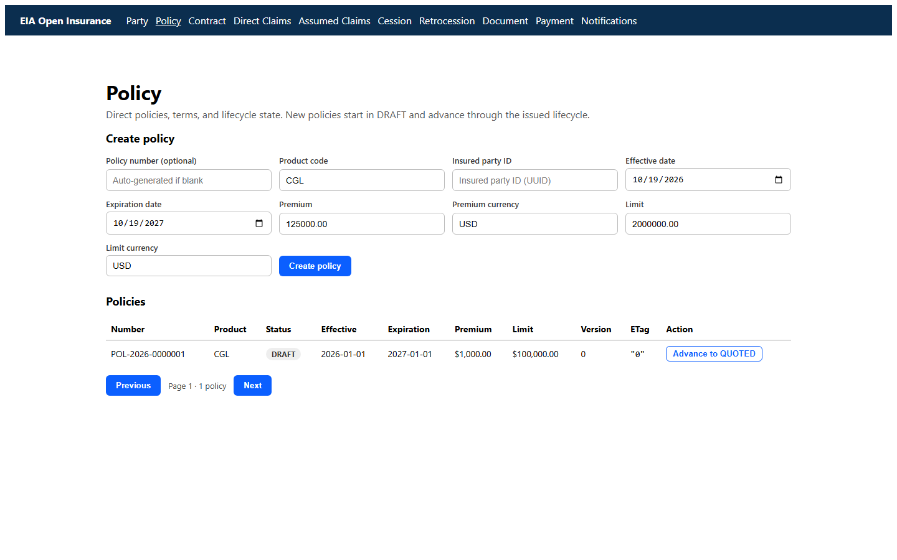

# Kubernetes local evidence

Cluster: minikube profile `minikube`, Kubernetes v1.37.0, Docker driver, namespace `eia-local`.

## Final workload state

```text
37 pods total
37 pods Running and Ready
2 Ingresses: eia, eia-remotes
```

- 4 platform services: gateway, auth, config, lineage
- 10 experts and 10 domains
- 10 federated web remotes
- shell
- FS-RI simulator
- PostgreSQL 17

## API smoke test

Through the gateway:

```text
PASS party
PASS policy
PASS contract
PASS direct-claims
PASS assumed-claims
PASS cession
PASS retrocession
PASS document
PASS payment
PASS notifications
All vertical APIs reachable through the gateway.
```

## Federated UI

The shell is served from the cluster and loads remotes from relative `/remotes/<vertical>/remoteEntry.js` paths.

```text
npx playwright test tests/live-all.spec.js
10 passed (5.7s)
```

All ten vertical workbenches loaded through the Kubernetes-hosted shell.

## Policy conformance in-cluster

```text
POST /api/v1/policies -> 201, ETag "0"
replay same Idempotency-Key -> 200, Idempotent-Replayed: true
GET ?page=0&size=1 -> page envelope with total
```

## FS-RI hand-off in-cluster

```text
cessionNumber   status       fsriStatus   fsriHandoffId
CES-000000001   HANDED_OFF   POSTED       FSRI-CES-DIRECT-000001
```

The Cession domain ran with `EIA_FSRI_BASE_URL=http://eia-fsri-simulator:8181` and persisted the FS-RI confirmation.

## Ingress

```text
NAME          CLASS   HOSTS       ADDRESS        PORTS
eia           nginx   eia.local   192.168.49.2   80
eia-remotes   nginx   eia.local   192.168.49.2   80
```

The shell nginx config proxies `/remotes/<vertical>/` to the corresponding Service, so both ingress and direct shell port-forward work.

## Verification commands

```powershell
kubectl -n eia-local get pods
pwsh ./repos/smoke-local.ps1 -Gateway http://localhost:8080
pwsh ./repos/eia-ops/scripts/validate.ps1
```

The local stack is test-double based: FS-RI is the deterministic eia-quality simulator, PostgreSQL is a single replica, and no TLS/mTLS is configured.




