# Kubernetes local evidence

Cluster: minikube profile `minikube`, Kubernetes v1.37.0, Docker driver, namespace `eia-local`.

## Final workload state

```text
37 pods total
37 pods Running and Ready
2 Ingresses: eia, eia-remotes
```

- 4 platform services: gateway, auth, config, lineage
- 10 experts and 10 domains
- 10 federated web remotes
- shell
- FS-RI simulator
- PostgreSQL 17

## API smoke test

Through the gateway:

```text
PASS party
PASS policy
PASS contract
PASS direct-claims
PASS assumed-claims
PASS cession
PASS retrocession
PASS document
PASS payment
PASS notifications
All vertical APIs reachable through the gateway.
```

## Federated UI

The shell is served from the cluster and loads remotes from relative `/remotes/<vertical>/remoteEntry.js` paths.

```text
npx playwright test tests/live-all.spec.js
10 passed (5.7s)
```

All ten vertical workbenches loaded through the Kubernetes-hosted shell.

## Policy conformance in-cluster

```text
POST /api/v1/policies -> 201, ETag "0"
replay same Idempotency-Key -> 200, Idempotent-Replayed: true
GET ?page=0&size=1 -> page envelope with total
```

## FS-RI hand-off in-cluster

```text
cessionNumber   status       fsriStatus   fsriHandoffId
CES-000000001   HANDED_OFF   POSTED       FSRI-CES-DIRECT-000001
```

The Cession domain ran with `EIA_FSRI_BASE_URL=http://eia-fsri-simulator:8181` and persisted the FS-RI confirmation.

## Ingress

```text
NAME          CLASS   HOSTS       ADDRESS        PORTS
eia           nginx   eia.local   192.168.49.2   80
eia-remotes   nginx   eia.local   192.168.49.2   80
```

The shell nginx config proxies `/remotes/<vertical>/` to the corresponding Service, so both ingress and direct shell port-forward work.

## Verification commands

```powershell
kubectl -n eia-local get pods
pwsh ./repos/smoke-local.ps1 -Gateway http://localhost:8080
pwsh ./repos/eia-ops/scripts/validate.ps1
```

The local stack is test-double based: FS-RI is the deterministic eia-quality simulator, PostgreSQL is a single replica, and no TLS/mTLS is configured.


## Operational UI


The shell now has a shared design system, contextual header, operations dashboard, and consistent vertical navigation. The dashboard aggregates direct/assumed claims, policies, contracts, cession/retrocession hand-offs, documents, payments, and notifications.


### Record detail

The Policy record opens into version, coverage, endorsement, insured/location, and cancellation tabs.


Direct Claims opens into injury, reserve, coverage, litigation, settlement, and recovery tabs.


## Shared record redesign

Policy, Contract, Direct Claims, and Assumed Claims now use the same record layout: left queue, right record header, summary cards, canonical tabs, form grids, tables, and action hierarchy.

- Policy detail tabs: Overview, Versions, Coverages & Limits, Endorsements, Insureds & Locations, Cancellation.
- Direct claim tabs: Overview, Injuries & Exposures, Reserve History, Coverage, Litigation, Settlements, Recovery & Liens.
- Assumed claim tabs: Overview, Loss Advice, Reserve History, Cash Calls, Recoveries, Commutation, Disputes, Audit.
- Contract tabs: Overview, Layers, Participants, Terms, Security, Cessions, Bordereaux, Commutation.

After the redesign, the live Kubernetes browser suite passed **10/10** in 6.0 seconds.

## Consistent workbench coverage

All ten workbenches now use the shared queue-record-summary-tabs pattern:

- Party
- Policy
- Contract
- Direct Claims
- Assumed Claims
- Cession
- Retrocession
- Document
- Payment
- Notifications

The UI uses the same header, queue, record panel, summary cards, tab strip, form grid, tables, badges, and action hierarchy.


## Event pipeline

- `eia-event-ingest` Deployment and Service are live in `eia-local`.
- All ten expert Deployments carry the transactional outbox endpoint and signing secret.
- Event Stream dashboard card is fed by `/api/v1/events/stats` and `/recent`.
- Live smoke: 14 events processed, 0 failed; 38/38 pods Ready.

## Global record search

The shell now carries a persistent Ctrl+K search across all ten verticals. It groups results, shows record status and secondary context, supports keyboard navigation, and offers create actions for every record type.


- Search endpoints are tenant-scoped and book-walled.
- Deep links (`?record=`) select the record in its workbench.
- `?new=1` opens creation from search.
- Cross-links navigate between related records in the SPA.
- Live suite after deployment: **13/13 passed**, including search-open-record and search-create-claim.

## Search workspace and process steps


The dedicated search page adds type and status facets, result counts, saved searches, and create actions. Global Ctrl+K search remains available on every page and links to this workspace.


Direct and Assumed Claims now show a process stepper with completed, current, denied, and upcoming steps plus a “What happens next” explanation.


Party records cross-link to their direct policies through the new `insuredPartyId` policy filter.

Live browser suite after rollout: **14/14 passed**.

## Claim diary and notes


The Direct Claims record now includes a Diary & Notes tab:

- task number, title, due date, priority, assignee, status
- overdue highlight
- Add task modal, Complete/Reopen with optimistic versioning
- newest-first claim notes with type, author, timestamp
- Open tasks summary card

Live end-to-end check in `eia-local`:

1. Opened `CLM-2026-0000001`.
2. Created task `TSK-2026-0000001` with due date 2027-01-15.
3. Completed it; summary changed from 1 open task to 0.
4. Added a `DIARY` note; it appeared at the top of the timeline.
5. Event inbox received `direct.claim.task-created`, `direct.claim.task-completed`, and `direct.claim.note-added`.

The claim progress stepper remains visible above the tabs.

## Diary contracts

The Direct Claims OpenAPI now includes task/note routes and schemas. AsyncAPI adds `direct.claim.task-created`, `task-completed`, `task-updated`, and `note-added`; the catalog has 172 published events. Validation: **9,155 checks, 0 failures**.

## Assumed claim diary


Assumed Claims now mirrors the Direct Claims Diary & Notes workspace:

- task list with overdue highlighting, priorities, assignees, status
- add task, complete/reopen with optimistic versioning
- newest-first notes with type, author, timestamp
- Open tasks summary card
- ASSUMED book wall and process stepper preserved

Live evidence on `RNS-2026-0000002`:

1. Created `TSK-2026-0000001`, due 2027-02-01, priority NORMAL.
2. Completed it; Open tasks moved from 1 to 0.
3. Event inbox received `assumed.claim.task-created` and `assumed.claim.task-completed`.

Live suite after rollout: **16/16 passed**, including both claim diary tabs.

## Settlement-to-payment hand-off


Direct Claims hands an authorized settlement to Payment with amount, currency, payee, and source claim prefilled.


Payment preserves `sourceType=DIRECT_CLAIM`, `sourceId`, and `sourceReference`, shows the source link, and appears back on the claim.


Live evidence:

1. Authorized `SET-2026-0000001` on `CLM-2026-0000001`.
2. Clicked **Create payment**; Payment opened with $15,000 / USD / Jordan Claimant / source CLM-2026-0000001.
3. Saved `PAY-2026-0000002` with source linkage.
4. Claim Settlements tab shows the related payment with amount.
5. Payment search finds the payment by claim id.

## Idempotent diary writes

Direct and Assumed Claims task/note creates now accept `Idempotency-Key` and store the response in `claim_command_idempotency`.

Live evidence in `eia-local`:

- first direct task POST: `replay=false`, new ID
- identical replay: same ID, `replay=true`, no duplicate/event
- changed body with the same key: `409`
- assumed claims: identical replay returned the same ID with `replay=true`

The browser forms generate a UUID per create attempt and reuse it only while the attempt is unresolved.

## Claim ownership


Both claims books now show the owner in the record header, summary, and queue, with an Assign action.

Live evidence:

- `CLM-2026-0000001` assigned to `A. Adjuster` / `DIRECT_CLAIMS`.
- `RNS-2026-0000002` assigned to `B. Examiner` / `ASSUMED_CLAIMS`.
- Both assignment events reached the event inbox.
- Queue filters match owner, team, and Unassigned.

## Insured-name search

Searching `Acme` now returns the Acme party plus its direct policies (`POL-2026-…`) by resolving `GET /api/v1/policies?insuredPartyId=…` for the matched party. Clicking a policy opens the policy record.

## Cross-book work queue


The work queue shows:

- My work
- Unassigned work
- Team queue
- Direct/assumed split
- book filter, owner/team filter, closed toggle
- open claim from the queue

Dashboard adds My work cards for direct, assumed, and unassigned claims. Owner assignment is visible in the claim header, summary, and queue, and emits `direct.claim.assigned` / `assumed.claim.assigned`.

Live suite after rollout: **17/17 passed**.

## Supervisory workload and hardening


The work queue now includes:

- open, unassigned, team queue, and aged 30+ cards
- team workload table with open/unassigned/aged/oldest claim
- aging measured from loss date
- highlighted search matches

Hardening:

- Direct idempotency reservation now uses atomic `ON CONFLICT DO NOTHING`; concurrent same-key creates produce one row/event and one replay, not a constraint error.
- Direct negative assignment `expectedVersion` returns 400.
- Direct assignment accepts only `X-EIA-Actor`.
- Assumed audit accepts `CLAIM_ASSIGNED`.
- M-25 assignment contract gaps closed.

## Document association links


The Document Associations tab now supports predictive linking to:

- direct claims
- assumed claims
- policies
- contracts
- parties
- payments
- manual OTHER reference

Live evidence:

1. Opened `DOC-2026-0000001`.
2. Added a DIRECT_CLAIM link to `CLM-2026-0000001`.
3. The link appeared with type, reference, linked record, and added time.
4. `GET /api/v1/documents?linkedType=DIRECT_CLAIM&linkedId=…` returned the document.
5. Event inbox received `document.link.added`.

## Reverse document visibility

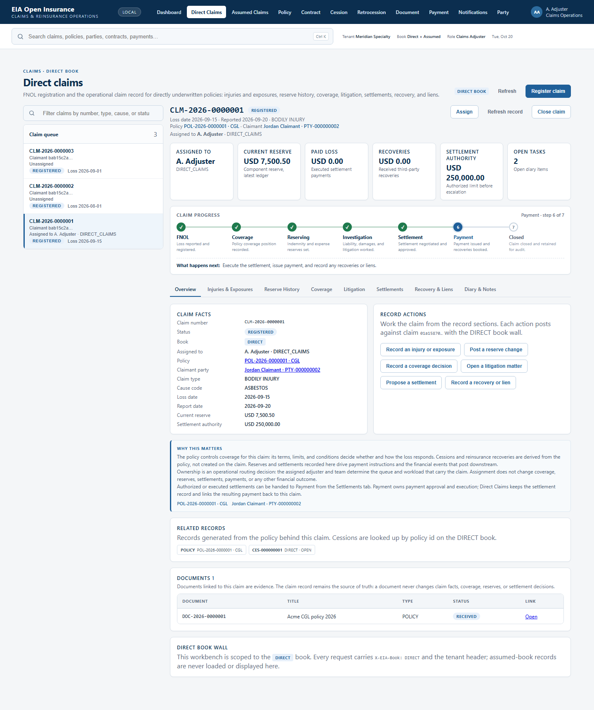

Claims, policies, parties, contracts, and payments now show their linked evidence. The card:

- loads documents by `linkedType` + `linkedId`
- shows document number, title, type, and status
- links to `/document?record=<id>`
- contains loading/empty/error state
- explains that documents are evidence and the business record remains source of truth

Live: `DOC-2026-0000001` appears on `CLM-2026-0000001`.

## Record activity timeline

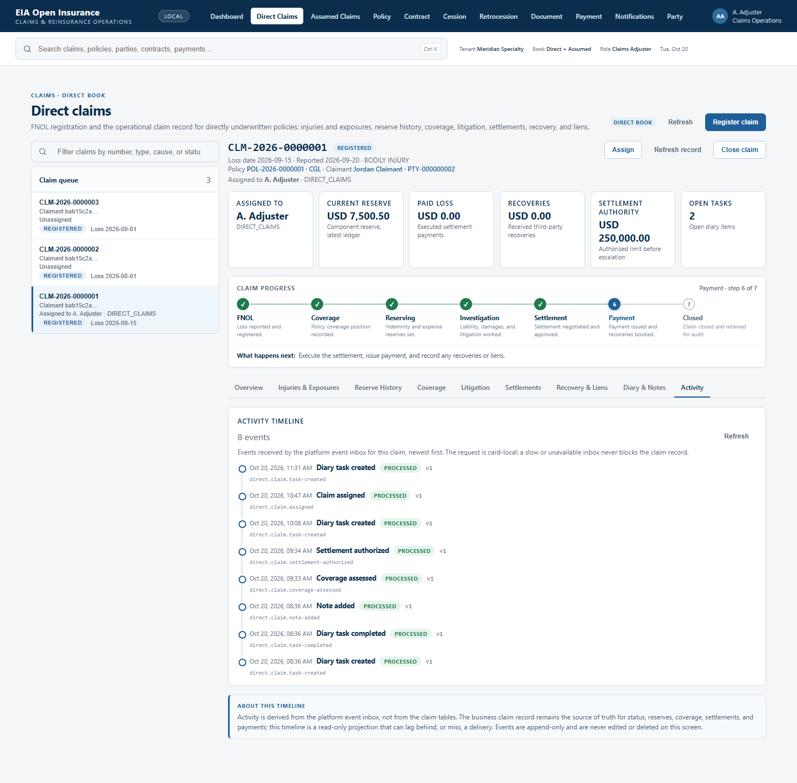

Claim, policy, and payment records now show an event-derived Activity timeline:

- newest first
- readable event label plus raw event type
- occurred timestamp, inbox status, event version
- payload facts such as status changes, reserves, coverage, settlement, task, note, and payment source
- card-local loading/error/empty state
- context note that the business record remains source of truth

Backend route:

`GET /api/v1/events/aggregate/{aggregateId}?limit=50` with `X-EIA-Tenant`.

Live `CLM-2026-0000001` returned 8 processed events.

## Activity across every workbench

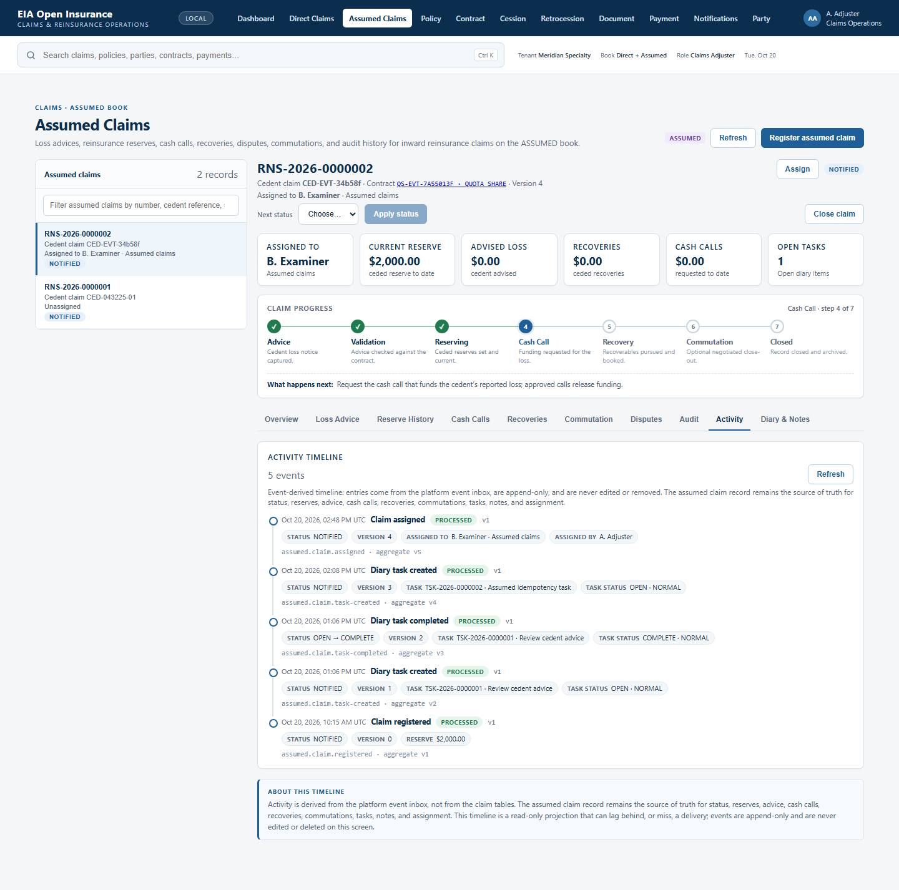

All ten verticals and Party now show an event-derived Activity timeline. The assumed claim example shows registered, task created/completed, a second task created, and assignment events with status, version, actor, task, and reserve facts.

The timeline is card-local, so an unavailable inbox never blocks the business record.

## People directory and adjuster workload

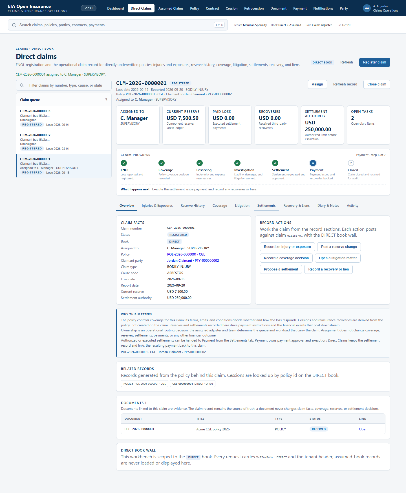

`GET /api/v1/directory` returns 4 adjusters and 6 teams. Claim assignment selects a real person, filters teams by that person, and submits display name + team code.

The work queue shows adjuster workload:

- open claims
- aged 30+
- teams
- oldest claim

Live: `C. Manager — CLAIMS_MANAGER` assigned to `SUPERVISORY` on CLM-2026-0000001.

## Policy billing

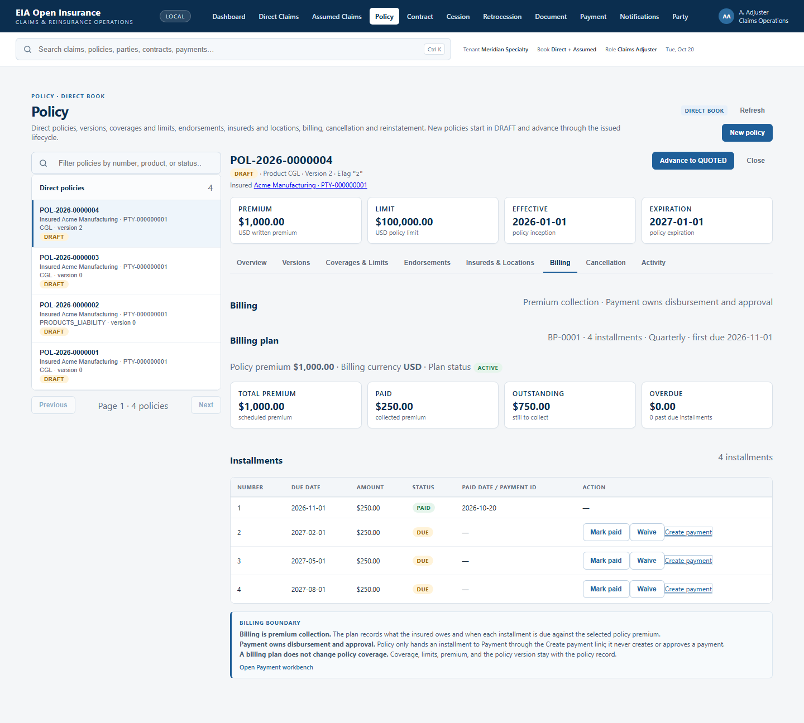

Policy records now expose a Billing tab:

- create a plan of 1–24 installments with frequency and first due date
- split premium exactly across installments
- total, paid, outstanding, overdue summary
- installment status and due dates
- Mark paid / Waive
- Create payment for due/overdue installments with sourceType=POLICY
- billing events in the outbox

Live: `POL-2026-0000004` plan `BP-0001`, 4 quarterly installments of $250; installment 1 marked PAID, outstanding $750.

## Policy renewal

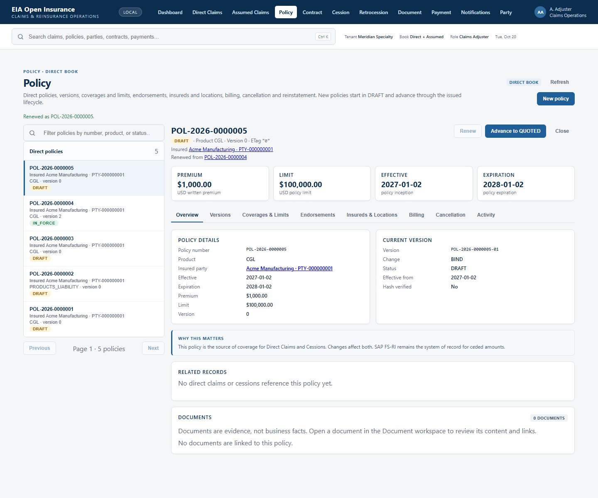

Renewal creates a successor policy without mutating the expiring record:

- new policy number and DRAFT status
- `renewedFromPolicyId` lineage
- copied coverages, limits, insureds, locations
- fresh version and limit state
- `policy.policy.renewed` outbox event

Live: `POL-2026-0000004` renewed as `POL-2026-0000005`, effective 2027-01-02 to 2028-01-02, premium and limit carried forward.

## Claim payment traceability


Claim Overview now lists the payments linked to that claim:

- number, status, amount/currency, payee, created date
- total paid and pending count
- link to the Payment record

Backend filter:

`GET /api/v1/payments?sourceType=DIRECT_CLAIM&sourceId=<claimId>`

`sourceType` and `sourceId` must be supplied together; invalid types or half-pairs return 400. Live CLM-2026-0000001 returned PAY-2026-0000002.

## Contract technical accounts

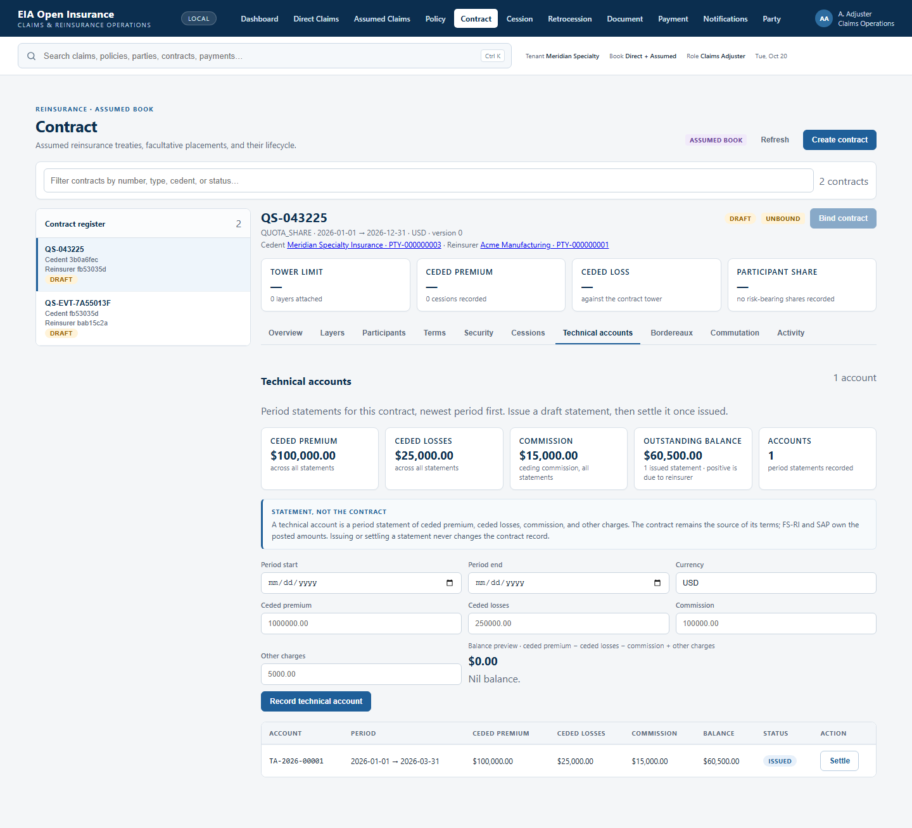

Technical accounts are period statements for an assumed contract:

- ceded premium, ceded losses, commission, other charges
- balance = ceded premium − ceded losses − commission + other charges
- status DRAFT → ISSUED → SETTLED
- duplicate period and invalid transition rejected
- events for create/issue/settle

Live: `TA-2026-00001` for contract `QS-043225`, period 2026-01-01–2026-03-31, balance $60,500, issued.

## Contract bordereaux

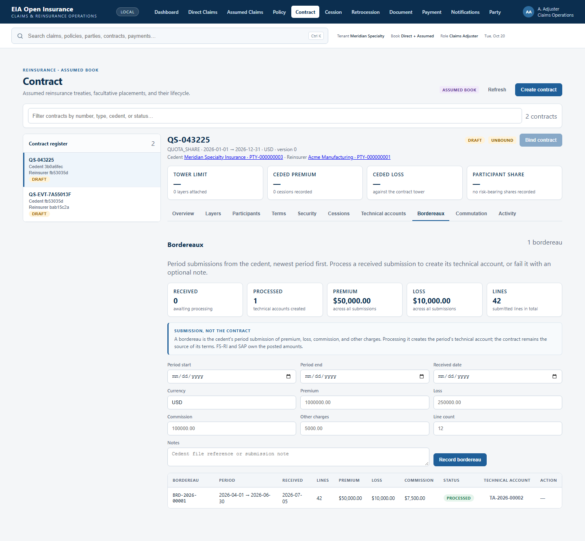

The Bordereaux tab now works:

- period submission with premium, loss, commission, other charges, line count, notes
- RECEIVED → PROCESSED or FAILED
- processing creates or reuses the period technical account and links it
- summary cards and linked account column

Live: `BRD-2026-00001` processed for 2026-04-01–2026-06-30 and linked `TA-2026-00002`.

## Claim allocations

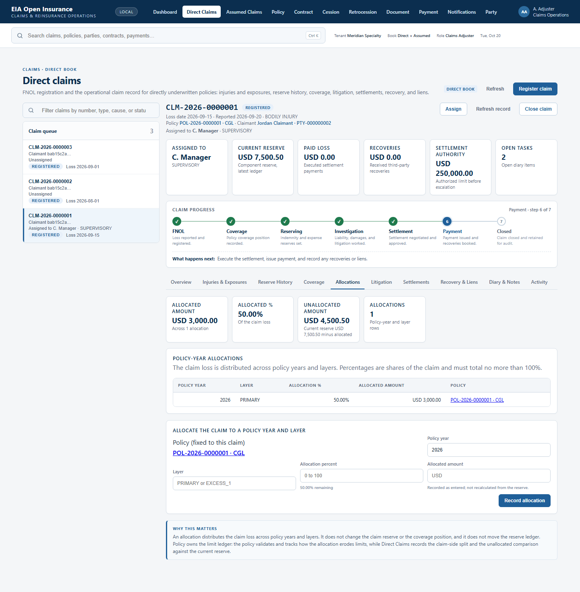

Direct claims can distribute loss across policy years and layers:

- allocation percentage (0–100%)
- allocated amount
- policy year and layer
- policy link
- total allocation percentage and amount
- unallocated amount against current reserve

The total percentage cannot exceed 100%. Policy owns the limit ledger; Direct Claims records the claim-side split.

Live: `CLM-2026-0000001`, 2026 / PRIMARY / 50% / $3,000, total 50% / $3,000.

## Premium receivables

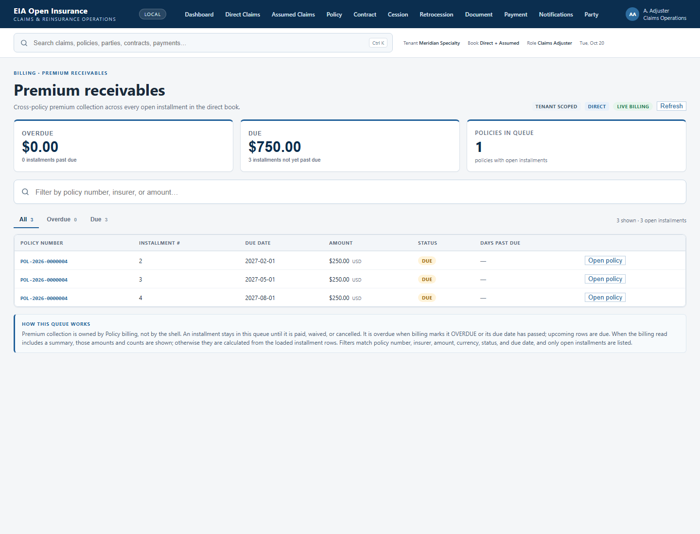

Cross-policy premium collection workspace:

- overdue and due totals
- policies in queue
- All / Overdue / Due tabs
- policy number, installment, due date, amount, status, days past due
- filter by policy, insurer, amount
- Open policy link to the billing tab

Backend: `GET /api/v1/billing/installments?limit=200` with tenant + DIRECT.

Live: POL-2026-0000004 had 3 DUE installments totaling USD 750.

## Mass tort profile

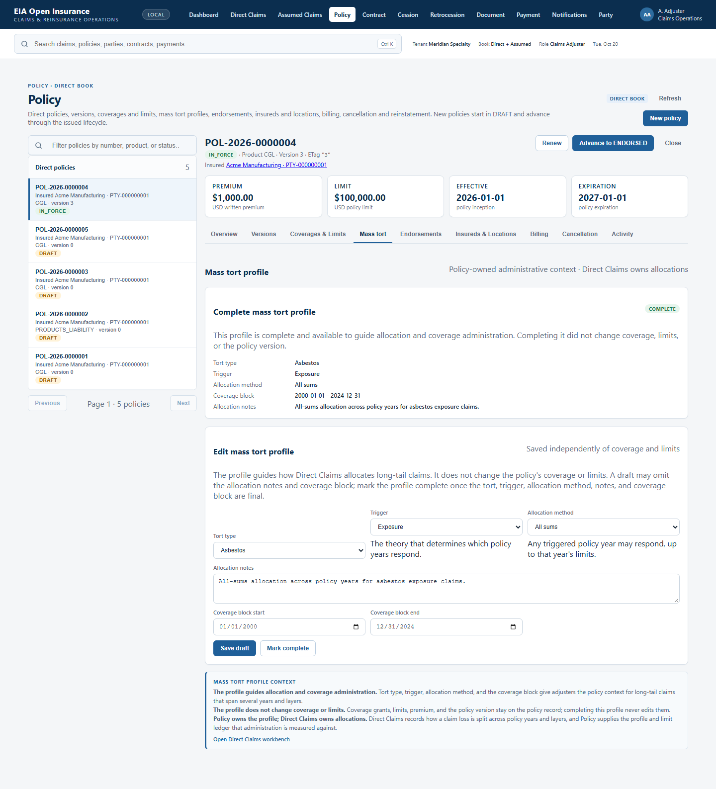

Policy records now carry a mass-tort profile:

- tort type
- trigger theory
- allocation method and notes
- coverage block
- DRAFT/COMPLETE status

The profile guides allocation/coverage administration but does not change coverage, limits, or premium. Policy owns the profile; Direct Claims owns allocations.

Live: POL-2026-0000004, COMPLETE, Asbestos / Exposure / All sums, 2000-01-01–2024-12-31.

## Claimant search enrichment

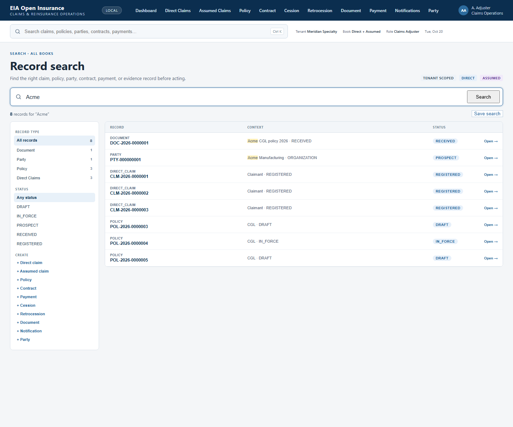

Searching a party now returns:

- the party record
- that party's policies
- that party's direct claims, where it is the claimant

Each claim result shows its type, claimant context, status, and opens the claim record.

Live Acme search: 8 records — 1 party, 3 policies, 3 direct claims, 1 document.

## Billing payment application

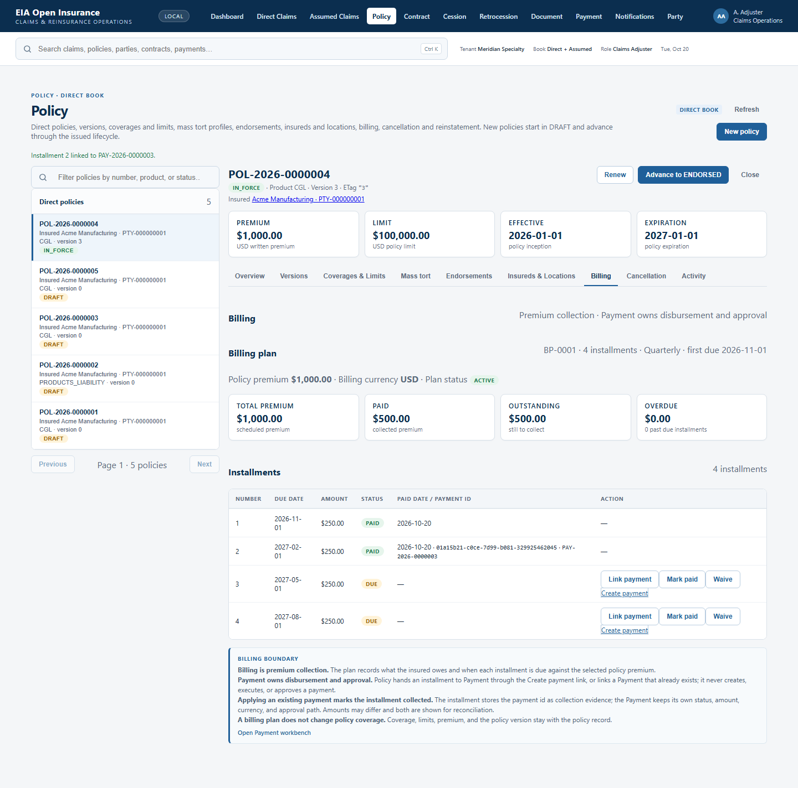

DUE/OVERDUE installments can link an existing policy-source payment:

- modal lists payment number, status, amount, created date, payee
- amount mismatch warning for reconciliation
- Apply sends PATCH status PAID + paymentId
- row shows paid date and linked payment number
- billing totals refresh

Live: PAY-2026-0000003 linked to POL-2026-0000004 installment 2; paid $500, outstanding $500.

## Contract cash calls

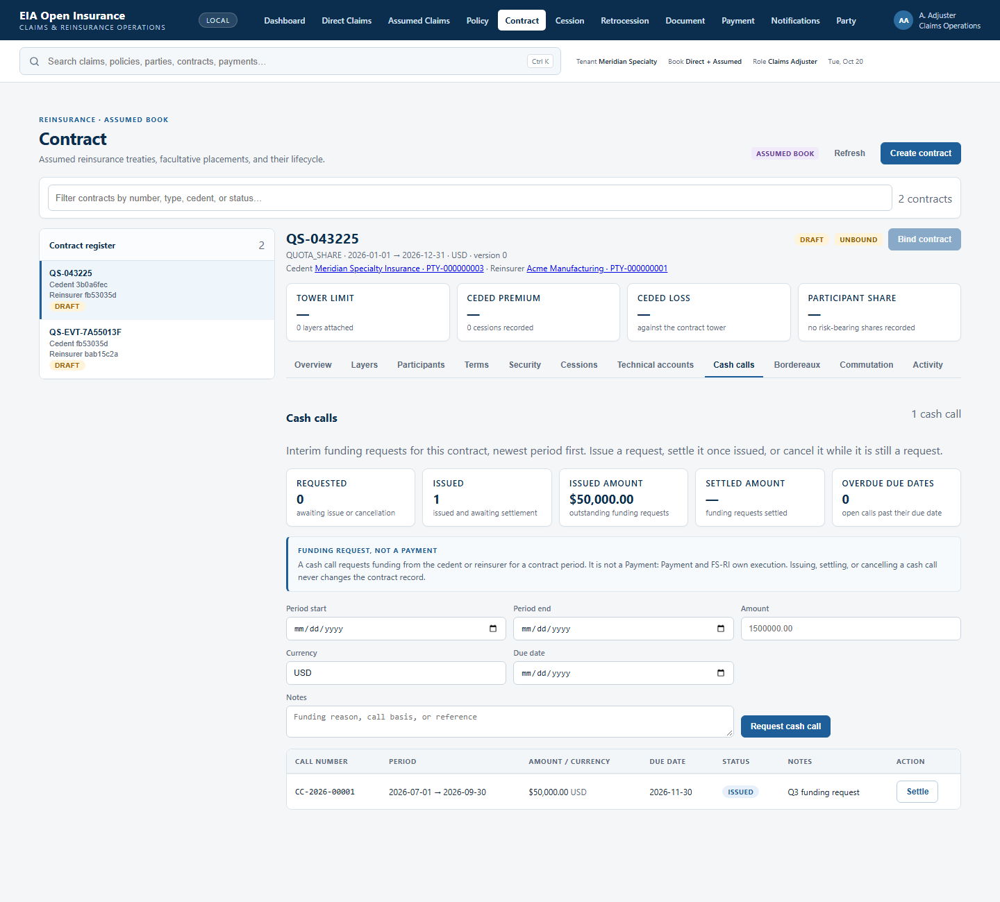

Contract cash calls request interim funding:

- period, amount/currency, due date, notes
- REQUESTED → ISSUED / CANCELLED
- ISSUED → SETTLED
- summary cards for requested/issued/settled and overdue due dates
- explicit boundary: a cash call is not a Payment; Payment and FS-RI own execution

Live: CC-2026-00001, USD 50,000, issued, due 2026-11-30.

## Payment allocations

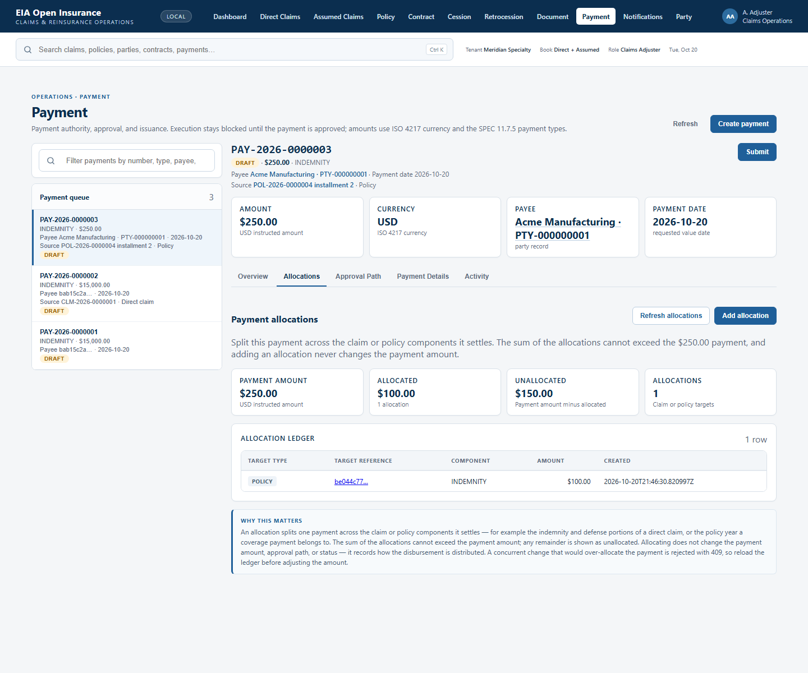

The Payment Allocations tab splits one payment across targets:

- target type and predictive record lookup
- component
- amount
- linked target record
- payment/allocated/unallocated summary

The sum cannot exceed the payment amount, and allocation never changes the payment amount.

Live: PAY-2026-0000003, USD 250, POLICY allocation USD 100, unallocated USD 150.

## Allocation-to-policy erosion

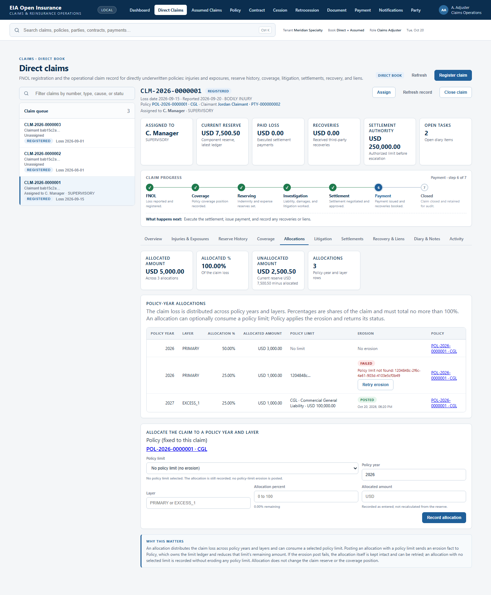

Claim allocations can consume a selected policy limit:

- optional policy-limit picker with remaining amount
- POST allocation → Policy erosion fact → POSTED / FAILED
- failure leaves the allocation intact and retryable
- policy remaining amount decreases

Live: claim allocation 2027 EXCESS_1 25% USD 1,000 posted to limit 93e3960f; policy limit state moved from USD 100,000 to USD 99,000.

## Contract security

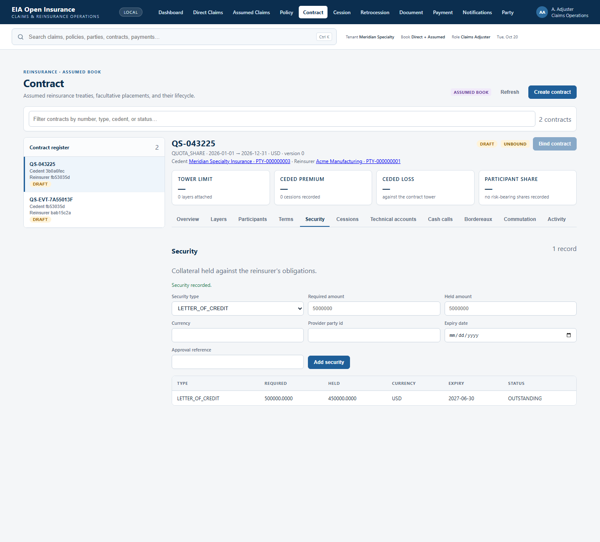

The Contract Security tab records collateral:

- security type
- required and held amounts
- currency
- provider party
- expiry date
- approval reference
- status

Live: QS-043225, LETTER_OF_CREDIT, required 500,000, held 450,000, USD, expiry 2027-06-30.

## Billing dunning

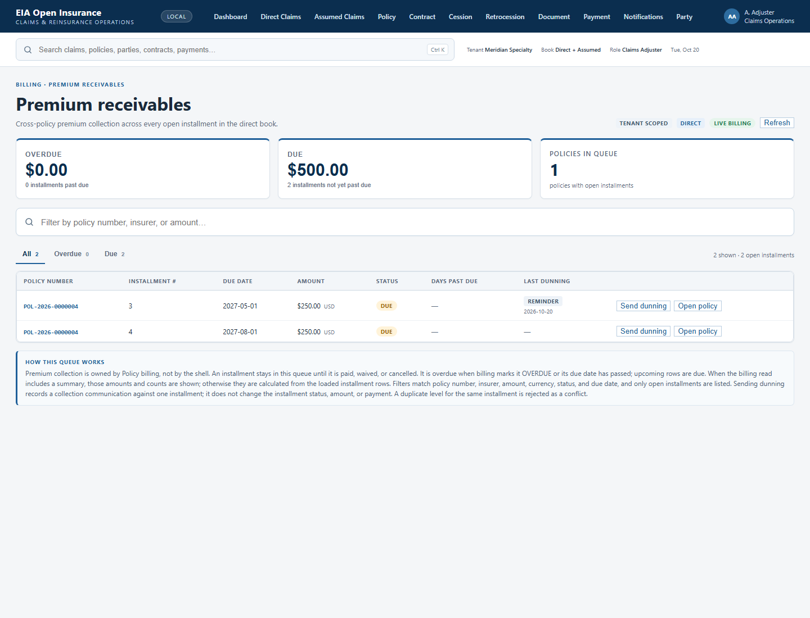

DUE/OVERDUE receivables can record collection communications:

- level REMINDER / FIRST_NOTICE / SECOND_NOTICE / COLLECTIONS
- channel EMAIL / LETTER / PORTAL
- notes
- last dunning level/date in the queue

Dunning does not change installment status, amount, or payment.

Live: POL-2026-0000004 installment 3, REMINDER via EMAIL, SENT.

## Mass-tort allocation guard

Claim allocations now respect the policy mass-tort profile:

- COMPLETE profile with coverage block → policyYear must fall within block years
- outside → 400 MASS_TORT_YEAR_OUTSIDE_BLOCK, nothing written
- DRAFT/missing/unavailable profile → allocation allowed

Live: policy block 2020-01-01–2024-12-31 rejected policyYear 2027 and accepted 2024.

## Policy programs

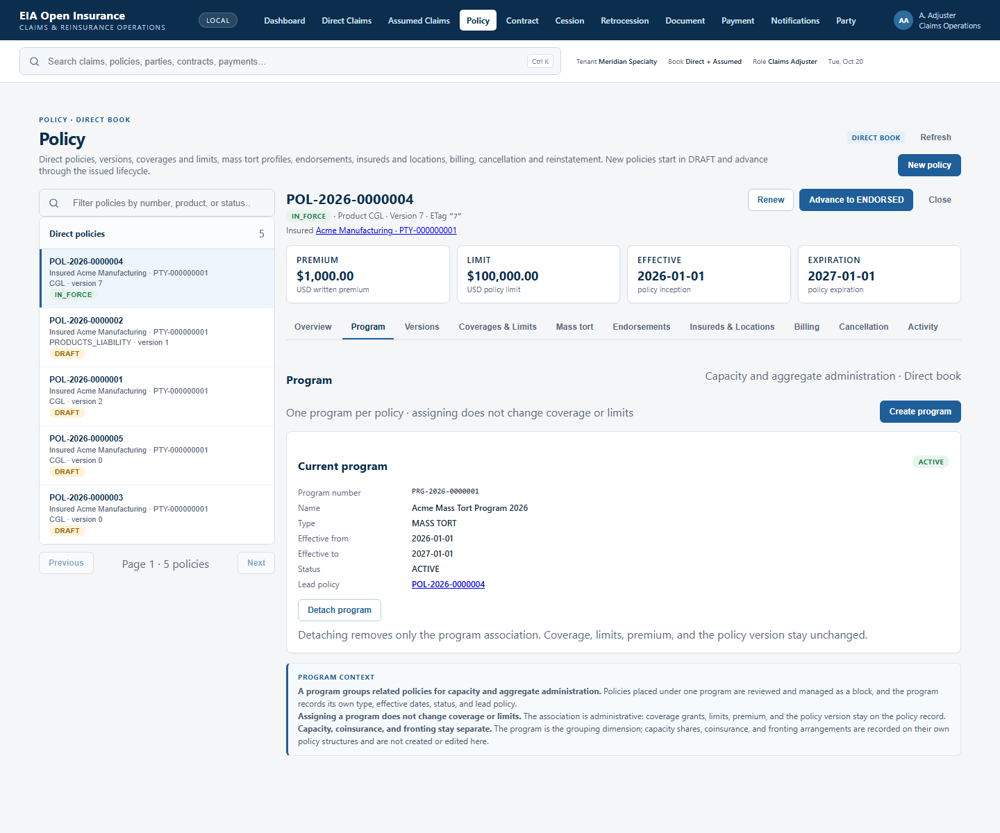

Policies can be grouped under a program for capacity and aggregate administration:

- program number/name/type
- effective dates and status
- lead policy link
- attach/detach
- create program from the policy

Live: PRG-2026-0000001 "Acme Mass Tort Program 2026", MASS_TORT, attached to POL-2026-0000004.

## Document file content

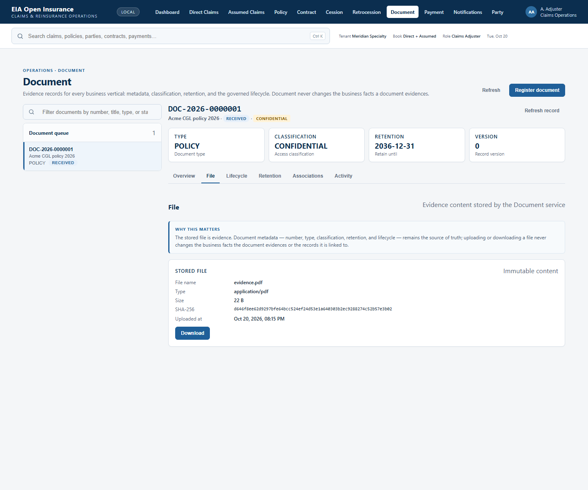

The Document workbench stores actual evidence files:

- upload raw bytes with file name/MIME
- 10 MiB cap
- SHA-256 and size metadata
- Download with attachment filename
- optional file at document registration
- drag/drop, progress, and contained errors

Live: DOC-2026-0000001 stored `evidence.pdf`, 22 bytes, application/pdf; download returned attachment headers.

## Contract security lifecycle

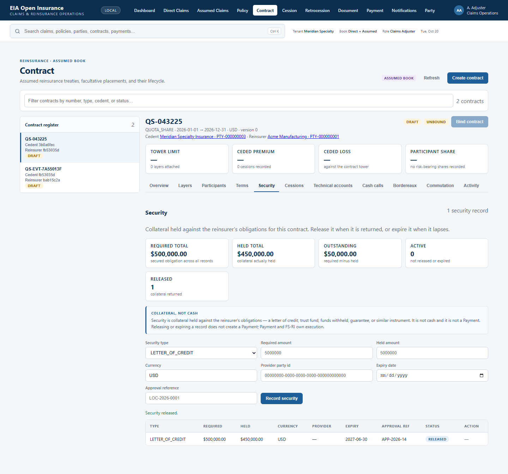

Collateral can be released or expired:

- ACTIVE/OUTSTANDING/PARTIAL/REQUIRED -> RELEASED or EXPIRED
- EXPIRED -> RELEASED
- RELEASED terminal

The Security panel shows required, held, outstanding, active, and released totals, plus release/expire actions.

Live: QS-043225 LETTER_OF_CREDIT released; summary shows 0 active, 1 released.

## Policy credit notes

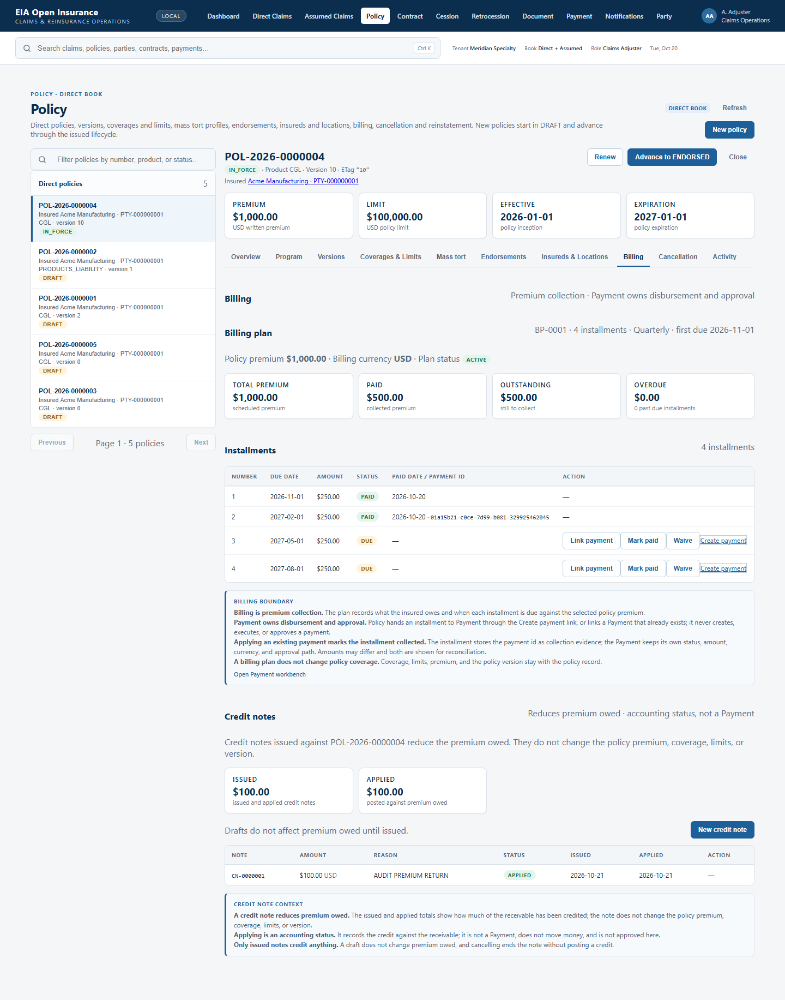

Credit notes correct premium owed without changing the policy premium:

- create DRAFT
- Issue
- Apply
- Cancel
- issued/applied totals

Live: CN-0000001, USD 100, audit premium return, APPLIED.

## Document content versions

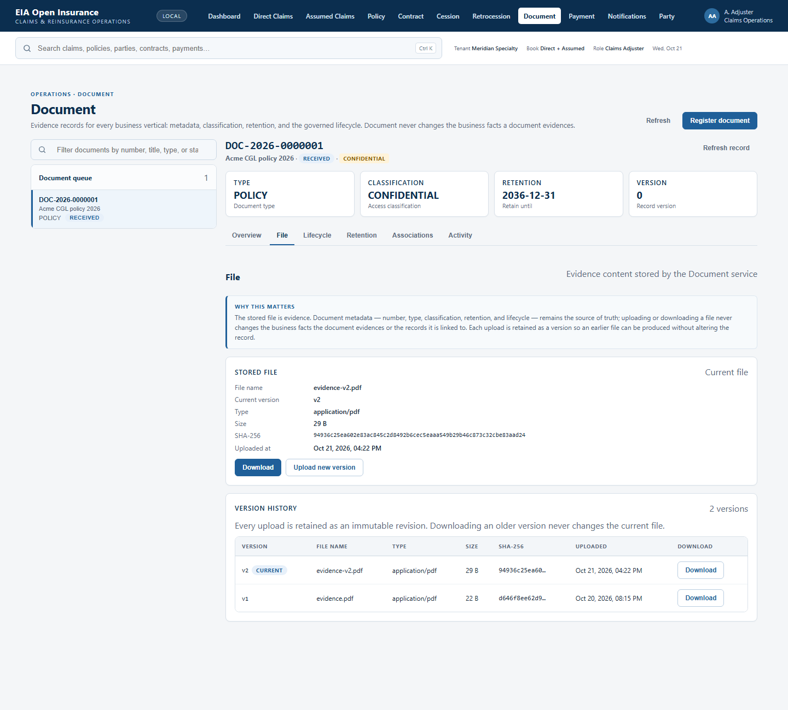

Every document upload creates an immutable revision:

- current pointer and currentVersion
- version history newest first
- download any prior version
- SHA-256 per version
- upload event carries version

Live: DOC-2026-0000001 v2 evidence-v2.pdf (29 B), v1 evidence.pdf (22 B) retained.

## Technical account lines

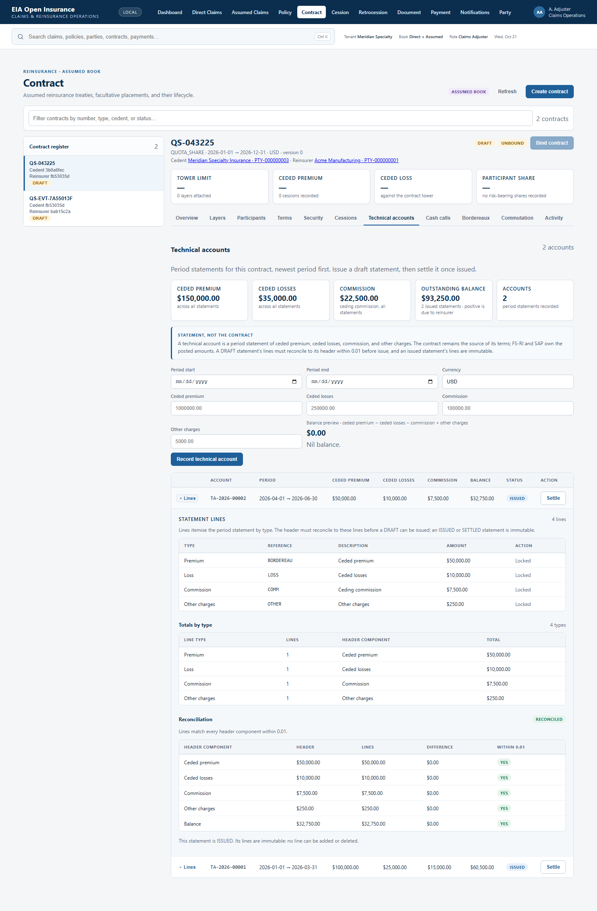

DRAFT statements now carry detail lines:

- line type PREMIUM/LOSS/COMMISSION/OTHER
- reference, description, amount
- totals by type vs header component
- reconciliation within 0.01
- issue blocked on mismatch with per-component detail
- issued line detail immutable

Live: TA-2026-00002 had four lines totaling USD 50,000 / 10,000 / 7,500 / 250 and issued reconciled.
